# FeedValve — Phase 1 High-Level Design: Sharded Write-Behind Mirror

**Status:** Issued for stakeholder selection — single-candidate detail document
**Responds to:** `feedvalve_requirements.md` v4.0 (2026-09-09), Section 11.2 (Phase 1 deliverable)
**Companion document:** `phase1_hld2.md` carries all three candidate designs, the §11.3 comparison
matrix and the recommendation argument. This document began as that document's Design 1, extracted
and made self-contained. **It has since diverged**: the policy-class model and the mirror structure
were changed by stakeholder direction (§1.1, ADR-016, ADR-017), so `phase1_hld2.md` now describes an
earlier model and the two must not be assumed consistent.
**Normative protocol reference:** `ncobrd_bible.md` (repo root) — every protocol claim below carries
a `§` citation into it. Where the bible and the requirements document disagree on a protocol fact,
the bible wins and the disagreement is called out explicitly (§3.4).
**Current-state reference:** `poc/` — cited as `file:line`. Per requirements Section 7, no code is
reused from it; it is evidence of protocol behaviour and a differential-test oracle only.

> **Review status.** A design review identified open gaps and internal inconsistencies in this
> candidate. They are **not corrected in the body of this document**; they are listed in
> **Appendix A** and must be resolved before or during LLD. The class-model change recorded in §1.1
> resolved four of them outright — B2, B6, S1 and half of S2 — which is noted where it happens.

---

## 0. Deliverable map

The requirements prescribe the shape of the Phase 1 deliverable. This table is the completeness check
for this design. The clauses that are inherently multi-candidate — §11.2's "top 3 HLDs" and §11.3's
comparison matrix — are discharged in `phase1_hld2.md`, not here.

| Requirement clause | What it asks for | Where it is |
|---|---|---|
| §11.2 item 1 | End-to-end data flow and concurrency model, distribution key, relation to ordering | §6.2, §6.6, §7.1–7.2 |
| §11.2 item 2 | Where the socket/decode boundary sits, justified against NFR4's 100 ms | §6.3, §7.2, ADR-001 |
| §11.2 item 3 | How high-frequency token data is coalesced; how ordering is enforced | §6.7, §7.3 |
| §11.2 item 4 | How unthrottled transcodes bypass lossy handling, anti-starvation, real-time mode | §6.8 (the two classes and the two flush triggers), §7.4, ADR-004 |
| §11.2 item 5 | Behaviour under the reference burst, degradation order, queue-full behaviour, recovery | §7.5, §9.3 |
| §11.2 item 6 | Expected end-to-end latency, batched and real-time, dominant term | §7.6 |
| §11.2 item 7 | Saturation and headroom on aggregate and per-(token,transcode) rate | §7.7 |
| §11.2 item 8 | Fit to entitled capacity 4; memory at 200K tokens | §7.8, §11 |
| §11.2 item 9 | Sensitivity to the Section 12 open items | §7.9, §15 |
| §11.2 item 10 | Module breakdown and responsibilities, boundaries justified | §6.1, §7.10 |
| §11.2 item 11 | Traceability **only where satisfaction is non-obvious** | §13 |
| §11.2 item 12 | Trade-offs, risks, open questions | §7.12, §14, §15 |
| §11.4 | Written section on architectural patterns, connected to the candidate | §5 |
| §12.2 | Which "persist every occurrence" semantics the design assumes | §8 — answered, not deferred |

Additional material the requirements do not mandate but which a buildable HLD needs: the assumption
register (§4), the persistence strategy (§8), the failure-mode table (§9), the FR10-scoped
observability plan (§10), deployment (§11) and the ADRs (§12).

**Deviations from the requirements** introduced by the class-model change are collected in §1.1 and
recorded once each in ADR-016 and ADR-017. They touch NFR1, NFR2, NFR6, FR7 and req §12.2, and every
affected traceability row in §13 names its deviation rather than claiming satisfaction.

---

## 1. Executive summary

FeedValve must absorb a one-way UDP feed that will not wait for it (§1 of the bible: no host-end
inquiries, no retransmission) and land it in Oracle through a write path that is two to four orders
of magnitude slower than the wire. Everything else follows from that gap.

The gap is closed by **coalescing, and coalescing is what bounds memory**. At the reference peak the
feed produces on the order of 15,000 update units per second (§4.2); the requirements' expected
steady-state DB write rate is "order of hundreds of row-updates/sec" (req §3.3). The ratio is roughly
100:1 and it is absorbed by keeping, per (token, transcode), only the newest unwritten value — which
is legitimate because every message is a snapshot (req §9, "Message semantics"). The decisive
consequence is structural: **if the newest value per key is all that is retained, the unwritten
backlog can never exceed one entry per key, so the queue between decode and Oracle is bounded by the
token universe rather than by the arrival rate.** A database that slows down therefore produces
staleness, not unbounded memory growth and not loss — which is exactly the degradation order req §9
demands (automatic degradation is latency growth only).

**This design — the sharded write-behind mirror — is** *distribute-then-coalesce*: state is owned by
a fixed set of shard goroutines, written out by a separately-sized pool of stateless writers, and
decode runs inline on the receive goroutine.

There are **exactly three mirrors, one per destination table**, each holding coalesced row state, and
**two policy classes**, configured per transcode:

- **rate-limited** — the write rate for this transcode is capped. Its updates coalesce in the mirror
  and reach the database on the flush tick, every `W`.
- **non-rate-limited** — uncapped. Its updates are applied to the mirror and then immediately trigger
  a flush of all three mirrors, so they do not wait for a window.

**A flush is an epoch, not a batch.** Whichever trigger fires, the shard takes a snapshot of
everything currently dirty and writes *all* of it before that flush is done, splitting it into
transactions of `maxBatchSize` rows. How many of those commit at once is a separate tunable
(`maxInFlightPerShard`): at 1 they go serially in FIFO order, above 1 several pool writers drain the
same shard in parallel. Rows dirtied while a flush is running belong to the next one, which is what
guarantees a flush terminates (ADR-018).

Its decisive advantages, on the requirements' own rubric order (req §11.1), are:

1. Under burst, back-pressure converts automatically into staleness with a structural memory bound,
   and recovers within one flush window without operator action (rubric 1). With one pipeline and two
   triggers rather than two lanes, **there is no fatal-on-overflow path at all**: a flood of
   non-rate-limited traffic coalesces its own flush requests and degrades into batching.
2. Because each destination row is applied by exactly one goroutine in wire arrival order, and is
   never carried by two in-flight batches at once, the FR9 ordering property holds **even if the
   header sequence number and timestamp turn out to be unusable** — the largest open item in
   req §12.3 / §10.5 becomes a gap-detection problem only, not a correctness problem (rubric 4).
   Keying the mirror by destination row is also what makes FR9 hold for *the destination the
   requirement actually names*, rather than for a key that merely correlates with it.
3. Write parallelism is a tunable in its own right. Writers hold no mirror state, so the pool is
   sized independently of the partitioning and can be grown while the process runs — which is the
   design's answer to a write path that falls behind (§7.7). It applies *within* a partition as well
   as across them: one busy shard emits as many batches as its dirty set needs and several writers
   take them concurrently, so a shard skewed by construction — the general-keyed one always is — is
   not drained by a single connection.

The cost is honest and stated: about 153 MB of resident mirrors (§7.8), twelve goroutines,
three internal queues plus a flush signal to size, and one channel hop of latency (tens of
microseconds) more than a design that writes the mirror directly from the receive goroutine.

### 1.1 Two deliberate deviations from the requirements

Both follow from stakeholder direction and both are recorded once in ADR-016. They are stated here,
at the front, because a reader must not discover either of them by accident halfway down.

> **Terminology override — "rate limiting" means the opposite of what req §2 defines.**
> The requirements glossary defines rate limiting as *"discarding update units outright to cap a
> rate, without regard to preserving final state… **not** a synonym for coalescing."*
> **In this document, `rate-limited` means the database write rate for a transcode is capped at
> `1/W` per destination row, achieved losslessly by coalescing — final state is always eventually
> written and nothing is discarded.** The discard mechanism NFR2 describes does not exist in this
> design. Where the requirements say "coalesced", read `rate-limited`; NFR1's third class is already
> glossed *"critical/unthrottled"*, and `non-rate-limited` is that class under a plainer name.
> The `intermediate-preserving` class is gone entirely.

> **FR7 delivers every occurrence *applied*, not every occurrence *observable*.**
> Writes are in-place upserts into current-state rows; there is no append-only event destination
> (ADR-008). A non-rate-limited unit is applied to the mirror and triggers a flush, but the receive
> goroutine does not wait for that flush (ADR-001, NFR4), so **two occurrences arriving inside one
> flush cycle coalesce and the row shows the second**. Against req §12.2 — which requires Phase 1 to
> state which semantics it assumes — this design assumes *the latest occurrence is what must be
> observable at the row*. The consequence is explicit: FR7 stops being checkable by comparing an FR10
> counter against a `COUNT(*)`, and intermediate values are not preserved anywhere.

---

## 2. Design goals, traced to requirement IDs

Ranked. Where two conflict, the higher one wins, matching the rubric in req §11.1.

| # | Goal | Traces to | How this document discharges it |
|---|---|---|---|
| G1 | The read loop never waits on anything slower than memory | NFR4, req §9 "never given up" | Inline decode with zero allocation and no first queue (§6.3, ADR-001, ADR-006) |
| G2 | Every queue has a capacity, an overflow behaviour and a saturation signal | NFR5, req §10.2 | §6.6 queue table; §7.1 concurrency diagram |
| G3 | Non-rate-limited transcodes are never dropped, coalesced away, throttled or starved | FR7, NFR1, req §10.1 | Flush-on-arrival, no capped path (§6.8), ADR-004, ADR-016 |
| G4 | An update never overwrites a newer one for the same destination | FR9, req §9 "Ordering" | A row is in at most one in-flight batch, so concurrent transactions hold disjoint rows (§6.7, ADR-005, ADR-017), plus a per-transcode sequence guard (ADR-007) |
| G5 | Write rate is decoupled from arrival rate without losing final state | FR6, NFR13 | Coalescing mirrors + FIFO dirty ring (§6.7, §7.3) |
| G6 | Overload degrades as latency, never as silent loss or unbounded memory | req §9 degradation table | §7.5; structural bound argued in §7.3; flush-request coalescing (§6.8) |
| G7 | Policy is per transcode and reloadable without restart | NFR1, NFR8 | §6.9 config model, ADR-010 |
| G8 | Work distribution addressable per destination row, policy per transcode | FR4, FR8, NFR10 | Key functions §6.5, fan-out §6.4 |
| G9 | Runs as one static cgo-free binary inside entitled capacity 4 | req §4, §7 | §11, ADR-009, ADR-014 |
| G10 | A wrong field value is diagnosable at 03:00 without a debugger | FR10, req §8 | §10, and the `fieldReader` trace pattern retained (§6.4) |
| G11 | The design survives the Section 12 open items resolving badly | rubric 4 | §7.9, ADR-007 |
| G12 | Two concurrent transactions can never deadlock on a shared row | engineering judgement; req §7 | No row is in two in-flight batches — shard ownership across shards, the in-flight rule within one — plus a fixed destination order (§6.5, §6.7, §8.4, ADR-017) |
| G13 | Write parallelism is tunable without re-partitioning state | NFR3, NFR8, req §4 | Stateless writer pool sized by `writers`, reloadable at runtime and independent of `shards` (ADR-005, §6.9) |

Explicit non-goals, from req §8: horizontal scaling, multi-feed, replay/backfill, DB high
availability, rich metrics, UI. Restated with consequences in §14.

Two goals the earlier three-class model carried have been **withdrawn** by the change in §1.1:
preserving intermediate values for any transcode, and offering a lossy discard limiter (NFR2). See
ADR-016.

---

## 3. Grounding — what the wire actually is

### 3.1 Nesting and byte offsets

Byte-level layouts are drawn as offset tables rather than diagrams, in the style the bible uses.

```
UDP datagram, maximum 516 bytes  (bible §3.2)
+--------+------------------------+------------------------------------------+
| Offset | Field                  | Notes                                    |
+--------+------------------------+------------------------------------------+
|  0-1   | cNetId[2]              | byte 0 = segment netId, 8 = commodity     |
|  2-3   | iNoPackets  (SHORT BE) | count of sub-packets, FIFO order          |
|  4-515 | cPackData[512]         | sub-packets back to back                  |
+--------+------------------------+------------------------------------------+

Sub-packet inside cPackData  (bible §3.3)
+--------+------------------------+------------------------------------------+
|  +0..1 | iCompLen    (SHORT BE) | 0 => NOT compressed; >0 => LZO1Z length   |
|  +2..  | broadcast data         | compressed: exactly iCompLen bytes        |
|        |                        | uncompressed: 8 + MessageLength bytes     |
+--------+------------------------+------------------------------------------+
     cursor advance = 2 + iCompLen              (compressed)
     cursor advance = 2 + 8 + MessageLength     (uncompressed)

Broadcast data, after decompression where applicable  (bible §3.4)
+--------+------------------------+------------------------------------------+
|  0     | netId repeated         | free frame-alignment oracle               |
|  1-7   | ignored                |                                           |
|  8-47  | BCAST_HEADER (40 B)    | see below                                 |
|  48-.. | message body           | per transaction code                      |
+--------+------------------------+------------------------------------------+

BCAST_HEADER, offsets relative to the header  (bible §2.8) — add 8 for payload offsets
+--------+------------------------+---------+-----------------------------------+
| Offset | Field                  | Size    | Use in this design                |
+--------+------------------------+---------+-----------------------------------+
|  0-3   | Reserved [2]+[2]       | 4       | read, discarded                   |
|  4-7   | LogTime  (LONG BE)     | 4       | FR11 effective timestamp source   |
|  8-9   | AlphaChar              | 2       | read, discarded                   |
| 10-11  | TransactionCode(SHORT) | 2       | DISPATCH KEY, payload offset 18   |
| 12-13  | ErrorCode  (SHORT)     | 2       | non-zero => MS_ERROR_RESPONSE     |
| 14-17  | BCSeqNo    (LONG)      | 4       | FR9 discriminator, FR10 gaps      |
| 18-21  | Reserved [1]+[3]       | 4       | read, discarded                   |
| 22-29  | TimeStamp2 CHAR[8]     | 8       | MACHINE NUMBER, not a time        |
| 30-37  | Filler2                | 8       | read, discarded                   |
| 38-39  | MessageLength (SHORT)  | 2       | framing for uncompressed packets  |
+--------+------------------------+---------+-----------------------------------+
```

The one structure whose arithmetic the whole 7208 decode depends on (bible §4.8, Appendix B item 1;
implemented in `poc/gobrdclnt.go:390` and asserted at `poc/exchange_communication.go:138`):

```
MS_BCAST_ONLY_MBP = 470 bytes  (bible §4.8)
  header 40 + NoOfRecords 2 + 2 x INTERACTIVE_ONLY_MBP_DATA(214) = 470

INTERACTIVE_ONLY_MBP_DATA, stride 214, NOT the 213 the spec's offset column implies
+--------+----------------------------------+------+
| Offset | Field                            | Size |
+--------+----------------------------------+------+
|   0    | Token                    LONG    |  4   |  <- FR4 fan-out key
|   4    | BookType                 SHORT   |  2   |
|   6    | TradingStatus            SHORT   |  2   |
|   8    | VolumeTradedToday        LONG    |  4   |
|  12    | LastTradedPrice          LONG    |  4   |
|  16    | NetChangeIndicator       CHAR    |  1   |
|  17    | (pad)                            |  1   |  <- pack(2), bible §2.2
|  18    | NetPriceChangeFromClosing LONG   |  4   |  <- carries the CLOSING price
|  ...   | ...                              | ...  |
|  56    | MBP_INFORMATION[10]              | 120  |  5 best buys then 5 best sells
|  ...   | ...                              | ...  |
| 210    | LowPrice                 LONG    |  4   |
+--------+----------------------------------+------+
```

Everything before offset 17 decodes correctly with the wrong stride; everything after becomes noise
and `records[1]` starts a byte early (bible §4.8). This is why §6.4 makes the layout check a
build-time gate rather than a code review item.

### 3.2 System context

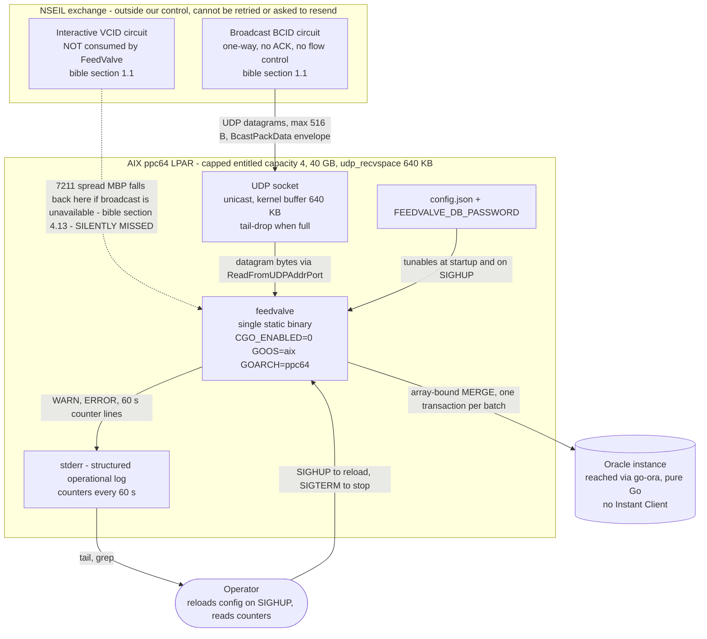

*Figure 1 — System context. The only thing FeedValve controls is the box marked HOST; the feed
cannot be slowed, replayed or queried, so every loss decision must be taken on our side of the
socket.*

Two consequences worth naming rather than burying. First, the dotted edge is real: bible §4.13 states
7211 Spread MBP arrives on the interactive circuit when broadcast is unavailable, and a
broadcast-only handler misses it silently. That is out of scope (req §8, single feed source) but it
is a known blind spot, not an oversight. Second, the kernel socket buffer is the only queue in the
system whose overflow behaviour we do not choose — it is tail-drop, silent, and counted only by
`netstat -s -p udp` on the host (req §10.4 puts it out of scope; §10 makes it observable anyway,
because it costs nothing).

### 3.3 What `poc/` establishes

The requirements treat `poc/` as normative for protocol behaviour (req §7). These are the behaviours
this design inherits as protocol facts, with their code locations:

| Behaviour | Evidence | Bible |
|---|---|---|
| Read buffer deliberately larger than 516 B so oversize is detectable | `poc/exchange_communication.go:23` (65536), `poc/gobrdclnt.go:158` | §3.6 |
| Envelope: netId, count, then length-prefixed sub-packets in FIFO order | `poc/gobrdclnt.go:514-586` | §3.2 |
| `iCompLen == 0` means uncompressed, length from `MessageLength` | `poc/gobrdclnt.go:558-576` | §3.3 |
| `MessageLength < 40` rejected because it misframes the rest of the buffer | `poc/gobrdclnt.go:572-574` | §3.3 |
| 8-byte prefix skipped in exactly one place, after decompression | `poc/gobrdclnt.go:298-323`, `:190` | §3.4 |
| netId byte 0 checked as a frame-alignment oracle, logged never dropped | `poc/gobrdclnt.go:233-243` | §3.4 |
| Bounds-checked LZO1Z, malformed input contained per packet | `poc/decompress.go:28`, `poc/gobrdclnt.go:178-197` | §3.5 |
| pack(2) pad byte at record offset 17, stride 214, build-time assertion | `poc/gobrdclnt.go:390`, `poc/exchange_communication.go:125,138` | §4.8 |
| `NoOfRecords` clamped to `[0,2]` and used to limit parsing | `poc/gobrdclnt.go:360-366`, `poc/exchange_communication.go:153` | §4.8 |
| Password only from `FEEDVALVE_DB_PASSWORD`; DSN never logged | `poc/db.go:30,126-136,190-206` | — |

Two things `poc/` does **not** do, which this design adds:

1. **`ErrorCode` is not checked before dispatch.** `poc/gobrdclnt.go:269` switches straight on the
   transaction code. Bible §2.10 requires the check: a non-zero `ErrorCode` means the payload is
   `MS_ERROR_RESPONSE` (182 bytes), not the structure the transaction code implies. §6.4 adds it.
2. **Decompressed length is not cross-checked against `MessageLength`.** Bible §2.8 says
   `MessageLength` covers the message from the header onward and excludes the 8-byte prefix, so a
   correct compressed packet satisfies `decompressedLen == 8 + MessageLength`. A mismatch is a cheap
   corruption detector that costs one comparison. §6.4 adds it.

The one behaviour this design deliberately discards is the per-packet synchronous write at
`poc/db.go:450-469`, which runs `begin / UPDATE / commit` on the receive goroutine. That is the exact
NFR4 violation the requirements were written to remove; `poc/db.go:449` documents it as intentional
POC simplicity.

### 3.4 Where the requirements and the bible disagree

Both are inputs; the bible wins on protocol facts. Two disagreements matter to the design.

**(a) There is no usable secondary timestamp in `BCAST_HEADER`.** Req §10.5 describes the header as
carrying "a 4-byte sequence number, a 4-byte log time and an 8-byte secondary timestamp". The 8-byte
field at header offset 22 is `TimeStamp2`, and bible §2.5 and §2.8 both state it carries the
**machine number**, stored in byte 0 on the broadcast circuit — not a time. The only time value in
`BCAST_HEADER` is `LogTime` (LONG at offset 4), which bible §2.5 defines as **seconds** since
1 Jan 1980 (Unix offset 315,532,800).

Consequences, both design-visible:

- FR11's "header timestamp field" resolves to `LogTime`, at one-second resolution. Two occurrences
  of the same general transcode within one second are indistinguishable by it.
- Therefore the effective timestamp for general units is the **pair** `(LogTime, receiptMonotonic)`
  compared lexicographically, with the receipt clock always recorded — not only as a fallback when
  `LogTime` is absent or implausible. This still satisfies FR11 (a usable ordering value always
  exists) and strictly strengthens it. Marked as a design decision, not a requirement change; it
  needs stakeholder acknowledgement (§15, OQ-6).
- A nanosecond `Timestamp` **does** exist, but only in `MESSAGE_HEADER` (bible §2.8, offset 14), which
  on the broadcast circuit is used solely by 6503 and 6541 (bible §4.12, §4.15).

**(b) `BCSeqNo` scope does not threaten FR9.** Req §10.5 flags that whether `BCSeqNo` is
per-transcode, per-segment or feed-global is unknown, and treats that as a risk to ordering. It is
not, under this design, because ordering is always evaluated **within a single (token, transcode)
key**: a feed-global counter, a per-segment counter and a per-transcode counter are all monotonic
within a key. The open item affects **FR10 gap detection only** — a global gap detector run against a
per-transcode counter would report false gaps. §6.5 handles that with a scope switch plus a
diagnostic audit mode. This materially reduces the blast radius of req §12.3 and is a large part of
why this design scores well on rubric 4.

One caveat that follows from `BCSeqNo` being a 4-byte signed `LONG` (bible §2.7, §2.8): at 10,000
messages/second a 32-bit counter wraps in about 59 hours, so a wrap inside a long-running session is
possible if the exchange does not reset it daily. Comparisons must use serial-number arithmetic
(`int32(a-b) > 0` means "a is newer"), not `a > b`. Flagged as ASM-11.

---

## 4. Sizing envelope and assumption register

### 4.1 Given figures

From req §3.3 and §4, taken as given. Figures the requirements themselves mark *(derived)* are marked
`D`; the rest are stakeholder-supplied.

| Quantity | Figure | |
|---|---|---|
| Peak aggregate ingress | 10 Mbit/s = 1.25 MB/s | given |
| Peak datagram rate | ~2,400/s | D |
| Peak packet rate | 5,000–10,000/s | D |
| Peak per-token burst | 1,000–5,000 packets/s | given |
| Concurrently hot tokens | order of tens | D |
| Tracked token universe | 150,000–200,000 | given |
| Target DB rate per active token | 1–10/s | given |
| Expected aggregate write rate | hundreds of row-updates/s | D |
| Ceiling aggregate write rate | ~5,000 row-updates/s | D |
| Entitled capacity / online vCPU / memory | 4 / 4 (SMT-8) / 40 GB | given |
| `udp_recvspace` | 640 KB | given |

### 4.2 Derived figures this design uses

Each is arithmetic over the table above; each is repeated wherever it is load-bearing.

**Bytes per packet on the wire.** 1.25 MB/s ÷ 7,500 packets/s ≈ **167 bytes/packet**, consistent
with req §3.3's "~150 bytes per compressed packet". A 7208 message is 470 bytes plus the 8-byte
prefix (bible §4.8, §3.4), so the implied LZO1Z ratio is about 3:1 — plausible for a message whose
MBP ladder is largely zeros, but unverified (ASM-2).

**Update units per second — and a discrepancy worth flagging.** FR4 fans a packet out into one unit
per token. 7208 carries up to two tokens (bible §4.8, `NoOfRecords` clamped to `[0,2]`), so the
planning ceiling is **15,000–20,000 update units/s** at 7,500–10,000 packets/s. Req §3.3's
uncoalesced write ceiling of ~5,000 row-updates/s is therefore **2–4× below the uncoalesced unit
rate**, not equal to it. Either most 7208 messages carry one record, or the ceiling was derived per
packet rather than per unit. This design sizes internal queues for 20,000 units/s and the write path
for 5,000 rows/s, and treats the difference as coalescing work. Raised as OQ-2; measurable directly
from FR10 counters (units emitted per second vs. rows written per second) on day one.

**Fan-out amplification is not bounded by two.** Other catalogued transcodes carry far more tokens per
message: 7320/7210 carries up to 35 (bible §4.4b), 7220 up to 25 (bible §4.16), 7202 up to 17
(bible §4.6), 7201 up to 5 (bible §4.9). These are sparse status/reference messages, so they do not
change the steady-state rate, but they do set the size of the per-packet fan-out buffer (40 units,
§6.4) and they make the "units per packet" counter worth watching (§10).

**Decode cost.** 7,500 packets/s × 478 bytes decompressed ≈ **3.6 MB/s** through the LZO1Z port, plus
roughly 120 field reads per 7208 message. At the assumed rates (ASM-1, ASM-3) this is **3–8 % of one
core** — the requirements reach the same conclusion in req §4 ("CPU is expected to be comfortably
sufficient"). This is the single assumption whose failure most changes the design: if it fails, the
socket/decode boundary of ADR-001 has to move behind a handoff to a decode pool.

**Socket buffer slack.** 640 KB ÷ 516 bytes ≈ 1,270 datagrams ≈ **0.53 s** at 2,400/s, which is where
NFR4's 100 ms stall budget and its 5× margin come from (req §4). **This arithmetic assumes AIX charges
socket buffer space by payload bytes.** BSD-derived stacks generally account for mbuf and cluster
overhead as well, and if each 516-byte datagram occupies a 2 KB cluster the real slack is nearer
**0.13 s**, cutting the margin from 5× to 1.3×. This is ASM-4 and it is the reason §6.3 targets a
*design* stall of ≤ 5 ms rather than spending the 100 ms budget.

**Write-side arithmetic.** The unit of write is a **destination row**, not an update unit and not a
`(token, transcode)` key — several transcodes can contribute columns to one row and coalesce into a
single write (§6.7). With a flush window `W` and `R` distinct rows dirtied per window, the
rate-limited write rate is `R/W` rows/s. **There is no per-window channel cap on that**: a tick
flushes the entire dirty set, splitting it into `ceil(R / maxBatchSize)` batches of which
`maxInFlightPerShard` commit at a time (§7.3, ADR-018). `maxBatchSize` bounds a *transaction*, not a
window's output. The earlier draft capped the drain at `maxBatchSize/W` per shard and quoted a
20,000 rows/s ceiling; that ceiling no longer exists, and removing it is deliberate — the write path,
not the flush mechanism, should be what limits the write path.

What does limit it is Oracle, and the shape of the limit is commits rather than rows: 5,000
individual commits/s is not achievable (each commit is a redo log flush, ~1–5 ms), whereas **20
commits/s of 250 rows each is trivial**. Aggregate capacity is therefore `writers × per-session row
throughput`, tunable at runtime via `writers` (§6.9, §7.7). Batching is not an optimisation here, it
is the thing that makes any of this reachable — and req §3.3's ~5,000 rows/s remains the number to
size against, with the caveat in §7.7 that it is a demand figure rather than a measured capacity.

**Flush-rate arithmetic, which is new.** A non-rate-limited unit triggers a flush of all three
mirrors across all `S` shards, so one such arrival costs up to `S` commits. Unchecked, an arrival
rate of `A` non-rate-limited units/s would demand `A × S` commits/s. The flush-request coalescing
rule in §6.8 bounds it instead at `S / t_commit` — roughly `4 / 5 ms` = **800 commits/s** worst case,
and in practice far less, because a shard with a flush in flight records the request rather than
stacking another. The design consequence is that **non-rate-limited arrival rate, not packet rate,
is what drives commit rate**, and the inventory decision of which transcodes are non-rate-limited is
therefore a capacity decision (req §12.1, OQ-2).

### 4.3 Assumption register

Every number this design relies on that is not in req §3.3/§4. Nothing below is asserted as fact.

| ID | Assumption | Used for | How to confirm | If wrong |
|---|---|---|---|---|
| ASM-1 | Pure-Go LZO1Z decompresses at ≥ 50 MB/s on ppc64 | Decode fits in <10 % of a core; ADR-001 | `go test -bench` for `DecompressSafe`, cross-compiled and run on the LPAR | At 5 MB/s decode is ~70 % of a core; inline decode becomes marginal and the boundary must move behind a decode pool |
| ASM-2 | Compressed packets average ~167 B, ratio ~3:1 | Packet rate, unit rate | Count bytes and packets over one session (FR10 counters) | Packet rate shifts inversely; queue depths rescale linearly |
| ASM-3 | Field parse of one 7208 message ≤ 5 µs | Inline decode budget | `go test -bench` on the parser | Same as ASM-1 |
| ASM-4 | AIX charges `udp_recvspace` by payload bytes, giving ~0.5 s slack | NFR4 margin | `netstat -s -p udp` socket buffer overflows under a synthetic 10 Mbit/s load; vary `udp_recvspace` | Margin falls to ~1.3×; the ≤5 ms design target (§6.3) is what preserves safety |
| ASM-5 | Oracle round-trip on the LAN is 0.5–2 ms | Real-time path latency, writer throughput | Loop `SELECT 1 FROM dual`, as `poc/db.go:484` does once | Real-time latency scales directly; batched path barely moves |
| ASM-6 | `go-ora` supports array binds inside a transaction and reports rows affected | Write ceiling of ~5,000 rows/s | Spike against the real instance; assert affected counts | Fall back to prepared-statement loops: ~500 rows/s per connection, ~3,000/s at 6 connections — still above the *expected* rate, below the ceiling |
| ASM-7 | The three destinations hold ≲400,000 rows in total — two token-keyed at the 200,000 universe, one general-keyed and small | 153 MB mirror sizing (§7.8) | Closing req §12.1 and the destination definitions (OQ-13) | Memory scales linearly with rows; a third token-keyed destination adds ~67 MB, still trivial against 40 GB |
| ASM-15 | Each destination's row key is derivable from the unit's shard key, so every row a unit touches belongs to that unit's own shard | The deadlock argument and single-writer-per-row (§6.5, ADR-017) | `-selfcheck` validates it against the configured destinations (§6.9) | The deadlock argument collapses and FR9 stops holding per destination; the fix is to shard per (destination, row key) and give up single-unit atomicity |
| ASM-16 | No transcode contributes more than ~256 bytes of column values across all three destinations combined | `UpdateUnit` and `Entry` sizing (§7.3) | Sum the contributed columns per transcode at config load | The value blob grows; channel and arena memory scale linearly with it |
| ASM-8 | 6541 heartbeat is present on this segment at ~9 s | Liveness alarm default (bible §4.12) | One capture, or exchange confirmation | Liveness falls back to a "no data at all" timer; alarm threshold becomes a guess |
| ASM-9 | `ErrorCode` is normally zero on the broadcast circuit | Error path is rare, not hot | Count non-zero occurrences (FR10) | If common, `MS_ERROR_RESPONSE` (bible §2.10) needs a first-class decoder |
| ASM-10 | Oracle allows ≥ 6 concurrent sessions for this user, and preferably enough headroom to raise `writers` | `writers` + 1 spare, default 5 | DBA confirmation; `sessions`/`processes` | Lower `writers`; write parallelism falls proportionally but **no re-keying is needed** — the pool is independent of the partitioning (ADR-005) |
| ASM-11 | `BCSeqNo` may wrap; comparisons use serial-number arithmetic | FR9 guard, FR10 gaps | Observe the counter across a session | A naive `>` comparison would freeze updates for a key after a wrap |
| ASM-12 | Datagram source address is stable and unicast from one exchange host | Source sanity counter | Count distinct sources (FR10) | Source check becomes noise; disable it |
| ASM-13 | `ReadFromUDPAddrPort` is allocation-free on the AIX build | Zero-allocation receive path | `go test -benchmem` on the LPAR | Falls back to `ReadFrom` with one `*net.UDPAddr` allocation per datagram (2,400/s), tolerable but adds GC pressure |
| ASM-14 | No broadcast message decompresses to more than 1 KB | Decompress buffer 2 KB | Max observed decompressed length counter | 7215/7216 are compressed (bible §3.1) but their layouts are Chapter 8, out of the bible's scope — an overrun is contained per packet and logged |

---

## 5. Architectural patterns — which fit, which do not

Required by req §11.4. Each pattern is judged against the constraints that actually bind here:
a one-way feed with no retransmission (bible §1), a capped 4-CPU AIX partition (req §4), a single
process (req §8), snapshot semantics (req §9), and the rule that critical-path queue overflow is
fatal rather than lossy (req §10.2).

### 5.1 Patterns this design uses

**Producer–consumer with bounded queues.** The backbone. It is unremarkable except in one respect:
NFR5 requires a defined overflow behaviour, and req §10.2 forbids the two easy answers on the
critical path — you may not block forever (the socket will not wait) and you may not drop (FR7).
The design resolves that not by splitting the queue but by **removing the need for an unbounded one**:
both classes travel the same queue into the same mirrors, and what differs is *when the mirror is
flushed*, not *where the unit is held* (§6.8). Because a mirror entry holds one row image however
many updates land on it, the queue behind it cannot grow with arrival rate.

**Fan-out, without fan-in.** FR4's per-token decomposition is a fan-out; work then diverges by key
and never rejoins. There is deliberately **no fan-in or completion-join stage**: nothing downstream
needs a per-packet result, and per-packet atomicity across tokens is explicitly not required (FR4).
A join would serialise the pipeline for no benefit.

**Actor / single-writer ownership — of state, not of the write path.** A goroutine owns a partition
of state and is reached only by channel. This is the core of this design. Its value here is not
concurrency — the work is tiny — it is that **it makes FR9 structural**: if exactly one goroutine
ever applies contributions to destination row R, in arrival order, then "an update never overwrites a
newer one for the same destination" holds without a lock, without a compare-and-swap, and without
depending on the sequence fields whose semantics are unresolved (req §12.3).

The *writing* is deliberately not owned this way. Writers are a stateless pool and any of them may
commit any shard's batch (ADR-005), which is what lets write parallelism be sized independently of
the partitioning. What preserves the ownership argument across that boundary is the in-flight rule
(§6.7): a row is in at most one outstanding batch, so concurrent transactions hold disjoint rows and
their commit order cannot matter. That also gives **row-level deadlock impossibility** for free
(G12, ADR-017). Cost: one channel hop of latency per unit, a queue to size, and two flag bits per
mirror entry.

**Sharding by entity.** Fixed shard count, chosen at startup, `shard = mix(token) % S`, with
general (non-token) units pinned to one designated shard. Sharding on the *entity* rather than on
`(token, transcode)` is what keeps all three of a token's destination rows in one shard, so a unit
contributing to several destinations is still handled by a single goroutine and flushed inside a
single transaction. Deliberately **not** consistent hashing: there is no cluster, no rebalancing and
no membership change (req §8), so the extra machinery buys nothing. One caution — exchange tokens are
allocated in contiguous blocks (all contracts of an underlying tend to be adjacent), so a plain
`token % S` can correlate shard assignment with contract family and skew load. A cheap integer mix
(`k * 2654435761 >> shift`) removes the correlation with no dependency.

**Write-behind caching.** The mirror is a write-behind cache of the target rows. Fits because req §9
declares all messages to be snapshots, so a superseded value has no residual meaning. Two costs,
both accepted explicitly: at most `W` of unwritten state is lost on a crash (req §10.1), and after a
restart the DB retains pre-restart values for tokens that never tick again (req §10.3).

**Debounce / coalesce, implemented as a dirty set drained on a trigger.** Coalescing is implicit in
"the entry holds the newest row image", and the flush is a batch assembled at the moment of the
trigger. The tick trigger produces sawtooth write bursts aligned to the window — which is what Oracle
wants, because it means fewer, larger commits. The alternative implementation, a per-key timer, needs
a timing wheel and spreads writes evenly, which for Oracle is slightly *worse*: more, smaller commits
at the same row rate.

**Coalesced signalling.** The second trigger — a non-rate-limited arrival — is itself coalesced, by
the same logic and for the same reason as the data. A shard with a flush already in flight records
"flush requested" rather than queueing another, so a burst of triggers collapses into one follow-up
flush. This is what converts an arrival storm into *batching* instead of into commit amplification,
and it is why this design has no terminal overflow behaviour on the unthrottled path at all (§6.8).

**Backpressure as staleness.** One policy, not several: when the write path falls behind, flushes are
skipped or deferred and entries stay dirty, coalescing further. The requirements force this shape —
latency growth is the only automatic degradation permitted (req §9), so back-pressure must be
expressible as "things get older" rather than "things get dropped".

### 5.2 Patterns rejected, with the reason

**Message broker or external queue (Kafka, NATS, Redis).** Rejected on three independent grounds,
any one sufficient: req §8 fixes the system at a single process on a single host; none of these ships
as a pure-Go, cgo-free AIX/ppc64 binary that could be co-deployed (req §4, §7); and the problem it
would solve — bounding the backlog — is already solved structurally by coalescing (§7.3), which a
broker would actually make *worse* by preserving every superseded message. Recorded as ADR-014 so
the question is answered once.

**Spill-to-disk / write-ahead log then drain.** Superficially attractive for a DB outage. Rejected:
req §8 excludes spooling and replay, req §10.2 defines a DB outage as an application outage, and a
spool converts a bounded staleness problem into an unbounded disk problem on a host where the packet
log already needed a size cap (`poc/logger.go:31`). It would also require a recovery path nobody has
asked for and which cannot be tested against a feed that cannot be replayed.

**Goroutine per token (actor per entity).** 200,000 goroutines at ~8 KB of stack each is ~1.6 GB and
a scheduler working set far beyond a 4-CPU entitlement. Fixed shards give the same single-writer
property at 4 goroutines. Rejected on cost, not on principle.

**Disruptor-style ring with busy-spin consumers.** The classic answer to "never block the producer".
Rejected: busy-spin consumes entitled capacity on a **capped** partition (req §4), so spinning
directly steals CPU from the receive goroutine — the opposite of the intent. Go also offers no
supported way to spin without burning a P.

**Stage-per-protocol-step pipeline** (a decompress stage, a parse stage, a fan-out stage, each with
its own queue). Rejected: each hop costs a copy and a scheduling latency for a workload measured in
single-digit percent of one core (§4.2), and every extra queue is another capacity, another overflow
policy and another tunable — directly against rubric 3.

**`SO_REUSEPORT` multi-socket receive fan-out.** Req §4 requires platform confirmation before
depending on it, and at 2,400 datagrams/s a single reader is roughly 1 % occupied. It would also
destroy the global arrival ordering that ADR-007 relies on. Rejected as unnecessary and harmful.

**Event sourcing / CQRS — append every message, project later.** This is the *correct* shape if
req §12.2 resolves toward "every occurrence must be observable", and it is noted as such in §8. It
is rejected as the primary architecture because it requires a durable store and a projector that
req §8 puts out of scope, and because it would write at the full uncoalesced unit rate, which is the
one thing the sizing says is unaffordable.

**Optimistic lock-free state (atomics, CAS loops over a shared map).** Rejected in favour of
single-writer ownership. Go's `sync.Map` is optimised for read-mostly workloads, which this is not; a
hand-rolled CAS structure is exactly the "subtle concurrency" rubric 5 penalises, and it cannot be
race-tested on the target platform (req §4: no race detector on AIX).

**Shared mirror under striped locks, written directly by the receive goroutine.** Rejected as the
primary structure and retained in `phase1_hld2.md` as candidate Design 2: it puts shared mutable
state on the receive goroutine's critical path, and an undifferentiated writer pool needs an
in-flight-flag protocol (or a conditional `MERGE`) to satisfy FR9 — concurrency that cannot be
race-tested where it runs. See ADR-002 and ADR-005.

---

## 6. Architecture

This section covers everything from the socket up to the point where an update unit is routed. §7
covers what is distinctive about this design: what happens to a unit once the router has it.

### 6.1 Module decomposition

Modules are drawn where a boundary is independently testable (NFR11) and where the thing crossing it
can be named. Ten modules; the package layout is a Phase 2 question but the boundaries are not.

`destinations` is the module that turns "this transcode decoded into these field values" into "these
columns of these rows change". It exists as a named boundary because the mirror is keyed by
destination row rather than by transcode: something has to own the many-to-many mapping, and leaving
it implicit inside the writer is how a schema change becomes a decode change.

| Module | Responsibility | Consumes | Produces | Independently testable by |
|---|---|---|---|---|
| `receiver` | Own the socket and the read buffer; enforce the stall budget; count oversize and unexpected sources | UDP datagrams | datagram byte slices | feeding synthetic datagrams to an in-process socket |
| `framing` | Envelope split, FIFO sub-packet loop, compressed/uncompressed branch, cursor arithmetic | datagram bytes | sub-packet payloads incl. the 8-byte prefix | table-driven fixtures, as `poc/gobrdclnt_test.go` does |
| `lzo` | Bounds-checked LZO1Z decompression into a caller-owned buffer | compressed bytes | decompressed bytes, or an error | round-trip fixtures and truncation cases |
| `header` | Select `BCAST_HEADER` vs `MESSAGE_HEADER`; parse it; check `ErrorCode`; cross-check `MessageLength` | payload incl. prefix | `MsgHeader` value | fabricated headers at both offsets |
| `decoders` | Per-transaction-code registry; layout assertions; fan-out into update units | header plus body | `[]UpdateUnit` written into a caller-owned array | differential test vs. `poc/` `-debug` trace (§10.4) |
| `policy` | Resolve transcode to its class — `rate-limited` or `non-rate-limited` — and validate the configured inventory | `MsgHeader` plus config | `Class` | pure function, table tests |
| `destinations` | Map a transcode's decoded record onto **column contributions to up to three destination rows**: which destination, which row key, which column mask, where the values live in the unit's blob | decoded record plus config | `[3]Contribution` descriptors | table tests per transcode against a declared destination schema |
| `router` | Compute the shard from the unit's token; enqueue on the shard channel; own the drop policy | `UpdateUnit` | enqueued unit, or a counted discard | fake shards, assert counters |
| `state` | Three coalescing mirrors, column merge, ordering guard, accumulating/cohort rings, the epoch state machine, batch assembly | `UpdateUnit` | `Batch` spanning all three destinations | deterministic unit sequences, assert emitted batches and epoch boundaries |
| `writer` | **Stateless pool member.** Pull any batch from the shared queue, select statements per destination, array-bind, commit one transaction in the fixed destination order, classify errors, reconnect, return the batch to its owning shard | `Batch` from any shard | committed rows, or a classified failure | stub `database/sql` driver, as `poc/db_test.go` does |

Cross-cutting, not in the data path: `config` (load, validate, atomic swap on SIGHUP), `stats`
(atomic counters plus periodic emission), `lifecycle` (signal handling, ordered shutdown), `health`
(heartbeat and session state machines).

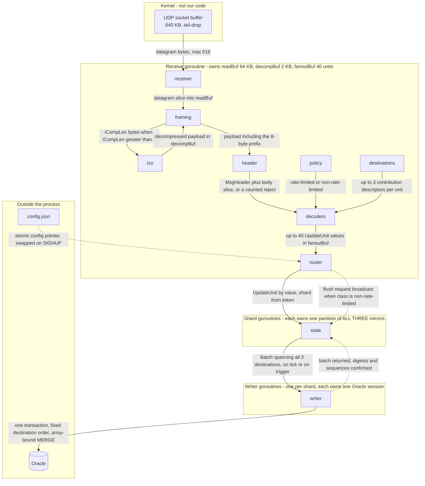

*Figure 2 — Module decomposition and process boundaries. Subgraphs are goroutine ownership domains;
nothing crosses a boundary except by value or by an explicitly transferred buffer. There is one data
path, not two: class decides **when** a shard flushes, never **where** a unit goes.*

The invariant that makes this work is stated once and enforced by test (§10.4): **an `UpdateUnit`
contains only scalars and fixed-size arrays — never a slice, pointer or string.** If a unit held a
`[]byte` into `decompBuf`, it would alias a buffer the receive goroutine reuses on the very next
packet, producing intermittent cross-contamination that would look exactly like a decode bug. The
same rule keeps the unit pointer-free, so channels and the mirror arenas cost the garbage collector
nothing to scan.

A second invariant is specific to the destination-keyed mirror and is validated at config load
(§6.9, ASM-15): **every destination row a unit touches must belong to that unit's own shard.** The
router shards on the unit's token, so this holds when each destination is either token-keyed or
general-keyed-and-written-only-by-general-units. If it were violated, two shards could write one row
and both the FR9 argument and the deadlock argument would fail silently.

### 6.2 Ingest pipeline

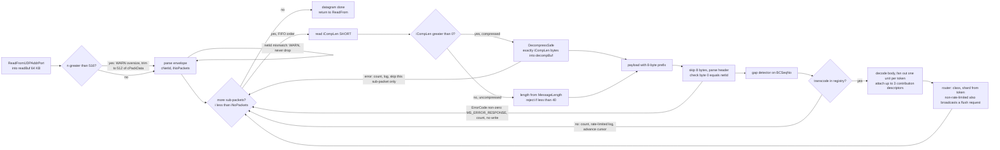

*Figure 3 — Ingest pipeline. The FIFO sub-packet loop and both branches of the compression predicate
are explicit; every terminating edge names what is counted. Cursor advance is `2 + iCompLen` for the
compressed branch and `2 + 8 + MessageLength` for the uncompressed branch (bible §3.3).*

Three properties of this loop are protocol requirements, not choices:

- Sub-packets are processed **in FIFO order** and a buffer may mix compressed and uncompressed
  (bible §3.2). Ordering across sub-packets within a datagram must be preserved end to end, which is
  why the loop cannot be parallelised without re-establishing order downstream.
- A `MessageLength < 40` **must** be rejected rather than clamped (bible §3.3): it advances the
  cursor too little and misframes every later sub-packet in the same buffer.
- The 8-byte prefix is skipped **in exactly one place**, after decompression (bible §3.4). The
  `poc` convention of having each parser take the whole payload and skip internally
  (`poc/gobrdclnt.go:298-323`) is retained, because the alternative — stripping once before dispatch —
  makes the debug offsets stop matching a wire capture.

The netId byte-0 check earns its keep as a diagnostic rather than a filter: a mismatch on sub-packet
2 or later of a buffer is almost always the previous sub-packet's length computed wrongly
(bible §3.4; the hint text is already in `poc/gobrdclnt.go:239`). It is logged and counted, never
used to drop.

### 6.3 Where the socket/decode boundary sits

Required to be stated and justified (req §11.2 item 2).

**Decision: decode inline on the receive goroutine, with no queue between the socket and the
decoder.** Justification is arithmetic. The per-datagram cost is decompression plus parsing plus
fan-out: at the assumed rates (ASM-1, ASM-3) that is roughly 10–20 µs for a four-packet datagram.
NFR4 allows 100 ms. The margin is about 5,000×, and even if ASM-1 is wrong by a factor of ten the
margin is 500×. Spending a queue and a copy to parallelise a workload at 5 % of one core would buy
nothing and cost the property that makes ordering free.

What actually threatens the stall budget is not decode, it is:

1. **A blocking send onto a full shard channel.** Bounded at 50 ms by construction (§6.6), and the
   design target is ≤ 5 ms; the 50 ms figure is the hard ceiling before escalation, chosen at half
   the NFR4 budget so ASM-4 can be wrong by 4× without causing kernel loss. The flush request a
   non-rate-limited unit raises is **not** in this category: it is a non-blocking flag set per shard
   (§6.6), never a send that can wait, and the receive goroutine never waits for the flush it asked
   for (ADR-001).
2. **Garbage collection assist.** A mutator that allocates gets charged with mark work. The receive
   path is therefore **allocation-free in steady state**: one reusable read buffer
   (as `poc/gobrdclnt.go:147`), one reusable decompress buffer (as `poc/gobrdclnt.go:148`), one
   reusable fan-out array, value-typed channel elements, and `ReadFromUDPAddrPort` instead of
   `ReadFrom` to avoid the per-datagram `*net.UDPAddr` (ASM-13). A pointer-free mirror (ADR-006)
   keeps the mark phase cheap even at a 256 MB live heap.
3. **Scheduler starvation** if `GOMAXPROCS` is left at the detected logical CPU count. On a
   dedicated SMT-8 partition with 4 online vCPUs the runtime can observe 32 logical CPUs while the
   partition is entitled to 4; req §4 requires the value to be configured, not detected (ADR-009).

The consequence to accept is that decode headroom is single-goroutine — about 20× the §3.3 peak
rather than the ~60× a decode pool would give — and that headroom rests entirely on ASM-1 and ASM-3,
which must be measured on the LPAR (OQ-5, R2). ADR-001 records the decision and names the condition
under which it must be revisited.

### 6.4 Decoder registry, header selection and unknown transcodes

**Registry.** One entry per transaction code, resolved by a small dispatch table rather than a
`switch`. The interface is deliberately narrow so a new decoder is a local, testable addition
(NFR11, and req §12.1 requires the inventory to be a parameter rather than a constant):

```go
// Decoder decodes one broadcast message body into zero or more update units.
//
// payload is the whole broadcast data including the 8-byte prefix (bible §3.4);
// implementations use a fieldReader-style cursor from the prefix so that debug
// offsets line up 1:1 with a hex dump and with a wire capture.
//
// out is caller-owned and reused per packet; a Decoder writes at most
// MaxUnits() entries into it and returns how many it wrote. It must not retain
// any slice of payload or of out.
//
// A decoder produces field values only. Which destination rows and columns those
// values land in is the `destinations` module's job (§6.1): it stamps each unit
// with up to three Contribution descriptors before the unit reaches the router.
type Decoder interface {
    Code() uint16
    // BodyLen is the declared packet length from the bible's Part V table,
    // measured from the broadcast header onward. Zero means variable-length.
    BodyLen() int
    // MaxUnits is the largest fan-out this message can produce: 2 for 7208,
    // 35 for 7320/7210, 25 for 7220, 1 for 7305.
    MaxUnits() int
    Decode(h MsgHeader, payload []byte, out []UpdateUnit) (n int, err error)
}

// Registry resolves a transaction code to its decoder. Unknown codes resolve
// to nil, which the dispatcher counts and logs at a bounded rate rather than
// treating as an error.
type Registry interface {
    Lookup(code uint16) Decoder
    Codes() []uint16
}
```

**Layout verification as a build-time gate.** Every decoder carries the bible's Part V arithmetic as
a compile-time assertion in the same style as `poc/exchange_communication.go:138-139`, where a
constant expression fails to compile if the record stride stops reconciling with the declared packet
length. This is the cheapest possible defence against the class of bug the bible's Appendix B exists
to document, and it is the reason `BodyLen()` is in the interface: the dispatcher can reject a
message whose `MessageLength` disagrees with the declared length before the decoder ever runs.

**Header selection — an ambiguity the bible surfaces but does not resolve.** Nearly every broadcast
message uses `BCAST_HEADER` with `TransactionCode` at header offset 10 (payload offset 18), but
**6541 and 6503 use `MESSAGE_HEADER`, where the code sits at offset 0** (bible §2.8, §4.12, §4.15).
The dispatcher must know which header it has before it knows the code. The rule adopted:

```
read SHORT at payload offset 18            -> candidate A (BCAST_HEADER)
if A is a code in the registry             -> BCAST_HEADER, dispatch on A
else read SHORT at payload offset 8        -> candidate B (MESSAGE_HEADER)
     if B is 6541 and payload length == 48 -> MESSAGE_HEADER, heartbeat
     if B is 6503 and payload length == 60 -> MESSAGE_HEADER, asset rate update
     else                                  -> unknown transcode, count A
```

The length checks are what make this safe: 6541 is `MESSAGE_HEADER` only, 40 bytes (bible §4.12), so
the payload is 48 bytes with the prefix; 6503 is 52 bytes (bible §4.15), so 60 with the prefix. In a
6541 message, payload offset 18 falls inside `TraderId` (bible §2.8), which on a broadcast circuit is
expected to be zero — so candidate A will not collide with a real code. **This is a designed rule,
not a protocol fact; ASM-8 and OQ-6 cover confirming it against a capture.**

**Unknown and unconfigured transcodes** (req §12.1 requires this to be defined — "they will occur"):
count by code, log at most once per code per interval, do **not** attempt to decode a body, and
continue the sub-packet loop using the cursor arithmetic already computed. This is the important
part: framing does not depend on understanding the message, so an unknown code costs nothing and
misframes nothing. A previously unseen code appearing mid-session is a signal — it surfaces in the
60-second counter line as a non-zero `unknown_transcode` with its code — and closing req §12.1 is
then a configuration change, not a code change.

**Rejects, all counted and none fatal:** `ErrorCode != 0` (bible §2.10, payload is
`MS_ERROR_RESPONSE`); declared `MessageLength` disagreeing with the registry's `BodyLen`; payload
shorter than the declared body; decompression failure; `NoOfRecords` out of range (clamped and warned
per bible §4.4b/§4.8/§4.16, as `poc/gobrdclnt.go:360-366` already does).

### 6.5 Keys, ordering values and gap detection

There are **three** keys in this design and conflating them is the easiest way to get it wrong. They
were one key in the earlier `(token, transcode)` model; separating them is what closes review gap B2.

| Key | What it identifies | Used for |
|---|---|---|
| **Shard key** | the entity — `token`, or a fixed sentinel for general units | which goroutine owns the work (§7.1) |
| **Row key** | a row in one destination — declared per destination | which mirror entry is merged into, and which row is written |
| **Ordering key** | `(row key, contributing transcode)` | which last-applied sequence the guard compares against |

```go
// ShardOf maps a unit onto one of n shards. General (non-token) units go to a
// designated shard, per FR8. The integer mix exists because exchange tokens are
// allocated in contiguous blocks, so a plain modulo would correlate shard
// assignment with contract family.
func ShardOf(u UpdateUnit, n int) int

// RowKeyOf returns the key of the row this contribution targets, in the
// destination it names. Each destination declares how its row key is derived.
func RowKeyOf(c Contribution) RowKey
```

**The invariant binding the first two** (ASM-15, validated by `-selfcheck`): *for every contribution
a unit makes, the destination row must be owned by the same shard the unit was routed to.* This holds
when each destination is either token-keyed — its row key contains the token, so it hashes with its
unit — or general-keyed and written only by general units, which all land on the designated shard. It
is what makes single-writer-per-row true, and therefore what makes both the FR9 claim (ADR-007) and
the deadlock argument (§8.3, ADR-017) true. A configuration that breaks it is rejected at load rather
than discovered as intermittent lost updates.

**The ordering value.** Per req §9 and corrected by §3.4 above:

| Unit scope | Primary | Secondary | If unusable |
|---|---|---|---|
| Token-scoped | `BCSeqNo` (bible §2.8, header offset 14), serial-number comparison per ASM-11 | `LogTime` | Skip enforcement, last-writer-wins — which is correct anyway under single-writer ownership |
| General | `LogTime` (bible §2.5, seconds since 1980) | receipt monotonic clock, always recorded | Receipt clock alone (FR11) |

**The guard is per `(row, contributing transcode)`, not per row.** This is forced by the column-merge
model: transcode A owns some columns of a row and transcode B owns others, and their sequence numbers
are not comparable to each other — a 7208 at sequence 900 says nothing about whether a 7305 at
sequence 850 is stale. Comparing them on one per-row counter would let whichever transcode ticks
faster permanently suppress the other, which is exactly the failure req §9 warns about when it
defines ordering per (token, transcode) rather than per token. So each mirror entry carries a small
fixed array of last-applied sequences, one slot per transcode configured to contribute to that
destination, and the guard compares the incoming unit against its own slot only.

The guard is a compare-and-discard at the point of application: if the incoming ordering value is not
newer than the last applied for that `(row, transcode)` slot, the contribution is discarded and
counted as `superseded`. Here it is a defence against wire reordering, not the mechanism that
establishes order (ADR-007).

**Gap detection (FR10, conditional on req §12.3).** The detector runs on the receive goroutine,
before any queue, because it must see every message in arrival order and it costs one comparison.
Scope is configurable — `global`, `per-transcode`, or `off` — defaulting to `global`, because bible
§2.8 describes `BCSeqNo` as the BCAST sequence number "for the Ericsson switch", which reads as a
transport-level counter. A gap is reported as `seq_gap from=<last> to=<current> missing=<n>` at WARN,
with a per-minute count; there is no recovery, and the design must not pretend otherwise
(bible §1: no host-end inquiries; req §10.1).

To close req §12.3 without needing a capture, a diagnostic **sequence audit mode** (off by default)
maintains both hypotheses simultaneously for a configurable number of packets and reports which one
produced zero gaps. That is a few hundred bytes of state and it turns an open item into a
five-minute production observation. The same idea closes req §12.4: a `map[int32]struct{}` reset
every second, whose size is emitted as `active_tokens_1s`, directly measures the concurrently active
token count that req §12.4 asks to be derived.

### 6.6 Queue inventory, depths and drop policy

NFR5 requires every queue to have a defined capacity and a documented overflow behaviour. This is
that table. Defaults are reloadable except where marked startup-only (§6.9).

| # | Queue | Carries | Capacity (default) | Arithmetic behind it | Producer behaviour when full | Saturation signal |
|---|---|---|---|---|---|---|
| Q0 | Kernel socket buffer | datagrams | 640 KB (`udp_recvspace`) | 1,270 datagrams ≈ 0.53 s at 2,400/s; ≈ 0.13 s if ASM-4 is wrong | Kernel tail-drops silently — not our policy | `netstat -s -p udp` socket buffer overflows; also a `BCSeqNo` gap |
| Q1 | Shard ingest `shardCh[k]` | `UpdateUnit` by value, 384 B | 4,096 units, startup-only | 15,000 units/s ÷ 4 shards = 3,750/s → 1.09 s of slack | Non-blocking send; on failure block with a 50 ms deadline; on expiry drop **oldest** and count; three expiries in 60 s escalates to fatal | `shard_send_blocked`, `shard_dropped`, depth in the 60 s line |
| Q2 | Shared batch queue `batchQ` | `*Batch` spanning all three destinations, drawn from the producing shard's free list | `shards × maxInFlightPerShard` batches (default 8), startup-only | **Sized so it cannot fill.** Only `maxInFlightPerShard` batches exist per shard, so the free list bounds what can be in flight and the queue merely holds them — stated explicitly rather than left implicit | **Never blocks.** A failed non-blocking send pauses the pump; the indices return to the head of their cohort rings, the epoch stays open and the next completion resumes it (§7.3) | `flush_deferred`, `dirty_depth`, `batchq_depth` |
| Q2c | Completion `completionCh[k]` | the finished `*Batch`, returned to its **owning** shard | `maxInFlightPerShard` (default 2) | One slot per batch that shard can have outstanding, so the writer can always hand a batch back | **Cannot fill**, for the same reason. A writer never blocks returning a batch | `completion_lag` |
| **F** | Flush request `flushReq[k]` | **not a queue** — one boolean per shard, set atomically | 1 bit | A request is an *edge*, not a message: what matters is that a flush happens after this unit, not how many were asked for | **Cannot fill.** Setting an already-set flag is a no-op and is counted as a coalesced request. The flag is cleared **only when an epoch actually opens** — a tick that lands mid-epoch leaves it set, or the request would be discarded unserved (§7.3) | `flush_triggered`, `flush_coalesced` |

Both classes of traffic use Q1 and Q2. There is no second lane and no queue whose overflow is fatal;
what a non-rate-limited unit does differently is set **F** after it has been applied.

**Q2 is shared, not per shard** (ADR-005). Any shard pushes to it and any writer pulls from it, so
write parallelism is set by `writers` rather than by `shards` and an imbalanced shard can be drained
by several writers at once. What keeps that safe is the per-row in-flight rule of §6.7: a row is in at
most one outstanding batch, so two batches in flight — from the same shard or different ones — always
carry disjoint rows.

Five things about this table are deliberate and worth defending.

**Q1's drop policy is oldest-out, not newest-out.** Every message is a snapshot (req §9), so the
newest unit carries the state that must eventually reach the database. Discarding the newest and
keeping older ones queued would leave the database holding a stale final value until the token ticks
again — a direct violation of "eventual correctness of the final state for every token", which req §9
lists as never given up. Discarding the oldest costs history that coalescing was going to discard
anyway. Implementation is a single non-blocking receive followed by the send; it is safe because the
only other consumer is the shard goroutine, which by definition is behind.

**Q1's escalation to fatal is the honest end of the road.** Dropping a coalescible unit is *usually*
harmless because a hot token ticks again within a millisecond. It is not harmless for a token that
ticks once and goes quiet, and there is no way for the router to tell them apart. So a single
expiry is a counted warning; sustained expiry means the system is no longer honouring final-state
correctness, and req §9 says the response to that is to stop loudly rather than to degrade past it.
Three expiries in sixty seconds is a judgement call (SHOULD, not a requirement) and is configurable.

**Q2 never blocking is the whole back-pressure design.** The shard goroutine must never wait on a
writer, because waiting would stall Q1 and then the receive goroutine. It therefore drains an epoch as
an event-driven state machine rather than as a loop: it emits as many batches as its free list allows,
returns to serving `shardCh`, and emits the next batch when a completion arrives (§7.3). A shard whose
`maxInFlightPerShard` batches are all outstanding simply does not emit another one yet, and a tick that
lands while an epoch is still draining does nothing at all — the rows it would have flushed keep
accumulating and coalesce further. **Back-pressure therefore appears as staleness, and staleness is
bounded because a dirty entry holds one row image regardless of how many updates land on it.** This is
the property that makes the whole design safe under burst (§7.3, §7.5).

**The flush request is a flag, not a queue, and that is the whole reason nothing here is fatal.**
If a non-rate-limited arrival enqueued a flush *message*, the queue would have a capacity, an
overflow behaviour and a terminal condition — and an arrival storm would demand `A × S` commits per
second (§4.2) until it hit that condition. As a flag, a storm sets an already-set bit: the shard
performs one flush, and every request that arrived while it was in flight is satisfied by the next
one. The observable effect of overload on this path is therefore **larger batches and slightly older
data**, which is req §9's permitted degradation, rather than a fatal stop. `flush_coalesced` rising
is the signal that this is happening.

**There is no queue whose overflow is fatal.** The earlier three-class model routed critical and
intermediate-preserving traffic onto a separate lossless lane whose overflow was a terminal stop, per
req §10.2's rule about critical-path queues. That lane is gone (ADR-004, ADR-016): non-rate-limited
traffic now shares Q1 and Q2 with everything else and is distinguished only by setting **F**. What
req §10.2's rule protected — never silently discarding an unthrottled occurrence — is instead
protected by Q1's drop-oldest being *counted and escalating*, and by the fact that a discarded unit
is a drop of the shared path that no class can hide behind. See §14.2, R8, for the residual risk this
trades away.

### 6.7 Coalescing, change suppression and ordering

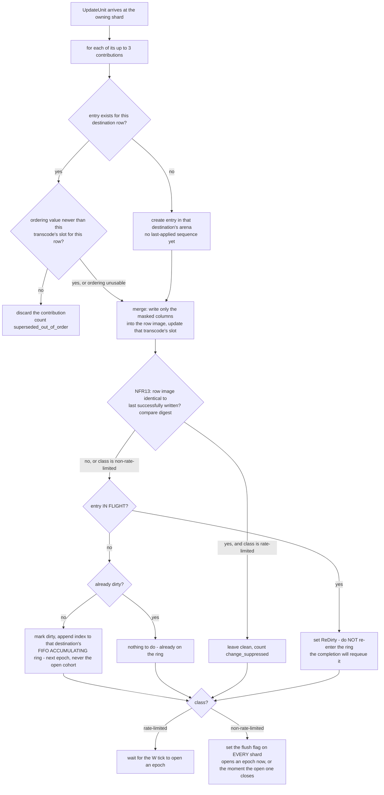

*Figure 4 — Per-unit handling inside a shard. Coalescing is implicit: the entry holds one row image,
so N arrivals between two flushes produce one row. The dirty ring is FIFO by requirement, not by
taste. Class appears only at the bottom of this diagram — it decides when the flush happens, never
what is stored or where.*

**The in-flight rule, and why it is what makes a shared writer pool safe.** Because any writer may
take any batch (§6.6, ADR-005), a shard can have several batches outstanding at once. If two of them
carried the same row, they could commit in either order and a stale image could win — the FR9
violation the earlier one-writer-per-shard mapping avoided by construction. The rule that replaces it
is that **a row is in at most one outstanding batch**, enforced entirely inside the shard goroutine:

| From | Event | To |
|---|---|---|
| clean | a contribution merges | **dirty** — appended to that destination's **accumulating** ring |
| dirty | a contribution merges | dirty — already on the accumulating ring, nothing to do |
| dirty | an epoch opens | still dirty, but its index now sits on the **cohort** ring, snapshotted by the ring swap (§7.3) |
| dirty, on the cohort | the pump batches it | **in-flight** — image, written column mask and digest copied into the batch; the index *leaves* the cohort |
| in-flight | a contribution merges | **in-flight + re-dirty** — merges into the entry image as normal, but does **not** enter any ring |
| in-flight | commit confirmed | **clean** — `Digest` set from the batch's image, `ColMask &^= writtenMask`; if re-dirty, mark dirty and append to the tail of the **accumulating** ring |
| in-flight | commit failed | **dirty** — inserted at the **head of the accumulating ring**, so the retry runs in the next epoch and stays ahead of rows dirtied after it |

Two consequences carry the whole argument. Any two batches in flight hold **disjoint row sets**, so
commit order between them cannot matter and FR9 stays structural without a lock, a compare-and-swap
or a dependency on req §12.3. This now covers two batches of the *same epoch* as well, because a row's
index leaves the cohort at the moment it is batched — the pump cannot hand the same row to two
batches. And successive writes to one row are serialised by the rule itself, because the second cannot
be batched until the first has been confirmed.

Two details are silent failures if missed. **The digest is confirmed from the image the batch
carried**, never recomputed from the entry's current image, which may have been re-merged while in
flight — recomputing would record a value as written that never was, and NFR13 would then suppress it
forever. And **a row leaving the in-flight state always rejoins the accumulating ring, never the
cohort** — at the tail if it was re-dirtied, at the head if its commit failed. Appending to a cohort
would let work arriving mid-drain extend the epoch indefinitely, which is the one way an epoch could
fail to terminate.

This is the in-flight protocol that `phase1_hld2.md`'s Design 2 needed and that ADR-005 originally
rejected. It is materially safer here: there, the mirror was shared under striped locks and the
protocol had to be correct under concurrent access on a platform with no race detector. Here the
shard owns its entries exclusively, so `InFlight` and `ReDirty` are ordinary goroutine-local fields
and the only thing crossing a boundary is the completion, which is a channel receive.

**The merge, and why a column mask is needed.** A contribution sets a subset of a row's columns. The
shard applies it by writing only the masked columns into the entry's row image and OR-ing the mask
into the entry's dirty-column mask, so the flush can emit a statement that touches just those
columns. Overwriting the whole image instead would blank every column the contributing transcode
does not know about — which is precisely what happens when two transcodes share a destination, and
the reason this is a merge rather than an assignment.

**Why the dirty ring must be FIFO.** A tick drains the whole ring (ADR-018), but it drains it in
batches of `maxBatchSize` that commit a few at a time, so the order still decides which keys are
written first — and under sustained overload, when the ring is refilled faster than an epoch clears
it, it decides which keys are written at all. If the ring were drained LIFO, the keys that went dirty
first would be pushed back indefinitely by newer arrivals and could starve for the rest of the
session — the database would hold stale values for those tokens forever, which is precisely the
"eventual correctness" property req §9 says is never given up. A FIFO ring bounds the wait for any
dirty key at `W + ceil(ceil(cohortSize / maxBatchSize) / maxInFlightPerShard) × t_commit`
(ADR-015). This is an invariant, not a preference.

**NFR13 change suppression, and where it must not apply.** For **rate-limited** contributions only,
an entry whose row image is byte-identical to the last image successfully written is not rewritten.
The comparison is a cheap digest of the image kept alongside the entry. The concrete case this exists
for is protocol-grounded: **7340 re-broadcasts `MS_SECURITY_UPDATE_INFO` periodically for every
security that changed** (bible §4.3), so a periodic sweep would otherwise rewrite thousands of
identical rows.

NFR13 forbids applying suppression to unthrottled traffic, where a repeated occurrence carrying
identical values is still an occurrence FR7 requires to be persisted. Under the two-class model this
is no longer enforced by *which lane the traffic is on* — there is one path — so it is enforced by
the rule stated explicitly in Figure 4: **a non-rate-limited contribution always marks the row dirty,
digest or no digest.** The check is skipped for it rather than merely failing. This is the one place
where class affects something other than flush timing, and it is deliberate.

Note what the two-class model bought here. In the earlier model 7340 was *critical*, therefore on the
lossless lane, therefore structurally unable to use the suppression mechanism its own periodic sweep
was the justification for — an outright contradiction (Appendix A, gap B6). With the lane gone and
intermediate values no longer preserved, 7340 can simply be configured `rate-limited`: it is a
snapshot re-send, the final state is what matters, and both the sweep cost and the contradiction
disappear.

NFR13 also forbids a periodic flush from sweeping the tracked-token universe. The dirty ring is what
satisfies that: the flusher touches only entries that changed, never the arena as a whole, so a tick
during a quiet minute costs one length check.

**Ordering.** Two mechanisms, in priority order:

1. **Structural.** Exactly one goroutine ever applies contributions to a destination row, and it
   receives them in the order the receive goroutine produced them, which is the order they arrived on
   the wire, which is the order the exchange packed them (bible §3.2). Exactly one goroutine ever
   writes that row. FR9 holds with no comparison at all — and it holds for **the destination the
   requirement names**, not for a proxy key that usually agrees with it.
2. **Defensive.** The per-`(row, transcode)` compare-and-discard in Figure 4 catches genuine wire
   reordering, which UDP permits even if it is rare on a single circuit.

The distinction matters for rubric 4: if req §12.3 resolves badly and the sequence fields turn out to
be unpopulated, mechanism 2 disappears and FR9 still holds. In a design where mechanism 1 is absent —
a decode pool, a round-robin writer, or two writers able to touch the same row — mechanism 2 is the
only mechanism and FR9 fails with it.

### 6.8 The two classes and the two flush triggers

req §11.2 item 4 asks how unthrottled transcodes bypass lossy handling and how they avoid being
starved by high-frequency traffic. The answer is not a separate lane. It is that **class controls
when a shard flushes, and nothing else**: both classes are applied to the same three mirrors by the
same goroutine, and a non-rate-limited arrival simply refuses to wait for the window.

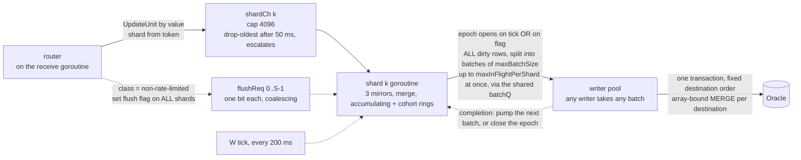

*Figure 5 — One pipeline, two triggers. A non-rate-limited unit is applied to the mirror exactly like
any other, then raises a flag that makes every shard flush at once. It never waits for the flush
(ADR-001) and never travels a different path.*

**Starvation** is prevented by construction rather than by priority scheduling. A flood of 7208
cannot delay a 6511, because a 6511 does not queue behind 7208's *writes* — it raises a flag, and the
next flush carries whatever is dirty including its own row. The only shared resources are the receive
goroutine's time (bounded by the 50 ms send deadline) and the Oracle instance itself. There is no
priority inversion to reason about and no starvation-avoidance heuristic to tune, which is worth more
at 03:00 than a cleverer scheduler.

**The two classes, in full:**

| Class | Flush trigger | Suppression (NFR13) | Example | Note |
|---|---|---|---|---|
| `rate-limited` | the `W` tick | applies | 7208 (bible §4.8), 7305 / 7340 (bible §4.3) | The high-volume default. Write rate per destination row is capped at `1/W` — losslessly, by coalescing, never by discard |
| `non-rate-limited` | on arrival, all shards — an epoch opens at once, or the instant the open one closes | **skipped** — always marks dirty | 6511 / 6521 / 6531 / 6571 (bible §4.5) | A handful per day; latency matters, cost is nil. Every occurrence is applied; whether every occurrence is separately *observable* is answered in §1.1 and §8.1 |

There is **no write-mode axis** any more. NFR6's batched-versus-real-time choice is implied by the
class: rate-limited is batched on the window, non-rate-limited is written as soon as available. And
there is **no discard limiter**: NFR2's mechanism does not exist here (§1.1, ADR-016).

**Config validation** rejects an inventory where a transcode contributes to a destination whose row
key is not derivable from that transcode's shard key (ASM-15 — it would break single-writer-per-row),
where a declared contribution names an unknown destination or column, or where more than three
destinations are declared. It warns when a transcode configured `non-rate-limited` is observed
exceeding a configured expected rate, since that combination is what turns flush amplification into a
capacity problem (§4.2, §7.7).

### 6.9 Configuration and runtime reload

NFR8 requires reload without restart, and gives the reason: a restart discards coalescing state
(req §9) and leaves the database stale (req §10.3), so a restart must not be the price of a tuning
change. It is also what makes the operator levers in the degradation table usable during an incident.

Mechanism: `SIGHUP` triggers a re-read of the JSON file, full validation, and an atomic pointer swap
(`atomic.Pointer[Config]`). Each goroutine loads the pointer at a natural boundary — the receiver
once per datagram, a shard once per flush tick, a writer once per batch — so a reload takes effect
within one window and never mid-batch. A file that fails validation is rejected wholesale with the
reason logged and the previous configuration left running; a partially applied configuration is worse
than a stale one.

| Tunable | Reloadable | Why not, where not |
|---|---|---|
| **Per-transcode class** — `rate-limited` or `non-rate-limited` | yes | The primary operator lever for req §9 steps 1 and 3. Reclassifying a chatty transcode to `rate-limited` is how an operator stops flush amplification without a restart |
| Flush window `W` | yes | Read per tick. It is the coalescing window and the dominant term in rate-limited latency (§7.6) |
| `maxBatchSize` — the **per-batch** row budget, across all three destinations | yes | Read per batch. It caps transaction size (NFR6) and therefore sets how many batches an epoch splits into; it no longer caps how much a tick flushes, which is now the whole dirty set (§7.3, ADR-018) |
| Per-transcode column contributions (which destination, which columns) | yes | Read by `destinations` at decode; a schema addition is a config change, not a rebuild, provided the columns already exist |
| **Destination set — the three destinations and their row keys** | **no — startup only** | Changing a row key re-keys a mirror and strands state mid-session, exactly as changing shard count does. Adding or removing a destination resizes the arena set |
| **`writers` — the size of the writer pool, and therefore the connection count** | **yes, up and down** | A writer holds **no mirror state** (ADR-005): growing the pool starts a goroutine with a fresh session, shrinking lets one exit after its current batch. This is the design's lever for a write path that cannot keep up (§7.7), bounded by the Oracle session budget (OQ-8) |
| `maxInFlightPerShard` — how many of one shard's batches may commit **concurrently** | no — startup only | It sizes a pre-allocated batch pool and the shared `batchQ` behind it, so raising it live means rebuilding a channel and losing what is in it. It does not change *what* a tick flushes — that is always the whole dirty set — only how fast the epoch drains: at `1` the batches commit serially in FIFO order, at `m` up to `m` at once (§7.3). `writers` remains the runtime lever for write throughput |
| `GOMAXPROCS` | yes | `runtime.GOMAXPROCS` is a supported live call |
| Socket receive buffer | yes | `(*net.UDPConn).SetReadBuffer` on the live socket; cannot exceed `udp_recvspace` without a kernel tunable change (req §4) |
| Stats interval, log verbosity, heartbeat timeout | yes | |
| **Shard count, queue capacities** | **no — startup only** | Changing shard count re-keys the mirror and would strand state mid-session; resizing a channel means rebuilding it, and a rebuild loses whatever is in flight. Note this no longer implies the connection count is fixed — that moved to `writers` above when ADR-005 decoupled the pool. Phase 2 may revisit; Phase 1 declares them fixed |
| Database credentials | no | The password comes only from `FEEDVALVE_DB_PASSWORD` (req §7, `poc/db.go:30`), and a live process cannot see a changed environment |

The password never appears in the config file and the DSN never reaches a log; `describe()` and
`redactDSN` at `poc/db.go:134` and `poc/db.go:190` are the pattern to reproduce. This matters more
than it looks: an operational log on this host is append-only and long-lived, so a leak is permanent.

### 6.10 Liveness, market session and process lifecycle

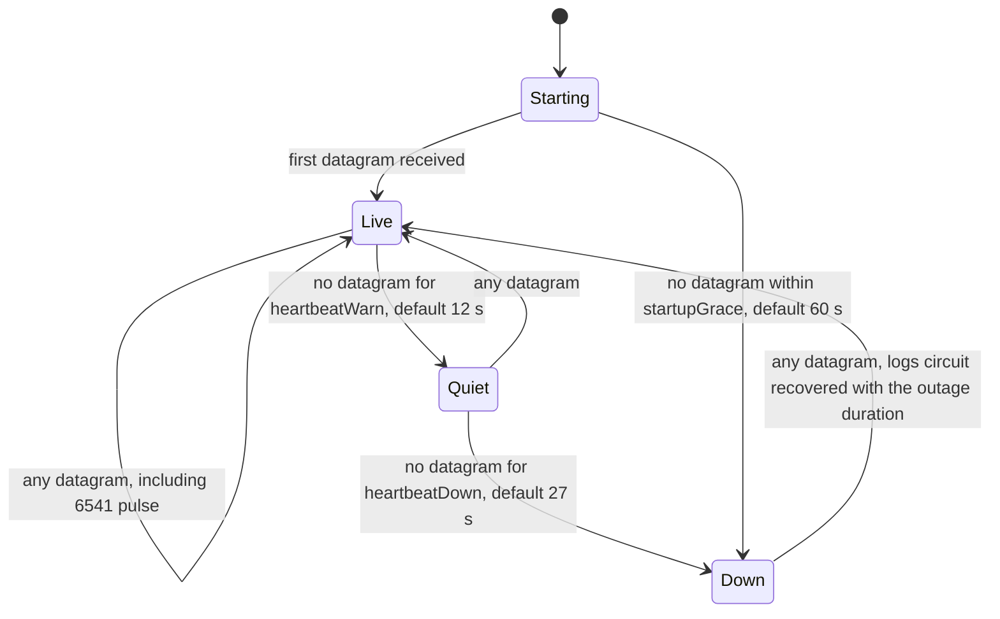

*Figure 6 — Broadcast circuit liveness, driven by the 6541 heartbeat. Bible §4.12: the host sends a
pulse when nothing has flowed for a stipulated period, currently 9 seconds and changeable by NSEIL
control — so both thresholds are configuration, never constants. Silence is a circuit-down signal,
not a quiet market.*

This is engineering judgement (SHOULD), not a stated requirement: FR10 asks for logging sufficient to
confirm the system is running correctly, and without this the difference between a dead circuit and a
quiet market is invisible. Severity is downgraded to WARN outside a configured trading window so an
overnight host outage does not page anyone, which also gives req §12.7 somewhere to land. Note the
decoding subtlety from §6.4: 6541 carries `MESSAGE_HEADER`, so its transaction code is at payload
offset 8, not 18 (bible §2.8, §4.12).

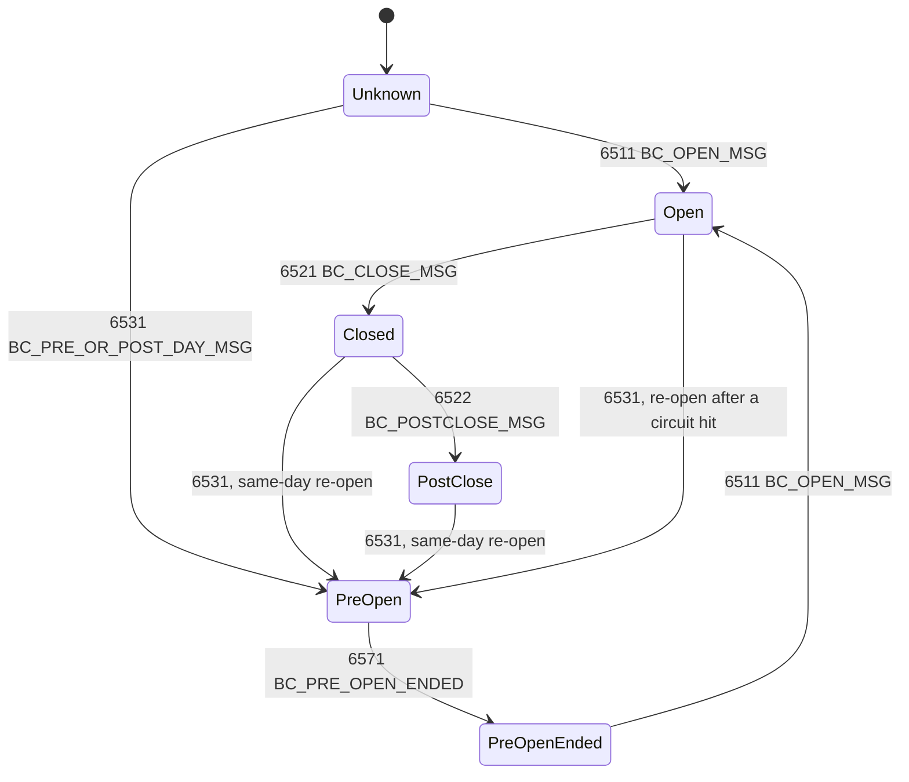

*Figure 7 — Market session state, tracked per `MarketType` (bible §4.5, field at message offset 74:
1 Normal, 2 Odd Lot, 3 Spot, 4 Auction). The transition Unknown → Open on 6511 alone is mandatory:
bible §4.5 states the regular first opening of the day sends 6511 by itself, while a same-day
re-opening runs 6531 → 6571 → 6511. A state machine that demands a pre-open before every open stalls
at the regular market open.*

These messages are general transcodes: `non-rate-limited`, one update unit each, contributing to the
general-keyed destination and stamped with `(LogTime, receipt)` per FR11 and §3.4. The state machine itself is for logging and for
the liveness severity gate; it does not gate the data path, because gating the data path on a
session state derived from messages that can themselves be lost would convert one lost datagram into
a session-long outage.

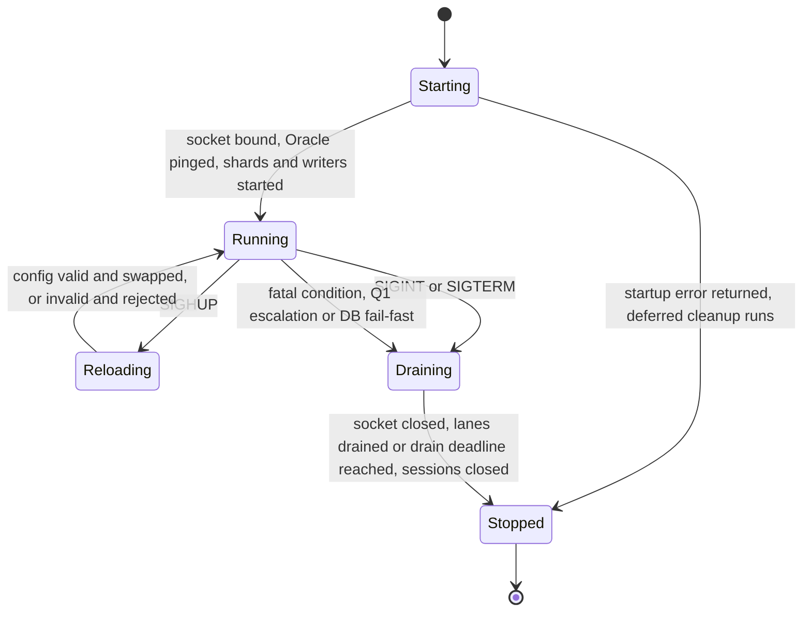

*Figure 8 — Process lifecycle. Startup and shutdown return errors rather than calling a
`Fatalf`-style exit: `os.Exit` skips every deferred cleanup, which is why `poc` splits `main` into
`main` and `run(ctx) error` (`poc/gobrdclnt.go:19-28`). The same split is mandatory here, because
this design has Oracle sessions and in-flight batches to close.*

Draining is bounded, not best-effort-forever: closing the socket is the only way to unblock an
in-flight read (`poc/gobrdclnt.go:135-145`), after which the receive goroutine returns, the shard
channels are closed, and **each shard performs one final flush-all across its three mirrors**,
repeating while dirty entries remain and `drainTimeout` (default 5 s) has not expired. On expiry the
process exits anyway and logs how many dirty rows were abandoned, per destination — an honest count
of what req §10.1 already says is unrecoverable.

---

## 7. The sharded write-behind mirror

**Distinguishing axis:** *distribute, then coalesce in shard-owned state.* Each destination row
belongs to exactly one goroutine that owns its state, and to exactly one writer that owns its Oracle
session. No locks anywhere on the data path.

### 7.1 Data flow and concurrency model

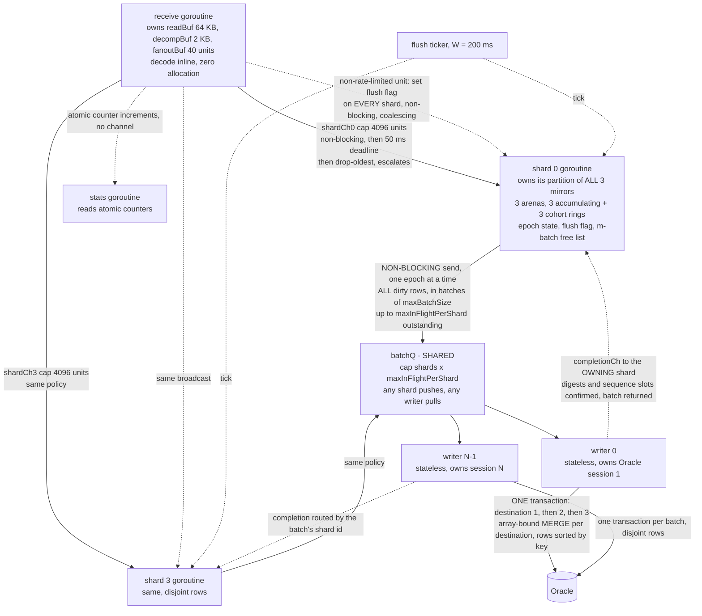

*Figure 9 — Concurrency and ownership. Shards 1 and 2 and the middle of the writer pool are omitted
for legibility. **Shards own state; writers own sessions; the two are independent.** Any transaction
in flight touches a row set disjoint from every other — across shards because a row belongs to one
shard, and within a shard because of the in-flight rule (§6.7) — which is what makes deadlock
impossible rather than merely unlikely (G12, ADR-017).*

Goroutine census: 1 receiver + `shards` + `writers` + 1 ticker + 1 stats + 1 signal/lifecycle, so
**12 goroutines** at the defaults of 4 and 4. At most 5 are runnable at any instant under normal
load; against `GOMAXPROCS=4` that is comfortable, and the writers spend nearly all their time blocked
on network I/O, so they do not compete for entitled capacity (NFR7 — parallelism is applied at the
write path, which is where it demonstrably helps, and nowhere else).

**`writers` is a tunable in its own right.** It is not tied to `shards`, it does not re-key anything,
and because a writer holds no mirror state the pool can be grown or shrunk while the process runs
(§6.9). Raising it is the design's answer to a write path that cannot keep up (§7.7); the ceiling is
the Oracle session budget, not the partitioning.

**A shard emits as many batches as its dirty set needs, not one.** A tick opens an *epoch* covering
every row that was dirty at that instant, and the shard keeps `maxInFlightPerShard` of that epoch's
batches on `batchQ` at a time, pumping the next one as each completion returns (§7.3). This is what
lets several pool writers serve one imbalanced shard simultaneously — without it the pool would give
failover and flexibility but no intra-shard parallelism at all.

**Distribution key** is `ShardOf(unit, 4)` — the token for token-scoped units, a fixed sentinel shard
for general ones per FR8 (§6.5). Sharding on the entity rather than on `(token, transcode)` is what
keeps every destination row a unit touches inside one shard, which is what lets a single transaction
cover all three destinations and what makes §6.7 mechanism 1 valid for the destination itself
(NFR10, ASM-15).

### 7.2 Socket and decode boundary

Inline, as argued in §6.3 and recorded as ADR-001. The first queue in the system is Q1, the shard
ingest channel, which sits **after** decode and fan-out — which is what lets it apply a per-class
policy at the point where back-pressure is felt. The receive goroutine's per-datagram work is
bounded and allocation-free; its only unbounded-in-principle wait is the Q1 send deadline, capped at
50 ms with escalation.

### 7.3 Coalescing and the structural memory bound

State layout, and the reason it is shaped this way:

```go
// Entry is one row of one destination. It contains no pointers and no slices,
// so the garbage collector never traces the arenas that hold these.
type Entry struct {
    Row       RowKey    // this destination's row key
    ColMask   uint64    // columns set since the last successful write
    LastSeq   [maxContributors]int32 // last applied ordering value, PER
                                     // contributing transcode (§6.5)
    LastTime  int64     // last applied LogTime, seconds since 1980 (bible §2.5)
    Digest    uint64    // digest of the row image SUCCESSFULLY written (NFR13)
    Dirty     bool
    InFlight  bool      // batched, not yet confirmed — see the rule in §6.7
    ReDirty   bool      // merged again while in flight; requeued on completion
    Image     [256]byte // the current column image of this row
}

// A shard owns its partition of all three destinations. Arenas store entries in
// fixed-size chunks so growth never copies a whole mirror; each Index maps a row
// key to an arena slot. All of it is pointer-free.
type Shard struct {
    Index      [3]map[RowKey]int32
    Arena      [3][][chunkSize]Entry
    DirtyRing  [3][]int32   // ACCUMULATING — rows dirtied now, for the NEXT epoch
    Cohort     [3][]int32   // DRAINING — this epoch's snapshot; FIFO, oldest-first
    EpochOpen  bool         // at most one epoch open per shard, ever
    CohortOut  int32        // batches of this epoch not yet confirmed
    TickMissed bool         // a W tick fired while the epoch was open
    FlushReq   atomic.Bool  // set by any non-rate-limited arrival; see §6.8
    Free       []*Batch     // maxInFlightPerShard batches — a CONCURRENCY limit
    Done       chan *Batch  // completions from whichever writer took the batch
}
```

`InFlight` and `ReDirty` are what allow several of this shard's batches to be outstanding at once
without two of them ever carrying the same row (§6.7). They are plain goroutine-local fields — the
shard is the only thing that reads or writes them — and they cost two bytes inside existing padding.

`maxContributors` is fixed at build time from the largest number of transcodes any one destination is
configured to receive contributions from; `-selfcheck` rejects a configuration that exceeds it. Four
is ample for the inventories the bible catalogues.

**The bound.** A dirty entry holds exactly one pending row image regardless of how many updates land
on it. The maximum unwritten backlog is therefore one entry per distinct destination row ever seen,
which is bounded by the destinations' own key spaces — numbers fixed by the exchange and the schema,
not by our arrival rate. No matter how far behind the database falls, the mirrors cannot grow past
their resident size. This is what lets Q2 refuse to block: there is nowhere for the backlog to go
except into entries that already exist.

Keying by destination row makes the bound *tighter* than the earlier `(token, transcode)` model, not
merely differently shaped: several transcodes contributing columns to one row now share one entry and
produce one write, where before they held one entry each and produced one write each.

Contrast this with a design that queues update units instead of coalescing them: at 15,000 units/s a
database stalled for 60 seconds accumulates 900,000 units × 384 B = **346 MB of queue**, and the
queue must then either be capped (dropping data) or grow (eventually fatal). Coalescing turns that
into zero additional bytes.

#### The flush is an epoch, not a batch

**A tick flushes every dirty row, not `maxBatchSize` of them.** `maxInFlightPerShard` decides only
*how* those rows go out — at `1` the batches commit serially in FIFO order, at `m > 1` up to `m`
commit concurrently. The quantity flushed is identical either way; only the wall time to drain it
changes. This is ADR-018, and it is what makes the writer pool of ADR-005 do anything for a single
imbalanced shard.

The mechanism has to respect one hard constraint: **the shard goroutine must never block waiting for
a commit.** It owns the mirror, so a shard parked on a completion stops draining Q1, and back-pressure
reaches the receive goroutine — precisely what NFR4 and the whole write-behind structure exist to
prevent. A four-batch serial drain at ~20 ms a commit would park the shard for ~80 ms, roughly 1,200
units at the burst rate. So the drain is an event-driven state machine advanced by completions, never
a loop.

**Open an epoch** — on a `W` tick or when `FlushReq` is set, and only when no epoch is open:

1. clear `FlushReq` (before the snapshot, so a request raised during the drain is not lost);
2. if all three accumulating rings are empty, no epoch opens — count `epoch_empty` and return;
3. **swap `DirtyRing[d] ↔ Cohort[d]`** for each of the three destinations. The cohort is now exactly
   the set of rows that were dirty when the tick fired, and the accumulating rings are empty;
4. set `EpochOpen`, `CohortOut = 0`, clear `TickMissed`;
5. call **pump**.

**A tick that fires while an epoch is open does nothing** except set `TickMissed` and count
`tick_skipped_epoch_open`. Critically it **does not clear `FlushReq`** — clearing a flag it is not
acting on would discard a non-rate-limited request outright.

**Pump** — called on epoch open and again on every completion. While the free list is non-empty *and*
the cohort is non-empty, it:

1. takes a batch from the free list;
2. fills it to at most `maxBatchSize` rows **in total across all three destinations** — drawing
   destination 1, then 2, then 3, oldest-first within each. One batch spans all three, which is what
   makes the write one transaction; `maxBatchSize` is a per-batch budget, not a per-destination
   allowance, so a transaction is never larger than the configured number says it is (NFR6);
3. copies each row's image, written column mask and digest into the batch and marks the entry
   `InFlight`;
4. attempts a non-blocking send on the shared `batchQ`, and increments `CohortOut`.

A failed send returns the indices to the **head** of their cohort rings, returns the batch, counts
`flush_deferred` and ends the pump — the epoch stays open and the next completion resumes it. By
construction this cannot happen (`batchQ` holds `shards × maxInFlightPerShard` batches and only that
many exist), and it remains in the design as defence rather than as an expected path.

**Completion.** Whichever writer took the batch returns it on `completionCh[k]`, routed by the shard
id the batch carries. The owning shard then, per row:

- clears `InFlight`;
- **on success** — sets `Digest` from *the image the batch carried*, clears the written bits from
  `ColMask`, and if `ReDirty` is set, clears it and appends the row to the tail of the **accumulating**
  ring;
- **on failure** — marks the row dirty and inserts it at the **head of the accumulating ring**, so the
  retry happens in the *next* epoch rather than this one. Count `retry_requeued`.

Then it returns the batch to the free list, decrements `CohortOut`, and:

- if the cohort is empty **and** `CohortOut == 0`, the epoch closes — clear `EpochOpen`, record
  `epoch_duration`. If `FlushReq` is set, or `TickMissed` is set and the accumulating rings are
  non-empty, **the next epoch opens immediately** rather than waiting for the tick: the shard is
  already behind, and in the `FlushReq` case something non-rate-limited is waiting;
- otherwise, pump again.

**Why a failed batch retries in the next epoch and not this one.** Re-admitting it to the cohort would
be the stronger guarantee — the epoch would not complete until every row in it was genuinely
written — but a row that fails every attempt would then hold the epoch open forever, and no tick could
ever start. Deferring it bounds the epoch; inserting at the *head* keeps the failed rows ahead of rows
dirtied after them, so FIFO survives the retry rather than being inverted by it.

Confirming the digest from the batch rather than from the entry matters because the entry may have
been re-merged while the batch was in flight; recomputing would record a value as written that never
was, and NFR13 would then suppress it permanently.

#### Four properties this buys, stated so they can be tested

- **Epoch completeness.** Every row that was dirty when the tick fired is written before the epoch
  closes. Every row dirtied during the drain is not. This is the literal form of "a tick flushes all
  dirty rows", and §10.4 gates it.
- **Cohort rings are drain-only.** Nothing is ever appended to a cohort ring — a mid-epoch merge goes
  to the accumulating ring, and a re-dirtied in-flight row is requeued there too. So work arriving
  during a drain cannot extend it, and the epoch is guaranteed to terminate.
- **FIFO is a staleness property, not a commit-order property.** At `m > 1` two batches of one epoch
  may commit in either order. FR9 is untouched: it rests on in-flight row sets being disjoint, and a
  row *leaves the cohort* when it is batched, so no two batches of the same epoch can share a row —
  the same argument that already covers batches from different epochs and different shards (§6.7,
  §8.4).
- **The memory bound is unchanged.** If Oracle cannot keep up, epochs overrun `W`, ticks are skipped
  and the next cohort is larger — still bounded by the destinations' key spaces, because a cohort is
  drawn from the same entries. Falling behind still costs staleness and not memory.

**The wait bound improves, and this is the point.** The worst-case wait for a dirty key was
`(dirtyDepth / maxBatchSize) × W` — one *flush window* per batch. It is now

```
W  +  ceil( ceil(cohortSize / maxBatchSize) / maxInFlightPerShard ) × t_commit
```

— one *commit latency* per batch, divided by the concurrency. A 3,000-row cohort at the defaults:
600 ms before, `200 + 2 × 20` = **240 ms** now. ADR-015's bounded-wait claim gets materially stronger,
and the per-window channel ceiling that used to cap the drain at `maxBatchSize/W` per shard
disappears entirely — what limits the drain is the write path, which is where §7.7 says the limit
belongs.

**Cost.** One extra ring header per destination per shard and four fields of shard state. The rings
themselves are `[]int32` indices, and the design already swapped a dirty ring with a spare on every
flush — the epoch simply keeps the swapped-out ring for the whole drain instead of for one batch. The
memory difference is not material (§11.3).

**Change suppression** (NFR13), and the rule that it is skipped outright for non-rate-limited
contributions, is covered in §6.7. The 7340 periodic sweep (bible §4.3) is the case that makes it
worth having.

### 7.4 Non-rate-limited traffic and the flush trigger

Per §6.8: the same path, an earlier flush. Five specifics:

- A non-rate-limited contribution **always marks its row dirty**, skipping the digest comparison
  entirely, so a repeated occurrence carrying identical values is still written (NFR13's explicit
  carve-out). This is the only behavioural difference inside the mirror.
- The trigger is a **broadcast**: every shard's flag is set, not just the one that received the unit.
  The unit's own row is in one shard, but the point of the trigger is that the database reflects a
  coherent picture of all three destinations at the moment something significant happened — a market
  open should not land alongside quote state from three windows ago.
- The receive goroutine **never waits**. It sets flags and returns to `ReadFrom` (ADR-001). For
  6511/6521 (bible §4.5) the row is committed a few milliseconds later, which is a handful of writes
  per day at ~3–6 ms each. The consequence — two occurrences inside one flush cycle collapse — is
  stated in §1.1 and is the accepted reading of req §12.2.
- **An arrival during an open epoch waits for that epoch to close, then opens the next one
  immediately** without waiting for the tick (§7.3). The alternative — admitting the row into the
  draining cohort — was rejected because it would stop the cohort being a snapshot and make the
  epoch's end a moving target, which is precisely the property that guarantees termination. The wait
  this costs is bounded by the remaining drain, `ceil(remainingBatches / maxInFlightPerShard) ×
  t_commit`, which at the defaults is tens of milliseconds rather than the `W` it would have been
  under the old one-batch-per-tick flush. Raising `maxInFlightPerShard` shortens it directly; this is
  the one place where that tunable buys latency rather than throughput.
- A writer failing does not stop the others; each classifies its own errors (§9.2) and has its own
  session, so a single dead session (`ORA-03113`, the failure `poc/db.go:40-45` explains) retires and
  reconnects. Since ADR-005 decoupled the pool, it **no longer strands a partition** either: the
  failed batch's rows are re-dirtied at the head of the next epoch's ring and any other writer picks
  up the retry.

### 7.5 Behaviour under the reference burst

Stimulus per req §3.3.1: 10 Mbit/s sustained for 30 s, preceded and followed by normal load.

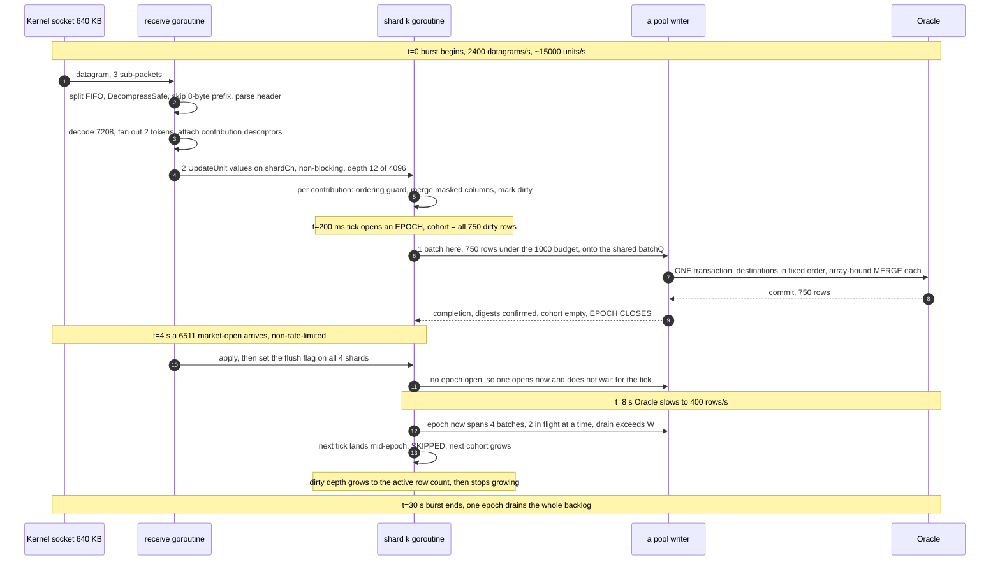

*Figure 10 — Reference burst timeline, including a database slowdown inside the burst. The critical
transition is steps 12–13: an epoch that outlasts `W` causes the next tick to be skipped and the
following cohort to be larger — additional coalescing, not a queue that grows.*

Mapped onto req §9's degradation order:

| Order | What is given up | Driven by | What happens here |
|---|---|---|---|
| 1 | Freshness of rate-limited state | **Operator**, via reload | Operator widens `W`; the system never self-adjusts it |
| 2 | End-to-end latency | **Automatic** | Epochs that outlast `W` cause skipped ticks and larger cohorts, pushing per-row latency from `W/2` toward `W + ceil(ceil(cohort / maxBatchSize) / maxInFlightPerShard) × t_commit`. This is the only automatic response, exactly as req §9 requires |
| 3 | Unthrottled write timing | **Operator**, via reload | Reclassify a chatty `non-rate-limited` transcode to `rate-limited`; on the next reload it stops triggering flushes and starts coalescing. req §9's step 3 was "intermediate values relax to latest-wins"; with intermediate preservation withdrawn (§1.1) this is the surviving form of the same lever |

**Quantified.** In the worst case for the burst, every unit in a window touches a distinct row:
15,000 units/s × 0.2 s = 3,000 distinct rows dirtied per window, spread across 4 shards = a 750-row
cohort per shard per epoch, which fits in a single batch under the 1,000-row budget — so the
aggregate is 3,000 rows per window × 5 windows/s = **15,000
row-updates/s**. That is **3× above req §3.3's ~5,000/s ceiling**, not within it: when every unit
touches a distinct row, no coalescing occurs by definition and the row rate simply equals the unit
rate. This corrects the arithmetic error recorded as Appendix A gap B1, and §7.7's headroom figure
follows from it.

In the *expected* case (hot set in the tens, req §3.3) the same burst produces tens of rows per
window, because the extra traffic lands on rows that are already dirty and coalesces into them at
zero marginal cost. **The burst's write cost scales with distinct active rows, not with packet rate**
— which is why the design absorbs a 4× packet-rate burst without a 4× write-rate increase. The
pessimistic case is not a prediction; it is the bound, and req §12.4 is the open item that decides
which end of the range is real.

**Flush amplification, the new burst dimension.** A non-rate-limited arrival costs up to `S` commits.
Left unchecked, `A` such arrivals per second would demand `A × S` commits/s and saturate Oracle long
before the row rate did. The coalescing flag (§6.6) bounds it: a shard with a flush in flight records
the request instead of stacking it, so the ceiling is `S / t_commit` ≈ 800 commits/s and the
*observable* effect of an unthrottled storm is larger batches, not more commits. This is why the
inventory decision — which transcodes are `non-rate-limited` — is a capacity decision (§4.2, OQ-2).

**Recovery is automatic.** When the burst ends, arrival drops to normal and the next epoch's cohort
is the whole accumulated backlog — ADR-018 leaves no per-window channel cap to meter it out, so
freshness returns within `dirtyDepth ÷ (writers × per-session row throughput)` seconds, i.e. at
whatever rate Oracle sustains (§9.3). Nothing is reset, no policy was changed, and no operator action
is needed (rubric 1's explicit test).

**What breaks it.** Now only one thing: if Oracle stops entirely, the fail-fast timer (§9.2) stops
the process loudly per req §10.2. The second terminal case the earlier model had — a critical
transcode flooding a fatal-on-overflow lossless queue — no longer exists, because there is no such
queue. An unthrottled flood degrades into batching instead (§6.6), which is the single most valuable
consequence of collapsing the classes.

### 7.6 Expected end-to-end latency

Measured per req §9's assumed definition: from the datagram's arrival at the socket to the commit of
the transaction containing the update (itself an open item, req §12.6).

| Term | `rate-limited` | `non-rate-limited` |
|---|---|---|
| Socket to receive goroutine | ~10–50 µs | same |
| Decompress, parse, fan out, map to contributions | ~5–20 µs (ASM-1, ASM-3) | same |
| Q1 hop | ~1–100 µs | ~1–100 µs |
| Coalescing wait for the next tick | **uniform on [0, W], mean W/2 = 100 ms at W = 200 ms** | **none — the flag opens an epoch immediately** |
| Wait for an open epoch to close | none in steady state — the epoch that batches this row is the one the tick opened | `ceil(remainingBatches / maxInFlightPerShard) × t_commit`, zero when no epoch is open |
| Q2 hop and batch assembly | ~0.1–5 ms | ~0.1–5 ms |
| Position within the epoch | `ceil(batchIndex / maxInFlightPerShard) × t_commit` — zero for the first `m` batches | same |
| Oracle write and commit | ~5–20 ms for a batch of up to 1,000 rows (ASM-5, ASM-6) | ~3–6 ms, but the batch carries whatever else was dirty |
| **Total** | **~105 ms mean, ~225 ms worst** at a single-batch cohort | **~4–10 ms**, degrading toward `W` under flush-request coalescing |

**Dominant term for rate-limited traffic: the flush window**, contributing about 95 % of the path. It
is also the primary control relating write rate to latency (NFR6 says exactly this), and it is
reloadable: at `W = 50 ms` the mean falls to ~30 ms at the cost of 4× the commits. The floor on `W`
is set by FR6's target of 1–10 updates/s per active token, i.e. `W ∈ [100 ms, 1 s]`; `W = 200 ms`
gives 5/s, mid-range.

**The deep-backlog case is where the epoch model earns its keep.** Under the old one-batch-per-tick
flush, a shard holding four batches' worth of rows paid a full `W` per batch — 600 ms of queued
staleness for the last of them, and the wait grew linearly with backlog at 200 ms a step. An epoch
pays a *commit latency* per batch instead, divided by `maxInFlightPerShard`: the same backlog clears
in `200 + 2 × 20` = **240 ms**, and each further batch adds 20 ms rather than 200 ms. The steady-state
figures above barely move; the tail improves by roughly `W / (t_commit) ÷ m` — about 10× at the
defaults, more as `m` rises.

**Non-rate-limited latency is not constant**, and the document should not pretend it is. The
~4–10 ms figure holds when such arrivals are sparse — which is the expected inventory. If they arrive
faster than an epoch completes, the coalescing flag (§6.6) means the second and subsequent arrivals
wait for the open epoch to close and then ride the next one, so latency rises toward `W` and the class
degrades gracefully into the rate-limited case rather than into commit amplification. That is the
intended behaviour, but it means *the class guarantees promptness, not a bound*.

Because latency is dominated by a reloadable tunable rather than by structure, it is a *tuning*
outcome rather than a design outcome — any other latency target inside the FR6 band is reachable
without touching the architecture.

### 7.7 Saturation and headroom

| Dimension | Saturates when | Multiple of req §3.3 | First stage to give out |
|---|---|---|---|
| Aggregate packet rate | `distinctRowsPerWindow / W` exceeds `writers × per-session throughput` | ~**0.3×** at the pessimistic 3,000-distinct-rows-per-window bound *against req §3.3's ~5,000 rows/s* — i.e. it does not keep up; ~**50×+** at the expected hot-set-of-tens. See the caveat below: the divisor is a demand figure, not a measured capacity | **Oracle write path** — mitigated by raising `writers`, and `maxInFlightPerShard` where one shard is the problem |
| Aggregate packet rate, decode-limited | single-goroutine decode at ~5 µs/packet | ~**20×** (≈200,000 packets/s); ~**2×** if ASM-1 and ASM-3 are wrong by 10× | receive goroutine |
| Per-destination-row update rate | never, in practice | ~**100×+** | receive goroutine, not the shard |
| **Non-rate-limited arrival rate** | flush requests arrive faster than `S / t_commit` ≈ 800/s | depends entirely on the inventory — unbounded in principle | commit rate, then **latency for that class**, never a stop |
| Distinct active rows | dirty depth grows until per-row latency is unacceptable, not until memory fails | bounded by the destinations' key spaces | freshness, then operator judgement |

The per-row result is worth stating plainly because it is the design's strongest quantitative
property: **a single token going from 5,000 to 500,000 packets/s costs the write path nothing at
all.** All the extra traffic coalesces into one already-dirty entry, so the row-update rate for that
row stays at `1/W`. The extra cost is confined to the receive goroutine's decode and the shard's
merge (≈200 ns), so the ceiling on per-row rate is the same ceiling as the aggregate decode path.
Designs that write per packet, or that debounce per key with a timer per update, do not have this
property.

**The honest weak point is the first row, and it is worse than the earlier draft claimed.** If every
unit in a window touches a distinct row, the write path needs 15,000 rows/s against the ~5,000/s
figure req §3.3 supplies — it falls behind by roughly 3×, and the symptom is dirty depth growing
until the burst ends. Three things make this survivable rather than fatal: the backlog is bounded by
the mirrors (§7.3), so falling behind costs staleness and not memory; the pessimistic case requires
the active row set to be thousands, which req §12.4 has not established and the expected figure
contradicts; and the write path now has a lever that does not require a restart.

**Write parallelism is that lever.** Since ADR-005 decoupled the pool from the partitioning,
`writers` can be raised — at runtime (§6.9) — without re-keying a mirror, because a writer holds no
mirror state. Aggregate write capacity is `writers × per-session throughput`, and the ceiling is the
Oracle session budget (OQ-8), not the shard count. The reloadable levers are therefore **`writers`,
`W` and `maxBatchSize`**; `shards` and `maxInFlightPerShard` remain startup-only. This resolves
Appendix A gap S3 properly: the lever the degradation playbook wanted to offer now exists.

**Nothing in the flush mechanism caps the drain any more.** ADR-018 made a tick flush the entire
dirty set, so the `maxBatchSize/W` per-shard ceiling the earlier draft quoted — 20,000 rows/s across
four shards — is gone. Whatever a shard has dirty leaves in one epoch, split into as many batches as
`maxBatchSize` requires. The only thing between the mirror and Oracle is now `writers` and
`maxInFlightPerShard`, which is the correct place for the limit to sit: the first row of this table
saturates on the database, not on a channel.

**`maxInFlightPerShard` is the second lever, and it is the one for *imbalance* rather than for
aggregate rate.** `writers` sets how much write work the process can do at once across all shards;
`maxInFlightPerShard` sets how much of that a single shard is allowed to claim. Raising `writers`
without raising it does nothing for the designated general shard (§7.12 risk 3), which is skewed by
construction and is exactly the case the pool was introduced to serve. The pairing to watch is
`rows_inflight{k}` against `writers_busy` (§10.1): writers idle while one shard's `epoch_duration`
climbs means `maxInFlightPerShard` is the binding constraint, and it needs a restart to change
(§6.9). OQ-14 is the measurement that should set it.

Two caveats on each of the other two, so the playbook is honest about which regime they work in.
Widening `W` only helps when rows **repeat** across the window; if every unit truly touches a
distinct row, a longer window has nothing to coalesce and the row count per second is unchanged.
And more writers help only if the bottleneck is per-session row throughput — if it is commit rate,
more sessions mean more commits competing for the same redo log writer, which is worse. At the
defaults each shard issues 5 commits/s, 20/s in total, so there is ample room before that binds.

**One number here is a guess and should be replaced by a measurement.** The ~5,000 rows/s figure is
req §3.3's *derived worst-case demand* — "the uncoalesced worst case… size for survivability at this
rate" — not a measured Oracle capacity, and this table divides against it as though it were one.
§7.6's own assumption (ASM-5: a batch of up to 1,000 rows commits in 5–20 ms) implies something far
higher per session. OQ-4 is the half-day spike that settles it; until then the first row of this
table should be read as a bound, not a forecast.

### 7.8 Fit to the platform

**CPU.** Bounded by entitled capacity 4, with `GOMAXPROCS` pinned to 4 by configuration (ADR-009).
Steady-state: receive goroutine ~5–10 % of one core, four shards ~1 % combined, writers essentially
idle (blocked on I/O), stats negligible. **Total under 15 % of one core**, leaving the partition's
capacity for the operating system and for ASM-1 being wrong.

**Memory at 200,000 tokens.** Per ASM-7 — two token-keyed destinations at the full universe and one
small general-keyed destination:

```
Entry                     336 B  (row 8, colMask 8, seq[4] 16, time 8, digest 8,
                                  flags+pad 32, image 256)
Entries                   200K + 200K + ~100          =  ~400,000 rows
Arenas (3)                400,000 x 336 B             =  134 MB
Indexes map[RowKey]int32  400,000 entries, ~18 B eff. =    7 MB
Channels                  Q1 4 x 4096 x 384 B         =    6 MB
Batch buffers             4 shards x m=2 x 1000 x 336 =    3 MB
Dirty rings               400,000 int32, x2 for the   =    3 MB
                          accumulating/cohort pair
Fixed buffers             readBuf 64 KB + decompBuf + fanout  <1 MB
                                                       --------
Resident total                                         ~153 MB
```

**The ring pair is not a new cost.** A row index sits in exactly one of the two rings at a time, so
the occupied total is bounded by the row count either way; what doubles is only the retained slice
*capacity* at high-water. The earlier one-batch-per-tick flush already swapped each dirty ring with a
spare on every flush — ADR-018 keeps the swapped-out ring for the whole epoch instead of for one
batch, so the second ring already existed and merely lives longer.

Against a 40 GB budget that is 0.4 % — and **little more than half the earlier `(token, transcode)`
model's 285 MB**, because transcodes that contribute columns to the same row now share one entry instead of
holding one each. Adding a third token-keyed destination costs ~67 MB. req §4 explicitly says a
design holding a full in-memory mirror should not be rejected on memory grounds, and the arithmetic
agrees with a wide margin.

**Garbage collector.** The arenas are pointer-free, so the mark phase never traces 134 MB of them —
this is why `Entry` uses fixed arrays rather than slices, and why each index is `map[RowKey]int32`
rather than `map[RowKey]*Entry`. Each arena is chunked so growth appends a chunk instead of copying
and briefly doubling. Steady-state allocation on the packet path is zero, so the collector runs only
for batch buffers and the rare slow paths.

**AIX specifics.** No `golang.org/x/sys` dependency (req §4 warns its AIX surface is thin);
`SetReadBuffer` comes from `net`, signals from `os/signal`, everything else from the standard library
plus `go-ora`. No `SO_REUSEPORT`, no batched receive, no platform-specific syscalls — nothing that
req §4 says must be confirmed available on AIX before depending on it. Concurrency correctness is
tested on Linux with the race detector and cross-compiled for deployment, per req §4.

### 7.9 Sensitivity to the open items

| Open item | Impact | What would change |
|---|---|---|
| req §12.1 Transcode inventory | **Medium**, up from very low. The registry and the policy table are still data, but the inventory now also settles which transcodes contribute which columns to which destination, and how many are `non-rate-limited` — the latter being a capacity decision (§4.2, §7.7) | A config line per transcode plus its contribution descriptors; nothing structural |
| req §12.2 "Persist every occurrence" semantics | **Medium**, up from low. §8.1 answers it as *latest-occurrence-observable*, which is a weaker reading than the earlier draft assumed. If the stakeholder needs every occurrence observable, an append destination has to come back — and it would be a fourth destination, outside the three-mirror model | A fourth destination and a second statement per batch |
| req §12.3 Ordering field semantics | **Very low for FR9** — ordering is structural (§6.7 mechanism 1) and survives the fields being useless. **High for FR10 gap detection only** | Gap detection scope switch, already designed (§6.5). *See Appendix A, gap B7* |
| req §12.4 Active token count | **Medium.** It is the input to write-path headroom (§7.7). If it is thousands, `W` widens or connections increase | Tunables, not structure |
| req §12.5 Capture capability | **None.** No design decision depends on a capture; §6.5's audit mode substitutes for items 3 and 4 | — |
| req §12.6 Latency endpoints | **None.** The estimate decomposes by term, so any endpoint definition can be read off Table 7.6 | — |
| req §12.7 Session boundaries | **Low.** Only the liveness alarm severity gate (§6.10) | Configuration |

This row set is the rubric-4 case for the design: the largest unresolved item in the requirements
(req §12.3) threatens only a diagnostic, not a correctness requirement, because FR9 is established by
ownership rather than by a header field. ADR-007 is where that argument is recorded.

### 7.10 Module breakdown

As §6.1, with `state` implemented as the sharded mirror described in §7.3 and `writer` implemented
one-per-shard. The boundary that carries the most weight is `router` → `state`: it is the only place
a drop can occur at all, so it is where the drop policy lives, where the counters live, and where a
test can assert the policy without a database or a socket. `destinations` → `state` carries almost as
much weight: it is where a column mask that disagrees with the schema would first be visible.

### 7.11 Where requirements satisfaction is non-obvious

Per req §11.2 item 11, only the non-obvious cases:

- **NFR3 (concurrent DB writes).** Satisfied 4-way, partitioned by destination row rather than by
  round-robin — which is what makes it safe under FR9 *and* what makes row-level deadlock impossible.
- **NFR4.** Satisfied with a 5,000× margin in decode and a 2× margin against the send deadline; the
  flush trigger adds no wait at all. The binding risk is ASM-4, not the design.
- **FR9.** Satisfied structurally **for the destination row**, which is the granularity req §9
  actually specifies, and without depending on req §12.3 resolving.
- **NFR13.** Satisfied by the dirty rings (no sweep) plus the written-image digest (no rewrite), with
  the digest check skipped for non-rate-limited contributions so the carve-out holds without a lane.
- **NFR1, NFR2, NFR6.** **Deviated from, not satisfied** — see §1.1 and ADR-016. Three classes become
  two, the discard limiter is gone, and write mode is implied by class rather than configured.
- **FR7.** Satisfied in the "applied" sense only — see §1.1 and §8.1.

### 7.12 Risks specific to this design

1. **A `[]byte` or pointer creeping into `UpdateUnit` or `Entry`** would silently alias a reused
   buffer or re-introduce GC scanning of 256 MB. Named as an invariant in §6.1 and gated by a
   reflection test in §10.4. This is the most likely way a correct design becomes an incorrect
   implementation.
2. **A LIFO dirty ring** would starve old keys under sustained overload and quietly break the one
   correctness property req §9 says is never given up (§6.7).
3. **Shard skew.** If one token dominates and hashes alone into a shard, that shard's flush is
   dominated by one row. Harmless here (coalescing collapses it) but it makes per-shard counters
   essential for diagnosis. The designated general shard is skewed by construction and should be
   watched separately.
4. **Digest-based suppression hiding a real write failure.** The digest must be updated on
   *confirmed commit*, never on enqueue, or a failed batch would leave the entry looking written.
   Called out in §7.3 — and see Appendix A, gap B4, for what the completion path still has to define,
   which now includes confirming the column mask and the per-transcode sequence slots.
5. **A column mask that disagrees with the statement.** The merge sets mask bits and the writer emits
   a statement from them; if the two drift, a column is either silently not written or written from a
   stale image. This is new with the destination-keyed mirror and needs a test that asserts the
   emitted statement's column list against the entry's mask.
6. **A destination whose row key is not derivable from the shard key** (ASM-15). It would break
   single-writer-per-row invisibly — no error, just occasional lost updates and the possibility of a
   deadlock. `-selfcheck` must reject it at load; it cannot be caught at runtime.
7. **The in-flight state machine getting a transition wrong.** New with the writer pool (ADR-005).
   Missing the `ReDirty` path loses the update that arrived mid-flight; clearing `InFlight` before
   the completion arrives lets the row into a second batch and reintroduces the ordering race the
   pool was made safe against. It is goroutine-local, so it cannot *race* — but it can be plainly
   wrong, and nothing fails loudly. Gated by three property tests in §10.4.
8. **Confirming the digest from the entry rather than from the batch.** A one-line difference that
   records an image as written when it never was, after which NFR13 suppresses the real value
   indefinitely. The most subtly destructive single mistake available in this design.
9. **An epoch that never closes.** New with ADR-018. Anything that appends to a *cohort* ring rather
   than to the accumulating ring — a re-dirtied row requeued to the wrong one, or a failed batch
   re-admitted to the epoch it came from — lets work arriving during a drain extend the drain, and
   under sustained load the epoch never ends: no tick ever fires, the accumulating rings grow and the
   whole flush cadence silently stops. The mitigation is structural rather than a check: **cohort
   rings are drain-only**, and every exit from the in-flight state targets the accumulating ring
   (§6.7, §7.3). Gated in §10.4 by the epoch-termination-under-persistent-failure test, which is the
   case a reviewer is least likely to think of.
10. **The two rings getting swapped the wrong way**, so the tick drains what has just accumulated and
    leaves the older cohort in place. The symptom is not an error but a slowly rising floor under
    `dirty_depth` — a set of old rows that never get written while everything else looks healthy.
    `epoch_rows` summing to less than the rows dirtied over the same interval is the observable.

---

## 8. Persistence and schema strategy

req §8 defers schema design; req §12.2 says one semantic question cannot be deferred and that Phase 1
designs must state which they assume. This section answers it.

### 8.1 The req §12.2 question, answered

> If successive occurrences of a critical or intermediate-preserving transcode update the same row in
> place, they overwrite each other and "every occurrence persisted" is indistinguishable from "the
> latest occurrence persisted".

**Assumed answer: in-place, latest occurrence observable.** There is no append-only event
destination. Every unit — both classes — is merged into a current-state row and written by upsert;
successive occurrences of the same transcode against the same row overwrite each other. Rationale,
and the cost, stated together because the cost is real:

- This is stakeholder direction (§1.1): intermediate values need not be preserved anywhere. With
  that, the append destination's only remaining job would be auditing FR7, at the price of the one
  unbounded table in the system, and nobody owned its retention.
- The consequence is that **FR7 stops being checkable by `COUNT(*)`**. In the earlier model,
  occurrences received (an FR10 counter) could be reconciled against event rows written. Now the
  counter stands alone: `units_applied` records what the system did, and nothing in the database
  corroborates it. That is a genuine loss of verifiability and §10.1 keeps the counter precisely so
  the claim is at least *stated* somewhere.
- Non-rate-limited traffic is *applied* on arrival and flushed immediately, so under any normal
  arrival pattern each occurrence does reach the database as its own write. What is not guaranteed is
  that two occurrences inside a single flush cycle produce two writes — they produce one (§1.1).

**Second question, also from req §12.2 — `UPDATE`-only against pre-seeded rows, or upserts that may
insert unseen tokens? Assumed answer: upsert.** `MERGE INTO … USING dual` (there is no `ON CONFLICT`
in Oracle, req §7 and `poc/db.go:247`). A new contract can be listed intraday and arrive as a 7305
security-master change (bible §4.3) for a token no pre-seeded row exists for; an `UPDATE` would
affect zero rows and the data would be lost silently. `poc/db.go:402` already shows what that failure
looks like — a WARN that a real server reports as success. Upsert removes the failure mode entirely.

**Third question, raised by the three-mirror model and not by req §12.2: what is a destination?**
Exactly three, each declaring a name, a row key derived from the unit's shard key (ASM-15), and a
column set. Their identities are schema work req §8 defers (OQ-13); the design fixes the *count* at
three, the *keying rule*, and the *write order*. §8.2 shows one plausible instantiation.

### 8.2 Illustrative schema

Illustrative only: req §8 defers the transcode→column/table mapping, and this diagram exists to make
the *shape* concrete, not to fix column lists. What **is** fixed is that there are three of them,
each with a row key derivable from the shard key, and a write order.

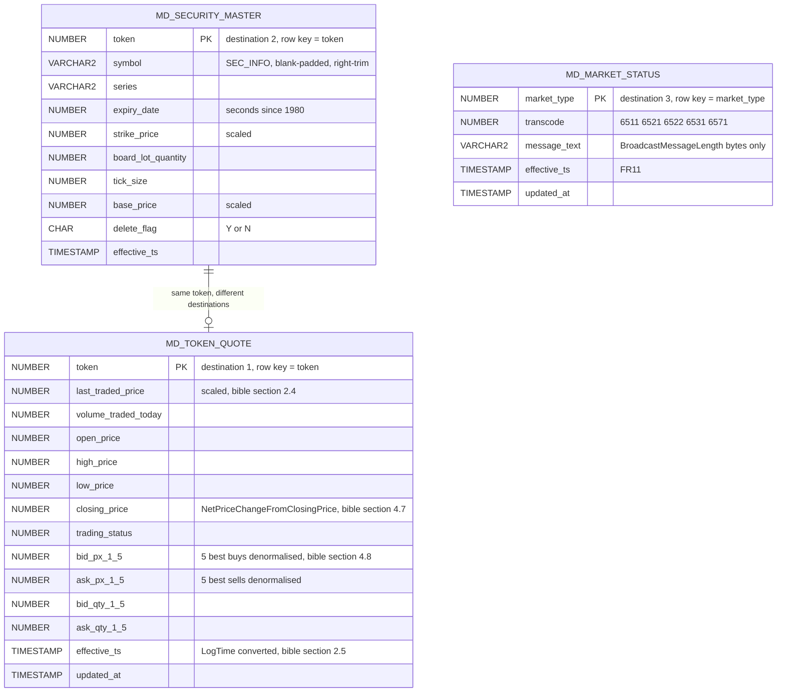

*Figure 11 — One plausible instantiation of the three destinations. Destinations 1 and 2 are
token-keyed, so they shard with their unit; destination 3 is general-keyed and lives on the
designated shard (§6.5, ASM-15). Column lists are illustrative; the shape — exactly three
current-state destinations, no append destination — is the design decision.*

Two things about this instantiation are worth saying even though the columns are illustrative. First,
**the MBP depth ladder is denormalised into the quote row** rather than held as up to ten rows of its
own. That keeps *one key = one row*, which is what every write-rate figure in §4.2 and §7.5 assumes;
a separate ladder table would multiply the row rate by up to eleven and every one of those figures
would have to be restated. This resolves Appendix A gap S6 by construction, and it is a constraint on
whatever the three destinations finally turn out to be, not merely a preference.

Second, **several transcodes can and do contribute to one destination** — 7305 and 7340 both write
`MD_SECURITY_MASTER` — which in the earlier `(token, transcode)` model meant two keys, two shards,
two writers and no ordering relationship between them (Appendix A, gap B2). Keying the mirror by the
row removes that: both contribute to one entry, guarded by their own sequence slots, flushed by one
writer.

### 8.3 Write strategy

| Aspect | Decision | Why |
|---|---|---|
| Statement | `MERGE INTO t USING dual ON (rowkey = :1) WHEN MATCHED THEN UPDATE … WHEN NOT MATCHED THEN INSERT …` | Oracle has no upsert alternative (req §7, `poc/db.go:247`); handles intraday listings |
| Columns written | Only those set in the entry's `ColMask` | A transcode that knows some columns must not blank the rest (§6.7). The mask is what the statement's `SET` list is built from |
| Binds | Positional `:1, :2, …`, array-bound where `go-ora` allows (ASM-6) | `?` is not an Oracle placeholder and fails as `ORA-00936` pointing nowhere near the cause (`poc/db.go:236-246`) |
| Transaction boundary | **One transaction per batch, spanning all three destinations** | Amortises the redo log flush, and — with the fixed order below — is what makes the deadlock argument hold. A batch is executed by whichever pool writer takes it; which writer is immaterial, because batches never overlap (§8.4) |
| Statement grouping | One array-bound statement **per destination per distinct column mask** within the batch | A batch is `[3]map[ColMask][]row`; rows sharing a mask share a statement |
| **Destination order within a transaction** | **Fixed and global: destination 1, then 2, then 3** | Two transactions that acquire locks in the same order cannot deadlock, even if the disjoint-ownership invariant were ever violated. This is the second of the two layers in §8.4 |
| Row ordering within a destination | Sorted by row key | Consistent acquisition order inside a destination, and better index locality |
| Idempotency | `MERGE` is naturally idempotent, and with no append destination there is nothing that is not | A retried batch rewrites the same images to the same rows. This is a direct simplification of dropping the event table: the `ORA-00001`-on-retry dance is gone |
| Retention | **Every destination is bounded by its own key space.** Nothing in the design grows without limit | The one unbounded table the earlier model had is gone with the append destination |
| Connections | `writers` + 1 spare, default 5, `ConnMaxLifetime` 30 min under the profile's `IDLE_TIME` | Oracle kills idle sessions silently and the first reuse surfaces as `ORA-03113`; retiring first turns an error into a reconnect (`poc/db.go:40-45`). `writers` is independent of `shards` and reloadable (§6.9) |

### 8.4 Why two transactions cannot deadlock

Oracle takes row locks, and a deadlock needs two transactions to acquire two rows in opposite orders.
Because any transcode may contribute to any of the three destinations, this is a real hazard rather
than a theoretical one, and it is answered in two independent layers — either alone would suffice,
which is the point of having both:

1. **No row is ever in two in-flight batches.** Across shards this follows from ownership: a
   destination row belongs to exactly one shard (ASM-15), so two shards' batches can never overlap.
   Within a shard it follows from the in-flight rule (§6.7): a row that is already batched merges in
   place and sets `ReDirty` rather than re-entering the ring, so it cannot appear in a second batch
   until the first is confirmed. Every transaction in flight therefore touches a row set disjoint
   from every other — **whichever writer happens to be executing it** — and disjoint sets cannot
   deadlock.
2. **Fixed acquisition order.** Within a transaction, destinations are written 1 → 2 → 3 and rows
   sorted by key inside each. If layer 1 were ever broken — a misconfigured destination whose row key
   is not derivable from the shard key, which `-selfcheck` exists to prevent, or a defect in the
   in-flight marking — two transactions would still acquire any shared rows in the same order, so the
   failure mode would be waiting, not deadlock.

Note that layer 1 no longer depends on there being one writer per shard. That mapping was what
carried the argument before ADR-005 decoupled the pool; the in-flight rule carries it now, and it
covers strictly more cases — several writers may be executing batches from the *same* shard
concurrently, which the earlier structure simply prevented from arising.

It also covers the case ADR-018 introduced: **several batches of the same epoch, in flight at
once.** A row's index *leaves* the cohort ring at the moment the pump copies it into a batch, and
nothing is ever appended to a cohort, so the pump physically cannot hand one row to two batches of
the same epoch. The disjointness argument therefore needs no extra clause for intra-epoch
concurrency — it is the same fact stated once, and `maxInFlightPerShard` can be raised without
revisiting it.

This is also the reason a flush covers **all three destinations in one transaction** rather than one
transaction per destination. Three separate transactions per flush would triple the commit count for
no benefit, and would reintroduce the interleaving that layer 2 exists to rule out.

---

## 9. Failure modes, degradation and recovery

> **Note on numbering.** Throughout this document `req §12.x` means an *open item* in the
> requirements document's Section 12. `§9.x` means a subsection of this section.

### 9.1 Failure-mode table

Every failure this design anticipates, with what detects it, how far it spreads, what the system
does, and what a human is expected to do. Ordered roughly by how often it will happen.

| # | Trigger | Detection | Blast radius | System response | Operator action |
|---|---|---|---|---|---|
| F1 | Sequence gap in `BCSeqNo` — datagrams lost on the wire or in the kernel | Gap detector on the receive goroutine (§6.5); bible §2.8 | The lost messages, permanently. Coalesced tokens self-heal on the next tick; a lost critical message does not | WARN `seq_gap from to missing`, counter `seq_gap_messages`. **No recovery is possible or attempted** — bible §1: no host-end inquiries | Correlate with `netstat -s -p udp` overflows. If ours, raise `udp_recvspace` or investigate a stall. If not ours, it is the circuit and only the exchange can answer |
| F2 | Unknown or unconfigured transaction code | Registry lookup miss (§6.4); req §12.1 says these *will* occur | That message only. Framing is unaffected because the cursor comes from `iCompLen`/`MessageLength`, not from understanding the body (bible §3.3) | Count by code, log once per code per interval, continue the sub-packet loop | Add the code to the inventory and its policy row; reload (NFR8). No rebuild if a decoder already exists |
| F3 | Decompression failure on one sub-packet | `DecompressSafe` returns an error (bible §3.5; `poc/decompress.go:28`, contained at `poc/gobrdclnt.go:190`) | That sub-packet. **Remaining sub-packets in the same datagram are still framed correctly**, because the cursor advanced by `iCompLen` before decompression | Count `decompress_failed`, ERROR with the packet index, skip to the next sub-packet | If sustained, suspect a wrong compression assumption or wire corruption; capture and compare against the compressed-code list (bible §3.1) |
| F4 | `MessageLength < 40` on an uncompressed sub-packet | Explicit check (bible §3.3; `poc/gobrdclnt.go:572-574`) | **The rest of the datagram** — accepting it advances the cursor too little and misframes every later sub-packet | Abandon the remainder of this datagram, count `framing_abandoned`, ERROR | Almost always a decode/format change; capture the datagram and re-verify against Part V of the bible |
| F5 | Payload byte 0 does not match the segment netId | Free frame-alignment oracle (bible §3.4; `poc/gobrdclnt.go:233-243`) | Diagnostic only — never used to drop | WARN with the hint that a mismatch on sub-packet 2+ means the previous length was computed wrongly | On sub-packet 1, suspect wrong segment or a changed encoding; on sub-packet 2+, suspect a framing bug |
| F6 | Datagram larger than 516 bytes | Read buffer is 64 KB, deliberately larger than the envelope, so oversize is visible rather than silently truncated (bible §3.2, §3.6; `poc/exchange_communication.go:23`, `poc/gobrdclnt.go:158`) | The excess beyond `cPackData`'s 512 bytes | WARN, trim to 512, process what fits (`poc/gobrdclnt.go:534-543`) | The envelope assumption has changed — escalate to the exchange before trusting any decode |
| F7 | `ErrorCode` non-zero in the header | Checked before dispatch (bible §2.10) | That message. The payload is `MS_ERROR_RESPONSE` (182 bytes), not the structure the code implies | Count `error_response`, log the key and message text, write nothing | If non-zero is common, ASM-9 is wrong and `MS_ERROR_RESPONSE` needs a first-class decoder |
| F8 | `NoOfRecords`/`MsgCount` out of range | Clamp and warn (bible §4.4b, §4.8, §4.16; `poc/gobrdclnt.go:360-366`) | The over-declared records only | Clamp to the array bound, parse only that many, count `record_count_clamped` | A persistent non-zero count means corruption or misframing upstream of the parse |
| F9 | Shard ingest queue Q1 saturated | Non-blocking send fails, then the 50 ms deadline expires (§6.6) | All traffic for that shard, both classes | Drop **oldest**, count `shard_dropped`; three expiries in 60 s escalates to a fatal stop | Widen `W`, raise `maxBatchSize`, or investigate why a shard goroutine stalled. Reloadable, no restart. **Note this is now the only place FeedValve itself discards data**, and it is class-blind — a dropped unit may be a non-rate-limited one |
| F10 | Non-rate-limited arrivals faster than flushes complete | `flush_coalesced` rising against `flush_triggered` | That class's latency only | Requests coalesce; a shard runs one epoch at a time and the class degrades toward `W`. **No queue fills and nothing stops** (§6.6) | Usually nothing — this is the designed behaviour. If sustained and the latency matters, reclassify the offending transcode to `rate-limited`, which is the same lever with an honest name |
| F11 | Database transiently slow | `epoch_duration` exceeds `W`; `tick_skipped_epoch_open` and `dirty_depth` rise | Freshness only | The epoch outlasts the window, so the next tick is skipped and its rows join a larger cohort; the flush flag survives an unserved tick so a pending request is not lost. **This is the intended automatic degradation** (req §9 step 2) | Usually nothing. If sustained, **raise `writers`** — a live lever since ADR-005 — or widen `W`, or raise `maxBatchSize`. If writers sit idle while one shard's `epoch_duration` climbs, the binding constraint is `maxInFlightPerShard`, which is startup-only (§6.9, OQ-14) |
| F12 | Dead Oracle session (`ORA-03113`/`ORA-03114`) | `oracleErrCode` classification (`poc/db.go:412`) | **One batch — no longer a whole partition.** With the pool decoupled from the shards (ADR-005), the affected writer's batch is returned failed and its rows are re-dirtied; every other writer keeps serving every shard | Retry once on a fresh connection; `ConnMaxLifetime` under the profile `IDLE_TIME` prevents most occurrences (`poc/db.go:40-45`) | None if it self-heals. Recurring means `IDLE_TIME` is shorter than `ConnMaxLifetime` |
| F13 | Database hard outage (`ORA-12541`, no listener; connect refused) | Consecutive failures across all writers | **Whole process**, by design | Retry with backoff until the fail-fast budget expires, then **stop loudly** — req §10.2 defines a DB outage as an application outage; no spooling, no catch-up (req §8) | Fix the database, restart FeedValve, accept the staleness in req §10.3 |
| F14 | Data error on one row (`ORA-00001` duplicate, `ORA-01438` value too large) | `oracleErrCode` classification | One row | Log with the key and the ORA code, count `row_rejected`, **continue the batch**. Retrying will not help and killing the feed for one bad row is worse | Investigate the value; usually a scaling or column-width mismatch (bible §2.4: v3.5 changed price precision from (6,4) to (7,2)) |
| F15 | Invalid configuration on SIGHUP | Validation before the atomic swap (§6.9) | None | Reject wholesale, log the reason, keep running the previous configuration | Fix the file and re-send SIGHUP |
| F16 | Disk fills from operational logging | Log volume is bounded by design; the packet-log pattern already needed a cap (`poc/logger.go:31-61`) | Host-wide if unbounded | The full-payload packet log of `poc` is **not** carried into production; operational logging is counters plus bounded-rate events (§10) | Rotate via the platform's normal mechanism |
| F17 | Circuit silent — no data and no 6541 pulse | Liveness state machine (§6.10; bible §4.12) | All data, for the duration | WARN at `heartbeatWarn`, ERROR at `heartbeatDown`, with the outage duration logged on recovery. Severity downgraded outside the trading window | Check the circuit with the exchange. FeedValve cannot request a resend (bible §1) |
| F18 | Process restart mid-session | Startup log | Every token that does not tick again keeps its pre-restart database value (req §10.3) | Mirror starts empty; the first unit per key writes unconditionally, then the guard engages | Accept. req §9 classes a mid-session restart as exceptional |
| F19 | Datagram from an unexpected source address | Source counter (ASM-12) | None by default | Count and log; **never drop by default**, mirroring the netId philosophy (`poc/gobrdclnt.go:225`) | If a second source is legitimate, nothing. If not, set the optional allow-list |

### 9.2 Database failure taxonomy and fail-fast

Referenced from §7.4 and §7.5. The distinction that matters is between errors where retrying could
succeed and errors where it cannot; `oracleErrCode` (`poc/db.go:412-418`) exists precisely so this is
a code comparison rather than string-matching error text.

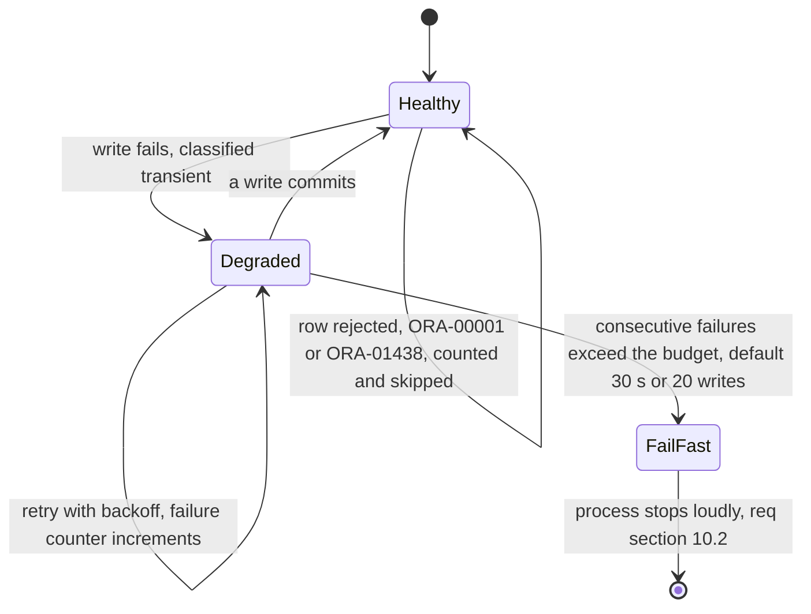

*Figure 12 — Writer health. Row-level data errors never leave Healthy; connection-level errors move
to Degraded and are retried; only a sustained inability to write reaches FailFast, which is the
terminal behaviour req §10.2 prescribes for a database outage.*

| Class | Examples | Retry? | Effect |
|---|---|---|---|
| Row-level data error | `ORA-00001` unique constraint, `ORA-01438` value larger than precision, `ORA-12899` value too large for column | No | Skip the row, count, continue the batch, stay Healthy |
| Session-level transient | `ORA-03113`, `ORA-03114`, `ORA-12541`, `ORA-12170` timeout | Yes | Retire the connection, retry once on a fresh session, then backoff |
| Statement-level | `ORA-00936` missing expression, `ORA-00942` table does not exist | No — these are deployment defects, not runtime conditions | Log at ERROR with the destination and statement name and stop the affected writer; a wrong statement will never become right |
| Deadlock (`ORA-00060`) | — | Yes, once | **Should be unreachable** (§8.4). If it ever fires, the disjoint-ownership invariant is broken — log at ERROR naming both destinations, retry the batch once, and treat a recurrence as a configuration defect rather than a runtime condition |
| Sustained unavailability | All writers failing past the budget | — | FailFast: log the reason, drain what can be drained, exit non-zero |

Two deliberate choices. **The fail-fast budget is time-based as well as count-based**, so a lightly
loaded system that writes once a minute does not take twenty minutes to notice a dead database.
**A statement-level error stops one writer rather than the process**, because it is almost always one
destination's statement being wrong while the rest of the feed is landing correctly — stopping
everything would turn a partial deployment defect into a total outage.

Note the asymmetry the writer pool introduces here. A **session-level** failure is now fully routed
around: the batch is returned failed, its rows re-dirty, and any other writer picks up the retry —
where the earlier one-writer-per-shard mapping left that shard's partition unwritten. A
**statement-level** failure is not, because the statement is wrong for every writer equally; retiring
writers one at a time would eventually empty the pool. The pool must therefore stop *itself* rather
than stop writer-by-writer once the same statement fails on more than one writer, and that rule is
part of what Appendix A gap B4 still has to pin down.

### 9.3 Degradation and recovery paths

Referenced from §0 and from §7.5. Failure paths drawn as paths, not only as table rows.

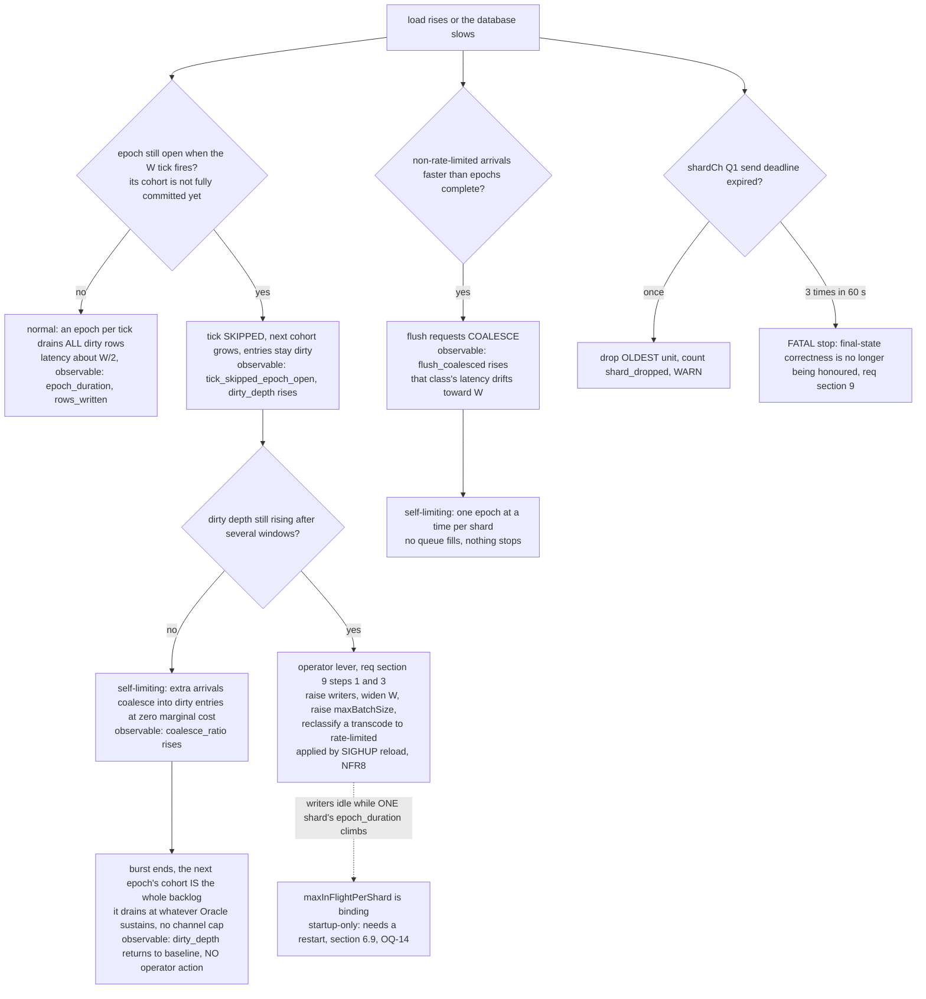

*Figure 13 — Degradation and recovery. Both the left branch and the flush-coalescing branch are
automatic and always return to normal without intervention. The dotted branch is the one lever an
incident cannot pull, and it is deliberately drawn so that nobody discovers it at 03:00. **Q1
escalation is now the only path that
stops the process**, besides the database fail-fast of §9.2 — the earlier model's second terminal
condition, a fatal overflow on the lossless lane, no longer exists because the lane does not.*

The property to check this diagram against is req §9's rule that **the only automatic degradation is
latency growth**. The left branch grows latency and nothing else: no interval is changed, no policy
class is relaxed, no critical message is dropped. Steps 1 and 3 of req §9's table appear only as the
operator lever box, reached by reload rather than by the system deciding for itself.

Recovery, stated explicitly because rubric 1 tests for it: after the reference burst ends, arrival
falls to normal and the next epoch's cohort is **the whole accumulated backlog** — there is no
per-window channel cap to meter it out, so the drain rate is simply **whatever Oracle sustains,
~5,000 rows/s (§4.2)**. A backlog of 10,000 dirty rows clears in about two seconds. The earlier draft
quoted a `maxBatchSize × shards / W` = 20,000 rows/s channel capacity alongside it and then explained
that the real rate was four times lower; with ADR-018 that channel figure is simply gone, and the
database rate is the only one. No state is reset, no restart occurs, and no configuration is changed.
This corrects the second half of Appendix A gap B1.

### 9.4 Packet loss and gap detection

Three distinct sources of loss, only two of which the system can see:

1. **On the wire, before the host.** Invisible to us except as a `BCSeqNo` gap. Unrecoverable
   (bible §1, §2.8).
2. **In the kernel socket buffer**, when the read loop stalls longer than the buffer's slack.
   Invisible in-process; visible as `netstat -s -p udp` socket buffer overflows, and *also* as a
   `BCSeqNo` gap. req §10.4 puts this out of scope; NFR4's stall budget exists to make it unlikely.
3. **Inside FeedValve**, only at F9 (Q1 drop-oldest). Counted explicitly and never silent — but with
   the lanes collapsed it is **class-blind**: Q1 carries both classes, so a drop can discard a
   non-rate-limited unit. The earlier model made that structurally impossible at the cost of a fatal
   overflow path; this one trades a certainty for a counted rarity (§6.6, §14.2 R8).

That the second and third are distinguishable matters operationally: a gap **with** a matching rise in
`shard_dropped` is ours; a gap **without** one, correlated with `netstat` overflows, is a stall; a gap
with neither is the circuit. That triage is the whole reason both counters exist.

Gap detection cannot recover anything and the design must not imply otherwise (req §10.1). What it
does provide is a magnitude — `missing=N` — which converts "the data looks odd" into "we lost 340
messages between 10:14:02 and 10:14:03", which is the difference between a diagnosable incident and a
rumour.

### 9.5 Malformed and corrupt input

NFR12 requires that a malformed packet be logged and dropped without affecting subsequent packets or
terminating the process. Four layers deliver that, and the ordering between them is deliberate:

1. **Cursor arithmetic before content.** Sub-packet lengths come from `iCompLen` or `MessageLength`
   (bible §3.3), both read before any body is interpreted, so a body that fails to parse cannot
   misframe its successors.
2. **Bounds-checked decompression.** Compressed sub-packets are untrusted network input and the
   unchecked LZO1Z variant will read or write out of bounds on malformed data (bible §3.5). Only the
   safe variant is used on the packet path — the split `poc` already makes at `poc/decompress.go:28`
   versus `:39`.
3. **Declared-length checks before field reads.** Each decoder verifies the payload is at least its
   declared `BodyLen` (bible Part V) before the first field read, so a truncated message is a counted
   reject rather than a slice panic.
4. **Panic containment per sub-packet.** A recover at the sub-packet boundary, as
   `poc/gobrdclnt.go:178-183` does, so that a decoder bug degrades to one lost message rather than a
   dead relay. This is the last line, not the first: relying on it in place of layers 1–3 would turn
   every malformed packet into an expensive stack unwind on the receive goroutine.

The one class of corruption none of this catches is a packet that is **structurally valid but
semantically wrong** — correct lengths, plausible values, wrong data. The netId oracle (F5) catches
the framing-shift version of it; nothing catches a genuinely corrupt price. That is an accepted limit
and it is why the differential decoder test in §10.4 matters.

---

## 10. Observability

Scoped to FR10. req §8 defers rich metrics — per-transcode/per-token histograms, queue-depth gauges
and a scrape endpoint — so this section delivers counters and logging "sufficient to confirm the
system is running correctly", and says where the deferred instrumentation would attach without
shaping the design around it.

### 10.1 Counters

All counters are `atomic.Uint64` incremented on the owning goroutine with no lock and no channel, so
instrumentation costs nothing measurable on the receive path. They are emitted as a single structured
line every `statsInterval` (default 60 s), as both cumulative totals and the delta since the last
emission — the delta is what an operator actually reads, and computing it in-process avoids everyone
doing arithmetic at 03:00.

| Group | Counter | FR10 clause | Why it earns its place |
|---|---|---|---|
| Ingress | `datagrams_received`, `datagrams_oversize`, `datagrams_unexpected_source` | packets received | Oversize is an envelope-assumption break (F6); unexpected source is ASM-12 |
| Ingress | `subpackets_total`, `subpackets_compressed`, `subpackets_uncompressed` | packets received | The compressed fraction should match the eight codes in bible §3.1; drift means an assumption changed |
| Decode | `packets_by_transcode{code}` | packets by transcode | The single most useful line in the log — it is also how req §12.1's inventory gets closed from production |
| Decode | `unknown_transcode{code}` | packets by transcode | req §12.1 says these will occur; a new code appearing is a signal, not noise |
| Decode | `decompress_failed`, `framing_abandoned`, `netid_mismatch`, `error_response`, `record_count_clamped` | — (NFR12 evidence) | Each maps to exactly one row of §9.1 |
| Decode | `units_emitted`, `units_per_packet_max` | — | Closes the fan-out amplification question in §4.2; 7320 can emit 35 units from one packet (bible §4.4b) |
| Loss | `seq_gap_events`, `seq_gap_messages` | **detected gaps in the header sequence number** | FR10's explicit clause, conditional on req §12.3 |
| Coalescing | `units_merged`, `units_applied`, `units_superseded_out_of_order`, `change_suppressed` | coalesce counts | `units_merged / units_applied` is the coalescing ratio FR6 is judged by. `units_applied` also stands in for the FR7 audit that the dropped append destination used to provide (§8.1) |
| Flush | `flush_triggered`, `flush_coalesced`, `flush_on_tick`, `flush_deferred` | — | `flush_coalesced / flush_triggered` is the single number that says whether non-rate-limited traffic is outrunning the write path (F10). Rising is not an error; rising toward 1 means the class has degraded to windowed. **`flush_deferred` now means only a failed `batchQ` send** — unreachable by construction (§6.6), so any non-zero value is a defect, not load |
| Epoch | `epoch_opened{k}`, `epoch_empty{k}`, `epoch_rows{k}`, `epoch_batches{k}`, `epoch_duration{k}`, `tick_skipped_epoch_open{k}` | — | The set that says whether a tick is still keeping up. `epoch_duration` exceeding `W`, with `tick_skipped_epoch_open` rising alongside it, is the exact signature of the left branch of §9.3 — and `epoch_rows` summing to less than the rows dirtied over the same interval is how the swapped-rings defect of §7.12 risk 10 shows itself |
| Epoch | `retry_requeued{k}` | — | Rows re-dirtied at the head of the next epoch's ring after a failed commit (§7.3). Distinct from `writes_failed`, which counts batches: one failed batch requeues up to `maxBatchSize` rows, and a rising ratio between the two says failures are hitting large batches |
| Shedding | `shard_dropped`, `shard_send_blocked` | discard counts | The only place FeedValve itself loses data, and it is class-blind (§9.4). Must be separable from wire loss |
| Queues | `shard_depth{k}`, `dirty_depth{k,destination}`, `cohort_depth{k,destination}`, `batchq_depth` | — (NFR5 evidence) | Sampled at emission, not tracked continuously; per destination, because one destination falling behind is a different problem from all three doing so. `dirty_depth` is the accumulating ring, `cohort_depth` what remains of the open epoch — the two answer different questions and summing them hides both |
| Write pool | `writers_configured`, `writers_busy`, `rows_inflight{k}`, `redirty_total` | — (NFR3 evidence) | `writers_busy / writers_configured` is the number that says whether raising `writers` would help (§7.7). A persistently high `rows_inflight` on one shard against a low one elsewhere is the imbalance the pool exists to absorb |
| Writes | `writes_attempted`, `writes_succeeded`, `writes_failed`, `rows_written{destination}`, `batches_written`, `row_rejected` | DB writes attempted/succeeded/failed | `rows_written / batches_written` is the batch efficiency that governs commit cost (§4.2) |
| Liveness | `heartbeat_seen`, `circuit_state`, `session_state{market_type}` | logging sufficient to confirm correct running | §6.10; SHOULD, not required |
| Active set | `active_tokens_1s` | — | Directly measures req §12.4's open item (§6.5) |

**Where deferred instrumentation attaches.** Every counter above is already a named quantity behind
a small interface; a later phase adds a second implementation that also records a histogram or serves
a scrape endpoint. Nothing in the data path changes, because nothing in the data path knows how the
counter is stored. That is the extent to which this design accommodates req §8's deferral — an
interface, not a metrics system.

### 10.2 Logging

Four levels, with the discipline that matters more than the levels: **nothing on the packet path logs
per packet**.

| Level | Emitted for | Rate control |
|---|---|---|
| INFO | Startup with the effective configuration, config reload, circuit and session transitions, the 60 s counter line, shutdown with a drain summary | Naturally bounded |
| WARN | Oversize datagram, netId mismatch, record-count clamp, sequence gap, queue at 50 %, shard drop | Token bucket per event class, default 10/min, with a suppressed-count suffix |
| ERROR | Decompression failure, framing abandoned, write failure, queue at 80 %, invalid config | Token bucket per class |
| FATAL-then-exit | DB fail-fast, Q1 escalation — the only two terminal conditions (§9.3) | Once, with the full reason and the counter snapshot that led to it |

The rate control is not decoration. A misframed feed produces one WARN per sub-packet, and at 10,000
packets/s an uncapped logger is both the loudest and the slowest thing in the process — it converts a
data problem into an availability problem. `poc` hit the same wall from the other direction and had
to cap its packet log (`poc/logger.go:31-61`); the production answer is not to have a per-packet log
at all.

**Log hygiene.** The DSN contains the password and must never reach a log; the pattern to reproduce
is `describe()` built from individual fields rather than by redacting an assembled URL
(`poc/db.go:134`), plus `redactDSN` as a second line of defence against a driver error quoting the
connection string back (`poc/db.go:190-206`). On this host the operational log is long-lived, so a
leak is permanent — this is a MUST, not a nicety (req §7).

**What is deliberately not carried over from `poc`.** The full-payload packet log
(`poc/gobrdclnt.go:246-247`, every payload plus its parsed form) is a debugging tool for a POC, not a
production artifact: it writes several times the wire rate to an append-only file. The `-debug`
field-level trace (`poc/reader.go:26-31`) **is** carried over, but as an operator-triggered,
per-transcode-scoped mode rather than a global flag — see §10.3.

### 10.3 Health checks and the bad-feed runbook

**Health checks.** Two one-shot modes, both modelled on `poc`'s `-dbcheck`
(`poc/gobrdclnt.go:79-87`, `poc/db.go:474-500`), because proving connectivity from the deployment
host without starting the relay is worth having:

- `-dbcheck` — connect, `SELECT 1 FROM dual`, report the server version, exit. Read-only. Proves
  credentials, listener and service name.
- `-selfcheck` — validate the configuration and exit. It confirms every configured transcode has a
  registered decoder; that exactly three destinations are declared; that **every destination's row key
  is derivable from the shard key of every transcode contributing to it** (ASM-15 — the invariant the
  deadlock and FR9 arguments both rest on, and the one defect that is otherwise invisible until it
  produces intermittent lost updates); that no destination has more contributors than
  `maxContributors` slots; and that every declared contribution names a known destination and column.
  Catches the deployment defects that otherwise surface as F2, as a statement-level error in §9.2, or
  as nothing at all.

There is deliberately no HTTP health endpoint: req §8 defers the scrape surface, and a listening
socket on this host is an attack surface and a port allocation nobody has asked for. Liveness for a
supervisor is the process exit code, which is honest because the design's terminal conditions
(§9.3) all exit.

**Diagnosing a bad feed.** The ordered procedure, because the ordering is the value:

1. **Is it framing or is it values?** Look at `netid_mismatch`. A mismatch on sub-packet 2 or later
   is a length computed wrongly, essentially always (bible §3.4; the hint text is already in
   `poc/gobrdclnt.go:239`). This is the cheapest signal in the system and it is free.
2. **Are the bytes wrong, or are the right bytes in the wrong field?** Enable the field-level trace
   for the affected transcode. It prints, per field, the name, the absolute offset range within the
   broadcast data, the raw hex and the decoded value (`poc/reader.go:30`), alongside a
   `hexdump -C`-style dump (`poc/reader.go:98`). Offsets are absolute **including the 8-byte prefix**,
   so they line up 1:1 against a wire capture. Wrong bytes means decompression; right bytes in the
   wrong field means layout.
3. **If layout, re-derive the arithmetic.** Sum the fields, apply pack(2) (bible §2.2), compare to
   the declared packet length in Part V. 7208's 213-versus-214 stride is the worked example and the
   one that fails silently — fields before offset 17 stay correct (bible §4.8).
4. **Is it us or the wire?** Correlate `seq_gap_messages`, `shard_dropped` and `netstat -s -p udp`
   per §9.4.
5. **Is anything arriving at all?** `circuit_state` and `heartbeat_seen`. Silence is a circuit-down
   signal, not a quiet market (bible §4.12).

### 10.4 Build-time and test-time gates

Referenced from §6.1, §7.12 and the module table. These are the checks that make the design's
invariants enforceable rather than aspirational.

| Gate | What it catches | Mechanism |
|---|---|---|
| **Layout assertion per decoder** | A field added, removed or resized so the structure no longer reconciles with its declared packet length (bible §2.3, Part V) | A constant expression that fails to compile, in the style of `poc/exchange_communication.go:138-139` |
| **Pointer-free `UpdateUnit` and `Entry`** | A `[]byte`, pointer or string creeping in — which would alias the reused decompress buffer and re-introduce GC scanning of the arena (§6.1, §7.12, risk 1) | A test that walks the type with `reflect` and fails on any pointer-containing field |
| **Differential decode against `poc`** | Subtly-wrong-but-plausible field decoding, which req §7 names as the specific risk of re-deriving the parsers | See below |
| **Zero-allocation receive path** | An allocation reappearing on the hot path, e.g. by reverting to `ReadFrom` (ASM-13) | `testing.AllocsPerRun` over decode-and-fan-out, asserted at zero |
| **Ordering property** | An FR9 regression | Feed one destination row units from two transcodes with shuffled sequence numbers; assert each transcode's columns end at its own highest-sequence value, and that neither transcode's sequence suppresses the other's |
| **Column-mask fidelity** | A merge or statement bug that blanks columns the contributing transcode does not own | Apply two transcodes' partial contributions to one row; assert the emitted statement's column list equals the union of their masks, and that unmentioned columns retain their prior values |
| **Single-writer-per-row** | A destination whose row key is not derivable from the shard key (ASM-15) — the defect that breaks both FR9 and the deadlock argument | A test that enumerates the configured destinations and asserts, for every contributing transcode, that `ShardOf(unit)` equals the shard owning `RowKeyOf(contribution)`. This is `-selfcheck`'s logic, run as a unit test against the shipped config |
| **Flush-request coalescing** | A regression that turns the flag back into a queue, or loses a request raised during an in-flight flush | Raise N requests during one stalled flush; assert exactly one follow-up flush occurs and `flush_coalesced` counts N−1 |
| **No row in two in-flight batches** | The defect that would break both FR9 and §8.4's deadlock layer 1 once several writers can serve one shard | Drive repeated updates to one row while stalling every writer; assert the row appears in exactly one outstanding batch, and that the later update is recorded by `ReDirty` rather than by a second ring entry |
| **Re-dirty survives completion** | A row silently losing the update that arrived while it was in flight — it would sit clean holding an image that was never written | Merge into a row mid-flight, complete the batch, assert the row is dirty again and that the *newer* image is what the next flush carries |
| **Digest confirmed from the written image** | Confirming from the entry's current image instead, which records a value as written that never was — after which NFR13 suppression swallows it permanently | Complete a batch whose row was re-merged in flight; assert the stored digest matches the batch's image, not the entry's |
| **Epoch completeness** | The defect ADR-018 exists to prevent: a tick flushing only part of the dirty set, leaving the rest for later ticks. It looks like nothing at all until a shard is imbalanced | Dirty N rows spanning several `maxBatchSize` batches, fire **one** tick, stall nothing. Assert all N are written before the epoch closes, and that they were carried by `ceil(N / maxBatchSize)` batches of one epoch |
| **The cohort is closed** | A row dirtied mid-drain being admitted to the open epoch — which lets arriving work extend the drain and, under load, stops the epoch ever terminating (§7.12 risk 9) | Merge a contribution while an epoch is draining. Assert it lands on the accumulating ring, is *not* written in this epoch, and *is* written in the next |
| **Serial FIFO at `maxInFlightPerShard = 1`** | Concurrency appearing where the configuration forbids it, or the drain order ceasing to be oldest-first | With a cohort spanning k batches, assert exactly one batch is outstanding at any instant, and that every row of batch *i* was dirtied before every row of batch *i+1* |
| **Concurrency at `maxInFlightPerShard = m`** | The pump emitting one batch at a time regardless of the setting — the original defect, which no other test here would notice | Assert up to `m` batches from one shard are outstanding simultaneously, and that the same cohort drains in roughly `1/m` of the `m = 1` wall time |
| **An epoch terminates under persistent failure** | A row whose commit always fails holding its epoch open forever, after which no tick fires and the flush cadence silently stops | Fail every commit for one row. Assert the epoch closes, the row reappears at the **head** of the next cohort, and ticks continue to fire |
| **Unthrottled delivery** | An FR7 regression | Feed N non-rate-limited units slowly enough that each flush completes; assert N writes and zero discards. Note this asserts the *applied* reading of FR7 (§8.1), which is all this design claims |

**The differential test deserves its own paragraph** because req §7 both mandates validation against
`poc` and forbids reusing its code. Those are compatible: `poc`'s `-debug` mode already emits a
field-by-field trace with absolute offsets, hex and decoded values (`poc/reader.go:26-31`). The
harness therefore (a) fabricates an input covering each supported transcode and its edge cases —
`NoOfRecords` at 0, 1 and above the array bound; a compressed and an uncompressed sub-packet in one
datagram; a record with a negative price, since prices may be negative (bible §2.4) — (b) runs `poc`
as a subprocess with `-debug`, (c) runs the new decoder's equivalent trace, and (d) diffs the two
field streams. No `poc` code is linked, imported or copied; the oracle is its *output*.

One caution about fixtures, learned by `poc` the hard way and recorded in its test suite: a fixture
builder that walks the same field order as the parser agrees with the parser even when both are
wrong. That is exactly how a 213-byte stride survives. At least one test must pin absolute byte
offsets against an independently written table rather than against a builder.

---

## 11. Deployment topology

### 11.1 The unit of deployment

One statically linked binary, one process, one host (req §8: single instance, single host; the feed
is unicast to this host, so a second instance would not receive it without infrastructure nobody has
asked for).

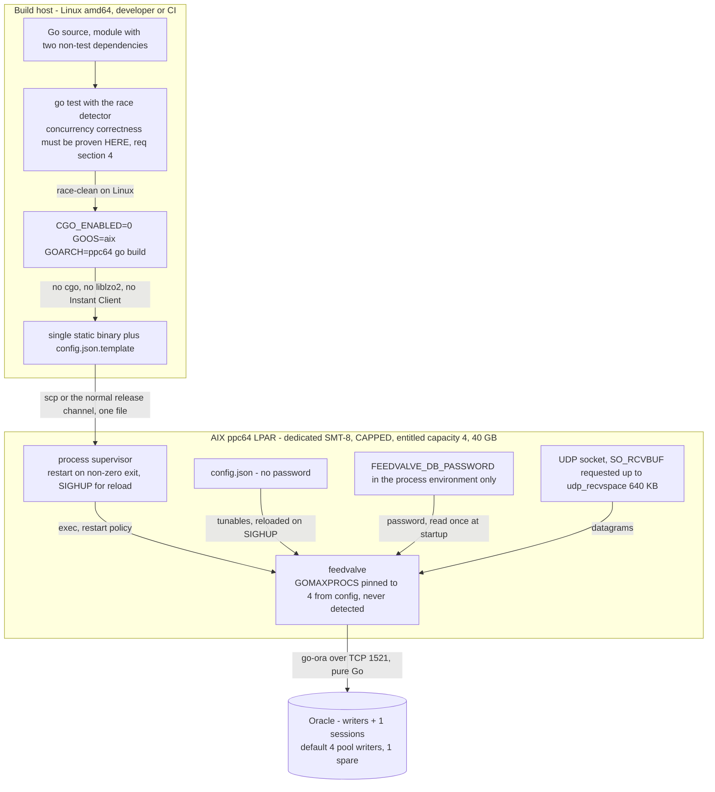

*Figure 14 — Deployment. The build host is Linux because the race detector does not exist on
AIX/ppc64 (req §4); the artifact crossing to the LPAR is a single file with no runtime dependencies.*

### 11.2 The cross-compile constraint and the dependency audit

`CGO_ENABLED=0 GOOS=aix GOARCH=ppc64 go build` must keep working. That single line invalidates most
off-the-shelf answers and it is why the dependency list is audited rather than assumed. Every
proposed dependency, with its cgo status:

| Dependency | Purpose | cgo-free? | Evidence |
|---|---|---|---|
| `github.com/sijms/go-ora/v2` | Oracle driver | **Yes** — pure Go, no Instant Client, no OCI | Fixed by req §7. `poc` already builds with it under `CGO_ENABLED=0` (`poc/db.go:20`), and its `gorm`/`xorm` `go.mod` entries belong to its test directories, not the main module |
| LZO1Z decompression | Required by bible §3.5 for the eight compressed codes (§3.1) | **Yes** — implemented in Go, no `liblzo2` | req §4 mandates a Go implementation; `poc/decompress.go` is the existing proof that a bounds-checked port is viable |
| `encoding/json`, `net`, `os/signal`, `runtime`, `sync/atomic`, `database/sql`, `reflect` | Config, socket, signals, GOMAXPROCS, counters, SQL, test gates | Yes — standard library | — |
| **`golang.org/x/sys/unix`** | *would* be needed for raw socket options | — | **Deliberately not used.** req §4 warns its AIX surface is thinner than Linux's; `(*net.UDPConn).SetReadBuffer` from the standard library covers the only socket option this design needs |
| Metrics/telemetry libraries | — | — | **None.** req §8 defers the metrics system; §10 uses atomic counters and a log line |
| Broker, cache or queue client | — | — | **None**, and none could run here anyway — ADR-014 |

Two platform-specific behaviours the design must not depend on without confirmation, per req §4:
`SO_REUSEPORT` and batched receive (`recvmmsg`-style). Neither is used (§5.2), so neither needs
confirming — which is itself a design decision rather than an accident.

### 11.3 Capacity and resource envelope on the LPAR

| Resource | Budget | Design usage | Margin |
|---|---|---|---|
| CPU | Entitled capacity **4**, capped, dedicated SMT-8 | Under 15 % of one core in steady state (§7.8): receiver 5–10 %, shards ~1 %, writers I/O-blocked | ~25× |
| `GOMAXPROCS` | Must be **configured, not detected** (req §4) | Pinned to 4 | The runtime may observe 32 logical CPUs on a 4-vCPU SMT-8 partition; detecting would oversubscribe a capped partition and add latency rather than throughput |
| Memory | **40 GB** | **~153 MB resident at 200,000 tokens** — three arenas 134 MB, indexes 7 MB, channels 6 MB, batches 3 MB, dirty rings 3 MB, fixed buffers under 1 MB (full arithmetic in §7.8) | ~260× |
| Socket buffer | `udp_recvspace = 655360` | Requested via `SetReadBuffer`; a per-socket request cannot exceed the tunable without a kernel change (req §4) | 0.53 s of slack, or ~0.13 s if ASM-4 is wrong |
| Oracle sessions | Instance `sessions`/`processes`, ASM-10 | `writers` + 1, default 5 | Small by design; an unbounded pool can exhaust the instance (`poc/db.go:33-38`). Raising `writers` is a live lever, so the headroom above the default is what OQ-8 needs to establish |
| Disk | Operational log only | Bounded by rate-limited logging (§10.2); no packet log, no spool (ADR-014) | — |
| File descriptors | 1 socket + 5 Oracle connections + logs | ~10 | — |

The memory figure answers req §11.2 item 8 directly: **a full in-memory mirror of 200,000 tokens
costs about 0.4 % of the memory budget**, which is what req §4 anticipated when it said such designs
should not be rejected on memory grounds.

### 11.4 Process lifecycle in production

- **Supervision.** Any supervisor that restarts on non-zero exit and can send SIGHUP. The design's
  two terminal conditions (DB fail-fast, Q1 escalation — §9.3) exit non-zero deliberately, so
  "restart on failure" is the correct policy *and* an unrecoverable database outage produces a
  visible restart loop rather than a silent stall. That is intended: req §10.2 treats a DB outage as
  an application outage.
- **Startup ordering.** Load and validate config, **including the destination/shard-key invariant of
  ASM-15** → pin `GOMAXPROCS` → open and ping Oracle → start writers → start shards and allocate the
  three arenas → bind the socket → start the receiver. The socket binds **last** so no datagram
  arrives before there is somewhere to put it. Startup failures return errors rather than calling a
  `Fatalf`-style exit, because `os.Exit` skips every deferred cleanup — the reason `poc` splits
  `main` into `main` and `run(ctx) error` (`poc/gobrdclnt.go:19-28`).
- **Shutdown ordering.** Signal → close the socket, which is the only way to unblock an in-flight
  read (`poc/gobrdclnt.go:135-145`) → close the shard channels → each shard flushes all three
  destinations repeatedly until clean or `drainTimeout` expires → close Oracle sessions → exit,
  logging abandoned dirty rows per destination (§6.10).
- **Upgrade.** Stop, replace the binary, start. There is no zero-downtime path and none is warranted:
  a second instance would not receive the unicast feed (req §8), and the restart cost is exactly the
  staleness req §10.3 already accepts. Restarts should be scheduled outside the trading session for
  that reason.
- **Secrets.** `FEEDVALVE_DB_PASSWORD` only — never a flag, because flags are visible in `ps`, and
  never a config file, because config files get committed and copied between environments (req §7;
  `poc/db.go:27-30`). A changed password requires a restart, since a live process cannot observe a
  changed environment (§6.9).

### 11.5 What is explicitly not deployed

No sidecar, no agent, no broker, no container orchestration, no HTTP endpoint. Each would have to
justify itself against a single static binary on one AIX host, and each would additionally have to
*run* on AIX/ppc64, which is where most of them fail before the argument even starts (§5.2,
ADR-014).

---

## 12. Architecture decision records

All are **proposed**: Phase 1 ends with a stakeholder selection (req §11.5), so none can be accepted
until this design is chosen. ADR-001 to ADR-015 keep the identifiers they have in `phase1_hld2.md` so
the two documents can be read against each other; **ADR-004 and ADR-008 have been replaced in place**
and ADR-002, ADR-005, ADR-006, ADR-007, ADR-010 and ADR-015 amended, by the class-model, mirror and
flush changes recorded in ADR-016, ADR-017 and ADR-018. Those three are new: the first two are where
the deviations from the requirements are argued, and ADR-018 is what makes the writer pool of ADR-005
useful to a single shard.

### ADR-001: Decode inline on the receive goroutine, with no queue between the socket and the decoder

**Status:** proposed

**Context:** NFR4 requires the read loop never to block on database work and derives a ~100 ms stall
budget from the ~0.5 s of socket slack (req §4). The work between `ReadFrom` and a decoded update
unit is LZO1Z decompression of ~150 compressed bytes (bible §3.1, §3.5) plus roughly 120 field reads
for a 7208 message (bible §4.8) plus fan-out — an estimated 10–20 µs per four-packet datagram
(ASM-1, ASM-3). `poc` already performs all of this inline and its measured problem was never decode;
it was the synchronous per-packet database write bolted onto the same goroutine
(`poc/db.go:450-469`, documented as intentional POC simplicity at `poc/db.go:449`).

**Decision:** Read, split, decompress, parse and fan out on the receive goroutine. The first queue in
the system sits *after* classification, so it can apply a per-class policy.

**Alternatives considered:**

- *Hand raw datagrams to a decode pool.* Rejected on two specific grounds. It destroys arrival
  ordering across datagrams, which is the mechanism ADR-007 relies on to satisfy FR9 without
  depending on req §12.3. And its queue sits *before* classification, so it cannot tell a 7208 from a
  market-open message and its only FR7-safe overflow behaviour is to stall the socket. Retained in
  `phase1_hld2.md` as candidate Design 3 precisely because it is the right answer if ASM-1 is badly
  wrong.
- *Decompress inline but parse in a pool.* Rejected: it has the ordering cost of the pool without the
  decode-cost benefit, since decompression is the larger half of the work.

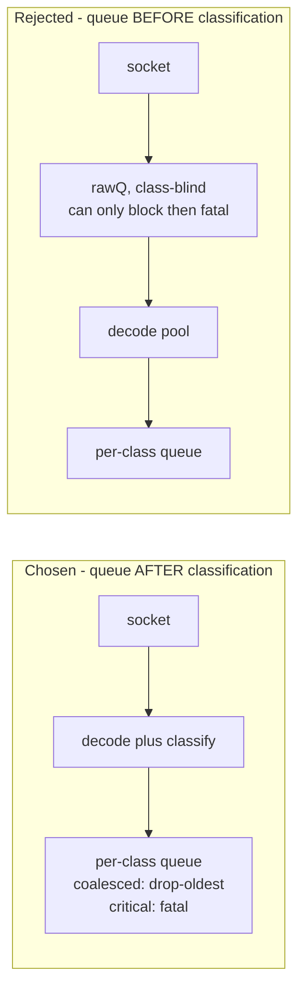

*Figure 15 — ADR-001's structural comparison. Moving the queue before classification removes the
ability to apply FR7 at the point where back-pressure is felt.*

**Consequences:** Better — no copy, no first queue, arrival order preserved end to end, zero
allocation achievable. Worse — decode headroom is single-goroutine, about 20× the §3.3 peak rather
than 60×. Accepted — that headroom rests on ASM-1 and ASM-3, which must be measured on the LPAR
before the design is committed.

**Revisit when:** measured decode cost exceeds ~50 µs per datagram on the target hardware, or NSEIL
switches the segment from 7208 to 7200 (bible §4.8a — their choice, not ours) and the heavier
order-level ladders push decode past that figure.

### ADR-002: Partition state by hashed token across fixed shard goroutines that own it exclusively

**Status:** proposed — **amended** by ADR-017, which changed the shard key from `(token, transcode)`
to the token alone

**Context:** NFR10 requires work distribution and policy to be addressable at (token, transcode)
granularity; FR9 requires that an update never overwrite a newer one *for the same destination*;
NFR3 requires the write path to be parallelisable rather than serialised. req §9 offers "retain the
last-applied ordering value per destination" as a *candidate* mechanism, explicitly not a mandate.

**Decision:** A fixed number of shards (default 4, startup-only), `shard = mix(token) % S`, with
general (non-token) units on a designated shard, each shard owned by one goroutine reached only by
channel. No locks on the data path. Sharding on the entity rather than on `(token, transcode)` keeps
every destination row a unit touches inside one shard (ASM-15), which is what allows one transaction
to cover all three destinations and what makes single-writer-per-row true. Policy remains per
transcode (NFR10) even though distribution is per entity — the two granularities are deliberately
different, and §6.5 names all three keys separately for that reason.

**Alternatives considered:**

- *Shared map with striped mutexes.* Retained in `phase1_hld2.md` as candidate Design 2. It loses
  here because it puts shared mutable state on the receive goroutine's critical path and needs an
  in-flight-flag protocol to satisfy FR9.
- *One goroutine per token.* Rejected: 200,000 goroutines is ~1.6 GB of stacks and a scheduler working
  set far past an entitled capacity of 4 (req §4).
- *`sync.Map`.* Rejected: optimised for read-mostly workloads; this one is write-mostly, and it still
  would not give single-writer ordering.
- *Consistent hashing.* Rejected: there is no cluster, no membership change and no rebalancing
  (req §8), so it is machinery with no beneficiary.

**Consequences:** Better — FR9 becomes structural, contention disappears, per-shard counters localise
every diagnosis. Worse — one channel hop of latency (10–100 µs, under 0.1 % of end-to-end) and shard
count cannot change without a restart. Accepted — a plain modulo would correlate shards with contract
family because exchange tokens are allocated in contiguous blocks, so an integer mix is required, not
optional. Note the scope: a shard owns **state**, not the write path. Since ADR-005 the writers are a
separately-sized pool, so the startup-only nature of `shards` no longer constrains write parallelism.

**Revisit when:** a single token exceeds the throughput of one shard goroutine — roughly 100× the
per-token peak in req §3.3, so effectively never — or if shard skew shows in per-shard counters as
sustained imbalance. The designated general shard is skewed by construction and is exempt.

### ADR-003: Treat the coalescing mirror as the queue, so the unwritten backlog is bounded by the key universe rather than by the arrival rate

**Status:** proposed

**Context:** NFR5 requires every queue to have a defined capacity and overflow behaviour. req §10.2
forbids the two easy answers on the critical path: you may not block indefinitely (the socket will
not wait) and you may not drop (FR7). req §9 declares every message a snapshot, and permits latency
growth as the only automatic degradation.

**Decision:** Coalesced traffic is not queued as units at all beyond the shard ingest hop. It is
folded into a mirror entry that holds exactly one pending value per (token, transcode). The batch
channel never blocks the shard: a full batch channel means the flush is skipped and the entries stay
dirty.

**Alternatives considered:**

- *A large bounded queue of update units.* Rejected with arithmetic: at 15,000 units/s a database
  stalled for 60 s accumulates 900,000 units × 384 B = **346 MB of queue**, which must then either be
  capped (dropping data, violating FR7 for anything critical) or grow (eventually fatal). Coalescing
  makes the same stall cost zero additional bytes.
- *Spill to disk.* Rejected — req §8 excludes spooling and replay, and it converts a bounded staleness
  problem into an unbounded disk problem (ADR-014).
- *Block the shard on a full batch channel.* Rejected: it propagates back through Q1 to the receive
  goroutine and breaks NFR4, which is the one thing req §9 says is never given up.

**Consequences:** Better — memory is bounded by a number the exchange controls, not by our slowest
component; back-pressure becomes staleness automatically, which is exactly req §9's permitted
degradation; recovery needs no operator action. Worse — history is lost for rate-limited transcodes,
which is what coalescing means. Accepted — a crash loses at most `W` of unwritten state (req §10.1).

**Revisit when:** a transcode requires intermediate values *and* is high-frequency. req §9 guarantees
this combination does not occur; if that guarantee is withdrawn, this ADR's premise is gone.

### ADR-004: One pipeline with two flush triggers, instead of two lanes by loss class

**Status:** proposed — **replaces** the earlier two-lane decision, which this document carried until
the class model was collapsed (ADR-016)

**Context:** FR7 requires every occurrence of an unthrottled transcode to be persisted and forbids
coalescing or rate-limiting them. req §10.1 says this cannot be an absolute guarantee and reads FR7
as "the system must not itself drop, coalesce or rate-limit them". req §10.2 says overflow of a
critical-path queue is fatal. req §11.2 item 4 asks how such traffic avoids being starved by
high-frequency traffic.

The earlier answer was two lanes sharing no queue and no goroutine, the unthrottled one blocking and
then stopping the process on overflow. It worked, and it cost: two extra queues to size, three extra
goroutines, two extra Oracle sessions, a terminal failure mode reachable by a single mis-classified
transcode, and — because suppression was structurally unavailable on that lane — a direct
contradiction with the one case NFR13 existed for (Appendix A, gap B6).

**Decision:** One path. Both classes travel the same shard channel into the same three mirrors and
are written by the same writer pool. **Class decides only when the shard flushes:** a
rate-limited unit waits for the `W` tick; a non-rate-limited unit is applied and then sets a
coalescing flush flag on every shard. The receive goroutine never waits for the resulting flush.

**Alternatives considered:**

- *Keep the two lanes.* Rejected with the collapse of the class model: with intermediate preservation
  withdrawn and no append destination, the lane's distinguishing property — never coalescing — is no
  longer something the stakeholder needs bought at the price of a fatal overflow path.
- *A flush **queue** rather than a flag.* Rejected with arithmetic: `A` unthrottled arrivals per
  second would demand `A × S` commits/s (§4.2) until the queue filled, reintroducing exactly the
  terminal condition this ADR removes. A flag makes the overload self-limiting.
- *Flush only the shard that received the unit.* Rejected: the point of the trigger is that all three
  destinations reflect a coherent picture when something significant happens; a market open landing
  beside quote state from three windows ago is the outcome to avoid.
- *One queue with priority scheduling.* Rejected as before: a shared queue can still be *filled* by
  bulk traffic. Priority solves ordering of service, not capacity — and here there is no service
  ordering problem, because the unthrottled unit does not queue behind writes at all.

**Consequences:** Better — three fewer goroutines, two fewer Oracle sessions, two fewer queues to
size, and **no fatal-on-overflow path anywhere in the design**: an unthrottled flood degrades into
batching (§6.6). Starvation is still structurally impossible, now because the classes share the path
rather than because they are separated on it. Worse — Q1's drop-oldest is now class-blind, so a
discard *can* hit a non-rate-limited unit where previously it could not (§9.4, R8); and the
suppression carve-out is enforced by an explicit rule rather than by structure (§6.7). Accepted:
a counted, escalating rarity is a better trade than a certain terminal stop.

**Revisit when:** the transcode inventory (req §12.1) closes and shows unthrottled traffic at a
sustained rate, which would make flush amplification a capacity problem rather than a latency one.

### ADR-005: Size the writer pool independently of the shards, and keep ordering with per-row in-flight marking

**Status:** proposed — **replaces** the earlier one-writer-per-shard decision

**Context:** NFR3 requires concurrent writes across workers or connections, subject to FR9. The
earlier decision gave shard *k* exactly one writer and one session, with a depth-2 batch channel
capping in-flight batches per shard at one. That made per-row ordering structural at no cost in
mechanism, and it is why this document could claim FR9 without a protocol — but it welded three
things together that do not belong together:

- **Write parallelism could only be raised by adding shards**, and `shard = mix(token) % S` makes
  shard count startup-only, so the answer to "the write path cannot keep up" (§7.7) was a restart.
- **A shard holding thousands of distinct dirty rows could not be drained in parallel.** Coalescing
  collapses a hot *row*; it does nothing for a shard with many distinct ones, and the designated
  general shard is skewed by construction.
- **A dead session stalled a whole partition** rather than being routed around.

**Decision:** Shards own state; **writers are a stateless pool of configurable size `writers`**, each
owning one Oracle session. Every shard pushes batches to a shared `batchQ` and any writer may take
any batch, returning it to the owning shard on `completionCh[k]` (§6.6). Ordering is preserved not by
limiting concurrency but by the **in-flight rule** of §6.7: a row that is already batched merges in
place and sets `ReDirty` instead of re-entering a ring, so **a row is in at most one outstanding
batch** and any two concurrent transactions hold disjoint rows. ADR-018 later made this rule carry
more weight than it did here: once a tick emits several batches at once, the disjointness has to hold
*within* one shard's epoch as well as across shards, which it does for the same reason.

**Alternatives considered:**

- *Keep one writer per shard.* Rejected on the three costs above. It remains available as a
  configuration — `maxInFlightPerShard = 1` with `writers = shards` reproduces it exactly — which is
  a useful fallback if the in-flight marking ever proves troublesome.
- *Shared pool with no in-flight marking.* Rejected: two batches from one shard could carry the same
  row and commit out of order. This is precisely the race that made the earlier ADR reject a pool.
- *Conditional MERGE — `WHEN MATCHED AND :seq > last_seq`.* Rejected as the primary mechanism: it
  costs a sequence column per destination, makes every row-update conditional, and makes FR9 depend
  on req §12.3 resolving well — which ADR-007 exists to avoid. Retained as the documented fallback.
- *One global writer.* Rejected: it fails NFR3 outright and makes a single slow statement the whole
  system's bottleneck.

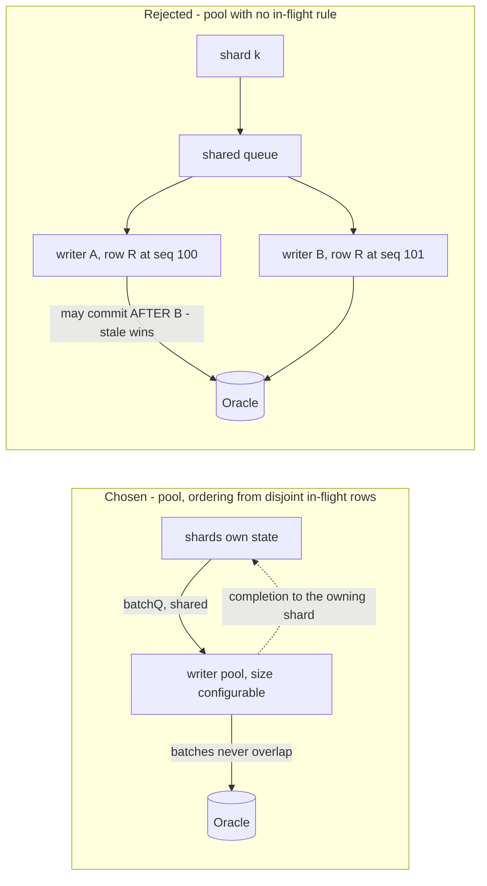

*Figure 16 — ADR-005. The hazard in the rejected shape is not the pool; it is two in-flight batches
sharing a row. Marking the row in-flight removes the overlap, after which any writer may take any
batch safely.*

**Consequences:** Better — write parallelism is a tunable independent of the partitioning and
**reloadable at runtime** (§6.9), since a writer holds no mirror state; an imbalanced shard is drained
by several writers at once; a dead session is routed around instead of stranding a partition (F12);
and §8.4's deadlock layer 1 gets *stronger*, now covering same-shard concurrency that the old
structure merely prevented from arising. Worse — two flag bits per entry and a small state machine
that did not exist before, whose failure modes are silent (§7.12 risks 7 and 8), and a
statement-level error now fails for every writer rather than retiring one (§9.2). Accepted: the state
machine is goroutine-local, which is what made the same protocol unacceptable in `phase1_hld2.md`'s
Design 2 and acceptable here.

**Revisit when:** measurement shows per-session throughput is not the bottleneck — if commit rate is,
more writers make it worse, not better (§7.7) — or if the in-flight marking proves troublesome, in
which case `maxInFlightPerShard = 1` reduces a shard to one outstanding batch at a time without a
code change. Note that under ADR-018 this no longer means one batch *per tick*: the epoch still
drains the whole dirty set, it simply does so serially.

### ADR-006: Make update units and mirror entries fixed-size and pointer-free, and keep the receive path allocation-free

**Status:** proposed

**Context:** The receive goroutine reuses its buffers — a 64 KB read buffer and a decompress buffer
allocated once before the loop (`poc/gobrdclnt.go:147-148`). Anything downstream holding a slice into
those buffers would be overwritten by the next packet. Separately, garbage collection charges mark
work to the allocating goroutine, and at 200,000 tokens the mirror is ~256 MB of live heap (§7.8) —
enough that tracing it would be visible on the one path NFR4 protects.

**Decision:** `UpdateUnit` and `Entry` contain only scalars and fixed-size arrays: no slices, no
pointers, no strings. Channels carry them **by value**, so channel buffers are one allocation at
startup and zero thereafter. Each mirror is a chunked arena of value structs indexed by
`map[RowKey]int32`, not `map[RowKey]*Entry`. `ReadFromUDPAddrPort` replaces `ReadFrom` to avoid a
`*net.UDPAddr` per datagram (ASM-13).

The destination-keyed model adds three fixed-size members and no pointers: a `uint64` column mask, a
`[maxContributors]int32` array of per-transcode sequences on the entry (§6.5), and up to three
`Contribution` descriptors on the unit. A unit carries **one** value blob — the decoded record image
— with each descriptor naming a destination, a row key, a mask and an offset into that blob, so a
unit contributing to all three destinations is still ~384 B rather than three times a row image
(ASM-16).

**Alternatives considered:**

- *Pass `*UpdateUnit` pointers.* Rejected with arithmetic: 20,000 allocations/s × 384 B = 7.7 MB/s of
  garbage, forcing frequent collection against a large live heap and charging mark-assist to the
  receive goroutine.
- *`sync.Pool` for units.* Rejected: it solves allocation but not aliasing, and it adds a lifetime
  question (when is a unit returned?) that value semantics answer for free.
- *Carry the raw record bytes and parse at write time.* Genuinely viable — FR3 only requires
  transcode, sequence, timestamp and tokens to be extracted at decode — but rejected because
  multi-token messages must be split per token anyway (FR4), so the copy happens regardless, and
  deferring the parse moves decode cost onto the writers where it competes with I/O.

**Consequences:** Better — zero steady-state allocation on the hot path; the collector never traces
the arena; buffer aliasing becomes structurally impossible. Worse — the unit is sized for the largest
per-token record plus three contribution descriptors (~384 B), so a 12-byte 7220 payload still costs
384 B in transit. Accepted — the
transcodes with tiny payloads are sparse. *(Appendix A, gap S2, notes what the size constants still
need: a derivation and a build-time gate.)*

**Revisit when:** a decoder needs a genuinely variable-length field (for example if 6501's
`BroadcastMessage` text, bible §4.1, must be carried as a column rather than truncated to a fixed
width).

### ADR-007: Derive ordering from single-writer arrival order, and treat the header sequence comparison as a defence rather than the mechanism

**Status:** proposed

**Context:** FR9 requires that a superseded update never overwrite a newer one. req §9 defines
ordering per (token, transcode) from `BCSeqNo` with the header timestamp as a secondary
discriminator, and offers "retain the last-applied ordering value per destination" as one candidate
mechanism. req §10.5 and req §12.3 both flag that **which header fields are actually populated is
unconfirmed**, and req §11.1 rubric 4 rewards designs that survive open items resolving badly. The
exchange packs messages FIFO and requires them to be processed in that order (bible §3.2).

**Decision:** Ordering is established structurally — one goroutine applies a **destination row's**
contributions in wire arrival order, and the row is never carried by two in-flight batches at once
(§6.7), so whichever pool writers commit those batches, their row sets are disjoint and the commit
order between them cannot matter. The `BCSeqNo` comparison, using
serial-number arithmetic (`int32(a-b) > 0`, ASM-11), is retained as a defence against genuine wire
reordering and as the source of FR10's gap counter, not as the thing that makes FR9 true. The
defensive comparison is kept **per `(row, contributing transcode)`**, because two transcodes writing
disjoint columns of one row have incomparable sequence numbers and a single per-row counter would let
the faster one permanently suppress the slower (§6.5).

**Alternatives considered:**

- *Depend on the sequence comparison as the mechanism.* Rejected: it makes FR9 contingent on req §12.3
  resolving favourably, and if the field is unpopulated the fallback in req §9 is "skip enforcement,
  last-writer-wins" — which is only *safe* if last-writer is guaranteed to be the newest writer,
  i.e. only if this ADR's structural property holds anyway.
- *Push ordering into Oracle with a conditional MERGE on `last_seq`.* Rejected as primary: it costs a
  column and a condition on every row-update and has the same dependency on the field. Retained as a
  documented fallback.
- *Serialise all writes through one path.* Rejected: fails NFR3.

**Consequences:** Better — the largest open item in the requirements stops threatening the largest
correctness requirement; §3.4(b) shows every plausible `BCSeqNo` scope works, so req §12.3 degrades to
a gap-detection question. **And, since ADR-017, the claim is about the destination row rather than
about `(token, transcode)`** — which is the granularity FR9 and req §9 actually specify, so the
property no longer merely correlates with the requirement, it is the requirement. That closes
Appendix A gap B2. Worse — the property is invisible in the code unless it is written down and
tested, because nothing fails loudly if a future change lets a row reach two writers concurrently,
and it now rests on two preconditions rather than one: ASM-15, which only `-selfcheck` enforces, and
the in-flight marking of §6.7, which only the property gates in §10.4 enforce. Accepted — hence those
gates. *(Appendix A, gap B7, still qualifies the guard's behaviour when
`BCSeqNo` is unpopulated.)*

**Revisit when:** any change routes units for one key through more than one goroutine — a decode pool,
a work-stealing writer pool, or a resharding feature. Any of those makes the sequence comparison
load-bearing again.

### ADR-008: Answer req §12.2 with in-place upsert into three current-state destinations, and no append destination

**Status:** proposed — **replaces** the earlier append-destination answer, withdrawn with the
requirement to preserve intermediate values (ADR-016)

**Context:** req §12.2 states the semantic question cannot be deferred: if successive occurrences of a
transcode update the same row in place, "every occurrence persisted" is indistinguishable from "the
latest occurrence persisted", and Phase 1 must state which it assumes. It also asks whether writes
are `UPDATE`-only against pre-seeded rows or upserts that may insert unseen tokens. Oracle has no
`ON CONFLICT`; upserts are `MERGE INTO … USING dual` (req §7, `poc/db.go:247`).

The stakeholder has since answered the first question directly: intermediate values need not be
preserved, and unthrottled units need only be *queued for update*. That removes the reason the
earlier draft carried an append-only event row alongside every current-state write.

**Decision:** Every unit of both classes is merged into a **current-state row in one of three
destinations** and written by `MERGE`. There is no append destination, no event table and no
occurrence history. All writes are upserts; nothing depends on rows being pre-seeded.

**Alternatives considered:**

- *Keep the append-only event row.* Rejected on stakeholder direction. It bought one thing —
  `COUNT(*)`-verifiable FR7 — at the price of the only unbounded table in the design, an unowned
  retention policy, and two rows written per unthrottled unit instead of one.
- *In-place update only, with an external consumer observing each change (trigger, CDC, poller).*
  Rejected for the same reason as before: it places FR7's satisfaction outside our process, in
  something we do not control and cannot test.
- *`UPDATE`-only against pre-seeded rows.* Rejected: a contract listed intraday arrives as a 7305
  security-master change (bible §4.3) for a token with no row, and the `UPDATE` silently affects zero
  rows — precisely the failure `poc/db.go:402` logs as a WARN because a real server reports it as
  success.
- *Append everything, project later (event sourcing).* Rejected as the primary architecture (§5.2):
  it writes at the full uncoalesced unit rate, which the sizing says is unaffordable, and it needs a
  projector req §8 puts out of scope.

**Consequences:** Better — **no table in the design grows without bound**, so the retention question
that had no owner disappears; intraday listings work; and retries are trivially safe, since `MERGE`
is idempotent and there is no longer an append row needing a natural key and an expected `ORA-00001`
on replay. One row per unit instead of two roughly doubles the effective drain rate of unthrottled
traffic. Worse — **FR7 stops being checkable from outside the process**: `units_applied` (§10.1) is
now the only record that an occurrence was handled, and two occurrences inside one flush cycle
produce one row (§1.1, §8.1). Accepted as stakeholder direction, and stated at the front of the
document rather than buried here.

**Revisit when:** req §12.2 is answered authoritatively the other way, or an audit requirement
appears. The change would be a **fourth** destination, which the three-mirror model does not
accommodate — so this is a structural revisit, not a statement-set change.

### ADR-009: Size `GOMAXPROCS` and every pool from configuration, never from detected CPU count

**Status:** proposed

**Context:** req §4 is explicit: the LPAR is **capped** at an entitled capacity of 4 with dedicated
SMT-8 processors, so the Go runtime may observe considerably more logical CPUs than the partition is
entitled to consume. It states that worker-pool sizing and `GOMAXPROCS` must be driven by entitled
capacity and **must be configurable, not auto-detected** — sizing CPU-bound pools off the detected
count "will oversubscribe a capped partition and add latency rather than throughput". NFR7 adds that
concurrency should be applied where it demonstrably helps, not uniformly.

**Decision:** `GOMAXPROCS`, `shards`, `writers`, `maxInFlightPerShard` and every queue capacity come
from configuration with documented defaults (4, 4, 4, 2, §6.6). Nothing calls `runtime.NumCPU()` to
size anything. Parallelism is applied at the write path, where workers block on I/O and therefore do
not consume entitlement; it is deliberately *not* applied to decode (ADR-001). Since ADR-005,
`writers` is sized against the **Oracle session budget** rather than against entitled capacity, which
is why it is the one pool that may sensibly exceed `GOMAXPROCS`.

**Alternatives considered:**

- *`GOMAXPROCS = runtime.NumCPU()` (the Go default).* Rejected: on a 4-vCPU SMT-8 partition the
  runtime can see 32, so the scheduler would run 32 Ps against an entitlement of 4 — the exact
  failure req §4 warns about.
- *Container-aware automatic sizing.* Rejected: that machinery is cgroup-based and Linux-only; this
  is an AIX LPAR, where it does not apply.
- *Hard-code 4.* Rejected: DLPAR can grow the partition to 12 maximum vCPUs (req §4), and NFR8 wants
  tuning without a rebuild.

**Consequences:** Better — the runtime's parallelism matches the entitlement; growing the LPAR is a
config change; `GOMAXPROCS` is one of the few tunables safely changeable at runtime. Worse — a
misconfigured value is now possible, so `-selfcheck` validates it against a sane range. Accepted.

**Revisit when:** the LPAR's entitled capacity changes, or profiling shows the receive goroutine
being descheduled rather than CPU-bound.

### ADR-010: Reload configuration by SIGHUP and an atomic pointer swap, with queue capacities and shard count startup-only

**Status:** proposed

**Context:** NFR8 requires runtime reload without restart and gives the reason plainly: a restart
discards all coalescing state (req §9) and leaves the database stale (req §10.3), so a restart must
not be the price of a tuning change. It also notes that reloadability is what makes the operator
levers in req §9's degradation table usable during an incident. NFR8 lists the minimum tunable set and
says which are genuinely reloadable is a Phase 2 determination, with reloadable as the default
expectation.

**Decision:** SIGHUP triggers re-read, full validation, then an atomic pointer swap; goroutines load
the pointer at natural boundaries (per datagram, per flush tick, per batch), so a change takes effect
within one window and never mid-batch. An invalid file is rejected **wholesale** with the reason
logged and the previous configuration left running. Shard count, queue capacities and
`maxInFlightPerShard` are declared startup-only for Phase 1. **`writers` is reloadable in both
directions**, which ADR-005 makes safe: a writer holds no mirror state, so the pool grows by starting
a goroutine with a fresh session and shrinks by letting one exit after its current batch.

**Alternatives considered:**

- *Mutex-protected config struct.* Rejected: it puts a lock acquisition on the receive path for a
  value that changes once a month.
- *Poll the file's mtime.* Rejected as primary — it adds latency to an operator action during an
  incident — but noted as a fallback if the supervisor already uses SIGHUP for log rotation.
- *Apply valid fields and skip invalid ones.* Rejected: a partially applied configuration is harder
  to reason about at 03:00 than a stale one, and it can produce combinations neither the operator nor
  the validator intended.
- *Make everything reloadable, including capacities.* Rejected for Phase 1: resizing a channel means
  rebuilding it, and a rebuild loses whatever is in flight; changing shard count re-keys the mirror
  and strands state mid-session.

**Consequences:** Better — every operator lever in req §9 is usable without losing state; the reload
path cannot half-apply; and reclassifying a transcode between `rate-limited` and `non-rate-limited`
is a reload, which is what makes req §9's step-3 lever real. Worse — several of NFR8's listed
tunables need a restart: queue sizes, shard count, `maxInFlightPerShard`, and **the destination set
and its row keys** (changing a row key re-keys a mirror and strands state mid-session). **Connection
count is not among them**: ADR-005 decoupled the writer pool from the shards, so `writers` — and
therefore the session count — is a live operator lever, which is what Appendix A gap S3 was really
asking for. Accepted — the password is also non-reloadable, since a live process cannot observe a
changed environment (req §7).

**Revisit when:** operational experience shows capacity changes are needed mid-session, which would
justify the drain-and-rebuild machinery Phase 1 declined to build.

### ADR-011: Count and log unknown transcodes without decoding them, and never let one affect framing

**Status:** proposed

**Context:** req §12.1 leaves the transcode inventory open and states plainly that behaviour for
transcodes *not* in the configured inventory must be defined because "they will occur". The bible
catalogues 21 broadcast codes (§4.0) while `poc` decodes two (`poc/gobrdclnt.go:269-289`). Framing
does not depend on understanding a message: sub-packet length comes from `iCompLen` or from
`MessageLength` (bible §3.3), both read before the body.

**Decision:** A registry miss is a counted, rate-limited log line keyed by code. No body is decoded,
nothing is written, and the sub-packet loop continues with the cursor arithmetic already computed. A
transcode present in the registry but absent from the policy configuration is treated the same way,
with a distinct counter so "we can decode this but nobody told us what to do with it" is
distinguishable from "we have never seen this".

**Alternatives considered:**

- *Log every occurrence.* Rejected: an unexpected high-volume code would produce 10,000 log lines/s,
  turning a data question into an availability incident (§10.2).
- *Treat an unknown code as a framing error and abandon the datagram.* Rejected: it is not a framing
  error, and abandoning the rest of the datagram would discard valid messages — including possibly
  critical ones — for no reason.
- *Fail startup if any catalogued code is unconfigured.* Rejected: it makes every exchange addition an
  outage rather than a counter.

**Consequences:** Better — req §12.1 can be closed from production data (the counter *is* the
inventory discovery mechanism); adding a transcode is a config change if a decoder exists.
Worse — a message we should have handled can go unnoticed if nobody reads the counters. Accepted —
mitigated by the 60 s line making a non-zero `unknown_transcode` visible with its code (§10.1).

**Revisit when:** the inventory closes and a policy of "unknown means alert" becomes affordable.

### ADR-012: Build the decoders as a registry with compile-time layout assertions, validated differentially against `poc`'s debug trace

**Status:** proposed

**Context:** req §7 forbids reusing `poc` code, keeps it as a normative reference for protocol
behaviour, and requires the new decoder to be **validated against `poc`'s output on fabricated
inputs** — with the explicit reasoning that re-deriving the LZO1Z port and the pack(2) parsers is
exactly where subtly-wrong-but-plausible field decoding gets reintroduced. The bible's Appendix B
lists ten places the source specification is wrong, and Part V is the reconciliation. 7208 is the
worked example: a 213-byte stride instead of 214 leaves every field before offset 17 correct and
turns everything after into noise (bible §4.8).

**Decision:** One `Decoder` per transaction code behind a narrow interface (§6.4), each carrying its
declared packet length from Part V as a constant expression that fails to compile if the field layout
stops reconciling — the technique already proven at `poc/exchange_communication.go:138-139`. Field
reads go through a sequential big-endian cursor that logs name, absolute offset, hex and value, with
padding read explicitly rather than skipped silently (`poc/reader.go:47-53`). Validation is a
differential harness that runs `poc` as a **subprocess** with `-debug` and diffs the field streams,
so the oracle is its output and no code is reused (§10.4).

**Alternatives considered:**

- *A `switch` on transaction code.* Rejected: it grows without bound, mixes dispatch with decoding,
  and gives nowhere to hang per-code metadata such as `BodyLen` and `MaxUnits`.
- *Struct tags plus reflection decoding.* Rejected: reflection cannot express the pack(2) rules
  (bible §2.2) — where the pad falls depends on preceding field sizes — and it would be slower on the
  one path NFR4 protects. `poc`'s struct definitions document the layout without being used for
  reflection decoding, which is the right split.
- *Copying `poc`'s parsers.* Forbidden by req §7.
- *Validating against a live capture.* req §7 explicitly says fabricated inputs suffice and a live
  capture is not required, which also removes the dependency on req §12.5.

**Consequences:** Better — adding a decoder is local and testable; the bible's arithmetic is enforced
by the compiler rather than by review; the class of bug req §7 warns about is caught by diff.
Worse — the harness needs `poc` to remain buildable and its `-debug` output format to remain stable,
so `poc` becomes a test fixture with a compatibility obligation. Accepted, and it should be stated in
`poc`'s own documentation.

**Revisit when:** `poc` is retired, or a transcode must be supported that `poc` cannot decode — in
which case the oracle for that code is the bible's Part V arithmetic plus a hand-built offset table,
per the fixture caution in §10.4.

### ADR-013: Derive circuit liveness from the 6541 heartbeat, with both thresholds configurable

**Status:** proposed — **SHOULD, not a stated requirement**

**Context:** Bible §4.12: if no data has flowed on the broadcast circuit for a stipulated period the
host sends a pulse; the period is currently 9 seconds and **is changeable by NSEIL control**. 6541
carries `MESSAGE_HEADER`, not `BCAST_HEADER`, so its transaction code is at offset 0 rather than 10
(bible §2.8). The requirements do not ask for liveness monitoring; FR10 asks for "logging sufficient
to confirm the system is running correctly". Without this, a dead circuit and a quiet market are
indistinguishable — and the circuit is one-way with no way to ask (bible §1).

**Decision:** Track circuit state as live / quiet / down from time since the last datagram of any
kind, with `heartbeatWarn` (default 12 s) and `heartbeatDown` (default 27 s, three pulse intervals) as
**configuration values, never constants**, because the exchange can change the interval underneath
us. Severity is downgraded outside a configured trading window so an overnight host outage does not
page anyone.

**Alternatives considered:**

- *Count only 6541 messages as liveness.* Rejected: during an active market no pulse is sent, because
  data is flowing — treating pulse absence as failure would alarm continuously during normal trading.
  Any datagram is evidence of life.
- *Hard-code 9 seconds.* Rejected: bible §4.12 says the interval is exchange-configurable, so a
  constant guarantees a future false alarm.
- *Omit it, since no requirement asks for it.* Rejected on judgement: it is a few dozen lines, and
  the failure it detects is total and otherwise silent. Labelled SHOULD so the stakeholder can
  decline it.

**Consequences:** Better — silence becomes an alarm rather than an absence of alarms; the market
session machine (§6.10, bible §4.5) gives the alarm sensible severity. Worse — two more tunables and
a dependency on ASM-8, which is unconfirmed. Accepted.

**Revisit when:** ASM-8 is confirmed or refuted by a capture, or the exchange announces an interval
change.

### ADR-014: Stay a single static binary — no broker, no sidecar, no spill-to-disk, no listening endpoint

**Status:** proposed

**Context:** req §8 fixes the system as a single process on a single host and rules out horizontal
scaling, multi-feed support, replay/backfill, DB high availability and rich metrics. req §4 requires
`CGO_ENABLED=0 GOOS=aix GOARCH=ppc64` to keep working, and notes Go's AIX/ppc64 port is second-tier.
The baseline this design must beat is one statically linked binary on one host.

**Decision:** No additional deployed component of any kind. Queueing is in-process and bounded
(§6.6), durability is Oracle, observability is counters plus a log line (§10), and configuration is a
file plus one environment variable.

**Alternatives considered:**

- *Kafka, NATS or Redis between decode and persistence.* Rejected on three independent grounds, any
  one sufficient: req §8 forbids the extra process; none ships as a pure-Go cgo-free AIX/ppc64 binary
  that could be co-deployed; and it would make the backlog *worse*, because it would faithfully retain
  every superseded snapshot that ADR-003 exists to discard.
- *A local write-ahead log to survive a DB outage.* Rejected: req §8 excludes spooling and replay,
  req §10.2 defines a DB outage as an application outage, and it converts a bounded staleness problem
  into an unbounded disk problem on a host where even the POC's packet log needed a cap
  (`poc/logger.go:31-61`).
- *A `/metrics` HTTP endpoint.* Rejected for Phase 1: req §8 defers the scrape surface, and it adds a
  listening socket and a port allocation nobody has requested. §10.1 keeps the counters behind an
  interface so this is a later addition, not a later rewrite.
- *A second instance for redundancy.* Rejected: the feed is unicast to this host (req §8), so the
  second instance would receive nothing.

**Consequences:** Better — deployment is one file; there is no component that can be up while another
is down; the AIX constraint is satisfied by construction. Worse — no buffering survives a process
death, and a DB outage is an application outage. Accepted explicitly, because req §10.2 says so and
because it is what resolves the otherwise unsatisfiable three-way conflict between never blocking the
socket, never dropping critical messages and never growing queues without bound.

**Revisit when:** req §8's scope changes — specifically if replay, multi-instance or DB-outage
survival is ever funded, since each of those reopens this decision.

### ADR-015: Drain the dirty set FIFO, and drop oldest-first if a coalesced queue must shed

**Status:** proposed — **amended** by ADR-018, which changed the bound without changing the decision

**Context:** req §9 lists "eventual correctness of the final state for every token" among the things
never given up while the process runs. Under sustained overload the drain order decides which keys
wait. Separately, NFR5 requires a documented overflow behaviour for every queue, and the shard ingest
queue is the one place coalesced traffic can be shed (§6.6).

**Decision:** The dirty structure is a FIFO ring drained oldest-first. Where a coalesced queue must
shed, it sheds the **oldest** unit, not the newest.

**The bound this gives, restated for ADR-018.** The original form was
`(dirtyDepth / maxBatchSize) × W` — one flush *window* per batch, because a tick emitted one batch.
Now that a tick drains the whole dirty set as an epoch, the wait for any key is

```
W  +  ceil( ceil(cohortSize / maxBatchSize) / maxInFlightPerShard ) × t_commit
```

— one *commit latency* per batch round, divided by the concurrency. At the defaults a 3,000-row
cohort waits 240 ms where it previously waited 600 ms, and each additional batch costs 20 ms rather
than 200 ms. The property ADR-015 asserts is unchanged: the worst-case staleness is a computable
function of depth rather than unbounded. It is simply a much better function.

**Alternatives considered:**

- *LIFO or unordered drain (a map iteration, a stack).* Rejected as a correctness defect, not a
  performance one: newer arrivals would push the earliest-dirtied keys back indefinitely, so a token
  that ticked once early in an overload could stay stale in the database for the rest of the session.
  Map iteration order in Go is deliberately randomised, which makes this failure intermittent and
  unreproducible — the worst possible shape.
- *Drop newest on a full queue.* Rejected: every message is a snapshot (req §9), so the newest unit
  carries the state that must eventually be written; discarding it while keeping older ones queued
  leaves the database holding a stale final value.
- *Priority by transcode within the coalesced lane.* Rejected: it re-creates starvation inside a lane
  whose whole purpose is uniform treatment, and class-based priority is already handled between lanes
  by ADR-004.

**Consequences:** Better — no key can starve; the worst-case staleness is a computable function of
depth rather than unbounded. Worse — drop-oldest on a Go channel needs an explicit
receive-then-send rather than a bare non-blocking send, which is a small piece of code that must be
commented or it will be "simplified" later. Accepted.

**Revisit when:** the drop path stops being exceptional — if `shard_dropped` is routinely non-zero,
the answer is not a better drop policy but more write throughput. It is also more urgent than it was:
with the lanes collapsed, Q1 carries both classes, so a drop can now discard a non-rate-limited unit
that the earlier model protected structurally (§9.4, R8).

### ADR-016: Collapse the policy classes to `rate-limited` and `non-rate-limited`

**Status:** proposed — **stakeholder direction**, not an architectural preference

**Context:** NFR1 defines three classes: coalesced (latest-wins), intermediate-preserving, and
critical/unthrottled. NFR2 adds a separate lossy discard limiter, off by default, and req §2's
glossary insists rate limiting is *"not a synonym for coalescing"*. NFR6 adds an orthogonal
batched-versus-real-time write mode per transcode. That is three axes — class, limiter, write mode —
and six meaningful combinations (§6.8 as it previously stood), against an inventory req §12.1 has not
closed and a stakeholder who has since said that intermediate values need not be preserved at all.

**Decision:** Two classes, configured per transcode, and nothing else:

- `rate-limited` — the database write rate for this transcode is capped at `1/W` per destination row,
  achieved **losslessly** by coalescing in the mirror. Final state is always eventually written.
- `non-rate-limited` — uncapped; applied on arrival and flushed immediately (ADR-004).

`intermediate-preserving` is withdrawn. NFR2's discard limiter is withdrawn. NFR6's write mode is
withdrawn as a separate setting and implied by the class.

**Alternatives considered:**

- *Keep three classes and rename them.* Rejected: the third class existed to preserve intermediate
  values, which is no longer required, and a class with no distinguishing behaviour is a tunable that
  can only be set wrong.
- *Keep NFR2's discard limiter as an extra knob on rate-limited transcodes.* Rejected: it would give
  the design two lossy mechanisms with nearly identical names — the exact conflation req §2 warns
  against — and the coalescing cap already achieves a rate ceiling without discarding anything.
- *Pick names that do not collide with req §2's glossary* (`throttled`/`unthrottled`, or keeping
  `coalesced`). Not adopted: the stakeholder chose these names. The collision is handled by the
  explicit override in §1.1 instead of by a quieter word.

**Consequences:** Better — one axis instead of three; the combination table collapses from six rows
to two; the validator has less to reject; and the withdrawal of intermediate preservation is what
made ADR-004's single pipeline and ADR-008's in-place answer possible, which between them removed a
fatal failure path and the only unbounded table. It also dissolved Appendix A gap B6 and OQ-1
outright. Worse — **three requirements are now deviated from rather than satisfied** (NFR1, NFR2,
NFR6), plus FR7 in the sense §8.1 sets out, and the term `rate-limited` means the opposite of req §2's
definition. Accepted, on stakeholder direction, with every deviation named in §1.1 and in §13's
traceability rows rather than left for a reader to notice.

**Revisit when:** the stakeholder reinstates a need for intermediate values or for occurrence
history, either of which reopens ADR-004 and ADR-008 as well as this one.

### ADR-017: Key the mirror by destination row, and flush all three destinations in one transaction

**Status:** proposed — **stakeholder direction**; amends ADR-002 and strengthens ADR-007

**Context:** The earlier model keyed the mirror by `(token, transcode)`. That is not the granularity
FR9 speaks about: req §9 requires that *"an update never overwrites a newer one **for the same
destination**"*, and where two transcodes write one row — 7305 and 7340 both maintain the security
master (§8.2) — `(token, transcode)` gives two keys, two shards, two writers and no ordering
relationship between them. Review recorded this as gap B2. Separately, with any transcode able to
update any destination, concurrent transactions touching the same tables in different orders are a
genuine deadlock hazard.

**Decision:** Exactly **three destination mirrors**, each keyed by that destination's row key and
each declaring how that key is derived. A unit carries up to three column contributions, merged into
the corresponding rows under a column mask. Shards partition by the unit's token so all three of a
token's rows are owned by one shard (ASM-15). A flush covers **all three destinations in one
transaction**, written in a fixed destination order with rows sorted by key inside each.

**Alternatives considered:**

- *Shard by (destination, row key).* Rejected: it balances better, but a unit contributing to two or
  three destinations would fan out across shards, so its contributions could no longer be applied
  together, ordered together or committed in one transaction.
- *One mirror owner with a writer pool.* Rejected: it gives the simplest possible deadlock story —
  one transaction at a time — by serialising the write path, which fails NFR3.
- *Three transactions per flush, one per destination.* Rejected: it triples the commit count for no
  benefit and reintroduces the cross-destination interleaving the fixed order exists to rule out.
- *Keep `(token, transcode)` keying and fix FR9 with a conditional `MERGE` on a stored sequence.*
  Rejected: it pushes a correctness property into SQL, makes every row-update conditional, and makes
  FR9 depend on req §12.3 resolving — which is precisely what ADR-007 exists to avoid.

**Consequences:** Better — FR9 now holds for the destination the requirement names (gap B2 closed);
row-level deadlock is impossible rather than unlikely (§8.4, G12 — layer 1 supplies cross-shard
disjointness, and ADR-005's in-flight rule supplies it within a shard); transcodes sharing a row share an
entry, so the mirror is *smaller* (≈153 MB against ≈285 MB, §7.8) and produces fewer writes; and the
transcode→column mapping becomes a named, testable module instead of being implicit in the writer
(§6.1, half of gap S2). Worse — three new mechanisms to get right: the column mask, the
per-contributing-transcode sequence slots, and ASM-15, which is a precondition no runtime check can
catch and only `-selfcheck` can reject (§7.12 risks 5 and 6). Accepted.

**Revisit when:** a fourth destination is needed — an audit/append table (ADR-008) being the likely
cause — or when a destination appears whose row key cannot be derived from the shard key, which would
force the per-(destination, row) sharding rejected above.

### ADR-018: Flush the entire dirty set per tick as a bounded epoch, with `maxInFlightPerShard` as the concurrency knob

**Status:** proposed

**Context:** ADR-005 decoupled the writer pool from the shards so that an imbalanced shard could be
drained by several writers at once. The flush procedure it inherited did not permit that: a trigger
emitted **one** batch and stopped, so a shard holding four batches' worth of dirty rows sent one per
`W` and exactly one writer ever served it. `maxInFlightPerShard` only came into play when a commit
outran the window. The stated benefit of the pool — parallel drain of a skewed shard, and the
designated general shard is skewed by construction (§7.12 risk 3) — never materialised.

The constraint on any fix is that **the shard goroutine must not block on a commit.** It owns the
mirror; parking it stops Q1 draining and back-pressure reaches the receive goroutine, which NFR4 and
the whole write-behind structure exist to prevent. A four-batch serial drain at ~20 ms a commit would
park a shard for ~80 ms — roughly 1,200 units at the burst rate.

**Decision:** A tick opens an **epoch**. The shard snapshots its dirty rings into a *cohort* by
swapping each with its spare, and drains the entire cohort — however many batches that takes —
before the epoch closes. Rows dirtied during the drain accumulate in the fresh rings and belong to the
next epoch. The drain is event-driven, not a loop: a *pump* emits batches while the free list allows
and runs again on every completion. `maxInFlightPerShard` therefore limits **concurrency, not
quantity**: at `1` an epoch's batches commit serially in FIFO order, at `m` up to `m` commit at once,
and the set of rows flushed is identical either way. A tick landing mid-epoch does nothing and does
not clear `FlushReq`. A failed batch's rows return to the **head of the next epoch's** ring. Full
mechanism in §7.3.

**Alternatives considered:**

- *Continuous pump — drain to empty, re-pumping on every completion with no epoch boundary.* The
  smallest change, and a defensible system: FIFO needs no bookkeeping and the drain self-regulates.
  Rejected because it silently converts the design from rate-paced to database-paced. With the pump
  always running, the coalescing window collapses from `W` (200 ms) to one commit latency (~20 ms),
  roughly a tenfold increase in rows written for the same arrival rate, and §4.2's load arithmetic,
  §7.6's latency budget and §9's degradation table are all written against `W` being the pacing knob.
- *Per-row eligibility — pump continuously, but a row is only batchable once it has been dirty for a
  minimum interval.* Would keep both low latency and coalescing. Rejected as materially more
  machinery for a benefit the epoch already provides structurally: the ring stops being drainable
  oldest-first when its head may be ineligible, so it needs skip-and-requeue or a time-ordered
  structure, plus a "first dirtied at" field `Entry` does not have (`LastTime` is last *update*).
- *Emit every batch at once and limit concurrency at the writer side.* Rejected on three counts: it
  breaks the invariant that `batchQ` can never fill (§6.6), which is what lets the shard use a
  non-blocking send; a shard with 50,000 dirty rows would emit 50 batches and starve every other
  shard at the pool; and enforcing a per-shard limit downstream turns a plain channel into a
  scheduler with per-shard sub-queues. The well-behaved version of it — a shard-owned ordered batch
  queue with a dispatcher releasing `maxInFlightPerShard` at a time — is this decision, with the
  batches materialised earlier and more memory held.
- *One unbounded batch per tick.* The naive reading of "flush everything in one tick". Rejected:
  unbounded undo and redo, row locks held for the whole commit, `maxBatchSize` and NFR6 discarded,
  one failure retrying the entire backlog — and no concurrency at `m > 1` at all.

**Consequences:** Better — the pool finally does what ADR-005 claimed for it, and
`maxInFlightPerShard` becomes a meaningful lever for shard imbalance rather than a rarely-exercised
depth; the worst-case staleness bound improves from one flush window per batch to one commit latency
per batch round (ADR-015), about tenfold at the defaults; the `maxBatchSize/W` per-window drain
ceiling disappears, so the write path saturates on Oracle rather than on a channel (§4.2, §7.7,
§9.3); and `W` keeps its meaning as the coalescing window, so nothing else in the sizing envelope
moves. Worse — four fields of shard state and a second ring per destination, and a new silent failure
mode: anything appended to a *cohort* ring lets arriving work extend the drain, and under sustained
load the epoch never closes and the flush cadence stops with no error (§7.12 risk 9). Gated by three
of the five new tests in §10.4. Accepted.

**Revisit when:** measurement shows epochs routinely outlasting `W` with writers idle — the fix then
is `maxInFlightPerShard`, which is startup-only and so is the one lever an incident cannot reach
(§6.9, OQ-14). If that proves to be the common case, making it reloadable within a pre-allocated
ceiling is the obvious Phase 2 change.

---

## 13. Traceability

req §11.2 item 11 asks for traceability **only where satisfaction is non-obvious**, and states that a
full per-requirement matrix is not wanted. Rows where the requirement is satisfied identically and
obviously are still listed — omitting them would make the matrix unusable as a completeness check —
but they are given one line, not a paragraph.

| Req | Requirement, abbreviated | Design element |
|---|---|---|
| FR1 | Receive on a unicast UDP socket | `receiver` module (§6.1); 64 KB read buffer so oversize is detectable, bible §3.6 |
| FR2 | Split datagrams into sub-packets, LZO1Z-decompress, reject malformed without terminating | `framing` + `lzo` (§6.1, §6.2); four containment layers (§9.5); bible §3.2, §3.3, §3.5 |
| FR3 | Parse each packet; extract transcode, sequence, timestamp, token(s) | `header` + `decoders` (§6.4); dispatch at payload offset 18, bible §2.8 |
| FR4 | Fan out into per-token update units; applied independently | Fan-out into a caller-owned 40-unit array (§6.4); 7208 yields up to 2, bible §4.8; 7320 up to 35, bible §4.4b |
| FR5 | Route each unit to the correct DB logic; different transcodes, different columns and tables | `destinations` maps a transcode to column contributions across up to three destinations (§6.1); a batch groups by destination and column mask, one array-bound statement per group (§8.3) |
| FR6 | Coalesce high-frequency token transcodes down to ~1–10/s per active token | Mirror entry holds the newest row image; flush window `W` = 200 ms gives 5/s (§6.7, §7.3). *One global `W`, not a per-transcode interval: Appendix A, gap B5* |
| FR7 | Persist every occurrence of critical transcodes; no coalescing, no rate limiting | **Deviation, stated in §1.1 and §8.1.** The `non-rate-limited` class is never coalesced-by-policy, never throttled and flushed on arrival (§6.8, ADR-004) — so req §10.1's reading ("we must not ourselves drop them") holds for arrival handling. But writes are in-place with no append destination (ADR-008), and two occurrences inside one flush cycle produce one row, so *every occurrence observable* is **not** delivered and FR7 is not `COUNT(*)`-verifiable |
| FR8 | General messages a distinct class; distributed on transcode alone | General units are pinned to a designated shard and their destination is general-keyed (§6.5); market status 6511/6521/6522/6531/6571, bible §4.5 |
| FR9 | An update never overwrites a newer one **for the same destination** | **Structural, and now at the stated granularity**: one goroutine applies and one writer commits each *destination row*, in wire order (ADR-002, ADR-005, ADR-007, ADR-017). Defensive guard kept per `(row, contributing transcode)` (§6.5). *Appendix A gap B2 closed by this change* |
| FR10 | Basic counters and logging, including sequence-gap detection | §10.1 counter table; gap detector on the receive goroutine with a configurable scope (§6.5) |
| FR11 | Stamp general units with an effective timestamp, header field with system-clock fallback | `(LogTime, receiptMonotonic)` pair — **note §3.4(a)**: `TimeStamp2` is the machine number, not a time (bible §2.5, §2.8), so `LogTime` is second-resolution and the receipt clock is always recorded |
| NFR1 | Coalescing configured per transcode; **three** policy classes | **Deviation (§1.1, ADR-016).** Configured per transcode, but **two** classes: `rate-limited` and `non-rate-limited`. `intermediate-preserving` is withdrawn — intermediate values are not preserved anywhere. *One global `W`: Appendix A, gap B5* |
| NFR2 | Rate limiting (lossy discard) per transcode, off by default, distinct from coalescing | **Deviation (§1.1, ADR-016).** The discard mechanism does not exist. The term `rate-limited` is reused for the *coalescing* cap that req §2's glossary explicitly says it is not — an override stated at the front of the document, not a conflation left implicit |
| NFR3 | Concurrent DB writes across workers/connections, subject to ordering | A pool of `writers` (default 4) sized independently of the partitioning, with ordering from disjoint in-flight row sets (ADR-005, ADR-017) — which is also what makes row-level deadlock impossible (§8.4). Closer to NFR3's wording than the earlier 1:1 mapping, since the number of workers is now genuinely a concurrency choice — and since ADR-018 the concurrency is real *within* a shard too: an epoch emits as many batches as its cohort needs and `maxInFlightPerShard` of them commit at once, so a single busy partition is genuinely written by several connections |
| NFR4 | Decouple socket read from DB write; no stall beyond ~100 ms | No DB work on the receive goroutine at all, and no wait for the flush a non-rate-limited unit triggers (§7.4); 50 ms bounded send deadline, ≤5 ms design target (§6.3); ASM-4 is the binding risk. *Appendix A, gap B3* |
| NFR5 | Bounded queues with defined overflow behaviour | Queue table with capacity, arithmetic, full-behaviour and signal (§6.6) — three queues plus a flush flag that is deliberately not a queue. *Appendix A, gap B4* |
| NFR6 | Write mode per transcode: batched on a time window with a max-size cap, or real-time | **Deviation (§1.1, ADR-016).** Write mode is no longer separately configurable: it is implied by class. `rate-limited` is batched on `W` with `maxBatchSize` as the secondary cap; `non-rate-limited` is written as soon as available. `maxBatchSize` is honoured literally since ADR-018 — it is a **per-batch** budget across all three destinations, so a transaction is never larger than the configured number, where the earlier per-destination reading allowed 3× it |
| NFR7 | Concurrency sized to entitled capacity; applied where it helps | Parallelism at the I/O-bound write path only; decode deliberately single-goroutine (ADR-001, ADR-009) |
| NFR8 | Everything tunable configurable and reloadable at runtime | SIGHUP + atomic pointer swap; reloadable/startup-only table (§6.9, ADR-010). **Worker-pool size is reloadable** since ADR-005 decoupled it from the partitioning — one of NFR8's listed tunables that an earlier draft had to concede needed a restart. Shard count, queue capacities and the destination set remain startup-only |
| NFR9 | 150K–200K tokens resident within the memory budget | ~153 MB at 200K tokens across three destination mirrors (§7.8, §11.3) |
| NFR10 | Policy and distribution addressable at (token, transcode), and at transcode for general | **Partial deviation.** Policy is per transcode and coalescing/ordering are per `(destination row, transcode)`, so both remain addressable at that granularity — but *distribution* is now per token, not per (token, transcode), because a unit's contributions must stay in one shard (§6.5, ADR-017). The three keys are named separately in §6.5 |
| NFR11 | Modular, independently testable, where reasonable independently replaceable | Nine modules with named boundaries and a per-module test approach (§6.1) |
| NFR12 | Malformed packet logged and dropped without affecting others or the process | Four ordered containment layers (§9.5); panic contained per sub-packet as `poc/gobrdclnt.go:178-183` |
| NFR13 | Change-driven writes for coalesced transcodes only; no full-universe sweep | FIFO dirty rings mean no sweep; written-image digest means no rewrite. The carve-out is now enforced by an explicit rule — **a non-rate-limited contribution skips the digest check and always marks dirty** (§6.7) — rather than by lane separation. *Appendix A gap B6 closed: 7340 can be `rate-limited` and actually use the mechanism its own sweep justifies* |
| req §7 | Oracle via `go-ora`, positional binds, `MERGE`, small pool under session/`IDLE_TIME` limits | §8.3; `ConnMaxLifetime` under `IDLE_TIME` (`poc/db.go:40-45`); binds `:1`, never `?` (`poc/db.go:236-246`) |
| req §7 | Pure Go, cross-compiled AIX/ppc64, no cgo | Dependency audit, every entry confirmed cgo-free (§11.2) |
| req §7 | Password from environment only; DSN redacted everywhere | `FEEDVALVE_DB_PASSWORD` only (`poc/db.go:27-30`); `describe()`/`redactDSN` (`poc/db.go:134,190`) |
| req §7 | No code reused from `poc/`; new decoder validated against it on fabricated inputs | Differential harness running `poc` as a subprocess with `-debug` (§10.4, ADR-012) |
| req §9 | Snapshot semantics; latest-wins is safe | Premise of ADR-003 and of coalescing generally |
| req §9 | Degradation order; only latency degrades automatically | §9.3 — the automatic paths (ticks skipped while an epoch is open, coalesced flush requests) grow latency only; steps 1 and 3 are operator levers reached by reload. Step 3 survives the class change as "reclassify a chatty transcode to `rate-limited`" (§7.5) |
| req §9 | Never given up: read-loop responsiveness, critical delivery, eventual final-state correctness | ADR-001, ADR-004, ADR-015 respectively — with the FR7 qualification above |
| req §10.1 | Delivery is best-effort; no absolute guarantee claimed | Stated in §9.4; FR7 implemented as "we do not throttle or coalesce-by-policy", not as a guarantee. Note Q1's drop is now class-blind (§9.4) |
| req §10.2 | DB outage is an application outage; critical-queue overflow is fatal | Writer health machine and fail-fast (§9.2) satisfies the first clause. **The second is deviated from:** there is no critical-path queue to overflow — unthrottled traffic shares Q1 and its flush trigger cannot fill (§6.6, ADR-004), so the design has no fatal overflow path. Overload on that path degrades to batching |
| req §10.3 | Restart leaves the DB stale | F18; mirrors start empty, the first contribution to a row writes unconditionally (§9.1); up to `W` of unwritten state is held |
| req §10.4 | Socket-level loss out of scope | Not compensated; made observable for free via `netstat -s -p udp` correlation (§9.4) |
| req §12.1 | Behaviour for transcodes not in the inventory must be defined | ADR-011 — counted, rate-limited, never decoded, framing unaffected |
| req §12.2 | Which "persist every occurrence" semantics is assumed | ADR-008 — **in-place upsert into three current-state destinations, no append destination.** Assumed semantics: *the latest occurrence is what must be observable at the row* |

Three rows deserve a sentence rather than a cell, because their satisfaction is non-obvious:

**FR7 cannot be satisfied absolutely and this document does not claim it is.** req §10.1 is explicit
that the transport is UDP with no retransmission and that in-memory queue state is lost on a crash.
What the design delivers is a narrower claim than the earlier draft made: no throttling or
policy-driven coalescing is applied to non-rate-limited transcodes, they are flushed on arrival
rather than on a window, and the gap counter makes wire loss visible even though it cannot make it
recoverable. What it no longer delivers is occurrence history — two occurrences inside one flush
cycle produce one row (§1.1, §8.1) — or any way to verify FR7 from the database.

**NFR13's two clauses are satisfied by two different mechanisms**, and conflating them would leave
one unmet. "A periodic flush must not sweep the full tracked-token universe" is satisfied by the
dirty rings, structurally — the flusher never touches a clean entry. "Token state that has not changed
since its last successful write is never rewritten" is satisfied by the digest, and only because the
digest updates on **confirmed commit** rather than on enqueue (§7.3).

**The deviations are not independent of each other.** Withdrawing intermediate preservation (NFR1)
is what allowed the lanes to collapse (ADR-004), which is what removed the fatal overflow path
(req §10.2's second clause) and made the discard limiter redundant (NFR2); dropping the append
destination (req §12.2) is what narrowed FR7. A reader evaluating whether to accept them should
evaluate them together, which is why ADR-016 argues them in one place rather than five.

---

## 14. What this design does not solve, and the risks it carries

### 14.1 Out of scope, restated with consequences

Referenced from §2. Each of these is deliberately excluded; what matters is what each exclusion costs
in operation, because that cost lands on somebody at 03:00.

| Excluded | By | Consequence accepted |
|---|---|---|
| Exchange retransmission / replay / backfill | req §8; bible §1 (no host-end inquiries for NNF users) | A gap is permanent. `seq_gap_messages` reports the magnitude and nothing more (§9.4) |
| Database high availability, spooling, catch-up | req §8, req §10.2 | A DB outage stops the process (§9.2). The supervisor restart loop is the visible symptom, by design |
| Horizontal scaling, second instance | req §8 | No redundancy. A second instance would receive nothing anyway — the feed is unicast to this host |
| Multi-exchange / multi-feed | req §8 | The segment netId is effectively a constant (8 for commodity derivatives, bible §3.2), checked and logged, never used to route |
| Rich metrics, histograms, scrape endpoint | req §8 | Diagnosis is counters plus a 60 s line (§10). Latency is estimated, not measured, until instrumentation is funded |
| UI / reporting | req §8 | — |
| DB schema and the transcode→column mapping | req §8 | §8 fixes the *shape* — exactly three current-state destinations, each with a row key derivable from the shard key — and answers req §12.2. Destination identities and column lists remain a Phase 2 and DBA question (OQ-13) |
| **Occurrence history / audit of every received message** | ADR-008, stakeholder direction | The database holds current state only. There is no way to establish from the database that a given occurrence was received, and `units_applied` (§10.1) is the only in-process record. This is the deviation §1.1 names second |
| **Preserving intermediate values for any transcode** | ADR-016, stakeholder direction | Withdrawn as a requirement. Every destination row holds latest-wins state for each contributing transcode's columns |
| Kernel/NIC-level drop accounting | req §10.4 | Not tracked in-process; correlated manually via `netstat -s -p udp` (§9.4) |
| **The interactive VCID circuit** | Bible §1.1, and out of the bible's own scope (Ch.3–7, 11–16) | **7211 Spread MBP is stated to fall back to the interactive circuit when broadcast is unavailable (bible §4.13). A broadcast-only handler misses those silently, in exactly the degraded state where they matter most.** Named here rather than buried; it is a known blind spot, not an oversight |
| Market By Aggregate — 7215, 7216 | Bible scope note (Ch.8) | Both are in the compressed set (bible §3.1) but their layouts are not in the bible. If they arrive they are unknown transcodes (ADR-011); if one decompresses beyond the 2 KB buffer it is a contained, counted error (ASM-14) |
| Bhavcopy — Ch.9 | Bible scope note | Not on this path |
| `MS_ERROR_RESPONSE` as a first-class decoder | ASM-9 | Detected and counted before dispatch (bible §2.10) but not decoded into fields. If ASM-9 is wrong this becomes work |
| Priming the mirror from the database at startup | Judgement, see below | The first unit per key after a restart writes unconditionally (F18) |

**On priming the mirror at startup** — worth one paragraph because it is the most tempting rejected
option. Reading the current-state tables into the mirror at startup would restore last-applied
sequence values and re-enable NFR13 suppression immediately. It was rejected because it does not fix
what actually hurts: the database is stale after a restart precisely because the process was down, and
priming replays that staleness back into memory rather than curing it (req §10.3 accepts the
staleness explicitly). It would add 200,000 rows of startup I/O, a schema coupling in the startup
path, and a new failure mode — a slow prime delaying the socket bind, during which datagrams are lost
for real. The cost is certain and the benefit is a handful of suppressed writes.

### 14.2 Risk register, ranked

Ranked by expected cost, not by likelihood alone. The first three are the ones that would actually
change the outcome of this project.

| # | Risk | Trigger / likelihood | Impact | Mitigation and residual |
|---|---|---|---|---|
| R1 | **A subtly wrong decoder** — plausible values in the wrong fields | Medium. req §7 names this as the specific hazard of re-deriving the parsers; the bible's Appendix B lists ten places the source spec is wrong | Silent bad data in Oracle, indistinguishable from a market anomaly until someone reconciles. The worst failure in the system because nothing alarms | Compile-time layout assertions, differential test against `poc`'s `-debug` trace, an independently-written absolute-offset table (§10.4, ADR-012). Residual: a transcode `poc` cannot decode has no oracle but the bible's arithmetic |
| R2 | **ASM-1/ASM-3 wrong — decode far more expensive than assumed** | Medium. Go on ppc64 is a second-tier port (req §4) and no measurement exists | Inline decode stops fitting the NFR4 budget; the socket/decode boundary of ADR-001 has to move behind a decode pool, which costs the structural ordering property | Measure on the LPAR **before** selection — half a day of work (OQ-5). Residual: none once measured, which is why it should be measured first |
| R3 | **req §12.3 resolves badly — sequence and timestamp unusable** | Medium; req §10.5 raises it as a live doubt | Only FR10 gap detection is lost, because ordering is structural | ADR-007 makes ordering structural; §6.5's audit mode closes the item from production without a capture. Residual: gap detection may be unavailable, which weakens §9.4's triage — **and see Appendix A, gap B7, for the guard behaviour this still requires** |
| R4 | **ASM-4 wrong — socket slack ~0.13 s, not 0.53 s** | Medium; BSD-derived stacks commonly charge mbuf overhead | NFR4's 5× margin becomes ~1.3×; a 50 ms stall starts costing datagrams | ≤5 ms design target rather than spending the budget (§6.3); measure via `netstat -s -p udp` under synthetic load. Residual: raising `udp_recvspace` needs a kernel tunable change |
| R5 | **A pointer or slice creeping into `UpdateUnit` or `Entry`** | Medium over the life of the code — it is a one-line change that looks harmless | Buffer aliasing produces intermittent cross-contamination that looks exactly like a decode bug; and 256 MB of arena becomes GC-traced | Reflection gate in §10.4, invariant stated in §6.1 and ADR-006. Residual: only as good as the gate being kept |
| R6 | **req §12.4 resolves high — thousands of active rows, not tens** | Medium; it is explicitly unresolved | Write-path headroom is ~0.3× against req §3.3's figure: the write path falls behind and dirty depth grows until the burst ends (§7.7) | Three reloadable levers now — **`writers`**, `W` and `maxBatchSize` — of which raising `writers` is the one that adds capacity rather than trading freshness (ADR-005). The backlog is bounded by the mirrors, so the failure is staleness, not memory. Residual: whether more sessions actually help is unmeasured (OQ-4), and widening `W` helps only where rows repeat |
| R7 | **ASM-6 wrong — `go-ora` array binds unusable in a transaction** | Low–medium; unverified | Write ceiling drops to roughly 2,000 rows/s across 4 connections | Prepared-statement loops as the documented fallback; still above the *expected* rate, below the ceiling. Residual: the §3.3 ceiling case becomes uncomfortable, and with two fewer sessions than the earlier model there is less to fall back on |
| R8 | **Q1's drop is class-blind, so a discard can hit unthrottled traffic** | Low–medium; requires Q1 saturation, which escalates to fatal on the third occurrence | An occurrence of a `non-rate-limited` transcode is lost — counted, but unrecoverable. The earlier two-lane model made this structurally impossible | Accepted deliberately in ADR-004 as the price of removing a fatal overflow path. `shard_dropped` is the signal and must not be left sitting non-zero (ADR-015). Residual: real, and traded against a failure mode that was certain rather than rare |
| R9 | **Flush amplification from a chatty unthrottled transcode** | Medium until the inventory closes (req §12.1) | Commit rate rises toward `S / t_commit` ≈ 800/s; that class's latency drifts toward `W` | The coalescing flag bounds it structurally (§6.6), so the outcome is latency rather than saturation. `flush_coalesced / flush_triggered` is the signal; reclassifying the transcode is the lever. Residual: low technically, but it makes the inventory a capacity decision |
| R10 | **The 6541/6503 header-selection rule is wrong** | Low; the rule is designed, not specified (§6.4) | Heartbeats mis-dispatched; liveness alarms wrong in either direction | Length checks make a false positive very unlikely; confirm against a capture (OQ-6). Residual: liveness is SHOULD, so the blast radius is monitoring only |
| R11 | **`poc` drifts or is retired**, breaking the differential oracle | Low near-term, high over years | R1's principal mitigation disappears | State the compatibility obligation in `poc`'s documentation (ADR-012); freeze a tagged build if it is retired |
| R12 | **Operators do not read the 60 s counter line** | Medium — the most human risk here | Every graduated warning in the design is wasted, and the first symptom is a fatal stop | Keep the line short and delta-based; ensure FATAL messages carry the counter snapshot that led to them (§10.2). Residual: real, and not solvable in software |
| R13 | **A destination's row key is not derivable from the shard key** (ASM-15) | Low, but silent | Two shards write one row: lost updates, and §8.4's deadlock argument fails | `-selfcheck` and the §10.4 gate reject it at load. Residual: the check must run against the *shipped* configuration — a misconfiguration that never sees `-selfcheck` is undetectable at runtime, because nothing fails loudly when two writers share a row |
| R14 | **The column mask and the emitted statement drift apart** | Medium over the life of the code — new with the destination-keyed mirror | A column is silently not written, or written from a stale image. Looks exactly like a decode bug | The mask-fidelity gate in §10.4 asserts the statement's column list against the entry's mask. Residual: as good as the gate is kept |
| R15 | **The in-flight state machine is wrong in a way nothing reports** | Medium; new with the writer pool (ADR-005) | Missing the `ReDirty` path loses an update silently; clearing `InFlight` early lets a row into two batches and reopens the FR9 race the pool was made safe against | Three property gates in §10.4, and the fallback that `maxInFlightPerShard = 1` restores the earlier one-batch-per-shard behaviour without a code change. Residual: the machine is goroutine-local so it cannot race, but it can be plainly wrong |

---

## 15. Open questions

req §12 lists seven open items that must close before or during Phase 2. This section carries those
through with this design's specific dependency on each, plus those the design work surfaced that are
**not** in req §12. Ordered by value: the first three are the ones worth closing before the
Phase 1 → Phase 2 gate, because each can change a decision rather than just a number.

### 15.1 Worth closing before the gate

**OQ-3 — Which of 7200 or 7208 does this segment actually send?**
*Unknown:* Bible §4.8a states the two are mutually exclusive and that the choice is taken by NSEIL
control, not by the implementer — both parsers must exist, and order-level (MBO) data cannot be
assumed available. `poc` implements 7208 only (`poc/gobrdclnt.go:270`).
*Who resolves:* the exchange, or one packet capture — `packets_by_transcode` answers it in the first
minute of running (§10.1).
*Blocks:* decode-cost sizing (7200's `ST_INTERACTIVE_MBO_DATA` is 236 bytes with a ten-entry
order-level ladder *plus* a ten-entry price ladder, bible §4.7, versus 7208's 214-byte record) and the
fan-out arithmetic in §4.2, since 7200 carries one token per message and 7208 up to two. Interacts
directly with R2: if the segment sends 7200, inline decode has materially less headroom.
*Also note:* 7200 requires `BookType` gating — process only `1` (Regular Lot) or `2` (Stop Loss),
skip otherwise (bible §4.7). That is a processing rule with no equivalent in 7208 and it must be in
the decoder, not downstream.

**OQ-5 / ASM-1 — What are the measured LZO1Z and parse costs on the target LPAR?**
*Unknown:* No measurement exists on AIX/ppc64. Everything in §4.2 rests on ASM-1 and ASM-3.
*Who resolves:* a cross-compiled `go test -bench` run on the LPAR — roughly half a day.
*Blocks:* ADR-001, the inline socket/decode boundary. This is the cheapest high-value measurement
available and it should precede selection.

**req §12.3 / OQ-6(b) — Ordering-field semantics: which header fields are populated, and what is
`BCSeqNo`'s scope?**
*Unknown:* req §10.5 flags it; bible §2.8 defines `BCSeqNo` as the BCAST sequence number "for the
Ericsson switch" without stating its scope.
*Who resolves:* the exchange, or §6.5's sequence audit mode running for a few minutes in production —
no capture needed.
*Blocks:* FR10's gap detection (§3.4(b)), and the behaviour of the defensive ordering guard if the
field is unpopulated (Appendix A, gap B7). FR9 itself does not depend on it under this design, which
is the rubric-4 argument.
*Note the correction in §3.4(a):* the "8-byte secondary timestamp" req §10.5 refers to is
`TimeStamp2`, which bible §2.5 and §2.8 define as the **machine number**, not a time. The only time
field in `BCAST_HEADER` is `LogTime`, at one-second resolution.

### 15.2 The remaining req §12 items

**req §12.1 / OQ-2 — The transcode inventory, and the update-unit rate discrepancy.**
Two parts. The inventory itself (which transcodes, each one's class, token scope and destination
column contributions) is
low-risk: the design is parameterised over it (ADR-011, ADR-012) and `packets_by_transcode` plus
`unknown_transcode` discover it from production. The second part is a **discrepancy worth an
answer**: FR4 fan-out at up to two tokens per 7208 message implies 15,000–20,000 update units/s at
the §3.3 packet rates, which is 2–4× req §3.3's stated uncoalesced ceiling of ~5,000 row-updates/s
(§4.2). Either most messages carry one record or the ceiling was derived per packet. Measurable on
day one from `units_emitted` versus `rows_written`. *Blocks:* nothing structural; it changes queue
sizing and the headroom claims in §7.7.

**req §12.2 — "Persist every occurrence" semantics.** Answered as an assumption by ADR-008: in-place
upsert into three current-state destinations, no append destination, *latest occurrence observable*.
*Who resolves:* the stakeholder — and this is now the deviation most worth confirming, because it
narrows FR7 (§1.1, §8.1). *Blocks:* if it resolves the other way, an append destination has to come
back as a **fourth** destination, which the three-mirror model does not accommodate — a structural
revisit of ADR-017, not a statement-set change.

**req §12.4 — Concurrently active token count in a peak second.** req §12.4 asks for this to be
derived analytically where possible and measured only if it cannot be. §6.5 offers a third route: a
per-second distinct-token set emitted as `active_tokens_1s`, which measures it directly in production
for a few hundred KB of memory. *Blocks:* the write-path headroom figures (§7.7). Feeds R6.

**req §12.5 — Raw capture capability and retention.** No longer needed for decoder validation
(req §7 uses fabricated inputs, §10.4), and §6.5's audit modes remove the dependency for items 3 and
4. *Blocks:* nothing in this design. Retained as a fallback.

**req §12.6 / OQ-6 — Definitions assumed rather than confirmed.** Three, grouped because they are all
"we chose a reading, please confirm it":
(a) **FR11's effective timestamp** is implemented as the pair `(LogTime, receiptMonotonic)` compared
lexicographically, with the receipt clock always recorded rather than only as a fallback — forced by
§3.4(a)'s finding that `LogTime` is second-resolution and `TimeStamp2` is not a time. This strengthens
FR11 but deviates from its literal wording, so it needs acknowledgement.
(b) **The 6541/6503 header-selection rule** (§6.4) is designed, not specified: the bible states these
two use `MESSAGE_HEADER` with the transaction code at offset 0 rather than 10 (bible §2.8, §4.12,
§4.15) but does not say how a decoder distinguishes them before it knows the code. Confirm against a
capture. Feeds R10.
(c) **Latency measurement endpoints** (req §9, req §12.6) — socket arrival to transaction commit. The
estimates in §7.6 decompose by term, so any other definition can be read off the same table.

**req §12.7 — Trading-session boundaries and start/end-of-day behaviour.** Used only for the liveness
alarm's severity gate (§6.10) and for interpreting an overnight silence. Market open/close messages
themselves are handled as ordinary critical messages (bible §4.5), including the asymmetry that a
regular first open is 6511 alone while a same-day re-open runs 6531 → 6571 → 6511 — a state machine
that requires a pre-open before every open will stall at the regular market open.

### 15.3 Raised by this design, not in req §12

Two questions this section used to carry are now **closed rather than open**, and are listed here so
their absence is not read as an oversight. *OQ-1 — do intermediate-preserving transcodes belong on
the fatal-on-overflow lane?* — dissolved: the class is withdrawn and there is no such lane
(ADR-016, ADR-004). *OQ-7 — who owns `MD_EVENT` retention?* — dissolved: there is no append
destination and nothing in the design grows without bound (ADR-008).

**OQ-13 — What are the three destinations, and what is each one's row key?**
*The gap:* the design fixes the **count** at three, requires each to declare a row key derivable from
the shard key (ASM-15), and fixes the write order — but the identities, the column lists and the
transcode→column mapping are schema work req §8 defers. §8.2 shows one plausible instantiation.
*Who resolves:* the stakeholder plus the DBA. *Blocks:* the memory arithmetic in §7.8 (which assumes
two token-keyed destinations at the full universe and one small general-keyed one, ASM-7), the
`maxContributors` constant in §7.3, and `-selfcheck`'s validation set. Two constraints are not
negotiable once chosen: every row key must be derivable from the shard key (R13), and a destination
that would hold several rows per token — a normalised MBP depth ladder, say — multiplies every
write-rate figure in §4.2 and §7.5 by that factor (§8.2).

**OQ-4 / ASM-6 — Does `go-ora` support array binds inside a transaction with correct affected-row
counts?** *Who resolves:* a spike against the real instance. *Blocks:* the ~5,000 rows/s ceiling case;
the fallback of prepared-statement loops reaches roughly 2,000 rows/s across four connections, which
covers the *expected* rate but not the ceiling (R7). See also Appendix A, gap S4, on per-row error
granularity — which now also has to cover a batch spanning three destinations in one transaction.

**OQ-8 / ASM-10 — What is the Oracle session budget and the profile's `IDLE_TIME` for this user?**
*Who resolves:* the DBA. *Blocks:* the **ceiling on `writers`**, and therefore the size of the one
lever available when the write path falls behind (§7.7) — ADR-005 no longer ties sessions to shards,
so what matters is the headroom above the default of 5, not a fixed number. Also the correct
`ConnMaxLifetime`, which must sit under `IDLE_TIME` or dead sessions surface as `ORA-03113` on first
reuse (`poc/db.go:40-45`). Worth pairing with OQ-4, since raising `writers` only helps if per-session
throughput is what binds.

**OQ-14 — What should `maxInFlightPerShard` be?** ADR-018 makes it the knob that decides how fast one
shard's epoch drains, and it is **startup-only** (§6.9) — so it is the one write-path lever an
incident cannot reach, and picking it wrong is a restart to fix. The default of 2 is a guess. The
measurement that settles it is `epoch_duration{k}` against `W`, read alongside `writers_busy`: epochs
overrunning `W` while writers sit idle means one shard cannot claim enough of the pool and the value
is too low; epochs finishing in a fraction of `W` with all writers busy means the pool, not this
value, is what binds. *Who resolves:* one session of production counters (§10.1), after OQ-4 has
established per-session throughput. *Blocks:* nothing structural — only whether the shipped default is
right, and whether Phase 2 should make it reloadable within a pre-allocated ceiling. Worth pairing
with OQ-8, since `writers × per-session` and `maxInFlightPerShard` bind in different places and only
the counters distinguish which is active.

**OQ-9 / ASM-9 — Does a non-zero `ErrorCode` ever occur on the broadcast circuit?** Bible §2.10
requires the check before dispatch and defines the payload as `MS_ERROR_RESPONSE` (182 bytes).
`poc` does not perform the check (`poc/gobrdclnt.go:269`). *Who resolves:* the `error_response`
counter, in production. *Blocks:* whether `MS_ERROR_RESPONSE` needs a first-class decoder rather than
a counted reject.

**OQ-10 — Does the 7340 periodic security-master re-send occur on this segment, and how large is a
sweep?** Bible §4.3 describes 7340 as the identical 294-byte structure re-sent periodically during
the day for every security that changed. *Who resolves:* the exchange, or one session's counters.
*Blocks:* much less than it did. With 7340 configurable as `rate-limited` it gets the mirror and the
NFR13 digest, so a sweep of identical values costs almost nothing (§6.7) and there is no lossless
queue whose sizing depends on the answer. What remains is the write cost of a sweep that carries
*genuine* changes for thousands of securities, which lands on the ordinary rate-limited path.

**OQ-11 / ASM-8 — Is 6541 present on this segment, and at what interval?** Bible §4.12 gives 9
seconds as current and changeable by NSEIL control. *Who resolves:* the exchange or a capture.
*Blocks:* only the liveness thresholds, which are configuration (ADR-013).

**OQ-12 — Gate mechanics.** req §11.5 assumes the normal review process and asks for confirmation:
who selects, on what timeline, and what happens if no candidate is acceptable. Worth settling
alongside OQ-3 and OQ-5, since both of those should be measured *before* the selection rather than
after it.

---

## Appendix A — Gaps identified by design review

These came out of a review of this candidate as it stood in `phase1_hld2.md`. Most are **still open**
and are recorded here so LLD does not start on top of them. Blocking items change a conclusion or a
structure; significant items change a number or leave a boundary undefined.

Three rounds of change have since closed seven of them — B1, B2, B6, S1, S3 and S6, plus half of S2,
and most of B4 — either by correcting the body or by removing the structure the gap was about. Those
are listed first, with what closed them, so the appendix does not read as a list of live defects when
it is partly a changelog. B4 is listed under "blocking, still open" because a defined remainder
survives.

One defect this review did **not** find is worth recording, since it was live until the third round:
the flush procedure emitted a single batch per trigger, so a tick flushed at most `maxBatchSize` rows
and a shard could only ever have one batch outstanding — which silently nullified the writer pool
ADR-005 had just introduced. Nothing in the document was self-contradictory, which is why a
consistency review missed it; it surfaced from a direct question about what happens when a shard has
four batches' worth of dirty rows. ADR-018 is the answer. The general lesson for LLD is that
*quantity* semantics — how much a procedure does, not just what it does — need stating as explicitly
as ordering and failure semantics do.

### Closed by the change recorded in §1.1

| ID | Gap | How it closed |
|---|---|---|
| B1 | The burst write-rate arithmetic was 4× low — 750 rows/batch × 5 flushes/s is *per shard*, so the aggregate is 15,000 rows/s, not 3,750 | **Corrected in the body.** §7.5 now states 15,000 rows/s with the sanity check (distinct rows ⇒ no coalescing ⇒ row rate equals unit rate); §7.7's headroom is ~0.3×, not ~1.3×; §9.3 notes the drain rate is Oracle's ~5,000/s, not the 20,000/s channel capacity |
| B2 | The distribution key was not the persistence destination, so FR9's "for the same destination" did not hold where two transcodes wrote one row | **Removed by ADR-017.** The mirror is keyed by destination row; 7305 and 7340 share one entry, one shard and one writer. §8.3's "two writers never touch the same row" is now true rather than assumed |
| B6 | NFR13's justifying case (the 7340 sweep) was classified onto the lane where suppression was structurally unavailable | **Removed by ADR-016 and ADR-004.** There are no lanes, and 7340 can be configured `rate-limited`, so it uses the mechanism its own sweep justifies (§6.7) |
| S1 | The lossless lane's queue sizing did not survive its own worked example once each unit cost two rows | **Removed.** There is no lossless queue, and with the append destination gone each unit costs one row (ADR-008) |
| S3 | "Raise the connection count" was offered as an operator lever that ADR-005 and ADR-010 forbid | **Resolved by making the lever real.** ADR-005 decoupled the writer pool from the shards, so `writers` — and with it the session count — is now an independently configurable tunable, reloadable in both directions (§6.9). The playbook offers it because it exists |
| S6 | The MBP depth-ladder row multiplier was absent from every rate figure | **Constrained in §8.2.** The illustrative instantiation denormalises the ladder into the quote row, and the text states that one key = one row is a constraint on whatever the three destinations turn out to be, not a preference (OQ-13) |
| S2 (half) | No module owned turning an opaque value image into column binds | **Named.** `destinations` is a module in §6.1 with its own responsibility, inputs, outputs and test approach |

### Blocking, still open

| ID | Gap | Where |
|---|---|---|
| B3 | **The 50 ms send deadline is per unit; NFR4's budget is per read-loop iteration.** A 3–4 sub-packet 7208 datagram emits 6–8 units, so the worst-case stall is 300–400 ms, already over budget; a 7320 datagram (35 units per message) is far worse. And because three expiries in 60 s is fatal, the third unit *of the same datagram* trips the terminal path — so F9's graceful drop-oldest degradation is effectively unreachable. **Now more consequential**, since Q1 carries both classes and F9 is the only remaining terminal condition besides the database fail-fast | §6.3, §6.6, §7.2, F9 |
| B4 | **Mostly closed by ADR-005.** The completion path is now a named queue with a capacity and an overflow argument (`completionCh[k]`, §6.6 Q2c); the shard applies the confirmation, so arena ownership is intact; "clean-pending" is replaced by the explicit `InFlight`/`ReDirty` state machine (§6.7), which specifies the re-dirty-while-in-flight case and the failed-commit path; and the free list is named as the concurrency bound rather than left implicit. **What remains open** is narrower but real: the statement-level error case, where a wrong statement fails for *every* writer, so retiring writers one at a time would drain the pool — §9.2 states the pool must stop itself once the same statement fails on more than one writer, but does not yet define the threshold or the recovery | §6.6 Q2/Q2c, §6.7, §7.3, §9.2 |
| B5 | **There is no per-transcode rate, only one global `W`.** §6.9 no longer lists a per-transcode interval as a tunable, so the document is at least self-consistent — but **the gap is sharper than before**, because the class is now literally named `rate-limited` while the mechanism offers exactly one rate for every transcode in it. NFR1's "coalescing is configured per transcode" is satisfied only in the sense that *membership* is per transcode. A per-destination or per-transcode interval needs a per-entry next-eligible-time and a second ring, neither of which exists | §6.7, §6.9, §7.3, NFR1 |
| B7 | **The defensive ordering guard becomes a silent outage if `BCSeqNo` is unpopulated.** With a constant or zero `BCSeqNo` and one-second `LogTime`, every contribution after the first compares "not newer" and is discarded — the mirrors freeze and the database stops updating, with only a counter rising. No detection or disable path is specified, yet "survives req §12.3 resolving badly" is the headline rubric-4 claim. Separately, `Entry` has no field for the receipt clock, so a *rate-limited general* transcode has nowhere to store the `(LogTime, receipt)` pair §3.4(a) mandates. The per-`(row, transcode)` slots of §6.5 change the blast radius but not the defect: each slot freezes independently | §6.5, §6.7, §7.3, ADR-007 |

### Significant, still open

| ID | Gap | Where |
|---|---|---|
| S2 | **The 256 B row image and ~384 B `UpdateUnit` have a derivation but no gate.** ASM-16 now states the assumption and §7.3 shows the arithmetic, and the missing transcode→column boundary is now the `destinations` module — but §10.4 still has no build-time gate asserting that a destination's declared column set fits the image, and margins are thin (7305's body is 254 B; 7200's record is 236 B) | §6.1, §7.3, §7.8, ADR-006, ASM-16 |
| S4 | **Row-level error handling assumes a granularity array-bound DML does not give.** F14 and §9.2 say "skip the row, continue the batch" while §8.3 makes each destination-plus-mask group one array-bound execution, now inside a transaction spanning three destinations. ASM-6 covers whether array binds exist, not partial-failure semantics — and a skipped row interacts with B4's confirm-on-commit rule. **Widened by the change**: a partial failure now has to be attributed to one of three destinations before the shard knows which entries to leave dirty | §8.3, §9.2, F14, ASM-6 |
| S5 | **The shard goroutine's own latency spikes are not budgeted.** It owns three `map[RowKey]int32` indexes growing toward 100,000 entries each plus arena chunk allocation, on the sole consumer of Q1 — against a 50 ms deadline and a three-strikes-fatal rule (B3). Nothing pre-sizes the indexes or pre-allocates the arenas | §7.3, §7.8, §6.6 Q1 |
| S7 | Smaller items: `active_tokens_1s`'s per-second map inserts allocate on the receive goroutine, and §10.4's zero-allocation gate covers only decode-and-fan-out; the market-session machine is per `MarketType` while the general destination is keyed by `market_type` — consistent now, but only because §8.2 chose that key, so it must stay consistent when OQ-13 closes | §6.10, §7.8, §10.4 |

---

## Closing note

If only one thing is taken from this document, it should be the argument in §7.3 and ADR-003:
**coalescing is not primarily a write-rate optimisation, it is what makes the unwritten backlog
bounded by a number the exchange controls rather than by our slowest component.** Every other
property this design claims under burst — automatic degradation into staleness, recovery without
operator action, a memory figure that does not depend on how long Oracle was slow — follows from that
one structural fact. The requirements' own degradation table (req §9) is satisfiable precisely
because of it.

And if two things are taken, the second is ADR-007 as amended by ADR-017: ordering that comes from
single-writer arrival order rather than from header fields is ordering that survives the largest
unresolved question in the requirements — and keying the mirror by the destination row is what makes
that ordering hold for the thing FR9 actually names, rather than for a key that usually agrees with
it. That is the difference between a design that is correct and a design that is correct *if*
req §12.3 resolves the way we hope.

The third thing, and the one a reviewer should weigh hardest, is the price of §1.1. Collapsing to two
classes bought a real simplification — one pipeline, no fatal overflow path, no unbounded table, half
the resident memory — and it was paid for in verifiability: FR7 can no longer be checked from the
database, intermediate values are gone, and three requirements are deviated from rather than met.
That trade was directed, not chosen here, but it should be accepted knowingly.
