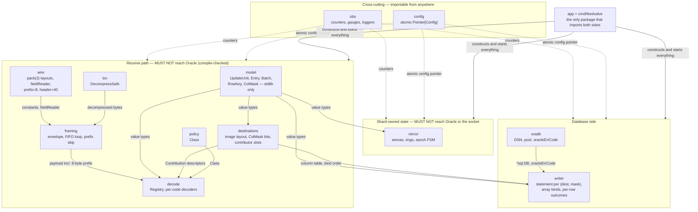
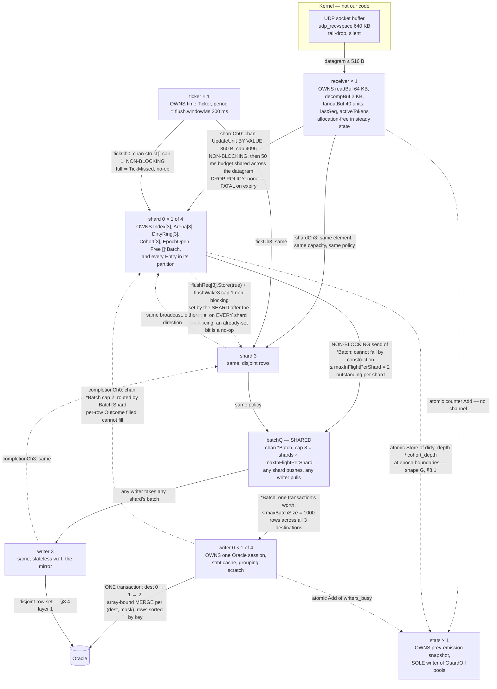

# FeedValve Phase 1 LLD — Volume 0: Foundations and Contracts

**Status:** draft for review
**Binds:** Volumes 1 (receive/decode), 2 (shard and mirror), 3 (writer pool and persistence),
4 (lifecycle, observability, failure, test).
**Detailed from:** `docs/architecture/phase1_hld_design1.md` (the HLD, authoritative).
**Protocol authority:** `ncobrd_bible.md` (the bible). Every protocol claim below cites a section of it.

> **This volume is a contract, not a discussion.** Where it says MUST, a sibling volume that does
> otherwise is wrong. Where it says SHOULD, it is engineering judgement and a sibling volume may
> deviate with a recorded reason. Anything two volumes both touch is defined here exactly once; if
> you find yourself re-deriving a number that appears here, stop and cite it instead.

---

## Table of contents

- [0. How to use this volume](#0-how-to-use-this-volume)
- [1. Package and file layout](#1-package-and-file-layout)
- [2. Go layout rules used for every size in this document](#2-go-layout-rules-used-for-every-size-in-this-document)
- [3. Type inventory](#3-type-inventory)
- [4. `Entry.Image`: the field map (closes L5)](#4-entryimage-the-field-map-closes-l5)
- [5. The digest: algorithm and collision argument (closes L6)](#5-the-digest-algorithm-and-collision-argument-closes-l6)
- [6. `ColMask` semantics](#6-colmask-semantics)
- [7. Configuration schema, complete](#7-configuration-schema-complete)
- [8. Instrument ledger](#8-instrument-ledger)
- [9. Concurrency contract](#9-concurrency-contract)
- [10. Naming and unit conventions](#10-naming-and-unit-conventions)
- [11. LLD-level ADRs](#11-lld-level-adrs)
- [12. Deltas against the HLD](#12-deltas-against-the-hld)
- [13. Open questions](#13-open-questions)

---

## 0. How to use this volume

### 0.1 What is frozen here

| Contract | Section | Volumes that bind to it |
|---|---|---|
| Package tree and the import-direction rule | §1 | all |
| Every cross-boundary type, with byte offsets | §3 | all |
| `Entry.Image` encoding and per-destination field map | §4 | 1, 2, 3 |
| Digest algorithm, covered bytes, suppression predicate | §5 | 2, 3 |
| `ColMask` bit assignment and its lifecycle transitions | §6 | 2, 3 |
| Configuration keys, defaults, reload class | §7 | all |
| Instrument names, shapes and label sets | §8 | all |
| Goroutine classes, channels, capacities, blocking semantics | §9 | all |
| Identifier, unit and error-wrapping conventions | §10 | all |

### 0.2 What this volume deliberately does not solve

- **The shard main loop, the epoch/flush state machine and the completion path.** HLD §7.3 specifies
  the states; the re-review found four defects in the mechanism (L1 flush flag has no wakeup, L2 the
  main loop is never specified, L3 the per-row outcome has three cases but the completion path has
  two, L4 "skip the row, continue the batch" has no fallback branch). **Volume 2 owns all four.**
  This volume only makes them *expressible*: §3.8 defines a three-valued `RowOutcome`, §6.2 states
  the per-outcome obligations on `Digest`, `Written` and `ColMask`, and §9.3 reserves a wakeup
  channel with its capacity and semantics fixed. It does not choose the mechanism.
- **Decoder bodies, statement text, retry policy, test plans.** Volumes 1, 3 and 4.
- **The destination schema itself.** HLD §8.2 is explicitly illustrative and OQ-13 is open. §4 gives
  the *encoding rules* and works the illustrative schema through them as a verification, not as a
  schema decision.

### 0.3 Reading the arithmetic

Every struct in §3 carries an ASCII offset table and a total. Those totals are re-derived from Go's
layout rules (§2), not copied from the HLD. Where a re-derivation disagrees with the HLD the
disagreement is recorded in §12 with the arithmetic on both sides. Numbers marked **(assumed)** carry
an assumption id and a measurement; numbers with an `ASM-n` reference are the HLD's own assumptions.

---

## 1. Package and file layout

Module path `feedvalve`, `go 1.23.3`. One binary, one host, statically linked — the HLD's deployment
baseline (§11.1) is unchanged. The package tree exists to make the HLD's ten modules (§6.1)
independently testable and to make one rule **checkable by the compiler**: the receive path cannot
reach the database.

### 1.1 The tree

```
feedvalve/
├── go.mod                              module feedvalve, go 1.23.3
├── cmd/
│   └── feedvalve/
│       └── main.go                     flags, main → run(ctx) error, process exit code
└── internal/
    ├── model/                          the value types every other package speaks
    ├── wire/                           protocol constants, header layouts, fieldReader, layout gates
    ├── lzo/                            LZO1Z decompression
    ├── framing/                        QD datagram ring; envelope split, FIFO sub-packet loop, prefix skip
    ├── decode/                         decoder registry and the per-transcode decoders
    ├── destinations/                   destination schema, image layout, contribution mapping
    ├── policy/                         transcode → rate-limited | non-rate-limited
    ├── mirror/                         shard goroutine: arenas, rings, epoch state machine
    ├── writer/                         stateless writer pool, statement assembly, binds
    ├── oradb/                          Oracle connection layer: DSN, pool, error classification
    ├── config/                         Config root, load, validate, atomic swap
    ├── obs/                            counters, gauges, emission, the three loggers
    ├── health/                         circuit liveness and market-session state machines
    └── app/                            wiring and lifecycle: builds the graph, owns the goroutines
```

Everything is under `internal/` so no part of this is importable from outside the module. `cmd/` holds
no logic beyond flag parsing and the `main` → `run(ctx) error` split that CLAUDE.md requires —
`appLogger.Fatalf` calls `os.Exit` and skips every `defer`, which is why `poc` split `run` out
(`poc/gobrdclnt.go:19-28`) and why this tree must too.

### 1.2 What each package owns, and what it must never import

| Package | Owns | Inherits from `poc/` | MUST NOT import |
|---|---|---|---|
| `model` | `UpdateUnit`, `Contribution`, `Entry`, `RowKey`, `ColMask`, `Batch`, `BatchRow`, `RowOutcome`, `DestID`, `TransCode`, `MsgHeader`, `HeaderKind`, `Class`. Pure data; no behaviour beyond accessors and `String()` | — (new) | everything except stdlib. Specifically **not** `database/sql`, `go-ora`, `log`, and no other `internal/` package |
| `wire` | Protocol constants (`broadcastDataPrefixLen` 8, `broadcastHeaderSize` 40, `maxPackedDataLen` 512, `maxDatagramLen` 516, netIds), the wire struct declarations, the `fieldReader` cursor, `hexDump`, and the pack(2) compile-time layout assertions | `exchange_communication.go`, `reader.go` | `oradb`, `writer`, `mirror`, `config`, `database/sql` |
| `lzo` | `DecompressSafe` (bounds-checked) and `Decompress` (tests only) | `decompress.go`, `errors.go` | everything but stdlib |
| `framing` | **QD, the lock-free SPSC datagram ring of §9.5** (`Producer`/`Consumer`, the spin-then-park wakeup, close-and-drain); envelope split, `iNoPackets` FIFO loop, the `iCompLen > 0` branch, cursor arithmetic, the 8-byte prefix rule, the netId frame-alignment oracle | `gobrdclnt.go` (`processBroadcastPackData`, `handleSubPacket`); QD is new | `oradb`, `writer`, `mirror`, `database/sql` |
| `decode` | `Registry`, `Decoder`, one file per transaction code, per-decoder Part V layout assertions | `gobrdclnt.go` (`parseBroadcastHeader`, `parseMS*`) | `oradb`, `writer`, `mirror`, `database/sql` |
| `destinations` | The destination table: name, target table, row-key rule, ordered column list, image layout, `ColMask` bit assignment, contributor slot assignment, and the transcode→contribution mapping | — (new) | `oradb`, `writer`, `mirror`, `database/sql` |
| `policy` | Transcode → `Class`; inventory validation | — (new) | `oradb`, `writer`, `mirror`, `database/sql` |
| `mirror` | `Shard`: index, arenas, accumulating/cohort rings, epoch state, batch free list. **Volume 2** | — (new) | `oradb`, `writer`, `database/sql`, `net` |
| `writer` | Statement assembly from a batch mask, array binds, transaction boundary, per-row outcome attribution | `db.go` (the `Exec`/`ExecTx` usage pattern) | `framing`, `decode`, `mirror`, `net` |
| `oradb` | `DBSettings`, `dsn()`, `Describe()`, `redactDSN`, `OpenDB`, pool settings, `oracleErrCode` | `db.go` | `framing`, `decode`, `mirror`, `destinations` |
| `config` | `Config` root, JSON load with pointer-optional fields, validation, `atomic.Pointer[Config]` | `config.go` | `framing`, `decode`, `mirror`, `writer` |
| `obs` | Counter/gauge registry, the 60 s emission line, the three loggers (`app`, `debug`, and the *deleted* packet logger — see below) | `logger.go` | every other `internal/` package (so anything may import `obs`) |
| `health` | Circuit liveness (HLD Figure 6) and market-session (Figure 7) state machines | — (new) | `oradb`, `writer`, `mirror` |
| `app` | Construction of the whole graph, goroutine start/stop order, signal handling, drain | `gobrdclnt.go` (`run`, `receiveLoop`) | nothing is forbidden; `app` is the only package allowed to import both halves |

**Not carried over from `poc`:** the full-payload packet logger (`poc/logger.go`, `poc/gobrdclnt.go:246-247`).
HLD §10.2 removes it — it writes several times the wire rate to an append-only file. `obs` keeps
`appLogger` and `debugLogger` only. The `-maxout` cap and `packetLogger` disappear with it.

### 1.3 The import-direction rule

> **MUST.** No package on the receive path — `model`, `wire`, `lzo`, `framing`, `decode`,
> `destinations`, `policy` — may import `oradb`, `writer`, `database/sql`, or
> `github.com/sijms/go-ora/v2`, directly or transitively.
>
> **MUST.** `mirror` may not import `oradb`, `writer`, `database/sql` or `net` either. A shard
> goroutine that cannot name a database handle cannot block on a commit, which is the property HLD
> §7.3 depends on and states in prose ("the shard goroutine must never block waiting for a commit").
> Here it is a compile error instead.
>
> **MUST.** `model` imports stdlib only. A `sql.NullString` or a `time.Time` with a location pointer
> inside `Batch` would drag the database into the receive path and break ADR-006's pointer-free rule
> in the same stroke.

Enforcement (Volume 4 owns the test): a table-driven test that shells `go list -deps <pkg>` for each
receive-path package and fails on any member of the forbidden set. This is cheap, exact, and it is
the only mechanism that survives a well-intentioned refactor at 03:00.



*Figure 0.1 — Package tree and import direction. Edges point the way imports flow; every edge names
what crosses it. The two subgraph boundaries on the left are the compile-checked rule: nothing inside
them may name `database/sql`, `go-ora` or `oradb`, and `mirror` additionally may not name `net`. Only
`app` sees both sides.*

### 1.4 Dependency audit against `CGO_ENABLED=0 GOOS=aix GOARCH=ppc64`

| Dependency | Where | cgo-free? | AIX/ppc64? | Evidence |
|---|---|---|---|---|
| Go standard library | everywhere | yes | yes | `aix/ppc64` is a supported Go port |
| `github.com/sijms/go-ora/v2` | `oradb` only | yes | yes | Pure Go driver, no Instant Client. CLAUDE.md records the `go list -deps ./poc` verification and `go mod why gorm.io/gorm` showing the gorm/xorm entries belong to go-ora's test tree |
| `hash/maphash` | `mirror` (digest, §5) | yes | yes | stdlib. Uses runtime assembly on some architectures; **assembly is not cgo**. On ppc64 `useAeshash` is false, so it takes the portable word-at-a-time path — *(assumed; measure with `go test -bench -benchmem` cross-compiled to the LPAR, OQ-L3)* |
| `encoding/binary` | `wire`, `destinations`, `writer` | yes | yes | stdlib; `binary.BigEndian.Uint32` and friends are pure Go and alignment-agnostic, which §4.1 relies on |
| `github.com/rhnvrm/lzo1z` | **not a dependency** | n/a | n/a | Was the reference *compressor* for fixtures. Removed from the module: the compressed bytes it produced are frozen in `poc/testdata/lzo_fixtures.json`, keyed by SHA-256 of the input, so the independence is preserved without the dependency. Gate G-DEP-3 now guards against reintroduction rather than against leakage into the binary |
| `golang.org/x/sys` | **not used** | — | — | HLD §7.8 excludes it deliberately: req §4 warns its AIX surface is thin. `SetReadBuffer` comes from `net`, signals from `os/signal` |

No new third-party dependency is introduced by this volume. The digest (§5) is stdlib; the image
encoding (§4) is stdlib; the concurrency primitives are `sync/atomic`, channels and `time`.

---

## 2. Go layout rules used for every size in this document

Every offset table below is derived with these rules and nothing else. They are stated so a reviewer
can check the arithmetic without a compiler, and so nobody confuses them with the **wire's** pack(2)
rules (bible §2.2), which are different and apply only inside `wire` and `decode`.

**Go (gc) struct layout on `GOARCH=ppc64` — a 64-bit, big-endian target** (`ppc64`, not `ppc64le`;
host byte order matters only in §4.1, where we deliberately do not depend on it):

1. Alignment of `bool`, `int8`, `uint8`, `byte` = 1; `int16`/`uint16` = 2; `int32`/`uint32`/`float32` = 4;
   `int64`/`uint64`/`float64`/pointer/`uintptr` = 8.
2. An array's alignment is its element's; its size is `n × elemSize` with no inter-element padding.
3. A struct's alignment is the maximum of its fields' alignments; fields are laid out in declaration
   order, each at the next offset satisfying its own alignment; the struct's size is rounded up to a
   multiple of its own alignment.
4. A zero-width trailing field would force a pad byte; none is used here.
5. `atomic.Bool` is `struct{ _ noCopy; v uint32 }` in effect — 4 bytes, align 4. It appears only in
   `Shard`, never in `Entry` or `UpdateUnit`.

**Two rules of our own, which is why the tables are exact rather than approximate:**

6. **MUST**: every struct that crosses a goroutine boundary declares its padding **explicitly** as a
   named `_ [n]byte` field, so the offset table in this document and the compiler agree by
   construction and a later field insertion is visible as a table edit. This is the Go-side analogue
   of `fieldReader.pad` (`poc/reader.go:47`), and the reason is identical: silent padding is how a
   layout drifts.
7. **MUST**: every fixed-size type in §3 carries a compile-time size assertion in the style of
   `mbpLayoutCheck` (`poc/exchange_communication.go:138-139`) — a constant expression that fails to
   compile if the total moves. For a Go struct the form is
   `const _ = uint(unsafe.Sizeof(Entry{}) - entrySize) + uint(entrySize - unsafe.Sizeof(Entry{}))`,
   which compiles only when the two are equal. `unsafe.Sizeof` is a compile-time constant and does
   **not** make the build unsafe or cgo-dependent; `go vet` is content with it. If a reviewer objects
   to importing `unsafe` at all, the equivalent gate is a `TestSizes` in `model` — weaker, because it
   fails at test time rather than build time.

> **Do not confuse the two layout systems.** `wire` describes the *exchange's* structs, which are
> `#pragma pack(2)` with "word" meaning 2 bytes (bible §2.1, §2.2) and are never decoded by
> reflection or `encoding/binary` struct decoding — they are read field by field through
> `fieldReader`. `model` describes *our* structs, which follow Go's rules above. The only place the
> two meet is `Entry.Image` (§4), whose **contents** are wire-form bytes but whose **container** is a
> Go `[N]byte` array with alignment 1.

---

## 3. Type inventory

Every type that crosses a package boundary or a goroutine boundary. Declarations and doc comments
only — no bodies. Constants first, because six struct sizes depend on them.

### 3.0 Build-time constants

```go
package model

const (
    // maxDestinations is fixed at three by HLD §8.1: three current-state
    // destinations, no append destination. -selfcheck rejects a configuration
    // declaring any other number.
    maxDestinations = 3

    // maxContributors is the number of distinct transaction codes that may
    // contribute columns to one destination. It sizes Entry's three ordering
    // arrays, so it is a build-time constant and contributor membership is
    // startup-only configuration (HLD §6.9, §7.3).
    //
    // Eight, not the HLD's four: HLD §8.2's own MD_MARKET_STATUS destination
    // takes contributions from FIVE transcodes — 6511, 6521, 6522, 6531 and
    // 6571 (bible §4.5) — so four fails -selfcheck against the schema the HLD
    // itself illustrates. See §12, delta D1.
    maxContributors = 8

    // imageSize is the fixed width of a destination row image inside Entry.
    // Bounded by ASM-16b: the largest full row image any destination can hold,
    // accumulated across every one of its contributors. §4.6 verifies 256 is
    // sufficient for HLD §8.2's instantiation with 3 bytes to spare in the
    // worst variant, and §4.7 says what to raise it to if that margin is spent.
    imageSize = 256

    // unitBlobSize is the packed value area of one UpdateUnit, bounded by
    // ASM-16a: the largest contribution one transcode makes across all three
    // destinations in one message.
    unitBlobSize = 256

    // maxColumns is the number of distinct maskable fields one destination may
    // declare. It is the width of ColMask and is not configurable.
    maxColumns = 64
)
```

### 3.1 Scalar types and enumerations

```go
package model

// TransCode is an NNF transaction code — the dispatch key of the whole feed
// (bible §2.8: BCAST_HEADER offset 10, payload offset 18). Unsigned, because a
// code is an identifier and not a quantity; read from the wire with
// binary.BigEndian.Uint16. Note this widens poc's int16 (poc/exchange_communication.go
// BroadcastHeader.transactionCode) — see §10.3.
type TransCode uint16

// DestID indexes the three destinations, 0..maxDestinations-1. It is the array
// index of every [maxDestinations] field in this package, and it is also the
// fixed write order inside a transaction (HLD §8.3: destination 0, then 1,
// then 2 — the second layer of the deadlock argument, §8.4).
type DestID uint8

// ShardID indexes the shard goroutines, 0..shards-1.
type ShardID uint8

// Class decides WHEN a shard flushes and nothing else (HLD §6.8). It never
// decides where a unit goes.
type Class uint8

const (
    ClassRateLimited    Class = iota // flushed on the W tick; digest suppression applies
    ClassNonRateLimited              // raises the flush flag after the merge; suppression skipped
)

// HeaderKind is the outcome of header resolution (HLD §6.4). It is decided
// WITHOUT consulting the decoder registry, so that adding a transcode to the
// inventory can never change how a message's header is classified.
type HeaderKind uint8

const (
    HeaderBcast   HeaderKind = iota // BCAST_HEADER, bible §2.8 — everything except the two below
    HeaderMessage                   // MESSAGE_HEADER, bible §2.8 — 6541 at payload len 48, 6503 at 60
)
```

### 3.2 `RowKey`

```go
// RowKey identifies one row within one destination. It is unique within a
// destination only: each destination has its own map[RowKey]int32 index
// (HLD §7.3), so two destinations may legitimately use the same value.
//
// Encoding, frozen here because the shard, the destinations table and the
// writer all construct and consume it:
//
//   single 32-bit key   (token, market_type, …):  RowKey(uint32(v))
//                        — ZERO-extended, never sign-extended, so a key is a
//                          bijection onto the low 32 bits
//   composite (a, b)    of two 32-bit components:  RowKey(uint32(a))<<32 | RowKey(uint32(b))
//
// Eight bytes, comparable, hashable by Go's map without a pointer chase, and
// pointer-free, which is what keeps the arenas out of the GC's mark phase
// (ADR-006). A destination whose natural key does not fit 64 bits is rejected
// by -selfcheck rather than silently truncated.
type RowKey uint64
```

### 3.3 `ColMask`

```go
// ColMask is a bitset over one destination's maskable fields. Bit i corresponds
// to image field i of that destination, in the destination's declared column
// order (§4.1). Bit indices are assigned at startup from the destination's
// declared column list and are therefore stable for the life of the process;
// the column list is startup-only configuration (§7.2) precisely so that they
// are.
//
// A ColMask is meaningful only together with its DestID: bit 3 of destination 0
// and bit 3 of destination 1 are unrelated.
//
// One bit may map to MORE THAN ONE SQL column — an image field is the unit of
// masking, and a field such as destination 0's 120-byte MBP ladder expands to
// 40 bound columns (§4.3). The mapping bit → (columns, bind order) lives in the
// destinations table and is fixed at startup.
type ColMask uint64
```

### 3.4 `Contribution` — 24 bytes

One unit's contribution to one destination. Indexed **by destination**: `Contribs[d]` is the
contribution to destination `d`, and `Mask == 0` means "this unit does not touch destination `d`".
That removes both a destination field and a count field, and makes "does this unit touch
destination d?" one test.

```go
// Contribution describes the columns one UpdateUnit sets in one destination row.
//
// The values themselves live in UpdateUnit.Blob as a PACKED RUN: the bytes for
// the fields named by Mask, in ASCENDING BIT ORDER, each at its declared width,
// with no padding, starting at BlobOff and running BlobLen bytes. The merge is
// therefore a single deterministic loop — walk Mask's set bits low to high, copy
// width(bit) bytes from the blob cursor to imageOffset(bit) — and BlobLen is
// exactly the sum of those widths, which is what ASM-16a bounds.
type Contribution struct {
    Row     RowKey  // the row this contribution targets, within its destination
    Mask    ColMask // fields set; zero means "no contribution to this destination"
    BlobOff uint16  // start of the packed values in UpdateUnit.Blob
    BlobLen uint16  // total packed bytes; == sum of widths of Mask's set bits
    Slot    uint8   // contributor slot of the unit's TransCode WITHIN THIS destination,
                    // assigned at startup by ascending transaction code (HLD §6.9).
                    // Per-contribution, not per-unit: one transcode may occupy
                    // different slots in different destinations.
    _       [3]byte // explicit pad to the 8-byte boundary
}
```

```
Contribution — align 8, size 24
  off  size  field
    0     8  Row      RowKey (uint64)
    8     8  Mask     ColMask (uint64)
   16     2  BlobOff  uint16
   18     2  BlobLen  uint16
   20     1  Slot     uint8
   21     3  _        [3]byte   explicit pad
  ----------------------------------------
   24 total.  24 % 8 == 0, no trailing pad.
```

### 3.5 `UpdateUnit` — 360 bytes

The element type of Q1 (`shardCh[k]`), carried **by value** (ADR-006). Pointer-free and slice-free:
a `[]byte` here would alias `decompBuf`, which the receive goroutine overwrites on the very next
packet (HLD §6.1).

```go
// UpdateUnit is one token's worth of one decoded message, with its
// destination contributions already resolved. It is the only thing that crosses
// the receive → shard boundary, and it crosses by value.
//
// INVARIANT (gated by the reflection test of HLD §10.4): no field of this type,
// transitively, is a pointer, slice, map, string, channel, func or interface.
type UpdateUnit struct {
    Token    int32     // shard key for token-scoped units (bible §4.3/§4.5/§4.8 Token, LONG);
                       // zero for general units, which are pinned to the designated shard (FR8)
    Code     TransCode // the contributing transaction code
    Flags    UnitFlags // see below
    _        [1]byte   // explicit pad
    Seq      int32     // BCSeqNo as read (bible §2.8, header offset 14). Compared with
                       // serial-number arithmetic, never with '>' — ASM-11
    LogTime  int32     // BCAST_HEADER.LogTime, SECONDS since 1 Jan 1980 (bible §2.5, §2.8).
                       // Compared as a plain signed timestamp, not serially — §10.2
    RecvMono int64     // receipt monotonic nanoseconds since process start (§10.2). Always
                       // recorded, never a fallback — the §3.4(a) tiebreak that lets
                       // 6531 → 6571 → 6511 inside one second order correctly (bible §4.5)
    Contribs [maxDestinations]Contribution // indexed by DestID; Mask == 0 means absent
    BlobLen  uint16    // total bytes of Blob in use; ≤ unitBlobSize. Bounds assertion and
                       // the runtime side of the ASM-16a gate
    _        [6]byte   // explicit pad
    Blob     [unitBlobSize]byte // packed contribution values, wire form (§4.1)
}

// UnitFlags is a bitset of per-unit booleans, packed into one byte so the struct
// stays 8-byte aligned without three separate bools.
type UnitFlags uint8

const (
    FlagGeneral        UnitFlags = 1 << iota // non-token-scoped; routed to the designated shard (FR8)
    FlagNonRateLimited                       // Class is ClassNonRateLimited (HLD §6.8)
    FlagOrderingUnusable                     // the decoder could not obtain a usable ordering value;
                                             // the guard is bypassed for this unit (HLD §6.5)
)
```

```
UpdateUnit — align 8, size 360
  off  size  field
    0     4  Token     int32
    4     2  Code      TransCode (uint16)
    6     1  Flags     UnitFlags (uint8)
    7     1  _         [1]byte    explicit pad
    8     4  Seq       int32
   12     4  LogTime   int32
   16     8  RecvMono  int64                     (16 is 8-aligned)
   24    72  Contribs  [3]Contribution           (3 × 24, align 8)
   96     2  BlobLen   uint16
   98     6  _         [6]byte    explicit pad
  104   256  Blob      [256]byte  (align 1)
  ----------------------------------------
  360 total.  360 % 8 == 0, no trailing pad.
```

**Against the HLD.** HLD §6.6 and ADR-006 quote "~384 B". The re-derivation gives **360 B**. The HLD
figure is an approximation and mine is smaller, so every memory figure that divides or multiplies by
384 — Q1 at `4 × 4096 × 384 = 6 MB` (§7.8), the 346 MB no-coalescing contrast (§7.3), the
`20,000/s × 384 B = 7.7 MB/s` garbage figure in ADR-006 — remains valid as an **upper bound**. Actual
Q1 memory is `4 × 4096 × 360 = 5.9 MB`. No HLD conclusion changes. Recorded as delta D2.

### 3.6 `MsgHeader` — 32 bytes

The parsed header, produced by `decode` and consumed by `decode`, `health` and the gap detector. Not
a wire layout: it is the *union* of the fields we use from both header shapes (bible §2.8), already
byte-swapped.

```go
// MsgHeader is the decoded 40-byte message header, whichever of the two
// broadcast layouts it came from (bible §2.8).
//
// Kind is resolved BEFORE the registry is consulted and BEFORE the gap
// detector runs (HLD §6.2, §6.4): BCSeqNo exists only in BCAST_HEADER, and at
// offset 14 of a MESSAGE_HEADER sits the top half of a nanosecond Timestamp,
// which would fabricate a gap on every 9-second heartbeat (bible §4.12).
type MsgHeader struct {
    TimestampNs int64      // MESSAGE_HEADER.Timestamp, ns since 1 Jan 1980 (bible §2.5, §2.8).
                           // Zero and meaningless when Kind == HeaderBcast
    LogTime     int32      // present in both layouts but at DIFFERENT offsets: header
                           // offset 4 in BCAST_HEADER, offset 2 in MESSAGE_HEADER
                           // (bible §2.8 tables). Seconds since 1 Jan 1980 (bible §2.5).
                           // Read it at a single fixed offset and the other layout
                           // yields AlphaChar — two characters of Symbol construed as
                           // a timestamp. Resolve Kind first, then pick the offset
    BCSeqNo     int32      // BCAST_HEADER only, header offset 14. Zero when Kind == HeaderMessage
    Code        TransCode  // BCAST_HEADER offset 10 / MESSAGE_HEADER offset 0
    ErrorCode   int16      // offset 12 in BOTH layouts — checked before dispatch (bible §2.10)
    MsgLen      int16      // offset 38 in both; counts from the header onward, NOT including
                           // the 8-byte prefix (bible §2.8, §3.3). < 40 is rejected, never clamped
    Kind        HeaderKind
    _           [1]byte    // explicit pad
    PayloadLen  int32      // length of the whole broadcast data including the 8-byte prefix,
                           // as framed — the quantity the 48/60 test in HLD §6.4 compares
}
```

```
MsgHeader — align 8, size 32
  off  size  field
    0     8  TimestampNs int64
    8     4  LogTime     int32
   12     4  BCSeqNo     int32
   16     2  Code        TransCode (uint16)
   18     2  ErrorCode   int16
   20     2  MsgLen      int16
   22     1  Kind        HeaderKind (uint8)
   23     1  _           [1]byte
   24     4  PayloadLen  int32
   28     4  (trailing pad to align 8)
  ----------------------------------------
   32 total.
```

> The trailing 4 bytes are the one place rule 6 of §2 is not honoured, because Go's own rounding
> supplies them. **MUST** declare `_ [4]byte` at offset 28 explicitly anyway, so the table and the
> compiler cannot diverge; the size is 32 either way.

### 3.7 `Entry` — 424 bytes at `imageSize` 256

One row of one destination, living in a shard's arena. Owned exclusively by its shard goroutine;
never shared, never pointed at.

```go
// Entry is one row of one destination. It contains no pointers and no slices,
// so the garbage collector never traces the ~170 MB of arenas that hold these
// (ADR-006, HLD §7.8).
//
// All three ordering components are arrays indexed by contributor slot, not
// scalars: two transcodes writing disjoint columns of one row have incomparable
// ordering values, so a single per-row counter of ANY of the three lets the
// faster one permanently suppress the slower (HLD §6.5, review finding B9).
type Entry struct {
    Row      RowKey  // this destination's row key
    ColMask  ColMask // fields dirtied SINCE this row was last batched (§6.2)
    Written  ColMask // union of every field ever SUCCESSFULLY committed for this row.
                     // Second half of the suppression predicate (§5.3): without it, a
                     // field set for the first time to a value that happens to equal the
                     // zero fill is suppressed and stays NULL in Oracle forever
    Digest   uint64  // digest of the row image successfully written (NFR13, §5).
                     // Zero is the sentinel "never successfully written"
    LastSeq  [maxContributors]int32 // last applied BCSeqNo, per contributor slot
    LastTime [maxContributors]int32 // last applied LogTime, SECONDS since 1980 (bible §2.5),
                                    // per contributor slot — wire width, see §10.3
    LastRecv [maxContributors]int64 // receipt monotonic ns, per contributor slot — the
                                    // §3.4(a) tiebreak, stored always
    Dirty    bool
    InFlight bool    // batched, not yet confirmed — the in-flight rule, HLD §6.7
    ReDirty  bool    // merged again while in flight; requeued by the completion

    // --- merged from Vol 2 §13.1 (A1, A2). Both land in padding this struct
    // --- already declared, so Entry is still 424 B.
    Quarantined bool  // Oracle refused this row and will refuse it identically
                      // forever; off every ring, zero retries, released only by a
                      // config fix or a disjoint-mask merge (Vol 2 §9, defect L4)
    SlotSeen    uint8 // bit i: has contributor slot i ever been applied? The
                      // ordering guard's denominator rule — a contribution that
                      // initialises a slot has nothing to compare against and must
                      // count in neither guard_offered nor guard_superseded (Vol 2 §5.4)

    _        [3]byte // explicit pad to the 8-byte boundary — was [5]byte before the
                     // two fields above; three bytes remain for the next flag
    Image    [imageSize]byte // the current column image of this row, wire form (§4)
}
```

```
Entry — align 8, size 424 (maxContributors = 8, imageSize = 256)
  off  size  field
    0     8  Row       RowKey (uint64)
    8     8  ColMask   uint64
   16     8  Written   uint64
   24     8  Digest    uint64
   32    32  LastSeq   [8]int32   (align 4)
   64    32  LastTime  [8]int32   (align 4)
   96    64  LastRecv  [8]int64   (align 8; 96 is 8-aligned)
  160     1  Dirty       bool
  161     1  InFlight    bool
  162     1  ReDirty     bool
  163     1  Quarantined bool       Vol 2 A1
  164     1  SlotSeen    uint8      Vol 2 A2
  165     3  _           [3]byte    explicit pad
  168   256  Image       [256]byte  (align 1)
  ----------------------------------------
  424 total.  424 % 8 == 0, no trailing pad.
```

> **`Quarantined` and `SlotSeen` cost nothing.** Both land inside the five pad bytes this struct
> already declared at offset 163, so `Entry` is **still 424 B** and every memory figure below is
> unchanged. This is the explicit-padding rule of §2 earning its keep: the free space was visible as
> a budget, so Volume 2 could spend it deliberately instead of growing the struct by eight bytes
> across 400,000 rows. Three bytes remain.

**Against the HLD's 368.** The HLD's arithmetic is *correct for the fields it declares*: `Row` 8 +
`ColMask` 8 + `Digest` 8 + `LastSeq[4]int32` 16 + `LastTime[4]int64` 32 + `LastRecv[4]int64` 32 +
3 bools + 5 pad = 8 + `Image` 256 → 112 + 256 = **368**, with no interior padding anywhere because
every field lands naturally aligned. I re-derived it and it holds. Three changes move it to 424, all
recorded in §12:

| Change | Δ | Why |
|---|---|---|
| `maxContributors` 4 → 8 | +80 | HLD §8.2's `MD_MARKET_STATUS` has **five** contributors (6511/6521/6522/6531/6571, bible §4.5). Four fails the HLD's own `-selfcheck` rule (§6.8). Eight gives headroom against OQ-13 for one more doubling (delta D1) |
| `LastTime` `int64` → `int32` | −32 | `LogTime` is a `LONG` — 4 bytes signed (bible §2.7, §2.8). Storing a 4-byte wire field in 8 bytes buys nothing and breaks §10.3's wire-width rule (delta D3) |
| `Written ColMask` added | +8 | §5.3's suppression predicate. Without it NFR13 silently loses a first-ever write of a field (delta D4) |

Arena memory at ASM-7's ~400,000 rows: `400,000 × 424 = 169.6 MB` of *occupied* bytes against the
HLD's 147 MB.

> **Superseded by Vol 2 §10, which is canonical for the envelope.** Occupied-byte arithmetic
> understates the real figure because it ignores quantisation: arenas are allocated in chunks, Go
> rounds map buckets to a power of two, and the rings are pre-sized. Vol 2 re-derived arenas at
> **187.6 MB**, indexes at **11.7 MB** and rings at **6.3 MB** *(erratum, Phase 3: 4.8 MB before the
> rings' power-of-two capacity was counted, Vol 2 §10.3)*. With Q1 at 5.9 MB, the new datagram
> ring **QD** at 8.5 MB (§9.5.2), batch rows at 2.3 MB and fixed buffers under 1 MB, the resident
> total is ≈ **222.3 MB — 0.56 % of the 40 GB partition.** Use these figures, not the 169.6/189 pair.

Every conclusion in HLD
§7.8 and §11.3 survives unchanged.

> **Considered and not taken:** a per-destination image size. HLD §8.2's destination 1 needs 181
> bytes and destination 2 needs 37 (§4.4), so sizing each arena to its own destination would save
> roughly 43 MB. Rejected: it makes `Entry` three types instead of one, and every loop in the shard
> and the pump generic or triplicated, to save 0.1 % of the partition. One `Entry` type, one arena
> shape, one pump.

### 3.8 `Batch`, `BatchRow` and `RowOutcome`

`Batch` is the only heap object on the hot path and the only thing passed by pointer. It is
pre-allocated (`maxInFlightPerShard` per shard) and reused forever, so `*Batch` on a channel costs no
allocation. Unlike `UpdateUnit` and `Entry`, `Batch` is **not** required to be pointer-free — it is
never in an arena and never traced at 170 MB scale — but it stays allocation-free in steady state.

```go
// RowOutcome is the writer's verdict on ONE row of a batch. Three terminal
// values, because HLD §9.2 classifies row-level data errors (ORA-00001,
// ORA-01438) as "skip the row, continue the batch, stay Healthy" while
// session-level errors (ORA-03113, ORA-12541) require the row to be retried.
// Collapsing them into success/failure makes F14 inexpressible.
//
// OutcomePending is the zero value and the state a batch is reset to. A batch
// returned with any row still Pending is a WRITER DEFECT, not a load condition:
// the shard counts it and stops loudly.
type RowOutcome uint8

const (
    OutcomePending   RowOutcome = iota // writer has not reported on this row
    OutcomeCommitted                   // the row's columns are in Oracle
    OutcomeRejected                    // permanent data error; retry cannot help (HLD §9.2)
    OutcomeFailed                      // transient; the row must be retried (HLD §9.2)
)

// BatchRow is one row's snapshot, copied out of its Entry at pump time so the
// Entry is free to be re-merged while the batch is in flight (HLD §6.7).
type BatchRow struct {
    Row     RowKey          // the row key, bound as :1 of the MERGE's ON clause
    Mask    ColMask         // THE MASK THE STATEMENT'S SET LIST IS BUILT FROM (HLD §8.3).
                            // Never the entry's live ColMask, which was zeroed at pump time
                            // and has since re-accumulated mid-flight changes
    Digest  uint64          // digest of Image at pump time; the value the shard stores into
                            // Entry.Digest on OutcomeCommitted — never recomputed (§5.4)
    Slot    int32           // arena slot of the source Entry, so the completion path needs no
                            // map lookup and cannot look up the wrong row after a reload
    Outcome RowOutcome      // filled by the writer, read by the owning shard
    _       [1]byte         // explicit pad — was [3]byte before ErrCode below
    ErrCode uint16          // Vol 2 §13.1 A7. The bare ORA number for a Rejected or Failed
                            // row, 0 otherwise. A uint16 and not an oradb.ErrClass because
                            // mirror may not import oradb (§1.3) and the shard never
                            // classifies — it only logs. Without it the quarantine ERROR
                            // line names no cause and is undiagnosable (Vol 2 §9.6)
    Image   [imageSize]byte // the row image as it was at pump time, wire form (§4)
}

// Batch is one transaction: up to maxBatchSize rows spanning all three
// destinations, committed in destination order 0 → 1 → 2 with rows sorted by
// key inside each (HLD §8.3, §8.4).
//
// Ownership crosses goroutines twice and is strictly sequential: the owning
// shard fills it and sends it on batchQ; exactly one writer holds it for the
// duration of one transaction and fills every Outcome; the writer returns it on
// completionCh[Shard]; the shard applies the outcomes and returns it to its own
// free list. At no instant do two goroutines hold it.
type Batch struct {
    Shard     ShardID  // routes the completion back to the owning shard
    Epoch     uint64   // the shard's epoch counter, for logging and the epoch-completeness gate
    DestStart [maxDestinations]int32 // first index in Rows belonging to destination d
    DestCount [maxDestinations]int32 // number of rows in Rows belonging to destination d
    N         int32    // total rows in use; == sum(DestCount)
    Err       error    // batch-level (not row-level) failure: the connection died, the
                       // transaction could not begin or could not commit. Nil when every
                       // verdict is per row
    Rows      []BatchRow // len == maxBatchSizeCeiling, allocated once at startup and reused;
                         // only Rows[:N] is meaningful
}
```

```
BatchRow — align 8, size 288 (imageSize = 256)
  off  size  field
    0     8  Row      RowKey (uint64)
    8     8  Mask     ColMask (uint64)
   16     8  Digest   uint64
   24     4  Slot     int32
   28     1  Outcome  RowOutcome (uint8)
   29     1  _        [1]byte    explicit pad
   30     2  ErrCode  uint16     (align 2; 30 is 2-aligned)   Vol 2 A7
   32   256  Image    [256]byte  (align 1)
  ----------------------------------------
  288 total.  288 % 8 == 0.
```

> **`ErrCode` is also free.** It occupies two of the three pad bytes already declared at offset 29,
> so `BatchRow` stays **288 B** and the buffer figure below does not move.

Batch row buffers: `shards × maxInFlightPerShard × maxBatchSizeCeiling × 288` =
`4 × 2 × 1000 × 288` = **2.3 MB**, under the HLD §7.8 figure of 3 MB (which reused the 368-byte
`Entry` size as a stand-in for a row).

**Three notes for Volumes 2 and 3, and only notes:**

1. **The three-outcome completion path is L3 and Volume 2 owns the mechanism.** What this volume
   fixes is that all three outcomes are *representable* and that each carries a defined obligation on
   the entry — §6.2 states those obligations as a table. A completion path with two branches cannot
   satisfy that table.
2. **`Err != nil` and per-row outcomes are not alternatives.** A batch that never reached the server
   has `Err` set and every row still `OutcomePending`; Volume 2's completion path must treat
   `Err != nil` as "every Pending row is `OutcomeFailed`" and Volume 3 must not leave a batch in a
   state where both `Err == nil` and some row is `Pending`. That is L4's fallback branch; **Volume 2
   owns it**, and this is the type-level hook it hangs on.
3. **`Rows` is the one slice here, and it is deliberate.** It is allocated once per batch at startup
   from `maxBatchSizeCeiling` and never resized, which is exactly why `maxBatchSize` is bounded by a
   startup-only ceiling (§7.2). `Batch` never enters an arena, so the slice header costs the
   collector three words per batch — eight batches at the defaults.

**Statement grouping, and a small divergence from HLD §8.3.** §8.3 describes a batch as
`[3]map[ColMask][]row`. A map rebuilt per batch allocates on the writer path for no benefit. The
frozen representation is the flat `Rows` array plus `DestStart`/`DestCount`; the writer groups by
`(destination, mask)` using a **writer-owned reusable scratch** — sort `Rows[DestStart[d]:…]` by
`(Mask, Row)` and walk the runs. Same statements, same grouping, no allocation, and rows stay sorted
by key inside each mask group, which is what §8.3's acquisition-order rule needs. Recorded as
delta D5.

### 3.9 The decoder registry entry

HLD §6.4 gives the `Decoder` and `Registry` interfaces; they are reproduced here with the two
additions the rest of the design needs, and with the allocation rule made explicit.

```go
package decode

// Decoder decodes one broadcast message body into zero or more update units.
//
// payload is the WHOLE broadcast data including the 8-byte prefix (bible §3.4);
// implementations read through a wire.FieldReader cursor started at the prefix
// so debug offsets line up 1:1 with a hex dump and with a wire capture
// (poc/reader.go:30, poc/gobrdclnt.go:298-323).
//
// out is caller-owned and reused per packet. A Decoder writes at most MaxUnits()
// entries into it and returns how many it wrote. It MUST NOT retain any slice of
// payload or of out.
//
// A Decoder produces field values only. Which destination rows and columns those
// values land in is the destinations package's job: it stamps each unit's
// Contribs before the unit reaches the router (HLD §6.1).
//
// ALLOCATION RULE (MUST): a Decoder returns only package-level sentinel errors.
// It never calls fmt.Errorf, errors.New or any wrapping helper on the decode
// path — the receive path is allocation-free in steady state (ADR-006) and a
// wrapped error at 10,000 packets/s during a misframe is both the loudest and
// the slowest thing in the process. Context goes in the counter label, not in
// the error string. See §10.4.
type Decoder interface {
    Code() model.TransCode

    // BodyLen is the declared packet length from the bible's Part V table,
    // measured from the broadcast header onward — 470 for 7208 (bible §4.8),
    // 294 for 7305/7340 (bible §4.3), 320 for the 6511 family (bible §4.5).
    // Zero means variable-length. The dispatcher compares it against
    // MsgHeader.MsgLen and rejects a mismatch before the decoder runs.
    BodyLen() int

    // MaxUnits is the largest fan-out this message can produce: 2 for 7208
    // (bible §4.8), 35 for 7320/7210 (§4.4b), 25 for 7220 (§4.16), 17 for 7202
    // (§4.6), 5 for 7201 (§4.9), 1 for 7305/7340 and the 6511 family.
    MaxUnits() int

    Decode(h model.MsgHeader, payload []byte, out []model.UpdateUnit) (n int, err error)
}

// RegistryEntry is what the registry stores per code: the decoder, its class,
// and the per-destination contribution descriptors resolved at config load so
// the decode path does no lookups. Contributor slots are assigned here, once,
// at startup, by ascending transaction code within each destination (HLD §6.9).
type RegistryEntry struct {
    Dec       Decoder
    Code      model.TransCode
    Class     model.Class
    Slots     [maxDestinations]uint8    // contributor slot of Code in each destination
    Contrib   [maxDestinations]ColSpec  // which columns of each destination Code supplies
}
// (erratum, Phase 3, ruling D2: the draft carried GuardOff *atomic.Bool here. The
// registry is immutable and swapped whole on a reload, so the bit lives instead in
// mirror.GuardTable — built once by app, shared by every shard, never rebuilt —
// with its guard_offered/guard_superseded counters resolved before Freeze.)

// ColSpec is one transcode's declared contribution to one destination: the mask
// of fields it supplies and the total packed width of their values. Width is
// precomputed so the decoder can bound-check its blob write in one comparison.
type ColSpec struct {
    Mask  ColMask
    Width uint16 // sum of the declared widths of Mask's set bits; 0 ⇒ no contribution
}

// Registry resolves a transaction code to its entry. Unknown codes resolve to
// nil, which the dispatcher counts and logs at a bounded rate rather than
// treating as an error (HLD §6.4, ADR-011). The registry is immutable after
// construction; a reload builds a new one and swaps the config pointer.
type Registry interface {
    Lookup(code model.TransCode) *RegistryEntry
    Codes() []model.TransCode
}
```

**Layout gate (MUST), one per decoder**, in the style of `mbpLayoutCheck`
(`poc/exchange_communication.go:132-139`). The build fails if the Part V arithmetic stops
reconciling:

```go
// 7208: bible Part V — declared 470, interior pad at offset 17 of each record,
// stride 214, 40 + 2 + 2×214 = 470.
const mbpLayoutSlack = mbpMessageBodySize - (wire.BcastHeaderSize + 2 + mbpMaxRecords*mbpRecordSize)
const _ = uint(mbpLayoutSlack) + uint(-mbpLayoutSlack)
```

### 3.10 The configuration root

Field-by-field defaults, ranges and reload classes are §7. The shape is given here because it is what
`app` passes around.

```go
package config

// Config is the whole runtime configuration. It is IMMUTABLE once published:
// reload builds a new *Config, validates it wholesale, and swaps the pointer
// (HLD §6.9). Nothing mutates a published Config, so every reader can hold the
// pointer for the duration of one natural unit of work — one datagram for the
// receiver, one flush tick for a shard, one batch for a writer.
type Config struct {
    UDP          UDPConfig
    Runtime      RuntimeConfig
    Flush        FlushConfig
    Writers      WritersConfig
    DB           oradb.DBSettings    // password is NOT here — see §7.5
    Ordering     OrderingConfig
    Stats        StatsConfig
    Liveness     LivenessConfig
    Debug        DebugConfig
    Destinations []DestinationConfig // startup-only; index is the DestID
    Transcodes   []TranscodeConfig   // class and contributions
}

// Load reads and validates a configuration file. Pointer fields inside the
// on-disk shape distinguish "absent" from "set to zero" (poc/config.go); Load
// resolves them against the defaults in §7 and returns a fully-populated Config.
func Load(path string) (*Config, error)

// Validate runs the complete rule set of HLD §6.8 — identical at startup, under
// -selfcheck, and on the SIGHUP path before the atomic swap. A file that fails
// is rejected WHOLESALE and the previous configuration keeps running: a
// partially applied configuration is worse than a stale one.
func Validate(c *Config, prev *Config) error

// Store is the published configuration pointer. Readers load it at a natural
// boundary, never mid-unit-of-work.
type Store struct{ p atomic.Pointer[Config] }

func (s *Store) Load() *Config
func (s *Store) Swap(c *Config) *Config
```

### 3.11 Error types

Three tiers, because the receive path and the database path have opposite requirements: the receive
path must not allocate, and the database path must carry an ORA code a caller can branch on.

```go
package model

// Reject is the receive path's error type: a small enum, not an error. Returned
// by value, costs nothing, and maps 1:1 onto a counter name and onto a row of
// HLD §9.1. Using an error here would allocate on a path that must not.
type Reject uint8

const (
    RejectNone            Reject = iota
    RejectOversizeDatagram        // > 516 bytes; trimmed to 512 and processed (F6, bible §3.2, §3.6)
    RejectShortMessageLen         // MessageLength < 40 — abandons the datagram remainder (F4, bible §3.3)
    RejectDecompress              // DecompressSafe failed; this sub-packet only (F3, bible §3.5)
    RejectErrorCode               // header ErrorCode != 0 ⇒ MS_ERROR_RESPONSE (F7, bible §2.10)
    RejectBodyLenMismatch         // declared MessageLength disagrees with the registry BodyLen
    RejectShortPayload            // payload shorter than the declared body
    RejectUnknownTranscode        // no decoder configured (F2)
    RejectRecordCountClamped      // NoOfRecords out of range; clamped and parsed (F8, bible §4.4b/§4.8/§4.16)
)

// Counter returns the obs counter name this rejection increments. One place,
// so a rejection cannot be counted under two names in two volumes.
func (r Reject) Counter() string
```

```go
package oradb

// Error wraps a driver error with the classification HLD §9.2 branches on, so
// no caller string-matches error text. Built from oracleErrCode
// (poc/db.go:412-418).
type Error struct {
    Code  int       // the ORA-nnnnn number, 0 if not an Oracle error
    Class ErrClass
    Op    string    // "begin", "exec", "commit", "ping", "connect"
    Dest  string    // destination name, empty for connection-level operations
    Stmt  string    // STATEMENT IDENTITY, not statement text: "dest=1 mask=0x00000000000001f3".
                    // This is what the two-writer pool-stop rule keys on (HLD §9.2)
    Err   error     // the driver error, ALREADY passed through redactDSN (poc/db.go:190-206)
}

func (e *Error) Error() string  // MUST NOT contain the DSN — see §7.4
func (e *Error) Unwrap() error

type ErrClass uint8

const (
    ErrRowData    ErrClass = iota // ORA-00001, ORA-01438, ORA-12899 — no retry, skip the row
    ErrSession                    // ORA-03113, ORA-03114, ORA-12541, ORA-12170 — retire and retry
    ErrStatement                  // ORA-00936, ORA-00942 — deployment defect, stop the writer
    ErrDeadlock                   // ORA-00060 — should be unreachable (HLD §8.4); retry once
    ErrUnknown
)

// Sentinels for the startup and lifecycle paths, where allocation does not matter
// but identity does.
var (
    ErrNoPassword   = errors.New("FEEDVALVE_DB_PASSWORD is not set")
    ErrPoolStopped  = errors.New("writer pool stopped by the statement-failure rule")
    ErrDrainTimeout = errors.New("drain deadline reached with dirty rows outstanding")
)
```

### 3.12 Type relationships

```mermaid
classDiagram
    class UpdateUnit {
        +int32 Token
        +TransCode Code
        +UnitFlags Flags
        +int32 Seq
        +int32 LogTime
        +int64 RecvMono
        +Contribution[3] Contribs
        +byte[256] Blob
        --360 B, by value on Q1--
    }
    class Contribution {
        +RowKey Row
        +ColMask Mask
        +uint16 BlobOff
        +uint16 BlobLen
        +uint8 Slot
        --24 B, Mask==0 means absent--
    }
    class Entry {
        +RowKey Row
        +ColMask ColMask
        +ColMask Written
        +uint64 Digest
        +int32[8] LastSeq
        +int32[8] LastTime
        +int64[8] LastRecv
        +bool Dirty/InFlight/ReDirty
        +byte[256] Image
        --424 B, in a shard arena--
    }
    class BatchRow {
        +RowKey Row
        +ColMask Mask
        +uint64 Digest
        +int32 Slot
        +RowOutcome Outcome
        +byte[256] Image
        --288 B--
    }
    class Batch {
        +ShardID Shard
        +uint64 Epoch
        +int32[3] DestStart
        +int32[3] DestCount
        +int32 N
        +error Err
        --pooled, by pointer--
    }
    class Destination {
        +DestID ID
        +string Table
        +RowKeyRule Key
        +Column[] Columns
        +int ImageLen
        +TransCode[8] Contributors
        --startup-only, immutable--
    }

    UpdateUnit "1" *-- "3" Contribution : indexed by DestID
    Contribution ..> Entry : merge, masked fields only,\nblob run -> Image at field offsets
    Entry ..> BatchRow : pump copies Image+Mask+Digest,\nthen ZEROES Entry.ColMask
    Batch "1" *-- "N" BatchRow : Rows[:N], segmented by destination
    BatchRow ..> Entry : completion applies Outcome\nto Digest / Written / ColMask
    Destination ..> Contribution : supplies Mask bit meanings\nand blob widths
    Destination ..> BatchRow : supplies bit -> SQL column\nand bind order
```

*Figure 0.2 — Type relationships and the direction of data movement. Solid diamonds are containment;
dashed arrows are "produces / is applied to", labelled with what actually moves. The three sizes on
the diagram are the re-derived ones from §3.5, §3.7 and §3.8, not the HLD's estimates. `Destination`
is startup-only immutable state, which is why every mask bit index and image offset in §4 can be a
constant for the life of the process.*

---

### 3.13 Merged from the sibling volumes

Types and values Volumes 1–4 needed that §3 did not define. Folded in here; the "Additions" sections
in those volumes are superseded and remain only as provenance. Two entries are **withdrawn** and are
listed rather than deleted, so a reader of an earlier draft can see the decision was deliberate.

| Addition | Package | Why it is needed |
|---|---|---|
| `Datagram` — 1040 B, pointer-free | `model` | **New in this merge.** QD's element (§9.5.2) |
| `SessionEvent` — 16 B, pointer-free | `model` | *(Vol 4)* crosses decode → health by value, so the session machines see the re-open's three transitions rather than a sampled end state |
| `RejectPanic` added to the `Reject` enum | `model` | *(Vol 1)* the recover boundary needs a `Reject` value to return; every other outcome on that path has one |
| `ErrStallBudgetExpired` sentinel | `model` | *(Vol 1)* the fatal path must be a **returned error**, not `os.Exit` (§10.4) — `main` maps it to an exit code and Volume 4's drain runs first. Now covers **both** budgets (§9.5.6) |
| `Column.Scale uint8` | `destinations` | *(Vol 3 A1)* `Scaled` says *whether* to divide; the statement text needs *by what* |
| `Column.LenBit int8` | `destinations` | *(Vol 3 A2)* destination 2's text takes its length from a different image field; without this the binder cannot be generated from the column table at all |
| `Column.SQLPrecision`, `SQLMaxBytes`, `NotNull`, `Domain` | `destinations` | **New in this merge (B2).** The DDL facts the mirror needs to pre-validate (§5A) |
| `Entry.Quarantined`, `Entry.SlotSeen` | `model` | *(Vol 2 A1, A2)* both free — they land in declared padding, §3.7 |
| `BatchRow.ErrCode uint16` | `model` | *(Vol 2 A7)* free, in declared padding. A bare ORA number and not an `ErrClass`, because `mirror` may not import `oradb` and the shard never classifies — it only logs |
| `Config.Gen uint64`, assigned monotonically on load and swap | `config` | *(Vol 2 A6)* the shard needs "was this reloaded?" as a cheap exact test at epoch open. Pointer comparison would also fire on a no-op re-publish |
| `oradb.ErrSpace` added to `ErrClass` | `oradb` | *(Vol 3 A4)* tablespace exhaustion retries like a session error but **never** self-heals. Folded into `ErrSession`, a full tablespace looks like a network blip and the runbook says "wait" when it should say "page the DBA" |
| `oradb.Session` — a pinned connection that knows when it was acquired | `oradb` | *(Vol 3 A5)* a writer needs its transaction, statements and row locks on one session — and, per finding W1, needs to know when to give it back |
| `FlushBus` — `req []atomic.Bool`, `wake []chan struct{}` | `mirror` | *(Vol 2 A8)* makes "no shard can reach another shard's state" structural rather than disciplinary |
| `ring` with `PushFrontBlock` | `mirror` | *(Vol 2 A9)* HLD §7.3 types the dirty structure as a slice and calls it a ring. A slice has no O(1) head insertion, and the failure path head-inserts deliberately — Vol 2 §11.4 shows the consequence is a process crash during a database outage |
| `Shard.Quarantine`, `Shard.cfgGen` | `mirror` | *(Vol 2 A4, A5)* materialise the quarantine set so a reload releases it in one pass instead of scanning the arena |
| `app.Runtime` — config, registry and destinations behind **one** atomic pointer | `app` | *(Vol 1 A-16)* the registry cannot live inside `Config` (§1.2 forbids `config` → `decode`), and two independent pointers give a skew window on reload |
| `wire.FieldID` + name table; `FieldReader` methods `Copy`, `Skip`, `Pad`, `Remaining`, `Reset` | `wire` | *(Vol 1 A-17)* §1.2 assigns the cursor to `wire` without fixing its surface. `Copy` is the workhorse, because R1 stores wire form — a field is copied, never decoded and re-encoded |
| `maxRegistered = 32`, `maxConsecutiveReadErrors = 64` | `decode`, `app` | *(Vol 1 A-18)* deliberately constants rather than keys |
| ~~`RowFailState`~~ **withdrawn** | — | *(Vol 2 A3)* an earlier draft's three-valued failure state. With OQ-4 resolved and attribution supplied by Volume 3, the intermediate "isolate" state is unnecessary and a `bool` suffices |
| ~~`oradb.ErrClass` moved into `model`~~ **withdrawn** | — | *(Vol 2)* superseded by `BatchRow.ErrCode`, which is strictly smaller and leaves §3.11 untouched |

**One correction to §4.3** *(Vol 1 A-19)*: destination 0's contributors are **7208 and 7200**, not
7208 alone. The exchange chooses which it sends, without notice (bible §4.8a), so both must be
declared — two of the eight slots.

---

## 4. `Entry.Image`: the field map (closes L5)

The HLD specifies a 256-byte row image and never says what is in it. Nobody can write the merge, the
bind or the column mask without that, and three volumes would each invent one. This section is the
missing definition.

### 4.1 Encoding rules

> **R1 — the image holds WIRE FORM.** Every field is stored exactly as it arrived: big-endian, at its
> wire width, **unscaled and unconverted** (bible §2.1, §2.4, §2.5). A `LONG` price occupies 4 bytes
> and still needs dividing by 10⁻ᵖʳᵉᶜⁱˢⁱᵒⁿ; a `LogTime` occupies 4 bytes and is still seconds since
> 1 Jan 1980.
>
> Two consequences, both load-bearing. The decode path does **zero byte-swapping** — `copy` from the
> payload into `Blob`, `copy` from `Blob` into `Image` — which is what keeps the receive goroutine at
> the cost §6.3 assumes. And **change detection compares raw bytes**, so the digest (§5) is a pure
> function of what the exchange sent, immune to a rounding change in our presentation code.
>
> **Clarified (Vol 1 A-08): re-grouping wire bytes is permitted; re-encoding them is not.** 7200's
> 10-byte ladder element has to be re-packed into destination 0's 12-byte element layout. That is
> allowed. Every stored byte remains the exchange's own big-endian value at its wire width, unscaled
> and untrimmed — only the grouping changes, and the synthesised flag byte is the zero the bible says
> it always carries. The rule forbids *transforming* a value, not *placing* it.
>
> All presentation conversion — price scaling (bible §2.4; note v3.5 changed precision from (6,4) to
> (7,2)), the 1 Jan 1980 epoch → Oracle `TIMESTAMP` (bible §2.5, Unix offset 315,532,800), blank-trim
> of `CHAR[n]` (bible §2.6: blank-padded, never NUL-terminated) — happens in `writer` at bind time,
> once per written row per flush, off the hot path.

> **R2 — packed, declared order, no padding.** Fields sit at consecutive offsets in the destination's
> declared column order. There is no alignment padding, because nothing reads the image through a
> typed pointer: every access is `binary.BigEndian.Uint32(img[off:])` or a `copy`, both
> alignment-agnostic. This maximises what fits in `imageSize` and makes the offset column below
> checkable by addition.

> **R3 — the row key is NOT in the image.** It lives in `Entry.Row` (§3.2) and is bound as the
> `MERGE … ON (…)` predicate. Putting it in the image would waste bytes and create two sources of
> truth for the same value.

> **R4 — derived columns are NOT in the image.** `updated_at` is the writer's clock at bind time, not
> feed data; it is emitted by every statement and never masked. Only fields that can *change what
> Oracle holds as a result of feed content* occupy image bytes and mask bits.

> **R5 — a variable-length field occupies its DECLARED MAXIMUM WIDTH, always, and carries an explicit
> length.** `CHAR[n]` fields are stored as a 2-byte big-endian length followed by `n` bytes of
> payload, and **the whole `n` bytes are overwritten on every contribution** — zero-filled beyond the
> valid length. This is the normalisation the digest depends on (§5.2): without it, writing "ABC"
> over "ABCDE" leaves "DE" in the tail and two identical logical values produce different digests,
> which defeats suppression silently and in the safe direction only by luck.

> **R6 — unset is all-zero, and zero is not NULL.** `Image` is zero-filled when the entry is created.
> A field whose bit has never been set in `Entry.Written` has never been written to Oracle and the
> column is `NULL` there; a field whose bit **is** in `Written` holds a real value, which may
> legitimately be numeric zero. The image alone cannot distinguish the two — `Written` is what does,
> and that is the second reason it exists (the first is §5.3).
>
> Where a wire field has its own in-band "absent" encoding, that encoding is stored verbatim and
> interpreted at bind time: `DeleteFlag` is `'Y'`/`'N'` (bible §4.3, Appendix A), `PermittedToTrade`
> is `0`/`1`, `NetChangeIndicator` is `'+'`/`'-'`. A `0x00` byte in one of those positions means
> "never set", and the writer binds `NULL`.

> **R7 — one mask bit is one IMAGE FIELD, which may be several SQL columns.** Destination 0's MBP
> ladder is 120 contiguous bytes set atomically by 7208 and expands to 40 bound columns. Splitting it
> into 40 bits would spend 40 of 64 available bits to express a distinction 7208 never makes — it
> always supplies the whole ladder (bible §4.8: the record is fixed at 214 bytes with
> `MBP_INFORMATION[10]` at offset 56). The destinations table holds bit → (columns, bind order).

> **R8 — bit indices and offsets are assigned ONCE, at startup, in declared order, and are frozen for
> the life of the process.** This is why the destination column list is startup-only configuration
> (§7.2) and not merely "the destination set" as HLD §6.9 words it: adding a column mid-session would
> renumber every bit and re-lay every image, invalidating 400,000 live entries and every stored
> digest at once. See delta D6.

### 4.2 The `Destination` descriptor

```go
package destinations

// Destination is one target table. Immutable after startup (§7.2, R8).
type Destination struct {
    ID          model.DestID
    Name        string          // "MD_TOKEN_QUOTE"
    Table       string          // the Oracle table name
    Key         RowKeyRule      // how RowKey is derived from the unit (ASM-15)
    Columns     []Column        // declared order == bit order == image order
    ImageLen    int             // sum of Columns[i].Width; MUST be ≤ imageSize (ASM-16b)
    Contributors [maxContributors]model.TransCode // slot order: ascending code (HLD §6.9)
    NContributors int
}

// Column is one maskable image field.
type Column struct {
    Bit      uint8    // ColMask bit index; == index in Destination.Columns
    Offset   uint16   // byte offset within Entry.Image
    Width    uint16   // bytes occupied; the wire width, or 2+n for a CHAR[n] (R5)
    Kind     ColKind  // how the writer converts it at bind time
    Scaled   bool     // divide by 10^Scale at bind time (bible §2.4)
    Scale    uint8    // Vol 3 A1 — decimal places. `Scaled` says WHETHER to divide;
                      // this says by what. The statement text needs the divisor
    LenBit   int8     // Vol 3 A2 — the mask bit of the field supplying this field's
                      // valid length; -1 when the length is implicit. Destination 2's
                      // message_text takes its length from message_len, a DIFFERENT
                      // image field, and without this the binder cannot be generated
                      // from the column table at all
    SQL      []string // one or more SQL column names, in bind order (R7)

    // --- Pre-validation metadata. Describes the DDL, so the mirror can reject a
    // --- value the database would refuse BEFORE it reaches a batch (§5A).
    // --- Lives here, in `destinations`, and not in `oradb`, because `mirror` may
    // --- not import the database packages (§1.3).
    SQLPrecision uint8    // NUMBER(p,s) total digits; 0 means "not a NUMBER"
    SQLMaxBytes  uint16   // VARCHAR2/CHAR byte capacity; 0 means "not character"
    NotNull      bool     // the column is NOT NULL in the DDL
    Domain       []string // the permitted values of a flag column ("Y","N"); nil is
                          // unconstrained. Mirrors a CHECK constraint
}

type ColKind uint8

const (
    KindLong    ColKind = iota // bible §2.7 LONG, 4 bytes signed
    KindShort                  // SHORT, 2 bytes signed
    KindChar1                  // CHAR, 1 byte — a flag character
    KindDouble                 // DOUBLE, 8 bytes IEEE-754 big-endian
    KindText                   // R5: 2-byte length + n bytes, blank-padded (bible §2.6)
    KindTime1980               // LONG seconds since 1 Jan 1980 → TIMESTAMP (bible §2.5)
    KindGroup                  // an opaque run expanding to several SQL columns (R7)
)
```

### 4.3 Destination 0 — `MD_TOKEN_QUOTE`, image length 181

Row key: `RowKey(uint32(token))`. Contributor: 7208 (`MS_BCAST_ONLY_MBP`, bible §4.8). All offsets
are within `INTERACTIVE_ONLY_MBP_DATA`, whose **true stride is 214, not 213** — the interior pad at
record offset 17 after `NetChangeIndicator` (bible §4.8, Part V, Appendix B item 1).

```
Entry.Image layout, destination 0 — MD_TOKEN_QUOTE          (bible §4.8)
bit  img.off  w   Go read                       src rec.off  SQL column(s)              kind
---  -------  --  ----------------------------  -----------  -------------------------  ----------
  0        0   4  int32  BigEndian.Uint32        12          last_traded_price          Long, scaled
  1        4   4  int32                           8          volume_traded_today        Long
  2        8   4  int32                         202          open_price                 Long, scaled
  3       12   4  int32                         206          high_price                 Long, scaled
  4       16   4  int32                         210          low_price                  Long, scaled
  5       20   4  int32                         198          closing_price              Long, scaled
  6       24   2  int16                           6          trading_status             Short
  7       26   1  byte                           16          net_change_indicator       Char1 ('+'/'-')
  8       27   4  int32                          22          last_trade_quantity        Long
  9       31   4  int32                          26          last_trade_time            Time1980
 10       35   4  int32                          30          average_trade_price        Long, scaled
 11       39   8  float64 Float64frombits        180         total_buy_quantity         Double
 12       47   8  float64                        188         total_sell_quantity        Double
 13       55   2  int16                            4         book_type                  Short
 14       57 120  [120]byte copy                  56         bid_qty_1..5, bid_px_1..5, Group → 30 cols
                                                              bid_ord_1..5, ask_qty_1..5,
                                                              ask_px_1..5, ask_ord_1..5
 15      177   4  int32                     hdr off 4         effective_ts               Time1980
---  -------  --
          181 = ImageLen                               16 bits used of 64, 75 bytes of 256 free
```

Notes that matter:

- **Bit 14 is `MBP_INFORMATION[10]`** — 10 records of 12 bytes at record offset 56 (bible §4.8):
  `Quantity LONG @0`, `Price LONG @4`, `NumberOfOrders SHORT @8`, `BbBuySellFlag SHORT @10`. Five
  best buys then five best sells. Copied as one 120-byte run; the writer expands it to **30 columns**
  (quantity, price, orders × 5 levels × 2 sides) and **discards `BbBuySellFlag`**, because the side
  is positional. Prices inside the run are scaled (bible §2.4).
  *(Corrected during P1-04: this said 40, which contradicted both the parenthetical arithmetic
  — 3 × 5 × 2 — and the column list in the table above, which names 30. Three kept fields across
  ten records is 30. R7's argument is unaffected: 30 bits would still be half the mask spent on a
  distinction 7208 never makes.)*
- **`BbTotalBuyFlag` and `BbTotalSellFlag` (record offsets 176, 178) are NOT stored.** Bible §4.8:
  they currently contain zero, the buy-back concept is not implemented, and "do not build logic on
  them". Storing them would spend 4 image bytes and two mask bits on constants.
- **`closing_price` is `ClosingPrice` at record offset 198**, not
  `NetPriceChangeFromClosingPrice` at 18. Bible §4.7 and Appendix B item 10 record that the latter's
  *name* contradicts its description; HLD §8.2's erDiagram comment maps `closing_price` to
  `NetPriceChangeFromClosingPrice`. **This is an unresolved conflict** — see OQ-L1. The layout above
  reserves 4 bytes either way, so resolving it changes a source offset and not the image.
- **`effective_ts` is `BCAST_HEADER.LogTime`** (bible §2.8 offset 4, §2.5 seconds since 1980), not
  `TimeStamp2` — which is the machine number, not a time (HLD §3.4(a), bible §2.5). One second of
  resolution; the receipt monotonic clock in `Entry.LastRecv` is what breaks same-second ties, and it
  is deliberately *not* an image field because it is ours, not the exchange's.
- `AuctionNumber` is documented as not in use for 7208 (bible §4.8) and is not stored.

### 4.4 Destination 1 — `MD_SECURITY_MASTER`, image length 37

Row key: `RowKey(uint32(token))`. Contributors: **7305 and 7340** — `MS_SECURITY_UPDATE_INFO`,
294 bytes, identical structure, 7340 being the periodic re-send (bible §4.3). Not compressed (bible
§3.1). Offsets below are within the 294-byte message, which bible Part V confirms sums to exactly 294
with **no padding anywhere** — in particular `ST_SEC_ELIGIBILITY_PER_MARKET` has stride 3, not 4
(Appendix B item 8).

```
Entry.Image layout, destination 1 — MD_SECURITY_MASTER      (bible §4.3)
bit  img.off  w   Go read              src msg.off  SQL column           kind
---  -------  --  -------------------  -----------  -------------------  ------------
  0        0  10  [10]byte copy         SEC_INFO+6  symbol               Text-fixed(10)
  1       10   2  [2]byte copy          SEC_INFO+16 series               Text-fixed(2)
  2       12   4  int32                 SEC_INFO+18 expiry_date          Time1980
  3       16   4  int32                 SEC_INFO+22 strike_price         Long, scaled
  4       20   4  int32                        138  board_lot_quantity   Long
  5       24   4  int32                        142  tick_size            Long, scaled
  6       28   4  int32                        290  base_price           Long, scaled
  7       32   1  byte                         264  delete_flag          Char1 ('Y'/'N')
  8       33   4  int32               hdr off 4     effective_ts         Time1980
---  -------  --
           37 = ImageLen                        9 bits used of 64, 219 bytes of 256 free
```

`SEC_INFO` is 30 bytes at message offset 44 (bible §4.3) and is laid out
`InstrumentName CHAR[6] @0, Symbol CHAR[10] @6, Series CHAR[2] @16, ExpiryDate LONG @18,
StrikePrice LONG @22, OptionType CHAR[2] @26, CALevel SHORT @28… ` — confirmed against `poc/exchange_communication.go`'s
`SecurityInfo` (`instrumentName[6], symbol[10], series[2], expiryDate int32, strikePrice int32,
optionType[2], caLevel int16` = 30). The absolute source offsets are therefore 44+6 = 50, 44+16 = 60,
44+18 = 62, 44+22 = 66.

`symbol` and `series` use **fixed-width** text (`Text-fixed`), not R5's length-prefixed form, because
their widths come from the wire and never vary: the whole 10 or 2 bytes are copied and the writer
right-trims blanks at bind time (bible §2.6). R5's length prefix is needed only where the wire itself
carries a length — which is exactly destination 2.

This destination shows what "a destination with fewer columns" does with the space: **nothing**. The
remaining 219 bytes stay zero, are not merged into, and are **not digested** — §5.2 digests
`Image[:ImageLen]`. The cost is memory, not correctness, and §3.7 records why we pay it rather than
carrying three arena shapes.

### 4.5 Destination 2 — `MD_MARKET_STATUS`, image length 142

Row key: `RowKey(uint32(marketType))`. Contributors: **6511, 6521, 6522, 6531, 6571** —
`MS_BCAST_VCT_MSGS`, 320 bytes, one trailing pad byte at 319 (bible §4.5, Part V, Appendix B item 7).
**Five contributors**, which is why `maxContributors` must exceed the HLD's four (§3.0, delta D1).

```
Entry.Image layout, destination 2 — MD_MARKET_STATUS        (bible §4.5)
bit  img.off  w   Go read                 src msg.off  SQL column           kind
---  -------  --  ----------------------  -----------  -------------------  -------------
  0        0   2  uint16 (TransCode)      hdr off 10   transcode            Short
  1        2   2  int16  BigEndian        78           message_len          Short (internal)
  2        4 128  [128]byte copy          80           message_text         Text(len@bit1)
  3      132   2  [2]byte copy            76           bcast_destination    Short
  4      134   4  int32                   40           token                Long (see OQ-L2)
  5      138   4  int32                   hdr off 4    effective_ts         Time1980
---  -------  --
          142 = ImageLen                        6 bits used of 64, 114 bytes of 256 free
```

- Bits 1 and 2 are **one logical value in two fields**: `BroadcastMessageLength` (SHORT @78) gives
  the valid length and "the remainder of the 239 bytes is not meaningful" (bible §4.5). A
  contribution sets both bits together, always; the 128-byte region is fully rewritten and
  zero-filled past the valid length, per R5. `message_len` is stored so the writer can bind the
  prefix without scanning for a terminator — bible §2.6 is explicit that there is no NUL terminator
  and a `strlen`-style read is a bug.
- `message_len` is **clamped to 128** on merge, and a longer arrival increments
  `message_truncated{dest=MD_MARKET_STATUS,col=message_text}` (HLD §10.1).
- `transcode` (bit 0) is the *contributing* code, which is how a reader tells `Open` from `Closed`:
  the five codes share one row per `market_type` and differ only in which one last wrote it
  (bible §4.5). This is also why the ordering guard must be per-contributor here and not per row —
  a same-day re-open sends 6531 → 6571 → 6511 inside a second and a shared second-resolution
  `LogTime` would discard the last two (HLD §6.5, §7.3, review finding B9).

### 4.6 Does 256 fit? The arithmetic, including the case HLD §8.2 says does not

HLD §8.2 states that `message_text` is capped at 128 **because** 239 bytes will not fit: *"239 bytes
plus `market_type`, `transcode` and two timestamps is ~261 bytes — which does not fit the 256-byte
`Entry.Image`."* Re-derived under the encoding rules above:

```
Destination 2 with the FULL 239-byte BroadcastMessage
  transcode            2     (bit 0)
  message_len          2     (bit 1)
  message_text       239     (bit 2)  -- the whole CHAR[239], bible §4.5
  bcast_destination    2     (bit 3)
  token                4     (bit 4)
  effective_ts         4     (bit 5)
                    ----
                     253   ≤ 256   ✅ FITS, with 3 bytes to spare
```

**The HLD's ~261 is wrong, and the cap is therefore not forced by `imageSize`.** The difference is
three encoding decisions this volume makes and the HLD had not:

| HLD's implicit assumption | This volume (R3, R4, R1) | Bytes saved |
|---|---|---|
| `market_type` occupies image bytes | it is the row key, in `Entry.Row` | 2 |
| `updated_at` occupies image bytes | derived at bind time, never masked | ~8 |
| timestamps stored wide | `LogTime` stored as the 4-byte wire `LONG` (bible §2.5, §2.7) | ~4 |

So the honest answer to "verify that cap is sufficient":

- **`imageSize` = 256 is sufficient for every destination in HLD §8.2's instantiation** — 181, 37 and
  142 bytes, worst case 181, **71 % headroom**.
- **It remains sufficient even if the schema stores the full 239-byte `BroadcastMessage`** — 253 of
  256, but with only **3 bytes of headroom**, which is not a margin anybody should build on. One more
  4-byte column on destination 2 overruns it.
- **The 128-byte cap stays**, but the justification changes from "ASM-16b forces it" to *"the bible
  says the tail is not meaningful (§4.5), a `VARCHAR2(128)` is a sane column, and it leaves 114 bytes
  of headroom on the destination most likely to grow"*. That is a schema choice, and `-selfcheck`,
  not prose, is what enforces ASM-16b. Recorded as delta D7.
- **If the full 239 is ever stored, raise `imageSize` to 288.** Cost: `400,000 × 32` = **12.8 MB**,
  `Entry` becomes 456 B, arenas 182.4 MB, resident ~202 MB. HLD §8.2 quotes ~26 MB for this, which
  assumed a larger increment; 32 bytes is enough and buys 35 bytes of headroom.

### 4.7 The `-selfcheck` gate for ASM-16b

The proof that every declared destination fits is a **constant expression per destination plus one
runtime rule**, not prose. Three layers, cheapest first:

1. **Build time** — for each destination whose column list is compiled in (the shipped default), a
   constant expression in the style of `mbpLayoutCheck` (`poc/exchange_communication.go:132-139`):

   ```go
   // Fails to compile if MD_TOKEN_QUOTE's declared columns stop fitting the image.
   const quoteImageSlack = imageSize - quoteImageLen
   const _ = uint(quoteImageSlack) // negative slack ⇒ constant overflows ⇒ build fails
   ```

   Converting a negative constant to `uint` is a compile-time error, so an overrun cannot be built.
   (The two-sided `uint(x) + uint(-x)` form of §2 rule 7 pins an *exact* size; here we want
   "≤", so the one-sided form is correct.)

2. **Config load / `-selfcheck` / SIGHUP** — for each destination as configured, recompute
   `ImageLen = Σ Columns[i].Width` and reject if `ImageLen > imageSize`, naming the destination, the
   computed length and the overrun. Same code path in all three places (HLD §6.8, §10.3). The same
   pass rejects `len(Columns) > maxColumns`, `NContributors > maxContributors`, and any
   `ColSpec.Width` that disagrees with the sum of its mask's declared widths — which is the ASM-16a
   half.

3. **Test time** — a table test that instantiates each destination from the *shipped* configuration
   file and asserts the same two bounds, so a config change that is never `-selfcheck`ed still fails
   CI (HLD §10.4).

**What the gate cannot catch, stated so nobody assumes it does:** a destination that fits today and
is grown by a *reload*. §7.2 makes the destination column list startup-only precisely because of
R8 — but a restart with a too-large column list is caught by layer 2 at startup, before the socket is
bound, and the process exits non-zero rather than running with a corrupt image layout.

---

## 5. The digest: algorithm and collision argument (closes L6)

NFR13 suppresses a write when the digest is unchanged. A false match is therefore not a slow path —
it is a write that never happens and is never retried. The HLD names the mechanism (§6.7, §7.3) and
specifies neither the algorithm, the covered bytes, nor the risk. This section does all three.

### 5.1 What the digest is for, stated precisely

The digest answers exactly one question, once per merge: **"would committing this row change what
Oracle holds?"** If no, the row is left clean and `change_suppressed` is counted. The 7340 periodic
security-master sweep (bible §4.3) is the case that makes it worth having: 7340 re-sends
`MS_SECURITY_UPDATE_INFO` for every security that changed, and without suppression a sweep writes
every one of them again at full row width.

It is **not** a checksum, **not** an integrity check, and **not** persisted. It never leaves the
process, it is never compared across processes, and on restart every entry starts with
`Digest == 0` so the first write per row is unconditional (HLD §9.1 F18). That last point is what
permits a per-process randomly-seeded hash.

### 5.2 The exact bytes covered, and the normalisation

```
digest(e, d) = maphash.Bytes(seed, e.Image[:destinations[d].ImageLen])
               with 0 mapped to 1
```

| Question | Answer | Why |
|---|---|---|
| Whole image or masked columns only? | **Whole image, truncated to the destination's `ImageLen`** | A digest over only the current contribution's columns would compare apples to oranges across contributors: 7305 sets nine fields, a hypothetical co-contributor sets three, and two different column subsets could produce equal digests on the same row. The image is the row's complete state and is what "identical to last successfully written" means |
| Does the mask participate? | **No** | It is a separate condition in the predicate (§5.3), not a hash input. Keeping the digest a pure function of the image is what lets §7.3's rule — "confirm the digest from the image the batch carried" — be stated and tested without also having to reason about which mask was in force |
| Slack beyond `ImageLen`? | **Excluded** | Never written, always zero, and excluding it saves 40 % of the hashing on destination 2 and 86 % on destination 1 |
| Where computed? | Twice, both on the shard goroutine: at **merge** for the suppression test, and at **pump** for `BatchRow.Digest` | Recomputing at pump costs `rows_written × ImageLen` ≈ 0.9 MB/s and removes the need for a `PendingDigest` field on `Entry` plus the invariant that it is fresh — which a non-rate-limited merge, skipping the suppression test, would otherwise break |
| Zero? | `0` is the sentinel "never successfully written". A computed digest of `0` is replaced by `1` | One row in 2⁶⁴ writes twice. The alternative — a separate `HasDigest bool` — costs a byte per entry and a branch, for the same effect |

**Normalisation — the three rules that keep it stable.** Without these the digest is a random
function of history rather than of state, and suppression becomes either useless (it never matches)
or wrong (it matches when it should not).

1. **Zero-filled at creation.** `Image` is zeroed when the arena slot is allocated, not merely when
   the entry is first written. A recycled slot carrying a previous row's bytes would produce a digest
   that matches a *different* row's history.
2. **Every contribution rewrites its field's full declared width** (§4.1 R5). Writing "ABC" over
   "ABCDE" must leave `ABC\0\0`, never `ABCDE`. This is not hypothetical: bible §4.5 says the bytes
   of `BroadcastMessage` beyond `BroadcastMessageLength` are "not meaningful", which means the
   exchange is free to leave whatever it likes there. Copying all 239 bytes verbatim would digest the
   garbage and produce a fresh write of an unchanged market-status row on every occurrence.
   Zero-filling past the valid length is what stops that.
3. **Fixed-width wire text is copied verbatim, including its blanks** (bible §2.6: blank-padded, no
   NUL terminator). `symbol` is always 10 bytes of exactly what arrived, so the same symbol always
   produces the same bytes. Trimming happens at bind time, in the writer, where it cannot affect
   change detection.

> **A truncation caveat, named rather than buried.** `message_text` is capped at 128 bytes (§4.5). Two
> market-status messages whose first 128 bytes agree and whose tails differ digest identically and
> the second is suppressed. That is a *correct* consequence of the schema's decision to store 128
> bytes — the stored value genuinely did not change — and `message_truncated` is the counter that
> tells an operator the cap is being hit at all.

### 5.3 The suppression predicate

```
suppress  ⟺   class == ClassRateLimited                       (HLD §6.8, §7.4)
          ∧   e.Digest != 0                                    row has been written at least once
          ∧   digest(e, d) == e.Digest                         image unchanged since that write
          ∧   (e.ColMask &^ e.Written) == 0                    no field is new to the Oracle row
          ∧   !e.InFlight                                      no batch of this row is in flight
```

*(erratum, Phase 3: the fifth clause. `Digest` describes the last **commit**, not the batch in flight,
so a value that returns to the committed one mid-flight — A committed, B pumped, A merged — matches it
and would be dropped, leaving Oracle at B and the mirror at A with nothing to requeue the row. Vol 2
Figure 2.4 already has no suppression arc out of `InFlight`.)*

The fourth clause is why `Entry.Written` exists, and the failure it prevents is concrete. Suppose
destination 1 is fed by two transcodes and the second one contributes `tick_size` for the first time,
with the value `0`. The image bytes at `tick_size`'s offset were already zero (R6: unset is
all-zero), so the image is unchanged and the digest matches — but the Oracle column is `NULL`, not
`0`, because no statement has ever named it. Without the fourth clause the write is suppressed and
`tick_size` stays `NULL` **forever**, or until the value changes to something non-zero. `Written` is
the union of every field ever successfully committed, so `ColMask &^ Written != 0` means "this
statement would name a column no statement has named before", which always forces the write.

This does not arise in HLD §8.2's instantiation, where every co-contributor to a destination supplies
the same column set (7305 and 7340 are the same structure; the five market-status codes are the same
structure). It arises the moment OQ-13 resolves toward the general case HLD §6.5 explicitly permits —
*"transcode A owns some columns of a row and transcode B owns others"*. Eight bytes per entry,
3.2 MB across the universe, to make that case safe.

**Non-rate-limited contributions skip the whole predicate** and always mark the row dirty
(HLD §7.4, NFR13's explicit carve-out). They still compute nothing — the digest call is not made at
all on that path, which is one fewer thing to be wrong.

### 5.4 Who writes `Digest` and `Written`, and when

This is the completion-path obligation table. **Volume 2 owns the mechanism (L3); these are the
obligations any mechanism must satisfy.**

| `BatchRow.Outcome` | `Entry.Digest` | `Entry.Written` | `Entry.ColMask` | Ring action |
|---|---|---|---|---|
| `OutcomeCommitted` | `= BatchRow.Digest` — **the digest of the image the batch carried**, never recomputed from the entry | `\|= BatchRow.Mask` | untouched (zeroed at pump; now holds exactly what was dirtied since) | tail of the accumulating ring **iff** `ReDirty` |
| `OutcomeRejected` | **unchanged** | **unchanged** | untouched, except that a row which stays quarantined gets `\|= BatchRow.Mask` back so a release rewrites the refused columns *(erratum, Phase 3: Vol 2 §8.4, ruling D13)* | **not requeued**; the shard counts `row_quarantined`, the writer `row_rejected` *(erratum, Phase 3: ruling D11)* |
| `OutcomeFailed` | **unchanged** | **unchanged** | `\|= BatchRow.Mask` (restore the unwritten fields) | **head** of the accumulating ring; count `retry_requeued` |
| `OutcomePending` on return | — | — | — | **defect.** Count `batch_row_unreported` and stop loudly: the writer returned a batch it never adjudicated |

Two consequences worth stating because they are not obvious:

- **`Rejected` leaves the row's image ahead of the database, and that is correct.** The columns Oracle
  refused (`ORA-01438` value larger than precision, `ORA-12899` too large for column) would be
  refused again; re-sending them converts one bad row into a permanent retry loop, which F14 forbids.
  Because `Digest` is left unchanged, the *next* genuine change to that row produces a different
  digest, is not suppressed, and is written — so the row self-heals on its next tick without any
  special machinery. If it never ticks again, one row is stale; that is the accepted cost in F14.
- **Recomputing the digest at completion would be a silent, permanent bug**, which is why the table
  says "never recomputed". The entry may have been re-merged while the batch was in flight
  (`InFlight + ReDirty`, HLD §6.7). Recomputing would record the *newer* image as written, and NFR13
  would then suppress it forever. This is the same class of error as the `ColMask` hazard in §6.3 and
  they must be tested together.

### 5.5 Algorithm: `hash/maphash`, and why not the alternatives

**Chosen: `hash/maphash.Bytes(seed, b) uint64` from the Go standard library**, with one
process-wide `maphash.Seed` created at startup.

| Property | Evidence |
|---|---|
| Pure Go, no cgo | `hash/maphash` is stdlib. It reaches `runtime.memhash` by linkname; on some architectures that is hand-written assembly, which is **not cgo** and does not affect `CGO_ENABLED=0`. On `ppc64` the AES path is not enabled, so it takes the portable word-at-a-time implementation — *(assumed; confirm with a cross-compiled benchmark, OQ-L3)* |
| Allocation-free | `maphash.Bytes` takes `[]byte` and hashes in place; the backing array is the arena slot, already heap-resident. **MUST** be covered by an `-benchmem` assertion of `0 allocs/op` (§8, `zero-alloc` gate) |
| Fast enough by three orders of magnitude | 20,000 merges/s × 181 B + 5,000 pumps/s × 181 B ≈ **4.5 MB/s**. Even at a pessimistic 1 byte/cycle that is 4.5 Mcycle/s, **~0.15 % of one core**, against a shard goroutine HLD §6.6 computes as 0.08 % busy |
| Good avalanche on near-identical structured inputs | The single property the whole mechanism rests on. Our inputs are 37–181 bytes that differ in a handful of low-order price bytes; `maphash`'s wyhash-derived construction is the one Go's own map uses against adversarial keys and is well characterised for exactly this |
| No dependency | stdlib |

**Rejected alternatives:**

- **`hash/fnv` (FNV-1a 64).** Also stdlib and also pure Go, and it has one genuine advantage: it is
  seed-free, so a test can pin a golden digest value. It lost on two counts. It is byte-at-a-time
  through a `hash.Hash64` interface, so it is both slower and at risk of an interface-boxing
  allocation unless the hasher is carefully reused per shard; and its diffusion of a single low-order
  byte change is one multiply rather than a full avalanche, which is weaker than we would like for
  the precise input shape we have. Neither is fatal — if `maphash` turns out to be slow on ppc64
  (OQ-L3), FNV-1a is the drop-in fallback and this section's collision arithmetic is unchanged.
- **CRC-32 (`hash/crc32`).** Rejected outright on width, and the margin is not close: at §5.6's
  2.52 × 10¹¹ comparisons a year against a 2³² space, the *expected* number of false matches is
  `2.52e11 / 4.29e9` ≈ **59 per year**. That is not a tail risk, it is a scheduled incident — roughly
  one silently skipped row update a week.
- **Truncated SHA-256 (`crypto/sha256`).** Rejected: ~20× the cost, an allocation per call unless the
  hasher is reused, and it buys collision resistance against an *adversary* — a property with no
  attacker in this threat model, on a one-way circuit from the exchange.
- **`github.com/cespare/xxhash`.** Rejected: a third-party dependency, needing its own AIX/ppc64
  cgo-free verification, to replace a stdlib call that is already fast enough.
- **No digest at all — write every dirty row.** This is the honest baseline and it is what happens if
  `imageSize` grows enough to make hashing expensive. Rejected because the 7340 periodic sweep
  (bible §4.3) would then write the whole security master every time it runs, and because NFR13 asks
  for the suppression explicitly.

> **One test constraint follows from the choice.** `maphash`'s seed is random per process, so **no
> test may assert a literal digest value**. Tests assert *equality relations* — same image ⇒ same
> digest, changed image ⇒ different digest, suppression fires / does not fire. Volume 4 owns those
> tests; this is the constraint they must respect.

### 5.6 Collision arithmetic, and the residual risk

**Comparison count.** Each suppression test compares one newly computed 64-bit digest against exactly
**one** stored value — `Entry.Digest` for that row. Using the HLD §4.1 peak of 20,000 update units/s
and ASM-17's ≈1 destination row per unit, and *(assumed)* a 14-hour trading session — commodity
derivatives run long — across 250 trading days:

```
comparisons/second              20,000              (HLD §4.2 planning ceiling, sustained)
comparisons/day    20,000 × 50,400 s  = 1.008 × 10⁹
comparisons/year   1.008e9 × 250      = 2.52  × 10¹¹
64-bit space                  2⁶⁴     = 1.845 × 10¹⁹

P(at least one false match in a year) ≈ 2.52e11 / 1.845e19 ≈ 1.4 × 10⁻⁸
                                      ≈ one expected collision every 7 × 10⁷ years
```

That is an upper bound twice over: it assumes the *peak* rate sustained for the whole session, and it
counts every comparison as a collision opportunity when in fact only the comparisons on a genuinely
changed image can collide — the rest are true matches, which is the mechanism working.

**The birthday bound does not apply here, and it matters that it does not.** A reader reaching for
`N²/2ᴺ⁺¹` gets `(2.52e11)² / 2⁶⁵ ≈ 1,700 collisions per year` and concludes the design is broken. That
model answers a different question: "do any two of N images collide with each other?" We never ask
it. We only ever compare a new image against **the one stored digest for that same row**, so the trials
are independent pairwise tests at 2⁻⁶⁴, not a pool. Stated here explicitly because the wrong model is
the natural first instinct and its answer is off by eleven orders of magnitude.

**What a collision actually costs.** The suppressed image is never written; the database keeps the
previously written image for that row. The *next* change to that row produces a different image whose
digest almost certainly differs, so it writes normally. A collision is therefore equivalent to **one
additional coalescing step** — and req §9 already declares every message a snapshot, so a superseded
intermediate value has no residual meaning. The one case where it is more than that is a collision on
a row's **final update of the session**, where the stale value persists until that row next trades.

> **The residual risk, in one sentence an operator can act on:** a digest collision makes FeedValve
> skip one update to one row exactly as if it had been coalesced away, and the row corrects itself on
> its next tick — the design expects this roughly once every seventy million years at peak load, and
> the only lasting harm would be a collision on a row's last update of the day, which leaves that one
> row showing its previous value until it trades again.

**What would change this assessment.** If `rows_dirtied` (HLD §10.1) turns out an order of magnitude
above the assumption, the per-year probability scales linearly and is still ~10⁻⁷. If the hash turns
out to be materially non-uniform on our inputs — the real risk, and not one the arithmetic above
covers — the observable is `change_suppressed` rising against `rows_dirtied` in a way that does not
track the 7340 sweep. Volume 4 should include a test that hashes a large corpus of realistic images
differing in one low-order byte and asserts zero collisions; that tests the property the arithmetic
assumes rather than the arithmetic itself.

---

## 5A. Pre-validation: refusing a value before Oracle has to

### 5A.1 What this is for

A batch commits in one transaction, and one bad row costs more than one row. With per-row
attribution supplied by Volume 3's two-phase execute, a batch containing a row Oracle refuses must
roll back and re-run **row by row** to find out which row was at fault — `N` round trips instead of
one. Volume 2 then quarantines the offender. Both mechanisms work, and both are expensive enough
that it is worth not reaching them.

**Most of that class is knowable in advance.** A value too wide for `NUMBER(7,2)` will be refused
every time, by every writer, forever; nothing about the database's state makes it a surprise. If the
column's precision is in the contract, the mirror can see it coming.

### 5A.2 What is checkable, and what is not

| Checkable in the mirror | Not checkable |
|---|---|
| Numeric precision overflow — `ORA-01438` | Deadlock, `ORA-00060` — a concurrency property |
| Character length — `ORA-12899` | Tablespace exhaustion, instance down |
| Domain violations on a flag column — a `CHECK` | Unique violations (this schema has none beyond the PK) |
| Invalid epoch conversions, non-finite numerics | Anything depending on rows we did not write |
| An empty column mask — a Volume 2 defect | |

`NOT NULL` is the one partial case. Writes are `MERGE`, so the insert branch fires only for a row
Oracle does not have — and the mirror knows only whether *it* has written the row (`Entry.Written`,
`Digest != 0`), not whether someone deleted it since. **Treat `NotNull` as advisory**: check it, warn
on it, never quarantine on it.

### 5A.3 The rule

> **Validate at merge, per contribution — not at pump, per row.**

Both points work. Merge-time is better for two reasons. It can name the **contributing transcode**,
which is what an operator needs to fix the cause rather than the symptom. And it rejects the field
*before* it is written into the image, so the rest of the row stays writable — at pump time the bad
value is already merged and the only remaining choices are to drop a column or quarantine the whole
row.

The cost is a bounds comparison per changed field on a merge that already costs ~365 ns on a shard
running at 0.29 % busy. It is not measurable.

### 5A.4 The limit, stated so nobody relies on the wrong thing

**Pre-validation is defence in depth. It does not and cannot replace the error path.** Oracle is
authoritative, its schema can change under a running process, and a mapping file can be wrong in the
optimistic direction as easily as the pessimistic one. **Volume 2's quarantine and Volume 3's
two-phase execute both remain in full.** What changes is how often they run, not whether they exist.

A design that treated this as "now row errors cannot happen" would have removed a safety net and
installed a false sense of safety in its place — strictly worse than not having the check.

### 5A.5 Instruments

| Instrument | Shape | Writer | Labels | Earns its place |
|---|---|---|---|---|
| `prevalidate_rejected` | C | shard | `{destination,reason}` — `precision`, `length`, `domain`, `time`, `nonfinite` | The rate at which the mirror is refusing values. Non-zero means a decoder, a scale setting or the DDL is wrong — and it says which kind |
| `prevalidate_rejected_transcode` | C | shard | `{transcode}` | Which message type is producing them. This is the field the operator actually acts on |
| `rows_rejected_by_oracle_unpredicted` | C | shard | `{destination}` | **The honesty counter.** A row Oracle refused that pre-validation passed. Every increment is a gap between the mapping and the real DDL, and the catalog check of §7.6 should have caught it |

That third one matters most. Without it, pre-validation silently degrades as the schema drifts and
nobody learns until the serial fallback starts costing throughput again.

---

## 6. `ColMask` semantics

### 6.1 Bit assignment

- **Bit `i` of a `ColMask` is image field `i` of its destination**, in the destination's declared
  column order — the same index as `Destination.Columns[i].Bit` (§4.2). Destination 0 uses bits 0–15,
  destination 1 bits 0–8, destination 2 bits 0–5 (§4.3–§4.5).
- A `ColMask` is meaningless without its `DestID`. Bit 3 of destination 0 is `high_price`; bit 3 of
  destination 2 is `bcast_destination`.
- **64 bits, fixed.** `-selfcheck` rejects a destination declaring more than `maxColumns` = 64
  fields. Destination 0's 16 fields expand to 45 SQL columns because bit 14 is a 30-column group
  (§4.1 R7) — the 64-bit limit is on *fields*, not columns, and that is the whole reason R7 exists.
  The group is 30 and not 40 because §4.3 enumerates it as `bid_qty_1..5, bid_px_1..5, bid_ord_1..5,
  ask_qty_1..5, ask_px_1..5, ask_ord_1..5` = 6 × 5, having discarded `BbBuySellFlag`; 40 would
  require keeping it. No image byte, mask bit or memory figure moves — only the bind count and the
  DDL column list (Vol 3 §A3).
- **Assignment is startup-only and frozen** (§4.1 R8, §7.2). A reload may change *which transcode
  supplies* a field; it may not change the field list, because that renumbers every live mask and
  re-lays 400,000 images.

Three distinct masks exist and conflating them is the failure §6.3 is about:

| Mask | Lives on | Means |
|---|---|---|
| `ColSpec.Mask` | `RegistryEntry.Contrib[d]`, immutable | which fields transcode *X* is *configured* to supply to destination *d* |
| `Contribution.Mask` | one `UpdateUnit`, in flight | which fields *this message* actually carries. Normally equals `ColSpec.Mask`; a decoder may clear a bit for a field the message left absent |
| `Entry.ColMask` | the mirror, mutable | which fields have been dirtied **since this row was last batched** |
| `BatchRow.Mask` | a `Batch`, in flight | which fields **this statement writes**. The `SET` list is built from this and from nothing else |

### 6.2 Who sets and clears each bit, and exactly when

The corrected HLD zeroes `Entry.ColMask` at pump and restores it with `|= batch.writtenMask` on
failure. Stated as an invariant:

> **INV-MASK.** `Entry.ColMask` means *"fields dirtied since this row was last copied into a batch"*.
> It is cleared **at the moment the pump copies the row into a `BatchRow`**, never at completion. The
> only thing that ever restores bits to it is a failed commit, via `|= BatchRow.Mask`.

| # | Point in the cycle | Goroutine | Operation on `Entry.ColMask` | Other state |
|---|---|---|---|---|
| 1 | entry created | shard | `= 0` | `Image` zeroed, `Digest = 0`, `Written = 0` |
| 2 | contribution merges (any time, including while in flight) | shard | `\|= Contribution.Mask` | masked fields copied blob → image; `LastSeq/LastTime/LastRecv[Slot]` updated |
| 3 | suppression fires (§5.3) | shard | **unchanged** | row left clean; `change_suppressed++`. Note the bits OR-ed in at step 2 stay set — they describe a change the database already has, and they will be re-sent harmlessly on the next flush |
| 4 | **pump copies the row into a batch** | shard | `BatchRow.Mask = Entry.ColMask`, then **`Entry.ColMask = 0`** | `BatchRow.Image = Entry.Image`, `BatchRow.Digest = digest(image)`, `Entry.InFlight = true`, index leaves the cohort |
| 5 | writer builds the statement | writer | **never touched** — the writer must not read the entry at all | `SET` list from `BatchRow.Mask` (HLD §8.3) |
| 6 | completion, `OutcomeCommitted` | shard | **left alone** — it already holds exactly what arrived since step 4 | `Digest = BatchRow.Digest`; `Written \|= BatchRow.Mask`; requeue to ring *tail* iff `ReDirty` |
| 7 | completion, `OutcomeFailed` | shard | **`\|= BatchRow.Mask`** | requeue to ring *head*; `retry_requeued++` |
| 8 | completion, `OutcomeRejected` | shard | **left alone** | not requeued; `row_rejected++` (see §5.4) |

Step 3 deserves one sentence of defence, because "suppression leaves the mask dirty" reads like a
leak. It is not: the bits describe fields whose values the database already holds, so the next flush
of that row emits them again with values Oracle already has. The alternative — clearing them — would
require knowing which subset was already written, which is exactly `Written`, and would buy a
marginally shorter `SET` list at the cost of another invariant. Not worth it.

### 6.3 The interleaving that breaks if the mask is cleared at completion

Clearing written bits at completion (`ColMask &^= writtenMask`) reads as the conservative choice —
"do not forget anything until it is confirmed". It is the opposite. Here is the exact interleaving,
on one row of destination 0, with `A` = bit 0 `last_traded_price` and `B` = bit 4 `low_price`.

```mermaid
sequenceDiagram
    autonumber
    participant D as decode (receive goroutine)
    participant S as shard k goroutine
    participant W as a pool writer
    participant O as Oracle

    Note over S: entry E clean. ColMask = {}
    D->>S: unit u1, 7208, Contribution.Mask = {A}
    S->>S: merge: Image[A] = 100, ColMask = {A}, mark dirty
    Note over S: W tick opens an epoch, pump runs
    S->>W: BatchRow{Mask={A}, Image[A]=100} on batchQ<br/>CORRECT: Entry.ColMask := 0 here
    D->>S: unit u2, 7208, Contribution.Mask = {A}
    S->>S: merge mid-flight: Image[A] = 105<br/>CORRECT ColMask = {A} &nbsp;&nbsp; BROKEN ColMask = {A}
    W->>O: MERGE ... SET last_traded_price = 100
    O-->>W: commit
    W-->>S: completion, Outcome = Committed, Mask = {A}
    Note over S: CORRECT: ColMask untouched = {A} -> next flush writes 105
    Note over S: BROKEN: ColMask &^= {A} -> {} -> next flush SET list is EMPTY,<br/>105 never reaches Oracle
```

*Figure 0.3 — The `ColMask` clearing hazard, on one row. Both paths merge the same two units; the
only difference is step 4 versus step 8. Clearing at completion (step 8) clears exactly the bit the
mid-flight merge at step 6 set, so the row is correctly re-queued dirty but the statement built from
its mask names no columns — and the newer value is not recovered until some later contribution
happens to set the same bit, which never comes if that transcode goes quiet.*

What makes this hard to find in production: the row **is** re-queued dirty, `rows_dirtied` and
`epoch_rows` both count it, `writes_succeeded` increments, and the only visible symptom is one
token's price frozen at a stale value while every counter reads healthy. It is not a crash, not an
error, and not a rate — it is a specific token that stopped updating. Zeroing at fill makes the
entry's mask mean "dirtied since batching", which is precisely what the next flush needs.

**The symmetric hazard, same shape, different field**: confirming `Digest` from the entry's *current*
image rather than from `BatchRow.Digest` records a value as written that never was, and NFR13
suppresses it forever (§5.4). The two must be tested together, because a fix to one that leaves the
other is indistinguishable from a fix to neither. HLD §10.4 already names the mask test; the digest
twin belongs beside it.

### 6.4 The statement's `SET` list

> **MUST.** The writer builds a statement's `SET` list from **`BatchRow.Mask`** — the mask the batch
> carries — and never from `Entry.ColMask`. HLD §8.3 states this; it is repeated here because it is
> the consumer-side half of INV-MASK and Volume 3 is the volume that could get it wrong.
>
> Structurally the writer *cannot* read the entry: `writer` may not import `mirror` (§1.2), and
> `BatchRow` carries no pointer back. The rule is enforced by the package graph, not by discipline.

Statement identity is `(DestID, Mask)` — that is what HLD §8.3 groups by, what `oradb.Error.Stmt`
carries (§3.11), and what the two-writer pool-stop rule of HLD §9.2 keys on. It follows that the
number of distinct prepared statements is bounded by the number of distinct masks actually observed,
not by 2⁶⁴: in practice one transcode emits one mask, so destination 0 has essentially one statement.
Volume 3 owns the statement cache and its eviction; the identity is frozen here so the cache key and
the error label cannot disagree.

---

## 7. Configuration schema, complete

The HLD scatters tunables across §6.9, §6.6, §7.3, §6.5, §9.2 and the ADRs, and the re-review found
reload contradictions. This is the single table; §7.3 reconciles the contradictions explicitly.

### 7.1 Reload classes

| Class | Meaning |
|---|---|
| **startup-only** | Read once at construction. A reload that changes it is **rejected wholesale** — the whole file is refused and the previous configuration keeps running (HLD §6.9). Changing it needs a restart, and a restart costs the coalescing state (req §9) and leaves Oracle stale for tokens that do not tick again (req §10.3) |
| **reloadable** | Re-read at the owning goroutine's next natural boundary (§7.4) |
| **reloadable-downward-only** | Reloadable, but a value greater than the running one is rejected. Used where raising it would require reallocating a pre-allocated buffer |

### 7.2 The complete key table

Defaults are the HLD's where the HLD states one. Where it does not, the default is marked
**(assumed)** with the measurement that settles it.

#### `udp`

| JSON path | Go type | Default | Valid range | Validation | Reload |
|---|---|---|---|---|---|
| `udp.listen` | `string` | `":9000"` | `host:port` | must parse and bind at startup | **startup-only** — rebinding drops datagrams on a circuit with no retransmission (bible §1) |
| `udp.readBufferBytes` | `int` | `655360` | 65,536 – 4,194,304 | applied with `(*net.UDPConn).SetReadBuffer`; the kernel silently caps at `udp_recvspace`, so the effective value is logged, not assumed (req §4) | reloadable |
| `udp.expectedNetId` | `int` | `8` | 0–255; `0` disables | diagnostic only — a mismatch is counted and logged, **never** used to drop (bible §3.4). 8 = commodity derivatives (bible Appendix A) | reloadable |
| `udp.sourceAllowList` | `[]string` | `[]` | IPs or CIDRs; empty = allow all | with an entry present, a datagram from elsewhere is still processed unless `udp.sourceEnforce` is set — mirroring the netId philosophy (F19, ASM-12) | reloadable |
| `udp.sourceEnforce` | `bool` | `false` | — | `true` turns the allow-list into a filter. Default off because a wrong list silently blinds the feed | reloadable |
| `udp.stallBudgetMs` | `int` | `50` | 1–100 | **MUST NOT exceed 100** — it is NFR4's whole budget. The default sits at half so ASM-4 can be wrong by 4× (HLD §6.3). Measured **per read-loop iteration**, shared by every unit that datagram fans out | reloadable |

#### `runtime`

| JSON path | Go type | Default | Valid range | Validation | Reload |
|---|---|---|---|---|---|
| `runtime.gomaxprocs` | `int` | `4` | 1–64 | MUST be set explicitly, never detected: a dedicated SMT-8 partition reports 32 logical CPUs while entitled to 4 (ADR-009, req §4) | reloadable (`runtime.GOMAXPROCS` is a supported live call) |
| `runtime.shards` | `int` | `4` | 1–64 | — | **startup-only** — changing it re-keys every mirror and strands state mid-session |
| `runtime.generalShard` | `int` | `0` | 0 – `shards-1` | the designated shard for non-token units (FR8, HLD §6.5) | **startup-only** — same reason |
| `runtime.shardQueueCapacity` | `int` | `4096` | 256 – 65,536 | Q1 depth. 15,000 units/s ÷ 4 shards → 1.09 s of slack (HLD §6.6) | **startup-only** — resizing a channel means rebuilding it and losing what is in it |
| `runtime.datagramQueueCapacity` | `int` | `8192` | 1,024 – 65,536, **and MUST be a power of two** | QD depth (§9.5). 8,192 at ~2,400 datagrams/s is **3.4 s** of absorption on top of Q0's 0.53 s, for 8.5 MB. The power-of-two rule is not stylistic: the ring wraps by masking, and a non-power-of-two silently corrupts the index. `-selfcheck` rejects it | **startup-only** — the ring is one allocation sized at construction |
| `runtime.maxInFlightPerShard` | `int` | `2` | 1–16 | sizes the per-shard batch free list, `completionCh` and `batchQ` | **startup-only** (HLD §6.9) |
| `runtime.maxBatchSizeCeiling` | `int` | `1000` | 1 – 10,000 | sizes the pre-allocated `Batch.Rows` slices (§3.8) | **startup-only** |
| `runtime.expectedRows` | `int` | `200000` | 1,000 – 5,000,000 | pre-sizes each shard's index as `make(map[RowKey]int32, expectedRows/shards)`. Incremental map growth lands on the sole consumer of Q1 (HLD §7.8) | **startup-only** |
| `runtime.arenaChunkRows` | `int` | `4096` | 256 – 65,536 | arena chunk size; growth appends a chunk rather than copying | **startup-only** |
| `runtime.time1980UnixOffsetSec` | `int` | `315532800` | 0 – 2³¹ | **(Vol 3 A8)** the Unix offset of the exchange's 1980 epoch (bible §2.5). A key and not a constant because **OQ-W2 is open** — if the epoch turns out to be IST-anchored rather than UTC, every timestamp is 5 h 30 m out, and this turns the fix from a rebuild into a reload. Changing it does **not** rewrite rows already written | reloadable |

#### `flush`

| JSON path | Go type | Default | Valid range | Validation | Reload |
|---|---|---|---|---|---|
| `flush.windowMs` (*W*) | `int` | `200` | 10 – 60,000 | the coalescing window and the dominant term in rate-limited latency (HLD §7.6) | reloadable — read at epoch open, held for the epoch (§7.4) |
| `flush.maxBatchSize` | `int` | `1000` | 1 – `runtime.maxBatchSizeCeiling` | caps a **transaction** (NFR6), not a window's output — a tick flushes the whole dirty set (ADR-018) | reloadable **in both directions within the ceiling** — see contradiction C2 |
| `flush.drainTimeoutMs` | `int` | `5000` | 0 – 60,000 | bounds the final flush-all at shutdown; on expiry the process exits anyway and logs abandoned dirty rows per destination (HLD §6.10). **One shared budget for all shards, not one each** (Vol 4 D4-1) | reloadable |
| `flush.epochStallWarnMs` | `int` | `30000` | 1,000 – 600,000 | **(assumed, Vol 2 A10)** — the runtime detector for an epoch that has stopped progressing rather than merely running slowly (HLD §7.12 risk 9). **How to measure:** set it to 5× the observed `epoch_duration_max_ns` after one session | reloadable — read at each tick |

#### `writers`

| JSON path | Go type | Default | Valid range | Validation | Reload |
|---|---|---|---|---|---|
| `writers.count` | `int` | `4` | 1–32 | bounded in practice by the Oracle session budget (ASM-10, OQ-8). Growing starts a goroutine with a fresh session; shrinking lets one exit after its current batch | reloadable, **up and down** — the design's lever for a write path that cannot keep up (HLD §7.7) |
| `writers.statementFailWriters` | `int` | `2` | 1 – `writers.count` | the pool-stop threshold: the same statement identity failing on *N* distinct writers inside the window stops the pool (HLD §9.2). A reload lowering `writers.count` below it is **rejected**, not clamped — see C6 | reloadable |
| `writers.statementFailWindowSec` | `int` | `60` | 1 – 3,600 | HLD §9.2 | reloadable |
| `writers.failFastSeconds` | `int` | `30` | 1 – 3,600 | the fail-fast budget is time-based **as well as** count-based, so a lightly loaded system notices a dead database in 30 s rather than 20 minutes (HLD §9.2) | reloadable |
| `writers.failFastWrites` | `int` | `20` | 1 – 100,000 | the count half of the same budget | reloadable |
| `writers.retryInitialMs` | `int` | `100` | 1 – 60,000 | **(assumed)** — HLD §9.2 says "retry with backoff" and gives no numbers. Measure the real reconnect time against the instance (OQ-L4) | reloadable |
| `writers.retryMaxMs` | `int` | `5000` | `retryInitialMs` – 60,000 | **(assumed)**; doubling backoff, capped | reloadable |
| `writers.connIdleReleaseSec` | `int` | `60` | 5 – 3,600 | **(assumed, ASM-W1; Vol 3 A6)** — finding W1: a pinned `*sql.Conn` is **exempt from `ConnMaxLifetime`**, because `database/sql` checks expiry only on put and get and the cleaner walks only the free list. CLAUDE.md invariant 4 therefore does not protect the writer sessions, and each writer must release its own when idle | reloadable |
| `writers.stmtCacheSize` | `int` | `256` | 8 – 4,096 | **(assumed, ASM-W2; Vol 3 A7)** — per-writer statement cache cap. Expected occupancy is 3; the structural ceiling is 765. Past the cap, execution continues uncached rather than evicting | reloadable |

#### `db` — and note what is **not** here

| JSON path | Go type | Default | Valid range | Validation | Reload |
|---|---|---|---|---|---|
| `db.host` | `string` | — | non-empty | required if the `db` object is present | **startup-only** |
| `db.port` | `int` | `1521` | 1–65,535 | | **startup-only** |
| `db.service` | `string` | — | non-empty | Oracle service name | **startup-only** |
| `db.user` | `string` | — | non-empty | | **startup-only** |
| `db.connectTimeoutSec` | `int` | `10` | 1–300 | used at open **and on every reconnect**, so it is live | reloadable |
| `db.queryTimeoutSec` | `int` | `30` | 1–600 | MUST exceed the worst full-batch commit (`t_commit` ≤ 20 ms, HLD §4.2) by a wide margin; the default is 1,500× | reloadable |
| `db.connMaxLifetimeMinutes` | `int` | `30` | 1–1,440 | **MUST be shorter than the Oracle profile's `IDLE_TIME`** — otherwise a dead session surfaces as `ORA-03113` on first reuse instead of being retired (`poc/db.go:40-45`). The validator cannot check this; it is OQ-8 | reloadable (`SetConnMaxLifetime` is live) |
| *`db.maxOpenConns`* | — | **derived** = `writers.count + 1` | — | **not a key.** See contradiction C5 | follows `writers.count` on every reload |
| *`db.maxIdleConns`* | — | **derived** = `writers.count + 1` | — | **not a key.** Every writer holds a session continuously, so idling below the writer count only causes churn | follows `writers.count` |
| *`db.password`* | — | — | — | **MUST NOT EXIST.** §7.5 | — |

#### `ordering`

| JSON path | Go type | Default | Valid range | Validation | Reload |
|---|---|---|---|---|---|
| `ordering.guard` | `string` | `"auto"` | `on` \| `off` \| `auto` | the escape hatch for req §12.3 resolving badly. `off` is safe by construction — ADR-007 mechanism 1 establishes ordering structurally (HLD §6.5) | reloadable |
| `ordering.guardSuppressionRatio` | `float64` | `0.5` | 0 < r ≤ 1 | `guard_superseded / guard_offered` above this disables the guard **for that transcode** | reloadable |
| `ordering.guardMinSamples` | `int` | `100` | 1 – 1,000,000 | offers required before an evaluation counts | reloadable |
| `ordering.guardEvalIntervalSec` | `int` | `5` | 1 – 3,600 | deliberately **not** the 60 s stats interval: a frozen transcode's rows stop updating entirely, so the worst-case freeze must be seconds (HLD §6.5) | reloadable |
| `ordering.gapScope` | `string` | `"global"` | `global` \| `per-transcode` \| `off` | bible §2.8 describes `BCSeqNo` as the switch's sequence number, which reads as transport-level — hence `global` (HLD §6.5) | reloadable |
| `ordering.gapAuditPackets` | `int` | `0` | 0 – 10,000,000 | the diagnostic that closes req §12.3 without a capture: maintain both hypotheses for *n* packets and report which produced zero gaps. `0` = off | reloadable |

#### `stats`, `liveness`, `debug`

| JSON path | Go type | Default | Valid range | Validation | Reload |
|---|---|---|---|---|---|
| `stats.intervalSec` | `int` | `60` | 1 – 3,600 | one structured line per interval, cumulative **and** delta (HLD §10.1) | reloadable |
| `stats.logLevel` | `string` | `"info"` | `info` \| `warn` \| `error` | | reloadable |
| `stats.eventRatePerMin` | `int` | `10` | 1 – 10,000 | token bucket **per event class**, with a suppressed-count suffix. Not decoration: a misframed feed emits one WARN per sub-packet and an uncapped logger converts a data problem into an availability problem (HLD §10.2) | reloadable |
| `liveness.heartbeatWarnSec` | `int` | `12` | 1 – 3,600 | bible §4.12: the pulse is sent after ~9 s of silence and the interval is **NSEIL-configurable**, so this is configuration and never a constant (ASM-8) | reloadable |
| `liveness.heartbeatDownSec` | `int` | `27` | > `heartbeatWarnSec`, ≤ 86,400 | cross-field rule C7 | reloadable |
| `liveness.startupGraceSec` | `int` | `60` | 1 – 86,400 | `Starting → Down` if no datagram at all (HLD Figure 6) | reloadable |
| `liveness.tradingWindow.start` / `.end` | `string` `"HH:MM"` | `"09:00"` / `"23:55"` | valid times | **(assumed)** — the commodity session boundary is req §12.7, open. Used only to downgrade liveness severity outside the window, never to gate data | reloadable |
| `liveness.tradingWindow.tz` | `string` | `"Asia/Kolkata"` | IANA name | must resolve via `time.LoadLocation`; **AIX may lack a zoneinfo database**, so the binary imports `time/tzdata` — pure Go, ~450 KB, no cgo | reloadable |
| `debug.traceTranscodes` | `[]int` | `[]` | known codes | the `poc` `-debug` field trace (`poc/reader.go:26-31`), carried over as an **operator-triggered, per-transcode** mode rather than a global flag (HLD §10.2) | reloadable |
| `debug.hexDump` | `bool` | `false` | — | payload hex dump alongside the trace, for the transcodes named above only | reloadable |

#### `destinations[]` — startup-only in its entirety

| JSON path | Go type | Validation |
|---|---|---|
| `destinations[i].name` | `string` | unique; `len(destinations) == 3` exactly (HLD §8.1) |
| `destinations[i].table` | `string` | non-empty |
| `destinations[i].rowKey` | `string` | `token` \| `marketType` \| a declared composite. **MUST be derivable from the shard key of every contributing transcode** (ASM-15) — the one defect that is otherwise invisible until it produces intermittent lost updates |
| `destinations[i].columns[]` | `[]Column` | ≤ `maxColumns` (64); `Σ width ≤ imageSize` (**ASM-16b**, §4.7); every `sql[]` name non-empty and unique within the destination |

**Why the whole array is startup-only, including the column list:** the declared order fixes every
`ColMask` bit index and every image offset (§4.1 R8). A reload that inserted a column would renumber
the masks and re-lay 400,000 live images and every stored digest in one step. HLD §6.9 marks only
"the destination set and their row keys" startup-only; the column list must be too. See C1.

#### `transcodes[]`

| JSON path | Go type | Default | Validation | Reload |
|---|---|---|---|---|
| `transcodes[i].code` | `int` | — | must have a registered decoder (`-selfcheck`, HLD §10.3) | **startup-only** — the set of codes contributing to a destination fixes the `[maxContributors]` slot assignment, and a reload that added or reordered one would silently reassign every stored ordering value to the wrong transcode (HLD §6.9, §7.3) |
| `transcodes[i].class` | `string` | `"rate-limited"` | `rate-limited` \| `non-rate-limited` | **reloadable** — the primary operator lever: reclassifying a chatty transcode stops flush amplification without a restart (HLD §6.9, §7.7) |
| `transcodes[i].contributions[].destination` | `string` | — | must name a declared destination; **membership is startup-only** | **startup-only** |
| `transcodes[i].contributions[].columns[]` | `[]string` | — | every name must already be declared by that destination; `Σ width` across all destinations ≤ `unitBlobSize` (**ASM-16a**) | **reloadable** — but only within the columns the destination already declares (C1) |
| `transcodes[i].expectedRatePerSec` | `int` | `0` (unset) | ≥ 0. A `non-rate-limited` transcode observed above this is **warned**, because that combination is what turns flush amplification into a capacity problem (HLD §6.8, §4.2) | reloadable |

#### Command-line flags (not configuration)

| Flag | Meaning |
|---|---|
| `-config <path>` | the JSON file. Flags beat file beats built-in default, as in `poc/config.go` |
| `-dbcheck` | connect, `SELECT 1 FROM dual`, log the server version, exit. Read-only; proves credentials and reachability from the deployment host (`poc/gobrdclnt.go:79-87`, `poc/db.go:474-500`) |
| `-selfcheck` | run the full §6.8 rule set against the configuration and exit. **Does not connect**, so it does not require `FEEDVALVE_DB_PASSWORD` |
| — | **There is no password flag and there will never be one.** §7.5 |

### 7.3 Reload contradictions, reconciled

| # | The contradiction | Resolution |
|---|---|---|
| **C1** | HLD §6.9 marks "per-transcode column contributions — which columns" reloadable, and separately marks the destination set startup-only. But the destination's **column list** defines every `ColMask` bit index and image offset, so reloading it would invalidate every live entry | The destination's column list is **startup-only** (part of the startup-only destination definition). What is reloadable is *which of those already-declared columns a transcode supplies* — which is what §6.9's own phrase "adding a column **a destination already declares**" means. Now stated as a rule rather than implied. Delta D6 |
| **C2** | §6.9 makes `maxBatchSize` "reloadable downward only" and justifies it with "the batch row buffers are pre-allocated, sized by the ceiling" — a reason that permits raising it up to the ceiling | **Reloadable in `[1, maxBatchSizeCeiling]`, both directions.** The buffers are sized by the startup-only ceiling, so any value within it is already allocated. Delta D8 |
| **C3** | §6.9 marks the socket receive buffer reloadable but never mentions the listen address | `udp.listen` is **startup-only**. Rebinding a socket on a circuit with no retransmission (bible §1) drops whatever arrives during the gap |
| **C4** | §6.9 marks shard count startup-only but does not mention the designated general shard | `runtime.generalShard` is **startup-only** for the same reason: changing it re-keys every general unit and strands destination 2's rows in the old shard |
| **C5** | §6.9 marks database credentials non-reloadable *and* `writers` reloadable upward. If the pool size is a separate fixed key, raising `writers` past it produces writers that block on `database/sql` forever | `db.maxOpenConns` and `db.maxIdleConns` are **derived** from `writers.count + 1` and re-applied with `SetMaxOpenConns`/`SetMaxIdleConns` on every accepted reload. Otherwise the documented remedy for a slow write path (HLD §7.7, F11: "raise `writers`") silently does nothing past the pool limit — a throughput cliff on the exact lever the runbook names. Delta D9 |
| **C6** | `writers.statementFailWriters` (default 2) can exceed `writers.count` after a downward reload, making the pool-stop rule unreachable | Cross-field validation: `statementFailWriters ≤ writers.count`. A reload violating it is **rejected wholesale**, not clamped — a silently clamped safety threshold is worse than a refused file |
| **C7** | `heartbeatWarn` and `heartbeatDown` are independent keys | Cross-field: `heartbeatDown > heartbeatWarn`. Both remain configuration and never constants, because bible §4.12 makes the 9 s pulse NSEIL-changeable |
| **C8** | §6.9 says a reload "takes effect within one window and never mid-batch" but does not name the boundaries | §7.4 names them, one per goroutine class |

### 7.4 Where each goroutine reloads

> **MUST.** A goroutine loads `Store.Load()` **once** at the boundary below and uses that pointer for
> the whole unit of work. Re-loading mid-unit lets one `Config` govern the first half of an operation
> and another the second — for a shard, that means two different `maxBatchSize` values inside one
> epoch.

| Goroutine | Boundary | Consequence of getting it wrong |
|---|---|---|
| receiver | top of each read-loop iteration, before `ReadFromUDPAddrPort` | the stall budget would change mid-datagram |
| shard | **at epoch open**, held for the whole epoch; and on each tick for `flush.windowMs` | `maxBatchSize` changing between batches of one epoch |
| writer | at the top of each batch | timeouts changing mid-transaction |
| ticker | at each tick, to reset its period | — |
| stats | at each emission, and at each guard evaluation | — |
| health | at each timer fire | — |
| lifecycle | on SIGHUP: validate, then `Store.Swap`, then apply the live side effects (`GOMAXPROCS`, `SetReadBuffer`, `SetMaxOpenConns`, `SetConnMaxLifetime`, writer pool resize) in that order | applying a side effect before the swap leaves the published config disagreeing with reality |

A file that fails validation is **rejected wholesale** with the reason logged; the previous
configuration keeps running. A partially applied configuration is worse than a stale one
(HLD §6.9, F15).

### 7.5 Secrets and the DSN

> **MUST.** The database password comes **only** from the environment variable
> `FEEDVALVE_DB_PASSWORD` (`poc/db.go:30`). There is **no flag** — flags are visible in `ps` to every
> user on the host — and **no configuration key** — configuration files get committed to version
> control and copied between environments.

> **MUST.** The DSN never reaches any log, any error string, or any counter label. The pattern is
> `oradb.DBSettings.describe()`, built from the individual fields so no URL-escaping edge case can
> leak (`poc/db.go:134`), plus `redactDSN` as a second line of defence against a driver error quoting
> the connection string back at us (`poc/db.go:190-206`). On this host operational logs are long-lived
> and append-only, so a leak is permanent.

Three structural reinforcements this volume adds beyond `poc`:

1. **`config.Config` has no password field at any depth.** `Config.DB` is a `DBSettings` carrying
   host, port, service, user and timeouts only. `oradb.OpenDB` reads the environment itself at open
   time. A type that never holds the secret cannot log it, and the startup "effective configuration"
   INFO line (HLD §10.2) can therefore dump `Config` wholesale without a redaction pass.
2. **`DBSettings` has no `String()` and no `MarshalJSON`.** `describe()` is the only rendering, so
   `%v` on it in a hurried log line produces a Go struct dump of non-secret fields rather than
   anything containing a DSN.
3. **`oradb.Error.Err` is already redacted when the struct is built** (§3.11), not when it is
   printed. Redacting at print time means every future call site has to remember.

Startup behaviour: if a `db` object is present and `FEEDVALVE_DB_PASSWORD` is unset or empty,
`OpenDB` returns `ErrNoPassword` and `run` returns it — the process exits non-zero with deferred
cleanup intact, because startup returns errors rather than calling `Fatalf` (CLAUDE.md;
`poc/gobrdclnt.go:19-28`). `-selfcheck` does not require the variable; `-dbcheck` does.

### 7.6 Catalogue check

The DDL in Vol 3 §10 is documentation: the application never issues `CREATE` (ruling D8). So the
mapping (§4) and the real tables can drift, and the drift is silent until a row is refused. The
catalogue check compares the one against the other **before** that happens. It is the check §5A.5
refers to when it calls `rows_rejected_by_oracle_unpredicted` "a gap the catalogue check should have
caught".

**Where it runs.** `-dbcheck` (after the round trip) and relay startup (after the database opens,
before the writers start). It reads only; it needs `SELECT` on `ALL_TAB_COLUMNS`, which every
account has for the objects it can see.

**Query.** One per destination table, a fixed text with a positional bind:

```sql
SELECT table_name, column_name, data_type, data_precision, data_length, nullable
  FROM all_tab_columns
 WHERE owner = SYS_CONTEXT('USERENV','CURRENT_SCHEMA') AND table_name = :1
 ORDER BY column_id
```

The owner filter is not optional. `ALL_TAB_COLUMNS` lists every table the account can *see*, so
without it a same-named table in another schema, granted to the writer, would be compared and could
make a wrong table pass. `CURRENT_SCHEMA` rather than the login name, because that is the schema an
unqualified `md_token_quote` in a MERGE resolves to. Table names are passed upper-case; column
names are compared case-insensitively.

**Layering.** `oradb` returns neutral rows (`CatalogColumn`: table, column, data type, precision,
byte length, nullable) and does not import `destinations`. The comparison is a pure function in
`app`, the only package that sees both. A missing table is a table with no rows.

**What is compared**, for the key column, `updated_at` and every SQL name of every mapped column:

| Finding | Rule |
|---|---|
| missing table | the query returned no rows for it |
| missing column | the name is absent from the table |
| type family | `NUMBER` column (`sqlPrecision` > 0, a `long`/`short`/`double` kind, any ladder group column) must be `NUMBER`; character (`sqlMaxBytes` > 0) must be `VARCHAR2` or `CHAR`; `time1980` and `updated_at` must be `TIMESTAMP*` |
| short precision | catalogue `DATA_PRECISION` is less than `sqlPrecision` (NULL precision, i.e. a bare `NUMBER`, passes) |
| short varchar | catalogue `DATA_LENGTH` (bytes) is less than `sqlMaxBytes` |
| NOT NULL data column | any data column that is not nullable (Vol 3 §10.4: a NOT NULL data column turns the first partial-mask insert into `ORA-01400`, permanently). The key and `updated_at` are the only columns allowed to be NOT NULL and are not flagged |

Not compared: scale, `CHECK` domains, grants, indexes. Ladder group columns are checked for family
and nullability only, because the mapping carries one `sqlPrecision` for the group, not one per
element.

**Outcome.** Every finding is one line naming table, column and the fault. `-dbcheck` exits
non-zero (`ExitStartup`) if there is any finding or if the catalogue could not be read. Startup
logs **one ERROR per finding and proceeds**: the fix is DDL by a DBA, and it must not need a
redeploy. A failure to read the catalogue at startup is one ERROR, also non-fatal.

---

## 8. Instrument ledger

The corrected HLD §10.1 permits exactly two instrument shapes. Reproducing the list exposed that a
third is unavoidable; §8.1 states it and justifies it rather than smuggling it in. Everything is
emitted as one structured line every `stats.intervalSec` (default 60 s), cumulative **and** delta.

### 8.1 Shapes

| Shape | Representation | Update | Emission | Naming |
|---|---|---|---|---|
| **C** — counter | `atomic.Uint64` | `Add(1)` / `Add(n)` on the owning goroutine, no lock, no channel | cumulative total **and** delta since last emission | plural noun; `_total` only where ambiguity demands it |
| **M** — high-water mark | `atomic.Uint64` | compare-and-swap-if-greater | published value is the maximum in the interval, **then reset to 0** | MUST end `_max` or `_max_ns` |
| **G** — published gauge | `atomic.Uint64` / `atomic.Int64` | `Store` by the state's **owner** at a defined point, or `Add(±1)` for occupancy | sampled at emission | MUST end `_depth`, `_state`, `_busy`, `_configured`, `_stopped`, or be a named set |

> **Why a third shape is required, stated rather than hidden.** HLD §10.1 says "two instrument shapes,
> and **only** two", then lists `shard_depth{k}`, `dirty_depth{k,destination}`, `cohort_depth`,
> `rows_inflight{k}`, `writers_busy`, `circuit_state` and `session_state{market_type}` and describes
> them as "sampled at emission". None of those is a monotonic counter or a CAS-max, and — critically
> — `dirty_depth` and `cohort_depth` are `len()` of a shard-owned slice. **The stats goroutine cannot
> read them without a data race**, and this is a platform with no race detector (req §4), so the race
> would never be caught where it runs. Shape G resolves it: the owning goroutine `Store`s the value
> at a point it already visits, and the stats goroutine reads the atomic. That is one extra store per
> epoch, not per unit. `batchq_depth` is the exception that proves the rule — `len(chan)` is
> race-free, so it genuinely is sampled at emission. Delta D10.
>
> **There are still no percentiles and no histograms.** A p99 needs a reservoir or bucketed
> histogram, which is precisely the instrumentation req §8 defers.

**Labels are not a metrics system.** A label set is a fixed-size array indexed at startup:
`{k}` → `[shards]`, `{destination}` → `[3]`, `{code}`/`{transcode}` → an index assigned at config
load from the configured inventory. **`unknown_transcode{code}` is the one dynamic label** and it is
on the receive path, so it is a 64-slot open-addressed table with atomic CAS insert and an
`unknown_transcode_other` overflow counter — never a mutex and never a map allocation (F2 says
unknown codes *will* occur, and a mutex at 10,000 packets/s would make an inventory gap into an
availability problem).

### 8.2 The ledger

| Instrument | Shape | Unit | Writer | Labels | Earns its place because |
|---|---|---|---|---|---|
| **Ingress** ||||||
| `datagrams_received` | C | datagrams | receiver | — | the denominator of everything |
| `datagrams_oversize` | C | datagrams | receiver | — | > 516 B is an envelope-assumption break (F6; bible §3.2, §3.6) |
| `datagrams_unexpected_source` | C | datagrams | receiver | — | ASM-12; never a drop by default (F19) |
| `subpackets_total` | C | sub-packets | framing | — | fan-out of the envelope (bible §3.2) |
| `subpackets_compressed` | C | sub-packets | framing | — | the compressed fraction should match the eight codes of bible §3.1; drift means an assumption changed |
| `subpackets_uncompressed` | C | sub-packets | framing | — | as above |
| `decompressed_len_max` | **M** | bytes | framing | — | **added** — ASM-14 calls for "max observed decompressed length" and §10.1 has no such instrument. This is how the 2 KB `decompBuf` assumption is falsified (§8.3, gap G1) |
| **Decode** ||||||
| `packets_by_transcode` | C | messages | decode | `{code}` | the single most useful line in the log, and how req §12.1's inventory is closed from production |
| `unknown_transcode` | C | messages | decode | `{code}` (dynamic, 64 slots) | req §12.1 says these will occur; a new code appearing is a signal |
| `unknown_transcode_other` | C | messages | decode | — | **added** — the overflow bucket for the dynamic table |
| `message_header_seen` | C | messages | decode | `{code}` = 6541, 6503 | **added** — HLD §6.2 says `MESSAGE_HEADER` messages are "counted separately" and §10.1 counts only `heartbeat_seen`. 6503 (bible §4.15) has no counter at all (gap G2) |
| `decompress_failed` | C | sub-packets | framing | — | F3; bible §3.5 |
| `framing_abandoned` | C | datagrams | framing | — | F4 — `MessageLength < 40` costs the **remainder of the datagram** (bible §3.3) |
| `netid_mismatch` | C | payloads | framing | — | the free frame-alignment oracle (F5; bible §3.4) |
| `error_response` | C | messages | decode | — | F7; non-zero `ErrorCode` ⇒ `MS_ERROR_RESPONSE`, 182 B (bible §2.10). Tests ASM-9 |
| `record_count_clamped` | C | messages | decode | `{code}` | F8; bible §4.4b, §4.8, §4.16 — counts are not array sizes |
| `body_len_mismatch` | C | messages | decode | `{code}` | **added** — HLD §6.4 rejects a `MessageLength` disagreeing with the registry's `BodyLen`, and §10.1 has no counter for it (gap G3) |
| `units_emitted` | C | units | decode | — | FR4 fan-out |
| `units_per_packet_max` | M | units | decode | — | 7320 can emit 35 from one packet (bible §4.4b); closes the §4.2 amplification question |
| **Loss** ||||||
| `seq_gap_events` | C | events | receiver | — | FR10's explicit clause; conditional on req §12.3 |
| `seq_gap_messages` | C | messages | receiver | — | the size of the hole. **No recovery is possible or attempted** (bible §1, §2.8) |
| `gap_audit_agree` / `gap_audit_disagree` | C | messages | receiver | `{hypothesis}` | **added** — HLD §6.5's sequence audit mode has no instruments (gap G4). Without them the mode reports nothing |
| **Coalescing** ||||||
| `units_merged` | C | contributions | shard | — | numerator of the FR6 coalescing ratio |
| `units_applied` | C | units | shard | — | denominator; also stands in for the FR7 audit the dropped append destination used to provide |
| `rows_dirtied` | C | rows | shard | — | `rows_dirtied / units_applied` is **ASM-17 measured directly** |
| `units_superseded_out_of_order` | C | contributions | shard | — | roll-up of the guard; **not** what the `auto` rule tests |
| `change_suppressed` | C | rows | shard | — | NFR13 working; the 7340 sweep (bible §4.3) is what makes it worth having |
| **Ordering** ||||||
| `guard_offered` | C | comparisons | shard | `{transcode}` | denominator of the `auto` ratio. Counts **only** contributions that reached the comparison — an entry-creating or slot-first contribution counts in neither (HLD §6.5) |
| `guard_superseded` | C | comparisons | shard | `{transcode}` | numerator |
| `ordering_guard_disabled` | G (set) | 0/1 | stats | `{transcode}` | the observable that req §12.3 resolved badly for that transcode — far better than its rows silently ceasing to update |
| **Flush** ||||||
| `flush_triggered` | C | requests | shard | — | non-rate-limited arrivals that raised the flag |
| `flush_coalesced` | C | requests | shard | — | `flush_coalesced / flush_triggered` → 1 means the class has degraded to windowed (F10). Rising is not an error |
| `flush_on_tick` | C | epochs | shard | `{k}` | |
| `flush_deferred` | C | sends | shard | `{k}` | **a failed `batchQ` send only** — unreachable by construction (HLD §6.6), so any non-zero value is a defect and the process has already stopped |
| **Epoch** ||||||
| `epoch_opened` | C | epochs | shard | `{k}` | |
| `epoch_empty` | C | attempts | shard | `{k}` | an open attempt that found every ring empty. Must **not** consume `FlushReq` (HLD §7.3 step 1 before step 2) |
| `epoch_rows` | C | rows | shard | `{k}` | summing to less than `rows_dirtied` over the same interval is how the swapped-rings defect shows itself (HLD §7.12 risk 10) |
| `epoch_batches` | C | batches | shard | `{k}` | |
| `epoch_duration_max_ns` | **M** | ns | shard | `{k}` | **renamed** — HLD §10.1 lists `epoch_duration` with no shape suffix, violating its own naming rule (gap G5). Exceeding `W` alongside a rising `tick_skipped_epoch_open` is the exact signature of HLD §9.3's left branch |
| `epoch_ns_total` | C | ns | shard | `{k}` | **added** — with `epoch_opened` it gives the mean, which a max alone cannot |
| `tick_skipped_epoch_open` | C | ticks | shard | `{k}` | |
| `retry_requeued` | C | rows | shard | `{k}` | rows re-dirtied at the ring **head** after a failed commit. Distinct from `writes_failed`, which counts batches |
| `batch_row_unreported` | C | rows | shard | `{k}` | **added** — a batch returned with a row still `OutcomePending` (§3.8). Zero or the process stops (gap G6) |
| **Stall** ||||||
| `shard_send_blocked` | C | sends | receiver | `{k}` | a Q1 send that had to wait **at all**. Against a shard HLD §6.6 computes as 0.08 % busy, non-zero is the early warning for the one fatal condition |
| `stall_budget_used_max_ns` | M | ns | receiver | — | how much of the 50 ms **per-datagram** budget the worst iteration consumed. A max, not a percentile: the question is "how close to the cliff" |
| `shard_loop_max_ns` | M | ns | shard | `{k}` | the shard-side cause of the above |
| **Queues** ||||||
| `shard_depth` | G | units | shard (Store per loop pass) | `{k}` | Q1 occupancy |
| `dirty_depth` | G | rows | shard (Store at epoch boundary) | `{k,destination}` | the **accumulating** ring. Per destination, because one destination falling behind is a different problem from all three |
| `cohort_depth` | G | rows | shard (Store at pump and completion) | `{k,destination}` | what remains of the open epoch. Summing it with `dirty_depth` hides both |
| `batchq_depth` | G | batches | stats (`len(batchQ)`, race-free) | — | the one genuinely sample-at-emission gauge |
| `completion_lag_max_ns` | M | ns | shard | `{k}` | pump → completion |
| **Write pool** ||||||
| `writers_configured` | G | writers | lifecycle | — | |
| `writers_busy` | G | writers | writer (`Add(±1)`) | — | `writers_busy / writers_configured` says whether raising `writers` would help (HLD §7.7) |
| `writers_stopped` | C | writers | writer | — | members retired by a statement-level error. **Without it a pool that has lost half its writers reads as half idle** and the operator raises a number already too high (HLD §9.2) |
| `rows_inflight` | G | rows | shard | `{k}` | a persistently high value on one shard against low elsewhere is the imbalance the pool exists to absorb |
| `redirty_total` | C | rows | shard | — | merges landing on an in-flight row |
| **Writes** ||||||
| `writes_attempted` / `writes_succeeded` / `writes_failed` | C | batches | writer | — | FR10's explicit clause |
| `batches_written` | C | batches | writer | — | `rows_written / batches_written` is the batch efficiency that governs commit cost (HLD §4.2) |
| `rows_written` | C | rows | writer | `{destination}` | |
| `row_rejected` | C | rows | writer | `{destination}` | F14; `ORA-00001`, `ORA-01438`, `ORA-12899` |
| `write_retry` | C | batches | writer | `{class}` = session/deadlock | **added** — HLD §9.2 retries on session-level and once on `ORA-00060`, with no counter for either (gap G7). A non-zero deadlock count means the disjointness invariant of §8.4 is broken, which is a configuration defect, not load |
| **Liveness** ||||||
| `heartbeat_seen` | C | messages | decode | — | 6541 (bible §4.12) |
| `circuit_state` | G | enum 0–3 | health | — | Starting/Live/Quiet/Down (HLD Figure 6) |
| `session_state` | G | enum 0–5 | health | `{market_type}` | bible §4.5; market types 1–4 (bible Appendix A) |
| **Active set** ||||||
| `active_tokens_1s_max` | **M** | tokens | receiver | — | **renamed** — HLD §10.1 lists `active_tokens_1s` without a shape suffix (gap G5). Directly measures req §12.4. The set is allocated once and **cleared**, never rebuilt, because the receive path is allocation-free (HLD §6.5) |
| **Schema fit** ||||||
| `message_truncated` | C | values | **decode** | `{destination,column}` | a variable-width value cut at its declared width (§4.5). Non-zero means the cap is too tight **or** ASM-16b needs revisiting — both schema decisions, so this is what keeps OQ-13 honest after the fact. **Writer corrected from `shard` to `decode` (Vol 1 A-07):** the decoder is the only component that ever sees the unclamped length, and clamping there keeps the merge a pure copy over the mask's set bits with no per-bit special case |
| **Configuration and lifecycle** ||||||
| `config_reloads` | C | reloads | lifecycle | — | **added** — F15 describes reload behaviour and §10.1 has no counter (gap G8) |
| `config_reload_rejected` | C | reloads | lifecycle | — | **added** — the one that matters: a rejected reload means the operator's change did **not** take effect while the process looks healthy |
| `drain_abandoned_rows` | C | rows | shard | `{destination}` | **added** — HLD §6.10 says the drain "logs how many dirty rows were abandoned, per destination" and §10.1 has no instrument (gap G9). This is an honest count of what req §10.1 already calls unrecoverable |

### 8.2a Merged from the sibling volumes

Volumes 1–4 were written in parallel against §8.2 and each ended with instruments it needed that
§8.2 did not define. **They are folded in here and this table is now part of the ledger** — the
"Additions to the Vol 0 ledger" sections in those volumes are superseded by it and remain only as
provenance. Shapes are §8.1's C / M / G; nothing below needs a reservoir.

> **The `Group` column was added in P1-07, and five things were settled with it.** This table
> originally carried no group, because §8.2's groups are bold heading rows and this one is organised
> by source volume instead — which left 60 of the 129 rows with no line to be emitted on, while Vol 4
> §6.1 emits one line per group and expects "all fifteen". Every row now names its home group.
> Where Vol 4 gave evidence it won over tidiness: its own §6.1 example line shows
> `shard_depth_max{0}` on the `group=stall` line, so that instrument is **Stall**, not Queues beside
> `shard_depth`. The other four, recorded as deltas **D0-1** to **D0-4**:
>
> 1. **129 rows, 131 instruments.** §8.2 has 69 rows and this table 60. Two rows name several
>    instruments (`gap_audit_agree` / `gap_audit_disagree`, and `writes_attempted` /
>    `writes_succeeded` / `writes_failed`) and `decompress_failed` appears in both tables, so the
>    distinct instrument count is **131**. The task breakdown's "129 instruments" is a row count.
>    Note also that a naive grep of this section returns **62** rows, because the collision
>    sub-table below begins two of its rows with a backticked instrument name.
> 2. **`health` is a sixteenth, emission-only group** — a projection, not an owner. Every instrument
>    keeps exactly one home group; the health line is an explicit ordered list, emitted first and
>    every interval, so an instrument named on it is emitted twice. Its membership is the union of
>    §6.1's example line and §6.6 Q1–Q3, which disagreed on four instruments.
> 3. **`uptime_seconds`, not `uptime_s`.** §6.1's example line writes the short form; the ledger name
>    is authoritative, because G-OBS-3 asserts the emitted name set equals this table's.
> 4. **High-cardinality labels are emitted sparsely.** §6.1 sized the group split against "≈200
>    values ≈ 5 KB", an arithmetic performed before this table existed and one whose own breakdown
>    does not list `{destination,column}`. Three instruments carry that dimension, which at three
>    destinations by 64 columns is 576 slots almost entirely in **Schema fit** — a dense line of
>    roughly 18 KB, worse than the single line the grouping exists to avoid. A *labelled* slot is
>    therefore emitted only when it carries data; unlabelled instruments and the health line always
>    emit. G-OBS-3 is unaffected, because its setup touches every instrument before emitting.

**Receive and decode** *(Vol 1)*

| Instrument | Shape | Group | Writer | Labels | Earns its place |
|---|---|---|---|---|---|
| `decompress_failed` | C | Decode | framing | **`{reason}`** = input_overrun, output_overrun, lookbehind_overrun, input_not_consumed | `output_overrun` means ASM-14 is broken and has a known fix; the other three mean wire corruption. Two operator actions behind one number |
| `decompressed_len_mismatch` | C | Decode | decode | `{code}` | HLD §3.3 names this cross-check as one of two things this design adds over `poc`, and nothing counted it |
| `seq_regression` | C | Loss | receiver | — | A duplicate or reordered datagram is **not** a gap; folding it into the gap counter corrupts the only loss figure the system produces |
| `seq_resync` | C | Loss | receiver | — | The observable for "the sequence source restarted"; without it the resync rule is a silent re-baseline |
| `unconfigured_transcode` | C | Decode | decode | `{code}` | ADR-011 explicitly requires "we can decode this but nobody told us what to do with it" to be distinguishable from "never seen". Different remedies: a config edit versus an exchange conversation |
| `booktype_skipped` | C | Decode | decode | `{code}` | A deliberate discard with no counter is indistinguishable from a decode failure |
| `blob_overrun` | C | Decode | decode | `{code}` | Runtime half of the ASM-16a gate. Should be unreachable; non-zero is a code defect `-selfcheck` missed |
| `short_payload` | C | Decode | decode | `{stage}` = header, body | §3.11 promises every `Reject` value maps to a counter name; this was the one without |
| `udp_read_errors` | C | Ingress | receiver | — | `poc` logs-and-continues on a read error, which spins at full CPU. With the consecutive-error bound this becomes a bounded, visible failure |
| `last_datagram_mono_ns` | **G** | Liveness | receiver | — | The liveness machine transitions on **any** datagram, so what `health` needs is a receipt timestamp, not a heartbeat message |

**Datagram ring and pre-validation** *(new in this merge — B3, B2)*

| Instrument | Shape | Group | Writer | Labels | Earns its place |
|---|---|---|---|---|---|
| `qd_depth_max` | **M** | Queues | receiver | — | QD is empty almost always; a sampled gauge would read 0 forever. The high-water mark is the only form that can show it filling (§9.5) |
| `qd_send_blocked` | C | Stall | receiver | — | Publishes that had to wait. **A signal about the decoder, not the socket** — publishing is a copy and an atomic store |
| `qd_wake_parked` | C | Queues | decoder | — | How often the consumer exhausted its spin and parked. Rising with load means the spin bound is mistuned; near-constant means the feed is idle, which is normal |
| `decoder_loop_max_ns` | **M** | Stall | decoder | — | One dequeue-to-fan-out pass. The direct measurement of ASM-1/ASM-3, which are the assumptions QD exists to insure against |
| `prevalidate_rejected` | C | Schema fit | shard | `{destination,reason}` = precision, length, domain, time, nonfinite | The rate at which the mirror refuses values before Oracle has to, and which kind (§5A) |
| `prevalidate_rejected_transcode` | C | Schema fit | shard | `{transcode}` | Which message type produces them — the field an operator acts on |
| `rows_rejected_by_oracle_unpredicted` | C | Schema fit | shard | `{destination}` | **The honesty counter.** A row Oracle refused that pre-validation passed: a gap between the mapping and the real DDL. Without it, pre-validation degrades silently as the schema drifts |

**Shard and mirror** *(Vol 2)*

| Instrument | Shape | Group | Writer | Labels | Earns its place |
|---|---|---|---|---|---|
| `flush_wake_dropped` | C | Flush | shard | `{k}` | Cap-1 wake coalescing made visible; divergence from `flush_coalesced` means the flag and the edge are out of step |
| `flush_wake_received` | C | Flush | shard | `{k}` | Proves the L1 wakeup fires. Zero here against a non-zero `flush_triggered` means only the loop's level check is carrying the design |
| `tick_send_dropped` | C | Epoch | **ticker** | `{k}` | A tick dropped *at the ticker* never reaches `TickMissed` and is otherwise invisible — a worse condition than a skipped tick |
| `rows_created` | C | Coalescing | shard | `{destination}` | The live growth curve of the row universe: validates ASM-7 from production instead of from a guess |
| `arena_chunks` | **G** | Queues | shard | `{k,destination}` | With `rows_created`, makes chunk utilisation — the quantisation correction of Vol 2 §10 — observable |
| `ring_grown` | C | Queues | shard | `{k,destination}` | A pre-sized ring that grew means `expectedRows` is wrong **and** a long copy landed on a shard. Should be 0 forever |
| `blob_len_mismatch` | C | Schema fit | shard | `{code}` | The merge's validation pass. A decoder or configuration defect; warrants a rebuild, not tuning |
| `merge_into_quarantined` | C | Schema fit | shard | `{destination}` | How much live data the quarantine is costing — a dead contract versus a hot row |
| `row_quarantined` | C | Schema fit | shard | `{destination}` | The **rate** of new permanent failures |
| `rows_quarantined_current` | **G** | Schema fit | shard | `{destination}` | The **standing set**, and the one to alert on. A counter alone cannot say whether the operator's fix worked |
| `quarantine_released` | C | Schema fit | shard | `{destination}` | Should step once per reload-fix; proves the runbook action landed |
| `quarantine_skipped` | C | Schema fit | shard | `{destination}` | A rejected row released immediately because a merge touched columns disjoint from those refused — "we recovered the data" versus "we held it back" |
| `inflight_desync` | C | Write pool | shard | `{k}` | Zero, or the process has stopped |
| `cohort_not_empty` | C | Epoch | shard | `{k}` | Zero, or the process has stopped |
| `epoch_stalled` | C | Epoch | shard | `{k}` | Distinguishes "the database is slow" from "the epoch is stuck" |
| `shard_depth_max` | **M** | Stall | shard | `{k}` | *(Vol 4)* §8.2's `shard_depth` is a gauge sampled every 60 s against a queue empty 99.9 % of the time — it reads 0 forever. **The high-water mark is the only form that can show Q1 rising**, and F9's whole early-warning story depends on it |

**Writer and persistence** *(Vol 3)*

| Instrument | Shape | Group | Writer | Labels | Earns its place |
|---|---|---|---|---|---|
| `writers_running` | **G** | Write pool | writer | — | `writers_stopped` is cumulative and cannot answer "how many are running now" after a resize. The operator ratio is `writers_busy / writers_running` |
| `commit_duration_max_ns` | **M** | Writes | writer | — | Closes HLD §4.2's *assumed* 5–20 ms commit. Three later sections divide by that range and nothing measured it |
| `writer_batch_duration_max_ns` | **M** | Writes | writer | — | Take-to-return. With the above it separates bind cost from commit cost — the difference between "raise `writers`" and "the database is slow" |
| `array_bind_rows_max` | **M** | Writes | writer | `{destination}` | The only way to answer "is `maxBatchSize` actually being reached?" |
| `stmt_cache_entries` | **G** | Write pool | writer | `{writer}` | Predicted occupancy is 3. Above ~20 means the mask space is not what the analysis assumed |
| `stmt_cache_uncached` | C | Write pool | writer | — | Executions that ran uncached because the cap was hit |
| `batch_fallback_perrow` | C | Writes | writer | — | Entries into the serial attribution phase. Rising means a schema or scaling defect is producing bad rows continuously — read the logged row keys, do not add writers |
| `rows_affected_mismatch` | C | Writes | writer | `{destination}` | Also the only external symptom of a short-arena silent write loss |
| `batch_row_empty_mask` | C | Writes | writer | `{destination}` | A row arriving with an empty mask — a shard defect. Without it, it looks like a token that stopped updating |
| `writer_conn_recycled` | C | Write pool | writer | `{reason}` = hold, idle, error | Separates "working as designed" from "the database keeps dropping us" |
| `write_probe` | C | Write pool | writer | `{result}` = ok, fail | Without it the degraded-state probe is invisible and "why did it fail-fast against a healthy database?" is unanswerable |
| `oracle_error` | C | Writes | writer | `{code}` — a **fixed 24-slot** table plus `other` | `write_retry{class}` is too coarse for a runbook: two codes in the same class can mean entirely different things. Fixed slots, because the taxonomy is closed |
| `bind_nonfinite` | C | Schema fit | writer | `{destination,column}` | A non-finite value reaching a price column means the decoder or the image is wrong |
| `bind_bad_time` | C | Schema fit | writer | `{destination,column}` | Also the first thing to read if OQ-W2 resolves badly |

**Lifecycle, liveness and observability** *(Vol 4)*

| Instrument | Shape | Group | Writer | Labels | Earns its place |
|---|---|---|---|---|---|
| `panics_recovered` | C | Configuration and lifecycle | decode / shard / writer / stats | `{stage}` | **Canonical for every recovered panic** — see the collision note below. HLD §9.5 layer 4 specifies panic containment per sub-packet and nothing counted it, so a decoder bug degraded to one silently lost message per packet, forever, with nothing to read |
| `circuit_quiet_events` | C | Liveness | health | — | `circuit_state` is sampled every 60 s: a 20-second quiet episode between samples is **completely invisible** |
| `circuit_down_events` | C | Liveness | health | — | A three-minute overnight outage that recovered must still be countable in the morning |
| `circuit_outage_max_ns` | **M** | Liveness | health | — | The magnitude of the worst outage in the interval |
| `session_transitions` | C | Liveness | health | `{market_type}` | `session_state` is a gauge; the re-open's three transitions inside one second are otherwise invisible |
| `session_anomalies` | C | Liveness | health | `{market_type}` | Distinguishes "we lost the message" from "the exchange sent something unexpected" |
| `session_events_dropped` | C | Liveness | decoder | — | The drop policy of the session channel. **Must remain zero** |
| `writer_health_state` | **G** | Write pool | writer | — | Healthy / Degraded / FailFast. Without it, `writes_failed` rising cannot be told from "retrying and recovering" |
| `log_events_suppressed` | C | Configuration and lifecycle | obs | `{class}` | Makes rate-limiting visible in the 60 s line; a large value is itself a signal |
| `clock_step_detected` | C | Configuration and lifecycle | stats | — | Explains a discontinuity in log timestamps in ten seconds instead of an hour |
| `readbuf_effective_bytes` | **G** | Ingress | lifecycle | — | The kernel silently caps the requested buffer, and the **effective** value is what bounds Q0's slack |
| `uptime_seconds` | **G** | Configuration and lifecycle | stats | — | A value that keeps resetting is a restart loop, which invalidates every other reading |
| `config_generation` | **G** | Configuration and lifecycle | lifecycle | — | The **positive acknowledgement** that a reload took effect. `config_reload_rejected` staying zero is an absence of a negative, not a confirmation |

#### Collisions resolved in this merge

| Collision | Resolution |
|---|---|
| Three names for one event — `decode_panic{code}` (Vol 1), `writer_panic` (Vol 3), `panics_recovered{stage}` (Vol 4) | **`panics_recovered{stage}` is canonical**; the other two are withdrawn. They counted the same events under narrower names. The offending transcode travels on the ERROR line, which Vol 4 already specifies, so the `{code}` label bought nothing a log line did not |
| `shard_depth` (G, §8.2) versus `shard_depth_max` (M, Vol 4) | **Both kept, different jobs.** The gauge answers "what is it now", the mark answers "did it ever rise". Alert on the mark — the gauge reads 0 forever against a queue this empty |
| `blob_overrun{code}` (Vol 1, decode) versus `blob_len_mismatch{code}` (Vol 2, shard) | **Both kept.** Same invariant observed from two sides with two different remedies: the decoder wrote past a declared width, versus the unit's blob length disagrees with its mask. Cross-referenced rather than merged |

### 8.3 Instruments the HLD names in prose but omits from §10.1

Flagged as required, with what each one blocks if it stays missing.

| # | Missing instrument | Named in | What is blind without it |
|---|---|---|---|
| G1 | `decompressed_len_max` | ASM-14 ("max observed decompressed length counter") | ASM-14 is unfalsifiable. An overrun of the 2 KB `decompBuf` is contained per packet and logged, but nobody learns the margin has gone |
| G2 | `message_header_seen{code}` | HLD §6.2 ("counted separately") | 6503 asset-rate updates (bible §4.15) are invisible; and the `MESSAGE_HEADER` arm of the §6.4 resolution rule cannot be validated against a capture |
| G3 | `body_len_mismatch{code}` | HLD §6.4, §6.4 "Rejects" list | A protocol version change shows up as silently skipped messages with no counter, which reads as a quiet market |
| G4 | `gap_audit_agree` / `gap_audit_disagree{hypothesis}` | HLD §6.5 sequence audit mode | The mode that "turns an open item into a five-minute production observation" (req §12.3) reports nothing |
| G5 | shape suffixes on `epoch_duration` and `active_tokens_1s` | HLD §10.1 itself | Both are durations/maxima presented without `_max`/`_max_ns`, breaking §10.1's own naming rule; a reader cannot tell a cumulative total from an interval maximum |
| G6 | `batch_row_unreported{k}` | implied by HLD §8.3's per-row status vector | A writer that returns a batch without adjudicating every row (L3/L4's failure mode) is undetectable |
| G7 | `write_retry{class}` | HLD §9.2 (session retry, `ORA-00060` retry once) | A recurring `ORA-00060` means the disjoint-ownership invariant of §8.4 is broken — the single most important thing the design assumes cannot happen |
| G8 | `config_reloads`, `config_reload_rejected` | HLD §6.9, F15 | An operator who fixes an incident by reloading a rejected file believes the fix is live |
| G9 | `drain_abandoned_rows{destination}` | HLD §6.10 | The shutdown summary has a number in the log line and nothing an operator can trend |

### 8.4 The instrument interface

```go
package obs

// Counter is shape C: monotonic, lock-free, incremented on the owning goroutine.
type Counter struct{ v atomic.Uint64 }
func (c *Counter) Add(n uint64)
func (c *Counter) Load() uint64

// Max is shape M: compare-and-swap-if-greater, reset to zero at emission, so
// the published value is the maximum observed during the interval.
type Max struct{ v atomic.Uint64 }
func (m *Max) Observe(n uint64)
func (m *Max) LoadAndReset() uint64

// Gauge is shape G: written by the OWNER of the state it describes, read by the
// stats goroutine. Store for a depth the owner recomputes; Add for an occupancy
// the owner increments and decrements.
type Gauge struct{ v atomic.Int64 }
func (g *Gauge) Store(n int64)
func (g *Gauge) Add(d int64)
func (g *Gauge) Load() int64

// Registry holds every instrument, keyed by name and label, and emits the single
// structured line every stats.intervalSec. Instruments are registered at startup
// and never created afterwards, so emission allocates nothing and the name set
// is fixed and auditable.
//
// This is the "small interface" HLD §10.1 says deferred instrumentation attaches
// behind: a later phase adds a second implementation that also records a
// histogram or serves a scrape endpoint, and nothing in the data path changes
// because nothing in the data path knows how a counter is stored.
type Registry interface {
    Counter(name string, labels ...Label) *Counter
    Max(name string, labels ...Label) *Max
    Gauge(name string, labels ...Label) *Gauge
    Emit(w io.Writer)
}
```

> **MUST.** Instruments are resolved **once, at startup**, into fields or arrays the hot path holds
> directly. `Registry.Counter(...)` is never called from the receive, shard or writer path — a
> per-event map lookup and a `[]Label` allocation on the receive goroutine is exactly the cost
> ADR-006 exists to avoid.

> **Delta D0-5: the key is an `ID`, not a `name string`.** P1-07 implements this interface with
> `Counter(id ID)` / `CounterAt(id ID, i int)` / `CounterAt2(id ID, i, j int)` and the matching
> `Max`/`Gauge` forms, where `ID` is a constant naming a row of §8.2 + §8.2a. The reason is the MUST
> directly above it: a name-keyed accessor can only honour "never called from the hot path" by
> convention, while an ID-keyed one honours it by construction — there is no map to look up and no
> `[]Label` to allocate — and a mistyped instrument becomes a build error rather than a startup
> panic. What this interface is *for*, per HLD §10.1, is substitutability of the **backend**, so that
> a later phase can add an implementation recording a histogram or serving a scrape endpoint; a
> histogram implementation keys off this same ledger, so nothing is given up. The arity is split
> across three accessors rather than taken as a variadic because a `{k,destination}` instrument
> handed one index would otherwise land on destination zero of that shard and look entirely
> plausible. `Freeze`, `SetIntervalSec`, `UnknownTranscode` and `OracleError` are **not** on the
> interface: they are owner operations, and the interface is what subsystems consume.

---

## 9. Concurrency contract

This is the table the other four volumes index into. **Thirteen** goroutines at the defaults — HLD
§7.1's census of twelve plus the `decoder` introduced with QD (§9.5), which is the only goroutine
this merge adds.

### 9.1 Goroutine classes and exclusive state

| Class | Count | Exclusively owns | Never touches | Started / stopped by |
|---|---|---|---|---|
| `lifecycle` | 1 | the `*net.UDPConn` handle for close, the config `Store`, the signal channel, the shutdown sequence | any mirror state, any `Batch` | `main` / returns from `run` |
| `receiver` | 1 | `readBuf [65536]byte`, **QD's producer index**, the source-address check, the per-datagram enqueue budget | any `Entry`, any `Batch`, any DB handle, **QD's consumer index**, every buffer below | `app` / the socket being closed, which is the only way to unblock an in-flight `ReadFrom` (`poc/gobrdclnt.go:135-145`) |
| `decoder` | **1 — exactly one, and this is load-bearing** | **QD's consumer index**, `decompBuf [2048]byte`, `fanoutBuf [40]UpdateUnit`, the gap detector's `lastSeq`, the per-second active-token set (allocated once, **cleared** not rebuilt), the per-datagram fan-out budget | any `Entry`, any `Batch`, any DB handle, the socket, **QD's producer index** | `app` / QD being closed after the receiver returns |
| `shard` | `runtime.shards` (4) | `Index [3]map[RowKey]int32`, `Arena [3][][chunkSize]Entry`, `DirtyRing[3]`, `Cohort[3]`, `EpochOpen`, `CohortOut`, `TickMissed`, the `Free []*Batch` list, and **every `Entry` in its partition** | another shard's entries; any DB handle (compile-checked, §1.3); the receive buffers | `app` / `shardCh[k]` being closed |
| `writer` | `writers.count` (4, reloadable) | one `*sql.Conn`, its prepared-statement cache, its grouping scratch, its consecutive-failure state | any `Entry`; any `Batch` it did not take from `batchQ`; the socket | `app`, and the reload path on resize / `batchQ` being closed, or self-exit on a shrink |
| `ticker` | 1 | one `time.Ticker`, reset when `flush.windowMs` changes | everything else | `app` / context cancellation |
| `stats` | 1 | the previous-emission snapshot of every counter, the guard-evaluation state, the per-transcode `GuardOff` bools (**sole writer**) | any mirror state, any `Batch` | `app` / context cancellation |
| `health` | folded into `stats` | the circuit and per-`MarketType` session state machines | — | — |

> **The ownership rule that makes the rest work:** a field is written by exactly one goroutine class,
> and anything read by another crosses either a channel (by value or by transferred pointer) or an
> `atomic`. There is no mutex anywhere on the data path. `Entry.InFlight` and `Entry.ReDirty` are
> plain `bool`s precisely because the shard is the only thing that reads or writes them — which is
> what makes the in-flight protocol safe here where HLD §5.2 rejected it under striped locks, on a
> platform with no race detector (req §4).

### 9.2 Channel inventory

| # | Channel | Element | Capacity | Producer | Consumer | Send semantics | Full ⇒ |
|---|---|---|---|---|---|---|---|
| **QD** | `datagramRing` — **not a channel**, a lock-free SPSC ring (§9.5) | `model.Datagram` **by value**, 536 B | `runtime.datagramQueueCapacity` = **8192**, startup-only, **MUST be a power of two** | receiver (sole) | **decoder (sole)** | lock-free publish; if full, spin briefly then block against the **datagram's enqueue budget** | **FATAL on the first expiry.** `qd_depth_max`, `qd_send_blocked` (req §10.2, as Q1) |
| **Q1** | `shardCh[k]` | `model.UpdateUnit` **by value**, 360 B | `runtime.shardQueueCapacity` = **4096**, startup-only | **decoder** | shard *k* (sole) | non-blocking `select` first; on failure, block against the **datagram's remaining fan-out budget** (50 ms, started once per dequeued datagram and shared by every unit it fans out) | **FATAL on the first expiry.** Nothing is discarded, anywhere in the design. `shard_send_blocked`, `stall_budget_used_max_ns` (HLD §6.6, F9, req §10.2) |
| **Q2** | `batchQ` | `*model.Batch` | `shards × maxInFlightPerShard` = **8**, startup-only | any shard | any writer | **non-blocking, and by construction cannot fail**: only that many batches exist, drawn from per-shard free lists | a failed send is a **defect, not load** — it cannot be resumed when `CohortOut == 0`, so the shard counts `flush_deferred`, logs FATAL and stops (HLD §7.3) |
| **Q2c** | `completionCh[k]` | `*model.Batch`, returned to its **owning** shard | `maxInFlightPerShard` = **2** | any writer | shard *k* (sole) | blocking send, but **cannot fill**: one slot per batch that shard can have outstanding | unreachable. `completion_lag_max_ns{k}` |
| **T** | `tickCh[k]` | `struct{}` | **1** | ticker | shard *k* | **non-blocking** send. A full channel means the shard has not consumed the previous tick, which is exactly the `TickMissed` condition | no-op; the shard's own `TickMissed` and `tick_skipped_epoch_open{k}` already describe it |
| **F** | `flushReq[k]` | **not a channel** — one `atomic.Bool` per shard | 1 bit | **whichever shard merged a non-rate-limited contribution**, after the merge — never the router | shard *k* | atomic `Store(true)`; setting an already-set flag is a no-op counted as `flush_coalesced` | cannot fill. Cleared **only when an epoch actually opens** — a tick landing mid-epoch leaves it set, and so does an open attempt that finds every ring empty, or the request is discarded unserved (HLD §6.6, §7.3) |
| **W** | `flushWake[k]` | `struct{}` | **1** | the shard that set `flushReq[k]` | shard *k* | **non-blocking** send, immediately after `flushReq[k].Store(true)` | no-op — a pending wake already exists. **Reserved for Volume 2's wakeup mechanism (defect L1); its capacity and semantics are frozen here, its use is not.** A flag with no wakeup leaves a shard parked in `select` until its next tick, which is precisely the *W* delay the non-rate-limited class exists to avoid |
| **H** | `sessionCh` | `model.SessionEvent` by value, 16 B | **64**, startup-only | **decoder** | stats/health (sole) | **non-blocking** `select` with `default`; never enters either budget | drop; `session_events_dropped`++. Losing one costs a log line and a gauge update and **never costs data** — the same message is already routed to its shard as an `UpdateUnit` *(Vol 4, A-CH-1)* |
| **S** | `shutdown` | `struct{}`, closed never sent | — | lifecycle | all | close-to-broadcast | — |

**Reading the drop policy in one sentence:** there is none. FeedValve discards no unit anywhere.
Q1 overflow stops the process (req §10.2 permits exactly one response to a critical-path queue
overflowing); Q2 and Q2c cannot fill by construction; the flush trigger is an edge, not a message, so
a storm sets an already-set bit rather than amplifying into commits. The observable effect of
overload is **larger batches and older data** — req §9's permitted degradation — not loss.

**Closing order (Volume 4 owns the sequencing; these are the signals):** close the socket → receiver
returns → close every `shardCh[k]` → each shard drains, performs its final flush-all bounded by
`flush.drainTimeoutMs`, and returns → close `batchQ` → writers finish their current batch and return
→ close sessions → `run` returns and its deferred cleanup fires. `appLogger.Fatalf` is forbidden
anywhere in this sequence because `os.Exit` skips every `defer` (CLAUDE.md).

### 9.3 Ownership diagram



*Figure 0.4 — Goroutine and channel ownership. Every solid edge is a channel labelled with its
element type, capacity, blocking semantics and drop policy; every dashed edge is an atomic or a
completion. Shards 1–2 and writers 1–2 are omitted for legibility and are identical. The three
subgraph-free clusters are the three ownership domains: the receiver owns buffers, shards own state,
writers own sessions — and no arrow crosses those without being named here.*

### 9.4 Two properties the diagram is asserting

**Deadlock impossibility is structural, in two independent layers** (HLD §8.4), and the diagram shows
both. Layer 1: any two `*Batch` in flight hold **disjoint row sets** — across shards because a row
belongs to one shard (ASM-15), within a shard because a row's index *leaves* the cohort the moment
the pump copies it, so the pump cannot hand one row to two batches. Layer 2: within a transaction,
destinations are acquired 0 → 1 → 2 and rows sorted by key inside each, so even if layer 1 were
broken the failure mode would be waiting, not deadlock.

**No goroutine in this diagram can block indefinitely on another.** The receiver's only wait is the
Q1 send, bounded at 50 ms per datagram and then fatal. A shard never waits on a writer — Q2 is
non-blocking and the drain is an event-driven state machine advanced by completions, never a loop. A
writer never waits on a shard — `completionCh[k]` has one slot per batch that shard can have
outstanding. The ticker and stats goroutines only ever do non-blocking sends and atomic loads. **The
one place where a wait could be reintroduced by accident is Volume 2's flush wakeup**, which is why
channel **W** is specified as cap-1 non-blocking here rather than left open.

---

### 9.5 QD — the lock-free datagram ring

#### 9.5.1 Why it exists — ADR-L13

> **ADR-L13: Decouple the reader from the decoder with a lock-free SPSC datagram ring.**
> **Status:** proposed, **supersedes ADR-001**. Context, alternatives and consequences are §9.5.1
> to §9.5.7 rather than a separate block, because the argument is inseparable from the mechanism.
> **Revisit when:** the decode-cost measurement (ASM-1 / ASM-3, HLD OQ-5) lands. If decode is at or
> under the assumed 10–20 µs per datagram, QD is insurance and could be removed; if it is an order
> of magnitude worse, QD is what keeps the design loss-free.

With decode inline, the socket is not being drained while a datagram is being decompressed and
parsed. QD separates the two: the receiver's whole job becomes read, copy, publish, and the decoder
runs behind it. The kernel buffer (Q0, 640 KB ≈ 0.53 s) and QD then compose — a datagram is lost
only if **both** are full.

This supersedes **ADR-001**, which placed the first queue after classification. Of ADR-001's two
grounds for rejecting a pre-classification queue, one is answered and one has expired:

- *"It destroys arrival ordering across datagrams."* It does — **for a decode pool.** QD has exactly
  one consumer, so arrival order is preserved end to end and ADR-007's structural ordering is
  untouched. This is the single non-negotiable constraint on QD (§9.5.5).
- *"Its queue sits before classification, so its only FR7-safe overflow behaviour is to stall the
  socket."* Written when Q1 still had a lossy per-class drop policy. Since the req §10.2 correction,
  **nothing is discarded anywhere** and Q1's policy is uniform: try, then block against a budget,
  then stop. There is no per-class policy left for classification to inform, so a queue that cannot
  classify loses nothing.

#### 9.5.2 The element

```go
// Datagram is one received datagram, carried through QD by value. Fixed size
// and pointer-free: the whole ring is one allocation the collector never traces.
type Datagram struct {
    RecvMono int64      // receipt monotonic ns, taken ONCE immediately after ReadFrom.
                        // This is the source of the ordering guard's receipt clock
                        // (§3.4(a)) and of the fan-out budget's start (§10.2)
    N        int32      // bytes valid in Buf
    _        [4]byte    // explicit pad
    Buf      [1024]byte // the datagram as read, 8-byte prefix included
}
```

```
Datagram — align 8, size 1040
  off  size  field
    0     8  RecvMono int64
    8     4  N        int32
   12     4  _        [4]byte   explicit pad
   16  1024  Buf      [1024]byte (align 1)
  ----------------------------------------
 1040 total.

QD memory: 8192 × 1040 = 8.5 MB, allocated once, pointer-free.
```

`Buf` is 1024 and not 520 deliberately. The envelope cap is 516 bytes (bible §3.2), so 1024 is
roughly a 2× margin — which means **an oversized datagram is still carried intact** and reported by
framing as the envelope-assumption break it is (F6), rather than being silently truncated at the
ring and misframed downstream. 4 MB buys the ability to diagnose the case rather than corrupt it.

#### 9.5.3 The ring

Single producer, single consumer — the simplest and fastest lock-free case, and the only one this
design needs.

```
producer (receiver) owns tail · consumer (decoder) owns head · both published as atomics

  publish:  if tail - load(head) == capacity -> full
            write slot[tail & mask]
            store(tail, tail+1)          <- release: the slot is written BEFORE the index moves

  consume:  if head == load(tail) -> empty
            read slot[head & mask]
            store(head, head+1)          <- release: the slot is read BEFORE the index moves
```

Three properties this relies on:

- **Capacity is a power of two**, so the wrap is a mask and never a division. `-selfcheck` rejects a
  configured capacity that is not (§7.2).
- **`head` and `tail` sit on separate cache lines.** On ppc64 the line is **128 bytes**, not 64 —
  pad to 128 or the producer and consumer write the same line on every operation and false sharing
  costs more than the lock this structure exists to avoid.
- Go's `atomic.Uint64` `Load`/`Store` are sequentially consistent, which is stronger than the
  acquire/release this needs. That is correct and portable; no `unsafe` and no assembly.

#### 9.5.4 The wakeup, stated honestly

**A lock-free ring has no blocking primitive, and that is the real design problem here — not the
queue.** A consumer that finds the ring empty has two options:

- *Busy-spin.* Genuinely lock-free throughout, and it burns a core. On a partition with capped
  entitled capacity 4 that is **25 % of the entitlement** permanently, to serve a feed that occupies
  a few per cent of one core. Rejected.
- *Spin briefly, then park.* Lock-free on the fast path; the park path takes a lock only when the
  ring is empty — which is exactly the moment there is nothing to contend over.

**Chosen: bounded spin, then park on a capacity-1 wake channel** — the same level-plus-edge shape
Volume 2 uses for the flush wakeup, for the same reason. The producer does a non-blocking send on
the wake channel after publishing.

> **Delta D0-6, settled in P1-08: the send is UNCONDITIONAL, and this paragraph used to say "after
> publishing into an *empty* ring".** That qualifier is wrong, and wrong in the dangerous direction —
> the reading a competent implementer reaches first is the broken one.
>
> Testing emptiness *before* the publish drops wakeups. With head=0 and tail=1, the consumer reads
> slot 0, stores head=1, tests `head == load(tail)` → empty, and parks. The producer then publishes
> item 2; its `load(head)` is ordered before the consumer's store and returns 0, so it computes
> `tail_before − head = 1 ≠ 0`, concludes the ring was non-empty, and **skips the token**. Now head=1,
> tail=2: a datagram is queued, the consumer is asleep, and it stays asleep until the *next* publish.
> The symptom is a datagram arriving roughly one inter-datagram gap late — ~400 µs — or, if that
> publish was the last before shutdown, never. Never a crash.
>
> A conditional send *can* be made correct, by deciding after the tail store and re-loading head —
> send iff `(tail+1) − load(head) == 1` — and that is provable under sequential consistency. It is
> **not** what P1-08 implements, because the proof rests on three premises nothing in the code states:
> the channel must be exactly capacity 1; the consumer's head store must precede its final emptiness
> check; and the producer's head load must be fresh. The second dies under *batched head publication*
> (drain *n*, store head once), a standard SPSC optimisation that a future reader would see as free.
>
> The unconditional send costs one non-blocking channel operation per publish — ~25 ns against a
> 2,400/s feed, 0.006 % of a core, by this section's own numbers — and it reduces the invariant to one
> sentence that is true by construction: *every publish leaves a token pending or the consumer
> running.* This section already argues for exactly that trade twice over ("Lock-free buys no
> throughput here and it would be dishonest to claim otherwise"; "a buffered channel is a correct
> drop-in"). And **Vol 2 §3 settles the shape question**: the flush wakeup this section claims to match
> sends unconditionally, with no emptiness predicate and no special case, because "a special case
> would be one more branch and one more thing to get wrong". So this is a clarification, not a
> reversal.
>
> The governing rule, which makes all three wake paths correct at once: **announce, then signal.** A
> publish stores `tail` before it sends; a close stores its flag before it sends; the consumer observes
> `tail`, then `closed`, then parks. There is no parked flag — with an unconditional send it has no
> job.
>
> **Gated by a source scan, not a runtime test**, and the distinction is worth recording. A runtime
> test cannot catch this reliably: the interleaving needs the producer's head load to race the
> consumer's head store, and any test that waits for the park — the only way to know the consumer got
> there — thereby guarantees the store is visible and the stale read cannot occur. P1-08 confirmed
> this by mutation: with the conditional send reintroduced, every park-and-wake test still passed.
> `TestTheWakeSendIsUnconditional` therefore asserts the source property — the send is not nested in a
> conditional — and is itself mutation-verified.

> **What "lock-free" is buying, measured rather than assumed.** At ~2,400 datagrams/s a Go channel's
> internal mutex would cost on the order of 25 ns per operation — about **0.006 % of one core**.
> Lock-free buys no throughput here and it would be dishonest to claim otherwise. What it buys is
> **predictability**: a mutex can be held across a goroutine preemption, and the resulting jitter is
> precisely the thing QD exists to absorb. That is a defensible reason, and it is the only one.
> If this structure ever becomes a maintenance burden, a buffered channel is a correct drop-in and
> the throughput loss is unmeasurable.

#### 9.5.5 The invariant that must not be relaxed

> **QD has exactly one consumer. Not a pool, not now, not later.**

A second consumer reorders datagrams relative to arrival, and arrival order at a single goroutine is
ADR-007's mechanism-1 — the thing that makes ordering structural rather than dependent on the
sequence guard, which is a *defence* and can auto-disable itself per transcode. Widening QD would
silently demote the whole ordering story to that defence. Volume 4 must gate this: a test that
asserts exactly one goroutine consumes QD, and a source scan that fails the build if the consumer is
started in a loop.

> **Delta D0-7, added in P1-08: QD has exactly one PRODUCER too, and that was missing.** This section
> and the P1-08 card both make single-*consumer* non-negotiable and argue it well; neither mentions
> the producer. It is just as load-bearing, and its failure is worse. `tail` is a read-modify-write
> through a producer-local — load it, write the slot, store `tail+1` — so two producers both write a
> slot and both store the same next index, and **one datagram is lost silently**: no error, no
> counter, no reordering to notice, and no race detector on the target platform (req §4) to catch it.
> A lost consumer shows up as reordering; a lost producer shows up as nothing at all.
>
> P1-08 enforces both the same way, by *shape* rather than by comment: `NewRing` returns a
> `*Producer` and a `*Consumer`, and only one of them has `TryPublish`/`Close` while only the other
> has `Drain`. Handing out one of each makes both invariants a property of the type system. The
> runtime guard is a compare-and-swap in `Drain`, which is the part that cannot be refactored away;
> the source scan asked for above is belt and braces, and in P1-08 it can only see `framing`'s own
> sources, because the decoder that will call `Drain` arrives in Phase 2. The tree-wide version
> belongs in P1-10 with the other gates.

#### 9.5.6 The budget split

One budget becomes two, both fatal on expiry, because there are now two critical-path queues:

| Budget | Owner | Covers | Expiry means |
|---|---|---|---|
| **enqueue** | receiver | the QD publish for one datagram | QD is full *and* the decoder is not draining — the decoder is wedged or starved |
| **fan-out** | decoder | every Q1 send a dequeued datagram produces | the shards are behind |

The receiver's budget should be almost unused: publishing is a 1 KB copy and an atomic store, so a
non-zero `qd_send_blocked` is a signal about the **decoder**, not about the socket. That separation
is the diagnostic value of the split — previously both conditions presented identically.

> **Delta D0-8, settled in P1-08: the enqueue budget lives in a wrapper, not in the publish.** The
> ring's primitive is `TryPublish`, which is total, non-blocking, allocation-free and knows nothing
> about time; `PublishWithin(d, t0, budget)` holds the retry loop and returns
> `model.ErrStallBudgetExpired`. Three reasons. The budget is a policy about what to do when the ring
> is full, not a property of the ring. This section defines *two* budgets owned by two goroutines, and
> the other one covers Q1 sends the ring cannot see. And a clock read on the publish path would be a
> measurable regression on an operation this very paragraph describes as "a 1 KB copy and an atomic
> store" — Vol 1 §10.5 property 3 makes the same argument about the shard send, and P1-08 asserts the
> fast path reads no clock at all. `t0` is the **caller's**, which is what preserves §10.5 property 1:
> one budget per read-loop iteration, shared across every unit the datagram fans out.
>
> Note also that §7.2 never added a key for this budget. P1-08 needs none — the caller supplies it —
> but whether the receiver shares `udp.stallBudgetMs` with the fan-out or gets a key of its own is a
> **Phase 2 decision** and is recorded here as open.

#### 9.5.7 Shutdown gains a stage

Close the socket → the receiver returns → **close QD and let the decoder drain it** → the decoder
returns → close each `shardCh[k]` → shards drain and perform their final flush. Volume 4 owns the
sequencing; the new obligation is that **QD must be drained, not abandoned**, or the no-loss property
has a hole at shutdown precisely where it is easiest to overlook.

---

## 10. Naming and unit conventions

### 10.1 Time units in identifiers

| Context | Rule | Example |
|---|---|---|
| JSON configuration key | **MUST** carry the unit suffix | `flush.windowMs`, `liveness.heartbeatWarnSec`, `writers.retryInitialMs` |
| Go field holding a `time.Duration` | **MUST NOT** carry the suffix — the type is the unit | `FlushWindow time.Duration` |
| Go field holding a raw integer time | **MUST** carry the suffix | `RecvMono int64 // ns`, `LogTime int32 // s since 1980` |
| Instrument name | **MUST** carry the unit for durations | `epoch_duration_max_ns`, `stall_budget_used_max_ns` |
| Instrument name, high-water mark | **MUST** end `_max` or `_max_ns` (§8.1) | `units_per_packet_max` |

Conversion happens once, at config load: `Config` holds `time.Duration`, the JSON holds integers with
units. Nothing downstream multiplies by 1,000,000 anywhere.

### 10.2 Monotonic versus wall clock

> **MUST.** Every elapsed-time measurement and every ordering comparison uses the **monotonic** clock:
> `time.Since(t0)` or `t1.Sub(t0)` on values from `time.Now()`, never `t1.UnixNano() - t0.UnixNano()`.
> Subtracting wall-clock readings makes every latency instrument wrong across an NTP step and can
> produce negative durations, which as an unsigned counter argument is catastrophic.

`Entry.LastRecv` and `UpdateUnit.RecvMono` are `int64` **nanoseconds since process start**
(`time.Since(processStart).Nanoseconds()`), not Unix nanoseconds. Three reasons, all from HLD §3.4(a):

1. It is monotonic by construction, so the ordering tiebreak cannot be perturbed by a clock step.
2. It is only ever compared **within one process** to another value from the same baseline, which is
   all the ordering guard needs — a restart resets both the mirror and the baseline together.
3. It is the tiebreak the design genuinely requires: `LogTime` is second-resolution (bible §2.5) and
   a same-day re-open sends 6531 → 6571 → 6511 inside one second (bible §4.5), so without a
   sub-second tiebreak the market never reaches `Open` in the database.

Wall clock is used in **exactly three places** and nowhere else: log-line timestamps, the
`updated_at` bind value, and the `liveness.tradingWindow` severity gate.

**`TimeStamp2` is not a time.** Bible §2.5 and §2.8: it carries the machine number, stored in byte 0
on the broadcast circuit. Req §10.5's "8-byte secondary timestamp" does not exist (HLD §3.4(a)).
Nothing in this design reads it as a time, and a future reader tempted to "fix" the missing precision
should read HLD §3.4(a) first.

### 10.3 Integer widths — wire versus memory

| Bible type (§2.7) | Wire bytes | Go type on the wire | In memory |
|---|---|---|---|
| `CHAR` | 1 | `byte` | `byte`; a flag character (`'Y'`/`'N'`, `'+'`/`'-'`) stays a character until bind time |
| `CHAR[n]` | n | `[n]byte` | `[n]byte`, blank-padded, **right-trimmed only at bind time** (bible §2.6 — no NUL terminator, a `strlen`-style read is a bug) |
| `SHORT` | 2 | `int16` | `int16` |
| `LONG` | **4** | `int32` | `int32` — **never** the host `int`, and never widened (bible §2.7's explicit warning) |
| `LONG LONG` | 8 | `int64` | `int64` |
| `DOUBLE` | 8 | `float64` via `math.Float64frombits(binary.BigEndian.Uint64(b))` | `float64` |

> **MUST.** Anything compared against a wire value keeps the **wire width**, so wrap and sign
> semantics match. `Entry.LastSeq` is `int32` because `BCSeqNo` is a `LONG`; `Entry.LastTime` is
> `int32` because `LogTime` is a `LONG`. Widening either to `int64` changes the comparison's
> behaviour at the wrap boundary and hides the very hazard ASM-11 exists to flag.

**Two comparison rules, and they are different:**

- **`BCSeqNo` uses serial-number arithmetic**: `a` is newer than `b` iff `int32(a-b) > 0`. A 4-byte
  signed counter at 10,000 messages/s wraps in about 59 hours, so a wrap inside a long-running
  session is possible if the exchange does not reset it daily (HLD §3.4, ASM-11). A naive `a > b`
  would freeze every affected row after a wrap.
- **`LogTime` uses a plain signed comparison**: `a > b`. It is a timestamp, not a counter; seconds
  since 1 Jan 1980 as `int32` does not wrap until 2048. Applying serial arithmetic to it would be
  harmless today and wrong in a way nobody would find.

Freezing both here because they look like the same comparison and are not, and two volumes reading
"serial-number arithmetic per ASM-11" would reasonably apply it to both.

**`TransCode` is `uint16`**, widening `poc`'s `int16` (`poc/exchange_communication.go`,
`BroadcastHeader.transactionCode`). A transaction code is an identifier, not a quantity; it is read
with `binary.BigEndian.Uint16`, it is a map and array key, and unsigned removes any question about a
future code above 32,767. Recorded as delta D11 so a reader comparing against `poc` is not surprised.

### 10.4 Error handling and wrapping

| Path | Convention |
|---|---|
| **Receive path** (`framing`, `decode`) | Returns `model.Reject`, a `uint8` enum — **not** an `error`. Returning a wrapped error at 10,000 packets/s during a misframe allocates on the one path ADR-006 keeps allocation-free, and makes the logger both the loudest and the slowest thing in the process (HLD §10.2). Context goes in the counter label |
| **Decoders** | **MUST** return only package-level sentinel `error` values. Never `fmt.Errorf`, never `errors.New` inside a function. §3.9 states this in the interface doc comment so it is visible at every implementation site |
| **Startup, shutdown, config, database** | Ordinary `fmt.Errorf("doing X: %w", err)`. Allocation does not matter here and a wrapped chain is what makes a startup failure diagnosable |
| **Anything a caller branches on** | A typed error with exported fields, never a string match. `oradb.Error` with its `ErrClass` exists so `ORA-00001` (expected) and `ORA-12541` (operational) are told apart by code, as `oracleErrCode` already does (`poc/db.go:412-418`) |
| **Sentinels** | `Err…` package-level vars, compared with `errors.Is`. Wrapping preserves them through `Unwrap` |
| **Fatal conditions** | **MUST NOT** use `log.Fatalf` / `os.Exit` outside `main`. Return the error; `run(ctx) error` returns it; `main` maps it to an exit code. `os.Exit` skips every `defer`, which is why `poc` was restructured (CLAUDE.md, `poc/gobrdclnt.go:19-28`) and why this design — with Oracle sessions and in-flight batches to close — cannot regress on it |
| **Redaction** | `oradb.Error.Err` is passed through `redactDSN` **when the error is constructed**, not when it is printed (§7.5) |

### 10.5 Naming, briefly

- Packages are singular nouns (`decode`, `mirror`, `writer`); `destinations` is plural because it
  names a collection and matches HLD §6.1's module name.
- Protocol identifiers keep the bible's spelling so a grep finds both: `BCSeqNo`, `LogTime`,
  `MessageLength`, `NoOfRecords`, `NetChangeIndicator`.
- Transaction codes are written bare in prose and log lines (`7208`, `6541`), never `0x1C28`.
- Field-trace output keeps `poc`'s format verbatim (`poc/reader.go:30`) — `field=… offset=a-b hex=… value=…`
  with **offsets absolute within the broadcast data, including the 8-byte prefix** — because that is
  what makes a trace line up 1:1 against a hex dump and against a wire capture (bible §3.4).

---

## 11. LLD-level ADRs

Numbered `ADR-L0n` so they cannot be confused with the HLD's ADR-001…018. Only decisions the HLD did
not make appear here; everything else is the HLD's and is cited, not re-argued.

### ADR-L01: Store the row image in wire form and convert only at bind time

**Status:** proposed

**Context:** `Entry.Image` must hold a row's current column values (HLD §7.3), and nothing says in
what representation. Prices are integers scaled by the contract's precision (bible §2.4, and v3.5
changed that precision from (6,4) to (7,2)); times are seconds since 1 Jan 1980 (bible §2.5); text is
blank-padded with no terminator (bible §2.6). Change detection (§5) compares images, and the receive
path must be allocation-free and cheap (ADR-006, HLD §6.3).

**Decision:** the image holds the bytes as they arrived — big-endian, wire width, unscaled, untrimmed
(§4.1 R1). All conversion happens in `writer` at bind time.

**Alternatives considered:**
- *Store converted, presentation-ready values (scaled `float64`, `time.Time`).* Rejected on three
  counts: `time.Time` contains a `*Location` pointer, which would make the arenas GC-traced and break
  ADR-006 outright; scaling on the decode path adds a divide per price field on the one goroutine
  NFR4 protects; and a later change to a rounding rule would change every digest, causing a one-off
  rewrite of the entire universe for no data change.
- *Store native-endian scalars for cheap access.* Rejected: it buys nothing (`binary.BigEndian` is a
  few instructions and alignment-agnostic), it requires alignment padding that costs image bytes, and
  it makes the image's meaning depend on `GOARCH` — on a design whose test host is amd64 and whose
  target is ppc64.

**Consequences:** better — zero byte-swapping on the hot path, the digest is a pure function of what
the exchange sent, and conversion bugs cannot cause spurious writes. Worse — the writer does ~30
conversions per row per write; at 250 rows a batch that is 7,500 conversions against a 5–20 ms commit,
which is noise. Accepted.

**Revisit when:** a destination needs a column whose value is *computed* from several wire fields
rather than copied from one. That column has no wire form, and either the computation moves to decode
(where it costs hot-path time) or the image gains a mixed representation (where R1 stops being a
single rule).

### ADR-L02: `hash/maphash` over the destination-truncated image, with the column set as a separate predicate clause

**Status:** proposed

**Context:** NFR13 suppresses a write when the digest is unchanged. HLD §6.7 and §7.3 name the digest
and specify neither algorithm, covered bytes, nor risk — defect L6. A false match is a write that
never happens and is never retried.

**Decision:** `maphash.Bytes(seed, Image[:ImageLen])`, one process-wide seed, `0` mapped to `1`; the
column set participates as a **separate clause of the suppression predicate**
(`ColMask &^ Written == 0`) and not as a hash input (§5.2, §5.3).

**Alternatives considered:** FNV-1a (`hash/fnv`) — byte-at-a-time through an interface, weaker
avalanche on near-identical structured inputs, but pinnable in tests; kept as the drop-in fallback if
OQ-L3 finds `maphash` slow on ppc64. CRC-32 — rejected on width: at §5.6's comparison count a 32-bit
digest gives ~59 *expected* false matches per year. Truncated SHA-256 — ~20× the cost for adversary
resistance nobody needs on a one-way circuit. `cespare/xxhash` — a third-party dependency needing its
own AIX audit to replace a stdlib call that is fast enough. Mixing the mask into the hash — rejected
because it stops the digest being "the digest of the image", which is the phrasing HLD §7.3's
"confirm from the image the batch carried" rule depends on.

**Consequences:** better — allocation-free, ~0.15 % of a core, and a residual collision risk of
~1.4 × 10⁻⁸ per year. Worse — the seed is per-process, so **no test may assert a literal digest
value**, and the digest can never be persisted or compared across processes. Neither is needed.

**Revisit when:** `change_suppressed` rises against `rows_dirtied` in a pattern that does not track
the 7340 sweep (bible §4.3) — the signature of a hash that is non-uniform on our inputs, which the
arithmetic in §5.6 assumes away.

### ADR-L03: Raise `maxContributors` to 8 and narrow `LastTime` to the wire width

**Status:** proposed

**Context:** HLD §7.3 sets `maxContributors = 4` and says "four is ample for the inventories the
bible catalogues". HLD §8.2's own `MD_MARKET_STATUS` destination takes contributions from **five**
transcodes — 6511, 6521, 6522, 6531, 6571 (bible §4.5) — so the HLD's illustrative schema fails the
HLD's own `-selfcheck` rule (§6.8: reject "a destination [declaring] more contributing transcodes
than `maxContributors` slots"). Separately, `LastTime` is declared `[maxContributors]int64` for a
field that is a 4-byte `LONG` on the wire (bible §2.7, §2.8).

**Decision:** `maxContributors = 8`; `LastTime [maxContributors]int32`. `Entry` becomes **424 bytes**
(§3.7).

**Alternatives considered:**
- *`maxContributors = 5`, exactly what the illustrative schema needs.* Rejected: zero headroom on a
  build-time constant, while OQ-13 leaves the destination set open. The next contributor is a
  rebuild, not a restart.
- *Make it configurable.* Rejected: it sizes a fixed array inside `Entry`, so it cannot be runtime
  configuration without making `Entry` variable-length — which costs ADR-006's pointer-free property.
- *Keep `LastTime int64`.* Rejected: it breaks §10.3's wire-width rule, costs 32 B per entry for no
  information, and would put `Entry` at 456 B.

**Consequences:** better — the HLD's own schema now validates, with room to double again. Worse —
arenas go from 147 MB to **169.6 MB** and the resident total from ~166 MB to ~189 MB, still 0.47 % of
the 40 GB partition. Every conclusion in HLD §7.8 and §11.3 survives.

**Revisit when:** a destination needs more than eight contributors, or when OQ-13 settles the
destination set and the real maximum is known — at which point the constant should be set to that
number plus one doubling, not to the number itself.

### ADR-L04: Add `Entry.Written`, the union of fields ever successfully committed

**Status:** proposed

**Context:** §4.1 R6 makes "unset" the all-zero byte pattern, which is indistinguishable from a
legitimate value of zero. The suppression predicate compares the image digest only, so a field set for
the first time to a value equal to its zero fill is suppressed — and the Oracle column, never named by
any statement, stays `NULL` permanently.

**Decision:** `Entry.Written ColMask`, OR-ed with `BatchRow.Mask` on `OutcomeCommitted` only, and
tested as `ColMask &^ Written == 0` in the suppression predicate (§5.3).

**Alternatives considered:**
- *Encode "unset" as an out-of-band sentinel per column.* Rejected: there is no sentinel that is
  simultaneously out of range for a signed price, a quantity, a status code and a flag character; and
  the exchange's own values are unconstrained.
- *Digest the column set along with the image.* Rejected: it works, but it stops the digest being
  "the digest of the image", which §5.4 and HLD §7.3 both depend on when they say "confirm from the
  image the batch carried".
- *Do nothing — HLD §8.2's co-contributors supply identical column sets, so the case does not arise.*
  Rejected: §8.2 is explicitly illustrative, OQ-13 is open, and HLD §6.5 states the general case
  ("transcode A owns some columns of a row and transcode B owns others") as the model. A correctness
  hole that depends on an illustrative schema staying illustrative is not a hole anybody will
  remember.

**Consequences:** better — a first-ever write of a field can never be suppressed. Worse — 8 bytes per
entry, **3.2 MB** across the universe, and one more field the completion path must maintain (§5.4).

**Revisit when:** never, unless R6's zero-fill encoding is replaced.

### ADR-L05: Represent a batch as a flat row array with destination segments, not `[3]map[ColMask][]row`

**Status:** proposed

**Context:** HLD §8.3 describes a batch as `[3]map[ColMask][]row`, with rows sharing a mask sharing a
statement. Batches are pre-allocated and reused (HLD §7.8), and the write path should not allocate
per batch.

**Decision:** `Batch.Rows []BatchRow` allocated once at `maxBatchSizeCeiling`, with
`DestStart[3]`/`DestCount[3]` segmenting it; the writer groups by `(destination, mask)` using a
writer-owned reusable scratch, sorting each destination's segment by `(Mask, Row)` and walking the
runs (§3.8).

**Alternatives considered:** *the literal map-of-slices* — rejected: three maps and N slices
rebuilt per batch, allocating on the write path and defeating the pre-allocation HLD §7.8 already
paid for. *Grouping in the shard at pump time* — rejected: it moves sorting work onto the one
goroutine whose stalls propagate back to the receive path (HLD §6.6, §7.8), to save the writers work
they do while otherwise blocked on I/O.

**Consequences:** identical statements and identical grouping, no allocation, and rows stay sorted by
key inside each mask group — which is what HLD §8.3's acquisition-order rule needs anyway. Worse —
the writer sorts, at `O(n log n)` on ≤ 1,000 rows per batch, which is microseconds against a 5–20 ms
commit.

**Revisit when:** a batch routinely carries more than a handful of distinct masks per destination, at
which point a counting sort on the mask index beats a comparison sort. Observable as
`rows_written / batches_written` falling while `writes_attempted` holds.

---

## 12. Deltas against the HLD

The HLD is authoritative. Every place this volume does something different is listed here with the
arithmetic or the citation that forced it. This is a deliverable, not an apology: a sibling volume
reading only the HLD would contradict this document at each of these points.

| # | HLD section | What it says | What this LLD does | Why | Impact |
|---|---|---|---|---|---|
| **D1** | §7.3 | `maxContributors = 4`, "ample for the inventories the bible catalogues" | `maxContributors = 8` | §8.2's own `MD_MARKET_STATUS` has **five** contributors — 6511, 6521, 6522, 6531, 6571 (bible §4.5) — so 4 fails §6.8's own `-selfcheck` rule. 8 gives one doubling of headroom while OQ-13 is open (ADR-L03) | `Entry` +80 B; arenas +32 MB. Nothing structural |
| **D2** | §6.6, ADR-006 | `UpdateUnit` "384 B" | re-derived **360 B** | Field-by-field under Go's layout rules (§3.5). The HLD says "~384"; mine is smaller, so Q1's 6 MB, ADR-006's 7.7 MB/s garbage figure and §7.3's 346 MB contrast all remain valid **upper bounds** | none; every HLD conclusion holds |
| **D3** | §7.3 | `LastTime [maxContributors]int64` | `[maxContributors]int32` | `LogTime` is a `LONG` — 4 bytes signed (bible §2.7, §2.8). Widening a wire field breaks §10.3's rule and hides the wrap boundary | `Entry` −32 B; partially offsets D1 |
| **D4** | §7.3 | `Entry` has `ColMask` and `Digest` | adds `Written ColMask` | Without it, a field set for the first time to a value equal to the zero fill is suppressed and the Oracle column stays `NULL` forever (§5.3, ADR-L04) | `Entry` +8 B, 3.2 MB |
| **D5** | §8.3 | "A batch is `[3]map[ColMask][]row`" | flat `Rows []BatchRow` + `DestStart`/`DestCount`, grouped by a writer-owned scratch | Maps rebuilt per batch allocate on the write path, defeating the pre-allocation §7.8 already paid for (ADR-L05) | same statements, same grouping, no allocation |
| **D6** | §6.9 | "Per-transcode column contributions — **which columns**: reloadable"; destination set startup-only | the **destination's column list** is startup-only; only *which of those declared columns a transcode supplies* is reloadable | The column list fixes every `ColMask` bit index and every image offset (§4.1 R8). Reloading it renumbers every live mask and re-lays 400,000 images and every stored digest. §6.9's own phrase — "adding a column **a destination already declares**" — already implies this; it is now a rule (C1) |  closes a silent-corruption path |
| **D7** | §8.2 | `message_text` is capped at 128 **because** 239 + the other columns is "~261 bytes — which does not fit the 256-byte `Entry.Image`" | the cap stays, but as a **schema choice**, not an `imageSize` constraint. Re-derived, destination 2 with the full 239-byte `BroadcastMessage` is **253 bytes and fits** | Under §4.1's encoding rules the row key is not in the image (R3), `updated_at` is derived at bind time (R4), and `LogTime` is stored at its 4-byte wire width (R1). §4.6 shows the arithmetic | 256 verified sufficient for all three destinations; if the full 239 is ever stored, `imageSize` → 288 (+12.8 MB) |
| **D8** | §6.9 | `maxBatchSize` "reloadable, but **downward only**" | reloadable in `[1, maxBatchSizeCeiling]`, **both directions** | The HLD's own justification is that the row buffers are pre-allocated **sized by the ceiling** — which permits any value within it. The stated rule is stricter than the stated reason (C2) | removes a needless restriction on an incident-time lever |
| **D9** | §6.9, §8.3 | credentials non-reloadable; `writers` reloadable up; connections "`writers` + 1 spare, default 5" | `db.maxOpenConns`/`maxIdleConns` are **derived** from `writers.count + 1` and re-applied live on every accepted reload | Otherwise raising `writers` past a fixed pool size produces writers that block on `database/sql` forever — a silent throughput cliff on the exact lever §7.7 and F11 tell the operator to pull (C5) | makes the documented remedy actually work |
| **D10** ✅ *adopted upstream* | §10.1 | *(was)* "Two instrument shapes, and **only** two", then listed nine depth/occupancy/state instruments as "sampled at emission" | a third shape, **G — published gauge**: `atomic` written by the state's owner at a defined point, read at emission | `dirty_depth` and `cohort_depth` are `len()` of a shard-owned slice; the stats goroutine cannot read them without a data race, on a platform with no race detector (req §4). §8.1 states the shape and its rules explicitly | one atomic store per epoch boundary; still no percentiles, no histograms. **The HLD now declares three shapes, so this is no longer a deviation** |
| **D11** | §6.4 vs `poc` | HLD's `Decoder.Code() uint16`; `poc`'s `BroadcastHeader.transactionCode int16` | `type TransCode uint16` everywhere | The two sources disagree. A code is an identifier, not a quantity; unsigned removes any question about a code above 32,767 and matches `binary.BigEndian.Uint16` (§10.3) | one conversion where `poc` code is ported |
| **D12** | §10.1 | nine instruments named in prose elsewhere but absent from the counter table | added, listed in §8.3 with what each one blinds | Each is an observable HLD §9.1, §6.5, §6.10 or ASM-14 explicitly relies on | nine names, no design change |
| **D13** | §6.9 | lists "socket receive buffer" reloadable; never mentions the listen address or the designated general shard | `udp.listen` and `runtime.generalShard` are **startup-only** | Rebinding drops datagrams on a circuit with no retransmission (bible §1); changing the general shard re-keys every general unit and strands destination 2's rows (C3, C4) | closes two gaps in the reload table |

**Two HLD numbers re-derived and confirmed, for the record:**

- **`Entry` = 368 B at `maxContributors` 4 and `imageSize` 256** — correct. Summed field by field
  under Go's layout rules: 8 + 8 + 8 + 16 + 32 + 32 + 3 + 5 + 256 = 368, every field naturally
  aligned, no interior padding, 368 % 8 = 0. The HLD's correction of the earlier "336 B via a
  flags+pad 32 term" was right. It is only D1, D3 and D4 that move it to 424.
- **7208's 214-byte record stride** — `40 + 2 + 2 × 214 = 470`, the declared packet length
  (bible §4.8, Part V, Appendix B item 1). The interior pad at record offset 17 after
  `NetChangeIndicator` is real, `poc`'s `mbpLayoutCheck` already gates it, and §3.9 carries that gate
  forward per decoder.

---

## 13. Open questions

Each with who or what resolves it and what it blocks. `OQ-n` refer to the HLD's register; `OQ-Ln` are
raised by this volume.

| # | Question | Resolved by | Blocks |
|---|---|---|---|
| **OQ-L1** | **Which wire field is `closing_price`?** HLD §8.2's erDiagram maps it to `NetPriceChangeFromClosingPrice` (record offset 18), citing bible §4.7; but bible §4.8 also lists a distinct `ClosingPrice LONG` at record offset 198, and Appendix B item 10 records that `NetPriceChangeFromClosingPrice`'s *name* contradicts its own description. §4.3 provisionally uses offset 198 | One packet capture, or the exchange. Both fields are 4-byte `LONG`s so the image layout is unaffected either way | Volume 1's 7208 decoder — one source offset. Not the image, not the mask, not the schema |
| **OQ-L2** | **Is `MS_BCAST_VCT_MSGS`'s `Token` at offset 40 meaningful on this circuit?** §4.5 stores it but destination 2 keys on `market_type` alone. HLD §8.2 raises the same point: if market status is per-security, four rows are collapsing what should be up to 200,000, and these are not "general" units under FR8 at all | Exchange confirmation, or one capture showing whether the field is ever non-zero. `message_truncated` and a simple `token != 0` observation would settle it in a session | The **destination count and the shard key** — the one open item that could change the structure rather than a column list. Blocks closing OQ-13 |
| **OQ-L3** | **Is `hash/maphash` allocation-free and fast on `aix/ppc64`?** The portable path is expected (AES hashing is not enabled there), but it has not been measured on the target | `go test -bench -benchmem` cross-compiled and run on the LPAR, asserting `0 allocs/op` and ≥ 200 MB/s | Nothing structurally — FNV-1a is the drop-in fallback (ADR-L02) and §5.6's arithmetic is unchanged. It blocks only the claim that the digest costs 0.15 % of a core |
| **OQ-L4** | **What are the writer retry backoff numbers?** HLD §9.2 says "retry with backoff" and gives none. §7.2 assumes 100 ms initial, 5 s cap, doubling | Measure the real reconnect time against the instance during OQ-4's spike | Volume 3's retry loop. Low risk — the fail-fast budget (30 s / 20 writes) bounds the whole thing regardless |
| **OQ-L5** | **Does AIX ship a zoneinfo database the Go runtime can find?** `liveness.tradingWindow.tz` needs `time.LoadLocation`. §7.2 specifies importing `time/tzdata` (pure Go, ~450 KB) to remove the dependency | Try `time.LoadLocation("Asia/Kolkata")` on the LPAR, or just import `time/tzdata` unconditionally | Only the liveness severity gate (HLD §6.10), which downgrades WARN outside the trading window. Failing open — treating every hour as in-window — is a safe default |
| **OQ-L6** | **Is 64 maskable fields enough for destination 0 long-term?** §4.3 uses 16 of 64, but only because the 120-byte MBP ladder is one field (R7). Splitting it per level would use 26; per column, 45 | Settled with OQ-13 when the real column list lands | Nothing now. It would force either a wider `ColMask` (128 bits, +8 B/entry) or a coarser grouping |
| **OQ-13** *(HLD)* | The three destinations, their row keys and their column lists | req §8 / the schema owner | §4.3–§4.5 are illustrative until it closes. The **encoding rules** (§4.1) and the gate (§4.7) are not affected; the field maps are |
| **OQ-2** *(HLD)* | Uncoalesced unit rate vs. the ~5,000 rows/s write ceiling — a 2–4× discrepancy | FR10 counters on day one: `units_emitted` vs `rows_written` | §5.6's collision arithmetic scales linearly with it and stays at ~10⁻⁷ either way. Volume 3's sizing |
| **OQ-4** *(HLD)* | Measured Oracle throughput, and whether `go-ora` supports array binds in a transaction with per-row affected counts (ASM-6) | A half-day spike against the real instance | **§3.8's per-row outcome vector.** If `go-ora` cannot attribute a failure to a row, `OutcomeRejected` and `OutcomeFailed` cannot be distinguished and Volume 2's three-outcome completion path collapses to two — which is exactly defect L3 re-appearing from the other side. **This is the highest-value open item for the LLD** |
| **OQ-8** *(HLD)* | The Oracle session budget, and whether `db.connMaxLifetimeMinutes` (30) is under the profile's `IDLE_TIME` | DBA | The upper bound on `writers.count` (D9 makes the pool follow it), and whether `ORA-03113` is routine or rare |

### What is complete, and what the next volumes must not assume

Every section of this volume is complete on disk. Three things are deliberately **not** decided here
and a sibling volume must not read silence as permission:

1. **The shard main loop, the flush wakeup, the completion path and the "skip the row" fallback** —
   L1 through L4, all Volume 2's. This volume freezes the types (`RowOutcome`, `BatchRow.Outcome`,
   `Batch.Err`), the obligations (§5.4, §6.2) and the wakeup channel's capacity and semantics
   (§9.2 row **W**). It chooses no mechanism.
2. **Statement text, the prepared-statement cache and its eviction** — Volume 3's. §6.4 freezes only
   the statement *identity* `(DestID, Mask)`, because the cache key, the error label and the
   pool-stop rule must agree on it.
3. **The destination schema** — OQ-13's. §4 freezes the *encoding*, not the columns.

