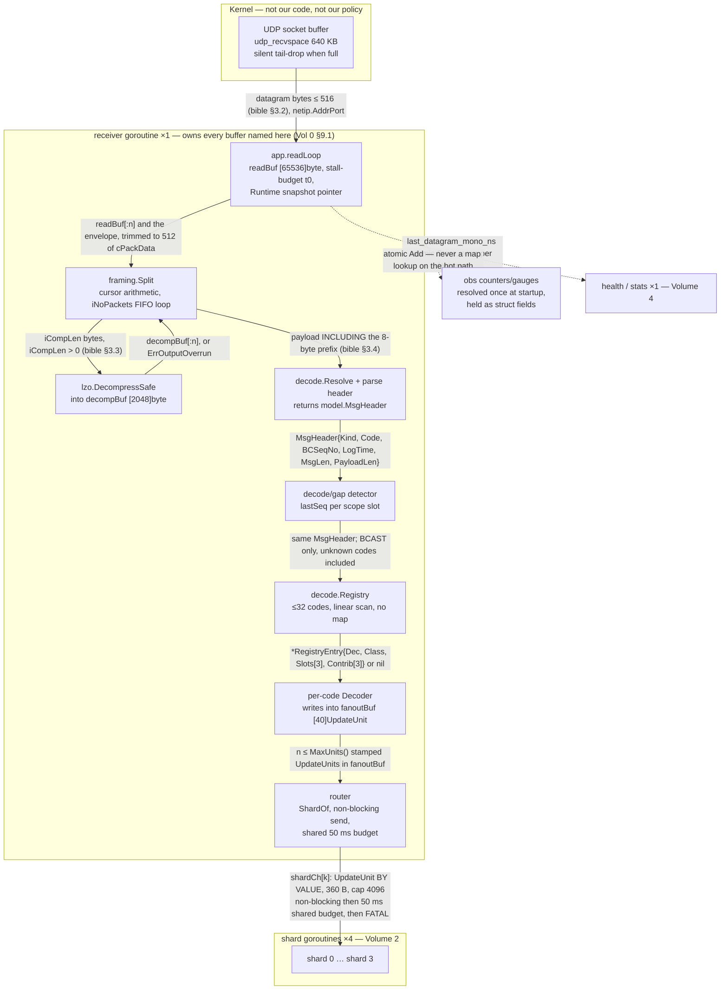
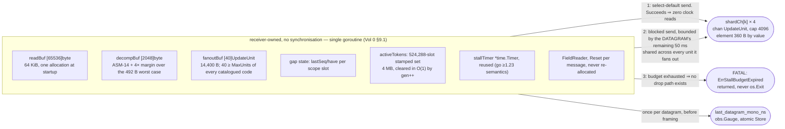
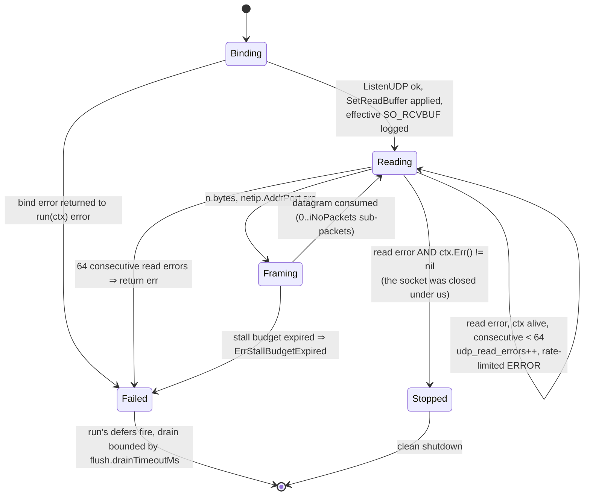
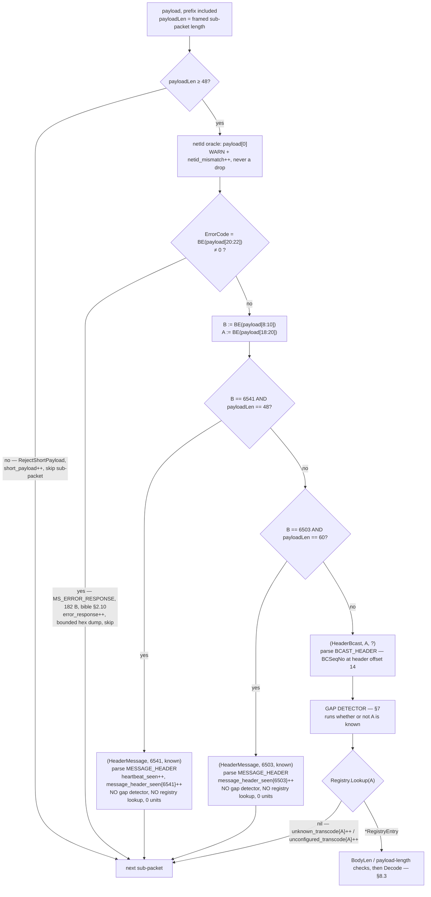
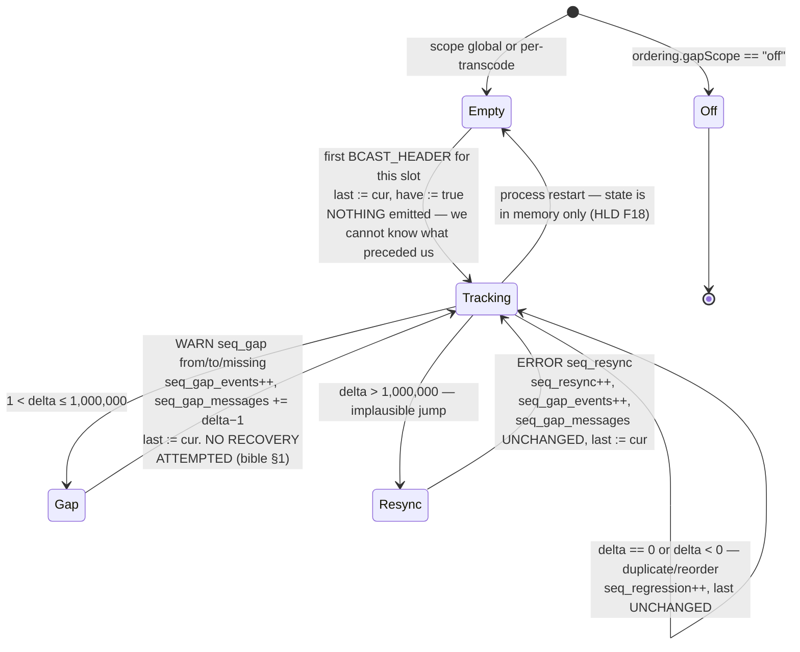
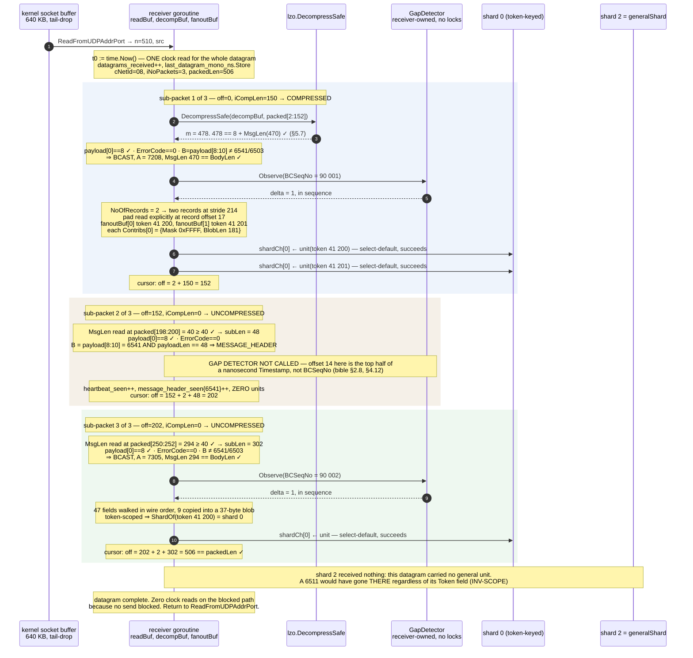
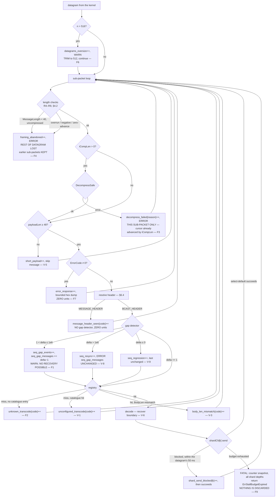
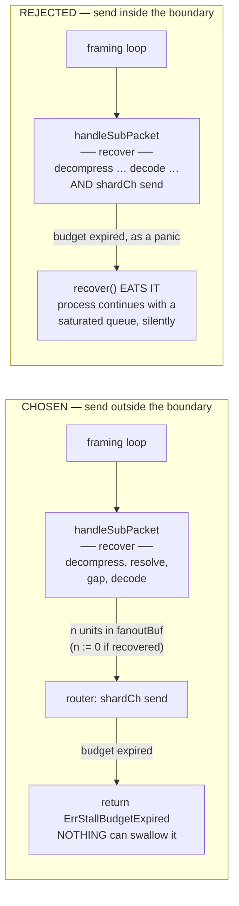
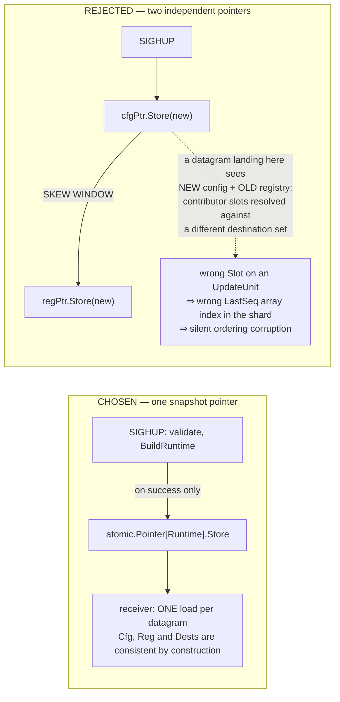

# FeedValve Phase 1 LLD — Volume 1: The Receive and Decode Path

**Status:** draft for review — complete
**Binds to:** `docs/lld/00-foundations.md` (Volume 0, the frozen contract). Every type, config key,
counter and channel used here is Vol 0's unless listed in §14, "Additions to the Vol 0 ledger".
**Detailed from:** `docs/architecture/phase1_hld_design1.md` (the HLD, authoritative).
**Protocol authority:** `ncobrd_bible.md` (the bible). Every protocol claim cites a section.
**Hands off to:** Volume 2 (shard and mirror) at `model.UpdateUnit` on `shardCh[k]`; Volume 4
(lifecycle, observability, failure, test) at socket close, counter emission and the test gates.

**Scope in one sentence:** everything between the kernel handing us a datagram and a stamped
`UpdateUnit` landing in `shardCh[k]` — one goroutine, no locks, no allocation.

---

## Table of contents

- [1. Scope, and what this volume does not solve](#1-scope-and-what-this-volume-does-not-solve)
- [2. The path in one picture](#2-the-path-in-one-picture)
- [3. Socket setup and the read loop](#3-socket-setup-and-the-read-loop)
- [4. Envelope framing](#4-envelope-framing)
- [5. Decompression](#5-decompression)
- [6. The 8-byte prefix and header resolution](#6-the-8-byte-prefix-and-header-resolution)
- [7. Gap detection](#7-gap-detection)
- [8. The decoder registry](#8-the-decoder-registry)
- [9. Per-transcode decoders](#9-per-transcode-decoders)
- [10. Fan-out to the shards](#10-fan-out-to-the-shards)
- [11. Allocation discipline](#11-allocation-discipline)
- [12. Failure-mode table for the receive path](#12-failure-mode-table-for-the-receive-path)
- [13. LLD ADRs raised by this volume](#13-lld-adrs-raised-by-this-volume)
- [14. Additions to the Vol 0 ledger](#14-additions-to-the-vol-0-ledger)
- [15. Deltas against the HLD and Vol 0](#15-deltas-against-the-hld-and-vol-0)
- [16. Assumptions](#16-assumptions)
- [17. Open questions](#17-open-questions)

### Diagram index

| Figure | Title | § |
|---|---|---|
| 1.1 | Receive-path component decomposition | §2.1 |
| 1.2 | Receiver ownership and the three ways work leaves the goroutine | §2.2 |
| 1.3 | Receiver lifecycle | §3.6 |
| 1.4 | Ingest pipeline data flow — FIFO loop and both `iCompLen` branches | §4.7 |
| 1.5 | Header resolution decision flow | §6.4 |
| 1.6 | Gap detector state machine, per scope slot | §7.8 |
| 1.7 | Packet lifecycle — one datagram, three sub-packets, four units | §10.8 |
| 1.8 | Receive-path failure paths | §12.2 |
| 1.9 | ADR-L10 structural comparison — recover boundary placement | §13 |
| 1.10 | ADR-L11 structural comparison — one snapshot pointer versus two | §13 |
| ASCII | Envelope → sub-packet → prefix → header nesting, with offsets | §4.1 |
| ASCII | Worked three-sub-packet datagram with cursor arithmetic | §4.6 |
| ASCII | `BCAST_HEADER` and `MESSAGE_HEADER` side by side | §6.3 |
| ASCII | 7208 `INTERACTIVE_ONLY_MBP_DATA`, stride 214, pad at 17 | §9.2 |
| ASCII | 7200 `ST_INTERACTIVE_MBO_DATA`, size 236, pad at 17 | §9.3 |
| ASCII | 7305/7340 `MS_SECURITY_UPDATE_INFO`, 294, no padding | §9.4 |
| ASCII | 6511-family `MS_BCAST_VCT_MSGS`, 320, trailing pad at 319 | §9.5 |
| ASCII | 6503 `MS_ASSET_UPDT_INT_RATE_INFO`, 52, the pack(2) proof | §9.6 |

**Required diagrams deliberately omitted, with the reason** — silent omission is not acceptable:

| Omitted | Why |
|---|---|
| **System context / deployment** | HLD Figure 1 already draws the BCID and VCID circuits, the LPAR, Oracle and the operator, and names what is outside our control. Nothing in this volume changes it. Redrawing it would be padding |
| **Full concurrency and ownership** | Vol 0 Figure 0.4 is the authoritative census of all twelve goroutines and every channel with capacity and drop policy. Figure 1.2 is the receive-path slice of it, expanded; reproducing the rest would risk the two disagreeing |
| **Circuit liveness state machine (6541)** | HLD Figure 6, and **Volume 4 owns `health`**. §9.6 and §1.2 specify only the signal this volume *produces* for it — `last_datagram_mono_ns` and `heartbeat_seen` |
| **Market session state machine (§4.5)** | HLD Figure 7, and Volume 4 owns it. §9.5 specifies the decoder that feeds it — including that image bit 0 is the contributing transaction code, which is how `Open` is told from `Closed` |
| **Persistence schema erDiagram** | Vol 0 §4.3–§4.5 fix the image encoding and HLD §8.2 the illustrative tables; **Volume 3 owns the schema**. §9 binds to Vol 0's field maps rather than restating them |
| **Full process lifecycle** | HLD Figure 8, Volume 4. Figure 1.3 is the receiver's slice of it, with the two edges that matter here: the only clean exit is the socket being closed, and both failure edges *return* rather than exiting |

---

## 1. Scope, and what this volume does not solve

### 1.1 What this volume owns

Everything between the kernel handing us a datagram and a `model.UpdateUnit` landing in `shardCh[k]`.
In Vol 0 §1.1's package tree that is **`wire`, `lzo`, `framing`, `decode`**, the read-loop half of
**`app`**, and the *table-provider* half of **`destinations`** (§10.2). In Vol 0 §9.1's goroutine
census it is exactly one goroutine — `receiver`, count 1 — and the buffers it owns exclusively.

| # | Scope item | Section |
|---|---|---|
| 1 | Socket setup, read-buffer sizing, oversize path, shutdown unblocking | §3 |
| 2 | Envelope framing, the FIFO sub-packet loop, every rejection | §4 |
| 3 | Decompression, buffer ownership, the panic boundary | §5 |
| 4 | The 8-byte prefix, the netId oracle, header resolution | §6 |
| 5 | `BCSeqNo` gap detection | §7 |
| 6 | Decoder registry, dispatch, `FieldReader`, layout gates, differential validation | §8 |
| 7 | Per-transcode decoders | §9 |
| 8 | Fan-out, shard selection, send discipline, the stall budget | §10 |
| 9 | Allocation discipline and its test gate | §11 |

### 1.2 The three hand-off boundaries, named

| Boundary | What crosses it | Direction | Owned on the far side by |
|---|---|---|---|
| **Q1** — `shardCh[k]`, `chan model.UpdateUnit`, cap 4096, by value (Vol 0 §9.2) | one fully-stamped `UpdateUnit`: `Token`, `Code`, `Flags`, `Seq`, `LogTime`, `RecvMono`, `Contribs[3]`, `Blob[:BlobLen]` | receiver → shard *k* | **Volume 2** |
| **liveness** — `last_datagram_mono_ns`, an `obs.Gauge` (§14, addition A-11) | monotonic ns of the most recent datagram, stored once per datagram | receiver → `health` (folded into `stats`, Vol 0 §9.1) | **Volume 4** |
| **fatal** — `ErrStallBudgetExpired` returned from the read loop (§10.5) | the reason, the shard id, the counter snapshot | receiver → `run(ctx) error` → `main` | **Volume 4** |

Nothing else leaves this volume. In particular the receiver never touches an `Entry`, a `Batch`, or a
database handle, and Vol 0 §1.3's import rule makes that a compile error rather than a convention.

### 1.3 What this volume deliberately does not solve

- **The shard main loop, the merge, the epoch machine.** Volume 2. This volume stops at the send.
- **Statement assembly, binds, retry.** Volume 3.
- **The circuit-liveness and market-session state machines, the stats emission line, the shutdown
  sequencing, the test suite as a whole.** Volume 4. This volume specifies only the signals it
  *produces* for them (§1.2) and the two test gates that are about the receive path specifically
  (§8.6 differential decode, §11.4 zero allocation).
- **The destination schema.** Vol 0 §4 froze the *encoding*; OQ-13 owns the columns. §9 binds to
  Vol 0 §4.3–§4.5 exactly as written and flags the one place that instantiation cannot survive
  contact with 7200 (§9.3, ADR-L08).
- **Chapter 8 (7215/7216 MBA) and Chapter 9 (Bhavcopy).** Out of the bible's scope entirely
  (bible, front matter). 7215/7216 *are* on the compressed list (bible §3.1) but their layouts are
  not in the bible, so a decoder for them cannot be specified without inventing protocol facts. They
  are handled as unknown BCAST transcodes (§6.5) and their decompressed size is what ASM-14 is
  about (§5.3).

### 1.4 Dependency audit — `CGO_ENABLED=0 GOOS=aix GOARCH=ppc64`

Vol 0 §1.4 audited the module. This volume adds **no third-party dependency** and three stdlib
surfaces the audit had not covered. All three were compiled for the target, not assumed:

| Surface | Used for | Verified |
|---|---|---|
| `net.ListenUDP`, `(*net.UDPConn).SetReadBuffer`, `ReadFromUDPAddrPort` | §3.1, §3.2 | `CGO_ENABLED=0 GOOS=aix GOARCH=ppc64 go build` succeeds |
| `net/netip` (`netip.AddrPort`, `netip.Prefix`) | §3.5 source check, allocation-free | same build |
| `syscall.GetsockoptInt(fd, SOL_SOCKET, SO_RCVBUF)` via `(*net.UDPConn).SyscallConn().Control` | §3.3, reading back the *effective* receive buffer | same build; `go vet` clean. **This is not `golang.org/x/sys`** — Vol 0 §1.4 excludes that package, and this uses the stdlib `syscall` package, which the AIX port supports |

`time/tzdata` (Vol 0 §7.2) is not needed by this volume — nothing here uses a wall clock.

---

## 2. The path in one picture

### 2.1 Component decomposition



*Figure 1.1 — Receive-path component decomposition. The single subgraph boundary in the middle is one
goroutine: everything inside it is sequential, single-threaded and allocation-free in steady state, so
no edge inside it needs a synchronisation story. The only two edges that leave it are the Q1 send —
the sole place the receiver can wait — and an atomic store. Compare Vol 0 Figure 0.1: this is the
`wire → lzo → framing → decode` half of it, expanded.*

Two properties of this picture are the design, not decoration:

1. **There is no queue before the router.** ADR-001 argues it with arithmetic (10–20 µs of work
   against a 100 ms budget, ~5,000× margin) and the consequence that matters here is that **arrival
   order is preserved for free**: one goroutine reads, frames and routes, so units reach a given
   shard in exactly the order their sub-packets appeared on the wire (bible §3.2 requires FIFO
   processing within a buffer). ADR-007 mechanism 1 depends on that.
2. **The gap detector sits between header resolution and the registry**, not before either. The
   reason is protocol, not taste, and §6.4 and §7.2 spell it out: `BCSeqNo` exists only in
   `BCAST_HEADER` (bible §2.8), so it must run *after* we know which header we have; and an
   unconfigured transcode still carries a perfectly good `BCSeqNo`, so it must run *before* the
   registry can discard the message.

### 2.2 Concurrency and ownership, receive-path slice



*Figure 1.2 — Receiver ownership and the only three ways work leaves the goroutine. Every buffer on
the left is allocated once, before the loop, and is never handed out: a `[]byte` into `readBuf` or
`decompBuf` that outlived one sub-packet would alias bytes the next datagram overwrites, which is why
`UpdateUnit` is pointer-free and slice-free (Vol 0 §3.5, ADR-006). Edge 3 is the entire drop policy:
**there is none** — Vol 0 §9.2 and req §10.2.*

## 3. Socket setup and the read loop

### 3.1 Binding: `net.ListenUDP`, not `net.ListenPacket`

`poc` binds with `net.ListenPacket("udp", addr)` (`poc/gobrdclnt.go:111`), which returns the
`net.PacketConn` interface. That is the wrong type here for two reasons that both matter:

- `SetReadBuffer` is not on `net.PacketConn`. Vol 0 §7.2 makes `udp.readBufferBytes` a real,
  reloadable key applied with `(*net.UDPConn).SetReadBuffer`, so we need the concrete type.
- `ReadFromUDPAddrPort` is not on `net.PacketConn` either. `PacketConn.ReadFrom` returns a
  `net.Addr`, which for UDP is a `*net.UDPAddr` — a heap allocation carrying a `[]byte` IP, **per
  datagram**. At 2,400 datagrams/s that is 2,400 allocations/s on the one goroutine ADR-006 keeps
  allocation-free. `ReadFromUDPAddrPort` returns a `netip.AddrPort`, which is a value with no
  pointer inside (ASM-13).

```go
package app

// bindUDP resolves and binds the broadcast listen address and applies the
// socket options of §3.3. The returned conn is owned by the lifecycle
// goroutine for close and by the receiver goroutine for reads; those are the
// only two goroutines that may name it (Vol 0 §9.1).
//
// udp.listen is startup-only (Vol 0 §7.2, contradiction C3): rebinding on a
// circuit with no retransmission (bible §1) drops whatever arrives during the
// gap, and nothing can ask for it again.
func bindUDP(cfg config.UDPConfig, log *obs.Logger) (*net.UDPConn, error)
```

### 3.2 Read-buffer sizing: why 64 KiB and not 516

`wire.MaxDatagramLen` is 516 (bible §3.2: `cNetId[2] + iNoPackets + cPackData[512]`). The read buffer
is `65536` (Vol 0 §9.1, carried from `poc/exchange_communication.go:18-23`). The reason is stated in
the bible (§3.6) and in `poc`'s own comment, and it is worth restating precisely because the naive
optimisation is obvious and wrong:

> A `recvfrom`-style read **silently discards whatever does not fit and reports no error**. With a
> 516-byte buffer, a 900-byte datagram returns `n == 516` with no indication that 384 bytes were
> thrown away — indistinguishable from a legitimately full envelope.

The choice of 65536 specifically — rather than, say, 1024 — closes the hole completely rather than
widening it:

```
Maximum UDP payload over IPv4 = 65535 (IP total length)
                              −    20 (minimum IPv4 header)
                              −     8 (UDP header)
                              = 65507 bytes
65536 > 65507, therefore n == len(readBuf) is UNREACHABLE and a short return
is always the true datagram length.
```

That arithmetic is IP-level, **not** an NNF protocol claim — the bible says only "size the read buffer
larger than 516" (§3.6). Its consequence is what makes the oversize branch trustworthy: `n > 516`
always means the exchange really sent more than 516 bytes, never that our buffer was small.

Cost of the choice: 64 KiB of resident memory, once, for the life of the process. Against the
~189 MB resident total of Vol 0 §3.7 it does not appear in the rounding.

### 3.3 Socket options, and reading back what the kernel actually gave us

| Option | Value | Why | Reload |
|---|---|---|---|
| `SetReadBuffer(cfg.ReadBufferBytes)` | default **655,360** = 640 KiB (Vol 0 §7.2) | This is the only queue in the system whose overflow policy we do not choose (HLD §3.2). 640 KiB ÷ 516 B ≈ 1,270 datagrams ≈ **0.53 s** of slack at 2,400/s — the arithmetic NFR4's 100 ms budget is derived from, and the arithmetic ASM-4 says may be 4× optimistic if AIX charges mbuf clusters rather than payload bytes | reloadable |
| `SetWriteBuffer` | **not set** | We never send on this socket. The broadcast circuit is one-way (bible §1.1) |  — |
| `SO_REUSEADDR` / multicast joins | **not set** | The HLD's context diagram (Figure 1) describes a **unicast** feed from one exchange host (ASM-12). Nothing in the bible describes multicast. If the circuit turns out to be multicast this is a real gap — see OQ-V5 |  — |
| read deadline | **not set in steady state** | §3.6 |  — |

**The effective buffer is read back, not assumed.** Vol 0 §7.2 says "the kernel silently caps at
`udp_recvspace`, so the effective value is logged, not assumed". Go's `net` package has no
`GetReadBuffer`, so the read-back is one `getsockopt` through the raw conn, executed **once at
startup and once per accepted reload** — never on the data path:

```go
// effectiveReadBuffer returns the SO_RCVBUF the kernel actually installed,
// which may be less than what SetReadBuffer requested (the AIX no_ tunables
// sb_max / udp_recvspace cap it) and on some stacks is double the requested
// value because the kernel reserves bookkeeping space.
//
// Called at startup and on reload only. Verified to compile under
// CGO_ENABLED=0 GOOS=aix GOARCH=ppc64 (§1.4); this is the stdlib syscall
// package, not golang.org/x/sys, which Vol 0 §1.4 excludes.
func effectiveReadBuffer(c *net.UDPConn) (bytes int, err error)
```

The startup INFO line reports **requested and effective side by side**. If they differ, the
0.53 s-of-slack arithmetic above is wrong by that ratio and every NFR4 margin with it — an operator
who cannot see both numbers has no way to know. A `getsockopt` failure is logged and ignored; it
degrades the diagnostic, not the feed.

> **Assumed (ASM-V1):** that AIX accepts a 640 KiB `SO_RCVBUF` for a UDP socket, i.e. that `sb_max`
> is at least that. **Measure:** the startup line above, on the LPAR. **If wrong:** the effective
> value is smaller, the slack shrinks proportionally, and `no -o sb_max` must be raised by the
> platform team before `udp.readBufferBytes` means anything.

### 3.4 The read loop

```go
// readLoop owns the receive path. It returns nil on clean shutdown (the socket
// was closed under it while ctx was already cancelled) and a non-nil error on
// a fatal condition — Q1 stall-budget expiry (§10.5) or persistent read
// failure (§3.7). It NEVER calls os.Exit: Vol 0 §10.4 forbids it outside main,
// because os.Exit skips every defer and this process has Oracle sessions and
// in-flight batches to close (CLAUDE.md; poc/gobrdclnt.go:19-28).
func (r *Receiver) readLoop(ctx context.Context) error
```

Steps, in order, once per iteration. The numbering is referenced from §4, §10 and §12.

1. **Load the runtime snapshot.** One `atomic.Pointer[app.Runtime]` load (ADR-L11) giving both
   `*config.Config` and `*decode.Registry`. Vol 0 §7.4 fixes this boundary: *"receiver — top of each
   read-loop iteration, before `ReadFromUDPAddrPort`"*. Holding one snapshot for the whole datagram
   is what stops the stall budget changing halfway through a 35-unit fan-out.
2. **`n, src, err := conn.ReadFromUDPAddrPort(r.readBuf[:])`.** This is the only blocking call in the
   loop that is not bounded by the stall budget, and it is *supposed* to block — it is how the
   goroutine parks when the market is quiet.
3. **Error handling** — §3.7.
4. **`t0 := time.Now()`.** Exactly one clock read per datagram (2,400/s), and it is the origin of the
   per-iteration stall budget (§10.4). Monotonic by construction because §10.4 only ever calls
   `time.Since(t0)` (Vol 0 §10.2).
5. **`datagrams_received++`**; **`last_datagram_mono_ns.Store(...)`** for the liveness FSM (§1.2).
6. **Source check** — §3.5.
7. **Oversize check** — §3.8.
8. **Hand `r.readBuf[:n]` to framing** — §4.
9. Loop.

The receiver reads nothing from any other goroutine except the two atomics in step 1 and step 5's
counters. It holds no lock, at any point, ever.

### 3.5 Source address check

Vol 0 §7.2 defines `udp.sourceAllowList []string` (IPs or CIDRs, default empty = allow all) and
`udp.sourceEnforce bool` (default false). Mechanics:

- The list is parsed **once at config load** into a receiver-held `[]netip.Prefix`. A bare IP becomes
  a `/32` or `/128`. Parsing per datagram would allocate.
- Matching is a linear scan of `prefix.Contains(src.Addr())`. With an expected list length of 1–2
  (ASM-12: one exchange host) that is a handful of comparisons and no allocation — `netip.Prefix` and
  `netip.Addr` are pointer-free value types.
- **Empty list ⇒ the check is skipped entirely**, not "matched against nothing".
- A non-matching source increments `datagrams_unexpected_source` and logs at WARN under the token
  bucket. With `sourceEnforce == false` (the default) the datagram **is still processed**. This
  mirrors the netId philosophy deliberately (Vol 0 §7.2, HLD F19, `poc/gobrdclnt.go:225`): *a wrong
  allow-list silently blinds the feed, and there is no retransmission to recover it* (bible §1).
- With `sourceEnforce == true` the datagram is discarded before framing and the counter still
  increments. This is the **one place in the entire design where FeedValve discards data on purpose**,
  and it is off by default and operator-armed. Stated here rather than buried, because Vol 0 §9.2's
  "there is no drop policy" is otherwise contradicted by it.

### 3.6 Shutdown: closing the socket is the only thing that unblocks an in-flight read

`ReadFromUDPAddrPort` parks the goroutine in the runtime netpoller. Cancelling a context does not
touch it; there is no `ctx`-aware read. Two mechanisms exist and the design picks the first:

**Chosen — close the socket from the lifecycle goroutine.** `(*net.UDPConn).Close` is safe to call
concurrently with an in-flight read; the read returns `net.ErrClosed` immediately. This is `poc`'s
mechanism (`poc/gobrdclnt.go:135-145`) and Vol 0 §9.1 already names it: the receiver is *"stopped by
the socket being closed, which is the only way to unblock an in-flight `ReadFrom`"*.

**Rejected — a periodic read deadline.** `SetReadDeadline(now + 100ms)` before each read, treating
`os.ErrDeadlineExceeded` as "check ctx and loop". It works, and it is what you reach for if you have
not read `poc`. It loses on three counts: it wakes a parked goroutine ten times a second forever to
do nothing, which on a capped 4-CPU partition is not free; it adds a timer manipulation to the
per-datagram path at 2,400/s; and it introduces a window in which a datagram that arrives exactly at
the deadline boundary is subject to a re-arm race that has no reason to exist. Closing the socket has
none of those properties and is already proven in `poc`.

The disambiguation rule is `poc`'s and it is load-bearing:

> A read error while `ctx.Err() != nil` means **shutting down**, not a failure. `readLoop` returns
> `nil`. A read error while `ctx.Err() == nil` is a real failure and goes to §3.7.



*Figure 1.3 — Receiver lifecycle. The only clean exit is `Stopped`, reached exclusively by the
lifecycle goroutine closing the socket. Both `Failed` edges return an error up through
`run(ctx) error`; neither calls `os.Exit`, because that would skip the drain the shards still owe
(Vol 0 §9.2 closing order, HLD Figure 8). This is the receiver's slice of the process lifecycle
diagram, which Volume 4 owns in full.*

### 3.7 Read errors that are not shutdown

`poc` logs and `continue`s unconditionally (`poc/gobrdclnt.go:151-157`). On an unconnected UDP socket
the realistic error set is small — the socket is closed, or the file descriptor is in a state the
process cannot recover from — and in both cases `continue` produces a **tight spin logging at full
CPU**, which on a 4-CPU capped partition is worse than stopping. That is a latent defect in the
POC's loop and it must not be carried forward.

Rule:

1. `ctx.Err() != nil` ⇒ return `nil` (§3.6).
2. Otherwise `udp_read_errors++` (§14, addition A-10), log at ERROR under the token bucket, and
   increment a consecutive-failure count.
3. A successful read resets the count to zero.
4. `consecutive >= maxConsecutiveReadErrors` ⇒ return the error. The process goes to `Draining`.

`maxConsecutiveReadErrors` is a **compile-time constant, 64** *(assumed)*. It is not a config key,
because the correct value is "small enough that a spin is bounded, large enough that no plausible
transient trips it", and no operator has information we do not. **Measure:** `udp_read_errors` is
expected to be exactly zero over a full session; any non-zero value is an incident in its own right.

### 3.8 The oversized datagram

```
n <= 516        normal. packedLen = n − 4.
n  > 516        datagrams_oversize++;  WARN (token bucket);
                packedLen = 512  — cPackData is a fixed 512-byte field (bible §3.2),
                so nothing past it can be framed;
                process the sub-packets that fit.
n  > 65507      unreachable over IPv4 (§3.2). If it ever fires, the transport
                is not what the context diagram says it is.
n  <   4        reject the whole datagram: no cNetId, no iNoPackets (§4.2 R1).
```

Trim-and-process rather than discard, following `poc/gobrdclnt.go:534-543`: the sub-packets inside
the first 512 bytes are still well-framed and still good data, and on a circuit with no
retransmission (bible §1) throwing them away costs real information to punish the sender for a
framing surprise. But it is logged **loudly** — HLD F6 puts the operator action as *"the envelope
assumption has changed — escalate to the exchange before trusting any decode"*.

> **A note on what `datagrams_oversize == 0` does and does not prove.** If the exchange writes the
> whole fixed-size `BcastPackData` struct, every datagram is exactly 516 bytes and this counter is
> permanently zero while carrying no information. If it writes only the bytes in use, datagrams are
> short and the counter is a genuine assumption check. The bible says "516 bytes **maximum**"
> (§3.2), which implies the latter, but does not state it. **Open (OQ-V1)**; it is also why §4.5
> does not treat residual bytes after the last sub-packet as an error.

## 4. Envelope framing

### 4.1 The nesting, with byte offsets

Drawn as offset tables, in the bible's own style, because a box diagram of a byte layout is worth
less than the arithmetic.

```
(a) UDP datagram — BcastPackData, at most 516 bytes            bible §3.2
+--------+---------------------------+------+---------------------------------------+
| Offset | Field                      | Size | Notes                                 |
+--------+---------------------------+------+---------------------------------------+
|   0-1  | cNetId[2]        CHAR[2]   |   2  | byte 0 = segment netId, 8 = commodity |
|   2-3  | iNoPackets       SHORT BE  |   2  | SIGNED. count of sub-packets, FIFO    |
|  4-515 | cPackData[512]   CHAR[512] | ≤512 | sub-packets back to back              |
+--------+---------------------------+------+---------------------------------------+
   wire.MaxDatagramLen = 516      wire.MaxPackedDataLen = 512


(b) One sub-packet inside cPackData — BcastCmpPacket            bible §3.3
+--------+---------------------------+------+---------------------------------------+
|   +0-1 | iCompLen         SHORT BE  |   2  | 0 => NOT compressed. >0 => LZO1Z len  |
|   +2.. | broadcast data             |   ?  | compressed:   exactly iCompLen bytes  |
|        |                            |      | uncompressed: 8 + MessageLength bytes |
+--------+---------------------------+------+---------------------------------------+
   cursor advance = 2 + iCompLen                      (compressed branch)
   cursor advance = 2 + 8 + MessageLength             (uncompressed branch)


(c) Broadcast data — AFTER decompression where applicable       bible §3.4
+--------+---------------------------+------+---------------------------------------+
|   0    | netId repeated             |   1  | free frame-alignment oracle (§6.2)    |
|   1-7  | ignored                    |   7  | read past, never interpreted          |
|   8-47 | 40-byte header             |  40  | BCAST_HEADER or MESSAGE_HEADER (§6.3) |
|  48-.. | message body               |   ?  | per transaction code                  |
+--------+---------------------------+------+---------------------------------------+
   wire.BroadcastDataPrefixLen = 8      wire.BroadcastHeaderSize = 40
   MessageLength counts from offset 8 onward and EXCLUDES the prefix (bible §2.8, §3.3)
```

**The one fact that lets framing run before header resolution:** `MessageLength` is a `SHORT` at
header offset **38** in *both* `BCAST_HEADER` and `MESSAGE_HEADER` (bible §2.8, both tables). So the
uncompressed branch can read it at **payload offset 46** without knowing which header it has — which
is essential, because a 6541 heartbeat (`MESSAGE_HEADER`, bible §4.12) arrives uncompressed and must
be framed by exactly the same loop. The bible does not draw attention to this coincidence; the layout
tables do prove it, and the design depends on it.

### 4.2 The loop, as cursor arithmetic

`framing.Split` walks `packed := datagram[4 : 4+packedLen]` with a cursor `off`. Every rejection
below names the `model.Reject` value (Vol 0 §3.11), the counter, and — critically — **how much data
it costs**, because that varies from one sub-packet to the whole rest of the datagram.

```
R1  len(datagram) < 4                       -> reject the datagram entirely.
                                               framing_abandoned++. No cNetId, no count.

    checkEnvelopeNetId(datagram[0:2])       -> §6.2. WARN only, never a drop.
    iNoPackets = int16(BE(datagram[2:4]))

R2  iNoPackets < 0                          -> reject the datagram entirely.
                                               framing_abandoned++.  SHORT is signed (bible §2.7).
R3  iNoPackets == 0                         -> nothing to do. Not an error; not counted
                                               separately. See §4.5.

    packedLen = min(len(datagram)-4, 512)   -> the trim of §3.8
    off = 0

    for i := 0; i < iNoPackets; i++ {

R4      off+2 > packedLen                   -> ABANDON THE REMAINDER of the datagram.
                                               framing_abandoned++, ERROR naming i and off.
        iCompLen = int16(BE(packed[off:off+2]))
        off += 2
R5      iCompLen < 0                        -> ABANDON THE REMAINDER. framing_abandoned++.

        if iCompLen == 0 {                     // ---- UNCOMPRESSED BRANCH ----
R6          off+48 > packedLen              -> ABANDON THE REMAINDER. framing_abandoned++.
                                               48 = prefix 8 + header 40; without it
                                               MessageLength cannot be read at all.
            msgLen = int16(BE(packed[off+46 : off+48]))         // header offset 38
R7          msgLen < 40                     -> ABANDON THE REMAINDER.
                                               RejectShortMessageLen, framing_abandoned++,
                                               ERROR. See §4.3 — this is the expensive one.
            subLen = 8 + int(msgLen)
        } else {                               // ---- COMPRESSED BRANCH ----
            subLen = int(iCompLen)
        }

R8      off+subLen > packedLen              -> ABANDON THE REMAINDER. framing_abandoned++.
                                               The declared length overruns the datagram.
R9      subLen < 3                          -> ABANDON THE REMAINDER. framing_abandoned++.
                                               See §4.4 — the zero-advance guard.

        handleSubPacket(packed[off:off+subLen], compressed = iCompLen != 0, i, iNoPackets)
        subpackets_total++
        off += subLen
    }
```

`min` at `packedLen` and the `off+subLen > packedLen` test are the only two places a slice bound is
computed from a wire value, and both are checked before use. There is no `data[a:b]` anywhere in
`framing` whose bounds were not tested in the preceding three lines — which is layer 1 of HLD §9.5's
four-layer malformed-input defence: *cursor arithmetic before content*.

### 4.3 Why `MessageLength < 40` costs the rest of the datagram, and nothing less

This is the rejection with the largest blast radius on the receive path and it is worth being exact
about, because "clamp it to 40 and carry on" looks like the forgiving choice and is the destructive
one.

`MessageLength` is the *only* length an uncompressed sub-packet carries — `iCompLen` is zero by
definition in that branch and the bible never states an uncompressed length anywhere else (bible
§3.3, ⚠, and Appendix B item 6). The cursor advance is therefore entirely derived from it. If a value
of, say, 12 were accepted, the cursor would advance by 20 instead of by the true size, and **every
subsequent sub-packet in that buffer would be read from the middle of this one**. Those sub-packets
would frame "successfully" — a `SHORT` read from arbitrary bytes is always a valid `SHORT` — and
decode into plausible garbage. The netId oracle (§6.2) would fire, which is exactly why it exists,
but by then the damage is a stream of fabricated market data.

`poc` rejects it (`poc/gobrdclnt.go:572-574`) and this design keeps that, with two changes:

1. **`poc` abandons the whole datagram by returning an error from `processBroadcastPackData`**, which
   also discards the sub-packets **already processed** in this datagram. It does not: `process` is
   called before the error is returned, so earlier sub-packets have already been handled. That is the
   correct behaviour and this design states it as a rule rather than leaving it as a property of the
   call order: **sub-packets already handled in this datagram are kept; only the remainder is
   abandoned.** They were framed from lengths read before the bad one and are independently valid.
2. `poc` obtains `MessageLength` by running the full `parseBroadcastHeader` on the remaining bytes
   (`poc/gobrdclnt.go:563`), which parses thirteen fields and then throws twelve away — and does so
   as a `BCAST_HEADER`, which is the wrong layout for a 6541. This design reads the two bytes at
   payload offset 46 directly (ADR-L06). Same result, correct for both header shapes, no wasted
   parse, and the real header parse happens exactly once, after resolution (§6.3).

### 4.4 The zero-length sub-packet, and the zero-advance guard

The task of enumerating "a zero-length sub-packet" has a slightly surprising answer, and the
surprise is worth recording rather than papering over.

- **In the compressed branch it cannot occur.** `iCompLen == 0` is claimed by the uncompressed branch
  (bible §3.3), so the compressed branch always has `iCompLen ≥ 1`.
- **In the uncompressed branch it cannot occur either.** `subLen = 8 + msgLen` and R7 has already
  established `msgLen ≥ 40`, so `subLen ≥ 48`.

So R9 (`subLen < 3`) is **unreachable today**, and it is specified anyway. The reason is structural,
not defensive superstition: the loop's termination and its framing both depend on the cursor strictly
advancing, and that property currently follows from *the branch predicate* rather than from anything
the loop itself checks. A future change — a new "length is zero means something else" rule from the
exchange, a refactor that moves the predicate — would silently reintroduce a sub-packet that advances
the cursor by 2 while `iNoPackets` counts down, i.e. `iNoPackets` reads of the same two bytes. R9
turns that from a data-fabrication bug into one counted `framing_abandoned`. It costs one comparison
per sub-packet, at 7,500/s.

Related and *reachable*: a compressed sub-packet with a small `iCompLen` (1–47 bytes) that decompresses
to fewer than 48 bytes. That is not a framing failure — the cursor advanced correctly by `iCompLen` —
and it is caught after decompression by the payload-length check of §6.1 as `RejectShortPayload`,
costing one sub-packet.

### 4.5 Residual bytes after the last sub-packet

When the loop finishes normally, `off` may be less than `packedLen`. This is **not** treated as an
error and **not** counted. Two reasons:

1. If the exchange writes the whole fixed-size `BcastPackData` struct, every datagram is 516 bytes and
   residue after the last sub-packet is *normal and expected* — an error counter would fire on every
   single datagram (OQ-V1, §3.8).
2. `iNoPackets` is authoritative for how many sub-packets exist (bible §3.2). Framing is driven by it,
   not by consuming to end-of-buffer, so residue carries no framing information either way.

The thing residue *would* indicate — that we have lost framing without noticing — is already covered,
for free, by the netId oracle on the next sub-packet (§6.2, bible §3.4). Adding a residue instrument
would be a second, weaker detector for a condition the first one already catches, and Vol 0 §8's
ledger discipline is that an instrument must earn its place.

### 4.6 A worked datagram: three sub-packets, both branches, both header kinds

The realistic shape, not an edge case: HLD §4.1 gives ~2,400 datagrams/s carrying 7,500–10,000
packets/s, i.e. **3–4 sub-packets per datagram is the steady state**. This example is 510 bytes and
exercises the compressed branch, the uncompressed branch, `BCAST_HEADER` and `MESSAGE_HEADER` in one
buffer.

```
datagram, n = 510
+------+-----------------------------------------------------------------------+
|  0-1 | cNetId  = 08 00                                                        |
|  2-3 | iNoPackets = 3                                                         |
|  4-  | cPackData, packedLen = 506                                             |
+------+-----------------------------------------------------------------------+

packed[]      iCompLen   branch         subLen   payload            cursor after
offset                                            content
---------  ------------  ------------   ------   ----------------   ------------
    0           150      compressed        150   LZO1Z, expands     off =   2+150 = 152
                                                  to 478 = 8+470
                                                  (7208, bible §4.8)
  152             0      uncompressed       48   prefix 8 +         off = 152+2+48 = 202
                                                  MESSAGE_HEADER 40
                                                  (6541, bible §4.12)
                                                  msgLen read at
                                                  packed[198:200] = 40
  202             0      uncompressed      302   prefix 8 +         off = 202+2+302 = 506
                                                  294 body
                                                  (7305, bible §4.3)
                                                  msgLen read at
                                                  packed[250:252] = 294

  loop ends: i == iNoPackets == 3,  off == 506 == packedLen   (no residue)
```

Note what the second row demonstrates: the framing loop read `MessageLength` at payload offset 46 of a
message whose header is a `MESSAGE_HEADER`, got the right answer, and did so **before** anything knew
which header kind it was. That is §4.1's coincidence doing load-bearing work.

### 4.7 Ingest pipeline data flow

```mermaid
flowchart LR
    A["ReadFromUDPAddrPort<br/>into readBuf[65536]"] --> B{"n > 516?"}
    B -->|"yes — datagrams_oversize++, WARN,<br/>packedLen := 512"| C
    B -->|"no — packedLen := n−4"| C["envelope: cNetId, iNoPackets<br/>netId WARN only, never a drop"]
    C --> D{"i < iNoPackets?<br/>FIFO order, bible §3.2"}
    D -->|"no"| Z["datagram done → step 1 of §3.4"]
    D -->|"yes"| E["read iCompLen SHORT at packed[off:off+2]<br/>off += 2"]
    E --> F{"iCompLen > 0 ?"}
    F -->|"iCompLen > 0 — COMPRESSED"| G["lzo.DecompressSafe(decompBuf, packed[off:off+iCompLen])<br/>subLen := iCompLen"]
    F -->|"iCompLen == 0 — UNCOMPRESSED"| H["msgLen := BE(packed[off+46:off+48])<br/>reject if msgLen < 40 — R7<br/>subLen := 8 + msgLen"]
    G -->|"error: decompress_failed{reason}++,<br/>skip THIS sub-packet, off += subLen"| D
    G -->|"decompBuf[:m]"| I["payload, 8-byte prefix INCLUDED<br/>bible §3.4"]
    H -->|"packed[off:off+subLen]"| I
    H -->|"msgLen < 40: framing_abandoned++,<br/>ABANDON THE REST OF THE DATAGRAM"| Z
    I --> J["byte 0 vs netId — oracle, WARN only<br/>ErrorCode := BE(payload[20:22]) — offset 12 in BOTH headers"]
    J -->|"ErrorCode != 0: error_response++, skip message"| D
    J --> K["RESOLVE HEADER — §6.3, registry NOT consulted"]
    K -->|"MESSAGE_HEADER (6541@48 / 6503@60):<br/>message_header_seen{code}++, NO gap detector"| D
    K -->|"BCAST_HEADER, code A"| L["gap detector on BCSeqNo, header offset 14<br/>runs for UNKNOWN codes too"]
    L --> M{"registry hit?"}
    M -->|"no: unknown_transcode{code}++ / unconfigured_transcode{code}++"| D
    M -->|"yes"| N["Decode → fanoutBuf; router: ShardOf, shardCh[k]<br/>off += subLen"]
    N --> D
```



*Figure 1.4 — Ingest pipeline. The FIFO loop (`D`) and **both** branches of the compression predicate
are explicit, with the predicate written on the branch edges. Every terminating edge names its
counter and says how much it costs: `decompress_failed` costs one sub-packet because the cursor
already advanced by `iCompLen`; `framing_abandoned` from R7 costs the rest of the datagram because
the cursor advance was never computed. This is HLD Figure 3 made exact — same shape, with the offsets,
the branch arithmetic and the counter names filled in.*

## 5. Decompression

### 5.1 The branch is on the wire flag, and only on the wire flag

```
iCompLen == 0   ->  the data is NOT compressed. Use it as-is.        bible §3.3
iCompLen  > 0   ->  the data IS compressed, and iCompLen is the
                    length of the compressed bytes. Pass exactly
                    that many bytes to the decompressor.             bible §3.3
```

Bible §3.1 lists the eight compressed transaction codes exhaustively — **7200, 7201, 7202, 7208,
7213, 7215, 7216, 7220** — and then says, in a ⚠ note: *"The compression flag on the wire is per
sub-packet and is authoritative. Use this table to sanity-check, not to decide."*

This design therefore:

- **Never consults the code list to decide anything.** The branch is `iCompLen > 0`, full stop. It
  has to be — the code is inside the payload, which for a compressed sub-packet is not readable until
  after decompression. Deciding from the code would be circular.
- **Does use the list as a cross-check, after the fact.** Vol 0 §8.2's `subpackets_compressed` and
  `subpackets_uncompressed` earn their place precisely here: *"the compressed fraction should match
  the eight codes of bible §3.1; drift means an assumption changed"*. Concretely, the pairing to
  watch is `subpackets_compressed` against `packets_by_transcode{7208}` + `{7200}` + the other six.
  A 7305 arriving compressed, or a 7208 arriving uncompressed, is a protocol change and the counters
  are the only way anyone learns of it. CLAUDE.md records the same invariant from the other side:
  *"Notably 7305 is not compressed and always arrives with `packetLen == 0`."*

### 5.2 Buffer ownership

| Buffer | Size | Owner | Lifetime of its contents |
|---|---|---|---|
| `decompBuf` | `[2048]byte` (Vol 0 §9.1) | receiver, exclusively | **one sub-packet.** Overwritten by the next compressed sub-packet in the same datagram |
| the compressed input | `readBuf[4+off : 4+off+iCompLen]` | receiver | one datagram |

`lzo.DecompressSafe(dst, src []byte) (n int, err error)` is `poc/decompress.go:28` unchanged — Vol 0
§1.2 assigns it to package `lzo` and the role brief is explicit that the LZO1Z port is sound and is
to be built on, not redesigned.

The consequence that has to be said out loud, because it is the single most likely way a future
change breaks this design: **the decompressed payload is valid for exactly as long as the current
sub-packet.** A `Decoder` that retained `payload[a:b]` in an `UpdateUnit` would be handing a shard a
window onto bytes the receiver overwrites microseconds later, producing cross-contamination between
unrelated tokens that looks exactly like a decode bug and reproduces in nothing. Vol 0 §3.5 states
the invariant (`UpdateUnit` is pointer-free and slice-free), Vol 0 §3.9 states the rule (*"It MUST
NOT retain any slice of payload or of out"*), and HLD §10.4 gates it with a reflection test. This
volume's contribution is to name the buffer whose reuse makes it a live hazard rather than a
theoretical one.

### 5.3 Sizing `decompBuf`, and what 2048 is and is not

```
Largest broadcast message catalogued in the bible (Part V, §4.0 index):
    7202  MS_TICKER_TRADE_DATA         484 body + 8 prefix = 492 bytes  <- largest
    7201  MS_BCAST_INQ_RESP_2          472 + 8 = 480
    7208  MS_BCAST_ONLY_MBP            470 + 8 = 478
    7320  MS_SECURITY_STATUS_UPDATE    462 + 8 = 470   (uncompressed)
    7200  MS_BCAST_MBO_MBP             410 + 8 = 418
    7220  MS_BCAST_LIMIT_PRICE_PROT    344 + 8 = 352
    6511  MS_BCAST_VCT_MSGS            320 + 8 = 328   (uncompressed)
    7305  MS_SECURITY_UPDATE_INFO      294 + 8 = 302   (uncompressed)

decompBuf = 2048  =  4.16 × the 492-byte worst case in the catalogue
```

Two things this buffer is **not**:

1. **It is not a correctness bound.** `DecompressSafe` bounds-checks every write against `len(dst)`
   and returns `ErrOutputOverrun` rather than writing past it (`poc/decompress.go:19-30`,
   `poc/errors.go:16`). An undersized buffer is a *counted reject*, never memory corruption. That
   distinction is the whole reason bible §3.5's ⚠ insists on a bounds-checked decompressor for
   untrusted network input.
2. **It is not a proof about 7215/7216.** Those two are compressed (bible §3.1) and their layouts are
   Chapter 8, outside the bible. Their decompressed size is unknown. That is exactly what ASM-14
   assumes away, and `decompressed_len_max` (Vol 0 §8.2, shape **M**) is the instrument that
   falsifies it. This volume adds nothing to ASM-14 except the observation that with 4× headroom over
   everything we *can* size, the first thing to break the assumption will announce itself as
   `decompress_failed{reason=output_overrun}` rather than as bad data.

**Can 510 compressed bytes exceed 2048 decompressed?** Yes, trivially — LZO's match encoding lets a
few input bytes emit hundreds of output bytes, so a *malicious or corrupt* sub-packet can request
arbitrary expansion. Which is why point 1 above matters and why `DecompressSafe`, not `Decompress`,
is the only variant the packet path may call. CLAUDE.md states the same split.

> **Worth noting against `poc`, because it confirms the 2048 rather than contradicting it.** `poc`'s
> buffer is **512** bytes — `maxDecompressedPacketLen = maxPackedDataLen`
> (`poc/exchange_communication.go:25,11`) — which is 20 bytes clear of the 492-byte worst case in the
> catalogue. It works, and it has no margin at all for a message the bible does not cover (7215/7216)
> or for a future structure. Vol 0 §9.1's 2048 is the right correction and this volume adopts it
> unchanged.

### 5.4 Distinguishing the four failure reasons

Vol 0 §8.2 has `decompress_failed` with no labels. The four sentinel errors in `poc/errors.go` mean
four genuinely different things to an operator, and collapsing them wastes the distinction the LZO
port already makes:

| Sentinel | Means | Operator action |
|---|---|---|
| `ErrInputOverrun` | the compressed input is truncated — an opcode needed bytes that were not there | Wire corruption, or `iCompLen` disagrees with the bytes actually sent. Capture and escalate |
| `ErrOutputOverrun` | the message decompresses to more than `decompBuf` holds | **ASM-14 is broken.** This is a capacity problem with a known fix; raise the buffer. Completely different from the other three |
| `ErrLookbehindOverrun` | a match references before the start of the output — corrupt distance | Wire corruption |
| `ErrInputNotConsumed` | end-of-stream marker found with input left over | `iCompLen` is larger than the real compressed length — a framing question, not a compression one |

Hence §14 addition **A-01**: a `{reason}` label on `decompress_failed`, with those four values. Four
fixed label slots, resolved at startup, no dynamic allocation — the same shape as every other
labelled counter in Vol 0 §8.1.

### 5.5 The panic boundary, and what must sit outside it

HLD §9.5 layer 4: *"a recover at the sub-packet boundary, as `poc/gobrdclnt.go:178-183` does, so that
a decoder bug degrades to one lost message rather than a dead relay. This is the last line, not the
first."*

```go
// handleSubPacket decompresses if required, resolves and parses the header,
// runs the gap detector, dispatches to the decoder, and returns how many units
// the decoder wrote into fanoutBuf.
//
// It recovers from any panic below it, so one malformed sub-packet or one
// decoder defect costs one message rather than the process
// (poc/gobrdclnt.go:178-183, HLD §9.5 layer 4). On recovery it returns n == 0,
// so a decoder that panicked halfway through a fan-out contributes NOTHING —
// never a partially-populated prefix of fanoutBuf.
//
// THE Q1 SEND IS DELIBERATELY NOT IN HERE. See ADR-L10.
func (r *Receiver) handleSubPacket(payload []byte, compressed bool, idx, count int) (n int, rej model.Reject)
```

The placement of the boundary is a real decision (ADR-L10) and the wrong placement is quietly fatal.
If the Q1 send were inside the recover boundary, then the one condition the whole design says must
stop the process — stall-budget expiry (Vol 0 §9.2, req §10.2) — would have to travel out through a
`recover()`. If it travelled as a panic, `recover` would eat it and the process would keep running
with a saturated queue, silently, which is the exact outcome req §10.2 forbids. If it travelled as a
return value it would work, but only until someone added a second `panic`-based path and did not
notice. Keeping the send outside makes the fatal path a plain `return err` that no `recover` can see.

Ordering inside one sub-packet, therefore:

```
  handleSubPacket  ── recover boundary ──┐
      decompress                         │  a panic here loses THIS sub-packet
      resolve + parse header             │  n := 0, rej := RejectPanic
      gap detect                         │
      registry lookup                    │
      decode into fanoutBuf[0:n]         │
  ───────────────────────────────────────┘
  route fanoutBuf[0:n]                      ← outside. Can return ErrStallBudgetExpired.
```

Cost: one deferred call per sub-packet at 7,500/s. Go's open-coded defers do not apply to a function
containing a `defer` inside a loop, which is why the boundary is a **separate function called from
the loop** rather than a `defer` in `framing.Split` — the same structure `poc` arrived at.

### 5.6 What a decompression failure costs, exactly

**One sub-packet. Nothing else.** The cursor advanced by `iCompLen`, which was read from the wire
*before* the decompressor ran, so every later sub-packet in the same datagram is still framed
correctly (HLD F3). That is not an accident of the code layout; it is the reason bible §3.3 gives a
compressed length at all, and it is why §4.2's loop computes `subLen` before calling
`handleSubPacket` and advances the cursor after it returns, regardless of the outcome.

Sustained failures mean one of three things and the counters separate them: the compression algorithm
or its parameters changed (`decompress_failed{reason=input_overrun}` plus `netid_mismatch` at zero);
we have lost framing upstream (`decompress_failed` *with* `netid_mismatch` rising — the oracle firing
on sub-packet 2+ is the tell, §6.2); or ASM-14 is broken (`reason=output_overrun` with
`decompressed_len_max` pinned at 2048).

### 5.7 The decompressed-length cross-check

HLD §3.3 names this as one of two things the design adds that `poc` does not: *"Bible §2.8 says
`MessageLength` covers the message from the header onward and excludes the 8-byte prefix, so a
correct compressed packet satisfies `decompressedLen == 8 + MessageLength`. A mismatch is a cheap
corruption detector that costs one comparison."*

It can only run after the header is parsed (§6.3), and the two directions are **not** symmetric:

| Condition | Verdict | Why |
|---|---|---|
| `m < 8 + MsgLen` | **reject the message.** `RejectShortPayload`, counter `decompressed_len_mismatch{code}` | The declared body is not all there. Parsing it would read past the decompressed data. This is layer 3 of HLD §9.5 |
| `m > 8 + MsgLen` | **count and continue decoding.** `decompressed_len_mismatch{code}` only | The body is complete; there are extra trailing bytes. The bible does not say trailing bytes are impossible, and discarding a complete, parseable message on an unverified assumption would be trading real data for tidiness on a circuit with no retransmission (bible §1) |

`decompressed_len_mismatch{code}` is §14 addition **A-02**. Non-zero in either direction is a
protocol-change signal; the asymmetry means the counter alone does not say which direction, so the
rate-limited log line carries `m`, `MsgLen` and the code.

The same check is *not* applied in the uncompressed branch, because there `subLen` was **derived
from** `MessageLength` (§4.2 R7), so the comparison is a tautology.

## 6. The 8-byte prefix and header resolution

### 6.1 The prefix, handled in exactly one place

> **Inside the broadcast data — compressed or uncompressed — the first 8 bytes come *before* the
> message header and must be skipped. The message header starts at the 9th byte.**
> Byte 0 repeats the segment netId; bytes 1–7 are ignored. For compressed sub-packets this applies
> **after decompression**, not before. — bible §3.4

Bible §3.4 also gives the design rule: *"Handle the prefix in exactly one place. Either strip it once
before dispatch, or have every parser take the full payload and skip it internally — but never both,
and never per-message ad hoc."*

**This design takes the second option**, as `poc` does (`poc/gobrdclnt.go:298-323`, `:336-354`) and as
HLD §6.2 requires. Every `Decoder` receives the **whole payload including the prefix** (Vol 0 §3.9's
interface doc comment) and starts its `FieldReader` at offset 0 of that payload. The reason is not
symmetry, it is diagnosis: Vol 0 §10.5 requires the field trace to print *"offsets absolute within
the broadcast data, including the 8-byte prefix"*, because that is what makes a trace line up 1:1
against a `hexdump -C` of the payload and against a wire capture. Strip the prefix first and every
debug offset is 8 lower than the bytes an operator is staring at, at 03:00, comparing two hex dumps.

The single length precondition, checked once in `handleSubPacket` before anything reads a header
field:

```
len(payload) < wire.BroadcastDataPrefixLen + wire.BroadcastHeaderSize   (8 + 40 = 48)
    ->  RejectShortPayload, short_payload{stage=header}++, skip THIS sub-packet only.
```

### 6.2 The netId oracle

```
payload[0]  must equal the segment netId (8 for Commodity Derivatives, bible §3.2, Appendix A)
```

Semantics, unchanged from `poc/gobrdclnt.go:229-243` and HLD F5:

- **Logged and counted (`netid_mismatch`), never used to drop.** The encoding assumption is itself
  unverified: bible §3.2 declares `cNetId` as `CHAR[2]` holding a small number, so `poc` accepts both
  the binary byte `0x08` and the ASCII digit `'8'` (`poc/gobrdclnt.go:209-211`). That tolerance is
  carried forward, and so is the reason — dropping on a check whose encoding we are guessing at would
  blind the feed on a guess.
- `udp.expectedNetId == 0` disables the comparison (Vol 0 §7.2). Observed values are still logged at
  startup.
- **The log line's hint depends on the sub-packet index**, and this is the whole value of the check:
  a mismatch on sub-packet **1** means wrong segment or a changed encoding; a mismatch on sub-packet
  **2 or later** means *the previous sub-packet's length was computed wrongly* (bible §3.4,
  `poc/gobrdclnt.go:237-240`). It is the cheapest misframing detector in the system and it costs one
  byte comparison.
- The envelope's `cNetId` is checked separately, once per datagram, against the same expectation.

Reading `netid_mismatch` in production: a non-zero count **with** `decompress_failed` or
`framing_abandoned` is a framing failure; a non-zero count with both of those at zero and the
mismatches all on sub-packet 1 is a configuration or segment problem. The rate-limited WARN carries
the index so the two are distinguishable from the log alone.

### 6.3 The two header layouts, side by side

Both are 40 bytes. Both place `ErrorCode` at 12 and `MessageLength` at 38. **Everything else that
this design reads is at a different offset in each**, which is why picking the wrong one still
"parses" and yields plausible garbage (bible §2.8's own warning).

```
Header offsets; add 8 for the offset within the broadcast data.             bible §2.8

        BCAST_HEADER (nearly every broadcast)      MESSAGE_HEADER (6503, 6541, MS_ERROR_RESPONSE)
 hdr  pay                                           hdr  pay
 off  off  size field                               off  off  size field
 ---  ---  ---- --------------------------------    ---  ---  ---- -------------------------------
   0    8    2  Reserved BYTE[2]   <- B is read        0    8    2  TransactionCode SHORT  <- B
                here when resolving
   2   10    2  Reserved BYTE[2]                       2   10    4  LogTime  LONG
   4   12    4  LogTime  LONG                          6   14    2  AlphaChar CHAR[2]
   8   16    2  AlphaChar CHAR[2]                      8   16    4  TraderId LONG
  10   18    2  TransactionCode SHORT  <- A           12   20    2  ErrorCode SHORT      == same
  12   20    2  ErrorCode SHORT      == same          14   22    8  Timestamp LONG LONG
  14   22    4  BCSeqNo  LONG   <<< ONLY HERE         22   30    8  TimeStamp1 CHAR[8]
  18   26    1  Reserved CHAR[1]                      30   38    8  TimeStamp2 CHAR[8]
  19   27    3  Reserved CHAR[3]                      38   46    2  MessageLength SHORT  == same
  22   30    8  TimeStamp2 CHAR[8]                         ------
  30   38    8  Filler2 BYTE[8]                              40
  38   46    2  MessageLength SHORT  == same
       ----
         40
```

Three consequences the design is built on:

1. **`BCSeqNo` exists only in `BCAST_HEADER`.** At `MESSAGE_HEADER` offset 14 sits the **top half of
   a nanosecond `Timestamp`** (bible §2.5, §2.8). Feeding that to the gap detector injects a value
   in the 10¹⁸ range on **every 9-second heartbeat** (bible §4.12). §7 is about not doing that.
2. **`LogTime` is at header offset 4 in `BCAST_HEADER` and offset 2 in `MESSAGE_HEADER`.** Vol 0
   §3.6 declares `MsgHeader.LogTime` as *"both layouts"* without stating the two offsets; they are
   different and the parse must be per-kind. Flagged as §15 delta V-D4 so no sibling volume reads
   "both layouts" as "same offset".
3. **`ErrorCode` at offset 12 and `MessageLength` at offset 38 are common to both**, which is what
   lets §4.2 frame before resolving and §6.4 check `ErrorCode` before resolving.

### 6.4 The resolution rule

Resolution returns a **triple** `(headerKind, code, known)` and does so **without consulting the
registry** (HLD §6.4, as corrected):

```
B := SHORT at payload offset  8      // MESSAGE_HEADER.TransactionCode, header offset  0
A := SHORT at payload offset 18      // BCAST_HEADER.TransactionCode,   header offset 10

if B == 6541 and payloadLen == 48  ->  (HeaderMessage, 6541, known)    // heartbeat,  bible §4.12
if B == 6503 and payloadLen == 60  ->  (HeaderMessage, 6503, known)    // asset rate, bible §4.15
otherwise                          ->  (HeaderBcast,   A,    A in registry)
```

`payloadLen` is the framed length of the whole broadcast data **including the 8-byte prefix** — Vol 0
§3.6's `MsgHeader.PayloadLen`, *"the quantity the 48/60 test in HLD §6.4 compares"*. The two constants
are derived, not chosen: 6541 is `MESSAGE_HEADER` only, 40 bytes (bible §4.12), so 8 + 40 = 48; 6503
is 52 bytes (bible §4.15), so 8 + 52 = 60.

**Why the code-plus-length pair is safe.** For a genuine `BCAST_HEADER` message to be misread as one
of the two, payload offset 8 — which is `BCAST_HEADER`'s first `Reserved BYTE[2]`, expected zero
(bible §2.8) — would have to hold exactly 6541 (`0x198D`) or 6503 (`0x1967`), **and** the message
would have to be exactly 40 or 52 bytes from the header onward, i.e. a body-less or 12-byte-bodied
broadcast message. Checking the bible's catalogue (§4.0): the smallest catalogued `BCAST_HEADER`
message is 7213 at 76 bytes. **No catalogued message has either shape.**



*Figure 1.5 — Header resolution. The three tests on the left column are the whole rule and none of
them names the registry: the arrow into `Registry.Lookup` is reached only after the header kind and
the code are already decided. `ErrorCode` is read before resolution because it sits at offset 12 in
both layouts (bible §2.8) and bible §2.10 requires it checked before the transaction code is
trusted.*

### 6.5 Why resolution must precede both the gap detector and the registry

**Before the gap detector — because of what is at offset 14.** Already stated in §6.3 point 1. The
cost of getting it wrong is not a crash: it is a steady drip of fabricated `seq_gap` events at the
heartbeat cadence, on the one counter HLD §9.4's triage procedure depends on, which converts the
loss-detection mechanism from a diagnostic into noise. It would be discovered as "the gap counter is
always non-zero so we stopped looking at it", which is the worst possible failure for a detector.

**Before the registry — because the registry is configuration, and header shape is protocol.**
HLD §6.4 records that an earlier form of the rule tested registry membership first and fell through
to the `MESSAGE_HEADER` candidates only on a miss. It worked, and it was a defect, for two reasons:

1. **It coupled two things that must not be coupled.** Adding a transcode to the inventory — an
   operator action, a config reload, `transcodes[i]` in a JSON file — could in principle change how a
   message's *header* was classified. A configuration change silently altering byte-level
   interpretation is the kind of coupling that produces an incident nobody can reproduce, because the
   reproduction requires the *old* config.
2. **It left "unknown code" ambiguous about which layout had been assumed** — which is precisely the
   information the gap detector needs next. Under the corrected rule an unknown code is unambiguously
   `BCAST_HEADER` with a readable `BCSeqNo`, so §7's "unknown codes are still gap-detected" is
   expressible at all.

Stated as an invariant the implementation must preserve:

> **INV-RESOLVE.** `decode.Resolve` reads exactly four bytes of the payload — offsets 8–9 and 18–19 —
> plus `payloadLen`. It takes no registry, no config and no state. It is a pure function and it is
> testable as one.

```go
package decode

// Resolve classifies a broadcast payload's header WITHOUT consulting the
// registry or any configuration (HLD §6.4, INV-RESOLVE). payload must already
// be at least 48 bytes; the caller checks that (§6.1).
//
// known is true only for the two confirmed MESSAGE_HEADER shapes; for a
// BCAST_HEADER it is always false and means nothing — registry membership is
// the caller's separate question (§8.3).
func Resolve(payload []byte, payloadLen int) (kind model.HeaderKind, code model.TransCode, known bool)
```

**This is a designed rule, not a protocol fact.** The bible states that 6503 and 6541 use
`MESSAGE_HEADER` (§4.12, §4.15) and that everything else in Chapter 10 uses `BCAST_HEADER`; it does
**not** state a discrimination procedure, because a C front end knows the layout from the circuit and
the context. The 48/60 length pairing is ours. HLD §6.4 says the same and points at ASM-8 and OQ-6;
§16 carries it forward as ASM-V2 with a measurement.

### 6.6 Parsing the resolved header

Two parse functions, one per kind, both reading through a `wire.FieldReader` based at payload offset
0 so the trace offsets are absolute (§8.4). Both produce the same `model.MsgHeader` (Vol 0 §3.6).

```go
package decode

// parseBcastHeader fills h from a BCAST_HEADER at payload offset 8 (bible
// §2.8). BCSeqNo is read; TimestampNs is left zero and is meaningless for this
// kind (Vol 0 §3.6).
func parseBcastHeader(r *wire.FieldReader, payloadLen int, h *model.MsgHeader)

// parseMessageHeader fills h from a MESSAGE_HEADER at payload offset 8 (bible
// §2.8). TimestampNs is read from header offset 14 (nanoseconds since
// 1 Jan 1980, bible §2.5); BCSeqNo is left zero and MUST NOT be read — that
// offset holds the top half of TimestampNs, which is the whole reason for
// HeaderKind (§6.3, §7.2).
func parseMessageHeader(r *wire.FieldReader, payloadLen int, h *model.MsgHeader)
```

Field-by-field, so the reader calls and the wire order agree by construction (CLAUDE.md, "Adding or
changing a parsed field"):

| `MsgHeader` field | `BCAST_HEADER` source | `MESSAGE_HEADER` source |
|---|---|---|
| `Code` | `r.i16` at payload 18 | `r.i16` at payload 8 |
| `LogTime` | `r.i32` at payload 12 | `r.i32` at payload 10 |
| `ErrorCode` | `r.i16` at payload 20 | `r.i16` at payload 20 |
| `BCSeqNo` | `r.i32` at payload 22 | **not read**, left 0 |
| `TimestampNs` | **not read**, left 0 | `r.i64` at payload 22 |
| `MsgLen` | `r.i16` at payload 46 | `r.i16` at payload 46 |
| `Kind` | `HeaderBcast` | `HeaderMessage` |
| `PayloadLen` | from framing | from framing |

Reserved fields, `AlphaChar`, `TraderId`, `TimeStamp1`, `TimeStamp2` and `Filler2` are **read and
discarded** via `r.skip(...)`, not jumped over with a cursor assignment. Bible §2.6 is explicit that
reserved fields *"still occupy bytes and must be read"*; more practically, an explicit skip keeps the
field trace's offsets contiguous so a missing byte shows up as a gap in the trace rather than as a
silent shift (the `r.pad` discipline of `poc/reader.go:43-53`, generalised).

**`TimeStamp2` is not a time.** Bible §2.5 and §2.8: it carries the **machine number**, stored in
byte 0 on the broadcast circuit. Vol 0 §10.2 states this and HLD §3.4(a) records that req §10.5's
"8-byte secondary timestamp" does not exist. Nothing in this volume reads it as a time, and a future
reader tempted to recover the missing sub-second precision from it should read HLD §3.4(a) first.

### 6.7 `MsgLen` checks after the parse

| Check | Verdict | Counter |
|---|---|---|
| `MsgLen < 40` | Reject the message. In the **uncompressed** branch this is unreachable — §4.2 R7 already rejected it and abandoned the datagram. In the **compressed** branch it is reachable and costs this message only | `RejectShortMessageLen`; `framing_abandoned` is **not** incremented here (it belongs to the uncompressed branch's larger blast radius) |
| `entry.Dec.BodyLen() != 0 && int(MsgLen) != entry.Dec.BodyLen()` | Reject before the decoder runs | `RejectBodyLenMismatch`, `body_len_mismatch{code}` (Vol 0 §8.2) |
| `PayloadLen < 8 + BodyLen()` | Reject before the first field read — HLD §9.5 layer 3 | `RejectShortPayload` |
| `m != 8 + MsgLen` (compressed only) | §5.7 | `decompressed_len_mismatch{code}` |

`BodyLen()` is the declared packet length from bible Part V, so this check is the runtime half of the
compile-time layout gate: the gate proves our arithmetic reconciles with the bible, and `BodyLen`
proves the wire agrees with the bible. A protocol version change shows up here, by code, instead of
as silently skipped messages (Vol 0 §8.3 gap G3).

### 6.8 `ErrorCode != 0`: what we do, and the one thing the bible does not tell us

Bible §2.10: a non-zero `ErrorCode` means the payload is `MS_ERROR_RESPONSE`, **182 bytes**,
regardless of the transaction code, and it must be checked **before** dispatching on the transaction
code. ASM-9 assumes it is normally zero on the broadcast circuit.

Behaviour: `error_response++`, rate-limited log carrying `Key` (the contract token, bible §2.10) and
`ErrorMessage` if the payload is long enough to hold them, no units emitted, continue the loop.

**The gap that follows, named rather than buried.** Bible §2.10's `MS_ERROR_RESPONSE` table shows it
prefaced by **`MESSAGE_HEADER`**, not `BCAST_HEADER`. But `ErrorCode` also exists in `BCAST_HEADER`
(bible §2.8, described as *"as in `MESSAGE_HEADER`"*), and the bible never says which header an error
response carries **on the broadcast circuit**. That matters twice over:

- If it is `MESSAGE_HEADER`, then it has no `BCSeqNo` — and the HLD's ordering (check `ErrorCode`
  before resolution, skip the message) is exactly right, because running the gap detector on it
  would read the `Timestamp`. This is a second, independent argument for the HLD's ordering, and it
  is the reason this volume keeps it unchanged.
- If it is `BCAST_HEADER`, we are skipping the gap detector on a message that did consume a sequence
  number, and every error response manufactures a one-message gap.

We cannot know from the bible. **Assumption ASM-V3**, and the resolution is cheap and concrete: on
`error_response`, emit a **bounded hex dump of the first 64 bytes** of the payload — at most 8 per
session, token-bucketed — so the header shape can be determined offline from production, the first
time it ever happens. Eight dumps cost nothing and close the question without a capture. (This is the
same technique HLD §6.5 uses for the sequence audit: turn an open item into a five-minute production
observation.)

## 7. Gap detection

### 7.1 What it is for, and what it cannot do

`BCSeqNo` — `LONG` at `BCAST_HEADER` offset 14 (bible §2.8) — is described by the bible as *"BCAST
sequence number (for the Ericsson switch). The only per-stream sequence number available; the natural
basis for gap detection."*

**There is no recovery and this design must not imply there is one.** The broadcast circuit is
one-way, there is no ACK and no flow control, and *"no host-end inquiries are permitted for NNF
users"* (bible §1, §1.1). A detected gap is a report, not a repair. What it buys is magnitude:
HLD §9.4 puts it exactly right — it converts *"the data looks odd"* into *"we lost 340 messages
between 10:14:02 and 10:14:03"*, which is the difference between a diagnosable incident and a rumour.

It also does one piece of triage that nothing else can (HLD §9.4): a gap correlated with
`netstat -s -p udp` socket-buffer overflows is **our** stall; a gap without them is the circuit. There
is no third case, because FeedValve discards nothing (Vol 0 §9.2) — if it could not keep up it would
have stopped (§10.5).

### 7.2 Which messages the detector sees, and which it must not

| Header kind | Detector runs? | Why |
|---|---|---|
| `HeaderBcast`, code **known** | **yes** | the normal case |
| `HeaderBcast`, code **unknown or unconfigured** | **yes** | §7.6 — this is the one that is easy to get wrong |
| `HeaderMessage`, 6541 | **no** | offset 14 holds the top half of a nanosecond `Timestamp` (bible §2.8, §2.5), not a sequence number |
| `HeaderMessage`, 6503 | **no** | same |
| `ErrorCode != 0` | **no** | the message never reaches resolution (§6.8) |

The exclusion is keyed on `MsgHeader.Kind`, which §6.4 computed from the wire, and on nothing else.
That is the entire reason `HeaderKind` exists as a type (Vol 0 §3.1).

The failure this prevents, numerically: a `MESSAGE_HEADER` `Timestamp` is nanoseconds since
1 Jan 1980 (bible §2.5). In 2026 that is ≈ `1.45 × 10¹⁸`; its top 32 bits are ≈ `3.4 × 10⁸`, a value
that changes every ~4.3 seconds. Read as a `BCSeqNo` it produces an enormous positive delta on every
heartbeat, i.e. a fabricated gap of hundreds of millions of messages, every 9 seconds (bible §4.12).
Without §7.5's resync rule that single mistake would also pin `seq_gap_messages` at an absurd value
within the first minute of a session.

### 7.3 The comparison rule — Vol 0 §10.2, used as written

> **`BCSeqNo` uses serial-number arithmetic**: `a` is newer than `b` iff `int32(a-b) > 0`. A 4-byte
> signed counter at 10,000 messages/s wraps in about 59 hours, so a wrap inside a long-running
> session is possible if the exchange does not reset it daily (HLD §3.4, ASM-11). A naive `a > b`
> would freeze every affected row after a wrap. — Vol 0 §10.2

Applied here, with `cur` the arriving `BCSeqNo` and `last` the stored one, both `int32`
(Vol 0 §10.3: keep the wire width, so wrap semantics match):

```
delta := cur - last            // int32 arithmetic; wraps exactly as the counter does

delta == 1        normal.                 last = cur
delta  > 1        GAP of (delta − 1).     last = cur      §7.4
delta == 0        duplicate.              last unchanged  §7.5
delta  < 0        regression.             last unchanged  §7.5
delta  > 1_000_000  implausible.          last = cur      §7.5 — resync, NOT a gap of that size
```

One language detail this relies on, stated because it is the kind of thing a reviewer stops at:
**signed integer overflow in Go is defined, not undefined** — the specification says signed operations
may legally overflow, the result is deterministic under the two's-complement representation, and
there is no run-time panic. So `cur - last` on two `int32` values *is* the serial-number subtraction,
directly, with no `uint32` round trip. A wrap from `2_147_483_647` to `-2_147_483_648` yields
`delta == 1`, which is the right answer and is exactly what `a > b` gets wrong.

### 7.4 What a gap emits

```
WARN  seq_gap scope=<global|transcode:NNNN> from=<last> to=<cur> missing=<delta-1>
      subpacket=<i>/<count> code=<A>
seq_gap_events   += 1
seq_gap_messages += delta − 1
```

Rate-limited by the per-class token bucket (`stats.eventRatePerMin`, default 10/min, Vol 0 §7.2) with
the suppressed-count suffix. The counters are **not** rate-limited — a suppressed log line still
increments both, which is the point of having counters as well as logs (HLD §10.2).

`seq_gap_messages` is the number to trend: `seq_gap_messages / (seq_gap_messages + messages_seen)` is
the session loss rate, and it is the only loss figure this system can produce, because everything
after the socket is lossless by construction.

### 7.5 First packet, restart, duplicate, regression, and the resync rule

**First packet per scope slot.** `have == false` ⇒ record `last = cur`, set `have = true`, emit
nothing, count nothing. There is no honest alternative: we do not know what the counter was before we
started listening, and reporting `missing = cur` would announce a gap of however many messages the
exchange has sent since midnight.

**Restart.** The detector's state is in memory only and is never persisted. A restarted process is
"first packet" again, per the rule above. That is correct and is also the only option — HLD F18
already accepts that a mid-session restart loses in-memory state, and a persisted `lastSeq` would be
worse than useless: it would report every message that arrived while the process was down as a gap,
which is true but is information the operator already has (the process was down) dressed up as a feed
problem.

**Wraparound.** Handled by §7.3's arithmetic with no special case. Worth a test (Volume 4): feed
`2_147_483_646, 2_147_483_647, -2_147_483_648, -2_147_483_647` and assert zero gap events.

**`delta == 0` (duplicate) and `delta < 0` (regression).** Neither is a gap — nothing is missing — and
folding them into `seq_gap_events` would corrupt the one loss figure the system produces. Both
increment `seq_regression` (§14, addition **A-03**) and leave `last` unchanged, so a single reordered
datagram does not rewind the detector and manufacture a gap on the *next* message. IP-level
duplication and reordering are both possible on a routed path, and the bible's only statement about
the transport is that *"IP fragmentation is on, QoS is not"* (bible §1.1) — it says nothing about
ordering. `seq_regression` is also the receiver-side evidence for whether the ordering guard
(HLD §6.5) has anything to defend against at all, which is currently unknown.

**The resync rule (ADR-L12).** A `delta` above `seqResyncThreshold` = **1,000,000** *(assumed)* is
treated as the sequence source having restarted — an exchange-side counter reset, a switch failover,
or our own misinterpretation of the field — and **not** as a gap of that magnitude:

```
seq_resync++                  (§14, addition A-04)
seq_gap_events++              the event is real; something discontinuous happened
seq_gap_messages UNCHANGED    the magnitude is not trustworthy
ERROR  seq_resync from=<last> to=<cur> delta=<delta> — sequence source appears to have restarted
last = cur
```

Without this rule, one counter reset poisons `seq_gap_messages` permanently: the counter is cumulative
(Vol 0 §8.1 shape C) and a single 2-billion increment makes the session loss rate meaningless for the
rest of the day, on the one instrument HLD §9.4's triage depends on. The cost of the rule is that a
genuine outage longer than ~100 s at 10,000 msg/s is reported as a resync rather than a counted gap —
and an outage of that length is visible in `circuit_state` and in the absence of `datagrams_received`
anyway, so nothing is lost that was not already loudly visible elsewhere.

> **Assumed (ASM-V4):** 1,000,000 is the right threshold. It is ~100 s of feed at the 10,000 msg/s
> planning ceiling and ~2 minutes at 7,500/s. **Measure:** `seq_resync` should be zero or extremely
> rare; a non-zero value with `datagrams_received` continuous through the event means the threshold
> is too low. **If wrong:** it is a constant, not a config key, and changing it is a rebuild — which
> is the right trade for something that should fire approximately never.

### 7.6 Unknown BCAST transcodes are gap-detected. This is not an oversight.

HLD §6.5 states it and the reason deserves restating because the opposite looks tidier:

> A `MESSAGE_HEADER` message has no `BCSeqNo` to read, so it is skipped. A `BCAST_HEADER` message
> carrying an unconfigured transcode has a perfectly good `BCSeqNo` and is **not** skipped — it is
> counted, then discarded by the registry as unknown. Excluding it would make the default `global`
> scope under-count by exactly the traffic we cannot decode, turning every unconfigured code into a
> permanent phantom gap.

Concretely: the bible catalogues 21 broadcast codes (§4.0) and this design's Phase 1 inventory decodes
nine of them (§9.1). The other twelve — 7201, 7202, 7206, 7210, 7211, 7213, 7214, 7220, 7306, 7320,
7324, 9010/9011 — are real traffic occupying real sequence numbers. Skipping them under `global`
scope would report **every one of them as a gap**, and the gap counter would read as the
non-inventoried fraction of the feed rather than as loss. That is not a small error; on a segment
where 7320 status sweeps and 7220 LPP ranges are routine it could be the majority of the counter.

This is also why §6.5's ordering — resolve, then detect, then look up — is not interchangeable.

### 7.7 Scope, and the state it needs

Vol 0 §7.2: `ordering.gapScope ∈ {global, per-transcode, off}`, default **`global`**, reloadable.
Default `global` because bible §2.8 describes `BCSeqNo` as the sequence number *"for the Ericsson
switch"*, which reads as transport-level rather than per-message-type. Req §12.3 leaves it formally
open; HLD §3.4(b) shows the ambiguity does **not** threaten FR9 ordering, only FR10 gap detection.

```go
package decode

// GapDetector is owned exclusively by the receiver goroutine (Vol 0 §9.1).
// No atomics, no locks: it is plain memory read and written by one goroutine.
// Counters are the only thing it publishes, and those are atomic adds on
// instruments resolved at startup (Vol 0 §8.4).
type GapDetector struct { /* see the state table below */ }

// Observe feeds one resolved BCAST_HEADER message to the detector. It is a
// no-op for HeaderMessage and when scope is off. It allocates nothing and
// performs no map lookup.
func (g *GapDetector) Observe(h model.MsgHeader, slot int)
```

State, per scope:

| Scope | State | Size | Slot resolution |
|---|---|---|---|
| `global` | one `{last int32, have bool}` | 8 B | slot is always 0 |
| `per-transcode` | one pair per **configured** transcode, indexed by the startup-assigned transcode index (Vol 0 §8.1: *"`{code}`/`{transcode}` → an index assigned at config load"*), **plus** one pair per slot of the 64-entry dynamic table `unknown_transcode{code}` already needs (Vol 0 §8.1) | (9 + 64) × 8 B ≈ 584 B | the index the counter layer already computed for this code — no second lookup, no map |
| `off` | none | — | — |

Reusing the counter layer's slot index is what keeps `per-transcode` from needing a map on the receive
path. The dynamic table's overflow bucket (`unknown_transcode_other`, Vol 0 §8.2) shares one detector
slot; a gap reported against it is aggregate and the log line says so.

The audit mode (Vol 0 §7.2 `ordering.gapAuditPackets`, default 0 = off) runs **both** hypotheses
simultaneously for *n* messages — global state *and* per-transcode state, updated in parallel, neither
feeding `seq_gap_*` — and reports which produced zero gaps, via `gap_audit_agree` and
`gap_audit_disagree{hypothesis}` (Vol 0 §8.2). Cost while enabled: ~584 bytes and two comparisons per
message. It is the mechanism HLD §6.5 describes for closing req §12.3 *"without needing a capture"*,
and its instruments exist only because Vol 0 §8.3 gap G4 added them.

### 7.8 Detector state machine



*Figure 1.6 — Gap detector, per scope slot. The two self-loops on `Tracking` are the steady state; the
distinction between them is why `seq_regression` exists separately from `seq_gap_events`. The
`Resync` state is ADR-L12: it exists so that one exchange-side counter reset cannot destroy the
cumulative loss figure for the rest of the session. Note there is no edge from any state back to the
feed — nothing here can ask for a retransmission.*

## 8. The decoder registry

### 8.1 Two levels: "we can decode this" and "we are configured to"

ADR-011 requires these to be distinguishable: *"A transcode present in the registry but absent from
the policy configuration is treated the same way, with a distinct counter so 'we can decode this but
nobody told us what to do with it' is distinguishable from 'we have never seen this'."* Vol 0 §8.2
supplies only `unknown_transcode{code}`, so the second counter is §14 addition **A-05**.

```
LEVEL 1 — the catalogue.  Compile-time. Every Decoder the binary contains.
          decode.catalogue [N]Decoder, populated by package-level registration
          in each per-code file. Immutable, no config, no allocation after init.

LEVEL 2 — the registry.  Built at config load from cfg.Transcodes ∩ catalogue,
          with contributor slots and per-destination ColSpecs resolved (Vol 0 §3.9).
          Immutable once built; a reload builds a NEW one.

code in neither  -> unknown_transcode{code}++        "we have never seen this"
code in L1 only  -> unconfigured_transcode{code}++   "we can decode it; nobody said where to put it"
code in both     -> decode
```

`-selfcheck` (Vol 0 §7.2) rejects a configured transcode with no catalogue entry, which is the
inverse error and is a deployment defect rather than a runtime condition.

### 8.2 Registration and construction

```go
package decode

// register adds d to the compile-time catalogue. Called from an init() in each
// per-code file, so adding a transcode is one new file plus one init — no
// central switch to edit, which is the extensibility property NFR11 and
// ADR-012 ask for. Panics on a duplicate code: that is a build-time-equivalent
// programming error and it must not be silently resolved.
func register(d Decoder)

// Catalogue returns every code the binary can decode, sorted. -selfcheck and
// the startup INFO line both print it, so "which codes does this build know?"
// is answerable from a log rather than from the source tree.
func Catalogue() []model.TransCode

// BuildRegistry resolves the configured inventory against the catalogue and
// against the destination table, assigning each transcode its contributor slot
// per destination (ascending transaction code within a destination, HLD §6.9)
// and precomputing its ColSpec (mask + packed width) and blob layout (§10.2).
//
// Returns an error naming every problem, not the first one: a config author
// fixing one name at a time is how a five-minute change becomes an afternoon.
func BuildRegistry(cfg *config.Config, dests *destinations.Table) (*Registry, error)
```

### 8.3 Dispatch: a linear scan, not a map and not a 65,536-entry array

`Registry.Lookup(code) *RegistryEntry` (Vol 0 §3.9) runs once per message, on the receive goroutine,
at 7,500–10,000/s. Three implementations were considered:

| Implementation | Cost | Verdict |
|---|---|---|
| `map[TransCode]*RegistryEntry` | a hash, a bucket probe, a pointer chase; and `maphash` seeding makes iteration order non-deterministic, which complicates the `-selfcheck` output | **rejected.** A map to hold nine entries is a reflex, not a decision |
| `[65536]*RegistryEntry` direct index | O(1), but **512 KB of pointers the garbage collector must trace**, forever, to dispatch nine codes | **rejected.** ADR-006's whole point is not to hand the collector work on this path |
| `codes [maxRegistered]uint16` + `entries [maxRegistered]RegistryEntry`, **linear scan** | ≤ 32 `uint16` comparisons = **one cache line**, values not pointers, nothing for the collector, deterministic order | **chosen** |

`maxRegistered` = **32** — the bible catalogues 21 broadcast codes (§4.0) and the 6511 family accounts
for five of those as one structure, so 32 leaves room for the whole catalogue plus growth. `Lookup`
returns `&entries[i]`, a pointer into an immutable array that outlives every caller, or `nil`.

**Hot-path ordering optimisation, deliberately not taken:** sorting the scan by observed frequency so
7208 is first. It would save perhaps three comparisons on a path that has just spent ~15 µs
decompressing. Rejected as unmeasurable complexity; `codes` is sorted ascending so `-selfcheck`
output and log lines are stable.

### 8.4 The `FieldReader` cursor

Carried forward from `poc/reader.go` — the brief is explicit that this pattern is sound and is to be
built on. Two changes, both forced by requirements `poc` did not have.

**Change 1 — it is reset, not constructed.** `poc`'s `newFieldReader` returns `*fieldReader`
(`poc/reader.go:22-24`), which escapes to the heap on every call: one allocation per header parse plus
one per message body. Here it is a field of the receiver's decode context with a `Reset`:

```go
package wire

// FieldReader is a sequential big-endian cursor over a byte slice. Every read
// advances the cursor by exactly the bytes consumed, so field order in the
// decoder IS wire order and offsets cannot drift out of sync the way
// hand-written data[a:b] slices can (poc/reader.go:10-20, CLAUDE.md).
//
// It is a VALUE owned by the receiver and Reset per message, never allocated
// per parse: poc's newFieldReader returns a pointer that escapes, costing one
// allocation per parse on the path ADR-006 keeps allocation-free.
type FieldReader struct { /* data []byte; pos, base int; trace *TraceSink */ }

// Reset points the cursor at data with the given absolute base offset. base is
// the payload offset of data[0], so logged offsets are ABSOLUTE WITHIN THE
// BROADCAST DATA INCLUDING THE 8-BYTE PREFIX (Vol 0 §10.5, bible §3.4) and line
// up 1:1 with a hex dump and a wire capture.
func (r *FieldReader) Reset(data []byte, base int, trace *TraceSink)

func (r *FieldReader) I16(f FieldID) int16       // SHORT  (bible §2.7)
func (r *FieldReader) I32(f FieldID) int32       // LONG, 4 bytes — never the host int
func (r *FieldReader) I64(f FieldID) int64       // LONG LONG
func (r *FieldReader) F64(f FieldID) float64     // DOUBLE, BigEndian.Uint64 → Float64frombits
func (r *FieldReader) Byte(f FieldID) byte       // CHAR

// Copy copies len(dst) bytes at the cursor into dst and advances. This is the
// workhorse: §10.2's blob is WIRE FORM (Vol 0 §4.1 R1), so a stored field is a
// copy, never a decode-then-re-encode.
func (r *FieldReader) Copy(f FieldID, dst []byte)

// Skip advances over a field we read but do not keep — Reserved, Filler,
// AlphaChar. Bible §2.6: reserved fields "still occupy bytes and must be read".
func (r *FieldReader) Skip(f FieldID, n int)

// Pad advances over ALIGNMENT padding. Semantically distinct from Skip so pad
// bytes stay identifiable in the trace as padding rather than as an unnamed
// field (poc/reader.go:43-53, CLAUDE.md invariant 3).
func (r *FieldReader) Pad(f FieldID, n int)

// Remaining is the bytes left; a decoder asserts against it once, before its
// first read, and never bounds-checks again (HLD §9.5 layer 3).
func (r *FieldReader) Remaining() int
```

**Change 2 — field names are `FieldID` constants, not strings (ADR-L07).** `poc` builds the name of
every field with `fmt.Sprintf`, unconditionally, whether or not tracing is on:

```go
// poc/gobrdclnt.go:375  — evaluated for EVERY field, even with -debug off
field := func(name string) string { return fmt.Sprintf("record[%d].%s", recordIndex, name) }
// poc/gobrdclnt.go:404  — two Sprintfs per ladder field: 4 fields × 10 levels = 80 fields
entry := func(name string) string { return fmt.Sprintf("%s.recordBuffer[%d].%s", field(""), i, name) }
```

A 7208 record is ~28 named fields plus 40 ladder fields formatted twice each — call it ~110
allocations per record, ~220 per message, **~1.6 million allocations per second** at the 7,500
messages/s planning rate. Harmless in a POC whose stated bottleneck is a synchronous database write;
fatal here, where ADR-006 requires the receive path to be allocation-free and HLD §10.4 gates it at
zero.

`FieldID` is a `uint16` index into a package-level `[...]string` name table. Passing it costs nothing,
and the trace sink resolves it to a name — and appends the record/level index, which it already has —
only when the transcode is in `debug.traceTranscodes` (Vol 0 §7.2). Behind the check, `fmt` may
allocate freely; it is an operator-triggered diagnostic mode on one transcode, not the hot path.

The trace line format is `poc`'s **verbatim**, because Vol 0 §10.5 requires it and §8.6's differential
harness diffs against it:

```
field=record[0].lastTradedPrice      offset=60-64 hex=000f4240 value=1000000
```

### 8.5 Layout verification as a build-time gate

ADR-012 and Vol 0 §2 rule 7. The technique is `poc/exchange_communication.go:132-139`, unchanged: a
constant expression that fails to compile when the arithmetic stops reconciling. Two forms, and using
the wrong one is a silent weakening:

```go
// EXACT (two-sided). Compiles only when slack == 0: if slack > 0 then uint(-slack)
// overflows; if slack < 0 then uint(slack) overflows. Use for a declared packet
// length, which the bible's Part V states exactly.
const mbpLayoutSlack = mbpMessageBodySize - (wire.BroadcastHeaderSize + 2 + mbpMaxRecords*mbpRecordSize)
const _ = uint(mbpLayoutSlack) + uint(-mbpLayoutSlack)

// AT-MOST (one-sided). Compiles only when slack >= 0. Use for a bound, such as
// Vol 0 §4.7's "this destination's image fits imageSize".
const _ = uint(imageSize - quoteImageLen)
```

Per-decoder gates required by this volume. Each is the bible Part V row for that structure, written as
arithmetic the compiler checks:

| Decoder | Constant expression | Part V row |
|---|---|---|
| 7208 | `470 == 40 + 2 + 2×214` **and** `214 == 4+2+2+4+4+1+1+4+4+4+4+2+2+2+4+4+4+4+120+2+2+8+8+2+4+4+4+4` **and** `120 == 10×12` | declared 470, field sum 468, Δ+2, interior pad at record offset 17 |
| 7200 | `410 == 40 + 236 + 100 + 8 + 8 + 2 + 4 + 4 + 4 + 4` **and** `236 == …` (interior pad at 17) **and** `100 == 10×10` | declared 410, field sum 409, Δ+1 |
| 7305 / 7340 | `294 == 40 + 4 + 30 + 2 + 8 + 4 + 4 + 12 + …` **and** `30 == 6+10+2+4+4+2+2` (SEC_INFO) **and** `12 == 4×3` (`ST_SEC_ELIGIBILITY_PER_MARKET`, stride **3**, the documented exception) | declared 294, field sum 294, Δ0, **no padding anywhere** |
| 6511 family | `320 == 40 + 4 + 30 + 2 + 2 + 2 + 239 + 1` | declared 320, field sum 319, Δ+1, **trailing** pad at 319 |
| 6541 | `48 == 8 + 40` (payload length; the message is header-only) | bible §4.12 |
| 6503 | `52 == 40 + 4 + 2 + 4 + 2` — the `LONG` at offset 46, which is the pack(2) proof | declared 52, Δ0 |

The 7305 gate is the one that must **not** be "fixed": bible §2.3 warns *"If it already equals the
declared length with no padding, add none — do not align blindly"*, and §4.14's
`ST_SEC_ELIGIBILITY_PER_MARKET` is a 3-byte struct whose 4-element array occupies 12, the one odd-sized
struct in the protocol that is not padded to even (Appendix B item 8). A gate written as `4×4 = 16`
would compile, produce 298, and fail — which is the gate working. A gate "corrected" to 298 to make
the build pass would ship a parser that is 4 bytes wrong from offset 116 onward.

**What the gate does not catch, stated so nobody assumes it does:** it verifies that *our declared
sizes* reconcile with *the bible's declared length*. It cannot verify that either matches the wire.
That is what `body_len_mismatch{code}` (§6.7) and §8.6's differential harness are for — three
independent checks on the same property, which for the class of bug bible Appendix B documents is
proportionate rather than paranoid.

### 8.6 Differential validation against `poc`'s `-debug` trace

ADR-012 requires it; req §7 both mandates validation against `poc` and forbids reusing its code.
Mechanism, from HLD §10.4: fabricate inputs, run `poc` as a **subprocess** with `-debug`, run the new
decoder's trace, diff the field streams. No `poc` code is linked, imported or copied — the oracle is
its *output*.

Four things the harness must get right, none of which HLD §10.4 spells out:

1. **Diff on `(offset, hex, value)`, not on names.** `poc` prints `header.sequenceNumber`; this design
   prints `BCSeqNo` (Vol 0 §10.5 keeps the bible's spelling so a grep finds both). The comparison key
   is therefore the offset range and the bytes and the decoded value, with a small, *explicit*
   name-mapping table for the fields we deliberately renamed. The mapping table is part of the test
   and a reviewer can read it; inferring the mapping would make the harness agree with itself.
2. **Fabricate the envelope from an independently written offset table, not from a builder that walks
   the parser's field order.** HLD §10.4 records the lesson and `poc`'s own suite has the scar
   (`TestMBPRecordWireOffsets`, deliberately *not* built with `buildMSBroadcastOnlyMBPMessage`):
   a fixture builder sharing the parser's field order agrees with the parser **even when both are
   wrong**, which is exactly how a 213-byte stride survives.
3. **`poc` is an oracle for two codes only.** It decodes 7208 and 7305 (`poc/gobrdclnt.go:269-289`).
   For **7200, 7340, the 6511 family, 6541 and 6503 there is no `poc` oracle at all**, and the
   harness must not pretend otherwise. For those the oracle is the bible's Part V arithmetic plus a
   hand-built absolute-offset table, per ADR-012's own revisit clause. Coverage, honestly:

   | Code | `poc` oracle | Fallback oracle |
   |---|---|---|
   | 7208 | yes — `parseMSBroadcastOnlyMBP` | — |
   | 7305 | yes — `parseMSSecurityUpdateInfo` | — |
   | 7340 | no | identical structure to 7305 (bible §4.3); reuse the 7305 fixture with the code changed, and assert byte-identical field streams |
   | 7200 | **no** | hand-built offset table from bible §4.7 + Appendix B item 2 |
   | 6511 family | **no** | hand-built offset table from bible §4.5 + Appendix B item 7 |
   | 6541, 6503 | **no** | trivial — header only / five fields |

4. **Required fixture cases**, from HLD §10.4 plus this volume's framing work:
   `NoOfRecords` at 0, 1 and 3 (above the bound of 2); a compressed and an uncompressed sub-packet in
   one datagram; §4.6's three-sub-packet buffer exercising both header kinds; a record with a
   **negative** price, since prices may be negative (bible §2.4); a `MessageLength` of 39; a
   `BroadcastMessageLength` above 128; and a datagram of 517 bytes.

**The obligation this creates on `poc`, named because ADR-012 accepts it:** `poc` becomes a test
fixture with a compatibility contract — it must stay buildable and its `-debug` line format must stay
stable. That belongs in `poc`'s own documentation. This volume does not modify `poc` and the harness
must not require modifying it.

## 9. Per-transcode decoders

### 9.1 The Phase 1 inventory, and why it stops where it does

| Code | Structure | Declared | Compressed | Bible | Dest | `MaxUnits` | Unit scope |
|---|---|---|---|---|---|---|---|
| **7208** | `MS_BCAST_ONLY_MBP` | 470 | **yes** | §4.8 | 0 `MD_TOKEN_QUOTE` | 2 | token |
| **7200** | `MS_BCAST_MBO_MBP` | 410 | **yes** | §4.7 | 0 `MD_TOKEN_QUOTE` | 1 | token |
| **7305** | `MS_SECURITY_UPDATE_INFO` | 294 | no | §4.3 | 1 `MD_SECURITY_MASTER` | 1 | token |
| **7340** | `MS_SECURITY_UPDATE_INFO` | 294 | no | §4.3 | 1 `MD_SECURITY_MASTER` | 1 | token |
| **6511 6521 6522 6531 6571** | `MS_BCAST_VCT_MSGS` | 320 | no | §4.5 | 2 `MD_MARKET_STATUS` | 1 | **general** |
| **6541** | `MESSAGE_HEADER` only | 40 | no | §4.12 | — | 0 | — |
| **6503** | `MS_ASSET_UPDT_INT_RATE_INFO` | 52 | no | §4.15 | — | 0 | — |

Nine decoding codes, two recognised-but-not-decoded. Everything else the bible catalogues — 7201,
7202, 7206, 7210, 7211, 7213, 7214, 7220, 7306, 7320, 7324, 9010, 9011 — is **out of scope for Phase
1** and is handled as §6.5/§7.6 describe: resolved as `BCAST_HEADER`, gap-detected, counted as
`unknown_transcode{code}`, framing unaffected (ADR-011).

**Why stop there.** The Phase 1 destination set is three tables (HLD §8.1, ADR-008) and Vol 0 §4.3–§4.5
names their contributors exhaustively. A decoder for 7320 would produce up to 35 units per message
(bible §4.4b) with nowhere to put them; building it now would be designing for a schema that OQ-13 has
not chosen. The counter *is* the mechanism for closing the inventory (ADR-011): a non-zero
`unknown_transcode{7320}` in the 60-second line is the evidence that adds it, and adding it is then
one file plus one config entry (§8.2).

**`fanoutBuf` stays at 40 units anyway**, not at 2. Vol 0 §9.1 fixes it there and Vol 0 §3.9 explains
why — 7320/7210 can emit 35 (bible §4.4b), 7220 25 (§4.16), 7202 17 (§4.6). 40 × 360 B = 14,400 B
allocated once. Sizing it to the Phase 1 maximum of 2 would save 13.7 KB and guarantee that adding
7320 later is a buffer change on the hot path rather than a new file.

### 9.2 Destination 0 — 7208, the worked example

Bible §4.8, Part V, Appendix B item 1. **This is the highest-value correction in the bible and the one
this design's build gate exists for.**

```
MS_BCAST_ONLY_MBP = 470 bytes                                         bible §4.8
  BCAST_HEADER 40  +  NoOfRecords 2  +  2 × INTERACTIVE_ONLY_MBP_DATA(214)  =  470

INTERACTIVE_ONLY_MBP_DATA — declared 213, TRUE STRIDE 214
rec  pay  w    field                          reader call        dest-0 bit / img.off
---  ---  ---  -----------------------------  -----------------  --------------------
  0   50    4  Token                  LONG    I32                row key + shard key (R3: not in image)
  4   54    2  BookType               SHORT   Copy               bit 13, img  55
  6   56    2  TradingStatus          SHORT   Copy               bit  6, img  24
  8   58    4  VolumeTradedToday      LONG    Copy               bit  1, img   4
 12   62    4  LastTradedPrice        LONG    Copy               bit  0, img   0   scaled
 16   66    1  NetChangeIndicator     CHAR    Copy               bit  7, img  26   '+' / '-'
 17   67    1  *** PAD ***                    Pad                —   see below
 18   68    4  NetPriceChangeFrom...  LONG    Skip               — OQ-L1; see below
 22   72    4  LastTradeQuantity      LONG    Copy               bit  8, img  27
 26   76    4  LastTradeTime          LONG    Copy               bit  9, img  31   Time1980
 30   80    4  AverageTradePrice      LONG    Copy               bit 10, img  35   scaled
 34   84    2  AuctionNumber          SHORT   Skip               — not in use for 7208 (bible §4.8)
 36   86    2  AuctionStatus          SHORT   Skip               —
 38   88    2  InitiatorType          SHORT   Skip               —
 40   90    4  InitiatorPrice         LONG    Skip               —
 44   94    4  InitiatorQuantity      LONG    Skip               —
 48   98    4  AuctionPrice           LONG    Skip               —
 52  102    4  AuctionQuantity        LONG    Skip               —
 56  106  120  MBP_INFORMATION[10]            Copy               bit 14, img  57 .. 176
                 12 B each: Quantity LONG @0, Price LONG @4,
                 NumberOfOrders SHORT @8, BbBuySellFlag SHORT @10
                 5 best buys then 5 best sells
176  226    2  BbTotalBuyFlag         SHORT   Skip               — always zero (bible §4.8 ⚠)
178  228    2  BbTotalSellFlag        SHORT   Skip               — always zero
180  230    8  TotalBuyQuantity       DOUBLE  Copy               bit 11, img  39
188  238    8  TotalSellQuantity      DOUBLE  Copy               bit 12, img  47
196  246    2  ST_INDICATOR                   Skip               — bit field, bible §4.14
198  248    4  ClosingPrice           LONG    Copy               bit  5, img  20   scaled
202  252    4  OpenPrice              LONG    Copy               bit  2, img   8   scaled
206  256    4  HighPrice              LONG    Copy               bit  3, img  12   scaled
210  260    4  LowPrice               LONG    Copy               bit  4, img  16   scaled
                                                                 bit 15, img 177 ← header LogTime
     ===  ===
          214  field sum INCLUDING the pad.  214 is even ⇒ no trailing pad.
```

*(`pay` = payload offset of record 0: 8 prefix + 40 header + 2 NoOfRecords + rec. Record 1 adds 214.)*

**The pad at record offset 17, and why pack(2) puts it exactly there.** Bible §2.2: `CHAR` and arrays
of `CHAR` are **byte** aligned; every other member is **word** aligned, where word means **2 bytes**
(§2.2 ⚠, proven by the `LONG` at offset 46 in 6503 and the `SHORT` at 78 in `MS_BCAST_VCT_MSGS`).
`NetChangeIndicator` is the record's only odd-sized member and it sits at the even offset 16, so it
leaves the cursor at 17 — odd. The next member is a `LONG`, which must start even. **One pad byte at
17.** The field sum with that byte is 214, which is even, so there is no *trailing* pad, and
`40 + 2 + 2 × 214 = 470` — the declared packet length. With a 213-byte stride the total is 468 and
the spec's own declared length is unreachable (bible §4.8, Part V).

**What getting it wrong looks like**, because this is the failure mode the whole gate exists for:
`Token`, `BookType`, `TradingStatus`, `VolumeTradedToday` and `LastTradedPrice` all sit *before*
offset 17 and decode **correctly**. Everything after — the prices, the whole ladder — becomes noise,
and `records[1]` starts one byte early. It presents as a data-quality complaint about certain fields,
not as a framing bug, and it will be investigated as a scaling problem for a week.

`r.Pad(fieldAlignmentPad7208, 1)` reads it explicitly rather than bumping the cursor, so it appears
in the `-debug` trace as padding and the logged offsets stay contiguous (`poc/gobrdclnt.go:384-390`,
CLAUDE.md invariant 3).

**`NoOfRecords` is a count, not the array size.** `r.I16` at payload offset 48, then:

```
declared := r.I16(fieldNoOfRecords)
n := declared
if declared < 0 || declared > 2 {           // mbpMaxRecords = 2, bible §4.8
    n = clamp(declared, 0, 2)
    record_count_clamped{7208}++
    WARN (token bucket): declared / clamped / max
}
for i := 0; i < n; i++ { decode record i }  // parse ONLY that many
```

`n == 0` is legal and yields zero units — not an error, not a counted reject.

**What parsing the unused slot would fabricate**, plainly: the message is always 470 bytes and always
carries room for two records, so slot 1 of a one-record message is the message's trailing padding.
Decoded, it becomes **a second, entirely fabricated security** — a token (very likely 0, but whatever
the padding holds), a price, a full ten-level ladder — that is indistinguishable downstream from a
real one. It would be merged into destination 0, written to Oracle, and served to whoever reads that
table. `poc` gets this right (`poc/gobrdclnt.go:357-369`) and exposes only `validRecords()`; this
design carries the rule forward as a per-decoder obligation, and the same rule applies verbatim to
7320/7210's 35, 7202's 17, 7220's 25 and 7201's 5 (bible §4.4b, §4.6, §4.16, §4.9) when those land.

**Blob layout.** Vol 0 §3.4: values are packed *in ascending bit order*, no padding, `BlobLen` = sum
of the widths of `Mask`'s set bits. Wire order and bit order are **different**, so the decoder writes
each field at a precomputed offset rather than sequentially:

```
bit  0  1  2  3  4  5  6  7  8  9 10 11 12 13  14 15
w    4  4  4  4  4  4  2  1  4  4  4  8  8  2 120  4
off  0  4  8 12 16 20 24 26 27 31 35 39 47 55  57 177   ⇒ BlobLen = 181
```

181 equals destination 0's `ImageLen` (Vol 0 §4.3) — as it must, since 7208 supplies the full mask —
and 181 ≤ `unitBlobSize` 256, which is the runtime half of the ASM-16a gate. `ColSpec{Mask: 0xFFFF,
Width: 181}`. Each of the up-to-two units carries its own 181-byte blob; they are different tokens
and therefore different rows.

**`closing_price` — the one unresolved source offset.** Vol 0 §4.3 provisionally uses `ClosingPrice`
at record offset **198**; HLD §8.2's erDiagram maps the column to `NetPriceChangeFromClosingPrice` at
record offset 18, and bible Appendix B item 10 records that the latter's *name* contradicts its own
description (it presently carries the closing price). OQ-L1 is open. This volume follows Vol 0 and
reads offset 198, and skips offset 18. Both are 4-byte `LONG`s, so resolving OQ-L1 changes one
`Copy`/`Skip` pair in one decoder and nothing else — not the image, not the mask, not the schema.

### 9.3 Destination 0 — 7200, and the ladder that does not fit

Bible §4.8a, quoted in full because it is the whole justification:

> *"These packets of broadcast above mentioned, at any time either 7200 or 7208 only will come but not
> both. This decision of sending which packet is taken by NSEIL control."*

Bible Part VI puts it as a checklist item: *"The handler supports 7200 or 7208, whichever the exchange
sends — not both, not a fixed choice."*

**So 7200 ships in Phase 1 (ADR-L08), and selection is by arriving transaction code — there is no
configuration switch, no build tag and no operator action.** If we shipped 7208-only and NSEIL flipped
the segment, the entire quote stream would go dark with nothing but a rising `unknown_transcode{7200}`
to show for it, and the fix would be a rebuild and a deployment during a trading session. That is
precisely the 03:00 failure the design is supposed to prevent, and the bible warns about it
explicitly.

7200 is one security per message — there is no `NoOfRecords` — so `MaxUnits() == 1`.

```
MS_BCAST_MBO_MBP = 410 bytes                                          bible §4.7
  BCAST_HEADER 40 + ST_INTERACTIVE_MBO_DATA(236) + ST_MBP_INFO[10](100)
  + TotalBuyQuantity 8 + TotalSellQuantity 8 + ST_INDICATOR 2
  + ClosingPrice 4 + OpenPrice 4 + HighPrice 4 + LowPrice 4  =  410

ST_INTERACTIVE_MBO_DATA — declared 235, TRUE SIZE 236 (same defect as 7208)
 off  w   field                            dest-0 bit
  0   4   Token               LONG         row key + shard key
  4   2   BookType            SHORT        bit 13   ← also the gating field, see below
  6   2   TradingStatus       SHORT        bit  6
  8   4   VolumeTradedToday   LONG         bit  1
 12   4   LastTradedPrice     LONG         bit  0
 16   1   NetChangeIndicator  CHAR         bit  7
 17   1   *** PAD ***                      — identical cause to 7208's
 18   4   NetPriceChangeFrom… LONG         skip (OQ-L1)
 22   4   LastTradeQuantity   LONG         bit  8
 26   4   LastTradeTime       LONG         bit  9
 30   4   AverageTradePrice   LONG         bit 10
 34..55  auction fields                    skip
 56 180   ST_MBO_INFO[10]  (18 B each)     SKIPPED ENTIRELY — order-level detail,
                                            no destination-0 column
        = 236

outer, offsets CORRECTED per bible Appendix B item 2 (spec's are 1 too low)
276 100   ST_MBP_INFO[10]  (10 B each)     bit 14 — AFTER RE-PACKING, see below
                             Qty LONG @0, Price LONG @4, NoOfOrders SHORT @8
376   8   TotalBuyQuantity    DOUBLE       bit 11
384   8   TotalSellQuantity   DOUBLE       bit 12
392   2   ST_INDICATOR                     skip
394   4   ClosingPrice        LONG         bit  5
398   4   OpenPrice           LONG         bit  2
402   4   HighPrice           LONG         bit  3
406   4   LowPrice            LONG         bit  4
        = 410
```

**The problem Vol 0 §4.3 did not anticipate, and the fix.** Destination 0's bit 14 is declared as a
**120-byte** run copied verbatim from 7208's `MBP_INFORMATION[10]`, whose element is **12 bytes**
(`Quantity`, `Price`, `NumberOfOrders`, `BbBuySellFlag`). 7200's price ladder is `ST_MBP_INFO[10]`,
whose element is **10 bytes** (`Qty`, `Price`, `NoOfOrders` — no `BbBuySellFlag`), total **100 bytes**
(bible §4.7). A verbatim copy is impossible: the shapes differ.

Options, and the choice:

| Option | Consequence |
|---|---|
| **Chosen: 7200's decoder re-packs its ten 10-byte levels into the 12-byte element layout**, writing `BbBuySellFlag = 0x0000` | A ten-iteration loop of three `Copy`s and one two-byte zero, ~40 ns. One image layout, one mask bit, one writer expansion, and destination 0 reads identically whichever code the exchange sends — which is exactly what bible §4.8a asks for |
| Give destination 0 a second mask bit / second ladder layout | Breaks Vol 0 §4.1 R7 (one bit = one image field), doubles the writer's expansion logic, and makes a consumer's query depend on which code was in force that day |
| Store 7200's ladder in its own 100-byte field | Same objection, plus 100 wasted image bytes on every 7208 row |

The re-pack is **not** a violation of Vol 0 §4.1 R1 ("the image holds wire form"). Every stored byte is
still the exchange's own big-endian value at its wire width, unscaled and unconverted; only the
*grouping* changes, and `BbBuySellFlag` is written as the zero that bible §4.8 says it always carries
anyway (*"currently contain zero — the buy-back concept is not implemented. Do not build logic on
them"*). Recorded as §14 addition **A-08**, a clarification of R1 rather than an exception to it.

**`BookType` gating, for 7200 only.** Bible §4.7: *"Process the message only if BookType is `1` or
`2`. Skip it in all other cases."* (`1` = RL Regular Lot, `2` = ST Stop Loss; `5` Odd Lot, `6` Spread,
`7` Auction, bible Appendix A.) The decoder reads `BookType` at record offset 4, and on any other
value returns `n = 0` and increments `booktype_skipped{7200}` (§14, addition **A-06**). This is a
*processing* rule, not a parsing rule — the message was framed and parsed correctly, we are choosing
not to store it.

**The rule is not applied to 7208.** Bible §4.8 describes 7208's `BookType` without restating the
gate, and Part VI's checklist item names 7200 specifically. Applying it to 7208 on the assumption that
"it must be the same" would silently discard traffic the bible never said to discard — on a feed with
no retransmission. Flagged as **OQ-V2**: one capture, or one question to the exchange, settles whether
7208 ever carries a `BookType` outside {1,2}; the observable in the meantime is a `book_type`
distribution counter, which this volume does **not** add because nothing would act on it before OQ-V2
closes.

### 9.4 Destination 1 — 7305 and 7340

Bible §4.3, Part V: declared **294**, field sum **294**, **Δ 0 — no padding anywhere.** Not compressed
(bible §3.1). 7340 (`BCAST_SEC_MSTR_CHNG_PERIODIC`) is *the identical structure* re-sent periodically
during the day for every security that changed — so **one decoder implementation, registered under two
codes**, with `Code()` distinguishing them so they occupy different contributor slots and different
`packets_by_transcode` buckets.

The full wire order, because a 47-field structure with no padding is exactly where an implementer
needs the checklist rather than prose. `Copy`/`Skip` is the reader call; `bit` is the destination-1
mask bit (Vol 0 §4.4).

```
msg  pay   w   field                              call   bit / img.off
---  ---  ---  ---------------------------------  -----  -------------
 40   48    4  Token                    LONG      I32    row key + shard key
 44   52   30  SEC_INFO  (bible Ch.5, 30 bytes):
   +0  52    6    InstrumentName    CHAR[6]       Skip
   +6  58   10    Symbol            CHAR[10]      Copy   bit 0, img  0   fixed-width text
  +16  68    2    Series            CHAR[2]       Copy   bit 1, img 10   fixed-width text
  +18  70    4    ExpiryDate        LONG          Copy   bit 2, img 12   Time1980
  +22  74    4    StrikePrice       LONG          Copy   bit 3, img 16   scaled
  +26  78    2    OptionType        CHAR[2]       Skip
  +28  80    2    CALevel           SHORT         Skip
 74   82    2  PermittedToTrade         SHORT     Skip
 76   84    8  IssuedCapital            DOUBLE    Skip
 84   92    4  WarningQuantity          LONG      Skip
 88   96    4  FreezeQuantity           LONG      Skip
 92  100   12  CreditRating             CHAR[12]  Skip
104  112   12  ST_SEC_ELIGIBILITY_PER_MARKET[4]   Skip   ** STRIDE 3, NOT 4 **  bible §4.14
116  124    2  IssueRate                SHORT     Skip
118  126    4  IssueStartDate           LONG      Skip
122  130    4  InterestPaymentDate      LONG      Skip
126  134    4  IssueMaturityDate        LONG      Skip
130  138    4  MarginPercentage         LONG      Skip
134  142    4  MinimumLotQuantity       LONG      Skip
138  146    4  BoardLotQuantity         LONG      Copy   bit 4, img 20
142  150    4  TickSize                 LONG      Copy   bit 5, img 24   scaled
146  154   25  Name                     CHAR[25]  Skip
171  179    1  Reserved                 CHAR[1]   Skip   ← a real field whose FUNCTION is alignment
172  180    4  ListingDate              LONG      Skip
176  184    4  ExpulsionDate            LONG      Skip
180  188    4  ReAdmissionDate          LONG      Skip
184  192    4  RecordDate               LONG      Skip
188  196    4  LowPriceRange            LONG      Skip   scaled
192  200    4  HighPriceRange           LONG      Skip   scaled
196  204    4  ExpiryDate               LONG      Skip
200  208    4  NoDeliveryStartDate      LONG      Skip
204  212    4  NoDeliveryEndDate        LONG      Skip
208  216    2  ST_ELIGIBILITY_INDICATORS          Skip   bit field, bible §4.14
210  218    4  BookClosureStartDate     LONG      Skip
214  222    4  BookClosureEndDate       LONG      Skip
218  226    4  ExerciseStartDate        LONG      Skip
222  230    4  ExerciseEndDate          LONG      Skip
226  234    4  Multiplier               LONG      Skip
230  238    6  AssetInstrument          CHAR[6]   Skip
236  244   10  AssetName                CHAR[10]  Skip
246  254    4  UnderlyingToken          LONG      Skip
250  258    4  IntrinsicValue           LONG      Skip
254  262    4  ExtrinsicValue           LONG      Skip
258  266    2  ST_PURPOSE                         Skip   bit field, bible §4.14
260  268    4  LocalUpdateDateTime      LONG      Skip
264  272    1  DeleteFlag               CHAR      Copy   bit 7, img 32   'Y' / 'N'
265  273   25  Remark                   CHAR[25]  Skip
290  298    4  BasePrice                LONG      Copy   bit 6, img 28   scaled
     ===  ===
          294  exactly. NO PAD ANYWHERE.
                                                         bit 8, img 33 ← header LogTime
```

**Three things about this structure that are easy to get wrong.**

1. **`ST_SEC_ELIGIBILITY_PER_MARKET` has stride 3, and the array of four occupies 12, not 16.** It is a
   3-byte struct — `Eligibility BIT 1` + `Reserved BIT 7` in byte 0, `Status SHORT` in bytes 1–2
   (bible §4.14) — and it is the **one odd-sized struct in the protocol that is not padded to even**
   (Appendix B item 8). Bible §2.3 is explicit: *"`MS_SECURITY_UPDATE_INFO` sums to exactly 294 and
   contains an unpadded 3-byte `ST_SEC_ELIGIBILITY_PER_MARKET`; adding alignment there would break
   it."* Aligning it produces 298 and shifts everything from offset 116 onward by 4. The layout gate
   (§8.5) catches it at build time.
2. **`Reserved CHAR[1]` at 171 is a real field, not implicit padding** (bible §4.3 ⚠). Its function is
   to re-align the following `LONG` after the 25-byte `Name`, but it is *in the table*, so it is read
   with `Skip`, not `Pad`. The distinction is visible in the trace and it is the honest one.
3. **`Symbol` and `Series` are fixed-width text, not R5 length-prefixed** (Vol 0 §4.4). Their widths
   come from the wire and never vary, so the whole 10 or 2 bytes are copied verbatim — blanks included
   — and the writer right-trims at bind time (bible §2.6: blank-padded, **never** NUL-terminated; a
   `strlen`-style read is a bug). Copying verbatim is also what keeps the digest stable (Vol 0 §5.2
   normalisation rule 3).

**Blob layout** (ascending bit order, Vol 0 §3.4):

```
bit  0  1  2  3  4  5  6  7  8
w   10  2  4  4  4  4  4  1  4
off  0 10 12 16 20 24 28 32 33    ⇒ BlobLen = 37 = destination 1's ImageLen (Vol 0 §4.4)
```

`ColSpec{Mask: 0x1FF, Width: 37}` for both 7305 and 7340. They supply the identical column set, which
is why Vol 0 §5.3's fourth suppression clause (`ColMask &^ Written == 0`) does not bite here — but
Vol 0 §5.3 already explains why it exists anyway.

> **A small correction to Vol 0 §4.4's prose, recorded for reconciliation.** It writes SEC_INFO as
> *"… `StrikePrice LONG @22`, `OptionType CHAR[2] @24` …"*. `StrikePrice` is 4 bytes at 22, so it ends
> at 26 and `OptionType` is at **26**, with `CALevel SHORT` at 28 and the struct totalling 30
> (6+10+2+4+4+2+2 = 30 ✓). The **absolute** offsets Vol 0 then derives — 44+6 = 50, 44+16 = 60,
> 44+18 = 62, 44+22 = 66 — are all correct and unaffected, because none of the four stored fields
> sits after `StrikePrice`. This is a typo in a worked example, not a design defect; the table above
> is the corrected form. Logged as §15 delta **V-D5**.

### 9.5 Destination 2 — the five market-status codes

Bible §4.5, Part V: declared **320**, field sum **319**, **Δ +1 — one trailing pad byte at offset
319**, because the fields sum to an odd number and a struct of odd size is padded to even (bible §2.2
rule 3, Appendix B item 7). Not compressed.

One structure, **five transaction codes** (bible §4.5): 6511 `BC_OPEN_MSG`, 6521 `BC_CLOSE_MSG`, 6522
`BC_POSTCLOSE_MSG`, 6531 `BC_PRE_OR_POST_DAY_MSG`, 6571 `BC_PRE_OPEN_ENDED`. One decoder
implementation registered under all five, each with its own contributor slot — which is why Vol 0
§3.0 had to raise `maxContributors` from the HLD's 4 to 8 (ADR-L03, delta D1).

```
MS_BCAST_VCT_MSGS = 320 bytes                                         bible §4.5
msg  pay   w   field                              call   dest-2 bit / img.off
---  ---  ---  ---------------------------------  -----  --------------------
 40   48    4  Token                    LONG      Copy   bit 4, img 134   see OQ-L2
 44   52   30  SEC_INFO                           Skip
 74   82    2  MarketType               SHORT     I16    ROW KEY (R3: not in the image)
 76   84    2  ST_BCAST_DESTINATION               Copy   bit 3, img 132
 78   86    2  BroadcastMessageLength   SHORT     I16    bit 1, img   2 — CLAMPED, see below
 80   88  239  BroadcastMessage         CHAR[239] Copy   bit 2, img   4 .. 131 (first 128 only)
319  327    1  *** TRAILING PAD ***               Pad
     ===  ===
          320
                                                  bit 0, img   0 ← header TransactionCode
                                                  bit 5, img 138 ← header LogTime
```

**`BroadcastMessageLength` and the 128-byte cap — three rules that must all hold together.**

1. Bible §4.5: *"`BroadcastMessageLength` gives the valid length of `BroadcastMessage` — use it; the
   remainder of the 239 bytes is not meaningful."* So the bytes past the valid length are whatever the
   exchange left there, and they must never be stored.
2. Vol 0 §4.1 R5 and §5.2 normalisation rule 2: the field's **full declared width is rewritten on
   every contribution**, zero-filled beyond the valid length. Not doing so makes the digest a function
   of history rather than of state, and suppression silently stops working.
3. Vol 0 §4.5 caps the stored text at 128 bytes.

Combined, the decoder's obligation is exact:

```
declared := r.I16(fieldBroadcastMessageLength)
valid    := clamp(declared, 0, 239)          // beyond the field itself is nonsense
stored   := min(valid, 128)
if declared != stored {
    message_truncated{dest=MD_MARKET_STATUS,col=message_text}++
}
write int16(stored) into the blob at bit 1       // the CLAMPED length, never the declared one
copy   payload[88 : 88+stored]  into blob bit 2
zero   blob bit 2 [stored : 128]                 // R5 — the whole 128 bytes, every time
```

Writing the **clamped** length into the blob is a deliberate choice with a consequence for Vol 0's
ledger. Vol 0 §4.5 says the value is *"clamped to 128 **on merge**"* and §8.2 attributes
`message_truncated` to the **shard**. Doing it in the decoder instead keeps the shard's merge a pure
`copy` loop over the mask's set bits (Vol 0 §3.4) with no per-bit special case — and the decoder is
the only component that ever sees the unclamped length, so it is the only one that *can* count the
truncation honestly. §14 addition **A-07** records the writer change from `shard` to `decode`.

**Routing: these are general units, whatever the `Token` field says.** `FlagGeneral` is set, `Token`
is left **zero** in the `UpdateUnit`, and the unit goes to `runtime.generalShard` (FR8, Vol 0 §3.5).
The message's own `Token` at offset 40 is carried as *data* — image bit 4 — and never as a routing
key. This is not an oversight: destination 2's row key is `MarketType` (Vol 0 §4.5), and routing
5 market-status messages by their token would scatter them across four shards while their rows all
live on the designated shard, breaking ASM-15 and with it both the FR9 single-writer argument and the
deadlock argument. Stated as a rule:

> **INV-SCOPE.** A unit's scope — token or general — comes from its transcode's declared inventory
> entry, never from whether the message happens to contain a field called `Token`.

OQ-L2 asks whether that `Token` is meaningful on this circuit at all. If it turns out market status is
per-security, destination 2 is collapsing up to 200,000 rows into four and these are not general units
at all. The image already stores the field, so the evidence is one query away once data is flowing.

**Blob layout:**

```
bit  0  1    2  3  4  5
w    2  2  128  2  4  4
off  0  2    4 132 134 138   ⇒ BlobLen = 142 = destination 2's ImageLen (Vol 0 §4.5)
```

**Bit 0 is the contributing transaction code**, taken from the header (payload offset 18), and it is
how a reader tells `Open` from `Closed`: the five codes share one row per `MarketType` and differ only
in which one last wrote it (Vol 0 §4.5). It is also why the ordering guard must be per contributor
here — a same-day re-open sends 6531 → 6571 → 6511 inside one second (bible §4.5) and `LogTime` is
second-resolution, so a shared per-row clock would discard the last two and the market would never
reach `Open` (HLD §6.5, Vol 0 §3.7). The receiver's part in that is stamping `RecvMono` on **every**
unit, always, never as a fallback (Vol 0 §3.5, §10.2) — §10.3.

### 9.6 The two header-only codes

**6541 — broadcast circuit check.** Bible §4.12: *"If no data has flowed on the broadcast circuit for
a stipulated period, the host sends a pulse. The period is currently 9 seconds and is changeable by
NSEIL control."* Structure: **`MESSAGE_HEADER` only**, 40 bytes, so `payloadLen == 48`.

There is no decoder and no `RegistryEntry`. §6.4's resolution handles it, and the effects are:

```
heartbeat_seen++                     (Vol 0 §8.2)
message_header_seen{6541}++          (Vol 0 §8.2)
zero units. No gap detection. No registry lookup.
```

**Liveness needs no channel and no message type.** HLD Figure 6's transitions are on *any datagram*,
including the pulse — so the signal `health` needs is "when did the last datagram arrive", not "did a
6541 arrive". The receiver stores `last_datagram_mono_ns` once per datagram (§3.4 step 5) and the
health timer reads it. The heartbeat's role is to *guarantee that datagrams keep arriving in a quiet
market*, which is exactly bible §4.12's design note: silence is a circuit-down signal, not a quiet
market. `heartbeat_seen` separately confirms ASM-8 — that the pulse is present on this segment at all.

Because the interval is NSEIL-configurable, both thresholds are configuration
(`liveness.heartbeatWarnSec` 12, `liveness.heartbeatDownSec` 27, Vol 0 §7.2), never constants
(ADR-013). **Volume 4 owns the state machine**; this volume owns the timestamp it consumes.

**6503 — asset interest-rate update.** Bible §4.15: `MS_ASSET_UPDT_INT_RATE_INFO`, **52 bytes**,
`MESSAGE_HEADER` (so `TransactionCode` is at offset 0), `payloadLen == 60`. Recognised by §6.4,
counted as `message_header_seen{6503}`, **body not decoded in Phase 1** — no destination consumes it
(Vol 0 §4.3–§4.5) and inventing one would be designing for a schema nobody has chosen.

The layout is recorded here so a future decoder does not have to re-derive it, and because it is the
protocol's clearest pack(2) proof:

```
MS_ASSET_UPDT_INT_RATE_INFO = 52 bytes                                bible §4.15
 msg  w   field
  0  40   MESSAGE_HEADER
 40   4   Token                 LONG    token of the ASSET
 44   2   ForeignInterestRate   SHORT
 46   4   Volatility            LONG    ** even but NOT 4-aligned **
 50   2   DomesticInterestRate  SHORT
 ===  ==
      52  exact, no padding
```

A parser assuming 4-byte alignment inserts two phantom bytes at 46 and overruns the message (bible
§4.15 ⚠, Appendix B item 5). This is the single clearest evidence that "word aligned" means **2
bytes** in this protocol (bible §2.2), and it is why the `-selfcheck`/build gate arithmetic in §8.5
includes 6503 even though nothing decodes it.

### 9.7 What the decoders do *not* do

Stated so nobody adds it "for convenience" on the receive goroutine:

- **No price scaling.** Prices are integers scaled by the contract precision (bible §2.4, and v3.5
  changed it from (6,4) to (7,2)); division happens in `writer` at bind time (Vol 0 §4.1 R1,
  ADR-L01). A divide per price field on this goroutine buys nothing and would make every digest a
  function of our rounding rule.
- **No epoch conversion.** `LogTime`, `LastTradeTime`, `ExpiryDate` stay as seconds since
  1 Jan 1980 (bible §2.5, Unix offset 315,532,800). Converted at bind time.
- **No blank-trimming.** `Symbol` keeps its blanks (bible §2.6). Trimmed at bind time.
- **No byte-swapping.** Stored fields are `Copy`, not decode-then-re-encode. Only control fields —
  `Token`, `NoOfRecords`, `MarketType`, `BookType`, `BroadcastMessageLength`, and the header — are
  decoded to values at all.
- **No bit-field decoding.** `ST_INDICATOR`, `ST_PURPOSE`, `ST_ELIGIBILITY_INDICATORS` and
  `ST_SEC_ELIGIBILITY_PER_MARKET` are skipped in Phase 1 because no destination column consumes them.
  When one does, bible §2.9 and §4.14 give the **big-endian** listing as the one describing the wire —
  first field listed is the most significant bit of the first byte — and the little-endian listing is
  for declaring a C struct on an x86 host, not for reading the wire.

## 10. Fan-out to the shards

### 10.1 One decoded message becomes *n* `UpdateUnit`s

FR4 fans a packet out into one unit per token. `Decode` writes `n ≤ MaxUnits()` units into the
caller-owned `fanoutBuf` and returns `n` (Vol 0 §3.9). In this inventory:

| Code | *n* | Determined by |
|---|---|---|
| 7208 | 0, 1 or 2 | `NoOfRecords`, clamped to `[0,2]` (bible §4.8) |
| 7200 | 0 or 1 | 1 normally; **0** when `BookType ∉ {1,2}` (bible §4.7) |
| 7305 / 7340 | 1 | one security per message (bible §4.3) |
| 6511 family | 1 | one market status per message (bible §4.5) |
| 6541 / 6503 | 0 | no decoder (§9.6) |

`n == 0` is a normal outcome, not a reject. `units_emitted += n` and `units_per_packet_max.Observe(n)`
(Vol 0 §8.2).

### 10.2 Stamping the unit: what the decoder fills, and where the tables come from

HLD §6.1 makes `destinations` the module that turns *"this transcode decoded into these field values"*
into *"these columns of these rows change"*. Mechanically it is a **table provider, not a second
pass**: everything it knows is resolved at config load into `RegistryEntry.Contrib[d]` (the
`ColSpec`), `RegistryEntry.Slots[d]`, and a per-`(transcode, destination)` `blobOffset[bit]` array
(§9.2). The decoder reads those constants and fills the unit in one pass. A second pass over
`fanoutBuf` to stamp contributions would re-touch 360 bytes per unit for no new information.

Per unit, the decoder fills every field of Vol 0 §3.5's `UpdateUnit`:

| Field | Value | Source |
|---|---|---|
| `Token` | the record's `Token`, or **0** for a general unit | wire / INV-SCOPE |
| `Code` | `h.Code` | header |
| `Flags` | `FlagGeneral` per the inventory; `FlagNonRateLimited` from `entry.Class`; `FlagOrderingUnusable` if no usable ordering value | inventory + §10.3 |
| `Seq` | `h.BCSeqNo` **as read**, compared serially, never with `>` (Vol 0 §3.5, ASM-11) | header, `BCAST_HEADER` only |
| `LogTime` | `h.LogTime`, seconds since 1 Jan 1980 (bible §2.5) | header |
| `RecvMono` | `time.Since(processStart).Nanoseconds()`, made strictly increasing per datagram as `max(now, last+1)` — **always**, never a fallback *(erratum, Phase 3, seam 9)* | §10.3 |
| `Contribs[d]` | `{Row, Mask: spec.Mask, BlobOff, BlobLen: spec.Width, Slot: entry.Slots[d]}`; `Mask == 0` means "does not touch destination *d*" | `RegistryEntry` + row-key rule |
| `BlobLen` | total bytes written; asserted `≤ unitBlobSize` | running |
| `Blob` | the packed contribution values, **wire form**, ascending bit order | `Copy` |

Row keys, per Vol 0 §3.2's encoding (zero-extended, never sign-extended):

```
destination 0  MD_TOKEN_QUOTE      RowKey(uint32(token))        7208, 7200
destination 1  MD_SECURITY_MASTER  RowKey(uint32(token))        7305, 7340
destination 2  MD_MARKET_STATUS    RowKey(uint32(marketType))   6511/6521/6522/6531/6571
```

**One bound assertion, and it is not decoration.** `BlobLen ≤ unitBlobSize` (256) is the runtime half
of the ASM-16a gate; `-selfcheck` is the startup half (Vol 0 §4.7 layer 2) and the per-decoder
constant is the build-time half (§8.5). Phase 1's worst case is 7208 at **181 of 256** — 29 % headroom
— so the runtime assertion should be unreachable. If it ever fires, the decoder's `ColSpec.Width` and
its actual writes have diverged, which is a code defect: count `blob_overrun{code}` (§14, addition
**A-09**), emit **zero** units for this message, and continue. Never a partial unit.

### 10.3 The two clocks, and why both are stamped on every unit

Vol 0 §10.2, and it is the receiver that must get this right because nothing downstream can recover it:

- `LogTime` is the exchange's clock, **seconds** since 1 Jan 1980 (bible §2.5). One-second resolution.
- `RecvMono` is **ours**: `int64` nanoseconds since process start, from `time.Since(processStart)`, never
  `UnixNano()`. Monotonic by construction, so an NTP step cannot perturb the ordering tiebreak.
  *(erratum, Phase 3, seam 9: and **strictly increasing** from one datagram to the next. The stamp is
  `nextRecvMono(now, last)` = `max(now, last+1)` (`internal/app/clock.go`): on a timer-tick monotonic
  clock (windows/amd64) two datagrams read in one tick otherwise share a value, and Vol 2 §5.3 step 8
  discards the second's contribution to a row the first touched as a re-delivery. One reader goroutine
  owns `last`, so it costs nothing. Vol 2 B-V1b carries the same obligation.)*

`RecvMono` is recorded on **every** unit, unconditionally, and HLD §3.4(a) is explicit that this is a
strengthening of FR11 rather than a fallback. The case that forces it: destination 2's five codes share
one row per `MarketType`, and a same-day re-open sends 6531 → 6571 → 6511 **inside one second** (bible
§4.5). On `LogTime` alone the last two are indistinguishable from the first and the ordering guard
discards them — the market never reaches `Open` in the database, silently, forever. `RecvMono` is the
sub-second tiebreak, and it only works if it is always there.

One clock read per unit would be 20,000 `nanotime` calls/s. Instead the receiver reads it **once per
datagram**, at §3.4 step 4 — the same `t0` the stall budget uses — and stamps every unit of that
datagram with the same value. Units within one datagram are then ordered by their **arrival sequence
into the shard channel**, which is FIFO and which ADR-007 mechanism 1 already relies on; a shared
`RecvMono` inside one datagram cannot invert them. 2,400 clock reads/s instead of 20,000, and the
tiebreak property is unchanged.

`FlagOrderingUnusable` is set when neither ordering component is usable — in practice, a general unit
whose `LogTime` is zero or implausible. The guard is then bypassed for that unit (Vol 0 §3.5,
HLD §6.5). The receiver sets the flag; Volume 2 acts on it.

### 10.4 Shard selection

```go
package app

// ShardOf maps a unit onto one of n shards (HLD §6.5). General units — those
// with FlagGeneral — go to runtime.generalShard per FR8, regardless of any
// Token field the message happens to carry (INV-SCOPE, §9.5).
//
// For token-scoped units the token is passed through an integer finaliser
// before the modulo. The mix is NOT decoration: exchange tokens are allocated
// in contiguous blocks, so a plain token % n correlates shard assignment with
// contract family and puts a whole expiry series on one shard.
//
// The mix MUST be deterministic and stable for the life of the deployment: it
// decides which shard owns a row, so changing it re-keys every mirror. That is
// also why runtime.shards and runtime.generalShard are startup-only
// (Vol 0 §7.2, contradictions C3/C4).
func ShardOf(u *model.UpdateUnit, n int, generalShard int) model.ShardID
```

The finaliser is a 32→32 bit avalanche of the `fmix32` shape — two xor-shifts and two odd multiplies,
about four instructions, no allocation, no dependency. Any stable finaliser with good low-bit
avalanche satisfies the requirement; the properties are what is normative, not the constants:

1. deterministic across runs and architectures (so `-selfcheck`'s ASM-15 check and the running process
   agree);
2. avalanche in the **low** bits, because `% n` with a small `n` uses only those;
3. allocation-free and branch-free.

`n` is a power of two at the default of 4, so `% n` compiles to a mask — but the code must not *assume*
that: `runtime.shards` is valid over 1–64 (Vol 0 §7.2) and a non-power-of-two value must still
distribute. Use `%`, and let the compiler do what it can.

**ASM-15, checked at startup, not discovered at 03:00.** *Every destination row a unit touches must
belong to that unit's own shard.* It holds for this inventory by construction: destinations 0 and 1
are token-keyed so they hash with their unit, and destination 2 is `MarketType`-keyed and written only
by general units, all of which land on `generalShard`. `-selfcheck` proves it for the configured
destinations (HLD §10.4, "Single-writer-per-row"), and the failure it prevents is intermittent lost
updates with no error anywhere.

### 10.5 The send discipline, the stall budget, and the fatal path

```
per READ-LOOP ITERATION (one datagram):
    t0 := time.Now()                            §3.4 step 4 — one clock read
    budget := cfg.UDP.StallBudget               default 50 ms, MUST NOT exceed 100 (Vol 0 §7.2)

per UNIT, in fan-out order, across EVERY sub-packet of this datagram:
    k := ShardOf(u, shards, generalShard)
    select {
    case shardCh[k] <- u:                       FAST PATH. no clock read, no timer.
        continue
    default:
    }
    shard_send_blocked{k}++                     Vol 0 §8.2 — non-zero is an early warning
    used := time.Since(t0)
    if used >= budget { FATAL }                 §10.6
    stallTimer.Reset(budget - used)
    select {
    case shardCh[k] <- u:
        stallTimer.Stop()
        stall_budget_used_max_ns.Observe(uint64(time.Since(t0)))
    case <-stallTimer.C:
        FATAL                                   §10.6
    }
```

Four properties, each of which the corrected HLD is explicit about and each of which is easy to get
subtly wrong:

1. **The budget is per read-loop iteration, shared across every unit the datagram fans out.**
   HLD §6.3 and §7.2: *"a per-unit deadline would let a single datagram stall for 35 × 50 ms and
   satisfy its own rule the whole way down."* One 7320 message is 35 units (bible §4.4b); one
   datagram can carry three or four sub-packets. A per-unit budget bounds nothing NFR4 cares about.
2. **It is measured with the monotonic clock only.** `time.Since(t0)` where `t0` came from
   `time.Now()`, never `t1.UnixNano() - t0.UnixNano()` (Vol 0 §10.2). Subtracting wall-clock readings
   across an NTP step can produce a negative duration, which as a `uint64` counter argument is
   catastrophic and as a remaining-budget computation hands the timer a value near 2⁶⁴.
3. **The fast path reads no clock at all.** At a shard occupancy HLD §6.6 computes as **0.08 % busy**,
   essentially every send takes the `default` arm. Putting `time.Since` on the fast path would add
   20,000 clock reads/s to buy a measurement of a quantity that is zero.
4. **One reusable `*time.Timer`, owned by the receiver.** Vol 0 §1 fixes the module at `go 1.23.3`,
   and from `go1.23` onward timer channels are unbuffered and a stopped or reset timer never delivers
   a stale value — so `Reset` needs no drain dance. That is a real dependency on the `go` directive
   and it is recorded here because a future downgrade of that line would reintroduce a stale-tick bug
   that fires only under load.

**The budget's sizing, restated so it is not mistaken for a tuning knob.** NFR4 budgets ~100 ms,
derived from ~0.5 s of socket slack (640 KB ÷ 516 B ≈ 1,270 datagrams ≈ 0.53 s at 2,400/s). The
default sits at **half** of that specifically so ASM-4 can be wrong by 4× — if AIX charges mbuf
clusters rather than payload bytes, the real slack is nearer 0.13 s and 50 ms still fits (HLD §6.3,
§4.2). The **design target is ≤ 5 ms** for the whole iteration; 50 ms is the cliff edge, not the
operating point, and `stall_budget_used_max_ns` is how an operator sees the distance to it.

### 10.6 Expiry is fatal. There is no drop path.

req §10.2 permits exactly one response to a critical-path queue overflowing, and Vol 0 §9.2 states the
consequence in one line: **"there is none"** — FeedValve discards no unit anywhere.

```go
package model

// ErrStallBudgetExpired is returned by the read loop when a Q1 send exhausted
// the datagram's stall budget. It is a FATAL condition per req §10.2 and
// HLD F9: nothing is discarded, the process stops.
//
// It is RETURNED, not fatal-logged. Vol 0 §10.4 forbids os.Exit outside main,
// because it skips every defer — and this process has shards owing a final
// flush and Oracle sessions to close (HLD Figure 8, CLAUDE.md).
var ErrStallBudgetExpired = errors.New("shard queue stall budget expired")
```

**What is emitted before stopping**, once, at FATAL (HLD §10.2: *"Once, with the full reason and the
counter snapshot that led to it"*):

| Field | Why it is in the line |
|---|---|
| `shard=k`, `depth=len(shardCh[k])`, `cap=4096` | which shard, and whether it was actually full or the send lost a race |
| `code`, `token`, `unit_index`, `units_in_datagram` | *which* unit — and how far into the fan-out the budget went |
| `subpacket=i/count`, `datagram_bytes` | where in the datagram |
| `budget_ms`, `used_ns` | the configured budget and what was actually consumed |
| `depth` for **every** shard | one shard stuck against three idle is a different fault from all four full |
| `shard_loop_max_ns{k}` | the shard-side cause — HLD F9's first triage step |
| the full counter snapshot | so the incident is diagnosable from the log alone, with no live process |

Then `readLoop` returns `ErrStallBudgetExpired`, the process enters `Draining` (HLD Figure 8), each
shard performs its final flush-all bounded by `flush.drainTimeoutMs` (5 s), and `run` returns non-zero.
**Volume 4 owns that sequencing**; what this volume guarantees is that the trigger is a returned error
and not an `os.Exit`, so the sequencing gets to happen at all.

**Why stopping is right here, and not a failure of nerve.** HLD §6.6's arithmetic: a shard's per-unit
work is a merge of a few masked columns into an entry it already owns — order 200 ns — against
3,750 units/s at the burst rate, i.e. the shard goroutine is roughly **0.08 % busy**. For a
4,096-deep channel to fill *and stay full for 50 ms*, something must be structurally wrong: a shard
blocked where the design says it never blocks, pathological arena or index growth (Vol 0 §7.2
pre-sizes against exactly that), or a load an order of magnitude beyond anything in req §3.3. **This
is a defect signal, not a load signal**, and there is no lever that makes it acceptable.

**Why dropping would be wrong, restated because the drop-oldest argument is genuinely seductive.**
HLD §6.6 records that an earlier draft shed the oldest queued unit, justified by "every message is a
snapshot, so the newest carries the state that must eventually reach the database". That holds per
`(row, transcode)`. **Q1 is not per `(row, transcode)`** — it carries heterogeneous units for every
token and every transcode routed to that shard. Under destination-row keying the oldest queued unit
may be the only carrier of a *different destination's* columns: discarding a 7305 security-master
unit because a 7208 quote unit is newer loses the security-master change outright, and coalescing was
never going to discard it. The drop was not only class-blind, it was destination-blind and
transcode-blind.

### 10.7 Ordering guarantee this volume provides

> **INV-ORDER.** For any one shard *k*, units arrive on `shardCh[k]` in exactly the order their
> sub-packets appeared on the wire: datagram order, then FIFO sub-packet order within a datagram
> (bible §3.2), then record order within a message.

It holds because one goroutine does all of it with no queue in between (ADR-001) and `shardCh[k]` is
a FIFO channel with a single producer. It is **per shard**, not global — two units routed to different
shards have no ordering relationship, and nothing needs one, because a row belongs to exactly one
shard (ASM-15).

This is ADR-007 mechanism 1: ordering is established **structurally**, by single-writer arrival order,
and the `BCSeqNo` comparison in the shard is a *defence against wire reordering*, not the mechanism.
It is also why ADR-001 rejected a decode pool — *"it destroys arrival ordering across datagrams, which
is the mechanism ADR-007 relies on to satisfy FR9 without depending on req §12.3."*

### 10.8 Packet lifecycle: §4.6's three-sub-packet datagram, end to end



*Figure 1.7 — One datagram, three sub-packets, both compression branches, both header kinds, four
units. The FIFO ordering is legible in the cursor arithmetic in each block: `off` advances by
`2 + iCompLen` for block 1 and by `2 + 8 + MessageLength` for blocks 2 and 3, and the sub-packets are
processed in exactly the order they were packed (bible §3.2). Block 2 is the one that matters most:
the gap detector is **not** called, and the reason is a protocol fact about offset 14, not an
optimisation. The two sends in block 1 are the FR4 fan-out — one unit per token, both to the same
shard here only because both tokens happen to hash there.*

## 11. Allocation discipline

### 11.1 Why the rule is absolute rather than a preference

ADR-006, and the mechanism is specific: **the Go collector charges mark work to the goroutine that
allocates.** A receive goroutine that allocates is a receive goroutine that periodically performs
mark-assist work in the middle of the read loop, against a live heap that Vol 0 §3.7 puts at ~189 MB.
That is a stall, on the one path NFR4 protects, whose duration is a function of the heap rather than
of anything in the packet — which makes it both unbounded in principle and impossible to attribute
when it happens.

Hence: **zero allocations per datagram in steady state.** Not "few". Zero, asserted by a test.

### 11.2 The inventory: what is pre-allocated, and who owns it

Everything below is allocated **once, before the loop starts**, and is owned exclusively by the
receiver goroutine (Vol 0 §9.1). Nothing is handed out, nothing is pooled, nothing has a lifetime
question.

| Object | Size | Purpose | Contents valid for |
|---|---|---|---|
| `readBuf [65536]byte` | 64 KiB | the datagram; oversized on purpose (§3.2) | one datagram |
| `decompBuf [2048]byte` | 2 KiB | decompressed payload (§5.3) | **one sub-packet** |
| `fanoutBuf [40]UpdateUnit` | 14,400 B | the decoder's output (§9.1) | one message |
| `activeTokens` | **4 MiB** | the req §12.4 per-second distinct-token set (§11.3) | one second |
| `gapState` | 8 B (`global`) / ≈584 B (`per-transcode`) | §7.7 | process |
| `stallTimer *time.Timer` | one object | §10.5; `Reset`, never `NewTimer` | process |
| `fieldReader wire.FieldReader` | one value | `Reset` per message, never constructed (§8.4) | one message |
| `srcPrefixes []netip.Prefix` | list length | source allow-list, parsed at config load (§3.5) | until reload |
| instrument pointers | — | resolved **once at startup** into struct fields | process |

That last row is a Vol 0 MUST worth repeating because it is the easiest to violate by accident:
*"Instruments are resolved once, at startup, into fields or arrays the hot path holds directly.
`Registry.Counter(...)` is never called from the receive, shard or writer path — a per-event map
lookup and a `[]Label` allocation on the receive goroutine is exactly the cost ADR-006 exists to
avoid"* (Vol 0 §8.4).

Resident cost of the whole receive path: **≈ 4.1 MB**, of which the token set is 4 MB. Against
Vol 0 §3.7's ~189 MB total and a 40 GB partition it does not move any figure.

### 11.3 `active_tokens_1s`: a generation-stamped set, not a map

HLD §6.5 states the requirement and the hazard:

> A fresh `map[int32]struct{}` each second would allocate on the receive goroutine, which is the one
> path ADR-006 keeps allocation-free — so the set is **allocated once at startup, sized from the
> configured token universe, and cleared rather than rebuilt** at each boundary.

**Why `clear(m)` on a map is not good enough here.** `clear` on a map is *documented* to empty it, and
the current runtime implementation reuses the existing bucket array — so it probably allocates
nothing. "Probably" is the problem: it is an unspecified implementation property of a runtime we
cross-compile to an architecture we cannot easily profile (Vol 0 OQ-L3 already flags the same class of
uncertainty for `hash/maphash` on ppc64). Depending on it means the zero-allocation gate is asserting
a runtime internal rather than our design.

**Chosen (ADR-L09): an open-addressed table with a generation stamp.**

```
slots   = 1 << ceil(log2(2 × runtime.expectedRows))
        = 1 << ceil(log2(400,000))  =  524,288 at the default of 200,000
memory  = 524,288 × 8 B  =  4 MiB      (uint32 token + uint32 stamp per slot)

insert(t):
    i := fmix32(t) & (slots-1)
    loop:
        if slot[i].stamp == gen:
            if slot[i].token == t { return }          // already counted this second
            i = (i+1) & (slots-1); continue           // linear probe
        slot[i] = {token: t, stamp: gen}              // stale slot ⇒ free this generation
        count++; return

boundary (once per second):
    active_tokens_1s_max.Observe(count)
    count = 0
    gen++                                             // O(1). No memclr, no allocation, no map.
    if gen == 0 { gen = 1; memclr(slots) }             // once per 136 years
```

Correctness of "claim the first stale slot": within one generation, stamps are only ever *set* to
`gen`, never unset. So if `t` was already inserted this generation at position *p* in its probe chain,
every slot before *p* in that chain held `stamp == gen` at insertion time and still does — the re-probe
walks the same prefix, finds none equal to `t`, and reaches *p*. The lookup cannot miss a token it
inserted.

Properties: **no allocation ever, no memclr on the boundary, O(1) clear.** Load factor at a
pessimistic 20,000 distinct tokens per second is 20,000 / 524,288 = **3.8 %**, so linear probing
essentially never probes, and the table **cannot saturate**: the token universe is 150,000–200,000
(HLD §4.1) against 524,288 slots, so even if every token in existence traded in one second the load
factor is 38 %. There is no truncation case to specify, which is itself worth more than the 4 MB.

Sizing from `runtime.expectedRows` rather than a new key is deliberate: it is already the
configured expression of "how many rows/tokens this deployment expects" (Vol 0 §7.2) and adding a
parallel key would let the two disagree.

### 11.4 The zero-allocation gate

HLD §10.4 requires `testing.AllocsPerRun` over **the whole receive iteration** — *"read, frame,
decompress, decode, fan out, gap-detect, active-token sample and route"* — and is explicit that
scoping it to decode-and-fan-out alone leaves the gap detector and the token set uncovered.

Two gates, because one cannot cover both halves honestly:

| Gate | Covers | Runs |
|---|---|---|
| **G-alloc-pipeline** | framing → decompress → resolve → gap detect → decode → stamp → token sample → non-blocking send into a drained channel. Input is a pre-built datagram in a `[]byte`; no socket | anywhere, every CI run. `AllocsPerRun` == **0** |
| **G-alloc-socket** | the same, driven through a real `*net.UDPConn` over loopback, to cover `ReadFromUDPAddrPort` (ASM-13) | anywhere for a smoke signal, **and on the LPAR** for the answer — the AIX socket path is not the one CI exercises |

Both must be written so the assertion cannot be satisfied vacuously: the fixture must carry a real
7208 with `NoOfRecords == 2`, at least one compressed and one uncompressed sub-packet, and a transcode
whose trace is **off** (the interesting case — with tracing on, allocation is expected and fine).

**What the gate is specifically hunting**, drawn from the ways this path has already been broken once
or could plausibly be broken again:

| Regression | Where it comes from |
|---|---|
| `fmt.Sprintf` field names evaluated with tracing off | `poc/gobrdclnt.go:375,404` — ~220 allocations per 7208 message (§8.4, ADR-L07) |
| `newFieldReader` returning an escaping pointer | `poc/reader.go:22-24` — one per parse (§8.4) |
| `ReadFrom` instead of `ReadFromUDPAddrPort` | one `*net.UDPAddr` per datagram (ASM-13, §3.1) |
| the token set rebuilt rather than cleared | HLD §6.5 (§11.3) |
| `obs.Registry.Counter(name, labels...)` called on the path | a map lookup and a `[]Label` (Vol 0 §8.4) |
| `fmt.Errorf` / `errors.New` in a decoder | Vol 0 §3.9's allocation rule and §10.4's error convention — the receive path returns `model.Reject`, a `uint8`, and decoders return only package-level sentinels |
| a log call whose arguments are built before the rate-limit check | §11.5 |
| a `[]byte` retained in an `UpdateUnit` | caught first by HLD §10.4's reflection gate, but it would also show here |

### 11.5 Logging without allocating on the suppressed path

Every WARN and ERROR on the packet path is rate-limited by a per-class token bucket
(`stats.eventRatePerMin`, default 10/min, Vol 0 §7.2). HLD §10.2 explains why: *"A misframed feed
produces one WARN per sub-packet, and at 10,000 packets/s an uncapped logger is both the loudest and
the slowest thing in the process — it converts a data problem into an availability problem."*

The detail that makes the bucket actually work:

> **MUST.** The bucket is tested **before** the log arguments are constructed, not inside the logger.
> `log.Printf("… %d …", x)` boxes every argument into an `interface{}` and allocates, *whether or not
> the line is emitted*. A suppressed line that still allocates gives back exactly the cost the bucket
> was installed to remove — under precisely the condition (a misframed feed) where it matters most.

```go
package obs

// Allow reports whether this event class may emit now, and is the ONLY thing
// on the packet path that may be called before building a log line. Call it
// first; build the message inside the if.
//
//   if r.evFraming.Allow() {
//       r.log.Warnf("seq_gap from=%d to=%d missing=%d", last, cur, cur-last-1)
//   }
//
// Suppressed events are counted and the count is appended to the next emitted
// line of that class, so nothing is silently lost.
func (e *EventClass) Allow() bool
```

Counters are **not** rate-limited — a suppressed log line still increments its counter. That is the
division of labour between the two: the counter carries the magnitude, the log carries the detail, and
the bucket bounds only the second.

---

## 12. Failure-mode table for the receive path

### 12.1 The table

Every failure that originates in, or is first detected on, the receive path. HLD §9.1's F-numbers are
carried where they exist; `V-n` rows are raised by this volume.

| # | Trigger | Detection | Blast radius | System response | Operator action |
|---|---|---|---|---|---|
| **F1** | Wire or kernel loss | gap detector, §7 | the lost messages, **permanently** (bible §1) | WARN `seq_gap from/to/missing`; `seq_gap_events`, `seq_gap_messages`. **No recovery is possible or attempted** | Correlate with `netstat -s -p udp`. Overflows ⇒ ours; none ⇒ the circuit, and only the exchange can answer |
| **F2** | Unknown transaction code | registry miss, §8.1 | that message only. **Framing is unaffected** — the cursor came from `iCompLen`/`MessageLength`, read before the body (bible §3.3) | `unknown_transcode{code}`, one log per code per interval, continue the loop | Add the code to the inventory; reload. No rebuild if a decoder exists (§8.1) |
| **V-1** | Code has a decoder but no configuration | registry miss with a catalogue hit, §8.1 | that message only | `unconfigured_transcode{code}` — a **different** counter from F2 (ADR-011) | Configure its contributions; reload. This one is a config omission, not an exchange change |
| **F3** | Decompression failure | `DecompressSafe` error, §5.4 | **one sub-packet.** Later sub-packets in the same datagram are still framed correctly | `decompress_failed{reason}`, ERROR with the index, skip to the next sub-packet | `reason=output_overrun` ⇒ ASM-14 broken, raise `decompBuf`. The other three ⇒ capture and compare against bible §3.1 |
| **F4** | `MessageLength < 40`, uncompressed branch | §4.2 R7 | **the rest of the datagram.** Sub-packets already handled are kept (§4.3) | `framing_abandoned`, `RejectShortMessageLen`, ERROR | Almost always a format change; capture and re-verify against bible Part V |
| **V-2** | `MessageLength < 40`, compressed branch | §6.7 | **this message only** — `subLen` came from `iCompLen`, not from `MessageLength` | `RejectShortMessageLen`; `framing_abandoned` **not** incremented | as F4, but the datagram is intact |
| **F5** | Payload byte 0 ≠ netId | the free oracle, §6.2 | **diagnostic only — never used to drop** | WARN carrying the sub-packet index and the index-dependent hint | Index 1 ⇒ wrong segment or changed encoding. Index 2+ ⇒ **the previous sub-packet's length was computed wrongly** |
| **F6** | Datagram > 516 bytes | 64 KiB read buffer makes it visible instead of silently truncating (§3.2) | the excess past `cPackData`'s 512 bytes | `datagrams_oversize`, WARN, trim to 512, process what fits | The envelope assumption has changed — **escalate to the exchange before trusting any decode** |
| **F7** | `ErrorCode != 0` | checked before dispatch, §6.8 | that message | `error_response`, log `Key` + `ErrorMessage`, **bounded hex dump** (≤8/session) to settle ASM-V3, zero units | If common, ASM-9 is wrong and `MS_ERROR_RESPONSE` needs a first-class decoder |
| **F8** | `NoOfRecords` out of range | clamp, §9.2 | the over-declared records only | clamp to the array bound, parse only that many, `record_count_clamped{code}`, WARN | A persistent non-zero count means corruption or misframing upstream |
| **F9** | Q1 saturated for the datagram's whole 50 ms | §10.5 | **the whole process, by design** (req §10.2) | **Stop on the first expiry.** Nothing discarded. FATAL with the §10.6 line, then return `ErrStallBudgetExpired` | Investigate why a shard stalled — at 0.08 % occupancy this is a defect. **There is no lever that makes it acceptable** |
| **V-3** | Declared body length disagrees with the registry | §6.7 | that message | `body_len_mismatch{code}`, reject before the decoder runs | A protocol version change. Re-verify against bible Part V; a decoder update is a rebuild |
| **V-4** | Decompressed length ≠ `8 + MessageLength` | §5.7 | `m <` ⇒ that message; `m >` ⇒ nothing, counted only | `decompressed_len_mismatch{code}` | Non-zero is a protocol or corruption signal; the log line carries both lengths |
| **V-5** | Payload shorter than 48, or shorter than the declared body | §6.1, §6.7 | that message | `RejectShortPayload`, `short_payload{stage}` | Usually downstream of F3 or a misframe; check F5 first |
| **V-6** | Panic inside decode | `recover` at the sub-packet boundary, §5.5 | **one sub-packet**, and `n` is forced to 0 so no partial fan-out escapes | `decode_panic{code}`, ERROR with the recovered value | **A code defect, always.** Layers 1–3 of HLD §9.5 should have caught anything data-driven. Capture the payload and fix |
| **V-7** | Persistent UDP read error, ctx alive | §3.7 | the whole process after 64 consecutive | `udp_read_errors`, ERROR each, then return the error | Should be exactly zero. Non-zero is an incident in its own right |
| **V-8** | Sequence source restarted (delta > 1,000,000) | §7.5 | nothing lost; the *counter* would have been ruined | `seq_resync`, `seq_gap_events`; `seq_gap_messages` **unchanged**; ERROR | Correlate with `datagrams_received` continuity. If continuous, the exchange reset its counter |
| **V-9** | Duplicate or reordered datagram | §7.5 | none | `seq_regression`, `last` unchanged so the *next* message is not reported as a gap | Informational. Sustained non-zero means the ordering guard has real work to do |
| **V-10** | `BlobLen` exceeds `unitBlobSize` | runtime assert, §10.2 | that message | `blob_overrun{code}`, zero units, continue | **A code defect** — `ColSpec.Width` and the decoder's writes have diverged. `-selfcheck` should have caught it |
| **V-11** | 7200 with `BookType ∉ {1,2}` | §9.3 | that message, deliberately | `booktype_skipped{7200}`, zero units | None — this is bible §4.7's instruction. Watch it only to confirm OQ-V2 |
| **F19** | Datagram from an unexpected source | §3.5 | **none by default** | `datagrams_unexpected_source`, WARN, **still processed** unless `udp.sourceEnforce` | If a second source is legitimate, nothing. If not, arm the allow-list |

### 12.2 Failure paths, as paths



*Figure 1.8 — Receive-path failure paths, drawn as paths. Read the three loop-back targets as the
blast radius: an edge returning to `sub-packet loop` costs one sub-packet or one message; the edge to
`framing_abandoned` costs the rest of the datagram; the single edge to `FATAL` costs the process, and
it is the only one, and it discards nothing on its way out. Every edge carries the counter that makes
it visible — a failure with no observable is not on this diagram because it is not in the design.*

## 13. LLD ADRs raised by this volume

Numbered `ADR-L06` onward, continuing Vol 0 §11's `ADR-L01`–`ADR-L05`. Only decisions the HLD and
Vol 0 did not already make appear here; everything else is theirs and is cited, not re-argued.

### ADR-L06: Read `MessageLength` directly at payload offset 46 during framing, instead of parsing a header

**Status:** proposed

**Context:** The uncompressed branch needs `MessageLength` to compute the cursor advance (bible §3.3,
Appendix B item 6). `poc` obtains it by calling `parseBroadcastHeader(packedData[offset:])`
(`poc/gobrdclnt.go:563`), which reads thirteen fields, discards twelve, and interprets the bytes as a
`BCAST_HEADER`. Framing runs **before** header resolution (§6.4), so at that moment we do not know
which of the two 40-byte layouts we have — and an uncompressed sub-packet may well be a 6541 heartbeat
carrying a `MESSAGE_HEADER` (bible §4.12).

**Decision:** `framing` reads the two bytes at payload offset 46 — header offset 38 — as a big-endian
`SHORT`, and nothing else. The real header parse happens exactly once, after resolution (§6.6).

**Alternatives considered:**
- *`poc`'s full `BCAST_HEADER` parse.* Rejected on correctness before cost: it parses a `MESSAGE_HEADER`
  as a `BCAST_HEADER` for every uncompressed 6541 and 6503 and then throws the result away. It happens
  to get the right answer for `MessageLength` — because both layouts put it at 38 — but it does so by
  accident, and the accident is invisible in the code. It also parses the header twice per message,
  which at 7,500/s is ~26 wasted field reads each.
- *Resolve the header first, then frame.* Rejected: circular. Resolution needs `payloadLen`, and in the
  uncompressed branch `payloadLen` is what `MessageLength` is being read to compute.

**Consequences:** Better — framing depends on one documented, layout-independent fact (bible §2.8:
`MessageLength` is a `SHORT` at header offset 38 in **both** layouts) and that fact is now stated in
§4.1 where a reader will find it. One header parse per message instead of two. Worse — the offset 46
is a magic number in `framing`; it is a named constant derived as
`BroadcastDataPrefixLen + messageLengthHeaderOffset` and covered by a layout gate, not a literal.

**Revisit when:** a third header layout appears on the broadcast circuit, or `MessageLength` moves.
Either invalidates §4.1's coincidence and forces framing to resolve first — which would require the
exchange to supply a length outside the header.

### ADR-L07: Field identifiers are `uint16` constants, not formatted strings

**Status:** proposed

**Context:** `poc`'s parsers build every field name with `fmt.Sprintf`, unconditionally, evaluated as
the argument to the reader call and therefore **whether or not `-debug` is on**
(`poc/gobrdclnt.go:375`, and twice per ladder field at `:404`). A 7208 message costs roughly 220
allocations. At the 7,500 messages/s planning rate that is ~1.6 M allocations/s on the goroutine
ADR-006 requires to allocate nothing, and HLD §10.4 gates at zero.

**Decision:** `wire.FieldReader`'s methods take a `wire.FieldID` — a `uint16` index into a
package-level `[...]string` name table. The trace sink resolves the ID to a name, and appends the
record and ladder-level indices it already holds, **only** when the transcode is in
`debug.traceTranscodes` (Vol 0 §7.2). The emitted line format is `poc`'s verbatim (Vol 0 §10.5), which
§8.6's differential harness depends on.

**Alternatives considered:**
- *Keep `string` parameters but hoist the `Sprintf` behind an `if debugEnabled`.* Rejected: it puts a
  conditional around every one of ~140 reader calls per record, which is exactly the kind of
  repetition that gets one instance wrong, and the wrong instance is invisible until someone profiles.
- *Two `FieldReader` implementations, tracing and non-tracing, selected by a type parameter.* Rejected:
  it doubles the code that must agree on wire order — which is the single thing the cursor pattern
  exists to make impossible to get wrong (CLAUDE.md: *"field order in the `parse*` function is the wire
  order"*).
- *Drop field names from the trace and print offsets only.* Rejected: the trace's value is that a human
  reading it can see *which field* landed at the wrong offset. Offsets alone reproduce the hex dump.

**Consequences:** Better — allocation-free with tracing off, and the name table is a single auditable
list per decoder. Worse — adding a field means adding a `FieldID` constant and a table entry, two edits
instead of one, and a mismatched index prints the wrong name. Mitigated by generating both from one
declaration list and by a test asserting `len(nameTable) == numFieldIDs`.

**Revisit when:** never for the receive path. If a decoder is ever needed off the hot path, plain
strings there are fine.

### ADR-L08: Ship the 7200 decoder in Phase 1, re-packing its 10-byte ladder into destination 0's 12-byte element layout

**Status:** proposed

**Context:** Bible §4.8a: *"at any time either 7200 or 7208 only will come but not both. This decision
of sending which packet is taken by NSEIL control."* Bible Part VI makes supporting both a checklist
item. HLD §8.2 and Vol 0 §4.3 instantiate destination 0 from 7208 alone, and the HLD never says 7200 is
built — ADR-001 mentions the switch only as a *revisit* trigger. But 7208's ladder element is 12 bytes
(`MBP_INFORMATION`: Quantity, Price, NumberOfOrders, BbBuySellFlag) and 7200's is 10 (`ST_MBP_INFO`:
Qty, Price, NoOfOrders), so Vol 0 §4.3's bit 14 — *"120-byte `copy` from record offset 56"* — cannot be
satisfied by 7200 verbatim.

**Decision:** build 7200 in Phase 1. Selection is by arriving transaction code with no configuration
switch and no build tag. Its decoder re-packs its ten 10-byte levels into the 12-byte element layout,
writing `BbBuySellFlag = 0x0000`, so destination 0 has one image layout, one mask bit and one writer
expansion whichever code the exchange sends.

**Alternatives considered:**
- *Ship 7208 only and add 7200 when NSEIL flips.* Rejected, and this is the load-bearing rejection: the
  flip is the exchange's decision, taken without notice (bible §4.8a). The observable would be the
  entire quote stream going dark with a rising `unknown_transcode{7200}` and the remedy a rebuild and a
  deployment mid-session. The bible warns about exactly this.
- *A second mask bit / second ladder field on destination 0.* Rejected: it breaks Vol 0 §4.1 R7 (one
  bit is one image field), doubles the writer's expansion logic, and makes a consumer's query depend on
  which transaction code the exchange happened to be sending that day.
- *Store 7200's ladder in its own 100-byte image field.* Same objection, and it wastes 100 image bytes
  on every 7208 row.
- *Carry 7200's order-level `ST_MBO_INFO[10]` too.* Rejected: no destination column consumes order-level
  detail, and inventing one is designing for a schema OQ-13 has not chosen.

**Consequences:** Better — the segment can be switched by NSEIL without an outage, which is the
property bible §4.8a asks for. Worse — a second 236-byte record layout with its own pad-at-17 to
maintain and gate; a ten-iteration re-pack loop (~40 ns) on the decode path; destination 0 gains a
second contributor slot (2 of 8, Vol 0 §3.0); and `BbBuySellFlag` is synthesised rather than received —
harmless, because bible §4.8 says it always carries zero and *"do not build logic on them"*, but it is
a byte we invent and that is worth having written down.

**Revisit when:** OQ-V2 or a capture shows the segment can never send 7200, or a destination column
appears that needs order-level detail — at which point the re-pack is no longer sufficient and
destination 0 genuinely needs two shapes.

### ADR-L09: A generation-stamped open-addressed set for `active_tokens_1s`, not a cleared map

**Status:** proposed

**Context:** HLD §6.5 requires the per-second distinct-token set to be *"allocated once at startup,
sized from the configured token universe, and cleared rather than rebuilt"*, because a fresh map each
second allocates on the one path ADR-006 keeps allocation-free. HLD §10.4's gate asserts zero
allocations over the whole receive iteration including this sample.

**Decision:** a `1 << ceil(log2(2 × runtime.expectedRows))`-slot open-addressed table of
`{token uint32, stamp uint32}` — 524,288 slots, 4 MiB at the default — cleared by incrementing a
generation counter (§11.3).

**Alternatives considered:**
- *`clear(m)` on a reused `map[int32]struct{}`.* The obvious answer, and it very probably allocates
  nothing — the current runtime reuses the bucket array. Rejected because *"very probably"* is an
  unspecified implementation property of a runtime we cross-compile to an architecture we cannot easily
  profile, and it makes the zero-allocation gate an assertion about a runtime internal rather than
  about our design. Vol 0 OQ-L3 already carries one uncertainty of exactly this shape for `maphash` on
  ppc64; a second is not free.
- *A plain `[]uint32` cleared with `clear(slice)`.* A memclr is definitively allocation-free, but it is
  4 MB of memclr every second — 4 MB/s of pointless memory traffic on a capped partition, versus one
  integer increment.
- *A Bloom filter or HyperLogLog.* Rejected: they answer an approximate-cardinality question nobody
  asked, at the cost of an approximate answer to a diagnostic that exists to close req §12.4 with a
  number.

**Consequences:** Better — no allocation, no memclr, O(1) clear, and the table **cannot saturate**
(524,288 slots against a 150,000–200,000 token universe, so worst-case load factor 38 %), which means
there is no truncation case to specify, instrument or test. Worse — 4 MiB resident and a hand-written
probe loop instead of a language builtin. The probe loop is ~15 lines and is covered by a property test
(insert N random tokens, assert the count).

**Revisit when:** `runtime.expectedRows` is configured above ~2 million, at which point 4 MiB becomes
32 MiB and a sampled estimator starts to look reasonable.

### ADR-L10: The panic-recovery boundary encloses decode only; the Q1 send sits outside it

**Status:** proposed

**Context:** HLD §9.5 layer 4 requires a `recover` at the sub-packet boundary so a decoder defect costs
one message rather than the relay (`poc/gobrdclnt.go:178-183`). Separately, Vol 0 §9.2 and req §10.2
require Q1 stall-budget expiry to **stop the process** — the one fatal condition on this path.

**Decision:** `handleSubPacket` contains the recover and covers decompression, header resolution, gap
detection and decode, returning `n` units in `fanoutBuf` and forcing `n = 0` on recovery. The router's
Q1 sends happen in the caller, **outside** the boundary, so the fatal condition travels as a returned
`error` that no `recover` can observe.

**Alternatives considered:**
- *One recover around the whole sub-packet including the send.* Rejected: the fatal path would have to
  escape through a `recover`. As a panic it would be swallowed and the process would continue with a
  saturated queue — silently — which is precisely the outcome req §10.2 forbids. As a return value it
  would work today and break the first time someone adds a second panic-based path and does not notice
  the interaction.
- *No recover at all; rely on layers 1–3 of HLD §9.5.* Rejected: layers 1–3 defend against malformed
  *data*, which they do well. Layer 4 defends against a *code* defect in a decoder, and those exist. A
  nil-map or off-by-one in a new decoder should cost one message, not the feed.
- *`recover` per decoder inside `Decode`.* Rejected: it puts the obligation on every future decoder
  author, which is the same as not having it.



*Figure 1.9 — ADR-L10's structural comparison. The only difference is which side of the recover the
send sits on, and it decides whether the design's one fatal condition can be silently swallowed. The
rejected shape also works if the signal is a return value rather than a panic — until someone adds a
second panic-based path, which is a property no reviewer can check by looking at one function.*

**Consequences:** Better — the fatal signal cannot be masked, and a panic loses one message with no
partial fan-out escaping into `fanoutBuf`. Worse — one deferred call per sub-packet at 7,500/s, and
`handleSubPacket` must be a separate function rather than a `defer` inside the framing loop (Go does
not open-code a defer inside a loop). That is the structure `poc` already arrived at.

**Revisit when:** `decode_panic` is ever non-zero in production. Not to remove the boundary — to fix
the decoder, and then to ask why layers 1–3 did not catch it.

### ADR-L11: Publish configuration and registry as one `app.Runtime` snapshot pointer

**Status:** proposed

**Context:** Vol 0 §7.4 requires the receiver to load `Store.Load()` **once** at the top of each
read-loop iteration and hold it for the whole datagram. But the receiver needs two things that change
together on reload: the `*config.Config` and the `*decode.Registry` built from it (Vol 0 §3.9: *"a
reload builds a new one and swaps the config pointer"*). The registry cannot live inside `Config`,
because Vol 0 §1.2 forbids `config` from importing `decode`.

**Decision:** `app` owns a single `atomic.Pointer[app.Runtime]` where
`Runtime struct { Cfg *config.Config; Reg *decode.Registry; Dests *destinations.Table }`. The receiver
does **one** atomic load per datagram. SIGHUP validates, builds a new `Runtime` wholesale, and swaps the
one pointer.

**Alternatives considered:**
- *Two independent atomic pointers, swapped in sequence.* Rejected: there is an instant between the two
  swaps in which the receiver can observe the new config with the old registry. In the worst case that
  is a transcode configured for a destination the registry has not yet resolved a slot for — a
  contributor-slot mismatch, which is Vol 0 §7.2's stated reason for making `transcodes[i].code`
  startup-only in the first place. A skew window that can only be hit under reload is the sort of thing
  that reproduces once a quarter.
- *A mutex around both.* Rejected: a lock on the receive path, for a value that changes on SIGHUP.
- *Rebuild the registry inside `config.Load`.* Rejected: it forces `config` to import `decode` and
  breaks Vol 0 §1.2's import direction, which is compile-checked.



*Figure 1.10 — ADR-L11's structural comparison. The rejected shape is correct except for the interval
between the two stores. A unit stamped with a contributor slot resolved against the old destination
set indexes the wrong element of `Entry.LastSeq`/`LastTime`/`LastRecv` (Vol 0 §3.7) — which is
ordering corruption with no error anywhere, reachable only during a reload, which is exactly the class
of bug that reproduces once a quarter.*

**Consequences:** Better — one load, no skew, and the reload is atomic in the plain sense of the word.
Worse — `app.Runtime` is a new type that `app` must construct in the right order at startup and on
every reload, and a partially-built `Runtime` would be worse than either half. Mitigated by
`BuildRuntime` returning `(*Runtime, error)` and the swap happening only on success — Vol 0 §7.4's
*"rejected wholesale"* rule applied to the pointer as well as to the file.

**Revisit when:** a third thing needs to change atomically with the config. It goes in `Runtime` too;
that is the point of the type.

### ADR-L12: An implausibly large `BCSeqNo` jump is a resynchronisation, not a gap of that magnitude

**Status:** proposed

**Context:** `seq_gap_messages` is a cumulative counter (Vol 0 §8.1 shape C) and is the only loss
figure this system can produce (§7.1). `BCSeqNo` is a 4-byte signed `LONG` (bible §2.7, §2.8) whose
behaviour across a session is not documented: ASM-11 flags that it may wrap, and req §12.3 leaves its
very scope open. An exchange-side counter reset, a switch failover, or our own misreading of the field
would each produce one enormous delta.

**Decision:** a `delta` above `seqResyncThreshold` = 1,000,000 *(assumed)* increments `seq_resync` and
`seq_gap_events`, logs at ERROR, sets `last = cur`, and leaves **`seq_gap_messages` unchanged**.

**Alternatives considered:**
- *Count it as a gap of `delta − 1`.* Rejected with arithmetic: one 2-billion increment makes the
  session loss rate meaningless for the rest of the day, on the exact counter HLD §9.4's triage
  procedure reads. The counter would be reporting one event as a hundred times the session's total
  traffic.
- *Ignore it entirely and silently re-baseline.* Rejected: something discontinuous happened and the
  operator must see it. `seq_gap_events` still increments precisely so the event is visible even if its
  magnitude is not trustworthy.
- *Make the threshold configuration.* Rejected: it should fire approximately never, and a key nobody
  can set correctly is a key that gets set wrongly. It is a constant, and changing it is a rebuild —
  which is the right friction for this.

**Consequences:** Better — one counter reset cannot destroy the day's loss figure. Worse — a genuine
outage longer than ~100 s at the 10,000 msg/s planning rate is reported as a resync rather than as a
counted gap. Accepted, because an outage of that length is already loud in `circuit_state` and in the
absence of `datagrams_received`, so nothing is hidden that was not already visible.

**Revisit when:** `seq_resync` is non-zero with `datagrams_received` continuous through the event —
which means the threshold is too low and the feed genuinely jumps that far — or when req §12.3 closes
and `BCSeqNo`'s behaviour is documented rather than inferred.

## 14. Additions to the Vol 0 ledger

Everything this volume needs that Vol 0 does not already define, listed so reconciliation can fold it
in. Each names the section that requires it and what is blind or broken without it.

### 14.1 Instruments (Vol 0 §8.2)

| # | Instrument | Shape | Labels | Writer | §here | Earns its place because |
|---|---|---|---|---|---|---|
| **A-01** | `decompress_failed` gains a **`{reason}`** label | C | `input_overrun`, `output_overrun`, `lookbehind_overrun`, `input_not_consumed` — four fixed slots, resolved at startup | framing | §5.4 | `output_overrun` means **ASM-14 is broken** and has a known fix (raise `decompBuf`); the other three mean wire corruption. Two completely different operator actions behind one number |
| **A-02** | `decompressed_len_mismatch` | C | `{code}` | decode | §5.7 | HLD §3.3 names this cross-check as one of two things the design adds over `poc`, and §10.1 has no counter for it. Without it the check exists and reports nothing |
| **A-03** | `seq_regression` | C | — | receiver | §7.5 | A duplicate or reordered datagram is **not** a gap; folding it into `seq_gap_events` corrupts the only loss figure the system produces. It is also the receiver-side evidence for whether the ordering guard (HLD §6.5) has anything to defend against |
| **A-04** | `seq_resync` | C | — | receiver | §7.5, ADR-L12 | The observable for "the sequence source restarted". Without it the resync rule is a silent re-baseline |
| **A-05** | `unconfigured_transcode` | C | `{code}` (shares the 64-slot dynamic table with `unknown_transcode`) | decode | §8.1 | **ADR-011 explicitly requires it** — *"a distinct counter so 'we can decode this but nobody told us what to do with it' is distinguishable from 'we have never seen this'"* — and Vol 0 §8.2 has only the latter. The two have different remedies: a config edit versus an exchange conversation |
| **A-06** | `booktype_skipped` | C | `{code}` = 7200 | decode | §9.3 | Bible §4.7 instructs us to skip these. A deliberate discard with no counter is indistinguishable from a decode failure |
| **A-09** | `blob_overrun` | C | `{code}` | decode | §10.2 | The runtime half of the ASM-16a gate. Should be unreachable; non-zero means `ColSpec.Width` and the decoder's writes have diverged, which is a code defect that `-selfcheck` missed |
| **A-10** | `udp_read_errors` | C | — | receiver | §3.7 | `poc`'s loop logs-and-continues on a read error, which spins at full CPU. The counter plus the 64-consecutive rule turns that into a bounded, visible failure |
| **A-11** | `last_datagram_mono_ns` | **G** | — | receiver (`Store` once per datagram) | §1.2, §9.6 | The circuit-liveness FSM (HLD Figure 6) transitions on *any* datagram, so what `health` needs is a receipt timestamp, not a heartbeat message. Shape G because it crosses a goroutine boundary and req §4 says there is no race detector on this platform (Vol 0 §8.1's own argument) |
| **A-12** | `short_payload` | C | `{stage}` = `header`, `body` | decode | §6.1, §6.7 | Vol 0 §3.11 defines `RejectShortPayload` and `Reject.Counter()` promises every value maps to a counter name — this is the one value with no counter in §8.2 |
| **A-13** | `decode_panic` | C | `{code}` | decode | §5.5 | HLD §9.5 layer 4 catches a decoder defect. **Always a code defect**, never load; if it is ever non-zero, layers 1–3 also failed and both need fixing |

### 14.2 Types, sentinels and values

| # | Addition | Package | §here | Why |
|---|---|---|---|---|
| **A-14** | `model.RejectPanic` added to the `Reject` enum (Vol 0 §3.11) | `model` | §5.5 | The recover boundary needs a `Reject` value to return; every other outcome on this path already has one |
| **A-15** | `model.ErrStallBudgetExpired` sentinel (alongside Vol 0 §3.11's three) | `model` | §10.6 | The Q1 fatal path must be a **returned error**, not `os.Exit` (Vol 0 §10.4). `main` maps it to an exit code; Volume 4's drain runs first |
| **A-16** | `app.Runtime struct { Cfg *config.Config; Reg *decode.Registry; Dests *destinations.Table }` in one `atomic.Pointer` | `app` | ADR-L11 | The registry cannot live inside `Config` (Vol 0 §1.2 forbids `config` → `decode`), and two independent pointers give a skew window on reload |
| **A-17** | `wire.FieldID uint16` + name table; `FieldReader` methods `Copy`, `Skip`, `Pad`, `Remaining`, `Reset` | `wire` | §8.4, ADR-L07 | Vol 0 §1.2 assigns `fieldReader` to `wire` without fixing its surface. `Copy` is the workhorse — Vol 0 §4.1 R1 stores wire form, so a field is copied, never decoded and re-encoded |
| **A-18** | `maxRegistered = 32` and `maxConsecutiveReadErrors = 64` constants | `decode`, `app` | §8.3, §3.7 | Both are deliberately constants rather than config keys; the reasoning is in place |

### 14.3 Corrections to existing Vol 0 entries

| # | Vol 0 entry | Change | §here | Why |
|---|---|---|---|---|
| **A-07** | §8.2 `message_truncated`, Writer = **shard** | Writer = **decode** | §9.5 | The decoder is the only component that ever sees the unclamped `BroadcastMessageLength`; clamping there keeps the shard's merge a pure `copy` loop over the mask's set bits (Vol 0 §3.4) with no per-bit special case. Vol 0 §4.5's *"clamped to 128 on merge"* becomes *"clamped to 128 by the decoder; the merge copies what it is given"* |
| **A-08** | §4.1 R1, *"the image holds wire form"* | Clarify: **re-grouping** wire bytes is permitted; **re-encoding** them is not | §9.3, ADR-L08 | 7200's 10-byte ladder element must be re-packed into destination 0's 12-byte element layout. Every stored byte remains the exchange's own big-endian value at its wire width, unscaled and untrimmed; only the grouping changes, and the synthesised `BbBuySellFlag` is the zero bible §4.8 says it always carries |
| **A-19** | §4.3 destination 0, `Contributors` | 7208 **and 7200** — two contributor slots, not one | §9.3, ADR-L08 | Bible §4.8a: the exchange chooses which one it sends, without notice. Still 2 of 8 slots (Vol 0 §3.0) |

---

## 15. Deltas against the HLD and Vol 0

### 15.1 Against the HLD

| # | HLD section | What it says | What this LLD does | Why |
|---|---|---|---|---|
| **V-D1** | §6.4, §8.2, ADR-001 | Destination 0 is fed by 7208; 7200 appears only as ADR-001's *revisit-when* trigger and is never specified as built | **7200 ships in Phase 1**, with its ladder re-packed into destination 0's element layout (ADR-L08) | Bible §4.8a makes the 7200/7208 choice NSEIL's, taken without notice, and Part VI's checklist requires supporting whichever arrives. Shipping 7208-only means the entire quote stream goes dark on a flip, with a rebuild as the remedy, mid-session |
| **V-D2** | §10.4 | The differential harness *"fabricates an input covering each supported transcode"* and diffs against `poc` | `poc` is an oracle for **7208 and 7305 only** (`poc/gobrdclnt.go:269-289`). For 7200, 7340, the 6511 family, 6541 and 6503 the oracle is a hand-built absolute-offset table from bible Part V | Not a disagreement about method — ADR-012's own revisit clause names this fallback. It is a coverage gap the HLD's wording hides, and a harness that silently skips the un-oracled codes would read as full coverage (§8.6) |
| **V-D3** | §9.1 F4 | *"Abandon the remainder of this datagram"* | Same, and states explicitly that **sub-packets already handled in this datagram are kept** | `poc` already behaves this way as a property of call order (`process` runs before the error returns, `poc/gobrdclnt.go:581`). Making it a rule stops a future refactor from "tidying" it into discarding the whole datagram, which would throw away valid, independently-framed messages on a feed with no retransmission |
| **V-D4** | §6.2 Figure 3 | One node reads *"skip 8 bytes, check byte 0 equals netId, read `ErrorCode` at header offset 12"* | Splits into an explicit order: payload-length precondition → netId oracle → `ErrorCode` at **payload** offset 20 → resolve | A refinement, not a contradiction. Offset 12 is the *header* offset; the payload offset is 20, and conflating the two is the 8-byte-prefix error the bible calls *"the single most common decoding error"* (§3.4) |
| **V-D5** | §6.3 item 2, §6.6, §10.1 | The 50 ms budget is *"started once at the top of the loop"*; nothing says where the clock is read | One `time.Now()` per datagram at §3.4 step 4; `time.Since(t0)` is evaluated **only on a blocked send** | The fast path takes the `select`-`default` arm at a shard occupancy HLD §6.6 computes as 0.08 % busy. Reading the clock per unit would add ~20,000 `nanotime` calls/s to measure a quantity that is zero |

### 15.2 Against Vol 0 — the frozen contract

Vol 0 is binding and this volume binds to it. Three places where it is imprecise or, in one case,
would produce a wrong parser. None changes a type, a size, a config key or a counter shape.

| # | Vol 0 | What it says | What this LLD does | Impact |
|---|---|---|---|---|
| **V-V1** | §3.6, `MsgHeader.LogTime` | *"both layouts, seconds since 1 Jan 1980"* | Correct about the semantics; **the offsets differ** — header offset **4** in `BCAST_HEADER`, header offset **2** in `MESSAGE_HEADER` (bible §2.8, both tables). §6.6 parses per kind | A sibling volume reading "both layouts" as "same offset" would read `AlphaChar` and the top half of `TraderId` as a `LogTime` on every 6541 and 6503. Caught here; no type change |
| **V-V2** | §4.4, SEC_INFO prose | *"`ExpiryDate LONG @18`, `StrikePrice LONG @22`, `OptionType CHAR[2] @24`…"* | `StrikePrice` is 4 bytes at 22, so it ends at 26: `OptionType` is at **26**, `CALevel SHORT` at **28**, struct total 30 (6+10+2+4+4+2+2 ✓). §9.4 carries the corrected table | **None to the design.** The four *absolute* offsets Vol 0 derives (50, 60, 62, 66) are all correct, because no stored field sits after `StrikePrice`. It is a typo in a worked example — but it is a typo in an offset table, in a document whose whole purpose is offset tables |
| **V-V3** | §4.5 and §8.2 | `BroadcastMessageLength` is *"clamped to 128 **on merge**"*; `message_truncated` writer = **shard** | Clamped by the **decoder**; writer = **decode** (§9.5, addition A-07) | Keeps the shard's merge a pure copy loop over the mask's set bits (Vol 0 §3.4) rather than a loop with one per-bit special case, and puts the counter in the only component that ever sees the unclamped value |

Two Vol 0 numbers re-derived here and **confirmed**, for the record:

- **7208's 214-byte stride.** Re-summed field by field from bible §4.8 in §9.2:
  `4+2+2+4+4+1+1+4+4+4+4+2+2+2+4+4+4+4+120+2+2+8+8+2+4+4+4+4 = 214`, even therefore no trailing pad,
  and `40 + 2 + 2 × 214 = 470` = the declared packet length. Matches Vol 0 §12 and
  `poc/exchange_communication.go:114-139`.
- **7305's 294 with no padding anywhere.** Re-summed field by field from bible §4.3 in §9.4, running
  offsets 40 → 294 with `ST_SEC_ELIGIBILITY_PER_MARKET[4]` at **stride 3** (12 bytes, not 16). Matches
  Vol 0 §4.4 and bible Part V.
- **Every blob width matches its destination's `ImageLen`**: 7208 → 181 (Vol 0 §4.3), 7305/7340 → 37
  (§4.4), 6511 family → 142 (§4.5). They must, because each of these transcodes supplies its
  destination's full mask; a mismatch would mean one of the two tables is wrong.

---

## 16. Assumptions

Numbered `ASM-Vn`. HLD assumptions (`ASM-n`) are inherited and cited where used, not restated.

| ID | Assumption | Used for | How to measure | If wrong |
|---|---|---|---|---|
| **ASM-V1** | AIX accepts a 640 KiB `SO_RCVBUF` on a UDP socket — i.e. `sb_max` is at least that | §3.3; the 0.53 s socket-slack arithmetic and therefore every NFR4 margin | The startup INFO line reports **requested and effective side by side** (§3.3), read back with `getsockopt` | The effective buffer is smaller and the slack shrinks proportionally. `no -o sb_max` must be raised before `udp.readBufferBytes` means anything. Compounds with ASM-4 |
| **ASM-V2** | The 48/60 code-plus-length pair is a sufficient discriminator for `MESSAGE_HEADER` on this circuit | §6.4's resolution rule — the pivot of the whole decode path | One capture, or the exchange. In the meantime: `message_header_seen{6541}` should track the heartbeat cadence (~1 per 9 s of silence, bible §4.12) and `netid_mismatch` should stay zero | A misresolution puts a `BCAST_HEADER` message through the `MESSAGE_HEADER` arm: zero units, no gap detection, silently. §6.4's catalogue check says no catalogued message has either shape, which is strong but is reasoning about a catalogue, not about the wire. This is HLD ASM-8 / OQ-6 restated at the byte level |
| **ASM-V3** | `MS_ERROR_RESPONSE` on the **broadcast** circuit is prefaced by `MESSAGE_HEADER`, as bible §2.10's table shows, and therefore consumes no `BCSeqNo` | §6.8's decision to skip the gap detector for `ErrorCode != 0` | **A bounded hex dump of the first 64 bytes, ≤8 per session**, emitted the first time it ever happens (§6.8). Settles it offline, from production, with no capture | If it is actually `BCAST_HEADER`, every error response manufactures a one-message gap. ASM-9 says these are rare, so the cost is bounded either way |
| **ASM-V4** | `seqResyncThreshold` = 1,000,000 separates "a real gap" from "the sequence source restarted" | §7.5, ADR-L12 | `seq_resync` should be zero or extremely rare. Non-zero **with `datagrams_received` continuous through the event** means the threshold is too low | A genuine outage longer than ~100 s at 10,000 msg/s is logged as a resync rather than counted as a gap. Visible anyway in `circuit_state` and in the datagram rate |
| **ASM-V5** | `maxConsecutiveReadErrors` = 64 is small enough to bound a spin and large enough that no plausible transient trips it | §3.7 | `udp_read_errors` should be **exactly zero** over a full session; any non-zero value is an incident | Too low ⇒ a spurious stop. Too high ⇒ a longer CPU spin before stopping. Both bounded; it is a constant, so changing it is a rebuild |
| **ASM-V6** | At most ~20,000 distinct tokens appear in any one second | §11.3's load-factor arithmetic | `active_tokens_1s_max` in the 60 s line — this is the instrument that *measures* it, which is the point (req §12.4) | Nothing breaks: the table has 524,288 slots against a 150,000–200,000 token universe (HLD §4.1), so worst-case load factor is 38 % and it **cannot saturate**. Only the probe length grows |
| **ASM-14** *(HLD)* | No broadcast message decompresses to more than 1 KB | §5.3's 2 KB `decompBuf` | `decompressed_len_max` (Vol 0 §8.2, shape M) | Contained per sub-packet as `decompress_failed{reason=output_overrun}` (A-01), never memory corruption — `DecompressSafe` bounds-checks (§5.3) |
| **ASM-13** *(HLD)* | `ReadFromUDPAddrPort` is allocation-free on the AIX build | §3.1, §11.4 | Gate **G-alloc-socket**, run on the LPAR (§11.4) | Falls back to `ReadFrom` with one `*net.UDPAddr` per datagram — 2,400/s, tolerable, but it breaks the zero-allocation gate and the gate would then have to be scoped to exclude the socket |
| **ASM-1 / ASM-3** *(HLD)* | LZO1Z ≥ 50 MB/s and a 7208 field parse ≤ 5 µs on ppc64 | **ADR-001's entire premise** — inline decode with no queue | `go test -bench`, cross-compiled and run on the LPAR (HLD OQ-5, risk R2) | At 5 MB/s decode is ~70 % of a core and the socket/decode boundary has to move behind a decode pool — which costs the arrival-order property ADR-007 mechanism 1 depends on. **The highest-consequence open measurement for this volume** |

---

## 17. Open questions

| # | Question | Resolved by | Blocks |
|---|---|---|---|
| **OQ-V1** | **Does the exchange send fixed 516-byte datagrams, or variable-length ones?** Bible §3.2 says *"516 bytes maximum"*, which implies variable, but `cPackData[512]` is a fixed C array and a sender that writes `sizeof(BcastPackData)` would emit 516 every time | One capture, or one `tcpdump -nn -c 100` length histogram on the LPAR | Nothing structural. It decides whether `datagrams_oversize == 0` is *evidence* or *tautology* (§3.8), and it is why §4.5 does not instrument residual bytes. Answer it before anyone trusts that counter |
| **OQ-V2** | **Does 7208 ever carry a `BookType` outside {1, 2}?** Bible §4.7 gates 7200 on it explicitly and Part VI's checklist names 7200 only; bible §4.8 describes 7208's `BookType` without restating the gate | One capture, or the exchange | Whether the gate applies to 7208. Applying it on the assumption that "it must be the same" would silently discard traffic the bible never said to discard, on a feed with no retransmission. §9.3 therefore does **not** apply it |
| **OQ-V3** | **Which header prefaces `MS_ERROR_RESPONSE` on the broadcast circuit?** Bible §2.10's table shows `MESSAGE_HEADER`; bible §2.8 also gives `BCAST_HEADER` an `ErrorCode`, and never says which applies here | The bounded hex dump of §6.8, the first time one arrives. Closes from production without a capture | Whether an error response consumes a `BCSeqNo`, i.e. whether skipping the gap detector for it is right (ASM-V3). Low blast radius while ASM-9 holds |
| **OQ-V4** | **Is the 48/60 resolution rule right?** It is a *designed* rule (HLD §6.4 says so), not a protocol fact | A capture, or the exchange confirming that 6541 and 6503 are the only `MESSAGE_HEADER` codes on BCID | Nothing now — §6.4's catalogue argument is strong. It blocks *retiring* ASM-V2, and it would matter immediately if NSEIL introduced a third `MESSAGE_HEADER` broadcast code |
| **OQ-V5** | **Is the broadcast circuit unicast or multicast?** HLD Figure 1 and ASM-12 assume unicast from one exchange host, and nothing in the bible says either way — bible §1.1 only says standard TCP/IP with IP fragmentation on | The deployment team, or the first packet capture | **§3.1 and §3.3 directly.** Multicast needs a group join and an interface selection, and `net.ListenMulticastUDP` has known limitations for source-specific joins — the workaround is `golang.org/x/sys`, which Vol 0 §1.4 excludes on AIX grounds. **This is the one open item that could change the socket setup rather than a constant**, and it should be settled before implementation starts |
| **OQ-V6** | **Does the path between the exchange and the LPAR reorder or duplicate datagrams?** | `seq_regression` (A-03) on day one | Nothing. It decides whether the ordering guard (HLD §6.5) has real work to do or is pure defence, which in turn informs whether `ordering.guard` should ever be set to `off` |
| **OQ-V7** | **Will `poc` remain buildable with a stable `-debug` line format?** ADR-012 accepts this obligation but nothing records it in `poc`'s own documentation, and this volume must not modify `poc` | The owner of `poc`; a line in its README | §8.6's differential harness for 7208 and 7305. If `poc` is retired, those two lose their oracle and fall back to hand-built offset tables like the other seven — weaker, but not fatal |
| **OQ-L1** *(Vol 0)* | **Which wire field is `closing_price`** — `ClosingPrice` at record offset 198, or `NetPriceChangeFromClosingPrice` at 18? | One capture, or the exchange | **One `Copy`/`Skip` pair in the 7208 decoder** (§9.2) and the same pair in 7200. Both are 4-byte `LONG`s, so the image, the mask and the schema are unaffected either way |
| **OQ-L2** *(Vol 0)* | **Is `MS_BCAST_VCT_MSGS`'s `Token` at offset 40 meaningful on this circuit?** | A `token != 0` observation over one session — the field is already stored as destination 2 bit 4 (§9.5), so the evidence is one query away | INV-SCOPE for destination 2. If market status is per-security, these are not general units under FR8 at all and four rows are collapsing up to 200,000. **The one open item that could change the destination count rather than a column list** |
| **OQ-5 / R2** *(HLD)* | **Measured LZO1Z throughput and 7208 parse cost on the LPAR** (ASM-1, ASM-3) | `go test -bench`, cross-compiled, run on the LPAR | **ADR-001, and therefore the shape of this entire volume.** If decode is 70 % of a core rather than 5 %, the socket/decode boundary moves behind a decode pool, arrival ordering stops being free, and ADR-007 mechanism 1 needs replacing. Everything else here is tuning by comparison |
