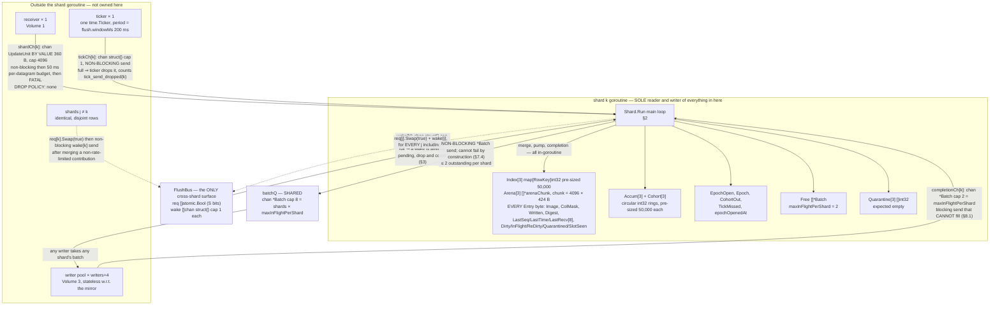
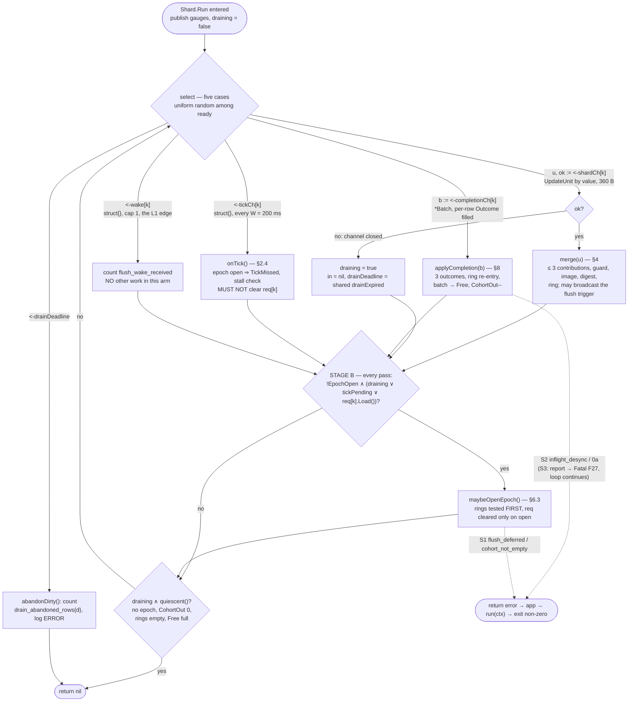
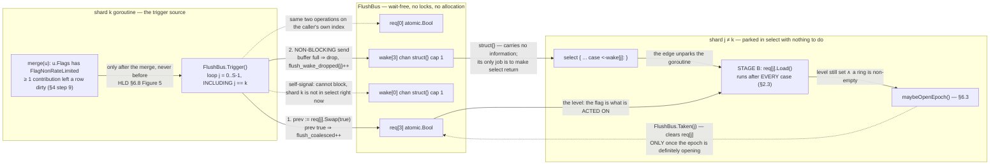
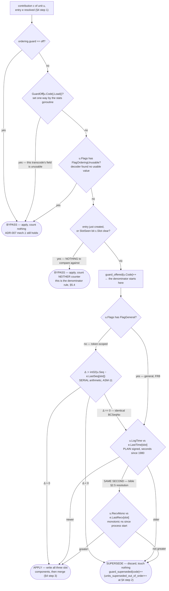
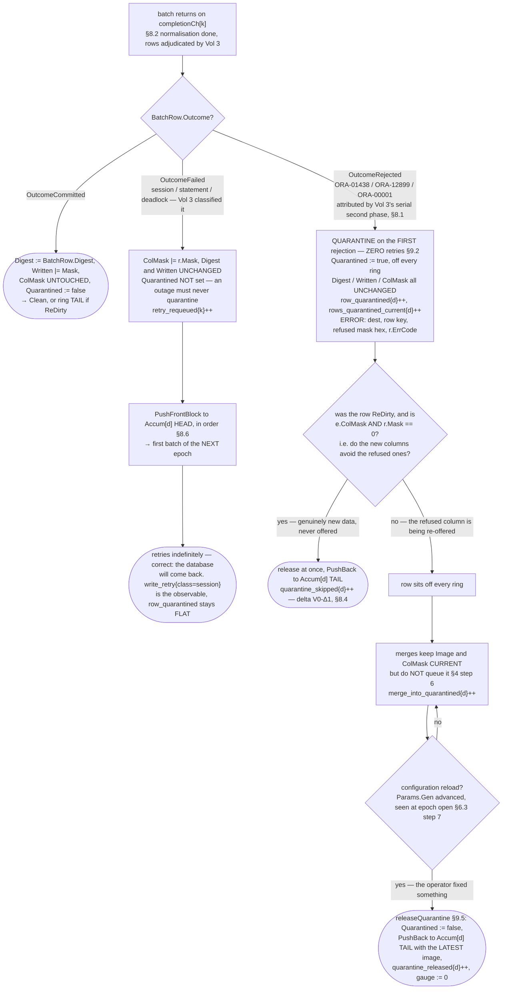

# FeedValve Phase 1 LLD — Volume 2: The Shard and the Coalescing Mirror

**Status:** draft for review

**Binds to:** `docs/lld/00-foundations.md` (Volume 0, the frozen contract — cited as `Vol 0 §x`).
**Detailed from:** `docs/architecture/phase1_hld_design1.md` (the HLD, authoritative).
**Protocol authority:** `ncobrd_bible.md` (the bible). Every protocol claim below cites a section of it.
**Owns:** LLD defects **L1** (flush flag has no wakeup), **L2** (the shard main loop is never specified),
**L3** (three row outcomes, two completion branches), **L4** ("skip the row" has no fallback).

> **What is binding here.** Volume 0 is the contract; where this volume needs a type, config key,
> counter or channel that Volume 0 does not define, it appears in §13 *Additions to the Vol 0 ledger*
> and nowhere else. Where this volume makes the HLD precise it is silent; where it contradicts the
> HLD it is recorded in §14 *Deltas against the HLD* with the arithmetic or citation that forced it.
> MUST is a protocol or contract requirement; SHOULD is engineering judgement and is labelled.

---

## Table of contents

- [0. Scope, and what this volume does not solve](#0-scope-and-what-this-volume-does-not-solve)
- [1. Shard construction and ownership](#1-shard-construction-and-ownership)
- [2. The main loop (closes L2)](#2-the-main-loop-closes-l2)
- [3. The flush wakeup (closes L1)](#3-the-flush-wakeup-closes-l1)
- [4. The merge](#4-the-merge)
- [5. The ordering guard](#5-the-ordering-guard)
- [6. The epoch and flush state machine](#6-the-epoch-and-flush-state-machine)
- [7. The pump](#7-the-pump)
- [8. The completion path (closes L3)](#8-the-completion-path-closes-l3)
- [9. The unwritable-row fallback (closes L4)](#9-the-unwritable-row-fallback-closes-l4)
- [10. Memory bound, re-derived](#10-memory-bound-re-derived)
- [11. Behaviour under the reference burst](#11-behaviour-under-the-reference-burst)
- [12. Concurrency proof obligations](#12-concurrency-proof-obligations)
- [13. Additions to the Vol 0 ledger](#13-additions-to-the-vol-0-ledger)
- [14. Deltas against the HLD](#14-deltas-against-the-hld)
- [15. ADRs](#15-adrs)
- [16. Open questions](#16-open-questions)

---

## 0. Scope, and what this volume does not solve

### 0.1 What this volume owns

Everything inside one `internal/mirror` shard goroutine, from the moment a `model.UpdateUnit` is
received on `shardCh[k]` to the moment a `*model.Batch` is returned to that shard's free list:

| Owned here | Section |
|---|---|
| `Shard` construction, arena/index/ring layout, pre-sizing, exclusive-ownership statement | §1 |
| The main loop: the `select`, every case, priority, timers, starvation argument (**L2**) | §2 |
| The flush trigger broadcast and the cap-1 wakeup (**L1**) | §3 |
| The merge: lookup, create, guard, image merge, digest, suppression, ring insertion, re-dirty | §4 |
| The ordering guard: three components, slot assignment, precedence, auto-disable | §5 |
| The epoch/flush state machine: ring pair, open/close ordering, `CohortOut`, `TickMissed`, free list | §6 |
| The pump: batch fill, `ColMask` zeroing, in-flight marking, the impossible-send case | §7 |
| The completion path: three outcomes, digest/mask/`Written` obligations, ring re-entry (**L3**) | §8 |
| Isolation and quarantine of a permanently unwritable row (**L4**) | §9 |
| The structural memory bound, re-derived at Vol 0's 424-byte `Entry` | §10 |
| Behaviour under the reference burst, and where it first breaks | §11 |

### 0.2 What this volume deliberately does not solve

- **Decode, framing, routing and the Q1 send.** Volume 1. The boundary is `shardCh[k]`, carrying
  `model.UpdateUnit` **by value** (Vol 0 §3.5, §9.2 Q1).
- **Statement text, binds, transaction boundaries, the writer's error classification, retry policy.**
  Volume 3. The boundary is `batchQ` out (`*model.Batch`) and `completionCh[k]` back.
- **Process lifecycle sequencing, signal handling, the stats/health goroutines, the test plan.**
  Volume 4. This volume specifies the *shard's own* drain behaviour (§2.6) and the counters it writes
  (§13), not who closes what in which order.
- **The destination schema.** OQ-13. §4 and §5 consume Vol 0 §4's field maps as given.

### 0.3 The three boundary obligations this volume places on its siblings

Named here so no sibling has to infer them, and so a reviewer can check them against the sibling
volume rather than against prose.

| # | On | Obligation | Why this volume cannot supply it |
|---|---|---|---|
| **B-V1** | Volume 1 | `UpdateUnit.Contribs[d].Slot` MUST be the contributor slot of `Code` **within destination `d`**, assigned at startup by ascending transaction code among that destination's declared contributors (HLD §6.9, §7.3; Vol 0 §3.4). The shard indexes `Entry.LastSeq/LastTime/LastRecv` with it and never recomputes it | The slot is a property of the configured destination table, resolved once in `destinations`; recomputing it per contribution on the shard would be a lookup on the coalescing path for a value that cannot change |
| **B-V1b** | Volume 1 | `UpdateUnit.RecvMono` MUST be set for **every** unit, from `time.Since(processStart).Nanoseconds()` (Vol 0 §10.2), made **strictly increasing** per datagram as `max(now, last+1)` (`nextRecvMono`) — never zero-as-absent, never a wall clock, never equal to the previous datagram's *(erratum, Phase 3, seam 9: on a timer-tick monotonic clock two datagrams read in one tick otherwise share a value, and §5.3 step 8 discards the second as a re-delivery)* | It is the third ordering component (§5.3) and the only sub-second discriminator the design has |
| **B-V3** | Volume 3 | Every returned batch MUST have every row adjudicated: `OutcomeCommitted`, `OutcomeRejected` or `OutcomeFailed`, never `OutcomePending` with `Batch.Err == nil`. A row refused for a **data** reason (`ORA-00001`, `ORA-01438`, `ORA-12899`) MUST be `OutcomeRejected` with `BatchRow.ErrCode` set to the ORA number; a row unwritten for a **session, statement or deadlock** reason MUST be `OutcomeFailed`. Per-row attribution is supplied by Vol 3's two-phase execute (ADR-W01), not by the driver | `mirror` may not import `oradb` (Vol 0 §1.3), so the shard cannot classify a driver error and must be told. The three-outcome completion path (§8) and the quarantine bound (§9) both rest on this |
| **B-V3b** | Volume 3 | The writer MUST return the batch on `completionCh[k]` **before** any backoff, never while holding it (Vol 3 ADR-W05) | A held batch is a batch missing from the shard's `Free` list, and an empty `Free` list stops the pump (§6.6) — so a writer backing off while holding a batch stops that shard's epoch clock as surely as a stalled epoch would |

### 0.4 Which of the HLD's open items this volume is exposed to

| Open item | Exposure here | Status |
|---|---|---|
| **OQ-4** — can `go-ora` attribute a failure to a row? | Total: it decides whether `OutcomeRejected` ever reaches the shard | **RESOLVED** (Vol 3, against pinned `go-ora/v2@v2.9.0`). Array binds work inside a `*sql.Tx` — `NewStmt` sets `bulkExec` for statement text beginning `MERGE` (`command.go:331-336`), slices activate array DML (`command.go:1616-1627`). **Per-row attribution is not exposed by the driver** — Oracle sends per-element affected counts and per-element bind errors, and go-ora parses and discards both (`command.go:891-896` reads `rowsAffectedByArrayBind[i]` into `_`; `network/summary_object.go:259-262` rewrites `RetCode` from `bindErrors[0].errorCode` on `RetCode == 24381` and drops every `rowOffset`; `bindErrors` and `Connection.session` are unexported, so `Conn.Raw` cannot reach them either). **Vol 3's ADR-W01 supplies attribution instead**: array-bind in steady state, and on a row-data classification *only*, roll back and re-run that same batch row by row through the same prepared statements, where each error is unambiguously attributable. §8 therefore implements the full three-outcome path with attribution treated as **available**, and §8.6 states the latency this costs |
| **OQ-13** — the destination schema | Low. §4's merge walks a declared column table; the columns themselves are Vol 0 §4's | Nothing structural. `imageSize`, `maxColumns` and `maxContributors` are already gated (Vol 0 §4.7) |
| **OQ-2** — uncoalesced unit rate vs. write ceiling | Medium. It sets cohort size, hence pump cost and `maxInFlightPerShard` adequacy | §11 walks both ends of the range and names which mechanism gives out first |
| **req §12.3** — are the header ordering fields populated? | Medium, and bounded by design. If `BCSeqNo` and `LogTime` are both useless the guard degrades to the receipt clock, then auto-disables per transcode | §5.5 |

---

## 1. Shard construction and ownership

### 1.1 The `Shard` struct

Presented as Vol 0 types it, with every field attributed to the document that fixed it. Additions
this volume makes are marked **`[+]`** and justified in §13.

```go
package mirror

// Shard owns one partition of all three destination mirrors. Exactly one
// goroutine — the one running Shard.Run — reads or writes every field below,
// with the single exception stated in §1.4: nothing in this struct is written
// by another goroutine, because the one cross-shard signal (the flush trigger)
// lives in a separate FlushBus that the shard only reads.
//
// The struct itself is allocated once at startup and never copied.
type Shard struct {
    ID model.ShardID // 0..shards-1; stamped into every Batch it emits

    // --- the mirror -------------------------------------------------------
    // Index[d] maps a destination-d row key to an arena slot. Pre-sized at
    // construction from runtime.expectedRows/shards so bucket evacuation does
    // not land on the sole consumer of Q1 (HLD §7.8).
    Index [model.MaxDestinations]map[model.RowKey]int32

    // Arena[d] holds destination d's entries in fixed-size chunks of
    // runtime.arenaChunkRows. Growth appends a chunk; nothing is ever copied,
    // so an int32 slot is stable for the life of the process (§1.3).
    // Pointer-free below the outer slice, so the collector never traces it
    // (ADR-006, Vol 0 §3.7).
    Arena [model.MaxDestinations][]*arenaChunk

    NextSlot [model.MaxDestinations]int32 // bump allocator; == number of live entries

    // --- the epoch machinery ---------------------------------------------
    // Accum[d] is the ACCUMULATING ring: rows dirtied now, for the NEXT epoch.
    // Cohort[d] is the DRAINING ring: this epoch's snapshot, FIFO oldest-first.
    // Both are genuine circular buffers, not slices — see ADR-L21 and §11.4.
    Accum  [model.MaxDestinations]ring
    Cohort [model.MaxDestinations]ring

    EpochOpen  bool   // at most one epoch open per shard, ever
    Epoch      uint64 // monotonic epoch counter, stamped into every Batch
    CohortOut  int32  // batches of this epoch emitted and not yet returned
    TickMissed bool   // a W tick fired while the epoch was open
    epochOpenedAt int64 // monotonic ns, for epoch_duration_max_ns and the stall warning

    // tickPending is a tick seen and not yet acted on: the tick arm sets it and
    // stage B opens the epoch (§2.4). maxBatchSize is the flush.maxBatchSize
    // loaded at epoch open and held for the whole epoch (§6.3).          [+]
    tickPending  bool
    maxBatchSize int

    // Free holds the shard's maxInFlightPerShard pre-allocated batches. Its
    // length is the shard's remaining write concurrency; an empty free list is
    // the ONLY thing that stops the pump (§7.2).
    Free []*model.Batch

    // all is every batch this shard owns, in a fixed order; sentAt[i] is when
    // all[i] was last sent on batchQ — §8.5's batchSentAt. Free is a stack and
    // completions return out of order, so a batch's index is found by a
    // linear scan of all (m = 2 by default).                               [+]
    all    []*model.Batch
    sentAt []int64

    // Quarantine[d] lists the arena slots of destination-d rows that Oracle has
    // permanently refused (§9). Bounded by the key universe; expected to be
    // empty. Walked only on a configuration reload.                        [+]
    Quarantine [model.MaxDestinations][]int32

    // cfgGen is the configuration generation the shard last observed. A change
    // at epoch open releases the quarantine set (§9.5).                    [+]
    cfgGen uint64

    // --- channels (see §1.4 for direction and capacity) -------------------
    in         <-chan model.UpdateUnit // Q1, this shard's ingest
    completion <-chan *model.Batch     // Q2c, this shard's completions
    tick       <-chan struct{}         // T,  from the shared ticker
    wake       <-chan struct{}         // W,  the L1 wakeup, cap 1           [+bound]
    batchQ     chan<- *model.Batch     // Q2, shared with every shard

    bus  *FlushBus     // the only cross-shard surface (§1.4, §3)
    params func() *Params // the published *mirror.Params inside app.Runtime; loaded at
                          // epoch open and at each tick (ruling D1, D3; §6.3)
    dst  *destinations.Table // immutable after startup
    inst *shardInstruments    // resolved once at startup (Vol 0 §8.4 MUST)
    seed maphash.Seed         // process-wide digest seed (Vol 0 §5.5)
}

// arenaChunk is one contiguous run of entries. A chunk is allocated whole and
// never freed, moved or resized, which is what makes an (arena, slot) pair a
// stable address for the life of the process.
type arenaChunk struct {
    e [arenaChunkRows]model.Entry
}
```

> *(erratum, Phase 3: `tickPending`, `maxBatchSize` and `all`/`sentAt` were used by §2.4, §6.3 and
> §8.5 but missing from this struct; added as `internal/mirror/shard.go` declares them. `cfg
> *config.Store` became `params func() *Params`: `mirror` cannot import `config`, which imports
> `oradb`, and G-DEP-1 is transitive — ruling D1. `app` projects config onto `mirror.Sizing`
> (startup-only) and `mirror.Params` (reloadable), and the `*Params` lives inside `app.Runtime`, one
> published pointer.)*

> **Delta against HLD §7.3.** The HLD places `FlushReq atomic.Bool` and `Done chan *Batch` **inside**
> `Shard`. This volume moves the flush flag out into a shared `FlushBus` (§3.1) and keeps the
> completion channel as a receive-only field. The reason is stated in §1.4 and recorded as delta
> **D2-1**: with `FlushReq` inside `Shard`, shard *j* must hold a `*Shard` pointer to shard *k* in
> order to set it, which makes every other field of shard *k* reachable from shard *j* and reduces
> "the shard owns its state exclusively" from a structural property to a discipline. With the bus,
> the cross-shard surface is one type containing nothing but atomics and channels.

### 1.2 What the shard goroutine exclusively owns, stated exactly

> **MUST.** For the lifetime of the process, the goroutine running `Shard.Run` is the **only**
> goroutine that reads or writes:
>
> - every field of `Shard` listed in §1.1 except `bus`, `params`, `dst`, `inst`, `seed` and the five
>   channel fields, which are set once before `Run` starts and are read-only thereafter;
> - **every byte of every `model.Entry` in `Arena[0..2]`** — image, masks, digest, the three ordering
>   arrays, and all five flag bytes;
> - every entry of `Index[0..2]`;
> - the contents of `Accum[0..2]` and `Cohort[0..2]`;
> - every `*model.Batch` currently in `Free`, and every `*model.Batch` it has received on
>   `completion` and not yet sent on `batchQ`.
>
> **MUST.** The shard goroutine never holds a `*Batch` that is simultaneously reachable from a
> writer. Ownership is a strict baton: `Free` → (`batchQ` send) → exactly one writer → (`completion`
> send) → `Free`. There is no instant at which two goroutines may touch one `Batch` (Vol 0 §3.8).
>
> **MUST NOT.** The shard goroutine imports neither `oradb`, `writer`, `database/sql` nor `net`
> (Vol 0 §1.3). A goroutine that cannot name a database handle cannot block on a commit, which is the
> property HLD §7.3 states in prose and Vol 0 makes a compile error.

### 1.3 Arena, index and ring construction

Three allocations per (shard, destination), all at startup, all sized from startup-only configuration
(Vol 0 §7.2). Nothing on this list grows during a normal session.

| Structure | Construction | Why at startup |
|---|---|---|
| `Index[d]` | `make(map[model.RowKey]int32, expectedRows/shards)` = 50,000 at the defaults | A map growing incrementally toward 50,000 entries evacuates buckets on insert, and that work lands on the sole consumer of Q1 (HLD §7.8). Pre-sizing converts it into one startup cost |
| `Arena[d]` | `Arena[d] = append(Arena[d], new(arenaChunk))` — **chunk 0 allocated with the shard**, remaining chunks on demand | Identical reason. HLD §7.8: "arena chunk 0 is allocated with the shard". A first-packet-of-the-session allocation of 1.74 MB on the shard goroutine is exactly the stall `shard_loop_max_ns` exists to catch |
| `Accum[d]`, `Cohort[d]` | `newRing(expectedRows / shards)` = 50,000 `int32`, rounded up to 65,536 = 256 KiB each | §11.4: a ring that grows during a database outage does so at the worst possible moment. Pre-sizing is 6.3 MB total (§10.3) and removes the case entirely |

**Slot allocation** is a bump allocator, and the slot is an address:

```
allocEntry(d) → int32:
  1. chunk := NextSlot[d] / arenaChunkRows
  2. if chunk == len(Arena[d]):  append a new zeroed *arenaChunk; count arena_chunks{k,d}
  3. slot := NextSlot[d]; NextSlot[d]++
  4. e := entry(d, slot)          // *Entry into the chunk, never copied out
  5. *e = model.Entry{}           // explicit zero: Image, Digest, Written, SlotSeen, Quarantined
  6. return slot
```

> **INV-SLOT.** An arena slot, once allocated, addresses the same `Entry` for the life of the
> process. Nothing is freed, nothing is compacted, nothing is moved. This is what lets
> `BatchRow.Slot` (Vol 0 §3.8) be a bare `int32` that the completion path dereferences **without a map
> lookup** — and it is what makes the completion path immune to an index rebuild.

> **INV-ZERO.** A freshly allocated entry has `Image` all-zero, `Digest == 0`, `Written == 0`,
> `SlotSeen == 0`, `Quarantined == false`. Vol 0 §5.2 normalisation rule 1 depends on it: a recycled slot
> carrying a previous row's bytes would produce a digest matching a *different* row's history. Since
> INV-SLOT never recycles a slot, the invariant is established once at allocation and never
> re-established. Step 5 is therefore belt-and-braces against a future slot-reuse feature, and its
> cost — 424 bytes of zeroing per *new row*, not per update — is ~170 MB once over a session.

**The ring.** `Accum` and `Cohort` are circular buffers, not slices, and the difference is
load-bearing (ADR-L21, §11.4):

```
ring — a circular buffer of int32 arena slots

  fields:  buf []int32   head int   n int          (cap(buf) is always a power of two)

  PopFront()          O(1)   the pump's only read
  PushBack(s)         O(1)   a newly dirtied row (§4 step 8)
  PushFrontBlock(ss)  O(k)   a FAILED BATCH's rows, IN ORDER, in one operation (§8.4)
  Len()               O(1)   published as dirty_depth{k,d} / cohort_depth{k,d}
  Swap(&other)        O(1)   the epoch's ring swap — exchanges the three fields (§6.3)
  Reset()             O(1)   head = 0, n = 0; buf retained

  growth: double buf and re-linearise when n == cap(buf); count ring_grown{k,d}
```

```
The three insertion points, and why each is where it is
=======================================================

   Accum[d]  (accumulating — the NEXT epoch)          Cohort[d]  (draining — THIS epoch)
   +------------------------------------------+      +--------------------------------+
   | head                                tail |      | head                      tail |
   +---+---+---+---+---+---+---+---+---+---+--+      +---+---+---+---+---+---+---+---+
     ^                                    ^            ^
     |                                    |            |
     |                                    |            +-- pump PopFront()  (§7.2)
     |                                    |                oldest-first, FIFO (ADR-015)
     |                                    |
     |                                    +-- PushBack: a row newly dirtied  (§4 step 8)
     |                                        and a re-dirtied row confirmed (§8.3)
     |
     +-- PushFrontBlock: a FAILED batch's rows (§8.4), so a retry stays ahead of
         rows dirtied after it — FIFO survives the retry instead of being inverted

   NOTHING is ever pushed to Cohort[d]. It is drain-only, which is the entire
   termination guarantee of the epoch (HLD §7.3, §7.12 risk 9).
```

### 1.4 Ownership and the four channel edges



*Figure 2.1 — Shard-local ownership and the four inbound channel edges. Every edge carries its
element type, capacity, blocking semantics and what happens when it is full. The box boundary is the
ownership boundary: **nothing inside `SH` is read or written by any other goroutine**, and the only
cross-shard surface is `FlushBus`, which contains nothing but `atomic.Bool`s and cap-1 `chan
struct{}`s. `batchQ` is shared but the `*Batch` on it is not: ownership is a strict baton (§1.2).*

**The one concurrency claim in this diagram, argued rather than asserted.** `FlushBus.req[k]` is
written by all `S` shard goroutines (`Swap(true)`) and by shard *k* alone (`Store(false)`, at epoch
open). `FlushBus.wake[k]` is sent on by all `S` and received from by shard *k* alone. Nothing else
crosses. Safety rests on three facts and no others:

1. `atomic.Bool` operations are sequentially consistent in the Go memory model, so a `Swap(true)` on
   shard *j* is visible to a later `Load()` on shard *k* with no additional synchronisation.
2. A channel receive happens-after the corresponding send, so the `Swap(true)`-then-send ordering on
   shard *j* is observed as-is by shard *k* after its receive. §3.4 uses this and states why it is
   belt-and-braces rather than necessary.
3. `Store(false)` races with a concurrent `Swap(true)` in the sense that either may win. §3.5 shows
   both outcomes are correct and names the benign one the HLD already accepts.

**False sharing, considered and not mitigated.** `req []atomic.Bool` puts `S` = 4 four-byte atomics in
one cache line. Every shard loads its own bit once per main-loop pass — 3,750 loads/s per shard at the
burst rate (§11), 15,000/s across the process — against a line written a handful of times per *day*
(the non-rate-limited inventory is 6511/6521/6522/6531/6571, bible §4.5). Padding each flag to a
128-byte line would cost 4 KB and remove a contention cost of approximately zero. Not taken; recorded
so a future reader does not assume it was overlooked.

## 2. The main loop (closes L2)

### 2.1 The defect, and why the loop is load-bearing

HLD §7.3 specifies epoch-open, pump and completion as procedures and never says what calls them.
ADR-007's entire correctness argument is *"exactly one goroutine ever applies contributions to a
destination row, and it receives them in the order the receive goroutine produced them"* — which is a
claim about **this loop's structure**, not about the mirror's data layout. A loop that services
completions inside the merge path, or that re-enters the pump recursively, or that blocks on anything,
falsifies it silently. So the loop is specified here in full, with the starvation argument written out.

### 2.2 The signature and the five cases

```go
// Run is the shard goroutine. It returns when shardCh is closed and the drain
// completes or the shared drain deadline expires (§2.6), or on one of the
// defects that must stop the process (§2.7). There is no context.
//
// Run returns an error rather than calling Fatalf: appLogger.Fatalf calls
// os.Exit and skips every defer, so a fatal condition here must unwind through
// app to run(ctx) error and out through main's exit code (CLAUDE.md,
// poc/gobrdclnt.go:19-28; Vol 0 §10.4).
func (s *Shard) Run() error
```

```
Shard.Run — the loop, in full

  init:  draining      := false
         drainDeadline := nil          // a nil channel blocks forever
         s.publishGauges()

  loop:
    ┌── (A) select, with exactly five cases ──────────────────────────────────┐
    │                                                                         │
    │   case u, ok := <-s.in:                                                 │
    │        if !ok { s.in = nil; draining = true                             │
    │                 drainDeadline = s.drainExpired  // shared, D4, §2.6    │
    │                 break }                                                 │
    │        s.merge(u)                                   // §4               │
    │                                                                         │
    │   case b := <-s.completion:                                             │
    │        if err := s.applyCompletion(b); err != nil {        // §8        │
    │             if err is S3 { s.report(err) } else { return err }  // §2.7 │
    │        }                                                                │
    │                                                                         │
    │   case <-s.tick:                                                        │
    │        s.onTick()                                   // §2.4             │
    │                                                                         │
    │   case <-s.wake:                                                        │
    │        s.inst.flushWakeReceived.Add(1)              // §3.3 — no other  │
    │                                                     // work in this arm │
    │                                                                         │
    │   case <-drainDeadline:                                                 │
    │        s.abandonDirty(); return nil                 // §2.6             │
    │                                                                         │
    └─────────────────────────────────────────────────────────────────────────┘

    ┌── (B) post-select, run ONCE per loop pass, unconditionally ─────────────┐
    │                                                                         │
    │   if !s.EpochOpen && (draining || s.tickPending || s.bus.req[s.ID].Load()) {
    │        if err := s.maybeOpenEpoch(); err != nil { return err } // §6.3  │
    │   }                                                                     │
    │                                                                         │
    │   if draining && s.quiescent() { return nil }       // §2.6             │
    │                                                                         │
    │   s.inst.shardLoopMaxNs.Observe(time.Since(passStart).Nanoseconds())    │
    └─────────────────────────────────────────────────────────────────────────┘
    goto loop
```

*(erratum, Phase 3: the draft listed a sixth `ctx.Done()` arm. Nothing in the design cancels that
context, and on SIGTERM it would skip the drain, so it is removed (YAGNI, ruling D5): a clean stop goes
through the `shardCh` close, an abnormal one through the drain deadline. Stage B's guard now includes
`tickPending`, as §2.4 already said it must. The drain deadline is the one shared `drainExpired`
channel, not a per-shard `time.After` — ruling D4, §2.6.)*

### 2.3 Stage B is the level-triggered half of the L1 fix, and it is why the loop has two stages

The cap-1 wake channel (§3) is an **edge**: it wakes a shard that is parked in `select` with nothing
else to do. `FlushBus.req[k]` is a **level**: it says "an epoch is owed". Stage B is what reads the
level, and it runs after *every* case — not only after a wake.

That is precisely the case HLD §7.3 calls benign and this volume has to make work:

> *"a flag raised on a shard with nothing dirty stays raised until that shard next dirties a row,
> which then flushes immediately rather than waiting for its tick."*

Trace it. Shard 3 receives a broadcast flush trigger because a 6511 landed on shard 0 (bible §4.5,
HLD §6.8). Shard 3 has nothing dirty. Its wake fires; the wake arm does nothing; stage B calls
`maybeOpenEpoch`, which finds all three accumulating rings empty, counts `epoch_empty{3}` and returns
with `req[3]` **still set** (§6.3 step 2). Shard 3 parks. Four milliseconds later a 7208 unit arrives
and dirties a row. The unit arm merges it; **stage B runs again**, finds `req[3]` still set and the
ring now non-empty, and opens an epoch immediately. Without stage B the shard would have waited up to
a full `W` = 200 ms, and the only trace would have been a rising `epoch_empty` — which reads as
idleness.

**Cost of stage B.** One `atomic.Bool.Load()` and two branches per loop pass. At the burst rate of
3,750 units/s per shard (§11) that is 3,750 atomic loads per second on a line written a handful of
times a day: on the order of **20 µs/s**, or 0.002 % of a core. It is the cheapest correct answer.

**Considered and rejected: putting the check only in the wake arm.** That is the defect. It makes the
flag observable only when an edge arrives, and the edge that would have re-armed it never comes —
`FlushBus` is written only by a non-rate-limited *merge*, and the whole scenario above is one in which
no further non-rate-limited message arrives. The flag would sit set until the next tick, which is the
`W` delay the class exists to avoid.

**Considered and rejected: a `default:` arm that polls.** A `select` with `default` turns the loop
into a spin: with no work available the shard would burn a core polling. At `GOMAXPROCS = 4` with four
shards that is the entire entitled capacity (ADR-009, req §4).

### 2.4 The tick arm

```
onTick():
  0. p := s.params(); s.guard = p.Guard     // one Params load per tick (ruling D3, §6.3)
  1. if s.EpochOpen:
       s.TickMissed = true
       inst.tickSkippedEpochOpen{k}.Add(1)
       if now - s.epochOpenedAt > p.EpochStallWarn:                  // assumed 30 s, §13 A9
            log WARN once per epoch: "epoch stalled" k, epoch, cohort depths, CohortOut, Free len
            inst.epochStalled{k}.Add(1)
       return                              // MUST NOT clear req[k] — HLD §7.3
  2. // no epoch open: stage B will open one if a ring is non-empty. Nothing to
     // do here but record that the tick was the reason.
     s.tickPending = true
```

Two things about this arm are deliberate and both come straight from HLD §7.3:

- **A tick that lands mid-epoch does nothing except set `TickMissed`, and MUST NOT clear `req[k]`.**
  Clearing a flag it is not acting on discards a non-rate-limited request outright.
- **The tick arm does not itself open an epoch.** It sets `tickPending` and lets stage B do it, so
  there is exactly one call site for `maybeOpenEpoch` and exactly one place where the ring-test-first
  ordering (§6.3) can be got wrong. Stage B's guard therefore reads
  `!EpochOpen && (draining || tickPending || req[k].Load())`, with `tickPending` cleared by
  `maybeOpenEpoch` whatever it decides — a tick that finds nothing dirty is consumed, unlike the flush
  flag, because a tick is a periodic sample and not a request.

**The epoch-stall warning needs no timer.** Ticks arrive every `W`, so an epoch open for 30 s has had
150 ticks to notice. A level check against `epochOpenedAt` on each tick is exact, free and cannot
itself get stuck. This is the runtime detector for HLD §7.12 risk 9 ("an epoch that never closes"),
which the HLD leaves to `epoch_duration_max_ns` trending — a metric nobody reads at 03:00.

### 2.5 Priority between the cases, and the starvation argument

**There is no explicit priority. Go's `select` chooses uniformly at random among ready cases, and that
is sufficient here.** This is the kind of claim that must be argued, so:

| Pair | Could it starve? | Argument |
|---|---|---|
| unit vs. completion | No | Under sustained load at most two cases are ready (Q1 always, completion when a batch returns). P(completion not chosen in *n* passes) = 2⁻ⁿ; expected wait **2 passes ≈ 0.7 µs** (§11.2's per-pass cost). Against a commit of 5–20 ms that is six orders of magnitude of slack. Adding a priority poll would buy 0.7 µs on a 20 ms cycle |
| unit vs. tick | No | Same bound, and the consequence of a two-pass delay on a 200 ms window is unmeasurable. If the shard were so busy that a tick waited materially, `tickCh[k]`'s cap-1 non-blocking send drops the *next* tick at the ticker and `tick_send_dropped{k}` says so (§13 A8) |
| unit vs. wake | No | Same bound. And the wake is redundant with stage B's level check whenever the shard is busy — a busy shard observes the flag on its next pass whether or not it ever drains the wake |
| everything vs. drain deadline | No | `drainDeadline` is the shared `drainExpired` channel, closed once; it becomes ready once and stays ready, so it is chosen within an expected 2 passes of firing |

**Where an explicit priority *would* have been needed, and why it is not.** If the completion arm
could be starved, the free list would stay empty, the pump could not run, and the epoch would stall —
which is exactly HLD §7.12 risk 9. The uniform-random bound above rules it out. What actually protects
against the risk is structural and stated in §6: **cohort rings are drain-only**, so no arrival can
extend an epoch, and an epoch with `CohortOut == 0` and an empty cohort closes on the very next
completion or, if there are none outstanding, at the end of the pump that emptied it.

**One ordering rule is imposed, and it is not a priority.** `applyCompletion` (§8) ends by calling
either `pump` or `closeEpoch`, and `maybeOpenEpoch` ends by calling `pump`. **Neither ever calls
`select`, receives from a channel, or re-enters the other.** The call graph inside one loop pass is a
tree of bounded depth 2, never a cycle:

```
loop pass ──▶ merge                            (§4)  — no epoch machinery at all
          ├─▶ applyCompletion ─┬─▶ pump         (§7)
          │                    └─▶ closeEpoch ─▶ maybeOpenEpoch ─▶ pump
          └─▶ maybeOpenEpoch ──▶ pump
```

`closeEpoch → maybeOpenEpoch` is the "next epoch opens immediately" path of HLD §7.3, and it cannot
recurse: `maybeOpenEpoch` only proceeds when a ring is non-empty, so the epoch it opens has a non-empty
cohort and cannot close inside the same pump. Depth is bounded at 2 by construction, not by a counter.

### 2.6 Drain and shutdown, the shard's half

Volume 4 owns the sequencing; this is what the shard does when it reaches it (Vol 0 §9.2 closing
order: close the socket → receiver returns → close every `shardCh[k]` → **each shard drains** → close
`batchQ` → writers finish → close sessions).

```
on s.in closing:
  1. s.in = nil                  // a nil channel blocks forever: the arm disables itself
  2. draining = true
  3. drainDeadline = s.drainExpired   // the ONE shared deadline, default 5,000 ms
  4. log INFO "shard draining" k, dirty depths per destination, CohortOut

while draining:
  - stage B's guard includes `draining`, so an epoch opens as soon as ANY ring is
    non-empty and no epoch is open — W is ignored entirely, back-to-back epochs
  - completions are applied exactly as in steady state (§8), including retries at
    the ring head: a transient failure during the drain is still worth one more try
  - quiescent() ⟺ !EpochOpen  ∧  CohortOut == 0  ∧  Accum[0..2] all empty
                 ∧  len(Free) == maxInFlightPerShard
  - when quiescent(): log INFO "shard drained" k, rows written this drain; return nil

on drainDeadline:
  1. for d in 0..2: inst.drainAbandonedRows{d}.Add(Accum[d].Len() + Cohort[d].Len())
  2. log ERROR "drain deadline reached" k, per-destination abandoned counts, CohortOut,
     len(Free) — the honest count of what req §10.1 already calls unrecoverable
  3. return nil     // NOT an error: the deadline is a designed outcome, not a failure
```

*(erratum, Phase 3, ruling D4: Vol 4 §2 wins — there is **one** drain budget for the process, not one
per shard. `app` arms a single `drainExpired` channel from `t_shutdown` and closes it when
`flush.drainTimeoutMs` runs out; every shard selects on it. Each shard keeps a nil local arm until it
has seen `in` closed, so even `drainTimeoutMs = 0` never pre-empts units still buffered in Q1.)*

**The shard may exit with batches still outstanding, and that is safe for exactly one reason.**
`completionCh[k]` has capacity `maxInFlightPerShard` (Vol 0 §9.2, Q2c) and a shard can have at most
that many batches outstanding. So if the shard returns while `CohortOut > 0`, the writers still holding
those batches complete their sends into the buffer and never block. Had the completion channel been
unbuffered, or sized by anything other than the in-flight limit, a drain timeout would hang the writer
pool and then the whole shutdown. Vol 0's capacity choice is what makes the timeout path terminate;
this is the case it protects and it is worth naming because nothing else in the design exercises it.

**`len(Free) == maxInFlightPerShard` is part of `quiescent()` and not decoration.** Without it the
shard could return with a batch in flight and dirty rows already written but unconfirmed, and the
`drain_abandoned_rows` count would understate by up to `maxBatchSize` rows per outstanding batch.

### 2.7 The five defects that stop the process

All five are construction or writer defects, never load. Four return a wrapped error from `Run` that
unwinds through `app` to `run(ctx) error`; S3 is reported without returning (below). None calls
`os.Exit` (Vol 0 §10.4). *(erratum, Phase 3: the draft said "three" while listing S1–S3 plus
`cohort_not_empty` and §8.2's step 0a, and called `cohort_not_empty` both "not fatal" and "fatal too";
the fatal mapping is ruling D9.)*

| # | Condition | Detected in | Counter | `FatalReason` (Vol 4 §5) | Why stopping is right |
|---|---|---|---|---|---|
| **S1** | Non-blocking `batchQ` send failed | `pump`, §7.4 | `flush_deferred{k}` | F21 `FatalBatchQSendFail` | It is arithmetically impossible (§7.4). The one recovery the HLD's earlier draft had cannot fire when `CohortOut == 0`, so the epoch would stay open forever and the flush cadence would stop silently — HLD §7.12 risk 9 reached through the path meant to defend against it |
| **S2** | A completion named a row whose `Entry.InFlight` is false | `applyCompletion`, §8.2 | `inflight_desync{k}` | `FatalShardInvariant` | The only thing that clears `InFlight` is the completion itself, so this means a row reached two batches — the disjointness that ADR-007's FR9 claim and §8.4's deadlock layer 1 both rest on has been violated. Continuing would write a stale image over a newer one and never say so |
| **S3** | A batch returned with `Err == nil` and a row still `OutcomePending` | `applyCompletion`, §8.1 | `batch_row_unreported{k}` | F27 `FatalBatchRowUnreported` — **not returned**: passed to `NewShard`'s `report func(error)` | Vol 0 §3.8 and §5.4: the writer returned a batch it never adjudicated. Every obligation in Vol 0 §5.4 is keyed on the outcome; with no outcome there is nothing correct to do |
| **—** | `cohort_not_empty`: a `Cohort[d]` non-empty at epoch open | `maybeOpenEpoch`, §6.3 step 4 | `cohort_not_empty{k}` | `FatalShardInvariant` | See below |
| **0a** | A completion for another shard, a future epoch, a batch this shard does not own, or one returned twice | `applyCompletion`, §8.2 step 0a | none of its own | `FatalShardInvariant` | Routing or ownership broken; the baton of §1.2 no longer holds |

**S3 does one thing before it stops, and it matters.** It first converts every `Pending` row to
`OutcomeFailed` and requeues it at the accumulating ring's head (§8.4). The process is going down, but
it goes down through the drain, and the drain may yet write those rows. Losing them on the way out
would be a second defect layered on the first. *(erratum, Phase 3: so **S3 does not return**. Had `Run`
returned, nobody would drain those rows and the decoder would keep fanning into a Q1 nobody reads.
After the requeue the shard's state is consistent, so `applyCompletion` returns it last and the loop's
completion arm hands it to `report` instead of returning,
`app` raises `Fatal(F27)`, and the shard keeps running into the normal drain — ruling D9.)*

**A fourth condition, `cohort_not_empty{k}`** — a `Cohort[d]` found
non-empty at epoch open (§6.3 step 4) — is HLD §7.12 risk 10's detector, the swapped-rings defect. It
is fatal, for the same reason as S2: a non-empty cohort at open means the previous epoch closed
with rows still in it, so those rows are now unreachable and will never be written. It is listed
separately because, unlike S1–S3, it is caught by an assertion whose cost is three `Len()` calls per
epoch.



*Figure 2.2 — The shard main loop (closes L2). Stage A is the `select`; **stage B is the level check
that closes L1** and runs after every case, not only after a wake. The dotted edges to `ERR` are
the only ways the loop exits other than the drain, and all are construction
defects (§2.7). Note that no arm blocks on anything except the `select` itself: `merge`, `pump`,
`applyCompletion` and `maybeOpenEpoch` are straight-line code over shard-local state plus one
non-blocking channel send.*

## 3. The flush wakeup (closes L1)

### 3.1 The defect, restated precisely

HLD §6.6 row **F** and §6.8 make the flush trigger *"not a queue — one boolean per shard, set
atomically by whichever shard merged a non-rate-limited contribution"*. HLD §7.3 then says an epoch
opens *"on a `W` tick or when `FlushReq` is set"*. Nothing in the HLD ever says how a shard **learns**
that `FlushReq` became set. An `atomic.Bool` generates no event; a goroutine parked in `select` on
`shardCh`, `completionCh` and `tickCh` does not observe it.

The failure coincides exactly with the case the class exists for. The non-rate-limited inventory is
6511/6521/6522/6531/6571 — market status, *"a handful per day"* (HLD §6.8), all landing on the
designated general shard (FR8, bible §4.5). Consider the 03:00 case honestly:

> A `BC_OPEN_MSG` (6511) arrives on an otherwise quiet shard. It is merged, its row goes dirty, the
> flag is set on all four shards. No further unit arrives on that shard for the next minute. With no
> wakeup, the shard's only remaining event is the `W` tick — so in the best case the market open
> reaches Oracle one tick later (≤ 200 ms, the delay the class exists to avoid), and **if the ticker
> has already been stopped by the drain, or the tick was dropped by the cap-1 non-blocking send, the
> row is not written at all until something else happens.** The observable is nothing: `flush_triggered`
> incremented, `rows_dirtied` incremented, every counter healthy, and a market that reads `Closed`.

Vol 0 §9.2 row **W** reserved the mechanism — `flushWake[k]`, `chan struct{}`, capacity 1,
non-blocking send — and froze its capacity and semantics without choosing its use. This section binds
to it.

### 3.2 The mechanism, end to end

```go
// FlushBus is the only state shared between shard goroutines. It contains
// nothing but atomics and channels, so no field of one Shard is reachable from
// another (§1.4). Constructed once by app, immutable thereafter.
type FlushBus struct {
    req  []atomic.Bool    // len == shards. req[k] is the LEVEL: "shard k owes an epoch"
    wake []chan struct{}  // len == shards. wake[k] is the EDGE, cap 1, never closed
}

// Trigger broadcasts a flush request to every shard. Called BY A SHARD
// GOROUTINE, after it has merged a non-rate-limited contribution and that
// contribution has actually left a row dirty (§4 step 9) — never by the router,
// and never before the merge (HLD §6.8, Figure 5).
//
// Trigger performs, for every shard index j including the caller's own:
//   1. prev := req[j].Swap(true)
//   2. if prev { flush_coalesced++ }              — the bit was already set
//   3. select { case wake[j] <- struct{}{}: default: flush_wake_dropped{j}++ }
//
// Both operations are wait-free. Trigger cannot block, cannot allocate, and
// cannot fail.
func (b *FlushBus) Trigger(inst *busInstruments)

// Taken clears shard k's request. Called ONLY by shard k, and ONLY once an
// epoch is definitely opening (§6.3 step 3).
func (b *FlushBus) Taken(k model.ShardID)

// Pending reports shard k's level. Called by shard k in stage B of its main
// loop (§2.3), once per pass.
func (b *FlushBus) Pending(k model.ShardID) bool
```



*Figure 2.3 — The flush trigger broadcast and the cap-1 wakeup (closes L1). The **level** (`req[j]`)
is what the shard acts on; the **edge** (`wake[j]`) exists only to unpark a shard that is doing
nothing. Stage B reads the level after every loop case, so a busy shard needs no edge at all — which
is why losing an edge to a full cap-1 buffer is harmless. The dotted self-edges are the case §3.4
argues cannot deadlock.*

### 3.3 Why capacity 1 is sufficient, and why the wake arm does no work

The channel carries `struct{}` — zero bytes, no information. Its entire contract is *"return from
`select`"*. Two consequences:

1. **A pending token already means "wake and check".** If `wake[j]`'s buffer is occupied, shard *j*
   has not yet returned to `select` since the last signal, so it is *going* to run stage B before it
   parks again. A second token would produce a second wake that finds the same level and does the same
   thing. Dropping it loses nothing. Capacity 2 would buy one extra redundant loop pass; capacity 0
   (unbuffered) would make the send fail whenever the receiver is not *already* blocked in `select`,
   which is exactly when the signal is most needed.
2. **The wake arm in the main loop does nothing but count** (§2.2). It deliberately does not call
   `maybeOpenEpoch` itself, because stage B is about to. Putting the work in the arm would create two
   call sites for the epoch-open procedure, and the ring-test-before-flag-clear ordering (§6.3) is
   exactly the kind of thing that gets right at one call site and wrong at the other.

**The edge and the level can legitimately disagree, in both directions, and both are correct:**

| Situation | `req[k]` | `wake[k]` buffer | Outcome |
|---|---|---|---|
| Two triggers in quick succession, shard busy | set | occupied | One wake, one epoch. `flush_coalesced` and `flush_wake_dropped` both increment. Correct — HLD §6.6: *"a storm sets an already-set bit"* |
| Trigger, then the shard opens an epoch for an unrelated tick before draining the wake | **cleared** by `Taken` | occupied | The stale token produces one extra loop pass whose stage B finds the level clear. One wasted pass, ~0.4 µs. Not counted, not a defect |
| Shard busy, trigger arrives, wake dropped (buffer full from an earlier trigger) | set | occupied | Stage B observes the level on the very next pass. **The level, not the edge, is what guarantees service** |
| Shard parked, trigger arrives, wake delivered | set | drained by the receive | Shard unparks, stage B opens the epoch. This is the case L1 was about |

### 3.4 Why a shard signalling itself cannot deadlock

`Trigger` loops over **every** shard index including the caller's own (HLD §6.8: *"set the flush flag
on **all** shards"*). So shard *k*, in the middle of `merge`, performs a send on `wake[k]` — a channel
only it receives from, and from which it is definitively **not** receiving at that instant, because it
is executing `merge`.

An unbuffered or blocking send here would deadlock instantly and permanently: the goroutine would
block waiting for itself. That is the single most likely way to implement this wrong, and it is why
Vol 0 froze the semantics rather than the use.

The send is **non-blocking** — `select { case wake[k] <- struct{}{}: default: }` — so it has exactly
two outcomes and neither waits:

- the cap-1 buffer is empty: the token is deposited and the send returns immediately. The shard
  finishes `merge`, runs stage B (which opens the epoch, cleared flag and all), returns to `select`,
  and finds its own token ready. It takes the wake arm, counts, runs stage B again, which finds the
  level clear — one wasted pass;
- the buffer is full: `default` is taken, `flush_wake_dropped{k}` increments, the send returns
  immediately.

In both cases the send completes in constant time with no scheduler involvement. **A non-blocking send
on a buffered channel never parks the sending goroutine, whatever the buffer state**, so self-signalling
is not merely safe — it is indistinguishable in cost from signalling anyone else, which is why
`Trigger` has no special case for `j == k`. A special case would be one more branch and one more thing
to get wrong.

**Nor can it livelock.** The concern would be a shard that wakes itself, does nothing, and wakes itself
again. It cannot: a token is produced **only** by `Trigger`, and `Trigger` is called **only** from the
merge of a non-rate-limited contribution that left a row dirty. The number of tokens a shard can
receive over any interval is therefore bounded by the number of non-rate-limited contributions merged
across the whole process in that interval — a handful per day for the catalogued inventory (bible §4.5,
HLD §6.8). Waking and finding nothing to do consumes one token and produces none. There is no path
from "wake" to "signal", so there is no cycle.

**And a storm degrades into batching, not into spin.** If a mis-classified chatty transcode were
declared `non-rate-limited` (HLD §6.8's `expectedRatePerSec` warning exists for exactly this), the
trigger rate could reach thousands per second. The bus absorbs it: `Swap(true)` on an already-set bit
is a no-op, the cap-1 send drops, and each shard performs at most one epoch at a time. The ceiling is
`S / t_commit` ≈ 200 commits/s at the conservative end (HLD §4.2), and the observable is
`flush_coalesced / flush_triggered → 1` and `flush_wake_dropped` rising — HLD F10, which is the
designed behaviour and not an error.

### 3.5 The one genuine race, and why both outcomes are correct

`req[k]` is written by every shard (`Swap(true)`) and by shard *k* (`Store(false)` via `Taken`, at
epoch open). Those can interleave. Take the worst ordering:

```
  shard k                                       shard j
  -------                                       -------
  maybeOpenEpoch: rings non-empty  ── step 2
                                                merge 6511, row goes dirty on shard j
  Taken(k): req[k].Store(false)    ── step 3
                                                Trigger: req[k].Swap(true)   ← lands AFTER the clear
  swap rings, EpochOpen = true     ── steps 4-6
  pump                             ── step 8
```

Shard *k*'s epoch does not contain anything triggered by shard *j*'s 6511 — but it never could,
because the 6511 dirtied a row on **shard *j***, not on shard *k*. What the flag actually asks of
shard *k* is *"flush whatever you have, promptly"*, and shard *k* is doing exactly that. The
re-set flag then causes shard *k* to open **one more** epoch when the current one closes (§6.5's
immediate-re-open rule), which is at worst one extra small commit.

Reverse the interleaving — `Swap(true)` lands *before* `Store(false)` — and the flag is consumed by
the epoch that is opening, which is also correct.

The only ordering that would be wrong is the one HLD §7.3 explicitly forbids and §6.3 implements:
clearing the flag and *then* discovering there is nothing to flush. That is not a race, it is a
sequencing bug, and it is closed by testing the rings before clearing (§6.3 step 2 before step 3).

**Memory-model note, for completeness.** `sync/atomic` operations in Go behave as sequentially
consistent atomics, so shard *k*'s `Load()` in stage B observes shard *j*'s `Swap(true)` without any
further synchronisation; the channel is not load-bearing for *visibility*. The channel's
happens-before edge (a receive happens-after its send) is nonetheless real and makes the ordering
"flag set, then wake sent, then wake received, then flag observed" total — which is convenient when
reasoning about the table in §3.3 but is not what the correctness rests on. **The correctness rests on
the level being re-read every loop pass** (§2.3), which needs no ordering argument at all.

### 3.6 What Volume 1 and Volume 4 must not do

- **Volume 1 (the router) MUST NOT call `Trigger`.** HLD §6.8 Figure 5 is explicit: raising the flag
  at enqueue time decouples the request from the contribution that justifies it, and a shard that
  observed the flag before draining the unit would consume the request against an empty dirty set —
  count `epoch_empty`, clear nothing (§6.3 keeps the flag), and the unit would then wait for a tick
  with no pending trigger. The trigger is raised by the shard, after the merge.
- **Volume 4 MUST NOT close `wake[k]`.** A closed `chan struct{}` is permanently ready, which would
  turn the wake arm into a spin loop consuming a core. Shutdown is signalled by closing `shardCh[k]`
  and by `ctx`, both of which the loop already handles (§2.6). `FlushBus` is never closed and never
  torn down.

## 4. The merge

### 4.1 Signature and shape

```go
// merge applies one UpdateUnit to this shard's mirrors. It is called only from
// the main loop's unit arm (§2.2) and runs to completion before the loop
// returns to select, which is what makes ADR-007 mechanism 1 — "exactly one
// goroutine applies a destination row's contributions in wire arrival order" —
// a property of the code rather than an aspiration.
//
// merge never blocks, never allocates in steady state, and touches no state
// outside this shard except FlushBus.Trigger at step 9.
func (s *Shard) merge(u model.UpdateUnit)
```

`UpdateUnit` is indexed **by destination**: `u.Contribs[d].Mask == 0` means "this unit does not touch
destination *d*" (Vol 0 §3.4), so the outer loop is three iterations with one test each and no count
field to disagree with the array.

### 4.2 The merge, as numbered steps

Steps 1–8 run per destination `d` in 0, 1, 2 where `u.Contribs[d].Mask != 0`. Steps 9–10 run once per
unit. Each step names the invariant it preserves.

---

**Step 1 — resolve or create the entry.**

```
c    := u.Contribs[d]
slot, ok := s.Index[d][c.Row]
if !ok:
    slot = s.allocEntry(d)                      // §1.3, bump allocator
    e := s.entry(d, slot); e.Row = c.Row
    s.Index[d][c.Row] = slot
    inst.rowsCreated{d}.Add(1)
    created = true
e := s.entry(d, slot)                           // *model.Entry, stable (INV-SLOT)
```

> **Preserves INV-ZERO** (§1.3): a new entry has `Image` all-zero, `Digest == 0`, `Written == 0`,
> `SlotSeen == 0`, `Quarantined == false`. `Digest == 0` is the sentinel "never successfully written"
> (Vol 0 §5.2), which is what makes the first write of every row unconditional after a restart
> (HLD F18).
> **Preserves INV-SLOT**: `e` is a pointer into an arena chunk that is never moved, so holding it for
> the rest of the merge is safe and no re-lookup is needed.

`rowsCreated{d}` is the live growth curve of the row universe, and it is how ASM-7 and
`runtime.expectedRows` are validated from production rather than from a guess (§13, addition A14).

---

**Step 2 — the ordering guard.**

```
verdict := s.guard(e, &c, &u, d)                // §5, returns Apply | Supersede | Bypass
if verdict == Supersede:
    inst.unitsSupersededOutOfOrder.Add(1)
    continue                                    // next destination; NOTHING is touched
```

> **Preserves FR9's defensive half** (ADR-007 mechanism 2): a superseded contribution leaves the
> image, the mask, the three ordering arrays, `Digest`, `Written`, `Dirty`, `InFlight` and every ring
> completely untouched. There is exactly one `continue` and it is here — no partial application is
> reachable.

---

**Step 3 — record the ordering values, all three together** — after step 4's pass 1 (below).

> *(erratum, Phase 3: step 4's width validation runs **before** step 3. A contribution with a wrong
> packed width is rejected whole and advances no ordering slot — which is what step 2's "no partial
> application" requires; otherwise a corrupt unit could make later valid ones look out of order. The
> copy itself stays at step 4.)*

```
e.LastSeq[c.Slot]  = u.Seq                      // BCSeqNo as read, bible §2.8 offset 14
e.LastTime[c.Slot] = u.LogTime                  // seconds since 1 Jan 1980, bible §2.5
e.LastRecv[c.Slot] = u.RecvMono                 // monotonic ns since process start, Vol 0 §10.2
e.SlotSeen        |= 1 << c.Slot                // this slot now has a comparable history   [+]
```

> **Preserves the guard's comparability invariant.** The three components are written as a set, so a
> later comparison can never pair a fresh `LastSeq` with a stale `LastTime` — which would make the
> fall-through precedence of §5.3 compare values from two different messages.
> `c.Slot` is supplied by Volume 1 (obligation B-V1, §0.3) and is `< maxContributors = 8` by
> construction; `-selfcheck` rejects a destination declaring more contributors than slots (HLD §6.8,
> Vol 0 §3.0).

---

**Step 4 — validate the contribution's packed width, then merge the masked fields.**

```
// pass 1 — validate; runs BEFORE step 3. Walk c.Mask low to high, summing declared widths.
want := 0
for bit in setBits(c.Mask) ascending:
    want += s.dst[d].Columns[bit].Width
if want != int(c.BlobLen):
    inst.blobLenMismatch{u.Code}.Add(1)
    log ERROR (rate-limited): dest, code, mask, want, c.BlobLen
    continue                                    // merge NOTHING; image and slots stay consistent

// (step 3 runs here)

// pre-validation (Vol 0 §5A) — per field, against the column's DDL facts. A refused
// field leaves the contribution's EFFECTIVE mask and is counted
// prevalidate_rejected{d,reason} + prevalidate_rejected_transcode{code}.
eff := s.prevalidate(d, &c, &u)                 // ⊆ c.Mask
if eff == 0: continue                           // nothing left: dirties nothing

// pass 2 — copy. One cursor, ascending bit order (Vol 0 §3.4).
cur := int(c.BlobOff)
for bit in setBits(c.Mask) ascending:           // walk ALL of c.Mask: a refused field
    col := s.dst[d].Columns[bit]                //   still occupies its place in the blob
    if eff has bit:
        copy(e.Image[col.Offset : col.Offset+col.Width], u.Blob[cur : cur+col.Width])
    cur += int(col.Width)
```

> **Preserves the merge-not-assignment property** (HLD §6.7): only fields named by `c.Mask` change.
> Every other byte of `e.Image` is exactly what the previous contributor left, which is the whole
> point of a column mask when two transcodes share a destination row — 7305 and 7340 on
> `MD_SECURITY_MASTER` (bible §4.3), and the five market-status codes on `MD_MARKET_STATUS`
> (bible §4.5).
> **Preserves Vol 0 §4.1 R5** (full declared width, zero-filled past the valid length) because the
> copy is exactly `col.Width` bytes and Volume 1 packs the blob at declared widths. This is what keeps
> the digest a function of state rather than of history (Vol 0 §5.2 normalisation rule 2).
> **Preserves Vol 0 §4.1 R1**: no byte-swapping, no scaling, no trimming — two `copy`s and nothing
> else. Conversion happens in `writer` at bind time.

*(erratum, Phase 3, ruling D12: Vol 0 §5A's "validate at merge, per contribution" runs inside this
step, between the width check and the copy; this volume never named the step. Its three instruments
are the shard's. An explicit-length text field and its length field are judged and withdrawn as a
pair (Vol 0 §4.5). `NotNull` is not checked here — at merge the mirror cannot tell an insert from an
update.)*

**Why two passes rather than one.** Vol 0 §6.1 permits a decoder to clear a mask bit for a field the
message left absent, so `c.Mask` may be a strict subset of `ColSpec.Mask` and `c.BlobLen` is therefore
variable at runtime. A single copy-and-check-at-the-end pass would leave a partially merged image
before discovering the mismatch, and that image would then be digested and written. The validation
pass costs one extra walk over ≤ 16 set bits — about 80 ns at destination 0's width — against a merge
budget of ~340 ns (§11.2). **SHOULD:** a mismatch is a decoder or configuration defect, not a data
condition; `blob_len_mismatch{code}` non-zero warrants a rebuild, not a tuning change.

---

**Step 5 — dirty the columns.**

```
e.ColMask |= eff                                // c.Mask less any pre-validation refusals
```

> **Preserves INV-MASK** (Vol 0 §6.2): `Entry.ColMask` means *"fields dirtied since this row was last
> copied into a batch"*. It is cleared only at pump (§7.2) and restored only by a failed commit
> (§8.4). Nothing else ever writes it.

---

**Step 6 — the quarantine check.**

```
if e.Quarantined:                                                               [+]
    inst.mergeIntoQuarantined{d}.Add(1)
    continue          // image and mask are current; the row is NOT queued (§9.4)
```

> **Preserves the quarantine bound** (§9): a row Oracle has permanently refused does not re-enter the
> rings on every arrival. The image and mask are kept current so that a release (§9.5) writes the
> *latest* state rather than the state at the moment of quarantine. This step sits after the merge
> and before the dirty logic for exactly that reason.

---

**Step 7 — change suppression (NFR13).**

```
if u.Flags & model.FlagNonRateLimited == 0:                 // rate-limited only
    if !e.InFlight && e.Digest != 0 && (e.ColMask &^ e.Written) == 0:
        if maphash.Bytes(s.seed, e.Image[:s.dst[d].ImageLen]) |or 1| == e.Digest:
            inst.changeSuppressed.Add(1)
            continue                              // leave clean; ColMask stays set (Vol 0 §6.2 step 3)
// non-rate-limited: the predicate is SKIPPED ENTIRELY and the digest is not computed
```

> **Preserves Vol 0 §5.3 exactly**, including the clause order. The two cheap tests (`Digest != 0`,
> `ColMask &^ Written == 0`) are evaluated **before** the hash, so the ~90 ns `maphash` call is
> skipped on every first-ever write and on every write that names a new column. `0` is mapped to `1`
> per Vol 0 §5.2.
> **Preserves NFR13's carve-out** (HLD §6.7, §7.4): a non-rate-limited contribution always marks the
> row dirty, digest or no digest, and the digest is *not computed* on that path — the check is skipped
> rather than merely failing, which is one fewer thing to be wrong.
> **Never on an in-flight row** *(erratum, Phase 3)*. `Digest` describes the last **commit**, not the
> batch in flight, so a value that returns to the committed one mid-flight (A committed, B pumped, A
> merged) would match it and be dropped — leaving Oracle at B and the mirror at A with nothing to
> requeue the row. Figure 2.4 already has no suppression arc out of `InFlight`; Vol 0 §5.3 carries the
> same clause.
> **Note the fourth clause uses `e.ColMask`, not `c.Mask`.** Bits may have accumulated from earlier
> suppressed merges (Vol 0 §6.2 step 3 leaves them set), and the question the clause asks is "would
> the *statement* name a column no statement has named before" — which is about the mask the next
> pump would carry, not about this contribution.

---

**Step 8 — dirty the row and place it on a ring.**

```
switch:
  case e.InFlight:                                // batched, not yet confirmed
       e.ReDirty = true
       inst.redirtyTotal.Add(1)
       // MUST NOT enter any ring — the completion requeues it (§8.3)
  case e.Dirty:                                   // already on the accumulating ring
       // nothing to do; this is coalescing, and it is the common case
  default:
       e.Dirty = true
       s.Accum[d].PushBack(slot)
       inst.rowsDirtied.Add(1)
dirtiedSomething = true
```

> **Preserves the in-flight rule** (HLD §6.7, ADR-005): a row is in at most one outstanding batch.
> The `InFlight` arm is the only place a merge can land on a batched row, and it deliberately enters
> no ring — appending to the accumulating ring here would put the row in a second batch before the
> first was confirmed and break §8.4's deadlock layer 1 and ADR-007's FR9 claim in one step.
> **Preserves the state encoding** below: `Dirty && InFlight` is never both true.
> **Preserves FIFO** (ADR-015): a newly dirtied row goes to the **tail**. The head is reserved for
> failed retries (§8.4), which is what keeps a retry ahead of rows dirtied after it.

---

**Step 9 — the class action, once per unit, after the loop.**

```
if u.Flags & model.FlagNonRateLimited != 0 && dirtiedSomething:
    s.bus.Trigger(inst)                           // §3.2 — every shard, including this one
    inst.flushTriggered.Add(1)
```

> **Preserves HLD §6.8's ordering requirement**: the flag is raised **by the shard, after the merge**.
> `dirtiedSomething` is the additional condition this volume makes explicit: if every contribution
> was superseded (step 2) or landed on a quarantined row (step 6), nothing is dirty because of this
> unit and raising the flag would ask four shards to open an epoch for it. HLD §7.3's "test the rings
> first" ordering makes that harmless, but not raising it at all is cheaper and more honest.

---

**Step 10 — count the unit.**

```
inst.unitsApplied.Add(1)                          // units — the ASM-17 denominator
inst.unitsMerged.Add(contributionsApplied)        // contributions — the FR6 numerator
```

`rows_dirtied / units_applied` is ASM-17 measured directly (Vol 0 §8.2), and it is the single number
that settles whether §11's pessimistic row rate or its expected one is real.

### 4.3 The entry state encoding, and the assertion that guards it

Three booleans encode four states, and each state has exactly one encoding:

| State | `Dirty` | `InFlight` | `ReDirty` | On a ring? |
|---|---|---|---|---|
| clean | false | false | false | no |
| dirty | **true** | false | false | **accumulating**, exactly once |
| in flight | false | **true** | false | no — it left the cohort at pump (§7.2) |
| in flight, re-dirtied | false | **true** | **true** | no — the completion requeues it (§8.3) |

> **INV-STATE.** `Dirty && InFlight` is never simultaneously true, and `ReDirty` implies `InFlight`.
> Both are checked by the property tests Volume 4 owns (HLD §10.4 already names the in-flight
> transition gates), and `InFlight` is additionally checked at every completion (§8.2, defect S2)
> because that is the one place the violation would silently corrupt data rather than merely being
> wrong.

```mermaid
stateDiagram-v2
    [*] --> Clean: allocEntry — Image zeroed, Digest 0,<br/>Written 0, SlotSeen 0, Quarantined false (INV-ZERO)

    Clean --> Dirty: merge applies (§4 step 8 default arm)<br/>ColMask |= c.Mask, PushBack to Accum[d] TAIL<br/>rows_dirtied++
    Clean --> Clean: merge suppressed (§4 step 7)<br/>digest matches ∧ ColMask ⊆ Written ∧ rate-limited<br/>change_suppressed++ — ColMask stays set
    Clean --> Clean: merge superseded (§4 step 2)<br/>guard verdict Supersede — NOTHING touched<br/>units_superseded_out_of_order++

    Dirty --> Dirty: merge applies again<br/>image + ColMask updated, already on the ring —<br/>THIS IS COALESCING, zero marginal cost
    Dirty --> InFlight: pump copies it (§7.2)<br/>BatchRow gets Image+Mask+Digest,<br/>then Entry.ColMask := 0; index LEAVES the cohort

    InFlight --> InFlightRe: merge lands mid-flight (§4 step 8 InFlight arm)<br/>image + ColMask updated, ReDirty := true,<br/>NO ring entry — redirty_total++
    InFlightRe --> InFlightRe: further merges — same

    InFlight --> Clean: completion Committed (§8.3)<br/>Digest := BatchRow.Digest, Written |= BatchRow.Mask,<br/>ColMask UNTOUCHED
    InFlightRe --> Dirty: completion Committed ∧ ReDirty (§8.3)<br/>as above, then PushBack to Accum[d] TAIL

    InFlight --> Dirty: completion Failed (§8.4)<br/>ColMask |= BatchRow.Mask, PushFrontBlock to Accum[d] HEAD<br/>retry_requeued++ — Digest and Written UNCHANGED
    InFlightRe --> Dirty: completion Failed ∧ ReDirty<br/>same, ReDirty folded into ColMask and cleared

    InFlight --> Quarantined: completion Rejected (§8.4)<br/>Vol 3 attributed the refusal to THIS row<br/>row_quarantined[d]++ ; ZERO retries ; Digest UNCHANGED
    InFlightRe --> Dirty: completion Rejected ∧ ReDirty ∧ ColMask AND Mask == 0<br/>(delta V0-Δ1, §8.4) mid-flight columns are DISJOINT from<br/>the refused ones — release, PushBack TAIL, quarantine_skipped[d]++

    Quarantined --> Quarantined: merge applies (§4 step 6)<br/>image + ColMask kept CURRENT, NOT queued —<br/>re-offering drags the whole batch serial, §9.4<br/>merge_into_quarantined[d]++
    Quarantined --> Dirty: configuration reload (§9.5)<br/>Quarantined := false, PushBack to Accum[d] TAIL<br/>quarantine_released[d]++
```



*Figure 2.4 — The lifecycle of one `model.Entry`. Every transition names its trigger, the fields it
writes and the counter it increments. The four boxes on the left of the diagram are the states of
INV-STATE; `Quarantined` is `Entry.Quarantined == true` and is the fifth, added by §9 to close L4.
Note the two self-loops on `Clean` — suppression and supersession both leave the entry clean, and they
are the two ways a message reaches the mirror and correctly changes nothing. Note also that **no
transition out of `InFlight` targets the cohort ring**: every one of them targets `Accum[d]`, which is
the structural guarantee that an epoch terminates (HLD §7.3, §7.12 risk 9).*

### 4.4 Cost of one merge, and what it is bounded by

Measured against destination 0 (`MD_TOKEN_QUOTE`, `ImageLen` 181, 16 mask bits — Vol 0 §4.3), which is
the widest and the hot one:

| Component | Estimate | Basis |
|---|---|---|
| `Index[d]` map lookup | ~30 ns | `map[uint64]int32`, pre-sized, no pointer chase (Vol 0 §3.2) |
| Guard: ≤ 3 comparisons + 1 atomic load | ~10 ns | §5.3; the `GuardOff` load is hoisted once per unit |
| Slot writes (three arrays) | ~5 ns | three stores into the same cache line region |
| Pass 1, validate 16 widths | ~80 ns | 16 array reads and adds |
| Pass 2, copy 181 bytes in 16 runs | ~120 ns | 16 short `copy`s; the 120-byte MBP ladder is one of them (Vol 0 §4.1 R7) |
| `maphash.Bytes` over 181 bytes | ~90 ns | *(assumed)* ~2 B/cycle on the portable ppc64 path at 2 GHz — **OQ-L3** |
| Bookkeeping, ring push, counters | ~30 ns | amortised; the ring push happens only on the clean→dirty edge |
| **Total** | **≈ 365 ns** | |

*(assumed — every line above.* **How to measure:** a `go test -bench -benchmem` of `merge` over a
synthetic 7208 contribution, cross-compiled and run on the LPAR, asserting `0 allocs/op`. The
allocation assertion is the important half: Vol 0 §5.5 and ADR-006 both depend on `maphash.Bytes`
being allocation-free, and the two-pass mask walk must not close over anything.)

HLD §6.6 budgets 200 ns and computes 0.08 % shard occupancy from it. At 365 ns the occupancy is
**0.14 %** at the burst rate of 3,750 contributions/s per shard — the conclusion is unchanged and the
number is re-derived in §11.2. The difference is the digest and the validation pass, both of which the
HLD's 200 ns did not count.

**What the merge is *not* bounded by, stated because it is the interesting part.** The merge does no
I/O, takes no lock, allocates nothing, and its cost does not depend on how far behind the database is,
how many rows are dirty, how deep the rings are, or how many batches are in flight. A shard that is
1,000 epochs behind merges at exactly the same speed as an idle one. That is what makes HLD §7.7's
strongest claim true — *"a single token going from 5,000 to 500,000 packets/s costs the write path
nothing at all"* — and it is a property of this function, not of the architecture diagram.

## 5. The ordering guard

### 5.1 What the guard is, and what it is not

> **The guard is a defence, not the ordering mechanism.** ADR-007 establishes FR9 *structurally*:
> exactly one goroutine applies a destination row's contributions, in the order the receive goroutine
> produced them, which is the order they arrived on the wire, which is the order the exchange packed
> them (bible §3.2). The guard exists to catch genuine wire reordering, which UDP permits, and to
> supply FR10's diagnostic. **If `ordering.guard` is set to `off`, the design is still correct.**

That framing decides every detail below. A guard that is wrong in the conservative direction costs a
duplicate write; a guard that is wrong in the aggressive direction **silently freezes a row for the
rest of the session**, which is strictly worse than having no guard at all. Every ambiguous case
therefore resolves to *Apply*.

### 5.2 The three components, and the slot they live in

HLD §6.5 is explicit that the guard is per `(row, contributing transcode)` **and that this applies to
every component of the ordering value, not only to the sequence number**. Vol 0 §3.7 realises that as
three fixed arrays on `Entry`, indexed by contributor slot:

```
Entry ordering state — three arrays, maxContributors = 8 slots each (Vol 0 §3.7)

  off  size  field                      wire source                          comparison
  ---  ----  -------------------------  -----------------------------------  ------------------
   32    32  LastSeq  [8]int32          BCAST_HEADER.BCSeqNo, hdr off 14     SERIAL  (ASM-11)
                                        LONG, bible §2.7, §2.8               int32(a-b) > 0
   64    32  LastTime [8]int32          BCAST_HEADER.LogTime, hdr off 4      PLAIN SIGNED
                                        LONG seconds since 1 Jan 1980,       a > b
                                        bible §2.5, §2.8
   96    64  LastRecv [8]int64          OURS: time.Since(processStart).ns    PLAIN SIGNED
                                        Vol 0 §10.2, never a wall clock      a > b
  164     1  SlotSeen uint8         [+] bit i ⇔ slot i has a comparable      —
                                        history (§4 step 3)
```

> **MUST.** The two comparison rules are **different and are not interchangeable** (Vol 0 §10.3):
> `BCSeqNo` is a 4-byte signed counter that wraps in about 59 hours at 10,000 messages/s, so a naive
> `a > b` would freeze every affected row after a wrap (ASM-11). `LogTime` is a timestamp, not a
> counter; `int32` seconds since 1 Jan 1980 (bible §2.5) does not wrap until 2048, and applying serial
> arithmetic to it would be harmless today and wrong in a way nobody would find. Vol 0 froze both
> here precisely because they look like the same comparison.

**Slot assignment.** Fixed at startup, by **ascending transaction code** among a destination's declared
contributors (HLD §6.9, §7.3), held in `destinations.Destination.Contributors [maxContributors]TransCode`
(Vol 0 §4.2) and stamped onto every contribution as `Contribution.Slot` by the `destinations` package
(Vol 0 §3.4, obligation **B-V1** in §0.3). The shard **reads** the slot and never computes it.

For HLD §8.2's instantiation, with `maxContributors = 8` (Vol 0 §3.0, ADR-L03 — the HLD's original 4
is contradicted by its own schema and has been corrected):

| Destination | Contributors, ascending | Slots | Bible |
|---|---|---|---|
| 0 `MD_TOKEN_QUOTE` | 7208 | 0 | §4.8 |
| 1 `MD_SECURITY_MASTER` | 7305, 7340 | 0, 1 | §4.3 |
| 2 `MD_MARKET_STATUS` | **6511, 6521, 6522, 6531, 6571** | **0, 1, 2, 3, 4** | §4.5 |

Three properties follow from "ascending code, fixed at startup", and each one is why it is that rather
than, say, declaration order:

1. **It is total and deterministic** — two operators writing the same contributor set in different
   orders in the configuration file get the same slots, so a stored ordering value cannot be
   reassigned to a different transcode by a cosmetic config edit.
2. **It is why contributor membership is startup-only** (HLD §6.9, Vol 0 §7.2 `transcodes[i].code`).
   Adding 6572 to destination 2 on a reload would shift 6571 from slot 4 to slot 5 and silently give
   every live row's slot-4 history to the new code. A reload that changes membership is rejected
   wholesale.
3. **It is bounded by a build-time constant**, so the arrays are fixed-size and `Entry` stays
   pointer-free (ADR-006). `-selfcheck` rejects a destination declaring more than `maxContributors`
   contributors (HLD §6.8).

### 5.3 The decision procedure, in precedence order

```go
// guard decides whether one contribution may be applied to one entry. It is
// called exactly once per contribution, from merge step 2 (§4.2), and reads
// nothing outside the entry, the contribution, the unit and one atomic.Bool.
//
// The returned verdict is one of Apply, Supersede, Bypass. Bypass and Apply both
// proceed to the merge; they differ only in whether the comparison was counted.
func (s *Shard) guard(e *model.Entry, c *model.Contribution, u *model.UpdateUnit, d model.DestID) verdict
```

```
guard(e, c, u, d) — evaluated strictly top to bottom, first match wins
============================================================================

 1. ordering.guard == "off"                      → Bypass   (not counted)
 2. GuardOff[u.Code].Load()                       → Bypass   (not counted)   §5.5
 3. u.Flags & FlagOrderingUnusable != 0           → Bypass   (not counted)
 4. entry was created by THIS contribution
    ∨ e.SlotSeen & (1<<c.Slot) == 0               → Bypass   (not counted)   §5.4
 -------------------------------------------------------------------------
 5. guard_offered{u.Code}++          ← the denominator starts HERE, and only here
 6. if u.Flags & FlagGeneral == 0:               // TOKEN-SCOPED unit
        Δ := int32(u.Seq - e.LastSeq[c.Slot])     // SERIAL, ASM-11, Vol 0 §10.3
        if Δ > 0 → Apply
        if Δ < 0 → Supersede
        // Δ == 0: identical BCSeqNo, fall through to 7
    else:                                         // GENERAL unit (FR8)
        if u.LogTime > e.LastTime[c.Slot] → Apply        // PLAIN, Vol 0 §10.3
        if u.LogTime < e.LastTime[c.Slot] → Supersede
        // equal second: fall through to 7
 7. secondary, token-scoped only:
        if u.LogTime > e.LastTime[c.Slot] → Apply
        if u.LogTime < e.LastTime[c.Slot] → Supersede
        // equal: fall through to 8
 8. FINAL TIEBREAK, both scopes — the receipt monotonic clock:
        if u.RecvMono > e.LastRecv[c.Slot] → Apply
        else                                → Supersede
 -------------------------------------------------------------------------
 on Supersede: guard_superseded{u.Code}++   (units_superseded_out_of_order++ is the
               merge's, §4 step 2 — counting it here too would double it)
```

*(erratum, Phase 3: the draft's footer and Figure 2.5 also counted `units_superseded_out_of_order` here.
It is counted once, by the merge at §4 step 2; the guard counts only `guard_superseded{code}`. Its
tests assert the counter rises by exactly 1 per Supersede.)*

This is HLD §6.5's table made executable. Three points where the table leaves a choice and this volume
makes one:

- **Step 8 is reached by both scopes, and it is `>` not `>=`.** A unit whose `RecvMono` exactly equals
  the stored one is the *same* unit re-delivered, which can only happen if Volume 1 replayed it. It is
  superseded. Since every datagram gets its own **strictly increasing** reading (obligation **B-V1b**),
  equality between units of different datagrams is unreachable by construction; specifying it removes
  the question. Units of **one** datagram share its reading (Vol 1 §10.3: one clock read per datagram),
  so two of them that reach step 8 on the same slot of the same row still tie. *(erratum, Phase 3,
  seam 9: the draft said "nanosecond-resolution monotonic … unreachable in practice". That is a
  property of the clock, not of `time.Since`: on a timer-tick monotonic clock (windows/amd64) two
  datagrams read in one tick share a reading, and the second's contribution to a row the first touched
  was discarded as a re-delivery — 10,373 times in a 60 s G-RACE-3 run. The receiver now stamps
  `RecvMono = nextRecvMono(now, last)` = `max(now, last+1)`, which makes the premise true.)*
- **`RecvMono` is stored always, never as a fallback** (HLD §3.4(a), Vol 0 §3.5). Step 3 of the merge
  writes all three components unconditionally on Apply, so step 8 always has a value to compare.
- **`FlagOrderingUnusable` is the decoder's escape hatch** (Vol 0 §3.5), not the guard's. It means
  "this message carried no usable ordering value at all", and HLD §6.5's "if unusable → skip
  enforcement, last-writer-wins" is exactly right *because* last-writer is guaranteed to be the newest
  writer under ADR-007's structural property.

**Cost.** One atomic load, hoisted once per unit and reused across its ≤ 3 contributions (all of which
share `u.Code`); then between one and three integer comparisons. Approximately 10 ns per contribution
(§4.4). There is no map lookup, no allocation, and no branch that depends on the destination.



*Figure 2.5 — The ordering guard decision, in precedence order. The four bypasses above the line are
the conservative resolutions: **every ambiguity applies rather than discards**, because a wrongly
discarded contribution freezes a row silently while a wrongly applied one costs a duplicate write.
The denominator of the auto-disable ratio begins at the `guard_offered` node and nowhere earlier —
that placement is §5.4 and it is the part an earlier HLD draft got wrong.*

### 5.4 The denominator rule, and why it is easy to get wrong

> **MUST.** `guard_offered{code}` counts **only** contributions that reached the comparison — i.e. the
> entry already existed **and** this transcode's slot had been populated at least once. A contribution
> that creates an entry, or that is the first to populate its slot, has nothing to compare against; it
> bypasses the guard and counts in **neither** counter (HLD §6.5).

The mechanism is the `SlotSeen` bitmask added to `Entry` (§13, addition A2). Eight contributor slots,
eight bits, one `uint8` that lands in `Entry`'s existing padding at offset 164 — **`Entry` stays 424
bytes and the arena arithmetic of §10 is unaffected.**

Three alternatives were considered for "has this slot ever been populated":

| Alternative | Why it lost |
|---|---|
| `LastRecv[slot] == 0` as a sentinel | Requires Volume 1 to guarantee `RecvMono != 0`, i.e. a `+1` on every unit, which is a convention imposed across a volume boundary for one bit of information. It also silently breaks if anyone ever legitimately stores zero |
| `LastSeq[slot] == 0 && LastTime[slot] == 0` | `BCSeqNo` may legitimately be 0 — that is precisely the req §12.3 failure mode the `auto` mode exists for — so the sentinel is ambiguous exactly when the guard matters most |
| A separate `[8]bool` array | 8 bytes, pushing `Entry` to 432 and the arenas up by 3.2 MB, to store 8 bits |

**Why the denominator matters at all.** Using `units_applied` — which an earlier HLD draft did — mixes
in every unit that never reached the comparison, so the ratio drifts with the *inventory mix* rather
than with the health of the field being tested. Concretely: on the first pass through a fresh mirror
after a restart, **every** contribution is entry-creating, so a `units_applied` denominator would show
a 0 % supersession rate during exactly the window in which the mirror is most exposed, and then a
step change as the universe fills. With the correct denominator the ratio is meaningful from the 100th
comparison on.

### 5.5 Per-transcode auto-disable

`ordering.guard` is a reloadable three-way setting (Vol 0 §7.2): `on` | `off` | **`auto`** (default).

```
Evaluation — on the stats goroutine, every ordering.guardEvalIntervalSec (default 5 s)
======================================================================================
for each configured transcode t:
    Δoffered    := guard_offered{t}    - prevOffered[t]
    Δsuperseded := guard_superseded{t} - prevSuperseded[t]

    if Δoffered < ordering.guardMinSamples:        // default 100
        continue            // ← do NOT advance the snapshot; let it ACCUMULATE
    if float64(Δsuperseded)/float64(Δoffered) > ordering.guardSuppressionRatio:   // default 0.5
        GuardOff[t].Store(true)                    // ONE-WAY within the session
        ordering_guard_disabled{t}.Store(1)
        log ERROR: transcode t, ratio, Δsuperseded, Δoffered, "ordering guard disabled for
                   the remainder of this session"
    prevOffered[t], prevSuperseded[t] = guard_offered{t}, guard_superseded{t}
```

Five mechanical points, each of which is a way to get this wrong:

1. **The snapshot advances only when an evaluation actually happens.** A transcode below the sample
   floor must keep accumulating across intervals, or a low-rate transcode never reaches 100
   comparisons in any single 5-second window and is never evaluated at all. HLD §6.5's phrasing —
   "at least `guardMinSamples` offers **since the last evaluation**" — says this; the `continue`
   before the snapshot update is what implements it.
2. **5 s, deliberately not the 60 s stats interval** (Vol 0 §7.2). A frozen transcode's rows stop
   updating *entirely*, so the worst-case freeze must be measured in seconds. Worst case is one
   evaluation interval plus the time to reach the sample floor.
3. **One `atomic.Bool` per configured transcode, written once by the stats goroutine, read by the
   shards with a single atomic load** (HLD §6.5; held in `mirror.GuardTable`, outside the decoder
   registry, which is swapped whole on a reload — *erratum, Phase 3, ruling D2*). The stats
   goroutine is the **sole writer** (Vol 0 §9.1); no shard ever writes it. That is what makes the
   whole mechanism safe with no lock on a platform with no race detector (req §4).
4. **Disabling is one-way within a session.** Re-enabling on a recovered ratio would flap, and there is
   nothing to gain: the guard is a defence, not the ordering mechanism. A restart re-enables it.
5. **`guard_offered{code}` and `guard_superseded{code}` are written by all four shard goroutines.**
   They are the only instruments in the ledger with more than one writer of the same class.
   `atomic.Uint64.Add` is an atomic read-modify-write, so concurrent increments are exact — and
   **no shard ever reads them**, so there is no read-modify-write hazard on the shard side either.
   Stated because Vol 0 §8.1's "incremented on the owning goroutine" reads as single-writer and here
   the owner is a class of four.

**Why per transcode and not globally** (HLD §6.5): an unpopulated `BCSeqNo` is a property of one
message type, not of the feed. If one transcode is 30 % of traffic and its sequence is constant, a
global ratio never crosses any sensible threshold while that transcode's rows stay frozen forever —
and if a global ratio *did* cross, it would switch the guard off for every well-behaved transcode too.

**What an operator sees.** One ERROR line naming the transcode, the ratio and the sample count, plus
`ordering_guard_disabled{transcode}` in the 60-second line for the rest of the session (Vol 0 §8.2).
That is a far better outcome than the alternative, which is that transcode's rows silently ceasing to
update with nothing but a rising counter to show for it.

### 5.6 The worked case: the same-day re-open, 6531 → 6571 → 6511

Bible §4.5 is explicit and the distinction is the whole reason this case exists:

> - **Regular (first) opening of the day:** `BC_OPEN_MSG` (6511) **only**.
> - **Re-opening later the same day** (e.g. after a sun outage or circuit hit):
>   `BC_PRE_OR_POST_DAY_MSG` (6531) → `BC_PRE_OPEN_ENDED` (6571) → `BC_OPEN_MSG` (6511).
>
> *"A state machine that requires a pre-open before every open will stall at the regular market open."*

All three messages are `MS_BCAST_VCT_MSGS`, 320 bytes (bible §4.5), all carry `MarketType` at offset
74, and all three land on **one row** of destination 2 keyed by `market_type` (Vol 0 §4.5). They are
general units (FR8, no token), so the primary ordering component is `LogTime` — **seconds** since
1 Jan 1980 (bible §2.5). A re-open sequence completes well inside one second, so all three carry the
**same** `LogTime`.

**Trace A — the broken design: one `LastTime` per row.** This is HLD §7.3's warning and it is worth
seeing as a table, because "the market never reaches Open" is an abstract phrase until you watch it
happen:

| # | Code | Slot | `LogTime` | Row's single `LastTime` before | Comparison | Verdict | Row's `transcode` column after |
|---|---|---|---|---|---|---|---|
| 1 | 6531 pre-open | — | T | T−3600 (this morning's open) | T > T−3600 | Apply | **6531** |
| 2 | 6571 pre-open ended | — | T | **T** | T > T ✗ | **Supersede** | 6531 |
| 3 | 6511 open | — | T | **T** | T > T ✗ | **Supersede** | **6531** |

The database holds `transcode = 6531`, i.e. **pre-open**, for the rest of the session or until the
market closes. Every counter reads healthy; `units_superseded_out_of_order` ticks by two. Vol 0 §4.5
bit 0 stores the *contributing* code, and that is how a reader tells `Open` from `Closed` — so this is
not a cosmetic loss, it is the market status being wrong.

**Trace B — the design: `LastTime` per contributor slot** (Vol 0 §3.7, HLD §6.5). Slots by ascending
code: 6511→0, 6521→1, 6522→2, 6531→3, 6571→4.

| # | Code | Slot | `LogTime` | `LastTime[slot]` before | Comparison | Verdict |
|---|---|---|---|---|---|---|
| 1 | 6531 | **3** | T | T−3600, or unseen | T > T−3600 ✓ (or bypass) | **Apply** |
| 2 | 6571 | **4** | T | unseen this session | `SlotSeen` bit 4 clear → **bypass** | **Apply** |
| 3 | 6511 | **0** | T | T−3600 (this morning's open) | T > T−3600 ✓ | **Apply** |

All three land. The row ends at `transcode = 6511`, `Open`. **The per-slot array is the structural
fix**, and it resolves the canonical sequence without needing a tiebreak at all — because the three
codes never compare against each other.

**Where the receipt monotonic clock is the only thing that works.** Trace B is the canonical case;
these three are the residue, and `LastRecv` is load-bearing in all of them:

| Sub-case | Why `LogTime` fails | What `LastRecv` does |
|---|---|---|
| **Same code twice inside one second** — a flapping circuit sends 6531, 6571, 6511, then 6531 again as the link drops, all within one second | Slot 3's `LastTime` is now T; the second 6531 compares T > T ✗ | `RecvMono` is strictly greater → **Apply**. Without it the second pre-open is discarded and the database says `Open` while the market is not |
| **A second re-open in the same second as the first completes** — 6571 then 6511 then a second 6571 | Slot 4 compares T > T ✗ | Same → **Apply** |
| **`LogTime` is zero or constant on this circuit** — the req §12.3 failure ADR-007 is written for. Bible §2.8 says `LogTime` is "host message-generation time when receiving"; it is not confirmed populated on the broadcast circuit | *Every* general comparison is equal-equal, so the guard would discard every general contribution after the first per slot — all four market-status rows frozen for the session | `RecvMono` becomes the **sole** discriminator and is strictly increasing by construction, so every contribution applies in arrival order. The guard degrades to exactly the behaviour `ordering.guard: off` would give, which ADR-007 says is safe |

That third row is the honest justification for storing `RecvMono` on every contribution rather than
computing it only as a fallback. It costs 64 bytes per entry (`[8]int64`, Vol 0 §3.7) — 25.6 MB across
the universe — and it is what stops the single largest open item in the requirements from freezing the
market-status destination.

**And note the regular first open needs none of this.** Bible §4.5: a first opening is 6511 alone. Slot
0 is unseen, `SlotSeen` bit 0 is clear, the contribution bypasses the guard and applies. The state
machine that "stalls at the regular market open" is the one that expects 6531 first; the guard has no
such expectation because it compares a slot against its own history and nothing else.

### 5.7 What the guard does not do

- **It does not detect gaps.** `seq_gap_events` / `seq_gap_messages` are the receive goroutine's, before
  any queue, on `BCAST_HEADER` messages only (HLD §6.5). Volume 1 owns them. The guard sees only what
  reached a shard, per row, per slot.
- **It does not recover anything.** A superseded contribution is discarded, permanently. The broadcast
  circuit is one-way and there are no host-end inquiries (bible §1, §2.8).
- **It does not order two transcodes against each other.** 7305 at sequence 850 and 7340 at sequence
  900 are incomparable; they occupy slots 0 and 1 of destination 1 and each is compared only against
  its own history (HLD §6.5). Ordering *between* them is supplied structurally by arrival order
  (ADR-007 mechanism 1), which is the only thing that can order them correctly.

## 6. The epoch and flush state machine

### 6.1 The state, and who writes each field

Five fields plus two ring pairs, all in `Shard`, all written by the shard goroutine alone (§1.2). The
one field written by other goroutines — the flush request — lives in `FlushBus` and is not in this
table (§3).

| Field | Type | Written by | Read by | Meaning |
|---|---|---|---|---|
| `EpochOpen` | `bool` | shard, at open and close | shard only | At most one epoch is open per shard, ever |
| `Epoch` | `uint64` | shard, at open | shard; copied into `Batch.Epoch` | Monotonic; the completion-path sanity check and the log correlation key |
| `CohortOut` | `int32` | shard, `++` after a successful `batchQ` send, `--` at completion | shard only | Batches of **this** epoch emitted and not yet returned |
| `TickMissed` | `bool` | shard, set in the tick arm, cleared at open | shard only | A `W` tick fired while the epoch was open |
| `epochOpenedAt` | `int64` ns | shard, at open | shard only | `epoch_duration_max_ns` and the 30 s stall warning (§2.4) |
| `Accum[d]` | `ring` | shard | shard only | **Accumulating** — rows dirtied now, for the *next* epoch |
| `Cohort[d]` | `ring` | shard | shard only | **Draining** — this epoch's snapshot. Drain-only |
| `Free` | `[]*Batch` | shard | shard only | Remaining write concurrency. `len(Free) == 0` is the only thing that stops the pump |

### 6.2 The states

There are exactly two, and the second is not a loop:

- **Idle** — `EpochOpen == false`. Rows accumulate in `Accum[0..2]`. Nothing is outstanding
  (`CohortOut == 0`, `len(Free) == maxInFlightPerShard`).
- **Open** — `EpochOpen == true`. The cohort is being drained by an *event-driven state machine
  advanced by completions, never a loop* (HLD §7.3). The shard returns to `select` between every
  batch, which is the property that keeps Q1 draining and stops back-pressure reaching the receive
  goroutine (NFR4).

```mermaid
stateDiagram-v2
    [*] --> Idle: Shard.Run starts<br/>Accum/Cohort empty, Free = maxInFlightPerShard = 2

    Idle --> Idle: stage B fires, ALL THREE Accum rings empty<br/>/ epoch_empty[k]++ ; req[k] LEFT SET (§6.3 step 2)<br/>tickPending cleared, flag is NOT
    Idle --> Idle: merge (§4) — rows PushBack to Accum[d] tail<br/>/ rows_dirtied++ ; no epoch machinery touched
    Idle --> Idle: tick arrives, no epoch open<br/>/ tickPending := true ; stage B decides

    Idle --> Open: stage B fires AND some Accum ring is non-empty<br/>guard: !EpochOpen ∧ (draining ∨ tickPending ∨ req[k])<br/>/ 1 clear req[k] via Taken() — ONLY NOW<br/>2 assert every Cohort empty, else cohort_not_empty[k] FATAL<br/>3 swap Accum[d] ↔ Cohort[d] for d = 0,1,2<br/>4 EpochOpen := true, Epoch++, CohortOut := 0,<br/>TickMissed := false, epochOpenedAt := now<br/>5 load config pointer, release quarantines if cfgGen moved (§9.5)<br/>6 epoch_opened[k]++ ; pump()

    Open --> Open: pump emits a batch<br/>guard: len(Free) > 0 ∧ some Cohort non-empty<br/>/ non-blocking batchQ send, CohortOut++ (§7)
    Open --> Open: completion arrives, cohort NOT yet drained<br/>/ apply 3 outcomes (§8), batch → Free, CohortOut−−, pump()
    Open --> Open: tick arrives<br/>/ TickMissed := true ; tick_skipped_epoch_open[k]++<br/>req[k] NOT CLEARED — clearing a flag it is not acting on<br/>would discard a non-rate-limited request outright
    Open --> Open: merge (§4) — goes to Accum[d], NEVER to Cohort[d]<br/>/ an in-flight row sets ReDirty and enters NO ring<br/>this is the epoch-termination guarantee
    Open --> Open: flush trigger arrives from another shard<br/>/ req[k] := true, wake dropped or buffered ; acted on at close

    Open --> Idle: completion arrives AND every Cohort empty AND CohortOut == 0<br/>/ EpochOpen := false ; epoch_duration_max_ns[k].Observe()<br/>epoch_ns_total[k] += ; publish dirty_depth / cohort_depth
    Idle --> Open: IMMEDIATE RE-OPEN at close<br/>guard: req[k] set, OR (TickMissed ∧ some Accum non-empty)<br/>/ re-enters the Idle→Open transition above; cannot recurse (§2.5)

    Open --> Stopped: batchQ non-blocking send failed (§7.4)<br/>/ flush_deferred[k]++ ; FATAL — no completion can resume it<br/>when CohortOut == 0, so the epoch would never close
    Open --> Stopped: completion names a row with InFlight false<br/>/ inflight_desync[k]++ ; FATAL — a row reached two batches
    Open --> Open: batch returned Err == nil with a Pending row<br/>/ batch_row_unreported[k]++ ; requeue at head, report → Fatal(F27),<br/>keep running into the drain (§2.7, ruling D9)

    Idle --> Draining: shardCh[k] closed (§2.6)<br/>/ arm the shared drainExpired (one budget, flush.drainTimeoutMs = 5,000 ms)
    Open --> Draining: same
    Draining --> Draining: back-to-back epochs, W ignored entirely<br/>stage B's guard includes `draining`
    Draining --> [*]: quiescent — no epoch, CohortOut 0,<br/>Accum empty, Free full / log INFO, return nil
    Draining --> [*]: deadline / drain_abandoned_rows[d] += Accum+Cohort lens<br/>log ERROR ; return nil — a designed outcome, not a failure
    Stopped --> [*]: return error → app → run(ctx) → exit non-zero
```

*Figure 2.6 — The epoch and flush state machine. Every transition carries its guard and its effects.
The two transitions that matter most are the two out of `Idle` at the top: **`Idle → Idle` on empty
rings leaves `req[k]` set**, and only `Idle → Open` clears it — that ordering is §6.3 and it is what
stops a non-rate-limited request being consumed by an epoch that has nothing to flush. Note there is
no transition from anywhere into `Cohort[d]`: every arrow that queues a row targets `Accum[d]`, which
is why the `Open` state always terminates.*

### 6.3 Opening an epoch — the corrected ordering

```go
// maybeOpenEpoch opens an epoch if and only if there is something to flush. It
// is the single call site for the ring swap, called only from stage B of the
// main loop and from closeEpoch's immediate-re-open path (§2.5).
//
// It returns an error only for the cohort-not-empty construction defect and for
// a failed batchQ send inside the pump it tails into.
func (s *Shard) maybeOpenEpoch() error
```

```
maybeOpenEpoch() — steps in this order, and the order is load-bearing
=====================================================================

 0. precondition: !s.EpochOpen        (stage B's guard; re-asserted here)

 1. onTick := s.tickPending           // remembered for step 8's flush_on_tick{k}
    s.tickPending = false             // a tick is a periodic SAMPLE and is consumed
                                      // whatever we decide. The FLAG is not — see step 2.

 2. if s.Accum[0].Len() + s.Accum[1].Len() + s.Accum[2].Len() == 0:
        inst.epochEmpty{k}.Add(1)
        return nil                    // ←←← req[k] IS LEFT EXACTLY AS IT WAS

 3. s.bus.Taken(s.ID)                 // req[k].Store(false) — ONLY NOW, once an epoch
                                      // is DEFINITELY opening, and BEFORE the snapshot
                                      // so a request raised during the drain is not lost

 4. for d in 0..2:
        if s.Cohort[d].Len() != 0:
            inst.cohortNotEmpty{k}.Add(1)
            return fmt.Errorf("shard %d: cohort[%d] non-empty at epoch open: %d rows",
                              s.ID, d, s.Cohort[d].Len())      // FATAL — §2.7

 5. for d in 0..2:  s.Accum[d].Swap(&s.Cohort[d])
                                      // O(1): exchanges (buf, head, n). The cohort is now
                                      // exactly the rows that were dirty at this instant;
                                      // the accumulating rings are empty and retain capacity

 6. s.EpochOpen = true; s.Epoch++; s.CohortOut = 0; s.TickMissed = false
    s.epochOpenedAt = nowMono()

 7. p := s.params()                    // one *mirror.Params load, held for the whole epoch
    s.maxBatchSize = p.MaxBatchSize   // (also loaded at each tick, §2.4 — ruling D3)
    s.guard = p.Guard
    if p.Gen != s.cfgGen: s.releaseQuarantine(); s.cfgGen = p.Gen          // §9.5

 8. inst.epochOpened{k}.Add(1)
    if onTick: inst.flushOnTick{k}.Add(1)   // the ONLY increment point of flush_on_tick
    publish dirty_depth{k,d} = Accum[d].Len() and cohort_depth{k,d} = Cohort[d].Len()   // shape G

 9. return s.pump()                   // §7
```

> **Step 2 MUST precede step 3.** This is HLD §7.3's correction and it is the single most important
> ordering in this volume after INV-MASK.

**Why, in full.** The flag is set by whichever shard merged a non-rate-limited contribution, and it is
set on *every* shard (HLD §6.8) — including shards that have nothing dirty at that instant. Clearing
the flag and *then* discovering there is nothing to flush would consume a request that nothing ever
serves: the shard counts `epoch_empty`, the next contribution marks a row dirty with **no pending
trigger**, and a unit whose whole class guarantee is "does not wait for the window" waits a full `W`.
The only trace would be a rising `epoch_empty`, **which reads as idleness.** Testing the rings first
makes the flag survive until an epoch actually consumes it, which is what HLD §6.6's queue table
already promises.

**The benign consequence, named so it is not mistaken for a defect.** A flag raised on a shard with
nothing dirty **stays raised** until that shard next dirties a row, which then flushes immediately
rather than waiting for its tick. That is eager, not wrong — it is a pending request being honoured at
the first moment there is anything to honour it with. Concretely: shard 3's `req` bit may sit set for
minutes across a quiet period, and then the first 7208 to dirty a row on shard 3 triggers an epoch
containing exactly that one row, roughly 100 ms earlier than the tick would have. The cost is one
small commit; `flush_on_tick{k}` falling relative to `epoch_opened{k}` is the observable, and it is
not an alarm.

**Step 1 treats the tick differently from the flag, and that asymmetry is deliberate.** A tick is a
periodic sample: if it finds nothing to flush, there is nothing to remember, and the next tick is
200 ms away. A flag is a *request* from a specific message whose class promises promptness; discarding
it unserved breaks that promise. Same code path, two different consumption rules, stated here because
they are one line apart.

**Step 4 is HLD §7.12 risk 10's detector.** A non-empty cohort at open means the previous epoch closed
with rows still in it, so those rows are now unreachable: the swap would move them into `Accum` where
they *would* eventually drain, but silently, one epoch late, and with `epoch_rows` summing to less
than `rows_dirtied` as the only symptom. HLD names that symptom — "a slowly rising floor under
`dirty_depth`" — and this assertion converts it into a stop at the first occurrence, for the price of
three `Len()` calls per epoch.

**Step 5 is the whole snapshot.** `Swap` exchanges the three fields of a `ring` struct — `buf`, `head`,
`n` — so it is three word moves per destination and no allocation. The cohort is a *snapshot* in the
strict sense: exactly the set of rows dirty at step 5, with everything dirtied after it going to the
now-empty accumulating ring.

**Step 7 is the only place the shard reads configuration** (Vol 0 §7.4). Holding one pointer for the
whole epoch is what stops `maxBatchSize` changing between two batches of the same epoch.
*(erratum, Phase 3: not the only place — the tick arm (§2.4) also loads `Params` once per tick, for
`flush.epochStallWarnMs` and `ordering.guard`, so a reload of either takes effect within one `W`.
`maxBatchSize` and the `Gen` compare remain epoch-open only, so the holding argument stands — ruling
D3. The shard reads a `*mirror.Params` projected by `app`, not `config.Store`: `mirror` may not import
`config` (G-DEP-1, ruling D1).)*

**Step 8's `dirty_depth` is `Accum[d].Len()`, not 0** *(erratum, Phase 3)*: the accumulating rings are
empty after step 5's swap *unless* step 7 released quarantined rows onto them (§9.5).

**`flush_on_tick{k}` counts only an open with `tickPending` set** *(erratum, Phase 3)*. A §6.4 step 4
re-open driven by `TickMissed` is not counted, so under sustained load `flush_on_tick` runs below the
tick-caused share of `epoch_opened`. Documented, not changed.

### 6.4 Closing an epoch

```
closeEpoch()  — called from applyCompletion when the cohort is drained
======================================================================
 precondition: every Cohort[d].Len() == 0  ∧  CohortOut == 0

 1. s.EpochOpen = false
 2. d := nowMono() - s.epochOpenedAt
    inst.epochDurationMaxNs{k}.Observe(d); inst.epochNsTotal{k}.Add(d)
 3. publish cohort_depth{k,*} = 0 ; dirty_depth{k,d} = Accum[d].Len()
 4. // immediate re-open (HLD §7.3): the shard is already behind, and in the
    // FlushReq case something non-rate-limited is waiting
    if s.bus.Pending(s.ID) || (s.TickMissed && anyAccumNonEmpty()):
         return s.maybeOpenEpoch()
 5. return nil
```

Step 4 re-enters `maybeOpenEpoch`, which re-tests the rings — so the `req`-set-but-nothing-dirty case
is handled by the same code and needs no second guard here. **It cannot recurse** (§2.5): the epoch it
opens has a non-empty cohort by construction, so it cannot close inside the same pump. Depth is
bounded at 2.

### 6.5 The two flush triggers, side by side

| | **Trigger 1 — the `W` tick** | **Trigger 2 — the flush flag** |
|---|---|---|
| Source | shared ticker goroutine, `flush.windowMs` = 200 ms | any shard, after merging a non-rate-limited contribution that dirtied a row (§4 step 9) |
| Transport | `tickCh[k]`, `chan struct{}` cap 1, non-blocking; full ⇒ ticker drops and counts `tick_send_dropped{k}` | `FlushBus.req[k]` (`atomic.Bool`, the level) + `wake[k]` (`chan struct{}` cap 1, the edge) |
| Observed by | the tick arm, which sets `tickPending` | stage B, every loop pass (§2.3) |
| Consumed when | `maybeOpenEpoch` runs, **whatever it decides** (step 1) | **only** when an epoch definitely opens (step 3) |
| If an epoch is open | `TickMissed = true`, `tick_skipped_epoch_open{k}++`, flag untouched | flag stays set; acted on at close via step 4 of §6.4 |
| Class it serves | `rate-limited` — 7208 (bible §4.8), 7305/7340 (bible §4.3) | `non-rate-limited` — 6511/6521/6522/6531/6571 (bible §4.5) |
| Saturation behaviour | can be dropped at the ticker; the next one is 200 ms away | coalesces: `Swap(true)` on a set bit is a no-op. A storm produces larger batches, never more commits (HLD §6.6, F10) |

**Both triggers converge on one procedure with one call site.** There is no separate "flush now" path,
no priority between them, and no way for one to bypass the ring test. That is why the epoch machinery
has exactly two states.

### 6.6 `maxInFlightPerShard`, the free list and what actually limits the drain

`Free` is `maxInFlightPerShard` pre-allocated `*model.Batch` (default 2, startup-only — Vol 0 §7.2).
Three consequences the HLD states and this volume makes concrete:

1. **`maxInFlightPerShard` limits concurrency, not quantity** (ADR-018). A tick flushes *every* dirty
   row; the free list decides how many of that epoch's batches are in flight simultaneously. At `m=1`
   they commit serially in FIFO order; at `m=2` two commit at once; the set of rows flushed is
   identical.
2. **An empty free list is the only thing that stops the pump.** It is not an error and it is not
   counted as one: the shard returns to `select`, serves Q1, and pumps again on the next completion.
   `rows_inflight{k}` persistently at the ceiling while `writers_busy` is below `writers_configured`
   is the exact signature that `maxInFlightPerShard` is the binding constraint (HLD §7.7) — and it is
   startup-only, so it is the one lever an incident cannot reach (OQ-14).
3. **The free list bounds `batchQ` by construction.** `shards × maxInFlightPerShard` = 8 batches exist
   in the whole process and `batchQ` has capacity 8, which is what makes the non-blocking send in §7.4
   provably unable to fail.

### 6.7 What an operator sees at each state

| Observable | Idle, quiet | Idle, steady | Open, healthy | Open, database slow | Open, stuck |
|---|---|---|---|---|---|
| `epoch_opened{k}` | ~0 | ≈ 5/s (`1/W`) | — | < 5/s | flat |
| `epoch_empty{k}` | small, tracks stray flags | ~0 | — | ~0 | ~0 |
| `tick_skipped_epoch_open{k}` | 0 | 0 | 0 | **rising** | rising fast |
| `epoch_duration_max_ns{k}` | ~0 | ≪ `W` | ≪ `W` | **> `W`** | ≫ `W` |
| `dirty_depth{k,d}` | 0 | small, sawtooth | sawtooth | **rising** | rising |
| `cohort_depth{k,d}` | 0 | 0 between epochs | falling within an epoch | falling slowly | **flat and non-zero** |
| `rows_inflight{k}` | 0 | brief | brief | at the `m` ceiling | flat, non-zero |
| `epoch_stalled{k}` | 0 | 0 | 0 | 0 | **non-zero + WARN line** |

The rightmost column is HLD §7.12 risk 9 — the epoch that never closes — and the distinguishing
signature is **`cohort_depth` flat and non-zero while `tick_skipped_epoch_open` rises**. A slow
database drains the cohort slowly; a stuck epoch does not drain it at all. §2.4's 30-second stall
warning fires on exactly that state and names the cohort depths, `CohortOut` and `len(Free)` in one
line, which is the difference between diagnosing it in a minute and diagnosing it in an hour.

## 7. The pump

### 7.1 Signature and contract

```go
// pump emits batches from the open epoch's cohort while the free list allows.
// Called on epoch open (§6.3 step 9) and again on every completion (§8.5). It
// is NOT a loop over commits — it emits what the free list permits and returns
// to the main loop, which is the mechanism that keeps the shard goroutine from
// ever waiting on a writer (HLD §7.3, ADR-018).
//
// Returns an error only for the impossible batchQ send of §7.4.
//
// PRECONDITION:  s.EpochOpen
// POSTCONDITION: len(s.Free) == 0  ∨  every s.Cohort[d].Len() == 0
func (s *Shard) pump() error
```

### 7.2 Filling one batch

```
pump():
  while len(s.Free) > 0  ∧  anyCohortNonEmpty():
      b := s.Free[len(s.Free)-1];  s.Free = s.Free[:len(s.Free)-1]
      b.Shard = s.ID;  b.Epoch = s.Epoch;  b.N = 0;  b.Err = nil
      n := int32(0)

      for d := 0; d < 3; d++:
          b.DestStart[d] = n
          for s.Cohort[d].Len() > 0 && n < s.maxBatchSize:
              slot := s.Cohort[d].PopFront()
              s.fillRow(b, d, slot, s.entry(d, slot), n)
              n++
          b.DestCount[d] = n - b.DestStart[d]

      b.N = n
      if n == 0 { s.Free = append(s.Free, b); return nil }   // unreachable: anyCohortNonEmpty()

      select {
      case s.batchQ <- b:
          s.CohortOut++                                      // ONLY after a successful send
          inst.epochBatches{k}.Add(1); inst.epochRows{k}.Add(uint64(n))
          publish rows_inflight{k} += n ; cohort_depth{k,d} = Cohort[d].Len()
      default:
          inst.flushDeferred{k}.Add(1)
          return fmt.Errorf("shard %d: batchQ send failed with %d batches outstanding "+
                            "(epoch %d, %d rows) — see LLD Vol 2 §7.4",
                            s.ID, s.CohortOut, s.Epoch, n)    // FATAL, §2.7 S1
      }
  return nil
```

**`fillRow` — the exact field order, because two of these lines are the ones HLD §7.12 risks 4 and 8
are about:**

```
fillRow(b, d, slot, e, i):
  r := &b.Rows[i]
  1. r.Row     = e.Row
  2. r.Mask    = e.ColMask            // ← BEFORE step 6. This is the mask the SET list is built
                                      //   from (Vol 0 §6.4, HLD §8.3), and it is the batch's copy
  3. r.Image   = e.Image              // full [256]byte array assignment — see the note below
  4. r.Digest  = digest(e, d)         // maphash over Image[:ImageLen], 0→1 (Vol 0 §5.2)
  5. r.Slot    = slot                 // arena slot: the completion path needs NO map lookup
     r.Outcome = model.OutcomePending
  6. e.ColMask = 0                    // ← INV-MASK. Cleared AT FILL, never at completion
  7. e.Dirty   = false
     e.InFlight= true                 // assert !e.ReDirty here: a row on a cohort cannot be
                                      // in flight, so ReDirty must be false (INV-STATE)
```

> **INV-MASK, the consumer side** (Vol 0 §6.2, HLD §6.7). Step 2 must precede step 6, and step 6 must
> happen **here** rather than at completion. Clearing at completion reads as the conservative choice
> and is the opposite: a contribution arriving mid-flight ORs its columns back into the entry's mask,
> and a completion doing `ColMask &^= writtenMask` clears exactly the bits that mid-flight merge just
> set. The row is correctly re-queued dirty and the statement built from its mask names **no columns**
> — so the newer value never reaches Oracle and is not recovered until some later contribution happens
> to set the same bit, which never comes if that transcode goes quiet. Vol 0 Figure 0.3 traces the
> interleaving step by step.

> **The digest is computed here and carried on the batch** (step 4), never recomputed at completion
> (Vol 0 §5.2, §5.4). The entry may be re-merged while the batch is in flight; recomputing at
> completion would record the *newer* image as written, and NFR13 would then suppress it forever. HLD
> §7.12 risk 8 calls this "the most subtly destructive single mistake available in this design", and
> steps 4 and 6 are its two halves — they must be tested together, because a fix to one that leaves
> the other is indistinguishable from a fix to neither.

**Step 3 copies all 256 bytes, not `ImageLen`.** Copying only `ImageLen` would save 75 bytes on
destination 0 and 219 on destination 1 — about 1 MB/s at the burst rate, which is noise — and would
leave the previous occupant's bytes in the tail of a reused `BatchRow`. Nothing reads past `ImageLen`
today (the writer binds only fields named by `Mask`, all of which are inside it), but "nothing reads
it today" is exactly the kind of invariant that is true until someone adds a debug dump. A fixed-size
array assignment is one inlined move and removes the class of bug. **SHOULD**, and cheap.

### 7.3 Four rules the fill obeys, and why each is where it is

1. **`maxBatchSize` is a per-batch budget across all three destinations, not a per-destination
   allowance** (HLD §7.3 step 2). The outer `n < s.maxBatchSize` test is shared by all three inner
   loops, so a transaction is never larger than the configured number says it is (NFR6). Destination
   0 filling the whole budget means destinations 1 and 2 get `DestCount = 0` in this batch and are
   drawn in the next one — which is correct: they are still in their cohorts and the epoch does not
   close until they drain.

   > **`maxBatchSize` acquired a second meaning when OQ-4 resolved, and it is worth stating.** Vol 3's
   > attribution fallback (ADR-W01) re-runs a row-data-failing batch **row by row**, so the worst-case
   > cost of one poison row is `N × RTT` — at `maxBatchSize` = 1,000 and an ~1 ms round trip (ASM-5),
   > about **1 s**, which is the bound Vol 3 quotes as ≤ 2 s. `flush.maxBatchSize` is therefore also
   > the **blast radius of a single bad value**, and lowering it is the lever that shrinks that blast
   > radius. It is reloadable in `[1, maxBatchSizeCeiling]` (Vol 0 §7.3, C2), so it is reachable during
   > an incident. This coupling did not exist before the two-phase execute and is easy to miss.
2. **Destinations are drawn 0, then 1, then 2** (HLD §8.3, §8.4 layer 2). The batch's segments are
   therefore already in the fixed global acquisition order the deadlock argument needs, and Volume 3
   writes them in that order without re-sorting across destinations.
3. **Oldest-first within each destination** (`PopFront`, ADR-015). FIFO is a correctness property, not
   a preference: under sustained overload the drain order decides which keys are written *at all*, and
   a LIFO drain would let the earliest-dirtied keys starve for the rest of the session — the
   "eventual correctness of the final state for every token" that req §9 says is never given up.
4. **A row leaves the cohort the moment it is copied** (`PopFront` before `fillRow`). This is what
   makes §8.4 layer 1 cover two batches of the *same* epoch: the pump physically cannot hand one row
   to two batches, so `maxInFlightPerShard` can be raised without revisiting the disjointness argument
   (HLD §8.4, ADR-018).

**Rows are *not* sorted by key inside a destination segment here.** HLD §8.3 requires rows sorted by
key within each destination; Vol 0 ADR-L05 assigns that to the writer, which sorts
`Rows[DestStart[d]:…]` by `(Mask, Row)` with a reusable scratch as part of grouping by statement
identity. Doing it in the shard would move `O(n log n)` onto the one goroutine whose stalls propagate
back to the receive path, to save the writers work they do while otherwise blocked on I/O. Recorded
here because "sorted by key" appears in the HLD's write-strategy table and a reader may look for it in
the pump.

### 7.4 The impossible `batchQ` send, and why it is FATAL rather than deferred

**The arithmetic.** Exactly `shards × maxInFlightPerShard` = 4 × 2 = **8** `*Batch` objects exist in
the process; they are allocated at startup and never created afterwards (Vol 0 §3.8). `batchQ` has
capacity `shards × maxInFlightPerShard` = **8** (Vol 0 §9.2, Q2). At any instant every batch is in
exactly one of four places:

```
   Free[k]  ──send──▶  batchQ  ──recv──▶  a writer  ──send──▶  completionCh[k]  ──recv──▶  Free[k]
      │                   │                  │                       │
      └───────────────────┴──────────────────┴───────────────────────┘
                 a strict baton: never in two places, never held by two goroutines
```

The batch being sent came from `Free[k]`, so it is **not** in `batchQ`. At most 7 of the other batches
can be. Capacity 8 > 7. **The send cannot fail.** The only ways to reach the `default` arm are
construction defects: `batchQ` built with the wrong capacity, more than `shards ×
maxInFlightPerShard` batches allocated, or a batch duplicated by a defect in the completion path.

**Why not defer and retry.** The HLD's earlier draft returned the indices to the head of their cohort
rings and waited for "the next completion" to resume the pump. That recovery **cannot fire when
`CohortOut == 0`** — there is no outstanding batch, so no completion will ever arrive. The epoch would
stay open forever, every subsequent tick would land mid-epoch and do nothing, and the shard's flush
cadence would stop **silently**: exactly HLD §7.12 risk 9, reached through the path that was supposed
to defend against it. A defensive path that deadlocks is worse than none.

**So: count `flush_deferred{k}`, return an error, and stop.** Vol 0 §8.2 states the rule from the other
side — *"a failed `batchQ` send only — unreachable by construction, so any non-zero value is a defect
and the process has already stopped."* The error text names the shard, `CohortOut`, the epoch and the
row count, because the first question at 03:00 is "how many batches did it think were out?" and the
answer distinguishes a capacity misconfiguration (`CohortOut` small) from a leaked batch (`CohortOut`
at the ceiling with a short `Free`).

**A cheaper alternative, considered and rejected: assert instead of sending.** `if len(s.Free) == 0 ||
cap(batchQ) < shards*m { … }` at startup catches the capacity misconfiguration without a runtime
branch. It is strictly weaker: it cannot catch a *leaked* batch, which is the failure a defect in
§8.5's return-to-free-list path would produce, and the non-blocking send costs one branch on a path
that runs five times a second per shard. Both are kept: the startup check is `-selfcheck`'s
(`writers`/`batchQ` sizing), and the send's `default` arm is the runtime backstop.

### 7.5 Cost of one pump, and what `shard_loop_max_ns` will actually show

Per row filled: a 256-byte image copy plus a `maphash` over `ImageLen`. At destination 0
(`ImageLen` 181, Vol 0 §4.3):

| Cohort size | Batches | Bytes touched | Estimated pump cost |
|---|---|---|---|
| 750 rows (the reference burst, §11) | 1 | 750 × 437 B ≈ 328 KB | **≈ 165 µs** |
| 2,000 rows (`m` = 2 fully used) | 2 | 874 KB | **≈ 440 µs** |
| 50,000 rows (deep backlog after an outage) | 50, two at a time | 21.9 MB total, ≈ 874 KB per pump call | 440 µs per call, 25 calls |

*(assumed: 2 GB/s effective memmove and ~2 B/cycle `maphash` on ppc64 — OQ-L3. Measure with a
`go test -bench` of `pump` over a synthetic cohort, cross-compiled to the LPAR.)*

> **This is the shard's largest single unit of work, and an operator must not misread it.**
> `shard_loop_max_ns{k}` will sit at a few hundred nanoseconds for merge passes and spike to
> **150–450 µs** on every epoch open. That is the pump, it is expected, and it is 0.9 % of the 50 ms
> per-datagram stall budget with Q1 holding 1.09 s of slack behind it (HLD §6.6). The number that
> would matter is a spike into the **milliseconds**, which would mean an arena chunk allocation
> (1.74 MB, §1.3) or a ring growth (§1.3) landing on the shard — both of which are pre-sized against
> and both of which have their own counters (`arena_chunks{k,d}`, `ring_grown{k,d}`).

A deep backlog does **not** produce one enormous pause: the pump emits at most `maxInFlightPerShard`
batches and returns to `select`, so 50,000 rows drain as 25 pump calls of ~440 µs spread across the
completions, with Q1 served between every one. That is ADR-018's event-driven drain, and it is why a
four-batch serial drain at ~20 ms a commit — which would park a shard for ~80 ms, roughly 1,200 units
at the burst rate — does not happen here.

### 7.6 The full path: merge → pump → write → completion

```mermaid
sequenceDiagram
    autonumber
    participant D as decode + router<br/>(receive goroutine, Vol 1)
    participant S as shard k goroutine<br/>(THIS VOLUME)
    participant Q as batchQ<br/>chan *Batch cap 8
    participant W as a pool writer<br/>(Vol 3)
    participant O as Oracle

    Note over D,S: ═══ goroutine boundary: Q1, UpdateUnit BY VALUE, 360 B, cap 4096 ═══
    D->>S: UpdateUnit{Token, Code=7208, Seq, LogTime, RecvMono,<br/>Contribs[0]{Row, Mask, BlobOff, BlobLen, Slot}}
    S->>S: merge §4: index lookup → guard §5 → slot values →<br/>validate+copy 181 B under mask → ColMask |= → digest →<br/>Accum[0].PushBack(slot), Dirty=true, rows_dirtied++
    D->>S: UpdateUnit, same token, newer price
    S->>S: merge: entry already Dirty → image updated, ColMask |= ,<br/>NOTHING queued. THIS IS COALESCING — zero marginal cost

    Note over S: ─── W tick at 200 ms → stage B → maybeOpenEpoch §6.3 ───
    S->>S: rings tested FIRST (non-empty) → Taken() clears req[k] →<br/>assert cohorts empty → SWAP Accum[d] ↔ Cohort[d] →<br/>EpochOpen, Epoch++, CohortOut=0, load config
    S->>S: pump §7.2: take batch from Free (len 2→1), fill 750 rows<br/>d=0 then 1 then 2, oldest-first. PER ROW:<br/>Mask←ColMask, Image←Image, Digest←hash, Slot←slot,<br/>then ColMask:=0, Dirty=false, InFlight=true

    Note over S,Q: ═══ goroutine boundary: NON-BLOCKING send, cannot fail (§7.4) ═══
    S->>Q: *Batch{Shard=k, Epoch, N=750, DestStart/DestCount}
    S->>S: CohortOut++ (=1). Free still has 1 → pump again;<br/>cohort empty → RETURN TO select. Shard never waits.
    Q->>W: any writer takes any shard's batch

    Note over S: ─── concurrently: a newer 7208 for a row IN THIS BATCH ───
    D->>S: UpdateUnit, same row
    S->>S: merge: e.InFlight → image updated, ColMask |= c.Mask,<br/>ReDirty := true, redirty_total++, NO RING ENTRY

    W->>O: ONE transaction: dest 0 → 1 → 2, rows sorted by key,<br/>array-bound MERGE per (dest, Mask), SET list from BatchRow.Mask
    O-->>W: commit — or a per-row error, or a whole-batch error
    W->>W: adjudicate EVERY row (obligation B-V3): array bind, and on a<br/>row-data error roll back and re-run serially to attribute it (Vol 3 ADR-W01)

    Note over W,S: ═══ goroutine boundary: completionCh[k], cap 2, cannot fill ═══
    W-->>S: *Batch with N outcomes
    S->>S: applyCompletion §8: normalise Err → per row, walk by<br/>destination segment, assert InFlight, apply the 3 outcomes
    S->>S: this row: Committed → Digest := BatchRow.Digest (NOT recomputed),<br/>Written |= BatchRow.Mask, ColMask UNTOUCHED (holds the<br/>mid-flight bits), ReDirty set → Accum[0].PushBack TAIL
    S->>S: reset Rows[:N].Outcome, N=0, Err=nil → Free (len 1→2),<br/>CohortOut−− (=0). Cohort empty ∧ CohortOut 0 → closeEpoch §6.4
```

*Figure 2.7 — One row from decode to committed and back, across three goroutine boundaries. The three
`═══` bands are the boundaries; everything between them is single-threaded. Steps 10–11 are the
mid-flight merge that makes `ColMask` clearing hazardous, and step 18 is where it pays off: the entry's
mask still holds the mid-flight bits because it was zeroed at step 8 and never touched at completion.
Note step 9: the shard returns to `select` immediately after sending, which is the whole of the "the
shard goroutine must never block waiting for a commit" requirement (HLD §7.3).*

## 8. The completion path (closes L3)

### 8.1 The defect, and the shape of the fix

Vol 0 §3.8 defines `RowOutcome` with **three** terminal values and §5.4 states a distinct obligation
on `Digest`, `Written`, `ColMask` and ring membership for each. HLD §7.3's completion procedure has
**two** branches — "on success" and "on failure" — so `OutcomeRejected` has nowhere to go. A
two-branch path cannot satisfy a three-row obligation table: whichever branch swallows `Rejected`
either re-sends a row Oracle will refuse again (converting one bad row into a permanent retry loop,
which F14 forbids) or marks it committed (recording a digest for an image that was never written,
which NFR13 then suppresses forever — HLD §7.12 risk 8).

The HLD feared a second half to this defect, and it has since been closed. **OQ-4 is resolved.**
Volume 3 read pinned `go-ora/v2@v2.9.0` directly and found that array binds work inside a `*sql.Tx`
(ASM-6's first half holds) but **per-row attribution is not exposed by the driver**: Oracle sends
per-element affected counts and per-element bind errors, and go-ora parses and then discards both
(`command.go:891-896`; `network/summary_object.go:259-262`; `bindErrors` and `Connection.session` are
unexported, so even `Conn.Raw` cannot reach them). The HLD's feared collapse assumed array binding was
the only execution mode. It is not: **Vol 3's ADR-W01 two-phase execute** array-binds in steady state
for one round trip and, on a row-data classification *only*, rolls back and re-runs that same batch
row by row through the same prepared statements — where each error is unambiguously attributable to
its row and yields `OutcomeRejected`.

**So this volume implements the full three-outcome path with per-row attribution treated as
available**, supplied by Volume 3's fallback phase rather than by the driver. Obligation **B-V3**
(§0.3) is the contract. Nothing in the completion path below branches on how the outcome was derived.

> **One latency fact the completion path must acknowledge** (§8.6): attribution on a *failing* batch
> costs a second, **serial** round trip of `N × RTT`. A batch containing a rejected row therefore
> returns materially later than one that commits cleanly — at `maxBatchSize` = 1,000 and ~1 ms RTT
> (ASM-5), up to about 1 s later. `CohortOut` stays elevated for that whole time, the epoch it belongs
> to cannot close, and `completion_lag_max_ns{k}` spikes with it. This is a real cost on a real path,
> and §7.3 rule 1 records the lever that bounds it.

### 8.2 Normalisation: reconciling `Batch.Err` with the per-row vector

```go
// applyCompletion applies one returned batch's outcomes to this shard's entries,
// returns the batch to the free list and advances the epoch. Called only from
// the main loop's completion arm (§2.2).
//
// Returns an error for the writer-defect conditions of §2.7 (S2, S3, 0a); the
// main loop reports S3 rather than returning it.
func (s *Shard) applyCompletion(b *model.Batch) error
```

```
applyCompletion(b) — step 0, before any entry is touched
========================================================
 0a. if b.Shard != s.ID  ∨  b.Epoch > s.Epoch:
         return error — a batch was routed to the wrong shard, or carries a future
         epoch. Both are construction defects; the completion channel is per shard
         and Batch.Shard is stamped at pump.

 0b. if b.Err != nil:
         // The transaction never reached a per-row verdict — the connection died, the
         // transaction could not begin, or it could not commit. Vol 0 §3.8 note 2:
         // "treat Err != nil as every Pending row is OutcomeFailed".
         for i in 0..b.N-1:
              if b.Rows[i].Outcome == model.OutcomePending:
                   b.Rows[i].Outcome = model.OutcomeFailed

 0c. else if any b.Rows[i].Outcome == model.OutcomePending:
         inst.batchRowUnreported{k}.Add(uint64(count))
         // Requeue them safely FIRST — the process is going down, but it goes down
         // through the drain (§2.6) and the drain may yet write them. Losing them
         // on the way out would be a second defect layered on the first.
         treat every Pending row as OutcomeFailed for the remainder of this function
         defer: return error — writer defect S3 (§2.7)
```

> **The shard does not classify anything.** With B-V3 in force, `OutcomeRejected` versus
> `OutcomeFailed` is Volume 3's verdict, reached through its two-phase execute and its `oradb.ErrClass`
> mapping. The shard reads `Outcome` and, for the log line only, `BatchRow.ErrCode` — the bare ORA
> number (§13, addition A7). That keeps `mirror` free of any Oracle vocabulary beyond a `uint16`, which
> is what Vol 0 §1.3's import rule requires and what makes the shard testable with no database in
> sight.

> **`Err != nil` and per-row outcomes are not alternatives** (Vol 0 §3.8 note 2). A batch that never
> reached the server has `Err` set and every row still `Pending`; a batch that reached the server and
> partially failed may have `Err == nil` and a mix of outcomes. Step 0b makes the first case
> expressible in the same vocabulary as the second, so steps 1–4 below have exactly one shape.

> **Step 0c is defect S3 and it stops the process** (Vol 0 §3.8, §5.4: *"a batch returned with any row
> still `Pending` is a WRITER DEFECT, not a load condition: the shard counts it and stops loudly"*).
> Every obligation in Vol 0 §5.4 is keyed on the outcome; with no outcome there is nothing correct to
> do. What this volume adds is that it requeues before it stops — and *(erratum, Phase 3, ruling D9)*
> that it stops through `Fatal(F27)` while the shard keeps running into the drain, not by `Run`
> returning (§2.7).

### 8.3 The per-row walk

Traversal is **by destination segment**, not by flat index, for a reason that is easy to miss:
`BatchRow` carries `Slot` but **not** the `DestID` (Vol 0 §3.8), so the destination is recoverable only
from the row's position in `DestStart`/`DestCount`. Walking `Rows[:N]` flat and guessing the
destination would index the wrong arena.

```
 1. for d := 0; d < 3; d++:
 2.     for i := b.DestStart[d]; i < b.DestStart[d]+b.DestCount[d]; i++:
 3.         r := &b.Rows[i]
 4.         e := s.entry(d, r.Slot)              // O(1), INV-SLOT — no map lookup
 5.         if !e.InFlight:
                inst.inflightDesync{k}.Add(1)
                return error — defect S2 (§2.7): a row reached two batches
 6.         e.InFlight = false
 7.         switch r.Outcome { … §8.4 … }
 8.         publish rows_inflight{k} −= 1
```

**Step 5 is not decoration.** The only thing that clears `InFlight` is this very step, and a row is in
at most one outstanding batch (HLD §6.7, ADR-005). So `!e.InFlight` at completion means a row reached
two batches, which falsifies §8.4 layer 1 of the deadlock argument, ADR-007's FR9 claim, and the
premise that lets `maxInFlightPerShard` be raised at all. HLD §7.12 risk 7 names this as a silent
failure — *"it is goroutine-local, so it cannot race, but it can be plainly wrong, and nothing fails
loudly"*. This is the one place it can be caught for the price of a byte load, and continuing past it
would write a stale image over a newer one and never say so.

**Step 4 needs no map lookup, and that is a correctness property as well as a performance one.**
`BatchRow.Slot` is an arena slot, and INV-SLOT (§1.3) makes it stable for the life of the process.
A `map[RowKey]int32` lookup here would be equally correct today but would reintroduce the possibility
of resolving to a *different* row if the index were ever rebuilt — which is exactly what Vol 0 §3.8's
doc comment means by *"so the completion path needs no map lookup and cannot look up the wrong row
after a reload"*.

### 8.4 The three outcomes, each with its obligation

This is Vol 0 §5.4's table made executable. Every line preserves a named invariant.

---

**`OutcomeCommitted` — the columns are in Oracle.**

```
e.Digest  = r.Digest                      // THE DIGEST THE BATCH CARRIED. Never recomputed.
e.Written |= r.Mask                       // union of every field ever successfully committed
// e.ColMask: UNTOUCHED — it was zeroed at pump and now holds exactly what was
//            dirtied since. Vol 0 §6.2 step 6.
e.Quarantined = false                     // a commit can only clear it; §9 never sets it here [+]
if e.ReDirty:
    e.ReDirty = false
    e.Dirty   = true
    s.Accum[d].PushBack(r.Slot)           // TAIL — it is new work, not a retry
else:
    e.Dirty = false                       // → Clean
```

> **Preserves NFR13's correctness.** `e.Digest = r.Digest` and not `digest(e, d)`. The entry may have
> been re-merged while the batch was in flight (steps 10–11 of Figure 2.7); recomputing would record
> the *newer* image as written and NFR13 would suppress it forever. Vol 0 §5.4 and HLD §7.12 risk 8.
> **Preserves ADR-L04.** `Written |= r.Mask` is the only place `Written` ever grows, and only on a
> confirmed commit. It is the second clause of the suppression predicate (Vol 0 §5.3) and what stops a
> field set for the first time to a value equal to its zero fill from being suppressed into a
> permanent `NULL`.
> **Preserves INV-MASK.** Leaving `ColMask` alone is the correct action, not an omission.
> **Preserves FIFO fairness.** Tail, not head: a re-dirtied row carries values that arrived *after*
> the rows already queued, so it queues behind them.

---

**`OutcomeFailed` — transient; the row must be retried.**

```
// e.Digest:  UNCHANGED — nothing was written, so nothing is confirmed
// e.Written: UNCHANGED — same reason
e.ColMask |= r.Mask                       // restore the unwritten columns (Vol 0 §5.4)
e.ReDirty  = false                        // folded in: its bits are already in ColMask
e.Dirty    = true
failedRows[d] = append(failedRows[d], r.Slot)     // collected, pushed as a BLOCK — §8.6
inst.retryRequeued{k}.Add(1)
```

> **Preserves the restore.** `ColMask |= r.Mask` puts back exactly the columns the pump zeroed, OR-ed
> with anything a mid-flight merge added. Both are unwritten and both must be in the next statement.
> **Preserves the digest's meaning.** `Digest` untouched means the row still compares against the last
> image *successfully* written, so the retry is not suppressed.
> **Preserves FIFO across the retry.** Head insertion (§8.6), so the retry runs in the next epoch and
> stays ahead of rows dirtied after it — FIFO survives the retry instead of being inverted by it.
> **`OutcomeFailed` never quarantines, and that is the whole point of the three-way split.** A session
> failure (`ORA-03113`, `ORA-12541`) fails every row of every batch on every shard; if failure and
> rejection shared an arm, an Oracle outage would quarantine the entire dirty set. Volume 3 draws the
> line — B-V3, §0.3 — and the shard trusts it.

---

**`OutcomeRejected` — permanent data error; retry cannot help (F14).**

```
// e.Digest:  UNCHANGED   // e.Written: UNCHANGED   // e.ColMask: see the fold below
e.Dirty       = false
e.Quarantined = true                                                              [+]
s.Quarantine[d] = append(s.Quarantine[d], r.Slot)
inst.rowQuarantined{d}.Add(1)        // row_rejected is the WRITER's (ruling D11)
publish rows_quarantined_current{d} += 1
log ERROR (rate-limited by stats.eventRatePerMin): dest, row key, rejected mask hex,
    r.ErrCode (the bare ORA number), "row quarantined — not retried until a
    configuration reload"

// ← delta V0-Δ1: a mid-flight merge may carry columns Oracle has NEVER seen.
//   Release only if they are DISJOINT from the columns it just refused.
if e.ReDirty:
    e.ReDirty = false
    if e.ColMask & r.Mask == 0:           // no refused column is being re-offered
        e.Quarantined = false
        drop it from s.Quarantine[d]; rows_quarantined_current{d} −= 1
        e.Dirty = true; s.Accum[d].PushBack(r.Slot)      // TAIL
        inst.quarantineSkipped{d}.Add(1)
    // else: the overlapping columns would be refused again — stay quarantined

if e.Quarantined:                         // stayed quarantined (either way above)
    e.ColMask |= r.Mask                   // fold the refused columns back — AFTER the
                                          // disjoint test, which needs ColMask without them
```

*(erratum, Phase 3, ruling D11: `row_rejected` is counted by the writer (Vol 3, G-STMT-2), not here —
counting it in both would double it in Phase 4. The shard counts only `row_quarantined{d}`.)*

*(erratum, Phase 3, ruling D13: the stay-quarantined branch folds the refused columns back,
`ColMask |= r.Mask`, exactly as the Failed arm does. Otherwise a row not merged into while quarantined
is released (§9.5) with `ColMask == 0`, batched with `Mask == 0`, refused by Vol 3 W-4 as a Vol 2
defect (`batch_row_empty_mask`) and re-quarantined — runbook step 4 then reads "the fix did not take"
though it did — and the refused columns are never rewritten unless a later merge touches them,
contradicting §9.4's "a release writes the **latest** state". Nothing is re-offered early: merge step
6 still keeps a quarantined row off the rings.)*

> **Preserves F14 and the self-healing property.** `Digest` unchanged means the *next* genuine change
> to that row produces a different digest, is not suppressed, and is written — so a row whose
> rejection was caused by one transient bad value self-heals on its next tick without special
> machinery (Vol 0 §5.4). If it never ticks again, one row is stale, which is the accepted cost in F14.
> **`Rejected` leaves the row's image ahead of the database, and that is correct.** The columns Oracle
> refused (`ORA-01438` value larger than precision, `ORA-12899` too large for column) would be refused
> again; re-sending them converts one bad row into a permanent retry loop.

**The `ReDirty` clause is a deliberate refinement of Vol 0 §5.4, recorded as delta V0-Δ1 (§14).**
Vol 0's table says `Rejected` is *"not requeued"* without addressing `ReDirty`. But `OutcomeRejected`
is a verdict on **the values the batch carried**, and a re-dirtied row's `ColMask` names columns that
arrived *after* the pump and have never been offered to Oracle at all. Not requeueing them would
discard new data because *old* data was refused, silently, until the row next ticked.

**The mask test is what makes the refinement safe rather than optimistic**, and it matters more now
that OQ-4 has resolved. `r.Mask` is the set of columns Oracle refused; `e.ColMask` after the pump
zeroed it holds exactly the mid-flight columns. If they are **disjoint**, the retry's `SET` list names
no refused column and cannot be refused for the same reason — release it. If they **overlap**, the
same column carries a new value that may well be refused again, and under the two-phase execute a
single such row drags its whole batch into a serial `N × RTT` re-run (§8.6) every time it is queued.
That is a far higher price than it would have been under a batch-granular writer, so the conservative
branch — stay quarantined, wait for the operator — is now clearly right. One `AND` decides it.

---

**`OutcomePending` on return** — unreachable after §8.2 step 0b/0c normalised it. If it is somehow
reached, `batch_row_unreported{k}` and the S3 stop.

### 8.4a What the three outcomes cost, in round trips

Worth tabulating because the second phase is new and its cost is not uniform across outcomes:

| Batch shape | Round trips | Who pays | Effect on the epoch |
|---|---|---|---|
| Every row commits — the overwhelmingly common case | **1** (array bind) | — | `CohortOut` falls promptly; `completion_lag_max_ns{k}` ≈ `t_commit` |
| Session or statement failure (`Err != nil`, all rows `Failed`) | 1, failed fast | — | Rows requeue at the head as a block (§8.6); the epoch still terminates (§8.7) |
| One or more rows refused for a data reason | **1 + N** — array bind, rollback, then `N` serial row executes (Vol 3 ADR-W01) | the whole batch waits | `CohortOut` stays elevated for up to `N × RTT` ≈ 1 s at `maxBatchSize` 1,000. `completion_lag_max_ns{k}` and `epoch_duration_max_ns{k}` both spike; a `W` tick will land mid-epoch and count `tick_skipped_epoch_open{k}` |

**This is why §9's quarantine is not optional.** A rejected row that were allowed back onto a ring
would put its next batch through the serial path too — once per coalescing window, at `1/W` = 5 times
a second. §9.4 works that arithmetic.

### 8.5 Returning the batch and advancing the epoch

```
 9. // reset BEFORE zeroing N, so Rows[:N] is still the right range
    for i in 0..b.N-1: b.Rows[i].Outcome = model.OutcomePending; b.Rows[i].ErrCode = 0
    b.N = 0; b.Err = nil
    for d in 0..2: b.DestStart[d] = 0; b.DestCount[d] = 0
10. s.Free = append(s.Free, b)          // the baton returns; the writer no longer holds it
11. s.CohortOut−−
    inst.completionLagMaxNs{k}.Observe(nowMono() − batchSentAt[b])
14. the failed rows' head push (§8.6) — BEFORE step 13
12. publish dirty_depth{k,d} = Accum[d].Len(); cohort_depth{k,d} = Cohort[d].Len()
13. if everyCohortEmpty() ∧ s.CohortOut == 0:  return s.closeEpoch()      // §6.4
    else:                                      return s.pump()           // §7
```

> **Step 9 is the shard's job, not the writer's.** The writer's last act is the send on
> `completionCh[k]`; after that it must not touch the batch. Resetting on the *shard* side, at the
> moment ownership returns, means a batch entering `Free` is always in a known state and the pump
> never has to defend against a stale `Outcome` from two batches ago. The ordering — reset `Rows[:N]`
> **before** `N = 0` — is the kind of line that is correct once and wrong after a refactor, so it is
> specified rather than implied.
> *(erratum, Phase 3: `batchSentAt[b]` is defined — `Shard.all` holds every batch the shard owns in a
> fixed order and `sentAt[i]` is when `all[i]` was last sent on `batchQ`, found by a linear scan of `all`
> (§1.1). And step 14 runs **before** step 13, ruling D8: if `closeEpoch` re-opened from `Accum` first,
> the Failed rows would miss the very next cohort and G-EPOCH-3 would fail.)*
> **Step 11 pairs with the `CohortOut++` in §7.2**, which happens only after a *successful* `batchQ`
> send. The two together make `CohortOut` exactly "batches of this epoch emitted and not yet
> returned", which is half the epoch-close predicate.

### 8.6 Head insertion as a block, and why one-at-a-time would be a defect

Failed rows are collected per destination during the walk (§8.4) and pushed in **one** operation after
it — numbered 14 but run before §8.5's step 13 (ruling D8):

```
14. for d in 0..2:
        if len(failedRows[d]) > 0:
            s.Accum[d].PushFrontBlock(failedRows[d])     // preserves their ORDER
```

Two reasons, and the second is a capacity argument rather than a style preference:

1. **Order.** Pushing front one at a time in forward order **reverses** the rows. They were drawn from
   the cohort oldest-first (§7.3 rule 3), so reversing them inverts FIFO among exactly the rows that
   have already waited longest. `PushFrontBlock` writes them as a run and keeps their relative order.
2. **Cost.** §11.4 works the arithmetic: on a genuine circular ring, `PushFrontBlock` of *k* rows is
   `O(k)`. On a naive slice-backed "ring", a head insert is `O(n)` — and during a database outage with
   a 50,000-row accumulating ring and 2,000 rows failing per completion round, one-at-a-time head
   insertion is **400 MB of memmove per round, ≈ 200 ms of shard time per epoch**. That saturates the
   shard, backs up Q1, and trips F9's fatal stall budget. **A database outage would become a process
   crash, through the retry path.** This is the single strongest reason the ring must be a ring
   (ADR-L21).

### 8.7 Why the epoch still terminates under persistent failure

The termination argument has to survive every row failing every time, because that is what an Oracle
outage looks like from inside a shard.

| Step | Fact | Source |
|---|---|---|
| 1 | A cohort is a snapshot taken at epoch open and **nothing is ever appended to it** | §6.3 step 5, §7.3 rule 4 |
| 2 | Every pump call removes rows from a cohort and never returns any | §7.2 `PopFront` before `fillRow` |
| 3 | Every exit from `InFlight` targets **`Accum[d]`**, never `Cohort[d]` — committed to the tail, failed to the head, rejected to neither | §8.4, all three arms |
| 4 | Therefore `Σ Cohort[d].Len()` is **monotonically non-increasing** within an epoch, and strictly decreases on every pump that emits a batch | 1 + 2 + 3 |
| 5 | Every emitted batch returns exactly once (Vol 0 §3.8's strict baton), so `CohortOut` returns to 0 | §8.5 steps 10–11 |
| 6 | Hence the epoch closes after at most `ceil(cohortSize / maxBatchSize)` batches, **whatever the outcomes were** | 4 + 5 |

**The failure carve-out is what buys this**, and HLD §7.3 is explicit that it is a price rather than a
weakening: re-admitting a failed row to the *cohort* would be the stronger guarantee — the epoch would
not complete until every row in it was genuinely written — but a row that fails every attempt would
then hold the epoch open forever and no tick could ever start. Deferring it to the next epoch bounds
the epoch; inserting at the head keeps FIFO.

**The batch count is unaffected by outcomes, and that is worth stating explicitly.** Nothing in this
volume re-splits, re-sizes or re-emits a batch: a rejected row is removed from the rings entirely (§9)
and a failed row goes back to the accumulating ring for the *next* epoch (§8.4). The attribution
fallback's second phase happens **inside** Volume 3, within one `completionCh` round trip, so it
lengthens an epoch (§8.4a) but does not add a batch to it. Step 6's bound —
`ceil(cohortSize / maxBatchSize)` batches — therefore holds exactly, whatever the outcomes were.

### 8.8 Concurrency: every field this path writes, and what makes it safe

| Field | Written by | Read by | Safe because |
|---|---|---|---|
| `Entry.Digest`, `.Written`, `.ColMask`, `.Dirty`, `.InFlight`, `.ReDirty`, `.Quarantined` | shard *k* only | shard *k* only | The arena belongs to one shard (§1.2). These are plain fields with no atomic and no lock, which is what HLD §5.2 rejected under striped locks and ADR-005 permits here |
| `BatchRow.Outcome`, `.ErrCode` | writer, before the `completionCh[k]` send | shard *k*, after the receive | The channel send/receive is the happens-before edge. The strict baton (Vol 0 §3.8) means no instant has two holders. `ErrCode` is a bare `uint16` ORA number, which is the entire Oracle vocabulary `mirror` is permitted (Vol 0 §1.3) |
| `Batch.Err` | writer, before the send | shard *k*, after the receive | Same edge. The shard tests it for nil only (§8.2 step 0b) and never inspects it — B-V3 puts the classification on the writer |
| `Accum[d]`, `Cohort[d]`, `Free`, `CohortOut`, `EpochOpen` | shard *k* only | shard *k* only | Never leave the goroutine |
| `Quarantine[d]` | shard *k* only | shard *k* only | Walked only at epoch open on a config-generation change (§9.5) |
| `rows_inflight{k}`, `dirty_depth{k,d}`, `cohort_depth{k,d}` | shard *k* (`Store`/`Add`) | stats goroutine (`Load`) | Vol 0 shape **G**: the owner publishes at a point it already visits, the reader does one atomic load. `len()` of a shard-owned ring can *never* be read by stats directly — that is the race Vol 0 delta D10 exists to close, on a platform with no race detector (req §4) |

**There is no mutex anywhere in this path and no atomic on the entry.** That is a direct consequence of
ADR-002's exclusive ownership plus ADR-005's in-flight rule, and it is why the same protocol that was
unacceptable in `phase1_hld2.md`'s striped-lock Design 2 is acceptable here.

## 9. The unwritable-row fallback (closes L4)

### 9.1 The defect

F14 says: on a row-level data error (`ORA-00001` duplicate, `ORA-01438` value larger than precision,
`ORA-12899` value too large for column) — *"log with the key and the ORA code, count `row_rejected`,
**continue the batch**. Retrying will not help and killing the feed for one bad row is worse."*

**Nothing in the HLD says what eventually writes that row.** Four questions are unanswered and each is
a distinct hole:

1. *Where does a skipped row go?* It leaves the cohort at pump and is not requeued. It is then
   reachable only through its arena slot and its index entry, off every ring.
2. *What retries it?* Nothing, until some later contribution merges into it — and Vol 0 §5.4 notes
   that this is intended ("the row self-heals on its next tick").
3. *What is the bound on how long it stays unwritten?* Unbounded. A security master row for a
   contract that never trades again is never written.
4. *How is a **permanently** unwritable row detected rather than silently retried forever?* It is not.

**Question 4 is the one that bites, and OQ-4's resolution changed its shape without removing it.**
`ORA-01438` — *value larger than specified precision* — is the canonical case and it is not
hypothetical: bible §2.4 records that NNF v3.5 changed price precision from (6,4) to (7,2), so a column
sized for the old precision refuses a class of real prices. Such a row **will fail forever, on every
retry, and no backoff will fix it.** Before OQ-4 resolved, the row was not even identifiable. Now it is
— Volume 3's two-phase execute names it exactly (§8.1) — but *identifying* it is not the same as
*bounding* it. Something must decide to stop offering it, and that is this section.

### 9.2 The mechanism: quarantine on the first rejection, zero retries

With per-row attribution available (§8.1), the mechanism collapses to one rule and one bit:

> **QUARANTINE.** A row returned `OutcomeRejected` is removed from every ring, marked
> `Entry.Quarantined`, and **is not offered to Oracle again** — not on the next tick, not on the next
> arrival, not on a backoff. It is released only by a configuration reload (§9.5), or immediately if a
> mid-flight merge left it dirty in columns **disjoint** from the ones that were refused (§8.4).

**The bound on retries is therefore zero, which is the tightest bound available and the honest one.**
Volume 3 has already proved the row unwritable by executing it individually; a shard that retried it
would be re-running an experiment whose answer it has.

**One bit of state, in existing padding.** `Entry.Quarantined` is a `bool` at offset 163, in the five
pad bytes Vol 0 §3.7 already declares — alongside `Dirty`, `InFlight` and `ReDirty`, which it belongs
with. **`Entry` stays 424 bytes** and every figure in §10 is unaffected.

> **What this section used to contain, and why it is gone.** An earlier draft of this volume, written
> while OQ-4 was open, carried a shard-side isolation mechanism: an extra per-entry state, a pump rule
> giving a suspect row a batch of its own, and the inference *"a single-row batch failing with a
> row-data code proves that row is poison"*. **Volume 3's ADR-W01 does exactly that inference, one
> layer down and one round trip sooner**, so the shard-side version is now redundant machinery. It has
> been removed: the `RowFailState` enum is gone, the pump's isolation branch is gone (§7.2), and
> `rows_isolated` is gone from the ledger. Recorded rather than quietly deleted, because "we
> considered isolating in the shard and the writer does it better" is the useful half of the decision
> (ADR-L23).

### 9.3 The bound on how long a row stays unwritten

| Regime | How it is detected | Bound on time unwritten | Collateral |
|---|---|---|---|
| **Transient failure** — `OutcomeFailed` from a session error (`ORA-03113`, `ORA-12541`) | Volume 3's classification; never quarantines | Until Oracle recovers, then **one epoch** — the row is at the ring **head** (§8.6) so it is in the very next epoch's first batch | None. Full batches throughout, one round trip each |
| **Permanently unwritable row** — `OutcomeRejected` (`ORA-01438`, `ORA-12899`, `ORA-00001`) | Volume 3's second phase, on the **first** batch that contains it | **Unbounded, and that is the point** — it is unwritable. But it is *detected on the first attempt*, counted, named in one ERROR line with its ORA code, and held in a standing gauge until an operator acts | That one batch takes `1 + N` round trips instead of 1 (§8.4a) — up to ~1 s at `maxBatchSize` 1,000. **Once.** Not per epoch, because the row never returns to a ring |
| **Many permanently unwritable rows** — e.g. a column sized for the wrong precision | Same, all in the same second phase | Same | The affected batches each pay `1 + N` once. Every bad row in a batch is identified in that single serial pass, so a 750-row cohort that is *entirely* unwritable costs **one** serial pass of ~750 ms and is then wholly quarantined |
| **Quarantined row released by a reload** | `quarantine_released{destination}` | One epoch after the reload | None — it goes to the ring **tail** (§9.5) |

**The worst case, worked.** A schema error makes every row of destination 0 unwritable. Epoch 1's
750-row batch array-binds, fails with `ORA-01438`, rolls back, and re-runs 750 rows serially at ~1 ms
each: **≈ 750 ms**, one epoch, after which all 750 are `OutcomeRejected` and quarantined.
`rows_quarantined_current{0}` reads 750, the log carries rate-limited ERROR lines naming the ORA code,
destinations 1 and 2 keep writing normally, and the feed never stops decoding. **No row is ever
retried.** Compare the HLD's pre-OQ-4 fallback for the same input: the shard retries the same 750-row
batch forever, writes nothing to any destination, and reports only `writes_failed`.

### 9.4 Why a quarantined row is not simply re-dirtied on the next arrival

The obvious simpler design is Vol 0 §5.4's self-healing property: quarantine means "off the ring now",
and the next merge re-dirties it like any other row. Since `Digest` is left unchanged, the next genuine
change produces a different digest, is not suppressed, and is written.

**That was defensible when a rejected row cost one wasted row in an array bind. Under the two-phase
execute it is not**, and the arithmetic is worse than it was before OQ-4 resolved, not better:

```
A quarantined row re-dirtying on every arrival, hot token, W = 200 ms
=====================================================================
  the row rejoins a ring                      every coalescing window → 5 /s
  its next batch contains it                  1 batch, N ≈ 750 rows
  that batch array-binds and FAILS            ErrRowData → Vol 3 rolls back
  and re-runs the WHOLE batch serially        750 × ~1 ms RTT = ~750 ms
  ⇒ one poison hot row costs ~750 ms of SERIAL writer time, five times a second.
    One such row saturates a writer. Ten saturate the pool.
```

The cost is not one wasted row — **it is the whole batch dragged onto the serial path, repeatedly.**
So:

> **A quarantined row is not queued by a merge** (§4 step 6). The merge still updates the image and
> ORs into `ColMask`, so the mirror stays truthful and a release writes the **latest** state rather
> than the state at the moment of quarantine. `merge_into_quarantined{destination}` counts the arrivals
> landing on quarantined rows, which is how an operator sees that the quarantine is costing live data
> rather than sitting on a dead contract.

**What is given up, stated plainly.** A row whose rejection was caused by one transient bad value —
say a single price that overflowed a column, followed by normal values in the *same* columns — does not
self-heal; it waits for a reload. §8.4's disjoint-mask test recovers the case where the new data
touches *different* columns, which is the common shape when two transcodes share a row (bible §4.3,
§4.5). The residue is accepted because the alternative is the arithmetic above. The mitigation is that
a release is one `SIGHUP` away and costs nothing (§9.5).

*(erratum, Phase 3: a duplicated copy of the two paragraphs above was removed. The latest state
includes the refused columns themselves, folded back into `ColMask` by §8.4's reject arm — ruling D13.)*

*(erratum, Phase 3: stale references to the removed `Fail` field (§9.2) now read `Quarantined`.)*

### 9.5 Release: what un-quarantines a row

> **A configuration reload releases every quarantined row.**

`Shard.Quarantine[d] []int32` materialises the set. At epoch open (§6.3 step 7) the shard compares the
configuration generation it observed against `Params.Gen`; if it advanced, it walks the three slices:

```
releaseQuarantine():
  for d in 0..2:
      for slot in s.Quarantine[d]:
          e := s.entry(d, slot)
          e.Quarantined = false
          e.Dirty       = true
          s.Accum[d].PushBack(slot)                 // TAIL — no urgency, and FIFO is preserved
          inst.quarantineReleased{d}.Add(1)
      publish rows_quarantined_current{d} −= len(s.Quarantine[d])   // shared gauge: NOT = 0
      s.Quarantine[d] = s.Quarantine[d][:0]         // retain capacity; expected to be tiny
  log INFO: per-destination released counts
```

*(erratum, Phase 3: the draft published `rows_quarantined_current{d} = 0`, right only with one shard.
The gauge has no shard label and every shard shares it, so a release subtracts its own count, matching
V0-Δ1's `−= 1` in §8.4. Released rows go to the tail of `Accum[d]` in quarantine order; step 7 runs
after §6.3 step 5's swap, so they ride the **next** epoch, not the cohort just opened.)*

**Why a reload is the right trigger, and the only one.** A reload is the operator saying *"I changed
something"* — and the things that fix a quarantined row are exactly the things a reload or a restart
changes: a column widened by DDL (no reload needed, but `SIGHUP` is the cheapest way to say so), a
transcode's contribution narrowed so it stops supplying the offending column, a class changed. Coupling
release to reload gives the runbook a concrete, testable action:

> **Runbook, row quarantined.** `rows_quarantined_current{destination}` is non-zero.
> 1. Read the ERROR line: it names the destination, the row key, the mask in hex and the ORA code.
> 2. `ORA-01438` / `ORA-12899` → the column is too narrow, or the price precision assumption is wrong
>    (bible §2.4: v3.5 changed precision from (6,4) to (7,2)). Widen the column.
> 3. `ORA-00001` → a unique index other than the `MERGE` key is being violated; that is a schema defect.
> 4. Apply the fix, then `SIGHUP`. Watch `quarantine_released{destination}` rise once and
>    `row_quarantined{destination}` stay flat. If it climbs again, the fix did not take.

**`-selfcheck` is unaffected and a restart also clears it**, since the mirror starts empty (HLD F18).

**Considered and rejected: a periodic automatic retry** (every *n* seconds, or on a backoff). It needs
a timer or a scan, it re-introduces the per-arrival cost of §9.4 at a rate nobody can predict, and it
produces an incident that *appears* to resolve and then returns — the worst shape for a 03:00 page.
The quarantine is deliberately sticky so that the operator's fix is what clears it and the counter is
what proves the fix worked.

### 9.6 What the operator sees, end to end

| Instrument | Shape | Meaning | Normal |
|---|---|---|---|
| `row_rejected{destination}` | C | rows Oracle refused permanently (Vol 0 §8.2, F14) | 0 |
| `row_quarantined{destination}` | C | rows placed in quarantine — the **rate** of new failures | 0 |
| `rows_quarantined_current{destination}` | **G** | the **standing set**. This is the one to alert on | 0 |
| `merge_into_quarantined{destination}` | C | live updates landing on quarantined rows — how much data the quarantine is costing | 0 |
| `quarantine_skipped{destination}` | C | rejected rows released immediately because a mid-flight merge touched disjoint columns (§8.4) | 0 |
| `quarantine_released{destination}` | C | rows released by a reload. Should step once per fix | 0 |
| `completion_lag_max_ns{k}` | M | Vol 0 §8.2. A spike to ~`N × RTT` is the signature of Vol 3's serial attribution phase (§8.4a) | ≈ `t_commit` |
| `write_retry{class=session}` | C | Vol 0 §8.2 — distinguishes an outage from a poison row | 0 |

**The three-line diagnosis.** `row_quarantined` stepping once and then flat, with
`rows_quarantined_current` holding a small number: a handful of bad rows, found, named, contained —
fix the schema and reload. `row_quarantined` climbing steadily with `merge_into_quarantined` climbing
too: the quarantine is on *hot* rows and live data is being lost, so this is urgent rather than
cosmetic. `write_retry{class=session}` rising with `row_quarantined` **flat**: it is the database, not
the data — and no row is quarantined, which is exactly what keeping `OutcomeFailed` and
`OutcomeRejected` in separate arms guarantees (§8.4).

**And one signature that is neither:** `completion_lag_max_ns{k}` spiking to hundreds of milliseconds
while `epoch_duration_max_ns{k}` follows it and `row_quarantined` steps. That is Volume 3's serial
attribution pass doing its job (§8.4a) — expected, once per affected batch, and the reason
`flush.maxBatchSize` is the lever that bounds it (§7.3 rule 1).



*Figure 2.8 — The row-failure and quarantine path (closes L4). The three branches are the three
outcomes, and the **middle and right branches are what must never be merged**: a session failure
retries forever and quarantines nothing, a data rejection quarantines immediately and retries never.
Volume 3 draws that line (obligation B-V3) using the two-phase execute of §8.1; the shard acts on it.
Every terminal node names its observable.*

### 9.7 Two alternatives, and why the shard does neither

Both were live designs in an earlier draft of this volume, written while OQ-4 was open. They are kept
because the comparison is the clearest statement of why the writer is the right place for attribution.

| | **Vol 3's two-phase execute** (chosen, ADR-W01) | Shard-side single-row isolation | Shard-side bisection |
|---|---|---|---|
| Where the inference happens | inside the writer, one `completionCh` round trip | across **two epochs** — mark, then re-batch alone | across ≈ `log₂N` epochs |
| Round trips to identify one poison row in 1,000 | `1 + 1000` serial, ≈ 1 s, **once** | 1 array bind + 1 single-row commit, but **2 epochs ≈ 400 ms of latency** plus a wasted 1,000-row batch | ≈ 20 commits over ≈ 11 epochs ≈ 2.2 s |
| Identifying **many** poison rows | **all of them in the same serial pass** | one pass isolates all marked rows; 750 extra single-row commits | degenerates: every half fails, ≈ 2,000 commits |
| Extra shard state | **none** | an extra per-entry state and a pump branch | a per-destination "under bisection" set and a depth counter, persisted **across epochs** |
| Risk it introduces | a bounded latency spike on a failing batch (§8.4a) | a second ring-membership-like state the pump must honour | a **third** ring membership — exactly HLD §7.12 risk 9's shape, since a mis-placed bisection set extends an epoch |
| Rows dragged along | the batch waits for the serial pass, once | the whole batch delayed one epoch | the whole batch delayed ≈ 11 epochs |

Attribution belongs where the error is raised. Doing it in the shard means inferring, across epoch
boundaries, something the layer below already knows — and paying for the inference in extra states that
the epoch machinery must not get wrong. **The shard's job is to act on the verdict, not to reach it.**
Recorded as ADR-L23.

### 9.8 What L4 does *not* solve

- **A quarantined row is stale in Oracle until it is released.** Its `MERGE` was never applied, so the
  database holds the previous image. That is F14's accepted cost, made visible by
  `rows_quarantined_current` rather than left as "one row is stale somewhere".
- **A row rejected for a transient reason in the *same* columns waits for a reload** (§9.4). §8.4's
  disjoint-mask test recovers the case where new data touches different columns; the residue is
  accepted with the arithmetic that forced it.
- **One rejected row costs its whole batch a serial pass, once** (§8.4a). Bounded by
  `flush.maxBatchSize × RTT` and reloadable downward during an incident (§7.3 rule 1).
- **Nothing here detects a row that Oracle *accepts* but stores wrongly.** A scaling error that fits the
  column produces a committed row with a wrong value; no counter in this design will say so. That is a
  schema/decoder correctness question (bible §2.4) and belongs to Volume 1's decoder gates and
  Volume 3's bind tests, not here.
- **The quarantine is per process.** A restart clears it (the mirror starts empty, HLD F18), so a
  restart re-discovers every poison row at the cost of one serial pass per affected batch. Acceptable,
  and the counters make it visible.

## 10. Memory bound, re-derived

### 10.1 The structural argument, restated

> **A dirty entry holds exactly one pending row image regardless of how many updates land on it.** The
> maximum unwritten backlog is therefore one entry per distinct destination row ever seen, which is
> bounded by the destinations' own key spaces — numbers fixed by the exchange and the schema, not by
> our arrival rate. No matter how far behind the database falls, the mirrors cannot grow past their
> resident size. (HLD §7.3, ADR-003.)

Three mechanisms in this volume are what make that true rather than aspirational, and each would break
it if got wrong:

1. **A row is on at most one ring, at most once.** §4 step 8's three-arm switch is the only place a row
   enters a ring, and it enters only from the clean state. The `Dirty` and `InFlight` arms enter
   nothing. So `Σ_d (Accum[d].Len() + Cohort[d].Len() + inFlight)` ≤ the number of live entries, always.
2. **Nothing accumulates per *update*.** The merge writes into an existing image (§4 step 4) and ORs
   into an existing mask (§4 step 5). A thousand updates to one row between two flushes allocate
   nothing and queue nothing.
3. **The arena never frees or recycles** (INV-SLOT, §1.3), so the high-water mark *is* the steady state.
   There is no fragmentation, no compaction and no re-entry path.

**The contrast the HLD draws, re-derived at Vol 0's sizes.** A design that queued update units instead
of coalescing them, with the database stalled for 60 s at 15,000 units/s: 900,000 units × **360 B**
(Vol 0 §3.5, re-derived from the HLD's ~384) = **324 MB of queue**, which must then be capped (dropping
data) or grown (eventually fatal). Coalescing turns that into **zero additional bytes**. The HLD's
346 MB figure used 384 B and remains a valid upper bound.

### 10.2 Arena arithmetic, and a correction to Vol 0

Vol 0 §3.7 reports arenas at `400,000 × 424 = 169.6 MB` and a resident total of ≈ 189 MB. **The arena
figure counts occupied bytes and omits chunk quantisation.** Arenas are `[]*arenaChunk` with
`arenaChunkRows` = 4096 (Vol 0 §7.2), so memory is allocated a whole chunk at a time and the last chunk
of each (shard, destination) is partly empty.

```
One arena chunk = arenaChunkRows × sizeof(Entry) = 4096 × 424 = 1,736,704 B ≈ 1.74 MB

Destination   rows      rows/shard   chunks/shard      slots/shard   bytes/shard    × 4 shards
              (ASM-7)   (÷ 4)        ceil(r/4096)                                   
--------------------------------------------------------------------------------------------
0 MD_TOKEN_QUOTE     200,000  50,000   13              53,248        22,577,152     90,308,608
1 MD_SECURITY_MASTER 200,000  50,000   13              53,248        22,577,152     90,308,608
2 MD_MARKET_STATUS      ~100      25    1               4,096         1,736,704      6,946,816
--------------------------------------------------------------------------------------------
                                                            ARENAS   187,564,032 B ≈ 187.6 MB
```

**Arenas are 187.6 MB, not 169.6 MB — an 18.0 MB correction, +10.6 %.** Two sources:

- **Rounding to whole chunks on destinations 0 and 1:** 13 × 4096 = 53,248 slots for 50,000 rows, so
  3,248 slots (1.38 MB) per shard-destination are allocated and unused — 11.0 MB across eight
  shard-destination pairs. This is inherent to chunking and is the price of never copying an arena on
  growth (HLD §7.8).
- **Destination 2's minimum chunk:** 1.74 MB per shard for ~25 rows, 6.95 MB across four shards to hold
  about 10 KB of data. This is 3.7 % of the arena budget spent on 0.006 % of the rows.

**Destination 2's overhead, named as accepted rather than hidden.** A per-destination `arenaChunkRows`
would fix it — at 256 rows the chunk is 108,544 B and the four shards cost 434 KB instead of 6.95 MB,
saving 6.5 MB. That is **0.016 % of the 40 GB partition** in exchange for a new per-destination
configuration key, a second quantisation rule to reason about, and a `-selfcheck` rule to validate it.
Not taken. Recorded here with the one-line fix for the day a fourth, also-tiny destination appears and
the overhead is 4 × 6.95 MB instead of 1 ×.

**Skew.** `ShardOf` uses an integer mix, not a plain modulo (ADR-002), so shard occupancy is
approximately even but not exactly. A shard holding 5 % more rows than the mean may need a 14th chunk:
+1.74 MB per affected shard-destination, so a worst case of roughly **+7 MB** across the eight
token-keyed pairs. Included as a stated margin rather than folded into the total.

### 10.3 The full resident re-derivation

| Component | Arithmetic | Bytes | Vol 0 §3.7 | Δ |
|---|---|---|---|---|
| **Arenas** | §10.2, chunk-quantised | **187,564,032** | 169.6 MB | **+18.0 MB** |
| **Indexes** | `make(map[RowKey]int32, 50000)` → `B = 13`, 8,192 buckets × 112 B + 512 overflow × 112 B = 974,848 per (shard, destination) × 12 | **11,698,176** | 7 MB | **+4.7 MB** |
| **Rings** | 24 rings (2 × 3 destinations × 4 shards) pre-sized `expectedRows/shards` = 50,000, rounded up to the power of two `cap(buf)` must be (§1.3) = 65,536 `int32` = 262,144 B each | **6,291,456** | 3 MB | **+3.3 MB** |
| **Q1** | `shards × shardQueueCapacity × sizeof(UpdateUnit)` = 4 × 4,096 × 360 | **5,898,240** | 5.9 MB | — |
| **Batch row buffers** | `shards × maxInFlightPerShard × maxBatchSizeCeiling × sizeof(BatchRow)` = 4 × 2 × 1,000 × 288 | **2,304,000** | 2.3 MB | — |
| Fixed buffers | `readBuf` 64 KB + `decompBuf` 2 KB + `fanoutBuf` 40 × 360 B | ~81,000 | <1 MB | — |
| `Batch` headers, `Free`/`Quarantine` slices, instruments | 8 batches × ~120 B + slice headers | ~5,000 | — | — |
| **Resident total** | | **213,841,904 B ≈ 213.8 MB** | ≈ 189 MB | **+24.8 MB** |
| Skew margin (§10.2) | up to 4 extra chunks | +6,946,816 | — | |
| **Resident total, with skew** | | **≈ 220.8 MB** | | |

*(erratum, Phase 3: the rings were costed at 50,000 slots, 4.8 MB; a ring's `cap(buf)` is a power of
two, so each is 65,536 slots and the 24 rings are 6.3 MB. Totals moved by +1.5 MB; the percentages do
not. `TestMemoryFigures` pins the corrected figure.)*

**Against the 40 GB partition: 0.53 %** (0.55 % with skew). The HLD's figure was 166 MB at 0.4 %,
Vol 0's 189 MB at 0.47 %, this volume's 213.8 MB at 0.53 %. **Every conclusion in HLD §7.8 and §11.3
survives unchanged**, and req §4's explicit instruction — that a design holding a full in-memory mirror
should not be rejected on memory grounds — is satisfied with three orders of magnitude of margin.

**Two Vol 0 figures confirmed exactly:** Q1 at 5.9 MB (`4 × 4096 × 360`) and batch row buffers at
2.3 MB (`4 × 2 × 1000 × 288`). **Three corrected:** arenas, indexes and rings, all upward, all from
quantisation that occupied-bytes arithmetic does not capture. **`Entry` itself is confirmed at 424
bytes** — this volume adds `Quarantined` and `SlotSeen` (§13, additions A1 and A2) and both land in the five
pad bytes Vol 0 §3.7 already declares at offset 163, so the offset table and the total are unchanged:

```
Entry — align 8, size 424 (maxContributors = 8, imageSize = 256).  UNCHANGED.
  off  size  field
  ...
  160     1  Dirty     bool
  161     1  InFlight  bool
  162     1  ReDirty   bool
  163     1  Quarantined  bool                        ← [+] §9.2, was pad
  164     1  SlotSeen  uint8                          ← [+] §5.4, was pad
  165     3  _         [3]byte   explicit pad         ← was [5]byte
  168   256  Image     [256]byte
  ----------------------------------------
  424 total.  424 % 8 == 0, no trailing pad.
```

### 10.4 Garbage collector, confirmed

- **The arenas are not traced.** `arenaChunk` contains `[4096]model.Entry` and `Entry` is pointer-free
  (Vol 0 §3.7, ADR-006). The collector's mark phase sees only the outer `[]*arenaChunk` slices — 13 + 13
  + 1 = 27 pointers per shard, **108 pointers for 187.6 MB**. This is the single largest thing ADR-006
  buys and it survives the re-derivation intact.
- **The rings are not traced.** `[]int32`, no pointers.
- **The indexes are traced**, but `map[RowKey]int32` has pointer-free keys and values, so the collector
  scans only the bucket array's overflow pointers — 8,192 + 512 per map, ~104,000 words total.
  Negligible, and it is why Vol 0 §3.7 insists on `map[RowKey]int32` rather than `map[RowKey]*Entry`.
- **Steady-state allocation on the shard path is zero.** The merge allocates nothing; the pump copies
  into pre-allocated `BatchRow`s; the completion appends to a `Free` slice that never grows past
  `maxInFlightPerShard`. The only allocations after startup are an arena chunk (once per 4,096 new
  rows) and a ring growth (never, if `expectedRows` is right). **SHOULD:** the zero-allocation gate
  Volume 4 owns (HLD §10.4) must cover `merge` and `pump` as well as decode.
- **`GOGC` needs no tuning and `GOMEMLIMIT` should be left unset.** With a ~212 MB live heap and
  near-zero steady-state allocation, the collector runs only for the rare slow paths. Setting
  `GOMEMLIMIT` below roughly 2× live would cause continuous GC against a heap that is 99.9 % unreachable
  from any pointer. Handed to Volume 4 as a one-line note, not a knob.

---

## 11. Behaviour under the reference burst

Stimulus per req §3.3.1 and HLD §7.5: **10 Mbit/s sustained for 30 s**, ≈ 2,400 datagrams/s,
≈ 15,000 update units/s, preceded and followed by normal load.

### 11.1 The numbers, per shard

| Quantity | Value | Source |
|---|---|---|
| Units/s reaching one shard | 15,000 ÷ 4 = **3,750** | HLD §7.5 |
| Contributions per unit | ≈ 1 | ASM-17; measured as `rows_dirtied / units_applied` |
| Distinct rows dirtied per `W` window, all shards | 15,000 × 0.2 = **3,000** (pessimistic: every unit a distinct row) | HLD §7.5 |
| Cohort per shard per epoch | 3,000 ÷ 4 = **750 rows** | HLD §7.5 |
| Batches per epoch | `ceil(750 / 1000)` = **1** | `maxBatchSize` 1,000 |
| Epochs/s per shard | **5** (`1/W`) | `flush.windowMs` 200 |
| Commits/s, whole process | 4 × 5 = **20**, of 750 rows each | |
| Aggregate row-update rate | **15,000 rows/s** | HLD §7.5 — 3× above req §3.3's ~5,000/s |

In the **expected** case (hot set in the tens, req §3.3) the same burst produces *tens* of rows per
window, because the extra traffic lands on rows that are already dirty and coalesces into them at zero
marginal cost (§4 step 8, `Dirty` arm). The pessimistic case is the bound, not a prediction, and
req §12.4 is the open item that decides which end is real.

### 11.2 Shard CPU, re-derived from this volume's mechanisms

| Work | Per-unit cost | At 3,750/s | Basis |
|---|---|---|---|
| `merge` (§4.4) | ≈ 365 ns | 1.37 ms/s | index lookup 30, guard 10, slots 5, validate 80, copy 120, digest 90, bookkeeping 30 |
| Main-loop overhead (§2.3) | ≈ 130 ns | 0.49 ms/s | `select` ~100 ns + stage B atomic load and two branches ~30 ns |
| `pump`, amortised (§7.5) | 165 µs × 5/s | 0.83 ms/s | 750 rows × (256 B copy + 181 B digest) |
| `applyCompletion`, amortised | ≈ 40 µs × 5/s | 0.20 ms/s | 750 rows × ~50 ns bookkeeping |
| **Total per shard** | | **≈ 2.9 ms/s = 0.29 % busy** | |
| **All four shards** | | **≈ 1.2 % of one core** | |

*(assumed: every per-operation figure above, at 2 GB/s memmove and ~2 B/cycle `maphash` on ppc64.*
**How to measure:** `go test -bench -benchmem` of `merge`, `pump` and `applyCompletion` over synthetic
7208 contributions, cross-compiled and run on the LPAR, asserting `0 allocs/op` — OQ-L3.)

HLD §6.6 budgets 200 ns per unit and derives **0.08 % busy**; HLD §7.8 quotes "four shards ~1 %
combined". This volume derives **0.29 % per shard, 1.2 % combined** — higher than §6.6's figure because
it counts the digest, the two-pass mask validation, the loop overhead and the pump, and in line with
§7.8's own combined estimate. **HLD §6.6's conclusion is unchanged**: for a 4,096-deep Q1 to fill and
stay full for 50 ms against a shard that is 0.29 % busy, something must be structurally wrong. F9
remains a defect signal, not a load signal, with a margin of ~340×.

### 11.3 The timeline, and what each stage does here

| t | Event | Shard behaviour | Observables |
|---|---|---|---|
| 0 | Burst begins | Q1 depth rises to single digits and stays there — 3,750/s arriving against a drain capacity of ~2.7 M/s | `shard_depth{k}` < 20, `shard_send_blocked` **0** |
| 0.2 s | First tick | Stage B → `maybeOpenEpoch`: rings non-empty → `Taken()` clears the flag → cohorts asserted empty → swap → pump fills one 750-row batch in ~165 µs → non-blocking send → back to `select` | `epoch_opened{k}` 5/s, `epoch_rows{k}` 750, `shard_loop_max_ns{k}` spikes to ~165 µs |
| 0.2 s + `t_commit` | Completion | 750 rows walked by destination segment, `InFlight` asserted, `Digest := BatchRow.Digest`, `Written \|= Mask`, batch reset → `Free`, `CohortOut` → 0, cohort empty → `closeEpoch` | `completion_lag_max_ns{k}` ≈ `t_commit`, `epoch_duration_max_ns{k}` ≈ `t_commit` ≪ `W` |
| 4 s | A 6511 market-open arrives (bible §4.5) | Merged on the general shard; **then** `FlushBus.Trigger()` sets `req[j]` and non-blocking-sends `wake[j]` on all four. Each shard's stage B opens an epoch at once — or, on a shard with nothing dirty, counts `epoch_empty` and **keeps the flag** | `flush_triggered` +1, `flush_coalesced` 0–3, `flush_wake_dropped` 0–3, `epoch_empty{k}` possibly +1 |
| 8 s | Oracle slows to 400 rows/s | Epochs outlast `W`. Ticks land mid-epoch: `TickMissed`, `tick_skipped_epoch_open{k}` rises, **flag not cleared**. Next cohort is larger; the rows that would have been two cohorts coalesce into one | `epoch_duration_max_ns{k}` > `W`, `dirty_depth{k,d}` rising, `cohort_depth` falling *slowly* (the distinguishing signature — §6.7) |
| 8 s+ | Dirty depth grows | Grows to the **active row count** and then stops. A row already dirty absorbs further updates for free | `dirty_depth` plateaus; **memory does not move** |
| 30 s | Burst ends | Arrival drops; the next epoch's cohort is the whole accumulated backlog. ADR-018 leaves no per-window cap, so it drains as `ceil(backlog/1000)` batches, two at a time, ~440 µs of shard time per pump call | `epoch_rows{k}` large once, then normal. No operator action |

### 11.4 Where the first thing breaks — and it is not where the HLD says

HLD §7.7 identifies the **Oracle write path** as the first saturation point: 15,000 rows/s demanded
against req §3.3's ~5,000 rows/s, short by ~3×. That remains true at the architecture level and the
degradation is the designed one (deeper cohorts, more coalescing, bounded memory).

**Inside this volume's mechanisms, the first thing to break is the ring — and only if it is
implemented as a slice.** The word "ring" appears in HLD §7.3 for a structure typed `[]int32`, and a
`[]int32` does not support O(1) head insertion. The failure is not slow; it is fatal, and it is reached
by the ordinary database-outage path:

```
Failure trace — slice-backed "ring", Oracle down, one shard
===========================================================
  accumulating "ring" holds          50,000 int32          = 200 KB
  batches in flight                  maxInFlightPerShard   = 2
  rows returned failed per round     2 × 1,000             = 2,000
  head inserts, one at a time        2,000 × memmove(200 KB) = 400 MB of memmove
  at ~2 GB/s                                                ≈ 200 ms of SHARD TIME
  per epoch, and an epoch is                                  W = 200 ms
  ⇒ the shard is ~100 % busy on memmove; Q1 (1.09 s of slack) backs up;
    the 50 ms per-datagram stall budget expires; F9 FATAL.

  A DATABASE OUTAGE BECOMES A PROCESS CRASH, THROUGH THE RETRY PATH.
```

Two independent fixes, both applied (ADR-L21, §8.6):

1. **A genuine circular buffer**: `PushFront` is O(1), so 2,000 inserts cost 2,000 word writes instead
   of 400 MB of memmove — a factor of ~50,000.
2. **`PushFrontBlock`**: a failed batch's rows go in as **one** operation of O(k), preserving their
   order. 2,000 rows become 2 block pushes per round, not 2,000 individual ones.

With both, the same trace costs **≈ 8 µs per round** instead of 200 ms. The ring must also be
pre-sized (§1.3) so the outage does not additionally trigger a growth-and-copy at the worst moment.

**Second on the list, and it is a tunable rather than a defect:** at a cohort above
`maxBatchSize × maxInFlightPerShard` = 2,000 rows, the epoch needs more than one round of commits and
its duration becomes `ceil(batches / m) × t_commit`. At the pessimistic 3× burst (45,000 units/s, all
distinct rows) the cohort is 2,250 and the epoch takes `2 × t_commit` ≈ 30 ms — still comfortably
inside `W` = 200 ms. `maxInFlightPerShard` only becomes binding at a cohort above ~20,000 rows per
shard, which is a deep backlog rather than a burst, and the signature is HLD §7.7's pairing:
`rows_inflight{k}` at the ceiling while `writers_busy < writers_configured`. It is startup-only
(OQ-14).

**Third: the pump's per-call cost at a very deep backlog.** 50,000 dirty rows drain as 25 pump calls of
~440 µs each, interleaved with completions and with Q1 service between every one. Total ~11 ms of shard
time spread over the drain. Not a constraint, and explicitly *not* one enormous pause — that is
ADR-018's event-driven drain working.

**Not on the list, and worth saying:** memory. At 10× the reference burst the arena, index and ring
figures of §10 are **identical**, because they are functions of the key universe and not of the arrival
rate. The only thing that grows is `dirty_depth`, which is an `int32` index already counted in the ring
pre-size. That is ADR-003's claim, and this volume's mechanisms are what make it hold.

### 11.5 Attack: five inputs this design is asked to survive

| Input | What happens | Bounded by |
|---|---|---|
| **10× the assumed rate** (150,000 units/s) | Shard busy rises to ~2.9 %; Q1 depth still trivial; cohorts 7,500/shard → 8 batches/epoch → epoch ≈ `4 × t_commit` ≈ 60 ms, inside `W`. **The write path saturates long before the shard does** | §11.2's 340× margin |
| **Database down for an hour** | Every batch fails `ErrSession`. Rows requeue at the head as blocks (§8.6), no row is quarantined (`OutcomeFailed` never quarantines, §8.4), epochs keep opening and terminating (§8.7). `dirty_depth` rises to the active row count and plateaus. HLD §9.2's fail-fast budget (30 s / 20 writes) stops the process long before an hour | §8.7 termination + Vol 3's fail-fast |
| **One permanently unwritable row** (`ORA-01438`) | Vol 3's second phase attributes it on the **first** batch that contains it; the shard quarantines it with **zero retries**. That batch costs `1 + N` round trips once (§8.4a). One ERROR line naming the ORA code, plus a standing gauge | §9.2, §9.3 |
| **Feed goes silent mid-epoch** | The epoch drains and closes normally; the shard parks in `select`. Ticks keep arriving and find empty rings → `epoch_empty`. No timer expires, nothing leaks. Liveness is `health`'s (6541, bible §4.12) | §6.3 step 2 |
| **A flush-trigger storm** (mis-classified chatty transcode) | `Swap(true)` on a set bit is a no-op; the cap-1 wake drops; each shard runs one epoch at a time. Ceiling `S / t_commit` ≈ 200 commits/s. Observable: `flush_coalesced / flush_triggered → 1`, `flush_wake_dropped` rising. **Degrades into batching, never into spin or a stop** | §3.4, HLD F10 |

## 12. Concurrency proof obligations

**The race detector does not run on the AIX target** (req §4), and a race here is silent data loss, not
a crash. So every shared field gets a row: who writes it, who reads it, and what makes that safe.
Concurrency correctness is tested on Linux under `-race` and cross-compiled for deployment; this table
is what those tests must assert.

### 12.1 Every field crossing a goroutine boundary

| Field | Writer(s) | Reader(s) | Mechanism | Argument |
|---|---|---|---|---|
| `FlushBus.req[k]` | **all S shards** (`Swap(true)`, §3.2); shard *k* (`Store(false)`, §6.3 step 3) | shard *k* (`Load()`, stage B) | `atomic.Bool` | Go's `sync/atomic` operations are sequentially consistent, so no additional ordering is needed. The one interleaving that can lose information (`Store(false)` after a concurrent `Swap(true)`) is analysed in §3.5: both orderings are correct, and the only *incorrect* ordering — clear-then-discover-nothing-to-flush — is a sequencing bug closed by §6.3 step 2 before step 3, not a race |
| `FlushBus.wake[k]` | all S shards (non-blocking send) | shard *k* (receive) | `chan struct{}`, cap 1 | A channel is the synchronisation. Cap 1 + non-blocking makes every send wait-free, including a shard's send **to itself** (§3.4), which a blocking send would deadlock on immediately. Never closed (§3.6) |
| `shardCh[k]` element | receiver (Vol 1) | shard *k* | `chan model.UpdateUnit` **by value**, 360 B | Value semantics: the shard's copy shares nothing with `decompBuf`, which the receiver overwrites on the very next packet. Vol 0 §3.5's reflection gate — no pointer, slice, map, string, channel, func or interface, transitively — is what makes "by value" mean "no aliasing" |
| `tickCh[k]` | ticker | shard *k* | `chan struct{}`, cap 1, non-blocking send | Channel. A dropped tick is counted by the ticker (`tick_send_dropped{k}`, §13 A8) and is harmless: the next is `W` away and `TickMissed` covers the mid-epoch case |
| `batchQ` element | all S shards (non-blocking send) | all writers (receive) | `chan *model.Batch`, cap 8 | **Pointer transfer with a strict baton** (Vol 0 §3.8): the sending shard does not retain the pointer — it was popped off `Free` — and the receiving writer holds it exclusively until its `completionCh` send. The channel supplies the happens-before edge for every byte of `Batch`, including `Rows[:N]` |
| `completionCh[k]` element | any writer (send) | shard *k* (receive) | `chan *model.Batch`, cap `maxInFlightPerShard` = 2 | Same baton, returning. Capacity equals the maximum a shard can have outstanding, so the send **cannot block** — which is what lets a shard exit on a drain timeout with batches still in flight without hanging the writer pool (§2.6) |
| `BatchRow.Outcome`, `.Mask`, `.Digest`, `.Image`, `.Slot` | shard at pump (§7.2); writer fills `Outcome` only | writer (all but `Outcome`); shard at completion (all) | fields of a batoned `*Batch` | Two channel edges bracket every access. The writer MUST NOT write anything but `Outcome`; that is Volume 3's obligation and is structurally reinforced by `writer` not importing `mirror` (Vol 0 §1.2) |
| `Batch.Err` | writer, before its send | shard, after its receive | field of a batoned `*Batch` | Same edge. The shard tests it for nil only (§8.2 step 0b); the per-row ORA number arrives in `BatchRow.ErrCode`, a bare `uint16` (§13 A7), so `mirror` never names an `oradb` type (Vol 0 §1.3) |
| `GuardTable` entry's `off` (*erratum, Phase 3, D2: not `RegistryEntry.GuardOff`*) | **stats goroutine only**, `Store(true)`, once, one-way | all S shards, `Load()`, once per unit | `*atomic.Bool` | Single writer by construction (Vol 0 §9.1: stats is the "sole writer of `GuardOff` bools"). One-way, so a shard can never observe a transition back to false and no shard writes it |
| `guard_offered{code}`, `guard_superseded{code}` | **all S shards**, `Add(1)` | stats goroutine, `Load()` | `atomic.Uint64` | The only instruments with more than one writer of the same class. `Add` is an atomic read-modify-write, so concurrent increments are exact; **no shard ever reads them**, so there is no lost-update hazard on the shard side. Stated because Vol 0 §8.1's "incremented on the owning goroutine" reads as single-writer |
| `dirty_depth{k,d}`, `cohort_depth{k,d}`, `rows_inflight{k}`, `shard_depth{k}` | shard *k* only, `Store`/`Add` at a point it already visits | stats goroutine, `Load()` | Vol 0 shape **G** (`atomic.Int64`) | These are `Len()` of shard-owned rings. **The stats goroutine must never read the ring directly** — that is the race Vol 0 delta D10 exists to close, and on a platform with no race detector it would never be caught where it runs. The owner publishes; the reader loads |
| `*mirror.Params` inside `app.Runtime` (*erratum, Phase 3, D1*) | lifecycle goroutine, `Swap` on SIGHUP | shard *k*, `params()` **at epoch open and at each tick** (§6.3 step 7, §2.4; *erratum, D3*) | `atomic.Pointer[Runtime]` | A published `Params` is immutable (Vol 0 §3.10), so holding the pointer for a whole epoch is safe and is required: re-loading mid-epoch would let two `maxBatchSize` values govern one epoch's batches. The tick's load reads only `epochStallWarnMs` and `ordering.guard` |
| `Params.Gen` | lifecycle, at construction of each `Config` | shard *k*, at epoch open | field of an immutable `*Params` | Read through the atomic pointer above. Monotonic, so `p.Gen != s.cfgGen` is an exact "something was reloaded" edge (§9.5) |

### 12.2 Every field this volume declares NOT to cross a boundary

Asserted here so a future change that shares one of them is recognisable as a design change rather than
a refactor:

> **Every byte of every `model.Entry`** — `Row`, `ColMask`, `Written`, `Digest`, `LastSeq[8]`,
> `LastTime[8]`, `LastRecv[8]`, `Dirty`, `InFlight`, `ReDirty`, `Quarantined`, `SlotSeen`, `Image[256]` — is
> written and read by exactly one goroutine and is a plain field with **no atomic and no lock**.
> Likewise `Index[3]`, `Arena[3]`, `Accum[3]`, `Cohort[3]`, `Free`, `Quarantine[3]`, `EpochOpen`,
> `Epoch`, `CohortOut`, `TickMissed`, `epochOpenedAt`, `cfgGen`, `maxBatchSize`, `tickPending`.
>
> This is what HLD §5.2 rejected under striped locks and ADR-005 permits here: *"they are plain
> goroutine-local fields — the shard is the only thing that reads or writes them"*. If any of them ever
> needs an atomic, the ownership model has been broken and the in-flight protocol is no longer safe.

### 12.3 The four properties the tests must gate

Volume 4 owns the tests; these are the propositions, each with the specific corruption it prevents.

| # | Property | Corruption if violated | Where it is established |
|---|---|---|---|
| **P1** | **INV-MASK.** `Entry.ColMask` is cleared at pump and restored only by `OutcomeFailed`; never cleared at completion | A mid-flight merge's columns are silently dropped; the row re-queues dirty with an empty `SET` list; one token's price freezes while every counter reads healthy (HLD §7.12 risk 5, Vol 0 Figure 0.3) | §7.2 `fillRow` steps 2 and 6; §8.4 all three arms |
| **P2** | **Digest provenance.** `Entry.Digest` is assigned from `BatchRow.Digest` and never recomputed at completion | An image that was never written is recorded as written; NFR13 suppresses the real value permanently. *"The most subtly destructive single mistake available in this design"* (HLD §7.12 risk 8) | §7.2 `fillRow` step 4; §8.4 Committed arm |
| **P3** | **Cohort rings are drain-only.** No path appends to `Cohort[d]` | Work arriving during a drain extends it; under sustained load the epoch never closes and the flush cadence silently stops (HLD §7.12 risk 9) | §4 step 8 (all three arms target `Accum`); §8.4 (all three arms target `Accum`); §8.7's termination proof |
| **P4** | **Disjointness.** A row is in at most one outstanding batch | Two batches carry one row, commit in either order, and a stale image wins — the FR9 violation ADR-005's pool was made safe against, and the collapse of §8.4 deadlock layer 1 | §7.2 (`PopFront` before `fillRow`); §4 step 8 (`InFlight` arm enters no ring); §8.3 step 5's runtime assertion |

**P1 and P2 must be tested together.** They are the same mistake made about two different fields, and
a fix to one that leaves the other is indistinguishable from a fix to neither (Vol 0 §6.3, HLD §10.4).

**P3's test is the one a reviewer is least likely to think of**: drive an epoch under *persistent*
commit failure and assert the epoch still closes (§8.7). HLD §10.4 already names it; §8.7 supplies the
six-step argument it is checking.

---

## 13. Additions to the Vol 0 ledger

Everything this volume needs that Vol 0 does not define. Each entry says what it is, where it goes, and
what it costs.

### 13.1 Types and fields

| # | Addition | Package | Cost | Why |
|---|---|---|---|---|
| **A1** | `Entry.Quarantined bool` at offset **163** | `model` | **0 bytes** — lands in the five pad bytes Vol 0 §3.7 declares, beside `Dirty`/`InFlight`/`ReDirty` where it belongs. `Entry` stays **424 B** | The quarantine marker; the mechanism of §9 and the answer to L4 |
| **A2** | `Entry.SlotSeen uint8` at offset **164** | `model` | **0 bytes** — same padding. `Entry` stays **424 B** | "Has contributor slot *i* ever been applied?" — the denominator rule of §5.4. The three alternatives (a `LastRecv != 0` sentinel, a zero-value test, an `[8]bool`) are compared there |
| **A3** | *(withdrawn)* — an earlier draft added a three-valued `RowFailState`. With OQ-4 resolved and attribution supplied by Vol 3 (§8.1), the intermediate "isolate" state is unnecessary and A1's `bool` is sufficient | — | — | Recorded as withdrawn rather than deleted, so a reader of an earlier draft can see it went on purpose (§9.2) |
| **A4** | `Shard.Quarantine [maxDestinations][]int32` | `mirror` | ~0; expected empty, bounded by the key universe | Materialises the quarantine set so a reload can release it in one pass (§9.5). Without it, release would need a full arena scan |
| **A5** | `Shard.cfgGen uint64` | `mirror` | 8 B per shard | The reload edge that triggers release (§9.5) |
| **A6** | `config.Config.Gen uint64`, assigned monotonically by `config.Load`/`Store.Swap` | `config` | 8 B | The shard needs "was this configuration reloaded?" as a cheap exact test at epoch open. Comparing pointers would work but would also fire on a no-op re-publish |
| **A7** | **`BatchRow.ErrCode uint16`** at offset **30** — the bare ORA number for a `Rejected` or `Failed` row, `0` otherwise. Layout becomes `Outcome` @28, `_ [1]byte` @29, `ErrCode` @30, `Image` @32 | `model` | **0 bytes** — lands in the three pad bytes Vol 0 §3.8 declares at offset 29. **`BatchRow` stays 288 B** and §10.3's 2.3 MB is unchanged | The quarantine ERROR line must name the ORA code or it is undiagnosable (§9.6), and `mirror` may not import `oradb` (Vol 0 §1.3). A bare `uint16` covers every ORA number and is the *entire* Oracle vocabulary the shard needs — the shard never classifies, it only logs. **An earlier draft moved `oradb.ErrClass` into `model` instead; with OQ-4 resolved the shard no longer branches on a class at all, so this is strictly smaller and leaves Vol 0 §3.11 untouched** |
| **A8** | `FlushBus` type: `req []atomic.Bool`, `wake []chan struct{}`, methods `Trigger`, `Taken`, `Pending` | `mirror` | `S × 4 B` + `S` channels | §3.1. Vol 0 §9.2 reserved channel **W** and §7.3 of the HLD put `FlushReq` inside `Shard`; the bus is what makes "no shard can reach another shard's state" structural rather than disciplinary (delta D2-1) |
| **A9** | `ring` type with `PopFront`, `PushBack`, **`PushFrontBlock`**, `Len`, `Peek`, `Swap`, `Reset` | `mirror` | see §10.3: 6.3 MB pre-sized | §1.3, §8.6, §11.4. HLD §7.3 types the dirty structure `[]int32` and calls it a ring; a slice does not support O(1) head insertion and §11.4 shows the consequence is a process crash during a database outage (ADR-L21) |

### 13.2 Configuration keys

| # | Key | Type | Default | Range | Reload | Why |
|---|---|---|---|---|---|---|
| **A10** | `flush.epochStallWarnMs` | `int` | **30000** *(assumed)* | 1,000 – 600,000 | reloadable (read at each tick) | §2.4's runtime detector for HLD §7.12 risk 9. **How to measure:** set it to 5× the observed `epoch_duration_max_ns` high-water after one session; anything above that is a stall, not slowness |

That is the only new key. Everything else this volume needs — `runtime.shards`, `runtime.expectedRows`,
`runtime.arenaChunkRows`, `runtime.maxInFlightPerShard`, `runtime.maxBatchSizeCeiling`,
`flush.windowMs`, `flush.maxBatchSize`, `flush.drainTimeoutMs`, `ordering.*` — is already in Vol 0 §7.2
with defaults and reload classes this volume uses unchanged. **No `writers.rowAttribution` key is
required**: with OQ-4 resolved (§8.1) attribution is always available, supplied by Volume 3's
two-phase execute, and a configuration switch would be one more thing to set wrong.

### 13.3 Instruments

All are `atomic.Uint64`/`Int64` resolved once at startup into `shardInstruments` fields (Vol 0 §8.4's
MUST — never a registry lookup on the hot path). Shapes are Vol 0 §8.1's C / M / G.

| # | Instrument | Shape | Writer | Labels | Earns its place because |
|---|---|---|---|---|---|
| **A11** | `flush_wake_dropped` | C | shard (in `Trigger`) | `{k}` | The cap-1 wake coalescing, visible. Divergence from `flush_coalesced` is the signature of the flag and the edge getting out of step (§3.3) |
| **A12** | `flush_wake_received` | C | shard | `{k}` | Proves the L1 wakeup is actually firing. Zero here with a non-zero `flush_triggered` means the edge is broken and only stage B's level check is carrying the design |
| **A13** | `tick_send_dropped` | C | **ticker** | `{k}` | Vol 0 §9.2 says a full `tickCh` is "a no-op; the shard's own `TickMissed` describes it" — but a tick dropped *at the ticker* never reaches `TickMissed` and is currently invisible. It means the shard did not return to `select` within `W`, which is a different and worse condition than `tick_skipped_epoch_open` |
| **A14** | `rows_created` | C | shard | `{destination}` | The live growth curve of the row universe: validates ASM-7 and `runtime.expectedRows` from production instead of from a guess. Also the early warning that an index or ring pre-size is about to be exceeded |
| **A15** | `arena_chunks` | G | shard | `{k,destination}` | With A14 it gives chunk utilisation, which is the 18 MB correction in §10.2 made observable |
| **A16** | `ring_grown` | C | shard | `{k,destination}` | A pre-sized ring that grows means `expectedRows` is wrong **and** a multi-hundred-microsecond copy landed on the shard. Should be 0 forever |
| **A17** | `blob_len_mismatch` | C | shard | `{code}` | §4 step 4's validation pass. A decoder or configuration defect; non-zero warrants a rebuild, not a tuning change |
| **A18** | `merge_into_quarantined` | C | shard | `{destination}` | How much live data the quarantine is costing (§9.4). Distinguishes a quarantined dead contract from a quarantined hot row |
| **A19** | `row_quarantined` | C | shard | `{destination}` | The **rate** of new permanent failures (§9.6) |
| **A20** | `rows_quarantined_current` | **G** | shard | `{destination}` | The **standing set**. This is the one to alert on; a counter alone cannot say whether the operator's fix worked |
| **A21** | `quarantine_released` | C | shard | `{destination}` | Should step once per reload-fix. Proves the runbook action landed (§9.5) |
| **A22** | `quarantine_skipped` | C | shard | `{destination}` | A rejected row released immediately because a mid-flight merge touched columns **disjoint** from the refused ones (§8.4, delta V0-Δ1). Distinguishes "we recovered the new data" from "we held it back", which is otherwise invisible |
| **A23** | `inflight_desync` | C | shard | `{k}` | §8.3 step 5, defect S2. Zero or the process has stopped |
| **A24** | `cohort_not_empty` | C | shard | `{k}` | §6.3 step 4, HLD §7.12 risk 10's detector. Zero or the process has stopped |
| **A25** | `epoch_stalled` | C | shard | `{k}` | §2.4's 30 s warning. Distinguishes "the database is slow" from "the epoch is stuck" (§6.7) |

Vol 0 §8.2 already defines everything else this volume writes: `units_merged`, `units_applied`,
`rows_dirtied`, `units_superseded_out_of_order`, `change_suppressed`, `guard_offered{transcode}`,
`guard_superseded{transcode}`, `flush_triggered`, `flush_coalesced`, `flush_on_tick{k}`,
`flush_deferred{k}`, `epoch_opened{k}`, `epoch_empty{k}`, `epoch_rows{k}`, `epoch_batches{k}`,
`epoch_duration_max_ns{k}`, `epoch_ns_total{k}`, `tick_skipped_epoch_open{k}`, `retry_requeued{k}`,
`batch_row_unreported{k}`, `shard_loop_max_ns{k}`, `shard_depth{k}`, `dirty_depth{k,destination}`,
`cohort_depth{k,destination}`, `completion_lag_max_ns{k}`, `rows_inflight{k}`, `redirty_total`,
`drain_abandoned_rows{destination}`, `message_truncated{destination,column}`. *(erratum, Phase 3,
ruling D11: `row_rejected{destination}` is the writer's, not this volume's.)*

**Fifteen additions is a lot, and the justification is that eleven of them are error or defect paths
that run zero times in a healthy process** (A11, A13, A16, A17, A18, A19, A21, A22, A23, A24, A25) and
cost one atomic add each when they do run. The four that run in steady state — A12 (a handful per day),
A14 (once per new row), A15 and A20 (one store per epoch and per quarantine event) — are all off the
per-unit path. None is a map lookup and none allocates (Vol 0 §8.4).

## 14. Deltas against the HLD

The HLD is authoritative. Every place this volume does something different is listed here with the
arithmetic or the citation that forced it. Numbered `D2-n` so they cannot be confused with Vol 0's
`D1`–`D13`.

| # | HLD § | What it says | What this LLD does | Why | Impact |
|---|---|---|---|---|---|
| **D2-1** | §7.3 | `FlushReq atomic.Bool` is a field **of `Shard`** | Moved out into a shared `FlushBus` (`req []atomic.Bool`, `wake []chan struct{}`), §3.1 | With the flag inside `Shard`, shard *j* must hold a `*Shard` pointer to shard *k* to set it — which makes every other field of shard *k* reachable from shard *j* and reduces "the shard owns its state exclusively" (§1.2) from a structural property to a discipline, on a platform with no race detector | The cross-shard surface becomes one type containing nothing but atomics and channels. No behaviour change |
| **D2-2** | §7.3 | `DirtyRing [3][]int32`, `Cohort [3][]int32` — typed as slices, called rings | A genuine circular buffer with O(1) `PushFront`/`PushBack` and a `PushFrontBlock` for a failed batch (§1.3, ADR-L21) | §11.4's arithmetic: with a slice, a database outage costs ≈ 200 ms of shard memmove per epoch, which saturates the shard, backs up Q1 and trips F9's fatal stall budget. **A database outage would become a process crash, through the retry path** | Rings pre-sized to 6.3 MB (§10.3, +3.3 MB against Vol 0). The failure mode is removed |
| **D2-3** | §7.3 | `Shard.Done chan *Batch` | `completion <-chan *model.Batch`, receive-only on the shard side | Vol 0 §9.2 already names it `completionCh[k]`; making the field directional stops the shard from ever sending on it | Naming and a compile-time direction check |
| **D2-4** | §9.2, Appendix A gap S4 | The OQ-4 fallback: *"the whole batch is treated as failed and every row returns to the head of the next epoch's ring, so one permanently-bad row would retry its whole batch indefinitely"* | **Quarantine on the first rejection, zero retries** (§9.2). Volume 3's two-phase execute attributes the row (ADR-W01, §8.1); the shard removes it from every ring, keeps its image current on subsequent merges, and releases it only on a configuration reload | The HLD's fallback is a total, silent, per-shard write outage caused by one value being one character too wide (§9.1) — reachable from bible §2.4's precision change alone. It cannot ship. **Gap S4 is closed**: by Vol 3 for attribution and by this section for the retry bound | One `bool` in existing padding; `Entry` unchanged at 424 B. A poison row costs its batch one serial pass of `N × RTT`, **once** (§8.4a) |
| **D2-5** | §7.8 | Arenas `400,000 × 368 = 147 MB`; Vol 0 §3.7 revises to `400,000 × 424 = 169.6 MB` | **187.6 MB** (§10.2) | Both figures count *occupied* bytes. Arenas are chunked at `arenaChunkRows` = 4096, so 13 chunks hold 53,248 slots for 50,000 rows, and destination 2 spends a full 1.74 MB chunk per shard on ~25 rows | +18.0 MB. Resident total **213.8 MB** (212.4 MB before the Phase 3 ring erratum, §10.3), 0.53 % of the 40 GB partition. Every HLD §7.8 and §11.3 conclusion survives |
| **D2-6** | §7.8 | Indexes `400,000 × ~18 B = 7 MB`; dirty rings `3 MB` | Indexes **11.7 MB**, rings **6.3 MB** (§10.3) | Go sizes a `map[uint64]int32` pre-sized to 50,000 at `2¹³` = 8,192 buckets × 112 B plus 512 pre-allocated overflow buckets = 974,848 B per map, × 12. Rings are pre-sized rather than grown, per D2-2 | +8.0 MB combined (+6.5 MB before the Phase 3 ring erratum). Folded into D2-5's total |
| **D2-7** | §6.6 | Shard per-unit work *"on the order of 200 ns"*, giving 0.08 % occupancy | **≈ 365 ns** per contribution, **0.29 %** per shard, 1.2 % combined (§4.4, §11.2) | The 200 ns figure does not count the digest (~90 ns, Vol 0 §5.2 computes it at merge *and* pump), the two-pass mask validation (~80 ns, §4 step 4), the main-loop overhead or the pump | None. HLD §6.6's conclusion — that a Q1 overflow is a defect and not load — holds with a ~340× margin instead of ~1,200× |
| **D2-8** | §7.3, §6.9 | `flush.maxBatchSize` bounds *a transaction* (NFR6) and nothing else | Same, **plus**: it now also bounds **the blast radius of one unwritable row**, because Vol 3's attribution fallback re-runs a row-data-failing batch serially at `N × RTT` (§7.3 rule 1, §8.4a) | The coupling did not exist before the two-phase execute and is easy to miss when tuning | Adds a second reason to lower `maxBatchSize` during an incident. It is reloadable in both directions within the ceiling (Vol 0 §7.3, C2), so the lever is reachable |
| **D2-9** | §8.3 | *"Row ordering within a destination: sorted by row key"*, listed in the write-strategy table | The shard does **not** sort; the writer does, as part of grouping by `(destination, mask)` | Vol 0 ADR-L05 already assigns this to the writer with a reusable scratch. Sorting in the shard would put `O(n log n)` on the one goroutine whose stalls propagate to the receive path, to save writers work they do while blocked on I/O | None; recorded because "sorted by key" appears in the HLD's write table and a reader may look for it in the pump |
| **D2-10** | §7.3 | Completion: *"clears `InFlight`; on success…; on failure…"* — two branches | Three arms plus a normalisation step (§8.2, §8.4), and `OutcomePending` on return is a **stop** | Vol 0 §3.8 defines three outcomes and §5.4 gives each a distinct obligation. This is defect **L3** | The completion path is identical in Modes A and B (§8.1) |

**One HLD correction adopted as settled**, not a delta: `maxContributors = 4` (HLD §7.3) is
contradicted by HLD §8.2's own `MD_MARKET_STATUS`, which takes five contributors — 6511, 6521, 6522,
6531, 6571 (bible §4.5) — and therefore fails HLD §6.8's own `-selfcheck` rule. **Vol 0's value of 8 is
correct** (Vol 0 §3.0, ADR-L03) and the HLD now says so. §5.2's slot assignment relies on it.

### 14.1 One refinement of Vol 0

| # | Vol 0 § | What it says | What this volume does | Why |
|---|---|---|---|---|
| **V0-Δ1** | §5.4, the `OutcomeRejected` row | `Digest` unchanged, `Written` unchanged, `ColMask` untouched, **"not requeued"**, count `row_rejected` | Identical — **except** that if `ReDirty` is set, the row is released from quarantine and requeued at the accumulating ring **tail** (§8.4) | `OutcomeRejected` is a verdict on **the values the batch carried**. A re-dirtied row's `ColMask` names columns that arrived *after* the pump and have **never been offered to Oracle at all**. Not requeueing them discards new data because *old* data was refused, silently, until the row next ticks. It is safe: the retry's `SET` list is built from the entry's current `ColMask`, which holds only the mid-flight columns and not the rejected ones, and any resulting loop is driven by fresh arrivals rather than by us |

Vol 0 §5.4's table does not address `ReDirty` on the `Rejected` row at all, so this is a gap being
filled rather than a rule being contradicted — but it is recorded here because a reader comparing the
two tables will see a difference.

---

## 15. ADRs

Numbered `ADR-L2n` so they cannot be confused with the HLD's `ADR-001`–`018` or Vol 0's
`ADR-L01`–`L05`. Only decisions neither the HLD nor Vol 0 made appear here.

### ADR-L20: Close L1 with a level flag plus a cap-1 edge, and read the level after every loop case

**Status:** proposed

**Context:** HLD §6.6 row F makes the flush trigger an `atomic.Bool` per shard; HLD §7.3 says an epoch
opens *"when `FlushReq` is set"*; nothing says how a shard **learns** it was set. A goroutine parked in
`select` on `shardCh`, `completionCh` and `tickCh` never observes an atomic. The failure coincides
exactly with the class the flag exists for: 6511/6521/6522/6531/6571 are *"a handful per day"*
(HLD §6.8, bible §4.5), so the triggering shard may receive nothing else for minutes. Vol 0 §9.2 row W
reserved `flushWake[k]`, `chan struct{}`, capacity 1, non-blocking, and explicitly declined to choose
the mechanism.

**Decision:** Two halves, and both are required. **The level** — `FlushBus.req[k]`, an `atomic.Bool`,
set with `Swap(true)` by whichever shard merged a non-rate-limited contribution *that left a row dirty*,
on every shard including itself, and cleared only once an epoch is definitely opening (§6.3 step 3).
**The edge** — `FlushBus.wake[k]`, cap 1, non-blocking send immediately after the `Swap`, whose only job
is to make `select` return. **Stage B of the main loop reads the level after every case** (§2.3), so a
busy shard never needs the edge and a lost edge is harmless. The wake arm does nothing but count.

**Alternatives considered:**
- *Edge only — do the epoch-open work in the wake arm.* Rejected: it creates a second call site for
  `maybeOpenEpoch`, and it fails the exact case HLD §7.3 calls benign — a flag raised on a shard with
  nothing dirty, whose ring becomes non-empty later. No further edge arrives, so the row waits a full
  `W` with `epoch_empty` rising, which reads as idleness.
- *Level only — poll the flag with a `select` `default:` arm.* Rejected: it turns the loop into a spin.
  Four shards spinning against `GOMAXPROCS = 4` is the entire entitled capacity (ADR-009, req §4).
- *A buffered flush-request **channel** instead of a flag.* Rejected by ADR-004 with arithmetic: `A`
  arrivals per second would demand `A × S` commits/s until the queue filled, reintroducing a terminal
  condition on the one path ADR-004 removed it from. A flag makes the overload self-limiting.
- *`sync.Cond`.* Rejected: it needs a mutex, which puts a lock on the shard path, and it cannot be
  selected on alongside three channels — the shard would need a second goroutine to bridge it.
- *Capacity 2 or unbuffered.* Cap 2 buys one extra redundant loop pass. **Unbuffered is a deadlock**: a
  shard's send to itself (§3.4) would block forever waiting for a receiver that is the sender.

**Consequences:** Better — the non-rate-limited class gets its promptness guarantee; the mechanism is
wait-free, allocation-free and cannot deadlock or livelock (§3.4); a trigger storm degrades into
batching (§3.4). Worse — two mechanisms instead of one, so a reader must understand that the level is
what is *acted on* and the edge is only what *unparks*; and stage B costs one atomic load per loop pass,
≈ 20 µs/s per shard.

**Revisit when:** the non-rate-limited inventory grows enough that `flush_wake_dropped` and
`flush_coalesced` are routinely non-zero — at which point the class is degrading toward windowed
behaviour (HLD F10) and the right lever is reclassification, not a bigger buffer.

### ADR-L21: Implement the dirty structure as a genuine circular ring, pre-sized, with block head insertion

**Status:** proposed

**Context:** HLD §7.3 types the dirty structure `[3][]int32` and calls it a ring. The design requires
three operations: `PopFront` (the pump, oldest-first, ADR-015), `PushBack` (a newly dirtied row, §4
step 8), and **`PushFront` for a failed batch's rows** so a retry stays ahead of rows dirtied after it
(HLD §7.3, §6.7). A Go slice supports the first two in O(1) and the third only in O(n).

**Decision:** A circular buffer — `buf []int32`, `head`, `n`, power-of-two capacity — pre-sized to
`runtime.expectedRows / runtime.shards` (50,000 entries, rounded up to 65,536 = 256 KiB) per ring, with an explicit
`PushFrontBlock(ss []int32)` that inserts a whole failed batch in one O(k) operation **preserving the
rows' order**. Growth doubles and counts `ring_grown{k,d}`; it should never happen.

**Alternatives considered:**
- *Slice with `append(ring[:0], append(failed, ring...)...)`.* Rejected with arithmetic (§11.4): during
  a database outage with a 50,000-row accumulating ring and 2,000 rows failing per completion round,
  one-at-a-time head insertion is **400 MB of memmove ≈ 200 ms of shard time per epoch** against a
  200 ms window. The shard saturates, Q1 backs up, and the 50 ms per-datagram stall budget expires:
  **a database outage becomes a process crash, through the retry path.** This is the strongest single
  argument in the volume and it is why the delta exists.
- *Two slices — a `retryFront` drained before `dirtyBack`.* Cheaper to implement and avoids the memmove.
  Rejected on three counts: the retry order within `retryFront` is reversed unless it is also reversed
  on insert; the pump has to check two structures per destination; and `dirty_depth{k,d}` becomes a sum,
  so the swapped-rings assertion of §6.3 step 4 has two things to check instead of one. It is a
  defensible design and would work — it lost on the number of places the invariant lives.
- *A linked list of slots (an intrusive `next` field in `Entry`).* Rejected: it puts a pointer or index
  chain in the arena, costs a cache miss per `PopFront` across 187 MB, and `Len()` becomes a counter
  that can drift from reality.
- *Grow lazily from `arenaChunkRows` instead of pre-sizing.* Saves 4.4 MB. Rejected: a doubling to
  131,072 entries is a ~1 MB allocation plus a 512 KB copy, ~0.75 ms on the shard, and it happens under
  load — precisely what HLD §7.8's pre-sizing philosophy exists to avoid, for 0.011 % of the partition.

**Consequences:** Better — every ring operation is O(1) or O(k-inserted); the outage path costs ≈ 8 µs
per round instead of 200 ms; FIFO survives the retry; `Swap` is three word moves. Worse — ~50 lines of
container code to write and test, 6.3 MB resident (+3.3 MB against Vol 0's estimate), and destination 2
over-provisions 256 KiB per ring for ~25 rows.

**Revisit when:** `ring_grown{k,d}` is non-zero, which means `expectedRows` understates the real
universe and both the ring **and** the index pre-size need raising together.

### ADR-L22: Implement the full three-outcome completion path, with attribution supplied by the writer

**Status:** proposed — **supersedes** an earlier draft of this ADR that made the path
attribution-agnostic while OQ-4 was open

**Context:** Vol 0 §3.8 defines three `RowOutcome` values and §5.4 gives each a distinct obligation;
HLD §7.3's completion has two branches (defect **L3**). Whether the third outcome can be *produced*
depended on ASM-6, which Vol 0 §13 called *"the highest-value open item for the LLD"*. **OQ-4 is now
resolved** (§0.4): against pinned `go-ora/v2@v2.9.0`, array binds work inside a `*sql.Tx` but the
driver parses and discards Oracle's per-element affected counts and bind errors
(`command.go:891-896`; `network/summary_object.go:259-262`), with `bindErrors` and
`Connection.session` unexported so `Conn.Raw` cannot reach them. Volume 3's ADR-W01 supplies
attribution above the driver: array-bind for one round trip, then on a row-data classification
**only**, roll back and re-run that batch row by row.

**Decision:** Three arms, each implementing exactly one row of Vol 0 §5.4's obligation table (§8.4),
plus a normalisation step mapping `Batch.Err != nil` onto `OutcomeFailed` for every `Pending` row and
treating `Err == nil` with a `Pending` row as a writer defect that stops the process (§8.2). **The
shard classifies nothing**: `OutcomeRejected` versus `OutcomeFailed` is Volume 3's verdict
(obligation B-V3), and the shard reads only `Outcome` and `BatchRow.ErrCode` — a bare `uint16` ORA
number for the log line.

**Alternatives considered:**
- *Collapse to two outcomes and accept HLD §9.2's stated fallback.* Rejected: §9.1 works it through —
  one poison row, inserted at the ring head, makes its shard write nothing for the rest of the
  session, silently. Not shippable, and it is what Appendix A gap S4 records.
- *Keep the attribution-agnostic design of the earlier draft* — a shard-side isolation state and a
  pump rule that batches a suspect row alone. Rejected now that OQ-4 has resolved: it infers across
  epoch boundaries what the layer below already knows, one round trip later, and costs an extra
  per-entry state the epoch machinery must honour (§9.7).
- *Have the shard classify the ORA code itself.* Rejected on the import rule: `mirror` may not import
  `oradb` (Vol 0 §1.3), and duplicating `oracleErrCode`'s table in `model` would create two places
  where `ORA-01438` is or is not a row-data error.
- *Branch on a `writers.rowAttribution` configuration key.* Rejected: a setting that can be wrong,
  validating a driver capability nobody can query, with two paths of which only one is ever exercised.

**Consequences:** Better — L3 is closed with each outcome carrying its Vol 0 §5.4 obligation; the shard
holds no Oracle vocabulary beyond a `uint16`; the path is identical whatever Volume 3 does internally.
Worse — a batch containing a rejected row returns up to `N × RTT` later than one that commits cleanly
(§8.4a), so `completion_lag_max_ns{k}` and `epoch_duration_max_ns{k}` both spike on such a batch and a
tick will land mid-epoch. Accepted, and `flush.maxBatchSize` is the lever that bounds it.

**Revisit when:** a future `go-ora` exports `bindErrors` or per-element affected counts, at which point
Volume 3's second phase disappears and the latency in §8.4a with it — **with no change to this path**,
which is the property worth having.

### ADR-L23: Quarantine a rejected row on its first rejection, with zero retries, released only by a reload

**Status:** proposed — **supersedes** an earlier draft that added a shard-side isolation state, made
unnecessary by OQ-4's resolution

**Context:** F14 permits *"skip the row, continue the batch"* and names nothing that eventually writes
the skipped row (defect **L4**). `ORA-01438` — *value larger than specified precision* — is the
canonical case and is live rather than hypothetical: bible §2.4 records that NNF v3.5 changed price
precision from (6,4) to (7,2), so a column sized for the old precision refuses a class of real prices.
Such a row fails forever, on every retry, and no backoff fixes it. Vol 0 §5.4 leaves `Rejected` rows
to *"self-heal on the next tick"*, which re-offers them. Under Vol 3's two-phase execute (ADR-W01)
re-offering is expensive: a batch containing a rejected row is rolled back and re-run **serially** at
`N × RTT`.

**Decision:** A row returned `OutcomeRejected` is quarantined on the **first** rejection —
`Entry.Quarantined = true`, removed from every ring, **never offered to Oracle again**. Merges keep its
image and `ColMask` current but do not queue it (§4 step 6). It is released by a configuration reload
(§9.5), or immediately if a mid-flight merge left it dirty in columns **disjoint** from those refused
(§8.4, one `AND`). `Entry.Quarantined` is a `bool` in existing padding, so `Entry` stays 424 B.

**Alternatives considered:**
- *Vol 0 §5.4's self-healing — re-dirty on the next merge.* Rejected with arithmetic (§9.4): a
  quarantined **hot** row rejoins a ring every coalescing window, and each time drags its whole batch
  onto the serial path — ~750 ms of serial writer time, five times a second. One such row saturates a
  writer; ten saturate the pool. This alternative was defensible before the two-phase execute and is
  not after it, which is the clearest example in this volume of a Vol 3 decision changing a Vol 2 one.
- *Shard-side isolation — mark the row, give it a batch of one, infer from a single-row failure.* This
  was the earlier draft's mechanism. Rejected now: it infers across two epochs what Vol 3 establishes
  in one round trip, and costs an extra per-entry state plus a pump branch that the epoch machinery
  must honour (§9.7).
- *Bisection.* Rejected with arithmetic (§9.7): it needs a per-destination "under bisection" set
  persisted **across epochs** — a third ring membership, exactly the class of state HLD §7.12 risk 9
  warns about — and it degenerates when more than one row is bad, which is the realistic shape.
- *A consecutive-failure threshold before quarantining.* Rejected: any threshold is an assumed number,
  and the honest one is 1. Volume 3 has already proved the row unwritable by executing it individually;
  a threshold would re-run a settled experiment.
- *A periodic automatic retry (every *n* seconds, or on a backoff).* Rejected: it needs a timer or a
  scan, its cost is unpredictable, and it produces an incident that appears to resolve and then
  returns — the worst shape for a 03:00 page.
- *Do nothing; let F14's "one row is stale" stand.* Rejected: it is HLD Appendix A gap S4, and the
  unbounded-retry half of it is a per-shard write outage.

**Consequences:** Better — a permanently unwritable row is detected **on its first attempt**, retried
**zero** times, named in one ERROR line with destination, row key, refused mask and ORA code, and held
in a standing gauge until an operator acts. The runbook has a concrete action and a counter that proves
it landed (§9.5). Worse — a row rejected transiently in the *same* columns does not self-heal and waits
for a reload (§9.4, accepted with the arithmetic that forced it); and the quarantine is per process, so
a restart re-discovers each poison row at the cost of one serial pass. One `bool` per entry (free), one
`[]int32` per destination, five new instruments.

**Revisit when:** `rows_quarantined_current` is routinely non-zero in normal operation. That means the
schema and the feed disagree systematically, and the answer is the schema — not a longer timer, and not
a retry budget.

### ADR-L24: No explicit priority in the shard `select`; rely on Go's uniform-random choice and a level re-check

**Status:** proposed

**Context:** The main loop selects over five channels (§2.2). Go chooses uniformly at random among ready
cases. The tempting addition is a priority poll — drain completions first, because completions release
batches to the free list and advance the epoch, and a stalled epoch is HLD §7.12 risk 9.

**Decision:** No priority. One `select`, five cases, plus a **level re-check (stage B) after every
case** which is not a priority but a post-condition.

**Alternatives considered:**
- *Non-blocking priority poll of `completionCh` at the top of every pass.* Rejected on arithmetic: under
  load at most two cases are ready, so P(completion not chosen in *n* passes) = 2⁻ⁿ and the expected wait
  is **2 passes ≈ 0.7 µs** against a commit of 5–20 ms. The poll would buy 0.7 µs on a 20 ms cycle and
  cost a non-blocking channel receive on every one of 3,750 passes per second.
- *A two-tier select (priority group, then full).* Same benefit, more code, and it makes the starvation
  argument harder rather than easier — a hand-rolled priority is a scheduler, and a scheduler has its own
  starvation question.

**Consequences:** Better — the loop is five arms and one post-condition, and the starvation argument is
one probability bound (§2.5) rather than a scheduling policy. Worse — the design depends on Go's
documented uniform-pseudo-random `select`, which is a language guarantee rather than a structural one;
if it were ever weakened, the argument would need revisiting.

**Revisit when:** `completion_lag_max_ns{k}` shows a component that is not `t_commit` — i.e. the gap
between a batch's return and its application is measurable — which would mean the loop is not getting to
the completion arm and the probability bound is wrong.

---

## 16. Open questions

`OQ-n` are the HLD's register, `OQ-Ln` are Vol 0's, `OQ-2n` are raised by this volume.

| # | Question | Resolved by | Blocks |
|---|---|---|---|
| **OQ-4** *(HLD)* | Can `go-ora` attribute an array-bind failure inside a transaction to an individual row? (ASM-6) | **CLOSED** by Vol 3 against pinned `go-ora/v2@v2.9.0`: array binds work, per-row attribution is not exposed by the driver, and Vol 3's ADR-W01 two-phase execute supplies it above the driver (§0.4, §8.1). HLD Appendix A gap S4 is closed with no driver fork | Nothing here. §8 implements the full three-outcome path with attribution available. What remains of OQ-4 is a **throughput measurement** only — see OQ-22 |
| **OQ-21** | **Should a quarantined row ever be released automatically?** §9.5 releases only on a configuration reload, and ADR-L23 rejects a timer. The open part is whether a *long* interval — say once per session boundary (bible §4.5, a 6511 market open) — would be safe, since a new session is the point at which a DDL fix is most likely to have landed | Operational experience: whether `rows_quarantined_current` is ever non-zero for more than one incident | Nothing. `Entry` has three remaining pad bytes at offsets 165–167, so a release-generation counter is free if it is ever wanted |
| **OQ-22** | **What is the per-row round-trip time of Vol 3's serial attribution phase?** §8.4a and §9.3 assume ~1 ms (ASM-5's 0.5–2 ms LAN round trip), giving ~1 s for a 1,000-row batch and matching Vol 3's ≤ 2 s bound. If it is 5 ms, a full batch costs 5 s and `flush.maxBatchSize` must come down | Time `N` serial executes of the same prepared `MERGE` against the real instance — the residue of the OQ-4 spike | §7.3 rule 1's lever setting, and the collateral figures in §9.3. The **mechanism** is unaffected: a rejected row is still detected on its first attempt and retried zero times |
| **OQ-23** | **Does `map[RowKey]int32` pre-sized to 50,000 actually allocate 8,192 buckets on `aix/ppc64`?** §10.3 derives 974,848 B per map from Go's `hmap` layout and a 6.5 load factor. Bucket layout is an implementation detail of the runtime and could differ | `runtime.MemStats` before and after `make(map[uint64]int32, 50000)`, cross-compiled and run on the LPAR | Only the index line of §10.3 (11.7 MB). Even a 2× error is +12 MB against a 40 GB partition — 0.03 % |
| **OQ-24** | **Is `epoch_stalled` at 30 s the right threshold?** §2.4's warning fires when an epoch has been open for `flush.epochStallWarnMs`. Too low and a legitimately slow database pages an operator; too high and a genuinely stuck epoch goes unreported for half a minute | One session's `epoch_duration_max_ns` high-water; set the threshold to 5× it | Nothing. It is a reloadable warning threshold (§13, A10), not a control |
| **OQ-L3** *(Vol 0)* | Is `hash/maphash` allocation-free and fast on `aix/ppc64`? | `go test -bench -benchmem` on the LPAR, asserting `0 allocs/op` and ≥ 200 MB/s | §4.4's 365 ns merge and §11.2's 0.29 % occupancy both assume ~90 ns for a 181-byte digest. A 10× miss makes the merge ~1.2 µs and the shard ~1 % busy — still a ~100× margin against F9, so it blocks only the precision of the CPU claim. FNV-1a is Vol 0's drop-in fallback |
| **OQ-13** *(HLD)* | The three destinations, their row keys and column lists | req §8 / the schema owner | §4 step 4's merge walks whatever `destinations.Table` declares, so nothing structural. It does set `ImageLen`, hence the digest cost in §4.4 and the pump cost in §7.5 |
| **OQ-2** *(HLD)* | Uncoalesced unit rate vs. the ~5,000 rows/s write ceiling | `rows_dirtied / units_applied` on day one (§4 step 10) | §11's cohort size, hence whether `maxInFlightPerShard` = 2 is adequate (§11.4 says it binds only above ~20,000 rows per shard) |
| **OQ-14** *(HLD)* | The right value for `maxInFlightPerShard` | `rows_inflight{k}` at the ceiling while `writers_busy < writers_configured` | Nothing here — it is startup-only and the mechanism is identical at any value. §6.6 states the signature that would say it is binding |
| **OQ-L2** *(Vol 0)* | Is `MS_BCAST_VCT_MSGS`'s `Token` at offset 40 meaningful, i.e. is market status per-security? (bible §4.5) | Exchange confirmation, or one capture | If it resolves to "per-security", destination 2 goes from ~4 rows to up to 200,000, its arena goes from 6.9 MB to 90 MB (§10.2), and its five contributors' slot arrays start mattering at scale. **The mechanisms in this volume are unchanged**; only §10's arithmetic moves |

### What is complete, and what a sibling volume must not assume

Every section of this volume is complete on disk. Three things are deliberately **not** decided here:

1. **Statement text, binds, transaction boundaries, the writer's error classification and retry
   policy** — Volume 3's. This volume fixes only the three boundary obligations of §0.3, of which
   **B-V3** (every row adjudicated; a data refusal is `OutcomeRejected` with `BatchRow.ErrCode` set)
   is the one L3 and L4 both depend on, and **B-V3b** (return the batch before backing off, Vol 3
   ADR-W05) is the one the epoch clock depends on.
2. **Process lifecycle sequencing, the ticker, the stats and health goroutines, and the test plan** —
   Volume 4's. This volume specifies the shard's own drain behaviour (§2.6) and the properties the
   tests must gate (§12.3), not who closes what in which order.
3. **Decode, framing, routing and the Q1 send** — Volume 1's. Obligations **B-V1** (contributor slot)
   and **B-V1b** (`RecvMono` always set) are the two things the guard cannot work without.
