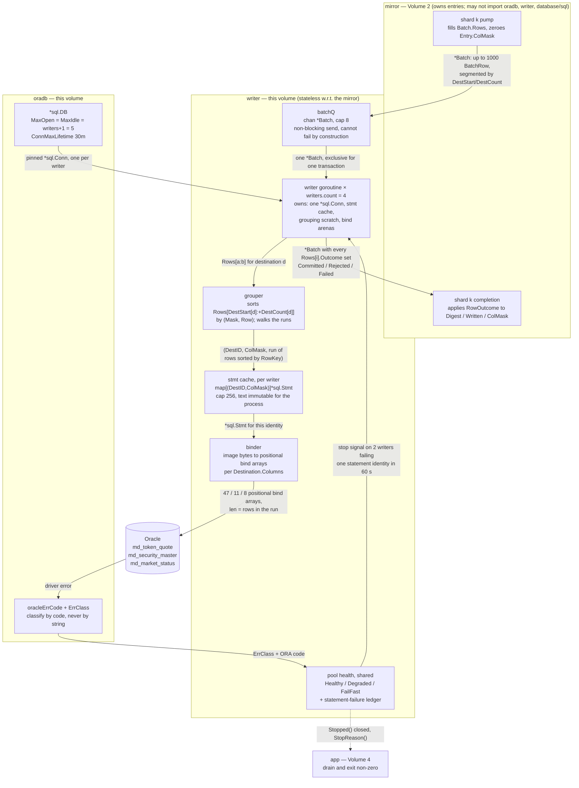
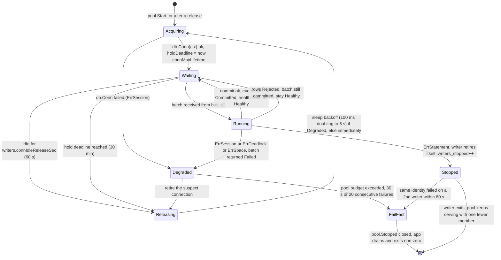
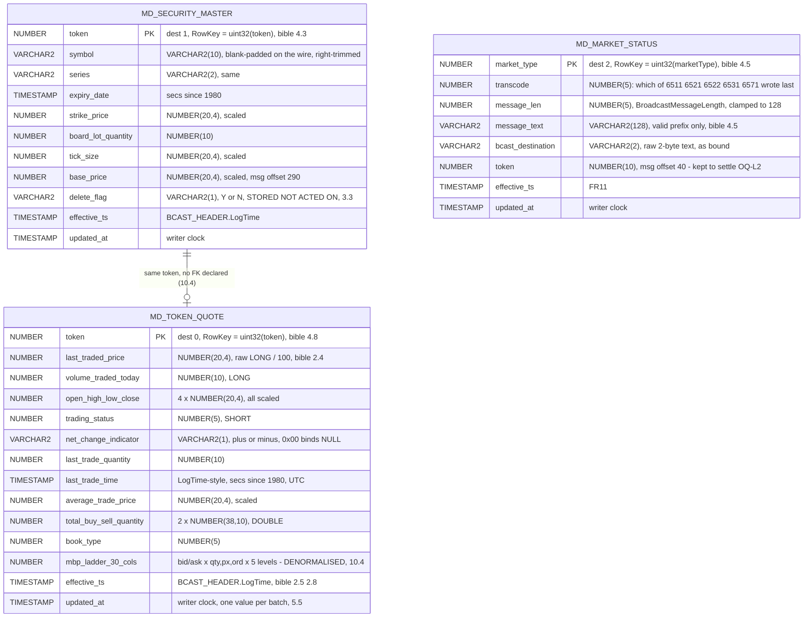
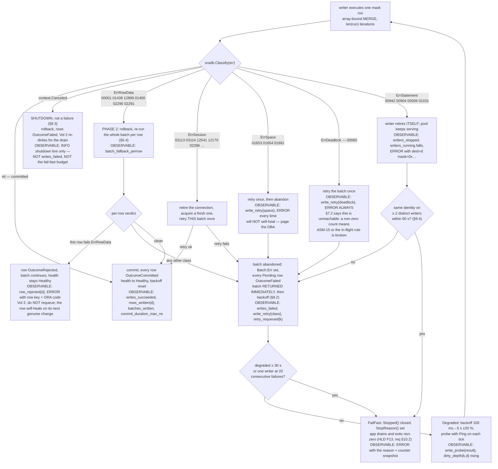

# FeedValve Phase 1 LLD — Volume 3: The Writer Pool and Persistence

**Status:** draft for review
**Binds to:** `docs/lld/00-foundations.md` (Volume 0, the frozen contract) and
`docs/architecture/phase1_hld_design1.md` (the HLD, authoritative).
**Protocol authority:** `ncobrd_bible.md` (the bible).
**Siblings:** Volume 1 (receive/decode), Volume 2 (shard and mirror — **owns the completion path**),
Volume 4 (lifecycle, observability, failure, test).

> **What this volume owns.** Everything downstream of `batchQ`: the writer pool, the Oracle session
> per writer, statement identity and caching, bind construction from `Entry.Image`, array binds,
> transaction boundaries, the Oracle error taxonomy, retry and the pool-stop rule, the DDL, and the
> secret-handling rules on this path.
>
> **What this volume does not own.** The shard main loop, the epoch/flush state machine, and the
> **application** of the per-row outcome vector (Volume 2, defects L1–L4). This volume *produces* the
> vector; it never touches an `Entry`. That is enforced by the package graph: `writer` may not import
> `mirror` (Vol 0 §1.2, §1.3).

---

## Table of contents

- [1. Scope, boundaries and the numbers this volume is sized against](#1-scope-boundaries-and-the-numbers-this-volume-is-sized-against)
- [2. Pool construction and the writer goroutine](#2-pool-construction-and-the-writer-goroutine)
- [3. Statement construction — the actual SQL](#3-statement-construction--the-actual-sql)
- [4. The column mask and statement grouping](#4-the-column-mask-and-statement-grouping)
- [5. Bind construction from the image](#5-bind-construction-from-the-image)
- [6. Array binds and OQ-4: per-row attribution](#6-array-binds-and-oq-4-per-row-attribution)
- [7. Transaction boundaries](#7-transaction-boundaries)
- [8. The Oracle error taxonomy](#8-the-oracle-error-taxonomy)
- [9. Retry, fail-fast and the pool-stop rule](#9-retry-fail-fast-and-the-pool-stop-rule)
- [10. DDL](#10-ddl)
- [11. Security on this path](#11-security-on-this-path)
- [12. Failure and degradation](#12-failure-and-degradation)
- [13. Interface summary](#13-interface-summary)
- [14. Additions to the Vol 0 ledger](#14-additions-to-the-vol-0-ledger)
- [15. Deltas against the HLD](#15-deltas-against-the-hld)
- [16. ADRs](#16-adrs)
- [17. Assumptions](#17-assumptions)
- [18. Open questions](#18-open-questions)

---

## 1. Scope, boundaries and the numbers this volume is sized against

### 1.1 The two boundaries, and what crosses them

This volume begins at `batchQ` and ends at a committed Oracle transaction plus a returned batch. Both
crossings are already frozen in Vol 0 §9.2 and neither is renegotiated here.

| Boundary | Channel | Element | Capacity | Semantics | Who owns the other side |
|---|---|---|---|---|---|
| **In** | `batchQ` (Q2) | `*model.Batch` | `shards × maxInFlightPerShard` = **8**, startup-only | any writer takes any batch; a writer blocks on the receive, which is the only place it may block indefinitely | Vol 2 (shards produce) |
| **Out** | `completionCh[b.Shard]` (Q2c) | the same `*model.Batch`, every `Rows[i].Outcome` filled | `maxInFlightPerShard` = **2** per shard | blocking send that **cannot fill**: one slot per batch that shard can have outstanding | Vol 2 (the owning shard applies the outcomes) |
| **Out** | Oracle | one transaction per batch | — | `MERGE` into three tables in a fixed order | outside our control |

> **Vol 2 owns the completion path.** This volume produces the per-row outcome vector and returns the
> batch. It never touches an `Entry`, never reads `Entry.ColMask`, and cannot: `writer` may not import
> `mirror` (Vol 0 §1.2) and `BatchRow` carries no pointer back to its entry (Vol 0 §3.8). The mask the
> `SET` list is built from is `BatchRow.Mask` and nothing else (Vol 0 §6.4, HLD §8.3) — the rule is
> enforced by the package graph, not by discipline.

**One postcondition this volume adds, stronger than Vol 0 requires.** Vol 0 §3.8 note 2 says a batch
may come back with `Err != nil` and rows still `OutcomePending`, and makes it Vol 2's job to read
those as `OutcomeFailed`. This volume guarantees more: **every row of every returned batch carries a
terminal outcome**, filled by a single deferred function on the writer's batch path (§7.4), including
after a panic. Vol 2 keeps its `Err != nil` rule as the contract; `batch_row_unreported` (Vol 0 §8.2)
should therefore be permanently zero and any non-zero value is a Volume 3 defect.

### 1.2 The numbers

Every figure is either the HLD's (cited) or labelled **(assumed)** with how to measure it. §17
collects the assumptions in one table.

| Quantity | Value | Source |
|---|---|---|
| Expected aggregate write rate | hundreds of rows/s | HLD §4.1 (derived from req §3.3) |
| Ceiling aggregate write rate | ~5,000 rows/s | HLD §4.1 |
| `t_commit`, full batch | **5–20 ms**; plan against 20 | HLD §4.2 |
| `t_commit`, small batch | 3–6 ms | HLD §4.2 |
| Oracle round trip on the LAN | 0.5–2 ms | HLD ASM-5 |
| `flush.maxBatchSize` | 1,000 rows across all three destinations | Vol 0 §7.2 |
| `writers.count` | 4, reloadable 1–32 | Vol 0 §7.2 |
| Pool size | `writers.count + 1` = **5**, derived, live-reapplied | Vol 0 §7.2, delta D9 |
| `db.connMaxLifetimeMinutes` | 30, MUST be under the profile `IDLE_TIME` | Vol 0 §7.2, CLAUDE.md "Database" 4, OQ-8 |
| `db.queryTimeoutSec` | 30 | Vol 0 §7.2 |
| Bind positions, full mask, destination 0 | **47** (§3.2) | derived here |
| Distinct statements expected in the shipped schema | **3** (§4.3) | derived here |

**Writer occupancy, so the pool size can be judged rather than guessed.** At the ~5,000 rows/s
ceiling with 250-row batches that is 20 batches/s. Each batch costs bind construction plus commit:

```
bind, destination 0, full mask, 250 rows
    45 bound columns × 250 rows         = 11,250 conversions
    (16 image fields, of which bit 14 expands to 30 columns — §5.2)
    at ~20 ns each (integer load + swap) ≈ 0.23 ms
  go-ora per-element encode, same count, at ~100 ns *(assumed, ASM-W3)*
                                        ≈ 1.1 ms
  ------------------------------------------------------------
  bind ≈ 1.4 ms   against t_commit 5–20 ms   → bind is ~7–22 % of a batch
```

```
pool occupancy at the 5,000 rows/s ceiling
  20 batches/s × (1.4 ms bind + 20 ms commit)  = 428 ms of work per second
  ÷ 4 writers                                   = 10.7 % busy per writer
```

At the *expected* rate of a few hundred rows/s the pool is under 1 % busy. **The pool is not the
constraint at either rate**; the constraint is Oracle's commit rate, which is exactly what HLD §4.2
says and why `writers` is the documented lever (HLD §7.7, F11) rather than a bigger batch.

### 1.3 What this volume does not solve

- **The shard main loop, the epoch state machine and the application of outcomes** — Vol 2 (defects
  L1–L4). §7.5 states the obligations the outcome vector places on Vol 2 and stops there.
- **The destination column lists.** HLD §8.2 is illustrative and OQ-13 is open. §3 and §10 work the
  illustrative schema through in full, because a design that says "the SQL will be generated from the
  column table" and stops has not been checked against anything. When OQ-13 lands, the *text*
  changes and the *generator* does not.
- **Process exit.** The pool signals FailFast on a channel; `app` (Vol 4) maps that to a drain and an
  exit code. `appLogger.Fatalf` is forbidden here — `os.Exit` skips every `defer`, which would leave
  an Oracle transaction open holding row locks (CLAUDE.md, Vol 0 §10.4).
- **Consumer-side query patterns and therefore secondary indexes.** §10.5 says what we require and
  what the cost of anything more is.

### 1.4 Component decomposition



*Figure 3.1 — Writer pool component decomposition. The two subgraph boundaries are the compile-checked
import rule of Vol 0 §1.3: nothing inside `mirror` may name `database/sql`, and nothing inside
`writer` may name `mirror`. Every edge carries what crosses it; the only two edges that cross the
process's trust boundary are the bind arrays going out and the driver error coming back.*

---

## 2. Pool construction and the writer goroutine

### 2.1 Why writers are sized independently of shards

ADR-005 decoupled the pool from the partitioning: shards own state, writers own sessions, and
`batchQ` is shared so any writer may take any shard's batch. Two consequences bind this volume:

1. **`writers.count` is reloadable up and down** (Vol 0 §7.2) and is the documented remedy for a slow
   write path (HLD §7.7, F11). It must therefore be a live resize, not a restart.
2. **Ordering is not this volume's problem.** FR9 rests on the in-flight rule (HLD §6.7, §8.4 layer
   1): a row is in at most one outstanding batch, so two concurrent transactions hold disjoint row
   sets whichever writers execute them. A writer never needs to know which shard a batch came from
   except to route the completion (`Batch.Shard`, Vol 0 §3.8).

### 2.2 `database/sql` pool settings, with the reason for each

| Setting | Value | Reason | What breaks without it |
|---|---|---|---|
| `SetMaxOpenConns` | `writers.count + 1` = 5, **derived**, re-applied on every accepted reload | Oracle caps concurrent sessions through the instance `sessions`/`processes` parameters (CLAUDE.md "Database" 4, `poc/db.go:34-38`, ASM-10). Deriving it from `writers.count` is Vol 0 delta D9 | A fixed pool smaller than `writers.count` makes the *documented* remedy for a slow write path silently do nothing: the extra writers block forever inside `database/sql`, `writers_busy` never rises, and the operator raises a number that is already too high |
| `SetMaxIdleConns` | same, 5 | Every writer holds a session continuously while it has work. Idling below the writer count makes `database/sql` close and reopen a session between batches — an Oracle logon is an authentication round trip, not a socket accept | Connection churn proportional to the batch rate, and a fresh logon in the latency path of every flush |
| `SetConnMaxLifetime` | `db.connMaxLifetimeMinutes` = 30 min. **MUST be shorter than the Oracle profile's `IDLE_TIME`** | Profiles and stateful firewalls kill idle sessions without telling the client; the *first reuse* of a dead one surfaces as `ORA-03113`/`ORA-03114`. Retiring first turns an error into a reconnect (`poc/db.go:40-45`) | `ORA-03113` becomes routine rather than rare, and every occurrence costs one batch a retry. The validator cannot check the relationship — it is OQ-8, a DBA question |
| `SetConnMaxIdleTime` | **not set** | `ConnMaxLifetime` already bounds every connection including the spare. A second, shorter timer gives two things that can retire a connection and two numbers that both have to stay under `IDLE_TIME` | Nothing breaks; it is a deliberate omission to keep one knob |

**The `+1` spare earns its place concretely, not as padding.** With four writers each holding a
pinned `*sql.Conn`, the fifth connection is what lets any of the following happen without a writer
waiting on the pool: preparing a statement identity seen for the first time (§4.4 — `db.PrepareContext`
borrows a connection), a liveness `Ping`, and the reload path re-applying pool limits. A writer that
had to wait for a connection would look exactly like a slow database and would be attributed to
Oracle.

### 2.3 The connection-per-writer model, and the hole in it

Vol 0 §9.1 gives each writer exclusive ownership of one `*sql.Conn`. That is right — it pins the
session so that a transaction, its prepared statements and its row locks all live on one connection
that no other goroutine can take. But it has a consequence nobody has written down and it defeats the
very mechanism CLAUDE.md invariant 4 relies on:

> **Finding W1 — `ConnMaxLifetime` does not apply to a pinned `*sql.Conn`.** `database/sql` checks
> `driverConn.expired(maxLifetime)` when a connection is **returned to the pool** and when one is
> **taken from it**, and the background cleaner only closes connections on the **free list**. A
> `*sql.Conn` held open by a writer for the whole trading day is on none of those paths, so it is
> never retired. A writer's session can therefore outlive `ConnMaxLifetime` indefinitely — which is
> precisely the state `ConnMaxLifetime` exists to prevent, and the one that surfaces as `ORA-03113` on
> the next use after an idle period.

Under load the session is used every `flush.windowMs` (200 ms) so the profile's `IDLE_TIME` never
elapses. The exposure is the quiet periods: overnight, the weekend, and the hours before the
commodity session opens — exactly when nobody is watching, and exactly when the first write after the
gap is the one that matters.

**Two rules close it, and both live in the writer's select loop:**

> **MUST — bounded hold.** A writer releases its `*sql.Conn` and acquires a fresh one once it has
> held the current one for `db.connMaxLifetimeMinutes`. The release happens **between batches**, never
> with a transaction open. On release, `database/sql` performs the expiry check it could not perform
> while the connection was pinned, discards the connection, and the next acquire opens a fresh
> session. Counted as `writer_conn_recycled`.

> **MUST — idle release.** A writer that has gone `writers.connIdleReleaseSec` **(assumed: 60 s,
> §17 ASM-W1)** without taking a batch releases its connection and re-acquires on the next batch.
> The connection then sits on the pool free list where `ConnMaxLifetime` and the background cleaner
> do apply, so a session is never held idle long enough for the profile to kill it.

The cost of both together is one logon per writer per 30 minutes under load, and one logon per idle
gap. Against 20 batches/s that is unmeasurable. The benefit is that CLAUDE.md invariant 4 becomes
true again for the sessions that actually do the writing.

### 2.4 The writer goroutine



*Figure 3.2 — One writer's lifecycle. The two `Releasing` transitions out of `Waiting` are finding W1's
fix: a pinned connection is never retired by `ConnMaxLifetime`, so the writer retires it itself. Note
that a row rejection never leaves `Running → Waiting` — it does not change writer health, which is
HLD §9.2 Figure 12's "Healthy → Healthy" self-loop made concrete.*

The loop, in words, because the diagram cannot carry the ordering:

1. If health is `Degraded`, sleep the current backoff first — **interruptibly**, on
   `select { case <-time.After(d); case <-ctx.Done(); case <-p.stop: }`. Sleeping here rather than
   while holding a batch is deliberate and is the subject of §9.3.
2. Ensure a connection: if none is held, `db.Conn(ctx)` under `db.connectTimeoutSec`.
3. `select` on `batchQ`, the idle timer, the hold timer, `p.stop` and `ctx.Done()`.
4. On a batch: `writers_busy.Add(1)`, load the config pointer **once** for the whole batch (Vol 0
   §7.4 — timeouts must not change mid-transaction), run the batch (§7), `writers_busy.Add(-1)`.
5. Return the batch on `completionCh[b.Shard]`. This send is blocking and cannot fill (Vol 0 §9.2).
6. Update pool health from the batch's result and loop.

**Shrinking the pool** (`writers.count` lowered by reload) closes a per-writer `quit` channel; the
writer finishes the batch it holds, returns it, releases its connection and exits. **Growing** starts
a goroutine in `Acquiring`. Both re-apply `SetMaxOpenConns`/`SetMaxIdleConns` first, in the order Vol
0 §7.4 fixes for the lifecycle goroutine: validate, swap the config pointer, then apply side effects.

### 2.5 Startup, and one asymmetry worth naming

`OpenDB` pings before returning, so a bad host, a wrong service name or a missing
`FEEDVALVE_DB_PASSWORD` fails at startup rather than on the first write (`poc/db.go:174-179`, CLAUDE.md
"Database" 3). The process exits non-zero with every `defer` intact because startup returns errors
(Vol 0 §7.5, §10.4).

The asymmetry: **a database that is down when FeedValve starts prevents it from starting, while a
database that goes down while FeedValve is running is tolerated for 30 seconds** (HLD §9.2's
fail-fast budget). That is deliberate but it is not obvious, and it is the kind of thing discovered at
03:00 during a maintenance window. ADR-W05 records the decision and the alternative.

### 2.6 Interfaces

```go
package writer

// Pool is the writer pool. It owns writers.count goroutines, their Oracle
// sessions and their statement caches, and the shared health state that the
// fail-fast and pool-stop rules key on.
//
// A Pool holds no mirror state: it may not import mirror (Vol 0 §1.2), so a
// writer cannot reach an Entry even by accident.
type Pool struct { /* unexported */ }

// NewPool builds the pool without starting it and without opening sessions.
// dests supplies the immutable column table (Vol 0 §4.2); statement text for
// every (destination, mask) is generated lazily but from an immutable source,
// so a statement's text never changes for the life of the process (§4.4).
func NewPool(db *oradb.DB, cfg *config.Store, dests *destinations.Table, m *obs.WriterMetrics) (*Pool, error)

// Start launches writers.count goroutines. Each acquires a session lazily, so
// Start does not block on the database; startup reachability is already proven
// by OpenDB's ping (§2.5).
func (p *Pool) Start(ctx context.Context, batchQ <-chan *model.Batch, completion []chan<- *model.Batch) error

// Resize changes the number of running writers, growing by starting goroutines
// and shrinking by signalling members to exit after their current batch. It
// re-applies SetMaxOpenConns/SetMaxIdleConns to writers+1 first (Vol 0 D9).
// Rejects n < cfg.Writers.StatementFailWriters (Vol 0 §7.3 C6).
func (p *Pool) Resize(ctx context.Context, n int) error

// Stopped is closed when the pool has stopped itself — the fail-fast budget or
// the statement pool-stop rule (§9). app (Volume 4) selects on it and turns it
// into a drain and a non-zero exit; this package never calls os.Exit.
func (p *Pool) Stopped() <-chan struct{}

// StopReason returns why Stopped was closed. Nil before it closes.
func (p *Pool) StopReason() error

// Close stops every writer after its current batch, closes cached statements
// and releases sessions. It does not close the *sql.DB, which app owns.
func (p *Pool) Close(ctx context.Context) error
```

```go
package oradb

// Session is one writer's pinned Oracle connection. It exists because
// *sql.DB.BeginTx takes an arbitrary pooled connection, and a writer needs its
// transaction, its prepared statements and its row locks on one session it
// alone can use.
//
// Finding W1 (§2.3): a pinned *sql.Conn is exempt from ConnMaxLifetime, so a
// Session records when it was acquired and Expired reports when the holder must
// release it.
type Session struct { /* unexported: *sql.Conn, acquiredAt, target */ }

// Acquire pins one connection from the pool under ConnectTimeout.
func (d *DB) Acquire(ctx context.Context) (*Session, error)

// Expired reports whether this session has been held for longer than
// ConnMaxLifetime and must be released at the next batch boundary (§2.3).
func (s *Session) Expired(now time.Time) bool

// Release returns the connection to the pool, where database/sql applies the
// expiry check it cannot apply while the connection is pinned.
func (s *Session) Release() error

// ExecTx runs fn inside one transaction on this session, committing if fn
// returns nil and rolling back otherwise. A panic inside fn also rolls back
// before the panic continues to unwind, so a bug in a callback cannot leave a
// transaction open holding row locks (poc/db.go:269-300).
//
// The caller MUST NOT rely on ExecTx to survive the panic: it re-panics. The
// writer's own recover sits outside this call (§7.4).
func (s *Session) ExecTx(ctx context.Context, fn func(context.Context, *sql.Tx) error) error

// Prepare returns a *sql.Stmt prepared on the OWNING *sql.DB, not on this
// session. That is deliberate and is the only form that lets Tx.StmtContext
// reuse a driver cursor instead of re-parsing — see §4.4 and finding W2.
func (d *DB) Prepare(ctx context.Context, text string) (*sql.Stmt, error)
```

## 3. Statement construction — the actual SQL

### 3.1 The form, and why it is not literally HLD §8.3's

Oracle has no `ON CONFLICT`; an upsert is `MERGE INTO … USING dual ON (…) WHEN MATCHED THEN UPDATE …
WHEN NOT MATCHED THEN INSERT …` (CLAUDE.md "Database" 1, `poc/db.go:247`, HLD §8.3, ADR-008). This
volume uses one refinement of that shape, and it is a refinement rather than a contradiction:

```sql
-- HLD §8.3 sketch
MERGE INTO t USING dual ON (rowkey = :1) WHEN MATCHED THEN UPDATE … WHEN NOT MATCHED THEN INSERT …

-- what this volume generates
MERGE INTO t USING (SELECT :1 AS k, :2 AS c1, … FROM dual) s ON (t.k = s.k)
  WHEN MATCHED THEN UPDATE SET t.c1 = s.c1, …
  WHEN NOT MATCHED THEN INSERT (k, c1, …) VALUES (s.k, s.c1, …)
```

**Why.** With the literal `USING dual` form, every value appears **twice** in the statement text —
once in the `SET` list and once in the `VALUES` list — so destination 0's full-mask statement needs
`1 + 46 + 47 = 94` bind positions instead of 47. Naming the source row `s` binds each value once and
references it from both branches.

That is not merely tidier. It removes a real hazard:

> **MUST — no placeholder is ever repeated in a statement's text, and the numbers ascend in order of
> first appearance.** Oracle binds positional placeholders by order of first occurrence, and a
> repeated `:n` is a *second occurrence of the same placeholder*, not a second bind. go-ora only takes
> its named-parameter re-ordering path when the driver arguments carry names
> (`command.go:1703-1705`: `if len(par.Name) == 0 && useNamedPars { useNamedPars = false }`), and
> `database/sql` leaves `Name` empty for positional arguments — so with `:1, :2, …` go-ora sends the
> parameters in argument order and never consults the text. A repeated placeholder would then mean
> the argument list and the placeholder list have different lengths, and every bind after the repeat
> would be off by one. The `USING (SELECT … FROM dual) s` form makes repetition structurally
> impossible rather than a rule somebody has to remember.

Three further constraints the generator must honour, all of them properties of go-ora that are
invisible from the SQL:

- **The text must begin with the keyword `MERGE`.** go-ora decides `stmtType` by uppercasing and
  prefix-matching the *refined* text (`command.go:329-341`), and only `DML` statements get array
  binding. Leading whitespace and `/* … */` comments are stripped by `refineSqlText`
  (`utils.go:59-114`) so a leading newline is safe, but a leading `WITH` or a leading hint written as
  `--` would not be. The generator emits no comments.
- **No string literals in the text.** `refineSqlText` deletes the contents of single-quoted literals
  before the prefix test and before `parseQueryParametersNames`. Nothing in these statements needs a
  literal — every value is bound, including the `'Y'`/`'N'` flags.
- **`t.k` must not appear in the `SET` list.** Oracle forbids updating a column referenced in the
  `ON` clause. The row key is in `ON` and in `INSERT` only, which is also correct semantically: the
  key never changes for a row.

### 3.2 Destination 0 — `md_token_quote`, full mask `0x000000000000FFFF`

Row key `token` (Vol 0 §4.3, bible §4.8). Sixteen image fields; bit 14 is the 120-byte
`MBP_INFORMATION[10]` run and expands to **30** SQL columns (five levels × three attributes × two
sides — `BbBuySellFlag` is discarded because the side is positional, Vol 0 §4.3). Forty-five data
columns plus `updated_at` plus the key: **47 bind positions.**

```sql
MERGE INTO md_token_quote t
USING (SELECT :1  AS token,
              :2  AS last_traded_price,   :3  AS volume_traded_today,
              :4  AS open_price,          :5  AS high_price,
              :6  AS low_price,           :7  AS closing_price,
              :8  AS trading_status,      :9  AS net_change_indicator,
              :10 AS last_trade_quantity, :11 AS last_trade_time,
              :12 AS average_trade_price, :13 AS total_buy_quantity,
              :14 AS total_sell_quantity, :15 AS book_type,
              :16 AS bid_qty_1, :17 AS bid_qty_2, :18 AS bid_qty_3, :19 AS bid_qty_4, :20 AS bid_qty_5,
              :21 AS bid_px_1,  :22 AS bid_px_2,  :23 AS bid_px_3,  :24 AS bid_px_4,  :25 AS bid_px_5,
              :26 AS bid_ord_1, :27 AS bid_ord_2, :28 AS bid_ord_3, :29 AS bid_ord_4, :30 AS bid_ord_5,
              :31 AS ask_qty_1, :32 AS ask_qty_2, :33 AS ask_qty_3, :34 AS ask_qty_4, :35 AS ask_qty_5,
              :36 AS ask_px_1,  :37 AS ask_px_2,  :38 AS ask_px_3,  :39 AS ask_px_4,  :40 AS ask_px_5,
              :41 AS ask_ord_1, :42 AS ask_ord_2, :43 AS ask_ord_3, :44 AS ask_ord_4, :45 AS ask_ord_5,
              :46 AS effective_ts,
              :47 AS updated_at
         FROM dual) s
   ON (t.token = s.token)
 WHEN MATCHED THEN UPDATE SET
       t.last_traded_price   = s.last_traded_price / 100,
       t.volume_traded_today = s.volume_traded_today,
       t.open_price          = s.open_price  / 100,
       t.high_price          = s.high_price  / 100,
       t.low_price           = s.low_price   / 100,
       t.closing_price       = s.closing_price / 100,
       t.trading_status      = s.trading_status,
       t.net_change_indicator= s.net_change_indicator,
       t.last_trade_quantity = s.last_trade_quantity,
       t.last_trade_time     = s.last_trade_time,
       t.average_trade_price = s.average_trade_price / 100,
       t.total_buy_quantity  = s.total_buy_quantity,
       t.total_sell_quantity = s.total_sell_quantity,
       t.book_type           = s.book_type,
       t.bid_qty_1 = s.bid_qty_1, t.bid_qty_2 = s.bid_qty_2, t.bid_qty_3 = s.bid_qty_3,
       t.bid_qty_4 = s.bid_qty_4, t.bid_qty_5 = s.bid_qty_5,
       t.bid_px_1  = s.bid_px_1 / 100,  t.bid_px_2 = s.bid_px_2 / 100, t.bid_px_3 = s.bid_px_3 / 100,
       t.bid_px_4  = s.bid_px_4 / 100,  t.bid_px_5 = s.bid_px_5 / 100,
       t.bid_ord_1 = s.bid_ord_1, t.bid_ord_2 = s.bid_ord_2, t.bid_ord_3 = s.bid_ord_3,
       t.bid_ord_4 = s.bid_ord_4, t.bid_ord_5 = s.bid_ord_5,
       t.ask_qty_1 = s.ask_qty_1, t.ask_qty_2 = s.ask_qty_2, t.ask_qty_3 = s.ask_qty_3,
       t.ask_qty_4 = s.ask_qty_4, t.ask_qty_5 = s.ask_qty_5,
       t.ask_px_1  = s.ask_px_1 / 100,  t.ask_px_2 = s.ask_px_2 / 100, t.ask_px_3 = s.ask_px_3 / 100,
       t.ask_px_4  = s.ask_px_4 / 100,  t.ask_px_5 = s.ask_px_5 / 100,
       t.ask_ord_1 = s.ask_ord_1, t.ask_ord_2 = s.ask_ord_2, t.ask_ord_3 = s.ask_ord_3,
       t.ask_ord_4 = s.ask_ord_4, t.ask_ord_5 = s.ask_ord_5,
       t.effective_ts        = s.effective_ts,
       t.updated_at          = s.updated_at
 WHEN NOT MATCHED THEN INSERT (
       token, last_traded_price, volume_traded_today, open_price, high_price, low_price,
       closing_price, trading_status, net_change_indicator, last_trade_quantity, last_trade_time,
       average_trade_price, total_buy_quantity, total_sell_quantity, book_type,
       bid_qty_1, bid_qty_2, bid_qty_3, bid_qty_4, bid_qty_5,
       bid_px_1,  bid_px_2,  bid_px_3,  bid_px_4,  bid_px_5,
       bid_ord_1, bid_ord_2, bid_ord_3, bid_ord_4, bid_ord_5,
       ask_qty_1, ask_qty_2, ask_qty_3, ask_qty_4, ask_qty_5,
       ask_px_1,  ask_px_2,  ask_px_3,  ask_px_4,  ask_px_5,
       ask_ord_1, ask_ord_2, ask_ord_3, ask_ord_4, ask_ord_5,
       effective_ts, updated_at)
 VALUES (
       s.token, s.last_traded_price / 100, s.volume_traded_today, s.open_price / 100,
       s.high_price / 100, s.low_price / 100, s.closing_price / 100, s.trading_status,
       s.net_change_indicator, s.last_trade_quantity, s.last_trade_time,
       s.average_trade_price / 100, s.total_buy_quantity, s.total_sell_quantity, s.book_type,
       s.bid_qty_1, s.bid_qty_2, s.bid_qty_3, s.bid_qty_4, s.bid_qty_5,
       s.bid_px_1 / 100, s.bid_px_2 / 100, s.bid_px_3 / 100, s.bid_px_4 / 100, s.bid_px_5 / 100,
       s.bid_ord_1, s.bid_ord_2, s.bid_ord_3, s.bid_ord_4, s.bid_ord_5,
       s.ask_qty_1, s.ask_qty_2, s.ask_qty_3, s.ask_qty_4, s.ask_qty_5,
       s.ask_px_1 / 100, s.ask_px_2 / 100, s.ask_px_3 / 100, s.ask_px_4 / 100, s.ask_px_5 / 100,
       s.ask_ord_1, s.ask_ord_2, s.ask_ord_3, s.ask_ord_4, s.ask_ord_5,
       s.effective_ts, s.updated_at)
```

**The `/ 100` is the price scaling of bible §2.4, and it is done by Oracle, not by Go.** §5.3 argues
this at length; the short version is that Oracle `NUMBER` arithmetic is exact decimal, so `2023/100`
is exactly `20.23`, whereas `float64(2023)/100` is `20.229999999999999982…` and would be stored as
such. The divisor is `10^Column.Scale` and is baked into the text at startup from the destination
column table, so a precision change is a configuration change and a new statement text, not a code
change (bible §2.4 warns that v3.5 changed price precision from (6,4) to (7,2), so this *will*
happen again).

### 3.3 Destination 1 — `md_security_master`, full mask `0x00000000000001FF`

Row key `token`. Contributors 7305 and 7340, identical 294-byte structure (Vol 0 §4.4, bible §4.3).
Nine data columns plus `updated_at` plus the key: **11 bind positions.**

```sql
MERGE INTO md_security_master t
USING (SELECT :1  AS token,
              :2  AS symbol,             :3  AS series,
              :4  AS expiry_date,        :5  AS strike_price,
              :6  AS board_lot_quantity, :7  AS tick_size,
              :8  AS base_price,         :9  AS delete_flag,
              :10 AS effective_ts,
              :11 AS updated_at
         FROM dual) s
   ON (t.token = s.token)
 WHEN MATCHED THEN UPDATE SET
       t.symbol             = s.symbol,
       t.series             = s.series,
       t.expiry_date        = s.expiry_date,
       t.strike_price       = s.strike_price / 100,
       t.board_lot_quantity = s.board_lot_quantity,
       t.tick_size          = s.tick_size  / 100,
       t.base_price         = s.base_price / 100,
       t.delete_flag        = s.delete_flag,
       t.effective_ts       = s.effective_ts,
       t.updated_at         = s.updated_at
 WHEN NOT MATCHED THEN INSERT (
       token, symbol, series, expiry_date, strike_price, board_lot_quantity,
       tick_size, base_price, delete_flag, effective_ts, updated_at)
 VALUES (
       s.token, s.symbol, s.series, s.expiry_date, s.strike_price / 100, s.board_lot_quantity,
       s.tick_size / 100, s.base_price / 100, s.delete_flag, s.effective_ts, s.updated_at)
```

**`delete_flag` is stored, not acted on.** Bible §4.3 gives it as `'Y'` deleted, `'N'` active. There
is no `DELETE` statement anywhere in this design: a deleted security keeps its row with
`delete_flag = 'Y'` and every other column at its last known value. Purging is a consumer or DBA
decision and deliberately not ours — deleting the row would destroy the only record that the security
ever existed, on a feed we cannot ask to re-send it (bible §1).

### 3.4 Destination 2 — `md_market_status`, full mask `0x000000000000003F`

Row key `market_type`. Five contributors — 6511, 6521, 6522, 6531, 6571, all
`MS_BCAST_VCT_MSGS` at 320 bytes (Vol 0 §4.5, bible §4.5). Six data columns plus `updated_at` plus
the key: **8 bind positions.**

```sql
MERGE INTO md_market_status t
USING (SELECT :1 AS market_type,
              :2 AS transcode,         :3 AS message_len,
              :4 AS message_text,      :5 AS bcast_destination,
              :6 AS token,             :7 AS effective_ts,
              :8 AS updated_at
         FROM dual) s
   ON (t.market_type = s.market_type)
 WHEN MATCHED THEN UPDATE SET
       t.transcode         = s.transcode,
       t.message_len       = s.message_len,
       t.message_text      = s.message_text,
       t.bcast_destination = s.bcast_destination,
       t.token             = s.token,
       t.effective_ts      = s.effective_ts,
       t.updated_at        = s.updated_at
 WHEN NOT MATCHED THEN INSERT (
       market_type, transcode, message_len, message_text, bcast_destination,
       token, effective_ts, updated_at)
 VALUES (
       s.market_type, s.transcode, s.message_len, s.message_text, s.bcast_destination,
       s.token, s.effective_ts, s.updated_at)
```

`transcode` is the *contributing* code and is how a reader tells `Open` from `Closed`: the five codes
share one row per `market_type` and differ only in which wrote it last (Vol 0 §4.5, bible §4.5).
`token` is stored because the message carries one at offset 40 and we do not know whether it is
meaningful on this circuit — that is OQ-L2, and storing it costs one `NUMBER(10)` and settles the
question from production data rather than from a capture.

### 3.5 What a partial mask changes, and what it does not

A statement for a mask with bits cleared is the same text with those columns removed from all four
lists — the `USING` select, the `SET` list, the `INSERT` column list and the `VALUES` list — and the
remaining bind positions renumbered to stay contiguous and ascending. The key and `updated_at` are
always present: the key because `ON` needs it, `updated_at` because R4 makes it unmasked and derived
(Vol 0 §4.1).

**A column absent from the statement is untouched on a matched row and `NULL` on an inserted one.**
That is the entire reason the statement is keyed by mask. It is also why `Entry.Written` exists (Vol 0
§5.3, ADR-L04): a column no statement has ever named is `NULL` in Oracle regardless of what the image
holds, and the suppression predicate's fourth clause is what stops a first-ever write being
suppressed.

**One case the generator must reject rather than emit.** A mask of zero cannot produce a statement —
there is nothing to set, and a `MERGE` whose `UPDATE` branch has an empty `SET` list is a syntax
error (`ORA-00936`, the exact error CLAUDE.md warns points nowhere near its cause). A `BatchRow` with
`Mask == 0` is a Volume 2 defect — the pump only batches dirty rows and a dirty row has at least one
bit — so the writer counts `batch_row_empty_mask{destination}`, marks that row `OutcomeRejected` (not
`Failed`: retrying an empty mask produces an empty mask), logs once per interval, and continues with
the rest of the batch. A silent skip here would look exactly like a row that stopped updating, which
is the hardest class of bug to find in production (Vol 0 §6.3).

---

## 4. The column mask and statement grouping

### 4.1 Statement identity

> **Frozen in Vol 0 §6.4: statement identity is the pair `(DestID, ColMask)`.** It is the grouping key
> of HLD §8.3, the value carried in `oradb.Error.Stmt`, and the key the two-writer pool-stop rule of
> HLD §9.2 counts on. All three must agree, which is why it is frozen there and only *used* here.

Rendered form, for logs and counter labels: `dest=0 mask=0x000000000000ffff` — fixed width, sixteen
hex digits, lower case, no statement text. Three reasons the label is the identity and not the text:
a destination-0 statement is roughly 4 KB and would dominate any log line it appeared in; the text
contains column names that a reader would have to diff to spot the difference; and the identity is
what the pool-stop ledger keys on, so a log line and a counter must be greppable against each other.

```go
package writer

// stmtKey is a statement identity: one destination and one column mask
// (Vol 0 §6.4). Comparable, 16 bytes, usable as a map key with no allocation.
type stmtKey struct {
    Dest model.DestID
    _    [7]byte    // explicit pad; Vol 0 §2 rule 6
    Mask model.ColMask
}

// String renders "dest=0 mask=0x000000000000ffff". This exact form appears in
// oradb.Error.Stmt, in the pool-stop ledger and in every write-failure log
// line, so the three can be grepped against each other.
func (k stmtKey) String() string
```

### 4.2 Grouping: how a flat batch becomes statements

ADR-L05 replaced HLD §8.3's `[3]map[ColMask][]row` with a flat `Batch.Rows` plus
`DestStart`/`DestCount`, and made grouping the writer's job using a **writer-owned reusable scratch**.
The procedure, per batch:

```
for d := DestID(0); d < 3; d++ {                 // FIXED global order, §7.2
    seg := b.Rows[b.DestStart[d] : b.DestStart[d]+b.DestCount[d]]
    sort seg by (Mask ascending, Row ascending)  // writer scratch, no allocation
    for each maximal run of equal Mask in seg {
        key  := stmtKey{Dest: d, Mask: run[0].Mask}
        stmt := writer.stmtCache.get(key)        // prepare on miss, §4.4
        bind  arrays from run                    // §5, rows already ascending by key
        exec  once with len(run) array iterations
    }
}
```

Two properties follow and both are load-bearing:

- **Rows inside a run are ascending by `RowKey`.** That is the row-ordering half of HLD §8.3's
  acquisition rule, and §7.2 shows it is also what makes the lock order a *total* order rather than a
  per-destination one.
- **Runs are walked in ascending `ColMask`.** That is not cosmetic either: see §7.2.

**The sort is a comparison sort on ≤ 1,000 rows** — `O(n log n)`, microseconds, against a 5–20 ms
commit (ADR-L05). It runs on the writer, never on the shard, which is the point: the shard's stalls
propagate back to the receive path and the writer's do not (HLD §6.6, §7.8). The scratch is a
`[]int32` of permutation indices sized at `maxBatchSizeCeiling` and allocated once per writer, so the
sort moves 4-byte indices and not 288-byte `BatchRow` values.

### 4.3 How many distinct statements can exist — the honest bound

The theoretical space is `3 × 2^64`. That number is useless and quoting it as if it were a risk is a
way of not answering the question. There are three bounds and they are very far apart.

**Bound 1 — structural.** `BatchRow.Mask` is `Entry.ColMask` at pump time, which is the OR of every
`Contribution.Mask` merged since the row was last batched (Vol 0 §6.2 steps 2 and 4). A
`Contribution.Mask` is normally exactly its transcode's configured `ColSpec.Mask`, which is fixed at
startup. So a destination with `C` contributors, each with a distinct column set, can produce at most
the non-empty unions of those sets:

```
distinct masks per destination  ≤  2^C − 1
with maxContributors = 8 (Vol 0 §3.0, ADR-L03):   ≤ 255
across three destinations:                        ≤ 765 statements
```

**Bound 2 — the shipped schema.** In HLD §8.2's instantiation every co-contributor to a destination
supplies the *same* column set: 7305 and 7340 are the same 294-byte structure (bible §4.3), and the
five market-status codes are the same 320-byte structure (bible §4.5). Destination 0 has one
contributor. So the union of any subset of contributors is the same single mask, and:

```
distinct masks, destination 0 (7208 alone)                          = 1
distinct masks, destination 1 (7305, 7340 — identical column sets)  = 1
distinct masks, destination 2 (5 codes — identical column sets)     = 1
                                                             total  = 3 statements
```

**Bound 3 — what could move it off 3, listed so nobody is surprised.** A decoder that *clears* a bit
for a field the message left absent (Vol 0 §6.1 permits this) multiplies the mask count by the number
of optional-field combinations it produces. If, say, 7305 sometimes omits `strike_price`, destination
1 goes from 1 statement to 2. This is the only realistic growth path and it is bounded by the number
of optional fields, not by 2^64.

**Therefore the cache is capped rather than unbounded, and the cap is an alarm rather than a
mechanism:**

> `writers.stmtCacheSize`, default **256** **(assumed, §17 ASM-W2)**. The expected occupancy is 3 and
> the structural ceiling at `maxContributors = 8` is 765. On a miss with a full cache the writer
> prepares, executes and closes the statement **without caching it**, counts `stmt_cache_uncached`,
> and logs once per `stats.eventRatePerMin` bucket. Correctness is unaffected — the cost is one soft
> parse per execution. The gauge `stmt_cache_entries{writer}` is what tells an operator the mask space
> is not behaving as §4.3 predicts, and a value above about 20 is worth investigating even though
> nothing is broken.

No LRU, no eviction list. An LRU would add a doubly-linked list and a per-execution list splice to
manage a set whose expected size is three. The refuse-to-cache behaviour degrades in the right
direction and makes itself visible.

### 4.4 Preparation and its lifetime — and why the obvious pattern silently does not work

> **Finding W2 — `Tx.StmtContext` re-prepares a statement that was prepared on a `*sql.Conn`.**
> The obvious pattern for a writer that owns a pinned connection is
> `conn.PrepareContext(…)` once, then `tx.StmtContext(ctx, st)` per transaction. It compiles, it
> works, and it re-parses on every single execution.
>
> `database/sql`'s `Tx.StmtContext` branches on `stmt.cg != nil` — "already belongs to a connection
> group" — and in that branch calls `ctxDriverPrepare` unconditionally, producing a **fresh driver
> statement** every time. A `*sql.Stmt` from `Conn.PrepareContext` has `cg` set to that `*sql.Conn`,
> so it always takes that branch. The reuse branch, which searches `stmt.css` for a driver statement
> already prepared on this connection, is reachable **only** for a statement created by
> `DB.PrepareContext`, whose `cg` is nil.
>
> With go-ora the symptom is not an extra round trip — `Connection.PrepareContext` merely constructs a
> `Stmt` struct locally (`connection.go:1199-1206`) and the parse rides along with the execute in one
> `OALL8` — so nothing looks slow. The symptom is that `stmt.parse` is `true` on every execution,
> the SQL text is re-sent every time, and the server does a **soft parse per execution**: library
> cache latch traffic, `parse count (total)` climbing at the batch rate, and a statement that never
> reaches the "held cursor" state the design assumed it was in.

**Decision (ADR-W02): prepare on the `*sql.DB`, execute through `tx.StmtContext`.**

```
st := db.PrepareContext(ctx, text)     // cg == nil; borrows the +1 spare connection briefly
…
tx := session.BeginTx(ctx)             // on the writer's pinned *sql.Conn
txSt := tx.StmtContext(ctx, st)        // finds st.css entry for THIS conn and reuses the cursor
txSt.ExecContext(ctx, binds…)
```

On first use for a given `(statement, connection)` pair, `database/sql` prepares and records it in
`st.css`; thereafter `tx.StmtContext` reuses the same `*go_ora.Stmt`, whose `stmt.parse` was set
`false` after its first successful execution (`command.go:1761`). The SQL text is then sent **once per
statement per connection**, not once per execution.

**Lifetime, stated precisely:**

| Event | What happens to cached statements |
|---|---|
| Writer's connection recycled (§2.3) or retired after a session error | Nothing explicit. `database/sql` prunes the dead connection's `css` entry and re-prepares lazily on the new one. The `*sql.Stmt` object and our cache entry survive |
| Configuration reload | **Nothing, ever.** The destination column list is startup-only (Vol 0 §7.2, delta D6), so a statement's text cannot change while the process runs. That is a property worth having explicitly: **statement text is immutable for the life of the process** |
| Writer exits (pool shrink, statement-class failure, shutdown) | The writer closes every `*sql.Stmt` it created, which releases its `DB`-level dependency. Failing to do this leaks a `*sql.Stmt` per identity per stopped writer |
| Cache full | Prepare, execute, `Close` immediately, count `stmt_cache_uncached` (§4.3) |

**The cache is per writer, not pool-wide.** Vol 0 §9.1 already assigns "its prepared-statement cache"
to the writer's exclusive state, and keeping it there means a plain `map` with no mutex on a path
executed a few times per batch. The cost is `writers.count` copies of each `*sql.Stmt` wrapper — a few
dozen objects at the shipped schema — and each carries exactly one `css` entry because only its owning
writer ever uses it. The pool-stop rule does **not** need a shared statement object: it keys on the
identity *value* `(DestID, ColMask)` in a separate shared ledger (§9.4).

**Where the +1 spare is consumed.** `DB.PrepareContext` borrows a pooled connection for the duration
of the prepare and returns it. With four writers holding pinned connections, that borrow takes the
fifth. Two writers preparing simultaneously serialise on it for microseconds, because for go-ora a
prepare is local construction and no round trip. This is the concrete answer to "what is the spare
for" (§2.2).

---

## 5. Bind construction from the image

This is the join between Vol 0 §4's field maps and Oracle. The image holds **wire form** — big-endian,
wire width, unscaled, untrimmed (Vol 0 §4.1 R1, ADR-L01) — and every conversion happens here, once per
written row per flush, on a goroutine that is otherwise blocked on I/O.

### 5.1 The binder and its arena

```go
package writer

// Binder turns the masked fields of a run of BatchRows into positional bind
// arrays for one statement identity. One Binder per (writer, stmtKey), created
// with the statement and reused for the life of the process.
//
// Every slice it owns is allocated once at maxBatchSizeCeiling and re-sliced to
// the run length on each use; nothing here allocates in steady state except the
// interface boxing of one slice header per bind position (§5.6).
type Binder struct { /* unexported: typed column arenas + the []any arg slice */ }

// NewBinder builds the bind plan for one statement identity from the
// destination's immutable column table (Vol 0 §4.2): for each set bit of mask,
// in ascending bit order, the image offset, the width, the ColKind, the scale
// and the bind positions its SQL columns occupy.
func NewBinder(d *destinations.Destination, mask model.ColMask, ceiling int) (*Binder, error)

// Bind fills the arena from rows and returns the positional argument slice,
// len == the statement's bind count, each element a CONCRETELY TYPED slice of
// exactly len(rows) (§5.6 notes 2 and 4). Position 1 is rows[i].Row, the last
// position is updatedAt — the SAME value for every row of one batch (§5.5).
//
// args is owned by the Binder and is valid only until the next call to Bind on
// the same Binder. A writer executes one statement at a time, so that is exactly
// the lifetime needed.
func (b *Binder) Bind(rows []model.BatchRow, updatedAt time.Time) (args []any, err error)

// BindRow is the phase-2 form: scalar arguments for one row, so that go-ora
// leaves arrayBindCount at zero and the same *sql.Stmt executes normally
// (§6.4). Same bind plan, same positions, same statement.
func (b *Binder) BindRow(row *model.BatchRow, updatedAt time.Time) (args []any, err error)
```

### 5.2 The conversion table

`Kind` is `destinations.ColKind` (Vol 0 §4.2). "Image read" is over `row.Image[off : off+width]`.

| `ColKind` | Width | Image read | Bind Go type | Oracle column | Where the presentation happens | Can it fail? |
|---|---|---|---|---|---|---|
| `KindLong` | 4 | `int32(binary.BigEndian.Uint32(img[off:]))` | `int64` | `NUMBER(10)` | — | no |
| `KindLong` + `Scale>0` | 4 | same | `int64` (the **raw** integer) | `NUMBER(20,4)` | `/ 10^Scale` **in the SQL text** (§5.3) | no in Go; `ORA-01438` if the column is too narrow |
| `KindShort` | 2 | `int16(binary.BigEndian.Uint16(img[off:]))` | `int64` | `NUMBER(5)` | — | no |
| `KindChar1` | 1 | `img[off]` | `sql.NullString`, 1 char; **`Valid=false` when the byte is `0x00`** | `VARCHAR2(1)` | R6's in-band absent encoding | no |
| `KindDouble` | 8 | `math.Float64frombits(binary.BigEndian.Uint64(img[off:]))` | `sql.NullFloat64` | `NUMBER(38,10)` | — | **yes** — NaN and ±Inf have no Oracle `NUMBER` representation (§5.4) |
| `KindText` (R5) | 2+n | `n2 := min(BigEndian.Uint16(img[off:]), n)`; then `img[off+2 : off+2+n2]` | `sql.NullString` | `VARCHAR2(n)` | `TrimRight " "` (bible §2.6) | no; over-long lengths were already clamped at merge (Vol 0 §4.5) |
| `KindTextFixed` | n | whole `img[off:off+n]` | `sql.NullString` | `VARCHAR2(n)` | `TrimRight " "`; an all-blank or all-zero field binds `NULL` | no |
| `KindTime1980` | 4 | `s := int32(BigEndian.Uint32(img[off:]))` | `sql.NullTime` | `TIMESTAMP` (UTC) | `time.Unix(int64(s)+offset, 0).UTC()`; `s <= 0` binds `NULL` (§5.5) | **yes** — a negative or absurd `s` (§5.4) |
| `KindGroup` (MBP) | 120 | 10 records × 12 B, `Quantity LONG@0`, `Price LONG@4`, `NumberOfOrders SHORT@8` (bible §4.8) | expands to **30** binds: `int64`, `int64` (raw, scaled in SQL), `int64` | mixed | positional side and level; `BbBuySellFlag` discarded (Vol 0 §4.3) | no |
| row key (not an image field, R3) | — | `row.Row`, decoded per `Destination.Key` | `int64` | `NUMBER(10)` PK | zero-extended low 32 bits (Vol 0 §3.2) | no |
| `updated_at` (not an image field, R4) | — | writer's clock | `time.Time` | `TIMESTAMP` (UTC) | one value per **batch** (§5.5) | no |

**The MBP group expansion, spelled out because it is thirty of the forty-seven binds.** Bit 14's 120
bytes are ten 12-byte `MBP_INFORMATION` records: five best buys then five best sells (bible §4.8).
Record `i` at image offset `57 + 12*i`. The bind order is the SQL column order declared in
`Column.SQL` (Vol 0 §4.2), which §3.2 fixes as all five bid quantities, then all five bid prices,
then all five bid order counts, then the same three for the ask side:

```
bid_qty_j   = LONG  at 57 + 12*(j-1) + 0     j = 1..5
bid_px_j    = LONG  at 57 + 12*(j-1) + 4     (raw; /100 in SQL)
bid_ord_j   = SHORT at 57 + 12*(j-1) + 8
ask_qty_j   = LONG  at 57 + 12*(j+4) + 0
ask_px_j    = LONG  at 57 + 12*(j+4) + 4     (raw; /100 in SQL)
ask_ord_j   = SHORT at 57 + 12*(j+4) + 8
                     ^^ bytes 10-11 of each record are BbBuySellFlag and are not read
```

The side is positional, which is why `BbBuySellFlag` is dropped. If a capture ever shows records
arriving in an order other than five buys then five sells, this mapping is silently wrong for every
row — so **the differential test against `poc`'s `-debug` field trace (HLD §10.4) must cover a
two-sided ladder**, not just a one-sided one. Named here because it is the only place in the bind
layer where a wrong answer looks entirely plausible.

**One cross-field dependency, and the Vol 0 gap it exposes.** Destination 2's `message_text`
(`KindText`, bit 2) takes its valid length from `message_len` (bit 1), a *different* image field
(Vol 0 §4.5: "`message_len` is stored so the writer can bind the prefix without scanning for a
terminator — bible §2.6 is explicit that there is no NUL terminator and a `strlen`-style read is a
bug"). Vol 0 §4.2's `Column` struct has no field expressing "my length comes from bit *j*". §14 adds
`Column.LenBit int8`. Until it exists, the binder cannot be generated from the column table and would
have to special-case destination 2, which is exactly the kind of hand-written exception that survives
a schema change and then produces garbage.

### 5.3 Price scaling: Oracle does the divide, not Go

Bible §2.4: every price is an integer scaled by the contract's precision, and **v3.5 changed that
precision from (6,4) to (7,2)**. Vol 0 §4.2's `Column.Scaled bool` says the division happens "at bind
time"; this volume makes *where* precise.

| Option | Exactness | Cost | Verdict |
|---|---|---|---|
| **Bind the raw `int64`, divide by an integer literal in the SQL** | **exact.** Oracle `NUMBER` is decimal, so `2023/100` is exactly `20.23` | zero — the divisor is a literal in a statement parsed once | **chosen** |
| Bind `float64(raw)/10^s` | **not exact.** `2023/100.0` is `20.229999999999999982…` in binary64, and go-ora encodes what it is given. Every price column would carry that error and every consumer would have to round | one divide per value | rejected |
| Bind a decimal string, e.g. `"20.23"` | exact | a `strconv.AppendFloat` and a string allocation per value — 11,250 per destination-0 batch | rejected on allocation alone |
| Bind raw and let consumers scale | exact, but pushes a protocol detail into every consumer and contradicts HLD §8.2, which labels these columns "scaled" | zero | rejected |

The divisor is `10^Column.Scale`, baked into the statement text at startup. Vol 0 §4.2 declares
`Scaled bool` and not the scale itself; §14 adds `Column.Scale uint8`, defaulting to **2** per bible
§2.4's v3.5 value.

> **Named gap, not buried: the broadcast does not carry the contract's precision.** Bible §2.4 says
> "the contract's precision", implying it varies per contract, and nothing in `MS_SECURITY_UPDATE_INFO`
> (bible §4.3) is a precision field. We therefore apply a single configured scale to every price
> column of every contract. If precision genuinely varies per contract on this segment, every price
> for the contracts that differ is wrong by a factor of ten or a hundred — a loud, obvious error
> rather than a subtle one, which is the only good thing about it. OQ-W1.

### 5.4 Which conversions can fail, and what happens

Only two can, and neither is a Go error return — both bind `NULL` and count, because the alternative
is failing a whole batch over one field the exchange sent oddly.

| Case | Detection | Action | Instrument |
|---|---|---|---|
| `KindDouble` value is NaN or ±Inf | `math.IsNaN \|\| math.IsInf` | bind `NULL` | `bind_nonfinite{destination,column}` (new, §14) |
| `KindTime1980` seconds `<= 0` | `s <= 0` | bind `NULL` — `s == 0` is R6's "never set" and `s < 0` is pre-1980 and cannot be a real `LogTime` | `bind_bad_time{destination,column}` (new, §14) |
| `KindTime1980` seconds absurdly large (year > 2100) | `s > 3_786_912_000` | bind `NULL`, log once per interval | `bind_bad_time{…}` |

Everything else is a load and a byte swap and **cannot fail**: the image is a fixed-width array, the
offsets come from the immutable column table, and Vol 0 §4.7's `-selfcheck` gate has already proven
`Σ width ≤ imageSize`. A read past the end of `Image` is therefore impossible by construction rather
than by a bounds check, and that is deliberate — a bounds check here would be dead code that nobody
could ever test.

**A panic during binding is still possible** (a column table corrupted by a bug, not by data), and §7.4
specifies the recovery. It is the reason the writer's recover sits *outside* `ExecTx`, which re-panics.

### 5.5 Time, NULL and the three things that are easy to get wrong

**Epoch.** Bible §2.5: all time fields are seconds since midnight 1 January 1980, Unix offset
**315,532,800**. `effective_ts` and `last_trade_time` are therefore
`time.Unix(int64(s) + runtime.time1980UnixOffsetSec, 0).UTC()`.

> **Named gap: is the exchange's 1980 epoch anchored in UTC or IST?** The bible gives the offset as a
> *Unix* offset, and 315,532,800 is exactly 3,652 days — so read literally it anchors the epoch at
> 1980-01-01T00:00:00 **UTC**. NSE systems conventionally run in IST. If the stamp is IST-anchored,
> every `effective_ts` we store is 5 h 30 m off, consistently and invisibly. The bible cannot settle
> it (OQ-W2). Two mitigations, both cheap: the offset is **configuration**
> (`runtime.time1980UnixOffsetSec`, default 315532800, §14) so a correction is a reload rather than a
> rebuild; and Volume 1 should compare the first `BCAST_HEADER.LogTime` of a session against
> `time.Now()` and log a WARN if they differ by more than an hour, which makes a 5 h 30 m error
> announce itself on the first datagram. **That check belongs to Vol 1/health and is handed off, not
> designed here.**

**`updated_at` is one value per batch, not per row.** `time.Now().UTC()` is read once when the writer
takes the batch and bound identically into every row of every destination. That makes "which rows did
this transaction write?" a single-predicate question, and it costs one clock read per batch instead of
one per row. It is also one of the exactly three places this design touches the wall clock (Vol 0
§10.2).

**Columns are `TIMESTAMP`, and the stored value is UTC with nothing to say so.** `TIMESTAMP WITH TIME
ZONE` would make it explicit for two more bytes per value and is the DBA's call (§10.5). The DDL
carries a comment; the comment is not enforcement, and this is recorded as a known ambiguity rather
than solved.

**NULL is bound in exactly four situations and nowhere else:**

1. A `KindChar1` byte is `0x00` — R6's in-band "never set" for `delete_flag`, `net_change_indicator`,
   `permitted_to_trade`. In practice unreachable when the bit is set in the mask, because a
   contribution that set the bit wrote a real character; it is defensive.
2. A `KindText`/`KindTextFixed` field trims to the empty string. Oracle treats `''` as `NULL` anyway,
   so binding `NULL` explicitly removes an inconsistency rather than creating one.
3. A `KindTime1980` field is `<= 0` (§5.4).
4. A `KindDouble` field is non-finite (§5.4).

A column **absent from the mask** is not NULL-bound — it is absent from the statement entirely, which
is the difference between "we know it is nothing" and "we have nothing to say about it" (§3.5).

### 5.6 What go-ora requires of the bind values, and the two traps

These are properties of the driver, not of SQL, and each one is a compile-clean runtime failure if
ignored.

1. **Every bind position must be a slice, or none may be.** `command.go:1690-1695`: once
   `arrayBindCount > 0`, a non-array parameter returns
   `"to activate bulk insert/merge all parameters should be arrays"`. So the per-batch constants —
   `updated_at` above all — are bound as slices of length `n` with the same value repeated, not as
   scalars. The alternative (a scalar `updated_at` alongside 46 arrays) fails at runtime with an error
   that names neither the position nor the column.
2. **`arrayBindCount` is the minimum length across all parameters** (`command.go:1621-1627`). A
   short slice silently truncates the statement to fewer rows and the rows past it are never written,
   with no error. The `Binder` therefore re-slices **every** arena to exactly `len(rows)` and a
   `-selfcheck`-style assertion checks all lengths are equal before the exec. This is the single
   most dangerous silent failure in the bind layer: it loses writes and reports success.
3. **`[]byte` is explicitly excluded from array detection** (`command.go:1619`:
   `tempType != reflect.TypeOf([]byte{})`). Nothing here binds `[]byte`, and nothing should start to:
   text columns are `[]sql.NullString`, never `[][]byte`. A `RAW` column would need `go_ora.NewBatch`.
4. **The first element's Go type fixes the bind type for the whole array** —
   `setDataType` returns early once `par.DataType > 0` (`parameter_encode.go:15-17`) and the loop
   reuses the same `ParameterInfo`. This is why every arena is a **concretely typed slice**
   (`[]int64`, `[]sql.NullString`, `[]sql.NullTime`, `[]sql.NullFloat64`) and never `[]any`: an
   untyped `nil` in an `[]any` would type the whole column as `NCHAR` (`parameter_encode.go:20-23`).
   `sql.Null*` is supported — it satisfies `driver.Valuer`, which `getValue` unwraps
   (`value_getter.go:15-28`) — and its zero-value `Valid=false` types correctly because
   `setDataType` matches on `tyNullString`/`tyNullTime`/`tNullNumber`
   (`parameter_encode.go:28-44`).
5. **An all-NULL text column in one run is an untested edge.** With every element invalid,
   `maxLen` stays 0 and the parameter is sent as `NCHAR` with `MaxLen 0` (`command.go:1657-1689`).
   Whether the server accepts a zero-max-length bind is unverified. It requires every row of one
   mask group to have an unset `delete_flag` or `net_change_indicator`, which §5.5 note 1 argues is
   already unreachable — but it is on the OQ-4 spike's checklist (§18) rather than assumed away.

**Allocation cost, since ADR-006 makes allocation a first-class concern elsewhere.** Array binding is
what keeps it small: one interface box per **bind position** per execution (a slice header into `any`,
~24 B), not one per value. Destination 0 at full mask is 47 boxes per execution; at 20 executions/s
that is ~940 allocations/s of 24 bytes ≈ **23 KB/s**. go-ora's own `make([][]byte, arrayBindCount)`
per parameter is larger — 47 × 250 = 11,750 encoded values per batch — and is inside the driver and
not ours to remove. Both are on the writer goroutine, which is blocked on I/O for 5–20 ms per batch;
neither touches the receive path, where ADR-006's rule applies.

---

## 6. Array binds and OQ-4: per-row attribution

HLD OQ-4 asks whether `go-ora` "supports array binds in a transaction with per-row affected counts
(ASM-6)", and Vol 0 §13 calls it *"the highest-value open item for the LLD"* because Vol 2's
three-outcome completion path depends on the answer. **It is now answered from the driver source, and
the answer is split.**

### 6.1 Finding: array binds yes, attribution no — and the data is on the wire

Read against `github.com/sijms/go-ora/v2@v2.9.0`, the version pinned in `go.mod`.

**(a) Array binds are supported, for `MERGE`, inside a transaction, with no special API.**
`NewStmt` sets `stmt.bulkExec = true` for any statement whose refined, uppercased text begins
`INSERT`, `MERGE`, `UPDATE` or `DELETE` (`command.go:331-336` — `MERGE` is named explicitly). If every
bind value is then a non-`[]byte` slice, `_exec` sets `arrayBindCount` to the minimum length
(`command.go:1616-1627`), the execute descriptor carries the iteration count
(`command.go:152-160`, `al8i4[1] = arrayBindCount` at `command.go:180-184`), and nothing in that path
depends on autocommit — so it works identically inside a `*sql.Tx`. **ASM-6's first half holds.**

**(b) Per-row results are sent by the server and parsed by the driver.** Two separate mechanisms, both
present:

```
per-element affected counts
  command.go:884-897   if session.TTCVersion >= 7 && stmt.stmtType == DML && stmt.arrayBindCount > 0 {
                           length, err := session.GetInt(4, true, true)
                           // for (int index = 0; index < length3; ++index)
                           //     rowsAffectedByArrayBind[index] = this.m_marshallingEngine.UnmarshalSB8();
                           for i := 0; i < length; i++ {
                               _, err = session.GetInt(8, true, true)      // <-- value DISCARDED
                           }
                       }

per-element bind errors (OCI batch-error mode, enabled by al8i4[9] = 0x4000, command.go:183)
  network/summary_object.go:3-7     type BindError struct { errorCode int; rowOffset int; errorMsg []byte }
  network/summary_object.go:157-241 parses errorCode[], rowOffset[] and errorMsg[] into
                                    SummaryObject.bindErrors
```

**(c) The driver then throws both away.** The affected counts are read into `_`. The bind errors are
stored in an **unexported** field of `network.SummaryObject` with no accessor, and `NewSummary`
collapses them:

```go
// network/summary_object.go:259-262
if len(result.bindErrors) > 0 && result.RetCode == 24381 {
    result.RetCode     = result.bindErrors[0].errorCode   // first failing row only
    result.ErrorMessage = result.bindErrors[0].errorMsg
}                                                          // every rowOffset is dropped
```

`ORA-24381` is "error(s) in array DML" — the error Oracle raises in batch-error mode when at least one
iteration failed. The caller therefore receives a single `*network.OracleError` carrying the **first**
failing row's ORA code and message, with no row offset, no count of how many rows failed, and no
`Result` at all (`_exec` returns `nil, err`). `oracleErrCode(err)` (`poc/db.go:412-418`) extracts that
code correctly, which is why the taxonomy of §8 still works — but it is a *batch-level* verdict.

**(d) There is no way to reach the discarded data from outside the driver.**
`network.SummaryObject.bindErrors` and `BindError`'s fields are unexported; `go_ora.Connection.session`
is unexported (`connection.go:89`) and no exported method on `Connection` returns the summary; and
`sql.Conn.Raw` yields only the `*go_ora.Connection`. Reflection into another module's unexported
fields is not a design, it is a hostage situation.

> **OQ-4, answered: `go-ora` v2.9.0 supports array binds for `MERGE` inside a transaction, and cannot
> attribute a failure to a row. The information exists on the wire and inside the driver; it is
> discarded at `command.go:892` and `network/summary_object.go:259-262`.**

### 6.2 What that does *not* mean

It does **not** mean Vol 2's three-outcome path collapses to two. That conclusion would follow only if
array binding were the *only* way to execute, and it is not. §6.4 specifies a two-phase execution that
recovers full per-row attribution using nothing but the driver's existing scalar path — so
`OutcomeCommitted`, `OutcomeRejected` and `OutcomeFailed` are all producible today, and
**OQ-4 stops being a blocker for the design**. What remains open is only the *measurement* half of
OQ-4: the actual commit throughput against the real instance (§18, OQ-W3).

### 6.3 The three ways to get attribution, compared

| Option | How | Steady-state cost | Verdict |
|---|---|---|---|
| **A — patch/fork go-ora** | ~40 lines: export `SummaryObject.BindErrors()` and stop the collapse at `summary_object.go:259-262`; capture `rowsAffectedByArrayBind` at `command.go:891-896` into an exported field of `QueryResult` | zero. One round trip, full attribution | **Rejected for Phase 1.** It replaces a maintained upstream dependency with a fork we must re-audit on every bump, to optimise a path that runs only when a row is already bad. Kept as the documented answer if §6.4's slow path ever becomes hot — the change is small, the code is pure Go, and the AIX audit is unchanged because the fork adds no imports |
| **B — never array-bind; one `ExecContext` per row** | scalar binds through the same prepared statement | `rows × RTT`. At 250 rows and ASM-5's 0.5–2 ms that is 125–500 ms per batch → ~500–2,000 rows/s across four writers. This is exactly HLD ASM-6's stated fallback ("~500 rows/s per connection") | **Rejected as the default.** It is above the *expected* few-hundred rows/s and below the ~5,000 rows/s ceiling, so it would work today and fail at peak. Retained as the **slow path** of option C |
| **C — array-bind, fall back to per-row on a row-data error** | §6.4 | one round trip per statement in steady state; `rows × RTT` once, only on a batch that actually contains a bad row | **Chosen (ADR-W03)** |

### 6.4 The chosen design: two-phase execute

```
PHASE 1 — array (always tried first)
  for d in 0,1,2:  for each mask run:  exec once with len(run) iterations
  commit
  → every row OutcomeCommitted.   This is the steady-state path.

PHASE 2 — per-row (entered only from a row-data classification)
  the transaction has already been rolled back by ExecTx
  re-run the whole batch on the same session, same statements, same order,
  but with SCALAR binds, one ExecContext per row
  → each error is unambiguously that row's:
        ErrRowData   → that row OutcomeRejected, continue the batch
        anything else → abandon, classify as in phase 1
  commit
  → rows that executed cleanly are OutcomeCommitted; rejected rows are OutcomeRejected.
```

Entry into phase 2 is decided **only** by the error class of phase 1's failure (§8):

| Phase 1 failure class | Phase 2? | Why |
|---|---|---|
| `ErrRowData` (`ORA-00001`, `ORA-01438`, `ORA-12899`, `ORA-01400`, `ORA-02290`, `ORA-02291`) | **yes** | This is the only class where a *single row* is the culprit and the rest of the batch would have committed. F14's "skip the row, continue the batch" is unreachable without it |
| `ErrSession`, `ErrSpace`, `ErrDeadlock`, `ErrStatement`, `ErrUnknown` | no | The failure is not a property of any row. Retrying row by row would make `rows` attempts at the same failure and burn the query timeout |

**Why the whole batch and not only the failing group.** `ExecTx` rolled the transaction back, so every
group must be re-executed regardless. Re-running the successful groups in array mode and only the
failing one per-row would be cheaper, but it makes the retry path's shape depend on *which* group
failed, which is one more thing to get wrong in a path that runs rarely and is therefore rarely
exercised. One rule — **phase 2 runs everything per-row, once** — is deterministic, reviewable at
03:00, and bounded: `maxBatchSize` × RTT ≤ 1,000 × 2 ms = **2 s**, comfortably inside
`db.queryTimeoutSec` = 30 s.

**Phase 2 runs at most once per batch.** If phase 2 itself fails with a non-row-data error, the batch
is abandoned: `Batch.Err` is set and every still-`Pending` row becomes `OutcomeFailed`. There is no
phase 3.

**The same `*sql.Stmt` serves both phases.** Scalar arguments make `arrayBindCount` stay 0, so
`command.go:1690-1695` sets `bulkExec = false` and the statement executes normally; `Stmt.Exec` resets
`arrayBindCount` on entry (`command.go:1836`), so no state leaks between calls.

**Instruments (§14):** `batch_fallback_perrow` counts entries into phase 2, and
`rows_written{destination}` / `row_rejected{destination}` (Vol 0 §8.2) are filled from phase 2's
per-row results. `batch_fallback_perrow` rising is the operator's signal that a **schema or scaling
defect** is producing bad rows continuously — not a load condition, and the response is to look at the
logged row keys and ORA codes, not to add writers.

### 6.5 `RowsAffected` under an array bind

On success, `_exec` sets `result.rowsAffected = int64(session.Summary.CurRowNumber)`
(`command.go:1751-1754`) — the aggregate, not a per-element vector. For a `MERGE` every iteration
affects exactly one row, so `rowsAffected == len(run)` is a checkable invariant.

It is **checked and reported, but does not change any outcome.** A mismatch is logged at WARN with the
statement identity and both counts, and counted as `rows_affected_mismatch{destination}` (§14). The
reason for not acting on it: the exact semantics of `Summary.CurRowNumber` under array DML are not
documented by go-ora and are not obvious from the code, so treating a mismatch as a failure risks
converting a driver quirk into a permanent retry loop — the exact shape of bug F14 exists to prevent.
`poc/db.go:397-405` sets the precedent: the dummy-row update logs a WARN on zero rows affected rather
than failing, "since a real server reports that as success". Resolving the semantics is on the OQ-4
spike's checklist (§18).

### 6.6 Batch-size ceiling for an array bind

`flush.maxBatchSize` = 1,000 bounds a **transaction** across all three destinations (Vol 0 §7.2,
ADR-018, NFR6); the array size of any one statement is therefore at most 1,000 and in practice is the
size of the largest mask run within one destination.

Nothing in go-ora or in the TTC protocol imposes a lower limit — `al8i4[1]` is a 4-byte count. The
real costs scale linearly and are worth stating so a future "just raise `maxBatchSize`" is an informed
decision:

```
per statement execution, destination 0 at full mask, n rows
  encoded values          47 × n      ([]byte per value, allocated by go-ora)
  wire payload         ~ 200 B × n    → n = 1000 gives ~200 KB, ~25 TTC packets at an 8 KB SDU
  undo + redo             proportional to n
  row locks held          n, for the duration of the transaction
```

`array_bind_rows_max{destination}` (§14) is the instrument that says how close to 1,000 a real session
gets; nothing currently measures it, and without it "is `maxBatchSize` reached?" is unanswerable.

---

## 7. Transaction boundaries

### 7.1 One transaction per batch, spanning all three destinations

HLD §8.3 and ADR-017 fix this: a batch is one transaction covering destinations 0, 1 and 2 together.
Three transactions per flush would triple the commit count — and commits, not rows, are what Oracle
charges for (HLD §4.2: "5,000 individual commits/s is not achievable … 20 commits/s of 250 rows each
is trivial") — and would reintroduce the cross-destination interleaving §7.2's second layer exists to
rule out.

Boundaries, in order:

| Step | Call | Notes |
|---|---|---|
| begin | `session.ExecTx(ctx, fn)` → `conn.BeginTx(ctx, nil)` | `nil` options = the driver default isolation, **read committed**. Not serialisable: we hold no read locks, we never read before writing, and serialisable would introduce `ORA-08177` for no benefit |
| execute | inside `fn`, destinations 0 → 1 → 2, mask runs ascending, rows ascending by key (§4.2) | one `ExecContext` per mask run in phase 1; one per row in phase 2 |
| commit | `tx.Commit()` on `fn` returning nil | the single redo log flush the whole design is shaped around |
| rollback | `tx.Rollback()` on `fn` returning an error **or panicking** | `poc/db.go:278-294`. On a rollback that itself fails, both errors are reported: the rollback failure explains why locks may still be held, the original explains why we rolled back |
| timeout | `db.queryTimeoutSec` = 30 s, applied by `withTimeout` unless the caller already set a deadline (`poc/db.go:228-233`) | 1,500× the 20 ms worst-case commit, and ~15× phase 2's 2 s worst case (§6.4) |

The context passed in is the writer's, derived from the pool's, derived from `app`'s. **Cancellation
during a transaction rolls back**, which is correct for shutdown: an in-flight batch at SIGTERM is
abandoned, every row returns `OutcomeFailed`, and Vol 2 re-dirties them for the drain (HLD §6.10).
§8.3 says why `context.Canceled` must not be counted as a write failure.

### 7.2 Why two transactions cannot deadlock — two layers, and a correction to the second

HLD §8.4 gives two independent layers. Both survive; the second needs its statement sharpened because
ADR-L05's grouping changed what "sorted by row key" means.

**Layer 1 — disjoint row sets. Unchanged and still sufficient on its own.**
A destination row belongs to exactly one shard (ASM-15), so two shards' batches never overlap. Within
a shard, a row's index *leaves* the cohort the moment the pump copies it into a batch and a re-merge
sets `ReDirty` rather than re-queueing (HLD §6.7, §7.3), so one row cannot appear in two batches of the
same epoch either. Every in-flight transaction therefore touches a row set disjoint from every other,
**whichever writer executes it** — and disjoint sets cannot deadlock. This is the layer that lets
ADR-005 hand any batch to any writer.

**Layer 2 — identical acquisition order. Correct, but not for the reason HLD §8.3 states.**

> HLD §8.3 says "Row ordering within a destination: **sorted by row key**". Under ADR-L05 the writer
> sorts each destination segment by **`(Mask, Row)`** and executes run by run, so the keys a
> transaction touches within one destination are *not* globally ascending: a run with keys {1, 5, 9}
> executes entirely before a run with keys {2, 3}. Taken literally, HLD §8.3's rule is not what the
> code does.
>
> **The rule is nevertheless satisfied, in a stronger form.** Sorting by `(Mask, Row)` ascending and
> walking the runs in that order means every transaction acquires rows in ascending lexicographic
> order of **`(DestID, ColMask, RowKey)`** — a *total* order over every row of every destination, the
> same order for every transaction, with no transaction ever going backwards. Two transactions that
> both follow one total order cannot deadlock, which is the property layer 2 is for. The correct
> statement of the rule is therefore:
>
> **MUST — the lock-acquisition order is ascending lexicographic `(DestID, ColMask, RowKey)`.**
>
> Recorded as HLD delta D-W2 (§15). It is a sharpening, not a contradiction: the HLD's rule was
> written before the batch representation grew a mask dimension, and the sort ADR-L05 already
> specifies happens to produce the stronger property.

**Why both layers are kept when either suffices.** Layer 1 depends on ASM-15 — that each destination's
row key is derivable from the unit's shard key — which no runtime check can verify and only
`-selfcheck` can reject (HLD ASM-15, Vol 0 §7.2). If ASM-15 is ever violated by a misconfigured
destination, layer 1 fails silently and layer 2 turns the consequence from a deadlock into waiting.
`ORA-00060` is therefore not merely rare but **should be unreachable**, and `write_retry{deadlock}`
being non-zero means a configuration defect, not load (Vol 0 §8.2 gap G7, HLD §9.2).

### 7.3 Packet-to-row lifecycle

```mermaid
sequenceDiagram
    autonumber
    participant SH as shard k (Volume 2)
    participant BQ as batchQ<br/>chan *Batch cap 8
    participant W as writer i<br/>owns *sql.Conn + stmt cache
    participant GB as grouper + binder<br/>writer-owned scratch
    participant TX as Oracle session<br/>one transaction
    participant CC as completionCh[k]<br/>cap 2

    Note over SH: W tick opens an epoch; pump copies 3 rows of dest 0<br/>(masks 0xFFFF, 0xFFFF, 0x00FF) and 1 row of dest 1
    SH->>BQ: *Batch{Shard:k, N:4, DestStart:[0,3,4], DestCount:[3,1,0]}<br/>non-blocking, cannot fail (Vol 0 §9.2 Q2)
    BQ->>W: *Batch, exclusive for one transaction
    W->>W: writers_busy+1; cfg := Store.Load() ONCE (Vol 0 §7.4);<br/>updatedAt := time.Now().UTC() ONCE (§5.5)
    W->>TX: conn.BeginTx(ctx, nil) — read committed

    Note over GB: destination 0 first — FIXED global order (HLD §8.3)
    W->>GB: sort Rows[0:3] by (Mask asc, Row asc) → runs 0x00FF{r3}, 0xFFFF{r1,r2}
    GB->>W: run A = (dest 0, mask 0x00ff), 1 row — LOWER mask first (§7.2)
    W->>W: stmtCache[dest=0 mask=0x…00ff] hit → *sql.Stmt;<br/>tx.StmtContext reuses the driver cursor (§4.4, finding W2)
    GB->>TX: ExecContext: 10 arrays of len 1<br/>(:1 token, :2..:9 the 8 columns of bits 0-7, :10 updated_at)
    TX-->>W: rowsAffected = 1 ✓ (= len(run), §6.5)
    GB->>TX: run B = (dest 0, mask 0xffff), 47 arrays of len 2
    TX-->>W: rowsAffected = 2 ✓
    Note over GB: destination 1 next — never before destination 0
    GB->>TX: run C = (dest 1, mask 0x01ff), 11 arrays of len 1
    TX-->>W: rowsAffected = 1 ✓
    Note over GB: destination 2 has DestCount = 0 — no statement, no empty exec

    W->>TX: tx.Commit()
    TX-->>W: ok
    W->>W: Rows[0..3].Outcome = OutcomeCommitted;<br/>rows_written{0}+=3, rows_written{1}+=1, batches_written+1
    W->>CC: *Batch, every Outcome terminal, Err == nil<br/>blocking send, cannot fill (Vol 0 §9.2 Q2c)
    W->>W: writers_busy-1; health → Healthy; backoff reset
    CC->>SH: shard applies outcomes: Digest = BatchRow.Digest,<br/>Written |= Mask, requeue iff ReDirty (Vol 0 §5.4)
```

*Figure 3.3 — One batch end to end, carrying two destinations and three distinct mask runs. The
goroutine boundary is `batchQ` → writer and writer → `completionCh`; between them exactly one
goroutine holds the batch, which is the ownership rule of Vol 0 §3.8. Note steps 7–14: destination 0's
two runs execute before destination 1's, and within destination 0 the **lower** mask `0x00ff` executes
before `0xffff` — ascending `(DestID, ColMask, RowKey)` is §7.2's total order and the reason two
transactions cannot deadlock even if layer 1 were broken. It is not an accident of iteration.*

### 7.4 Panics, and the guarantee that no batch comes back unadjudicated

`ExecTx` recovers a panic, rolls back and **re-panics** (`poc/db.go:278-285`, CLAUDE.md "Database" 5).
That is the right behaviour for the transaction and the wrong behaviour for the writer, which must not
die. So the writer wraps its per-batch work in its own recovery, **outside** `ExecTx`:

```go
// runBatch executes one batch as one transaction and fills every Rows[i].Outcome
// before returning. It never returns an error: a batch-level failure is reported
// on b.Err, which is what Vol 0 §3.8 specifies, and the writer's health state is
// updated from the classification.
//
// POSTCONDITION (stronger than Vol 0 §3.8 requires): on every path, including a
// panic, no row of b is left OutcomePending. See §1.1.
func (w *writer) runBatch(ctx context.Context, b *model.Batch, cfg *config.Config)
```

The deferred function that carries the postcondition does three things in this order:

1. `recover()`. A panic means a defect in the binder or the column table, not bad data — the image is
   fixed-width and its offsets are `-selfcheck`ed (Vol 0 §4.7). Set
   `b.Err = fmt.Errorf("writer panic: %v", r)`, count `writer_panic`, log at ERROR with the statement
   identity, the destination and the row index being bound.
2. **Retire the connection.** `ExecTx`'s rollback has already run, but if the panic happened inside
   go-ora mid-packet the rollback itself may have failed and the session's protocol state is unknown.
   A session in an unknown state is worse than a reconnect, and a reconnect costs one logon.
3. Sweep `b.Rows[:b.N]` and set every `OutcomePending` to `OutcomeFailed` when `b.Err != nil`.

The panic is **not** re-raised past this point. One malformed batch must not take down a writer, and
it certainly must not take down the process while the receive path is still decoding a feed that
cannot be replayed (bible §1). `writer_panic` is the instrument; any non-zero value is a defect to
fix, not a condition to tune.

### 7.5 What the outcome vector obliges Volume 2 to do

Stated so the two volumes can be checked against each other; **Vol 2 owns the mechanism** (Vol 0 §0.2,
defects L3/L4). The obligations are Vol 0 §5.4's table, reproduced with the writer-side source of each
outcome:

| `RowOutcome` | Writer sets it when | Vol 2 must then |
|---|---|---|
| `OutcomeCommitted` | the transaction committed and this row was in it | `Digest = BatchRow.Digest` (**never** recomputed), `Written \|= BatchRow.Mask`, leave `ColMask` alone, requeue to the ring **tail** iff `ReDirty` |
| `OutcomeRejected` | phase 2 classified this row's own error as `ErrRowData` (§6.4, §8.2) | leave `Digest`, `Written` and `ColMask` alone; **do not requeue**; count `row_rejected` |
| `OutcomeFailed` | the batch was abandoned (`b.Err != nil`) or this row was still pending when it was | `ColMask \|= BatchRow.Mask`, requeue at the ring **head**, count `retry_requeued` |
| `OutcomePending` on return | **never.** §7.4's postcondition | if it ever happens, count `batch_row_unreported` and stop loudly — it is a Volume 3 defect |

---

## 8. The Oracle error taxonomy

### 8.1 Classify by code, never by text

> **MUST.** Every branch on an Oracle failure goes through `oracleErrCode(err) (int, bool)`
> (`poc/db.go:412-418`), which unwraps a `*network.OracleError` with `errors.As` and returns its
> `ErrCode`. **No code in this volume matches on error text.** CLAUDE.md "Database" 6 states the rule;
> the reason it is a MUST and not a preference is that `OracleError.Error()` is *synthesised* — for
> most codes go-ora has no message table and produces the bare string `"ORA-" + strconv.Itoa(code)`
> (`network/oracle_error.go:74-76`), with `" error occur at position: N"` appended when `errPos >= 0`
> (`oracle_error.go:22-25`). A substring match on `"ORA-00060"` would never fire, because the driver
> renders code 60 as `"ORA-60"`.

Classification order, because three of the four steps are not Oracle errors at all:

```
1. errors.Is(err, context.Canceled)          → SHUTDOWN. Not a failure. §8.3
2. errors.Is(err, context.DeadlineExceeded)  → ErrSession (the query timeout fired)
3. errors.Is(err, driver.ErrBadConn)         → ErrSession (database/sql gave up on the connection)
4. oracleErrCode(err) → the table in §8.2; no match → ErrUnknown
```

The result is wrapped in `oradb.Error` (Vol 0 §3.11) with `Op`, `Dest`, the statement identity in
`Stmt`, and `Err` **already passed through `redactDSN`** at construction rather than at print time
(Vol 0 §7.5, §10.4).

```go
package oradb

// Classify maps a driver error to the class the writer branches on. It examines
// context and driver sentinels first, then the ORA code; it never inspects error
// text (poc/db.go:412-418, CLAUDE.md "Database" 6).
//
// ok is false for context.Canceled, which is shutdown and not a failure: the
// caller must not count it, must not retry it and must not let it advance the
// fail-fast budget (§8.3).
func Classify(err error) (e *Error, ok bool)
```

### 8.2 The table

`ErrSpace` is new in this volume (§14): tablespace exhaustion retries like a session error but never
self-heals, and merging it into `ErrSession` would hide a DBA-actionable condition inside a class
whose runbook entry is "wait".

| ORA | Meaning | Class | Scope | Retry | Row outcome | Counted | Logged |
|---|---|---|---|---|---|---|---|
| **00001** | unique constraint violated | `ErrRowData` | row | no | `Rejected` | `row_rejected{d}` | **ERROR.** See §8.4 — under ADR-008 this is *not* an expected error |
| **01400** | cannot insert NULL into | `ErrRowData` | row | no | `Rejected` | `row_rejected{d}` | ERROR. A `NOT NULL` column was not in the mask — a schema/config disagreement, not a data problem |
| **01438** | value larger than specified precision | `ErrRowData` | row | no | `Rejected` | `row_rejected{d}` | ERROR with the row key. Usually a scaling mismatch — bible §2.4's v3.5 (6,4)→(7,2) change is the named cause (HLD F14) |
| **01722** | invalid number | `ErrRowData` | row | no | `Rejected` | `row_rejected{d}` | ERROR. A bind/column type disagreement; behaves per row but is really a statement defect |
| **02290** | check constraint violated | `ErrRowData` | row | no | `Rejected` | `row_rejected{d}` | ERROR |
| **02291** | integrity constraint, parent key not found | `ErrRowData` | row | no | `Rejected` | `row_rejected{d}` | ERROR. We declare no foreign keys (§10.4); if this fires, the DBA added one |
| **12899** | value too large for column | `ErrRowData` | row | no | `Rejected` | `row_rejected{d}` | ERROR with the column name from the message |
| **00028** | your session has been killed | `ErrSession` | batch | yes, once on a fresh session | `Failed` | `write_retry{session}` | WARN. A DBA or a profile acted on us |
| **01012** | not logged on | `ErrSession` | batch | yes | `Failed` | `write_retry{session}` | WARN |
| **01033** | initialization or shutdown in progress | `ErrSession` | batch | yes + backoff | `Failed` | `write_retry{session}` | ERROR |
| **01034** | ORACLE not available | `ErrSession` | batch | yes + backoff | `Failed` | `write_retry{session}` | ERROR |
| **01089** | immediate shutdown in progress | `ErrSession` | batch | yes + backoff | `Failed` | `write_retry{session}` | ERROR |
| **02396 / 02399** | exceeded maximum idle time / connect time | `ErrSession` | batch | yes | `Failed` | `write_retry{session}` | **WARN, and this one is a design signal**: it is the profile's `IDLE_TIME`/`CONNECT_TIME` firing, so `db.connMaxLifetimeMinutes` or `writers.connIdleReleaseSec` is too long (§2.3, OQ-8) |
| **03113** | end-of-file on communication channel | `ErrSession` | batch | yes, once | `Failed` | `write_retry{session}` | WARN first occurrence, ERROR if recurrent. The classic dead-session-on-first-reuse (`poc/db.go:40-45`) |
| **03114** | not connected to ORACLE | `ErrSession` | batch | yes, once | `Failed` | `write_retry{session}` | as above |
| **03135** | connection lost contact | `ErrSession` | batch | yes, once | `Failed` | `write_retry{session}` | as above. go-ora's own `OracleError.Bad()` lists 3113/3114/3135 (`network/oracle_error.go:79-86`) |
| **12170** | TNS: connect timeout occurred | `ErrSession` | batch | yes + backoff | `Failed` | `write_retry{session}` | WARN |
| **12514** | listener does not know of the service | `ErrSession` | batch | yes + backoff | `Failed` | `write_retry{session}` | ERROR. Often a configuration typo, but at runtime it is indistinguishable from a restarting instance, so it must retry rather than stop the writer |
| **12537** | TNS: connection closed | `ErrSession` | batch | yes | `Failed` | `write_retry{session}` | WARN |
| **12541** | TNS: no listener | `ErrSession` | batch | yes + backoff | `Failed` | `write_retry{session}` | ERROR. HLD F13's hard-outage signature; the fail-fast budget is what turns it terminal |
| **01653 / 01654 / 01688 / 01691** | unable to extend table / index / LOB / segment | **`ErrSpace`** | batch | yes + backoff | `Failed` | `write_retry{space}` | **ERROR every time.** Retrying is correct because a DBA can extend the tablespace and the rows are still in the mirror, but it will **never** self-heal and the fail-fast budget will expire in 30 s. This is the one class where the runbook is "page the DBA", not "wait" |
| **00060** | deadlock detected while waiting for resource | `ErrDeadlock` | batch | yes, **once** | `Failed` | `write_retry{deadlock}` | **ERROR always, at every occurrence.** §7.2's two-layer argument says this is unreachable; a non-zero count means ASM-15 or the in-flight rule is broken, which is a configuration or Volume 2 defect and not load (HLD §9.2, Vol 0 §8.2 gap G7) |
| **00054** | resource busy, acquire with NOWAIT | `ErrDeadlock` | batch | yes, once | `Failed` | `write_retry{deadlock}` | ERROR. We never use `NOWAIT`, so this means another session holds our rows — i.e. something outside FeedValve is writing these tables |
| **00904** | invalid identifier | `ErrStatement` | batch | **no** | `Failed` | `writers_stopped` | ERROR + retire this writer + pool-stop ledger. A column in the `SET` list does not exist: DDL/config drift, the most likely deployment defect |
| **00936** | missing expression | `ErrStatement` | batch | no | `Failed` | `writers_stopped` | as above. CLAUDE.md's named trap — it is also what a `?` placeholder or an empty `SET` list produces (§3.5) |
| **00942** | table or view does not exist | `ErrStatement` | batch | no | `Failed` | `writers_stopped` | as above. Wrong schema, missing grant, or the DDL was never run |
| **00917 / 00920 / 00933 / 00947** | syntax | `ErrStatement` | batch | no | `Failed` | `writers_stopped` | as above — a generator bug, caught on the first execution after deployment |
| **01031** | insufficient privileges | `ErrStatement` | batch | no | `Failed` | `writers_stopped` | as above. Missing `INSERT`/`UPDATE` grant |
| **24381** | error(s) in array DML | `ErrUnknown` | batch | via phase 2 | `Failed` then per-row | `write_retry{unknown}` | ERROR. **Should never be observed**: go-ora rewrites it to `bindErrors[0].errorCode` (`network/summary_object.go:259-262`). Seeing it means `bindErrors` was empty, so the batch enters phase 2 to obtain attribution the hard way (§6.4) |
| *anything else* | — | `ErrUnknown` | batch | yes, once | `Failed` | `write_retry{unknown}` | ERROR with the ORA number and `%T` of the wrapped error, so an unclassified code shows up as a table gap rather than as silence |

### 8.3 `context.Canceled` is not a failure

During shutdown, `app` cancels the writer context, every in-flight `ExecContext` returns
`context.Canceled`, `ExecTx` rolls back, and the batch comes back `OutcomeFailed`. That is correct.
What must **not** happen is the four writers each recording a "failure", driving pool health to
`FailFast`, and the process logging a database outage on its way out of a clean SIGTERM.

> **MUST.** `Classify` returns `ok == false` for `context.Canceled`. A cancelled batch does not
> increment `writes_failed`, does not advance the fail-fast budget, does not enter the pool-stop
> ledger, and is logged at INFO as part of the shutdown sequence, not at ERROR.

`context.DeadlineExceeded` is the opposite case and **is** a failure: it means the 30 s query timeout
fired, which at a 20 ms expected commit means the session is wedged. It classifies as `ErrSession` so
the connection is retired.

### 8.4 Expected versus operational — and the one CLAUDE.md calls expected is not

CLAUDE.md "Database" 6 gives the canonical example: use `oracleErrCode` "to tell an expected
`ORA-00001` (unique constraint) from an operational `ORA-12541` (no listener)". **Under this design
`ORA-00001` is not expected.**

The earlier model had an append-only event table whose natural key made a duplicate on replay a normal
occurrence; ADR-008 removed it, and with it "the `ORA-00001`-on-retry dance". What remains is three
current-state tables written by `MERGE`, which is idempotent by construction — a retried batch rewrites
the same images to the same rows. The primary key can never collide, because `MERGE` matches on it.

So the only way to see `ORA-00001` here is a **second unique constraint beyond the primary key** — one
a DBA added, or one in a schema this design did not write. That is a surprise, it is not self-healing,
and it must be logged at ERROR with the row key and the constraint name from the message.

| Genuinely expected, log at WARN or below | Operational, log at ERROR |
|---|---|
| `ORA-03113`/`03114`/`03135` at a low rate — the dead-session-on-reuse that `ConnMaxLifetime` exists to make rare | `ORA-00001` (§8.4), `ORA-01438` (a scaling defect), `ORA-00060` (a broken invariant, §7.2) |
| `ORA-02396` immediately after a long quiet period, once, while `writers.connIdleReleaseSec` is being tuned | `ORA-12541`, `ORA-01034`, `ORA-01089` (outage), `ORA-016xx` (space), every `ErrStatement` code |
| `context.Canceled` during shutdown | `context.DeadlineExceeded` |

---

## 9. Retry, fail-fast and the pool-stop rule

### 9.1 The backoff policy, set here

HLD §9.2 says only "retry with backoff". Vol 0 §7.2 assumed 100 ms initial, 5 s cap, doubling, and
raised it as OQ-L4. **This volume confirms those numbers and adds jitter**; they remain labelled
assumed (§17, ASM-W4) because nobody has measured a real reconnect against the instance.

| Key | Value | Reload | Reason |
|---|---|---|---|
| `writers.retryInitialMs` | **100** *(assumed)* | reloadable | Below one round trip's worth of jitter there is no point sleeping at all; above ~250 ms a transient blip costs a whole flush window (`flush.windowMs` = 200 ms) |
| `writers.retryMaxMs` | **5000** *(assumed)* | reloadable | The pool-wide fail-fast gate is 30 s, so a cap above ~7 s would let a single sleep consume a quarter of the budget and make the gate fire between two attempts rather than after several |
| growth | ×2 | — | Doubling reaches the cap in 6 steps, which is 6.3 s of cumulative sleep — a fifth of the budget spent getting to a steady probe rate |
| jitter | **±20 %**, `math/rand/v2` | — | **SHOULD.** Four writers failing in lockstep reconnect in lockstep, and a recovering Oracle instance meets four simultaneous logons. `math/rand/v2` is stdlib and cgo-free |

```
attempt   sleep before it   cumulative
   1          0 ms              0.0 s
   2        100 ms              0.1 s
   3        200 ms              0.3 s
   4        400 ms              0.7 s
   5        800 ms              1.5 s
   6       1600 ms              3.1 s
   7       3200 ms              6.3 s
   8       5000 ms (cap)       11.3 s
   9       5000 ms             16.3 s
  10       5000 ms             21.3 s
  11       5000 ms             26.3 s
  12       5000 ms             31.3 s   <-- the 30 s time gate has already fired
  ...
  20       5000 ms             71.3 s   <-- where the 20-attempt count gate would fire
```

### 9.2 Retry granularity: once in-batch, then give the batch back

Two levels, and the split is the important part.

**In-batch, once.** On `ErrSession` or `ErrDeadlock`, the writer retires the connection (session) or
keeps it (deadlock), acquires a fresh session if needed, and retries the **same batch once** — HLD
§9.2: "retire the connection, retry once on a fresh session"; "`ORA-00060` … retry the batch once".
`ErrSpace` and `ErrUnknown` also get one retry; `ErrRowData` goes to phase 2 (§6.4); `ErrStatement`
gets none.

**Between batches, with backoff.** If the single in-batch retry also fails, the writer **returns the
batch immediately** with `Batch.Err` set and every row `OutcomeFailed`, and only *then* sleeps the
backoff before taking the next batch.

> **MUST — a writer never holds a batch across a backoff sleep.**
>
> Holding it would consume one of the owning shard's `maxInFlightPerShard` = 2 slots for up to 5
> seconds. With both slots held, the shard's cohort cannot drain, `CohortOut` never reaches zero, the
> epoch never closes, every subsequent `W` tick lands mid-epoch and does nothing, and the shard's
> flush cadence stops with no error — which is exactly HLD §7.12 risk 9, reached from the writer side
> instead of the shard side. Returning the batch lets the shard close its epoch, requeue the rows at
> the ring head (Vol 0 §5.4), and keep coalescing.

What that looks like during a real outage, so the behaviour is not a surprise: shards keep pumping,
writers keep taking batches and failing them after a sleep, and rows cycle
`dirty → batched → Failed → ring head → batched`. At the 5 s cap with four writers that is **0.8
batches/s of churn**, each costing one `BeginTx` against a dead listener, which fails in milliseconds.
Meanwhile the mirror keeps coalescing and its size stays bounded by the key space (HLD §7.3), so the
cost of the outage is staleness and not memory — which is req §9's permitted degradation.

### 9.3 Pool health, and the probe that makes the budget honest

```go
package writer

// HealthState is the pool-wide write health of HLD §9.2, Figure 12.
type HealthState uint8

const (
    HealthHealthy  HealthState = iota // last write committed
    HealthDegraded                    // at least one transient failure, no success since
    HealthFailFast                    // budget exhausted or pool-stop fired; terminal
)

// poolHealth is shared by every writer. The success path is lock-free when the
// pool is Healthy — one atomic load — because a mutex on the commit path of four
// writers at 20 batches/s is a contention point with no purpose.
type poolHealth struct { /* unexported */ }

// OnSuccess records a committed batch: clears this writer's consecutive-failure
// count and returns the pool to Healthy. Takes the lock only if degraded.Load().
func (h *poolHealth) OnSuccess(writerID int)

// OnFailure records a classified failure and returns the action the writer must
// take: continue, retire itself (ErrStatement), or stop the pool.
func (h *poolHealth) OnFailure(writerID int, e *oradb.Error) Action
```

State, and exactly what moves it:

| From | To | Trigger |
|---|---|---|
| Healthy | Healthy | a batch commits; **or** a row is rejected (`ErrRowData`) — a data error never changes writer health, which is HLD §9.2 Figure 12's self-loop |
| Healthy | Degraded | any `ErrSession`, `ErrSpace`, `ErrDeadlock` or `ErrUnknown`. `degradedSince = now` |
| Degraded | Healthy | any writer commits a batch; **or** a probe succeeds *and* the last failure class was `ErrSession` (§9.3 note) |
| Degraded | Degraded | further failures; each writer's `consecFailures[i]` increments |
| Degraded | FailFast | `now − degradedSince ≥ writers.failFastSeconds` (30 s) **or** `max_i consecFailures[i] ≥ writers.failFastWrites` (20) |
| any | FailFast | the pool-stop rule fires (§9.4) |

**The failure count is per writer; the clock is pool-wide.** That combination is what makes the `or`
safe. If the count were summed across the pool, four writers at the 100 ms floor would reach 20 in
half a second and a two-second Oracle failover would kill the process. Per writer, the schedule in
§9.1 puts the 20th consecutive failure at ~71 s, so **the 30 s clock always fires first in practice**
and the count is a backstop against a misconfigured near-zero backoff.

> **The probe, and why the budget needs it.** A degraded writer with no batch to take makes no
> attempts, so on a quiet market the pool could sit Degraded for the full 30 s without ever
> discovering that the database came back — and then FailFast on a healthy database. So on each
> backoff tick a degraded writer that has no batch issues one `Ping` under `db.connectTimeoutSec`.
> A successful probe clears that writer's count and, **if the last failure was `ErrSession`**, returns
> the pool to Healthy. For `ErrSpace` a probe proves nothing — the listener is fine and the tablespace
> is still full — so only a committed batch clears it. Counted as `write_probe{result}` (§14).

On `FailFast` the pool closes `Stopped()`, sets `StopReason()`, stops taking batches, and returns
every in-flight batch with `Err` set. **`app` (Volume 4) owns what happens next** — drain what can be
drained, log the reason, exit non-zero (HLD F13, req §10.2). Nothing in this package calls
`os.Exit`: it would skip every `defer` and could leave a transaction open holding row locks
(CLAUDE.md, Vol 0 §10.4).

### 9.4 The pool-stop rule

An `ErrStatement` failure is wrong for **every** writer equally — the statement text is identical
across the pool — so retiring writers one at a time would empty the pool one session per occurrence
while the process went on looking healthy (HLD §9.2).

> **The rule (HLD §9.2, made concrete).** Each writer reports the failing **statement identity**
> `(DestID, ColMask)` (§4.1) with its error. When the same identity has failed on
> **`writers.statementFailWriters` distinct writers** (default 2) within
> **`writers.statementFailWindowSec`** (default 60 s), the pool stops itself and the process enters
> FailFast.

```go
// stmtFailRecord is one identity's entry in the pool-stop ledger. writers is a
// bitmask of writer ids that have seen this identity fail, so the same writer
// failing twice does not count twice; first is when the window opened.
type stmtFailRecord struct {
    writers uint32
    first   time.Time
}
```

Entries older than the window are dropped lazily on the next failure, so the ledger is bounded by the
number of statement identities (§4.3: expected 3, structurally ≤ 765) and never needs a sweeper.

Why the threshold is two and not one or three, restated because it is the kind of constant that gets
"tidied": one failure is indistinguishable from a session-specific problem — a cursor invalidated by
DDL on one session, say — and would stop the process on a condition that self-heals. Three costs a
third session's worth of evidence for a conclusion two already support, and the pool may only have
four members. Both the threshold and the window are configuration (Vol 0 §7.2), and
`writers.statementFailWriters ≤ writers.count` is a cross-field validation that **rejects** a reload
rather than clamping it (Vol 0 §7.3 C6) — a silently clamped safety threshold is worse than a refused
file.

**What the first occurrence does, before the threshold is reached:** the writer logs at ERROR with the
statement identity and the destination, **retires itself** (releases its session, closes its cached
statements, exits its goroutine), and increments `writers_stopped`. The pool keeps serving with one
fewer member.

### 9.5 `writers_stopped`, and why the obvious ratio misreads after a self-stop

`writers_busy / writers_configured` is the signal HLD §7.7 tells an operator to read when deciding
whether raising `writers` would help. After a self-stop it lies, and it lies in the direction that
makes the operator do the wrong thing:

```
writers.count = 4, one writer retired by ORA-00942 on destination 1's statement

  writers_configured = 4          (lifecycle wrote it from the config; nothing lowered it)
  writers_busy       = 3 at most  (only three goroutines can be in a batch)
  ratio              = 0.75 at full saturation, and lower at any real load

  reads as:  "25 % spare capacity, the pool is not the constraint"
  actually:  the pool has lost a quarter of its members and one destination is not being written
```

Two instruments fix it, and the second is new here:

- **`writers_stopped`** (Vol 0 §8.2, shape C) counts members retired by a statement-level error. Its
  existence is the HLD's own point: without it "a pool that has lost half its writers reads as half
  idle and the operator raises a number already too high".
- **`writers_running`** (shape G, new — §14) is the number of writers currently able to take a batch.
  `writers_stopped` is *cumulative* and therefore cannot answer "how many are running now" once
  `writers.count` has been reloaded: a pool grown from 4 to 8 after two stops has
  `writers_configured = 8`, `writers_stopped = 2` and 8 running. The gauge answers it directly.

> **The operator rule, stated once so it can be put in the runbook:** read
> **`writers_busy / writers_running`**, never `writers_busy / writers_configured`. If
> `writers_stopped > 0`, the pool has a deployment defect and adding writers will not help — every new
> writer will fail on the same statement and the pool-stop rule will fire on the second one.

---

## 10. DDL

> **Status of this section.** HLD §8.2 is explicitly illustrative and OQ-13 is open, so the *column
> lists* below are provisional. What is **not** provisional is everything in §10.4: three tables, one
> row per key, the row keys themselves, the denormalised ladder, and the absence of any table that
> grows without bound. Those are design decisions and every write-rate figure in the HLD depends on
> them.

### 10.1 Schema



*Figure 3.4 — The three persistence destinations. One row per key in every table; the ladder is 30
columns of `MD_TOKEN_QUOTE` and not a child table, which is what keeps every write-rate figure in HLD
§4.2 and §7.5 valid. The relationship between the two token-keyed tables is real but is **not** a
declared foreign key — §10.4 says why. Groups shown as one attribute in the diagram
(`open_high_low_close`, `mbp_ladder_30_cols`, `total_buy_sell_quantity`) are separate columns in the
DDL below; they are collapsed here only to keep the diagram legible.*

### 10.2 `md_token_quote`

```sql
CREATE TABLE md_token_quote (
  token                 NUMBER(10)     NOT NULL,
  last_traded_price     NUMBER(20,4),
  volume_traded_today   NUMBER(10),
  open_price            NUMBER(20,4),
  high_price            NUMBER(20,4),
  low_price             NUMBER(20,4),
  closing_price         NUMBER(20,4),
  trading_status        NUMBER(5),
  net_change_indicator  VARCHAR2(1),
  last_trade_quantity   NUMBER(10),
  last_trade_time       TIMESTAMP,          -- UTC; see the note below
  average_trade_price   NUMBER(20,4),
  total_buy_quantity    NUMBER(38,10),
  total_sell_quantity   NUMBER(38,10),
  book_type             NUMBER(5),
  bid_qty_1             NUMBER(10),  bid_qty_2  NUMBER(10),  bid_qty_3  NUMBER(10),
  bid_qty_4             NUMBER(10),  bid_qty_5  NUMBER(10),
  bid_px_1              NUMBER(20,4), bid_px_2  NUMBER(20,4), bid_px_3  NUMBER(20,4),
  bid_px_4              NUMBER(20,4), bid_px_5  NUMBER(20,4),
  bid_ord_1             NUMBER(5),   bid_ord_2  NUMBER(5),   bid_ord_3  NUMBER(5),
  bid_ord_4             NUMBER(5),   bid_ord_5  NUMBER(5),
  ask_qty_1             NUMBER(10),  ask_qty_2  NUMBER(10),  ask_qty_3  NUMBER(10),
  ask_qty_4             NUMBER(10),  ask_qty_5  NUMBER(10),
  ask_px_1              NUMBER(20,4), ask_px_2  NUMBER(20,4), ask_px_3  NUMBER(20,4),
  ask_px_4              NUMBER(20,4), ask_px_5  NUMBER(20,4),
  ask_ord_1             NUMBER(5),   ask_ord_2  NUMBER(5),   ask_ord_3  NUMBER(5),
  ask_ord_4             NUMBER(5),   ask_ord_5  NUMBER(5),
  effective_ts          TIMESTAMP,
  updated_at            TIMESTAMP      NOT NULL,
  CONSTRAINT pk_md_token_quote PRIMARY KEY (token)
);
```

### 10.3 `md_security_master` and `md_market_status`

```sql
CREATE TABLE md_security_master (
  token                 NUMBER(10)     NOT NULL,
  symbol                VARCHAR2(10),
  series                VARCHAR2(2),
  expiry_date           TIMESTAMP,
  strike_price          NUMBER(20,4),
  board_lot_quantity    NUMBER(10),
  tick_size             NUMBER(20,4),
  base_price            NUMBER(20,4),
  delete_flag           VARCHAR2(1),
  effective_ts          TIMESTAMP,
  updated_at            TIMESTAMP      NOT NULL,
  CONSTRAINT pk_md_security_master PRIMARY KEY (token)
);

CREATE TABLE md_market_status (
  market_type           NUMBER(10)     NOT NULL,
  transcode             NUMBER(5),
  message_len           NUMBER(5),
  message_text          VARCHAR2(128),
  bcast_destination     VARCHAR2(2),
  token                 NUMBER(10),
  effective_ts          TIMESTAMP,
  updated_at            TIMESTAMP      NOT NULL,
  CONSTRAINT pk_md_market_status PRIMARY KEY (market_type)
);
```

### 10.4 Which choices are forced, and which are the DBA's

**Forced — changing any of these invalidates numbers elsewhere in the design:**

| Choice | Forced by | What breaks otherwise |
|---|---|---|
| **One row per key**, PK on `token` / `token` / `market_type` | HLD §8.2, ASM-15, the whole of §4.2's write-rate arithmetic | Every rows/s figure in the HLD, and the `RowKey` type itself (Vol 0 §3.2) |
| **The MBP ladder is 30 columns of the quote row**, not a child table | HLD §8.2 ("one key = one row, which is what every write-rate figure in §4.2 and §7.5 assumes"; closes Appendix A gap S6) | A ladder table multiplies the row rate by up to **eleven**. 5,000 rows/s becomes 55,000 rows/s, which is not reachable at any batch size. It would also break the one-transaction-per-batch shape, because a quote row and its ten ladder rows are two tables to lock in some order |
| **`NOT NULL` only on the key and `updated_at`** | §3.5: a column absent from the mask is not named by the statement and is `NULL` on insert | A `NOT NULL` on any data column turns the first partial-mask insert into `ORA-01400`, permanently, for every row — a `Rejected` verdict that never self-heals |
| **No foreign key between the two token-keyed tables** | ordering: a 7208 quote for a token can arrive before that token's 7305 security master, and on a one-way feed we cannot ask for the master (bible §1) | An FK makes the quote insert fail with `ORA-02291` until the master happens to arrive. The relationship is real and is documented in Figure 3.4; enforcing it would discard exactly the data the feed gave us first |
| **No table grows without bound** | ADR-008 (no append destination); HLD §8.3 "retention: every destination is bounded by its own key space" | The retention question that ADR-008 deliberately removed comes back, with no owner |
| **`token` stored on `md_market_status`** | OQ-L2 | It is the only way to settle whether market status is market-wide or per-security from production data rather than from a capture. One `NUMBER(10)` on a four-row table |
| **`delete_flag` stored, never acted on** | §3.3, bible §4.3 | A `DELETE` would destroy the only record a security existed, on a feed that cannot re-send it |

**The DBA's call — stated with our constraint attached so the trade-off is explicit:**

| Choice | Our constraint | Note |
|---|---|---|
| Tablespace, extent sizing, `PCTFREE` | The workload is ~100 % `UPDATE` on existing rows with a small insert tail at listing time. Rows do not grow after the first full-mask write, so a low `PCTFREE` is fine and row migration is not a concern | `ORA-016xx` is classified `ErrSpace` (§8.2) precisely because this is someone else's decision |
| `TIMESTAMP` vs `TIMESTAMP WITH TIME ZONE` | We bind UTC (§5.5). With plain `TIMESTAMP` the zone is documented, not enforced | TSTZ costs 2 bytes per value and removes an ambiguity that OQ-W2 makes worse. Recommended if the consumer set is wider than one team |
| `NUMBER(38,10)` vs `BINARY_DOUBLE` for the two `DOUBLE` quantities | go-ora encodes a Go `float64` as Oracle `NUMBER` (`parameter_encode.go:28-31`). Binding into `BINARY_DOUBLE` therefore costs an implicit `NUMBER → BINARY_DOUBLE` conversion on every row | `NUMBER(38,10)` avoids the conversion and keeps the value in Oracle's exact decimal domain. `BINARY_DOUBLE` is 8 bytes and faster to compare, if a consumer aggregates these |
| Secondary indexes | **Every index is maintained on every `MERGE`.** One extra index on `md_token_quote` adds an index maintenance to all 5,000 rows/s of the ceiling case | We require **none** beyond the primary keys: the `MERGE` matches on the PK and nothing in FeedValve reads these tables. Any index is driven entirely by consumer queries. The likely candidate, if consumers look up contracts rather than tokens, is `md_security_master (symbol, series, expiry_date)` — cheap, because that table is written only on 7305/7340 changes (bible §4.3) and not at the quote rate |
| Partitioning | Nothing in our access pattern benefits — every statement is a PK-equality `MERGE` | Only worth it if a consumer scans by expiry or by symbol prefix |
| Grants | `INSERT` and `UPDATE` on all three tables; `SELECT` is not required by FeedValve | A missing grant is `ORA-01031`, classified `ErrStatement`, which retires a writer and then stops the pool on the second one (§9.4) — loudly, at first write, which is the right time to discover it |

### 10.5 Retention and idempotency

**Retention: there is none to design.** Each table is bounded by its key space — ~200,000 tokens for
the two token-keyed destinations and a handful of market types for the third (ASM-7) — and `MERGE`
never adds a row for a key that already exists. The only growth is new listings. This is the direct
benefit ADR-008 bought by dropping the append destination, and it is why "what is the retention
policy?" has no owner in this design: it has no subject.

**Idempotency: `MERGE` is idempotent and nothing here is not.** A retried batch rewrites the same
images to the same rows and lands on the same values, so a row that goes out twice — after an
`ErrSession` retry, or after Vol 2 requeues an `OutcomeFailed` row — is harmless. The one thing that
is *not* idempotent in the wider system is `updated_at`, which moves forward on a retry; that is
correct, since it records when we wrote, not when the exchange sent (which is `effective_ts`).

---

## 11. Security on this path

Vol 0 §7.5 states the rules. This section says where each one applies in **this volume's** code paths,
because a rule stated in a contract and not located in the code is a rule somebody will step over.

### 11.1 The password

> **MUST.** The password comes **only** from `FEEDVALVE_DB_PASSWORD` (`poc/db.go:27-30`). Never a flag
> — flags are in `ps` for every user on the host. Never a configuration key — configuration files get
> committed and copied between environments.

Where that lands in this volume:

| Path | Rule |
|---|---|
| `config.Config.DB` | Has no password field at any depth (Vol 0 §7.5 reinforcement 1). `oradb.OpenDB` reads the environment itself, at open time |
| `writer.Pool` and every writer | **Never sees a credential of any kind.** It receives a `*oradb.DB` that is already open. A type that never holds the secret cannot log it |
| Reconnect (`db.Acquire`, §2.3) | Goes through the already-open `*sql.DB`; `database/sql` re-dials using the DSN it holds internally. No credential is re-read and none passes through this package |
| `-selfcheck` | Does not connect and does not require the variable (Vol 0 §7.2). Since this volume's statement generation is pure — column table in, SQL text out — **`-selfcheck` can and should generate and syntax-check every statement without a database**, which is the cheapest possible catch for an `ErrStatement` defect |

### 11.2 The DSN

> **MUST.** The DSN contains the password and must never reach any log, error string or counter label.

| Defence | Where | What it stops |
|---|---|---|
| `DBConfig.describe()` (`poc/db.go:130-136`) | every user-visible rendering of the target, including the startup INFO line and `DB.target` (`poc/db.go:143`) | Built from the individual fields rather than by redacting the assembled DSN, so **no URL-escaping edge case can let the password through**. A password containing `@` or `%40` defeats a regex over a DSN; it cannot defeat a `Sprintf` that never receives it |
| `redactDSN` (`poc/db.go:186-206`) | applied when an `oradb.Error` is **constructed**, not when it is printed (Vol 0 §3.11, §10.4) | A driver error quoting the connection string back at us. Redacting at print time means every future call site has to remember; redacting at construction means the struct is safe by the time anyone holds it |
| `DBSettings` has no `String()` and no `MarshalJSON()` (Vol 0 §7.5 reinforcement 2) | the type itself | A hurried `%v` in a log line produces a struct dump of non-secret fields instead of something containing a DSN |
| `oradb.Error.Stmt` carries the statement **identity**, not text (§4.1) | every write-failure log line and the `write_retry` labels | Not a credential concern, but the same discipline: a 4 KB statement in a log line at the batch rate is the packet-logger problem again (HLD §10.2 removed `poc`'s packet logger for exactly this) |

**The packet log is gone and that removes the worst exposure.** `poc`'s `packetLogger` wrote to a
world-readable, append-only file at several times the wire rate (`poc/logger.go`, CLAUDE.md `-maxout`);
HLD §10.2 and Vol 0 §1.2 delete it. A leak into that file would have been permanent. What remains is
`appLogger` on stderr, which is still long-lived and append-only on this host, so the rules above are
unchanged in strength — only the surface is smaller.

### 11.3 Bind values are not secrets, but they are not loggable either

Market data is not confidential to us, but a batch carries 47 × 1,000 values and dumping them on a
failure would reproduce the packet-log failure mode on the error path — the loudest and slowest thing
in the process at exactly the moment it is already struggling (Vol 0 §10.4).

> **MUST.** A write-failure log line contains: the statement identity, the destination name, the ORA
> code, the **row key**, and — where the server names one — the column. It never contains a bind array,
> a row image, or the statement text. `stats.eventRatePerMin` (default 10/min) token-buckets it, with
> a suppressed-count suffix (Vol 0 §7.2).

### 11.4 What this volume adds to the threat surface, honestly

Two things, both small and both named rather than implied:

1. **`db.PrepareContext` sends SQL text to the server** (§4.4). The text is generated from the
   immutable destination column table and contains no literals (§3.1), so there is no injection
   surface — but it does mean a corrupted or attacker-supplied *configuration file* becomes SQL. The
   mitigation is the one already in place: destination column lists are startup-only (Vol 0 §7.2), and
   `-selfcheck` validates every SQL identifier against a strict pattern before a statement is ever
   generated. **`-selfcheck` MUST reject a column or table name that is not `[A-Za-z][A-Za-z0-9_]{0,29}`.**
2. **A `*sql.Conn` held for hours** (§2.3) is a session an operator might not expect to see in
   `v$session` overnight. That is a visibility matter rather than a vulnerability, and §2.3's idle
   release means the sessions disappear during quiet periods rather than sitting there.

---

## 12. Failure and degradation

### 12.1 Paths, not just rows



*Figure 3.5 — Every error class as a path, with the observable it emits. The three terminal outcomes
of Vol 0 §3.8 are the three leaves `OK`, `REJ` and `ABORT`; there is no fourth and no path leaves a row
`Pending` (§7.4). Note the two paths that look similar and are not: `ErrRowData` rolls back and
re-executes to *gain* attribution, while `ErrSession` rolls back and re-executes to *retry*.*

### 12.2 Failure-mode table

Extends HLD §9.1 rows F12, F13 and F14 with the ones this volume introduces. `W-n` are new here.

| # | Trigger | Detection | Blast radius | Response | Operator action |
|---|---|---|---|---|---|
| F12 | Dead Oracle session | `oradb.Classify` → `ErrSession` | **one batch.** Other writers keep serving every shard (ADR-005) | retire the connection, retry once on a fresh session, else return the batch `Failed` and back off | None if it self-heals. Recurring means `IDLE_TIME < ConnMaxLifetime` (OQ-8) — **or** finding W1 (§2.3) is not implemented |
| F13 | Hard outage | 30 s degraded, or one writer at 20 consecutive failures | **whole process**, by design | backoff + probe, then FailFast | Fix the database, restart, accept req §10.3's staleness |
| F14 | Data error on one row | `ErrRowData` → phase 2 attributes it | **one row**, and one extra per-row pass over the batch | `OutcomeRejected`; **not requeued**; the row self-heals on its next genuine change because `Digest` is left unchanged (Vol 0 §5.4) | Investigate the value. Usually a scaling mismatch — bible §2.4's v3.5 (6,4)→(7,2) change |
| **W-1** | Pinned session outlives `ConnMaxLifetime` | none, until the next use returns `ORA-03113`/`ORA-02396` | one batch, but **every** writer at once after a quiet period | §2.3's bounded hold + idle release | If `ORA-02396` appears, lower `db.connMaxLifetimeMinutes` and `writers.connIdleReleaseSec` below the profile |
| **W-2** | Statement re-parsed on every execution (finding W2) | `stmt_cache_entries` looks right while Oracle's `parse count (total)` tracks the batch rate | none functionally; library-cache latch traffic | §4.4's `DB.PrepareContext` + `Tx.StmtContext` | Nothing at runtime. Detectable only from the server side, which is why it is written down |
| **W-3** | A bind arena shorter than the others | **none from the driver** — `arrayBindCount` is the minimum and the surplus rows are silently not written (`command.go:1621-1627`) | **silent write loss** for part of a batch, reported as success | the `Binder` asserts every arena is exactly `len(rows)` before the exec (§5.6 note 2) | Non-zero `rows_affected_mismatch{d}` is the only external symptom. Treat it as a defect, not load |
| **W-4** | `BatchRow.Mask == 0` | the generator refuses to build an empty `SET` list (§3.5) | one row | `OutcomeRejected` + `batch_row_empty_mask{d}`, batch continues | A Volume 2 defect: the pump batched a clean row |
| **W-5** | Panic while binding | `recover()` outside `ExecTx` (§7.4) | one batch, plus one reconnect | `Batch.Err`, all rows `Failed`, connection retired, `writer_panic` | Always a defect. The column table and the image disagree |
| **W-6** | Statement cache full | `stmt_cache_entries` at `writers.stmtCacheSize` | none functionally; one soft parse per execution | prepare-use-close without caching, `stmt_cache_uncached` | The mask space is not behaving as §4.3 predicts. Look at whether a decoder is clearing bits |
| **W-7** | Phase 2 itself fails | second classification is not `ErrRowData` | whole batch | abandon; no phase 3 | Read the second error — it is usually the real one, with the row error a symptom |
| **W-8** | Tablespace full | `ErrSpace` | whole process after 30 s | retry, then FailFast | **Page the DBA.** Unlike every other `Degraded` cause, this one never self-heals |

### 12.3 What degradation looks like from the outside

Three distinct shapes, and telling them apart is the whole point of having separate instruments:

| Shape | Signature | Meaning | Lever |
|---|---|---|---|
| Write path slower than the feed | `dirty_depth{k,d}` and `epoch_duration_max_ns` rise; `tick_skipped_epoch_open` rises; `writers_busy / writers_running` near 1 | HLD F11. The intended automatic degradation: staleness grows, nothing is lost, memory is bounded (HLD §7.3) | raise `writers` (live), widen `flush.windowMs`, raise `flush.maxBatchSize` |
| Write path failing | `writes_failed` and `write_retry{class}` rise; `writers_busy / writers_running` near 0; `retry_requeued{k}` rises | F12/F13/W-8. The backoff is holding the pool off the database | depends entirely on `{class}`: `session` → wait, `space` → DBA, `deadlock` → configuration defect |
| Write path degraded but reading as idle | `writers_stopped > 0`, `writers_running < writers_configured`, `writers_busy` low | §9.5. A statement-level defect has retired a writer and one destination is not being written | **Do not raise `writers`** — the next one fails the same way and the second failure stops the pool |

---

## 13. Interface summary

Signatures and doc comments only, collected so a reviewer can see the whole surface at once. Types
already given in §2.6, §4.1, §5.1, §8.1 and §9.3 are not repeated.

```go
package destinations

// StatementFor generates the MERGE text and the bind plan for one statement
// identity. Pure: same inputs, same output, no database. That is what lets
// -selfcheck generate and syntax-check every statement without connecting
// (§11.1), and what makes the generator testable with a golden-file test.
//
// The returned text always begins with the literal keyword MERGE, contains no
// string literals and no repeated placeholder, and numbers its binds :1..:n in
// ascending order of first appearance (§3.1) — three properties go-ora depends
// on and SQL does not express.
func StatementFor(d *Destination, mask model.ColMask) (text string, plan BindPlan, err error)

// BindPlan is the ordered list of bind positions for one statement identity:
// position 1 is the row key, positions 2..n-1 are the SQL columns of mask's set
// bits in ascending bit order (a KindGroup bit contributing several), and
// position n is updated_at.
type BindPlan struct {
    Dest     model.DestID
    Mask     model.ColMask
    N        int          // total bind positions
    Fields   []BindField  // one per position 2..n-1
}

// BindField is one bind position's source: where to read it in the image, how
// wide it is, how to convert it (§5.2), and which SQL column it feeds.
type BindField struct {
    Bit      uint8
    Offset   uint16
    Width    uint16
    Kind     ColKind
    Scale    uint8  // decimal places; the statement divides by 10^Scale (§5.3). New — §14
    LenBit   int8   // bit supplying the valid length for KindText; -1 if implicit. New — §14
    SQL      string
}
```

```go
package writer

// Action is what poolHealth.OnFailure tells a writer to do next.
type Action uint8

const (
    ActionContinue      Action = iota // stay in the pool; back off if degraded
    ActionRetireWriter                // ErrStatement: this writer exits, pool keeps serving (§9.4)
    ActionStopPool                    // budget exhausted or pool-stop threshold reached
)

// execPhase1 executes every mask run of one batch with array binds inside an
// open transaction, in ascending (DestID, ColMask, RowKey) order (§7.2).
// Returns the first classified failure, or nil.
func (w *writer) execPhase1(ctx context.Context, tx *sql.Tx, b *model.Batch) *oradb.Error

// execPhase2 re-executes the whole batch one row at a time through the same
// statements, so each failure is attributable (§6.4). Sets OutcomeRejected on
// rows whose own error is ErrRowData and returns the first non-row-data failure.
// Runs at most once per batch.
func (w *writer) execPhase2(ctx context.Context, tx *sql.Tx, b *model.Batch) *oradb.Error
```

---

## 14. Additions to the Vol 0 ledger

Everything this volume needs that Vol 0 does not define. Each is additive — nothing here changes a
type, a size or a rule Vol 0 already froze — except **A3**, which corrects an arithmetic error.

### 14.1 Types and fields

| # | Addition | Where | Why |
|---|---|---|---|
| **A1** | `Column.Scale uint8` — decimal places, default **2** (bible §2.4, v3.5 precision (7,2)) | `destinations.Column`, Vol 0 §4.2 | Vol 0 declares `Scaled bool`, which says *whether* to divide and not *by what*. The statement text needs the divisor (§5.3) |
| **A2** | `Column.LenBit int8` — the mask bit supplying this field's valid length; `-1` when implicit | `destinations.Column`, Vol 0 §4.2 | Destination 2's `message_text` takes its length from `message_len`, a different image field (Vol 0 §4.5). Without this the binder cannot be generated from the column table and has to special-case one destination (§5.2) |
| **A3** | **Correction.** Destination 0's `KindGroup` bit 14 expands to **30** SQL columns, not 40; the destination therefore has **45** data columns, not 55 | Vol 0 §4.1 R7, §4.3, §6.1 | Vol 0's own enumeration is `bid_qty_1..5, bid_px_1..5, bid_ord_1..5, ask_qty_1..5, ask_px_1..5, ask_ord_1..5` = 6 × 5 = **30**, and it states `BbBuySellFlag` is discarded. 40 would require keeping it. **No image byte, mask bit or memory figure changes** — only the bind count and the DDL column list, which is why this volume is where it surfaced |
| **A4** | `oradb.ErrSpace` added to `ErrClass` | Vol 0 §3.11 | `ORA-01653`/`01654`/`01691` retry like a session error but **never** self-heal. Folded into `ErrSession`, a full tablespace looks like a network blip in `write_retry{class}` and the runbook says "wait" when it should say "page the DBA" (§8.2) |
| **A5** | `oradb.Session` — a pinned `*sql.Conn` that knows when it was acquired | `oradb`, new | `*sql.DB.BeginTx` takes an arbitrary pooled connection. A writer needs its transaction, its prepared statements and its row locks on one session, and — finding W1 — it needs to know when to give that session back (§2.3) |

### 14.2 Configuration keys

All under `writers` unless noted. Reload classes follow Vol 0 §7.1.

| # | Key | Type | Default | Range | Reload | Why |
|---|---|---|---|---|---|---|
| **A6** | `writers.connIdleReleaseSec` | `int` | **60** *(assumed, ASM-W1)* | 5 – 3,600 | reloadable | Finding W1: a pinned `*sql.Conn` is exempt from `ConnMaxLifetime`, so the writer must release it itself when idle (§2.3) |
| **A7** | `writers.stmtCacheSize` | `int` | **256** *(assumed, ASM-W2)* | 8 – 4,096 | reloadable | Caps the per-writer statement cache. Expected occupancy is 3; the structural ceiling is 765 (§4.3) |
| **A8** | `runtime.time1980UnixOffsetSec` | `int` | **315532800** (bible §2.5) | 0 – 2^31 | reloadable | Turns OQ-W2 (is the epoch UTC or IST?) from a rebuild into a reload. Changing it does **not** rewrite rows already written |

### 14.3 Instruments

Shapes per Vol 0 §8.1. All are written by the writer goroutines unless noted.

| # | Instrument | Shape | Unit | Labels | Earns its place because |
|---|---|---|---|---|---|
| **A9** | `writers_running` | **G** | writers | — | `writers_stopped` is cumulative and cannot answer "how many are running now" after a pool resize. The operator ratio is `writers_busy / writers_running` (§9.5) |
| **A10** | `commit_duration_max_ns` | **M** | ns | — | Closes HLD §4.2's *assumed* 5–20 ms `t_commit`. Three later sections divide by that range and nothing currently measures it. `epoch_duration_max_ns` is the shard's view and includes queuing |
| **A11** | `writer_batch_duration_max_ns` | **M** | ns | — | Take-to-return. With A10 it separates bind cost from commit cost, which is the difference between "raise `writers`" and "the database is slow" |
| **A12** | `array_bind_rows_max` | **M** | rows | `{destination}` | The only way to answer "is `maxBatchSize` actually being reached?" and the sizing input for §6.6 |
| **A13** | `stmt_cache_entries` | **G** | statements | `{writer}` | §4.3 predicts 3. A value above ~20 means the mask space is not what the analysis assumed — not broken, but not understood either |
| **A14** | `stmt_cache_uncached` | **C** | executions | — | Executions that ran without a cached statement because the cap was hit (§4.3) |
| **A15** | `batch_fallback_perrow` | **C** | batches | — | Entries into phase 2 (§6.4). Rising means a schema or scaling defect is producing bad rows continuously, and the response is to read the logged row keys, not to add writers |
| **A16** | `rows_affected_mismatch` | **C** | executions | `{destination}` | `RowsAffected() != len(run)` (§6.5). Also the only external symptom of W-3, the short-arena silent write loss |
| **A17** | `batch_row_empty_mask` | **C** | rows | `{destination}` | A `BatchRow` with `Mask == 0` (§3.5). A Volume 2 defect; without the counter it looks like a token that stopped updating |
| **A18** | `writer_panic` | **C** | batches | — | §7.4. Any non-zero value is a defect; without it a recovered panic is invisible |
| **A19** | `writer_conn_recycled` | **C** | connections | `{reason}` = hold \| idle \| error | §2.3's two release rules plus session retirement. Distinguishes "working as designed" from "the database keeps dropping us" |
| **A20** | `write_probe` | **C** | probes | `{result}` = ok \| fail | §9.3. Without it the degraded-state probe is invisible and "why did it FailFast on a healthy database?" is unanswerable |
| **A21** | `oracle_error` | **C** | errors | `{code}`, a **fixed 24-slot** table over §8.2's codes plus `other` | `write_retry{class}` is too coarse for a runbook: `ORA-12541` and `ORA-02396` are both `session` and mean entirely different things. Fixed slots, not a dynamic label — the taxonomy is closed |
| **A22** | `bind_nonfinite` | **C** | values | `{destination,column}` | §5.4. A NaN reaching a price column means the decoder or the image is wrong |
| **A23** | `bind_bad_time` | **C** | values | `{destination,column}` | §5.4. Also the first thing to look at if OQ-W2 resolves badly |

---

## 15. Deltas against the HLD

The HLD is authoritative. These are the places this volume does something different, with the
citation or the arithmetic that forced it.

| # | HLD section | What it says | What this volume does | Why | Impact |
|---|---|---|---|---|---|
| **D-W1** | §8.3, table row "Statement" | `MERGE INTO t USING dual ON (rowkey = :1) WHEN MATCHED … WHEN NOT MATCHED …` | `MERGE INTO t USING (SELECT :1 AS k, :2 AS c1, … FROM dual) s ON (t.k = s.k)` | The literal form needs every value bound **twice** — once in `SET`, once in `VALUES` — taking destination 0 from 47 to 94 bind positions, and it requires repeated placeholders, whose behaviour in go-ora's positional path is untested (§3.1) | Same statement class, same semantics, half the binds, and repetition becomes structurally impossible |
| **D-W2** | §8.3, table row "Row ordering within a destination" | "Sorted by row key" | The lock-acquisition order is ascending lexicographic **`(DestID, ColMask, RowKey)`** | Under ADR-L05 the writer groups by mask, so a destination's keys are *not* globally ascending: run {1,5,9} executes before run {2,3}. The `(Mask, Row)` sort ADR-L05 already specifies produces a **total** order, which is stronger than what §8.3 asked for — but the HLD's wording, read literally, is not what the code does (§7.2) | §8.4's deadlock layer 2 is intact and now says something true. No code change relative to ADR-L05 |
| **D-W3** | §9.2 | "consecutive failures exceed the budget, default 30 s or 20 writes" | the **30 s clock is pool-wide**; the **20-failure count is per writer** | Summed across the pool, four writers at the 100 ms backoff floor reach 20 in half a second, so a two-second Oracle failover would kill the process and lose the whole mirror (req §10.3). Per writer, the 20th consecutive failure lands at ~71 s and the 30 s clock always fires first (§9.1, §9.3) | The count becomes a genuine backstop against a near-zero backoff instead of the effective trigger |
| **D-W4** | §9.2 | Degraded → FailFast on the budget; Degraded → Healthy when "a write commits" | adds a **`Ping` probe** on each backoff tick while degraded, which can also return the pool to Healthy — but **only** when the last failure class was `ErrSession` | Without it, a degraded pool on a quiet market makes no attempts, never learns the database recovered, and FailFasts on a healthy instance after 30 s. `ErrSpace` is excluded because a successful `Ping` proves nothing about a full tablespace (§9.3) | One `Ping` per writer per backoff tick while degraded, and only while degraded |
| **D-W5** | §9.2 | "If it is not [attributable], … the whole batch is treated as failed and every row returns to the head of the next epoch's ring, so one permanently-bad row would retry its whole batch indefinitely" | **the fallback is not needed.** §6.4's two-phase execute recovers full per-row attribution using only the driver's scalar path | go-ora v2.9.0 genuinely cannot attribute an array-bind failure to a row (§6.1) — so the HLD's premise is confirmed — but array binding is not the only way to execute. Phase 2 costs `rows × RTT` and runs only on a batch that already contains a bad row | **Appendix A gap S4 closes.** Vol 2's three-outcome completion path is fully supported today, with no fork of go-ora and no change to the write ceiling |
| **D-W6** | §8.2 erDiagram | `closing_price "NetPriceChangeFromClosingPrice, bible section 4.7"` | the column is `closing_price` and its source is `ClosingPrice` at 7208 record offset 198 (Vol 0 §4.3) | Vol 0 §4.3 already made this call and raised OQ-L1; restated here only because the DDL in §10.2 names the column and a reader comparing it against HLD §8.2 would otherwise think they disagree | None on the schema — both candidates are 4-byte `LONG`s. It changes one source offset in Volume 1's decoder |
| **D-W7** | §8.3, table row "Connections" | "`writers` + 1 spare, default 5, `ConnMaxLifetime` 30 min under the profile's `IDLE_TIME`" | the same, **plus** a writer-side bounded hold and idle release | `ConnMaxLifetime` does not apply to a pinned `*sql.Conn` at all (finding W1, §2.3): `database/sql` checks expiry on put and on get, and the background cleaner only walks the free list. The stated mechanism therefore does not protect the four sessions that do all the writing | One logon per writer per 30 minutes under load; CLAUDE.md invariant 4 becomes true again for the writer sessions |

---

## 16. ADRs

Numbered `ADR-W0n` so they cannot be confused with the HLD's ADR-001…018 or Vol 0's ADR-L01…L05.
Only decisions neither document made appear here.

### ADR-W01: Execute array-bound, fall back to per-row execution on a row-data error

**Status:** proposed — **answers HLD OQ-4 and closes Appendix A gap S4**

**Context:** HLD §9.2's F14 requires "skip the row, continue the batch", which is only expressible if
a failure can be attributed to a row. Vol 0 §3.8 defines a three-valued `RowOutcome` for it and Vol 0
§13 calls OQ-4 "the highest-value open item for the LLD". Read against
`github.com/sijms/go-ora/v2@v2.9.0`: array binds work for `MERGE` inside a transaction
(`command.go:331-336`, `1616-1627`, `180-184`), the server *does* send per-element affected counts and
per-element bind errors, and the driver *does* parse both — then discards the counts
(`command.go:891-896`) and collapses the bind errors to `bindErrors[0]`, dropping every row offset
(`network/summary_object.go:259-262`), into unexported fields with no accessor.

**Decision:** phase 1 array-binds every mask run. On a failure classified `ErrRowData` and only then,
the transaction is rolled back and **the whole batch is re-executed once, one row at a time**, through
the same prepared statements in the same `(DestID, ColMask, RowKey)` order. Each phase-2 error is
unambiguously its row's: that row becomes `OutcomeRejected` and the batch continues. There is no
phase 3.

**Alternatives considered:**
- *Fork go-ora to expose the discarded data.* ~40 lines, zero steady-state cost, and the AIX audit is
  unchanged because it adds no imports. Rejected for Phase 1: it trades a maintained upstream
  dependency for a fork we must re-audit on every bump, in order to optimise a path that runs only
  when a row is already bad. **Documented as the answer if `batch_fallback_perrow` ever becomes hot.**
- *Never array-bind; one `ExecContext` per row always.* HLD ASM-6's own fallback, ~500 rows/s per
  connection. Above the expected few-hundred rows/s and below the ~5,000 rows/s ceiling — it would
  work today and fail at peak. Retained as phase 2 rather than as the default.
- *Accept two outcomes and retry the whole batch forever.* What HLD §9.2 says happens if attribution
  is unavailable. Rejected because it converts one permanently-bad row into a permanent retry loop,
  which is precisely what F14 forbids, and because it is not necessary.
- *Split the batch and bisect to find the bad row.* `log n` executions instead of `n`. Rejected: it is
  more machinery than a linear pass for a path that runs rarely, and after a rollback the linear pass
  has to re-execute everything anyway, so the saving is smaller than it looks.

**Consequences:** better — Vol 2's three-outcome path is fully supported **today**, with no driver
fork and no reduction in the steady-state write ceiling; OQ-4 stops being a blocker and reduces to a
throughput measurement. Worse — a batch containing one bad row costs a rollback plus `rows × RTT`
(≤ 2 s at `maxBatchSize` 1,000 and ASM-5's 2 ms), and there are now two execution paths, of which the
rare one is the one more likely to rot. Volume 4 must test phase 2 directly and not only through a
fault injection that happens to hit it.

**Revisit when:** `batch_fallback_perrow` is non-trivial in steady state — at which point the bad rows
are the problem, not the mechanism — or when go-ora exposes `bindErrors`, which would make phase 2
unnecessary.

### ADR-W02: Prepare statements on the `*sql.DB`, not on the writer's `*sql.Conn`

**Status:** proposed

**Context:** each writer owns a pinned `*sql.Conn` (Vol 0 §9.1) and a statement cache. The obvious
implementation — `conn.PrepareContext` once, `tx.StmtContext` per transaction — re-prepares on every
single execution: `Tx.StmtContext` branches on `stmt.cg != nil`, which is always true for a
connection-scoped statement, and calls `ctxDriverPrepare` unconditionally. The reuse branch, which
searches `stmt.css` for a driver statement already prepared on this connection, is reachable only for
a `DB.PrepareContext` statement, whose `cg` is nil. With go-ora the symptom is invisible from the
client — `Connection.PrepareContext` is local construction (`connection.go:1199-1206`) and the parse
rides along with the execute — so nothing looks slow while the server does a soft parse per execution.

**Decision:** cache `*sql.Stmt` values obtained from `DB.PrepareContext` (pool-scoped, `cg == nil`) and
execute them with `tx.StmtContext(ctx, st)` on a transaction begun on the writer's pinned connection.
`database/sql` then prepares once per `(statement, connection)` pair and reuses the go-ora cursor,
whose `stmt.parse` is false after its first execution (`command.go:1761`).

**Alternatives considered:**
- *`conn.PrepareContext` + `tx.StmtContext`.* The hazard above.
- *`tx.PrepareContext` per transaction.* Honest about re-parsing, and simpler — but it re-parses by
  construction and discards the cursor at commit.
- *`tx.ExecContext(ctx, text, args…)` with no prepared statement at all.* Equivalent to the above in
  round trips, because go-ora sends parse+bind+execute in one `OALL8`. It is the simplest thing that
  works and it is the fallback if `*sql.Stmt` lifetime management proves troublesome; the cost is a
  soft parse per execution, which at ~20 executions/s is real library-cache traffic but not a
  bottleneck. Rejected as the default because holding the cursor is free once the mechanism is right.
- *A pool-wide shared statement cache.* One `*sql.Stmt` per identity with up to `writers` `css`
  entries, fewer objects. Rejected: it needs a mutex on a path the writer executes several times per
  batch, and Vol 0 §9.1 already assigns the cache to the writer's exclusive state. The pool-stop rule
  does not need a shared object — it keys on the identity *value* in a separate ledger (§9.4).

**Consequences:** better — the SQL text crosses the wire once per statement per connection instead of
once per execution. Worse — the writer's cache holds statements that are not scoped to its own
connection, so `Close` on writer exit is now load-bearing (§4.4) and a leaked `*sql.Stmt` is a real
leak. And the design depends on a `database/sql` internal branch that is documented only in a source
comment; Volume 4 should assert the property behaviourally — prepare once, execute twice, assert the
stub driver saw one `Prepare` — rather than trusting the reading.

**Revisit when:** a Go release changes `Tx.StmtContext`'s reuse rule, which the behavioural test above
is what catches.

### ADR-W03: Oracle performs the price division; Go binds the raw scaled integer

**Status:** proposed

**Context:** bible §2.4 makes every price an integer scaled by the contract's precision, and v3.5
changed that precision from (6,4) to (7,2). Vol 0 §4.1 R1 keeps the image in wire form and ADR-L01
puts all presentation conversion in `writer` "at bind time"; Vol 0 §4.2 declares `Column.Scaled bool`
without saying who divides.

**Decision:** the writer binds the **raw `int64`** and the statement text divides by the integer
literal `10^Column.Scale`, baked in at startup from the destination column table.

**Alternatives considered:**
- *Divide in Go and bind a `float64`.* Rejected on exactness: `2023/100.0` is
  `20.229999999999999982…` in binary64, go-ora encodes what it is given, and every price column would
  carry that error into `NUMBER`, where consumers would have to round it back out. Oracle `NUMBER`
  arithmetic is exact decimal, so `2023/100` is exactly `20.23`.
- *Bind a decimal string.* Exact, but a `strconv.AppendFloat` and a string per value — 11,250 per
  destination-0 batch — on the one path that is otherwise allocation-light.
- *Bind raw and let consumers scale.* Exact and free, but it pushes a protocol detail into every
  consumer and contradicts HLD §8.2, which labels these columns "scaled".

**Consequences:** better — exact, zero conversion cost in Go, and a precision change becomes a
configuration change plus a new statement text rather than a code change (which bible §2.4 says *will*
happen again). Worse — the scale is part of the statement identity's *text* but not of its
*identity* `(DestID, ColMask)`, so a reload that changed a scale would leave stale cached statements.
It cannot: the destination column list is startup-only (Vol 0 §7.2, delta D6), which is why §4.4 can
state that statement text is immutable for the life of the process.

**Revisit when:** the broadcast is found to carry a per-contract precision (OQ-W1), at which point the
divisor becomes per-row data and must move to a bind — `s.px / s.scale` — which is a different
statement and a different `NUMBER` division cost.

### ADR-W04: The writer releases its own pinned connection on a hold deadline and on idle

**Status:** proposed

**Context:** CLAUDE.md "Database" 4 and `poc/db.go:40-45` rely on `ConnMaxLifetime` (30 min) being
shorter than the Oracle profile's `IDLE_TIME`, so that a session killed by the server is retired
before it is reused and `ORA-03113` never surfaces. Vol 0 §9.1 gives each writer a pinned `*sql.Conn`.
`database/sql` checks `driverConn.expired(maxLifetime)` when a connection is returned to the pool and
when one is taken from it, and the background cleaner only closes connections on the free list — so a
pinned connection is on none of those paths and is **never retired** (finding W1, §2.3).

**Decision:** a writer releases its `*sql.Conn` and acquires a fresh one (a) once it has held the
current one for `db.connMaxLifetimeMinutes`, and (b) after `writers.connIdleReleaseSec` (default 60 s,
assumed) with no batch. Both releases happen between batches, never with a transaction open.

**Alternatives considered:**
- *Do nothing and let `ORA-03113` happen.* It is classified, retried once on a fresh session and
  costs one batch (F12). Rejected because the exposure is concentrated exactly where it is least
  observed — the first write after an overnight or weekend gap, when **every** writer's session has
  been idle and all four fail at once — and because it silently falsifies a CLAUDE.md invariant that
  a future reader will rely on.
- *Do not pin a connection; use `db.BeginTx` per batch.* The pool then applies expiry normally and
  finding W1 evaporates. Rejected: it contradicts Vol 0 §9.1, it makes ADR-W02's per-connection cursor
  reuse pointless because each batch may land on a different connection, and it reintroduces
  connection acquisition into the latency path of every flush.
- *Set `SetConnMaxIdleTime` as well.* Does not help — a pinned connection is not idle in the pool's
  sense either. It would only affect the +1 spare, and `ConnMaxLifetime` already bounds that.

**Consequences:** better — CLAUDE.md invariant 4 becomes true for the sessions that actually write,
and sessions disappear from `v$session` during quiet periods instead of sitting there all night.
Worse — one logon per writer per 30 minutes under load, and a reconnect in the path of the first batch
after an idle gap (one round trip, against a 200 ms flush window). Two new timers in the writer's
`select`, which is two more things in the loop that carries the whole write path.

**Revisit when:** `ORA-02396` appears in `oracle_error{code}` — which means the profile's `IDLE_TIME`
is shorter than 60 s and `writers.connIdleReleaseSec` must come down with it.

### ADR-W05: A writer returns its batch *before* backing off, never during

**Status:** proposed

**Context:** on a transient failure the writer must wait before retrying (§9.1), and it is holding a
batch drawn from the owning shard's free list of `maxInFlightPerShard` = 2 (HLD §7.3, ADR-018).

**Decision:** the batch is returned immediately with `Batch.Err` set and every row `OutcomeFailed`;
the backoff sleep then happens on the writer's *take* loop, before the next batch.

**Alternatives considered:**
- *Hold the batch and retry it after the sleep.* Intuitively better — the rows are right there and
  retrying them is what we want. Rejected because with two writers degraded and holding batches from
  one shard, that shard's free list is empty, `CohortOut` never reaches zero, the epoch never closes,
  every `W` tick lands mid-epoch and does nothing, and the shard's flush cadence stops with no error.
  That is HLD §7.12 risk 9 reached from the writer side. **A design where a slow database can stop a
  shard's clock is the failure mode the whole write-behind structure exists to prevent.**
- *Return the batch but keep the writer out of the pool until healthy.* Equivalent, and it is what the
  backoff on the take loop does; naming it a separate mechanism adds nothing.

**Consequences:** better — the shard always closes its epoch, rows return to the ring head and keep
coalescing, and memory stays bounded by the key space through an arbitrarily long outage (HLD §7.3).
Worse — during an outage rows cycle `dirty → batched → Failed → ring head → batched` at about 0.8
batches/s across four writers at the 5 s backoff cap, each costing one `BeginTx` against a dead
listener. That churn is visible as `retry_requeued{k}` rising with `writes_failed`, and it is cheap.

**Revisit when:** the churn is measurably expensive, which would mean the backoff cap is too low or
`maxInFlightPerShard` is too high.

### ADR-W06: Bind through a named `USING (SELECT … FROM dual) s` source, with no repeated placeholder

**Status:** proposed

**Context:** HLD §8.3 sketches `MERGE INTO t USING dual ON (rowkey = :1) …`. In that form every value
appears in both the `SET` list and the `VALUES` list, so destination 0 needs 94 bind positions rather
than 47 — or the same placeholder repeated. go-ora takes its named-parameter path only when the driver
arguments carry names (`command.go:1703-1705`), and `database/sql` leaves `Name` empty for positional
arguments, so the driver sends parameters in argument order and never reconciles them against the
text. What a repeated `:n` does in that mode is not specified by the driver and not tested by it.

**Decision:** name the source row, bind each value once in the `USING` subquery, reference it as
`s.col` from both branches, and number placeholders `:1..:n` uniquely and ascending in order of first
appearance.

**Alternatives considered:** *the literal `USING dual` form with each value bound twice* — correct and
unambiguous, at double the binds and double the per-value encode cost inside go-ora. *Named binds
(`sql.Named`)* — would let a value be referenced twice by name, but it routes through
`useNamedParameters` (`command.go:1768-1824`), a re-ordering path with special handling for repeated
names (`parCollection[x].Flag = 0x80`) that positional binds never exercise; CLAUDE.md prescribes
positional, and adding a second binding mode to save 47 binds is not a trade worth making.

**Consequences:** better — half the binds, no repetition, and an argument list whose length is
mechanically equal to the placeholder count. Worse — the statement text is longer and slightly less
like the textbook example, so a reviewer comparing it with HLD §8.3 needs §3.1 to explain why.

**Revisit when:** never, unless go-ora's positional path changes.

### ADR-W07: Cap the statement cache and refuse to cache past it, rather than evicting

**Status:** proposed

**Context:** statement identity is `(DestID, ColMask)` (Vol 0 §6.4), so the theoretical space is
`3 × 2^64`. The structural bound is `Σ_d (2^{C_d} − 1)` ≤ 765 at `maxContributors = 8`, and the shipped
schema produces exactly **3** (§4.3).

**Decision:** a per-writer map capped at `writers.stmtCacheSize` (256, assumed). Past the cap the
writer prepares, executes and closes without caching, counts `stmt_cache_uncached`, and logs at the
event-rate limit. `stmt_cache_entries{writer}` is the gauge.

**Alternatives considered:** *LRU eviction* — a doubly-linked list and a splice per execution to manage
a set whose expected size is three. *No cap at all* — correct in every realistic case, but it makes an
unexpected mask explosion a slow memory leak instead of a counter.

**Consequences:** better — no eviction machinery, and overflow degrades to one soft parse per execution
while making itself visible. Worse — at the cap the write path silently gets slower until somebody
reads the counter, which is why `stmt_cache_entries` is a gauge and not only a counter.

**Revisit when:** `stmt_cache_entries` exceeds ~20, which means §4.3's analysis is wrong about how
decoders build masks.

### ADR-W08: Startup requires a reachable database; a running process tolerates one for 30 seconds

**Status:** proposed

**Context:** `OpenDB` pings before returning (`poc/db.go:174-179`), so a bad host, service name or
missing `FEEDVALVE_DB_PASSWORD` fails at startup rather than on the first write. HLD F13 gives a
*running* process a 30 s fail-fast budget. The HLD is silent on startup.

**Decision:** keep the ping. A database unreachable at startup returns an error from `run`, which
exits non-zero with every `defer` intact (Vol 0 §7.5).

**Alternatives considered:** *start degraded and let the fail-fast budget decide.* Genuinely
attractive: the mirror is bounded (HLD §7.3), so FeedValve could come up during a maintenance window,
coalesce, and write everything when the database returned — and an operator restarting during a
five-second blip would not have to try twice. Rejected for Phase 1 on one argument: the ping is the
only cheap check that catches a **wrong credential or a typo'd service name** before the socket is
bound, and those are startup defects, not outages. Starting degraded would turn a typo into a process
that looks healthy, accumulates a mirror, and fails 30 seconds later with nothing written.

**Consequences:** better — deployment errors surface at deploy time, and `-dbcheck` (`poc/db.go:474`)
is the documented pre-flight that proves credentials and reachability without starting the relay.
Worse — a restart during a database maintenance window fails, and an operator has to retry. That is
the asymmetry §2.5 names explicitly so nobody finds it at 03:00.

**Revisit when:** operations report restarts failing during routine maintenance. The change is small:
retry the initial ping for `writers.failFastSeconds` before giving up, which distinguishes "wrong
credential" (fails immediately with `ORA-01017`) from "not listening yet" (`ORA-12541`).

---

## 17. Assumptions

Every number this volume relies on that is not in the HLD, Vol 0 or the bible. Nothing below is
asserted as fact.

| ID | Assumption | Used for | How to measure | If wrong |
|---|---|---|---|---|
| **ASM-W1** | 60 s of writer idleness is short enough to stay under the Oracle profile's `IDLE_TIME` | `writers.connIdleReleaseSec` (§2.3, A6) | Ask the DBA for `IDLE_TIME` on the FeedValve profile (this is OQ-8). Failing that, watch `oracle_error{code=2396}` | Lower the key. The failure is visible and self-announcing, which is why a guess is acceptable here |
| **ASM-W2** | 256 distinct statement identities per writer is far above anything real | `writers.stmtCacheSize` (§4.3, A7) | `stmt_cache_entries{writer}` on day one. §4.3 predicts 3 | Raise the key, or find out why decoders are producing more masks than the analysis expects |
| **ASM-W3** | go-ora encodes one bind value in ~100 ns | §1.2's bind-cost arithmetic | `go test -bench` on the `Binder` plus a stub driver, cross-compiled to the LPAR | Bind cost rises from ~7 % of a batch toward the commit cost. The pool is under 11 % busy at the ceiling, so even 10× leaves headroom |
| **ASM-W4** | 100 ms initial / 5 s cap / doubling is the right backoff (Vol 0 OQ-L4, confirmed here) | §9.1 | Measure a real reconnect against the instance during the OQ-W3 spike: kill the listener, time `db.Acquire` until it succeeds | Low risk — the 30 s fail-fast clock bounds the whole thing regardless of the shape of the curve |
| **ASM-W5** | Every price column on this segment uses one precision, and it is 2 (bible §2.4, v3.5) | the `/ 100` literal in every statement (§5.3, A1) | Compare a decoded `LastTradedPrice` against the exchange's published price for the same contract, once | Prices for the differing contracts are wrong by a factor of ten or a hundred — loud, not subtle. If precision genuinely varies per contract, ADR-W03's revisit clause applies |
| **ASM-W6** | The exchange's 1980 epoch is UTC-anchored, as bible §2.5's Unix offset literally states | `effective_ts`, `last_trade_time` (§5.5, A8) | One capture: compare the first `LogTime` of a session against the wall clock at receipt. A 5 h 30 m gap is unmistakable | Every timestamp is 5 h 30 m out, consistently. Fixed by a reload of `runtime.time1980UnixOffsetSec`, not a rebuild |
| **ASM-W7** | `Summary.CurRowNumber` equals the array iteration count for a successful array-bound `MERGE` | the `rowsAffected == len(run)` check (§6.5) | Assert it in the OQ-W3 spike against the real instance | Nothing breaks — a mismatch is logged and counted and changes no outcome, deliberately. It would just mean `rows_affected_mismatch` is noise and the check should be dropped |
| **ASM-W8** | Oracle accepts an array bind where every element of an `NCHAR` parameter is NULL | §5.6 note 5 | Include a run with an all-unset `delete_flag` in the OQ-W3 spike | §5.5 note 1 argues it is unreachable when the bit is set in the mask. If it is both reachable and rejected, the fix is to bind a single space rather than NULL for `KindChar1`, at the cost of a value that is not NULL and not a flag |

---

## 18. Open questions

`OQ-n` are the HLD's register, `OQ-Ln` are Vol 0's, `OQ-Wn` are raised here.

| # | Question | Resolved by | Blocks |
|---|---|---|---|
| **OQ-4** *(HLD)* | **Partially closed.** (a) *Does go-ora support array binds in a transaction?* **Yes** (§6.1a). (b) *Does it report per-row results?* **No** — the data is on the wire and in the driver, and is discarded (§6.1b–d). (c) *What is the measured throughput?* **Still open** | (a) and (b) are answered from the driver source and need no spike. (c) needs the half-day spike below | **(a) and (b) no longer block anything** — ADR-W01's two-phase execute supplies the three-outcome vector Vol 2 needs, without a driver fork (delta D-W5). (c) blocks only the *confidence* in the ~5,000 rows/s ceiling, not the design |
| **OQ-W3** | **The Oracle spike.** One half-day against the real instance, with this checklist: measure `t_commit` at 1/10/100/250/1000 rows to close HLD §4.2's assumed 5–20 ms; confirm `RowsAffected() == n` for an array-bound `MERGE` (ASM-W7); execute a run with an all-NULL `NCHAR` column (ASM-W8); kill the listener and time the reconnect (ASM-W4); confirm a `TIMESTAMP` bound from `time.Time.UTC()` round-trips; force an `ORA-01438` inside an array bind and confirm phase 2 attributes it to the right row | a DBA and one afternoon | The `array_bind_rows_max` sizing, `flush.maxBatchSize`'s real ceiling (§6.6), and four assumptions. **Nothing structural** |
| **OQ-W1** | **Where does a contract's price precision come from?** Bible §2.4 says "the contract's precision", implying it varies, but nothing in `MS_SECURITY_UPDATE_INFO` (bible §4.3) is a precision field and the broadcast never carries one. §5.3 applies one configured scale to every contract | Exchange confirmation, or one comparison of a decoded `LastTradedPrice` against a published price | Every price column's correctness. If precision varies per contract, ADR-W03's revisit clause makes the divisor a bind rather than a literal. The error mode is loud (factor of 10 or 100), not subtle |
| **OQ-W2** | **Is the 1980 epoch UTC- or IST-anchored?** Bible §2.5 gives the offset as 315,532,800 seconds from Unix, which read literally anchors it at 1980-01-01T00:00:00 **UTC**; NSE systems conventionally run in IST | One capture: compare the first `LogTime` of a session against the wall clock at receipt | `effective_ts` and `last_trade_time` being right or 5 h 30 m out. Mitigated, not solved, by `runtime.time1980UnixOffsetSec` (A8) and by a startup sanity check **which belongs to Volume 1 and is handed off, not designed here** |
| **OQ-W4** | **Does the DBA accept 45 columns on `md_token_quote`, and does any consumer need an index beyond the primary key?** §10.4 states our constraint — every index is maintained on all 5,000 rows/s of the ceiling case — but the query patterns are not ours | The schema owner, with OQ-13 | The DDL in §10.2 only. No design consequence; the generator does not care how many columns there are |
| **OQ-8** *(HLD)* | The Oracle session budget, and whether `db.connMaxLifetimeMinutes` (30) and `writers.connIdleReleaseSec` (60 s) are under the profile's `IDLE_TIME` | DBA | The upper bound on `writers.count`, and whether `ORA-02396`/`ORA-03113` are routine or rare. §2.3's release rules are what make the answer actionable rather than fatal |
| **OQ-13** *(HLD)* | The three destinations, their row keys and their column lists | the schema owner | §3's statement text and §10's DDL are provisional until it closes. The **generator**, the bind conversions (§5.2), the identity rule (§4.1) and everything in §10.4's "forced" list are not affected |
| **OQ-L1** *(Vol 0)* | Which wire field is `closing_price` — `ClosingPrice` at 7208 record offset 198, or `NetPriceChangeFromClosingPrice` at 18? | one capture, or the exchange | One source offset in Volume 1's decoder. **Nothing in this volume**: both are 4-byte `LONG`s, the image layout is identical and the column and its bind position do not move (delta D-W6) |
| **OQ-L2** *(Vol 0)* | Is `MS_BCAST_VCT_MSGS`'s `Token` at offset 40 meaningful on this circuit? | one session's observation of whether it is ever non-zero — which is why §3.4 stores it | The destination count and the shard key. If market status is per-security, `md_market_status` needs a composite key and the whole three-destination shape is back open |
| **OQ-14** *(HLD)* | Should `maxInFlightPerShard` be reloadable? | measurement: writers idle while one shard's `epoch_duration_max_ns` climbs | Not this volume — but §9.2's "never hold a batch across a backoff" rule is what keeps the current startup-only value from being a liability during an outage |

---

## Diagram coverage

Five diagrams, each captioned and consistent with the prose:

| # | Figure | Type | Carries |
|---|---|---|---|
| 3.1 | Writer pool component decomposition | `flowchart TD` | the two import boundaries, what crosses each edge, pool sizes, cache identity |
| 3.2 | One writer's lifecycle | `stateDiagram-v2` | finding W1's two release transitions, and that a row rejection never changes writer health |
| 3.3 | One batch end to end | `sequenceDiagram` | the goroutine handoff, three mask runs in `(dest, mask, row)` order, the bind counts, the outcome vector |
| 3.4 | The three persistence destinations | `erDiagram` | keys, types, the denormalised ladder, the undeclared relationship |
| 3.5 | Error class → path → observable | `flowchart TD` | every class of §8.2 as a path, the three terminal outcomes, the fail-fast gate |

**Deliberately omitted, with the reason** — each belongs to another volume and reproducing it here
would create two copies that could drift:

- **System context / deployment** — HLD §3.2 and Vol 0 Figure 0.1. This volume adds nothing to it
  except the Oracle edge, which Figure 3.1 already carries.
- **Ingest pipeline data flow** and **wire layout** — Volume 1. No byte of the wire is read in this
  volume: the writer reads `BatchRow.Image`, whose layout is Vol 0 §4's field maps, and those tables
  are cited rather than redrawn.
- **Concurrency and ownership** — Vol 0 Figure 0.4 is the authoritative channel inventory with
  capacities and drop policies. §1.1 cites the two rows that concern this volume rather than redrawing
  the graph.
- **Market session and circuit liveness state machines** — HLD Figures 6 and 7, owned by `health` and
  detailed in Volume 4. Nothing in the write path observes them.
