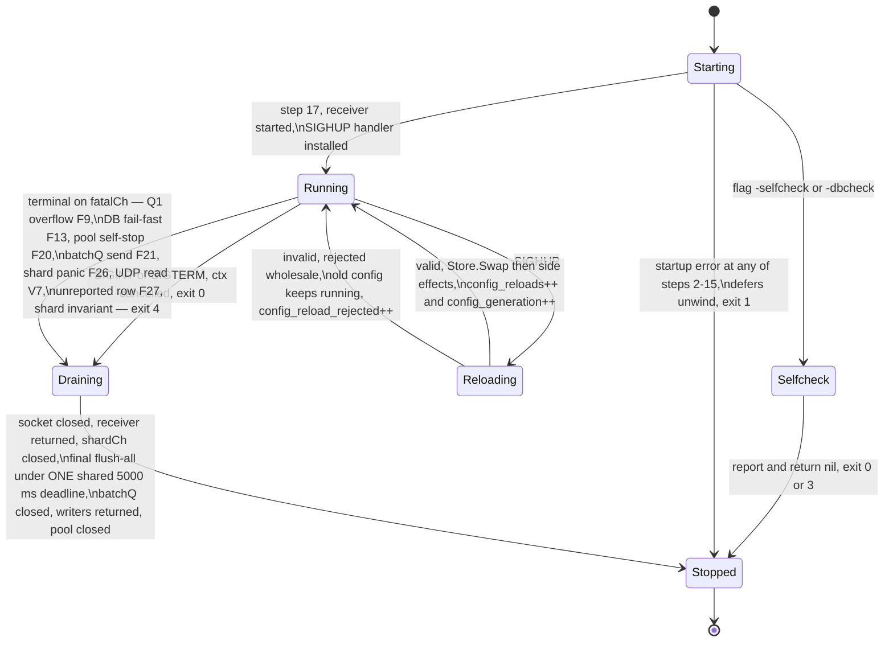
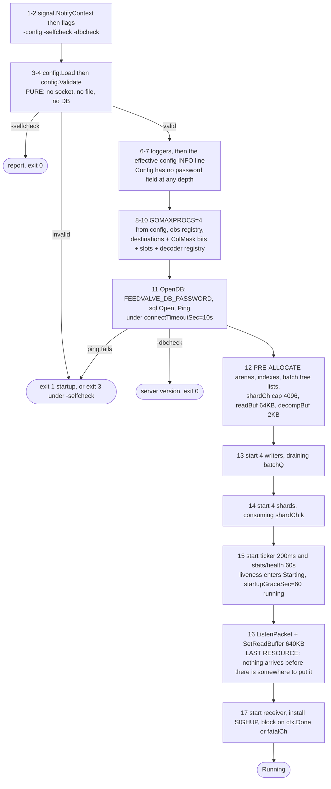
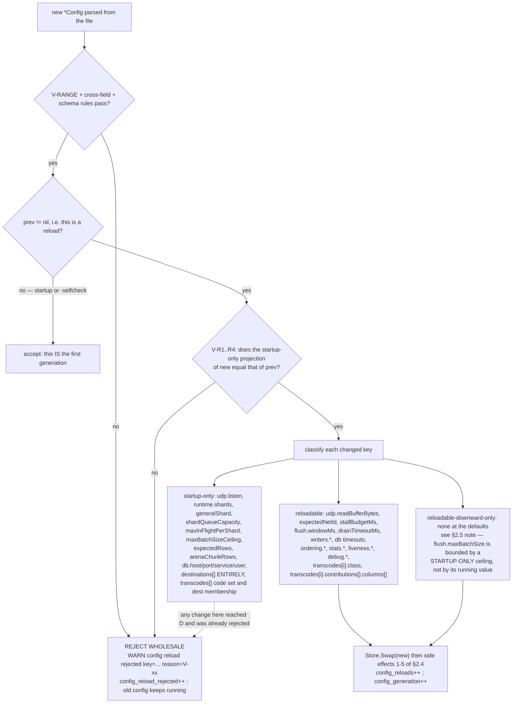
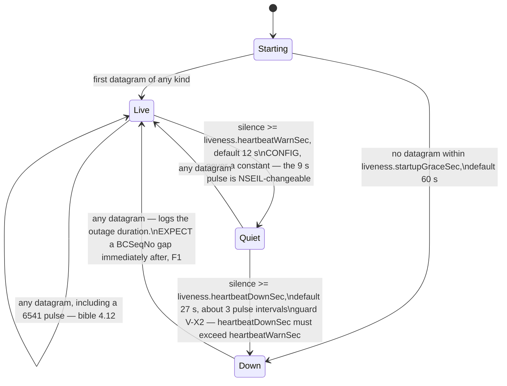
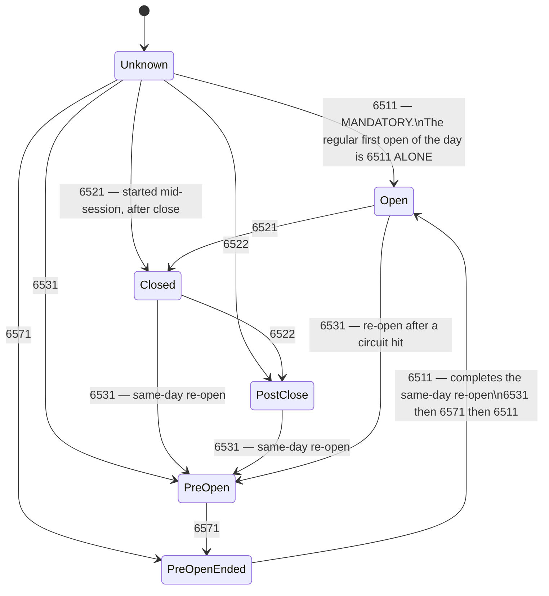
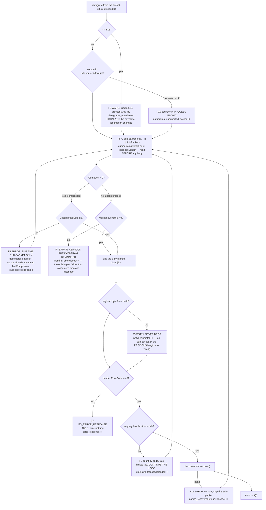
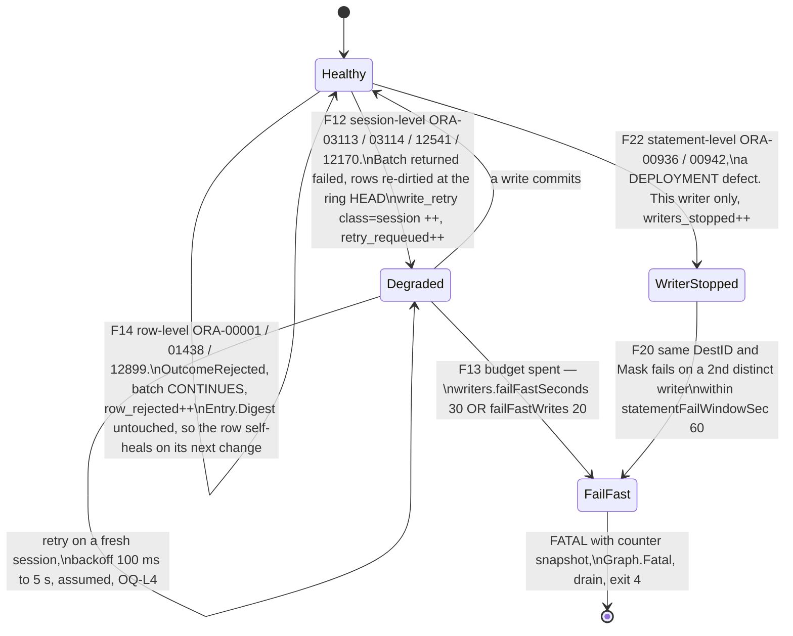
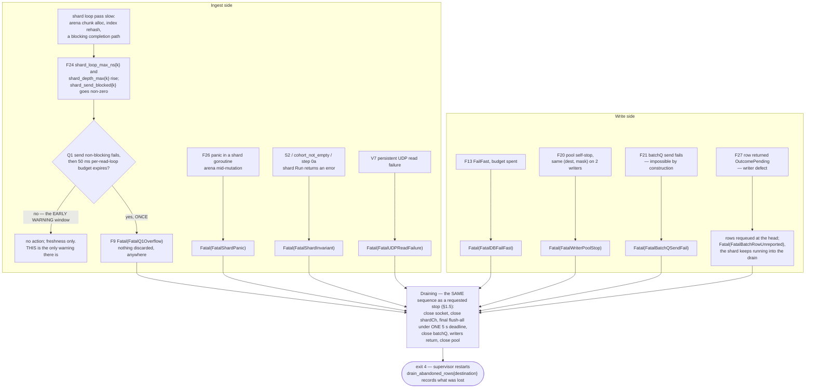
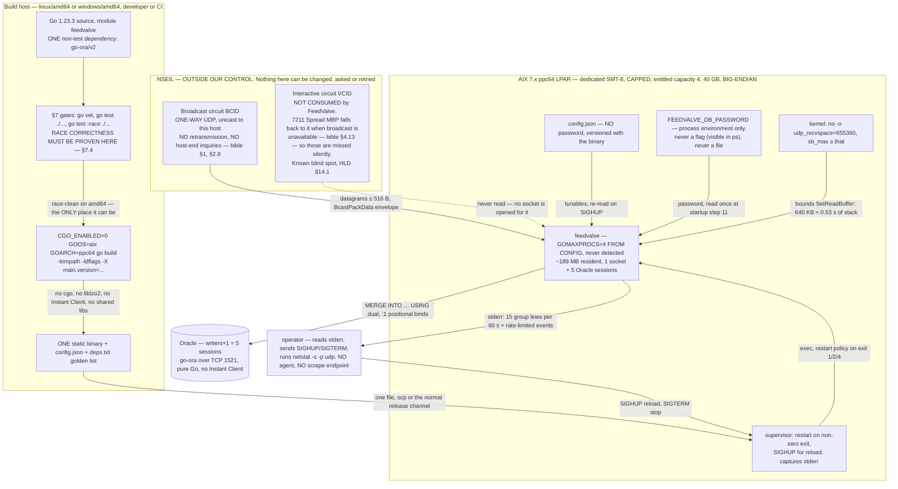
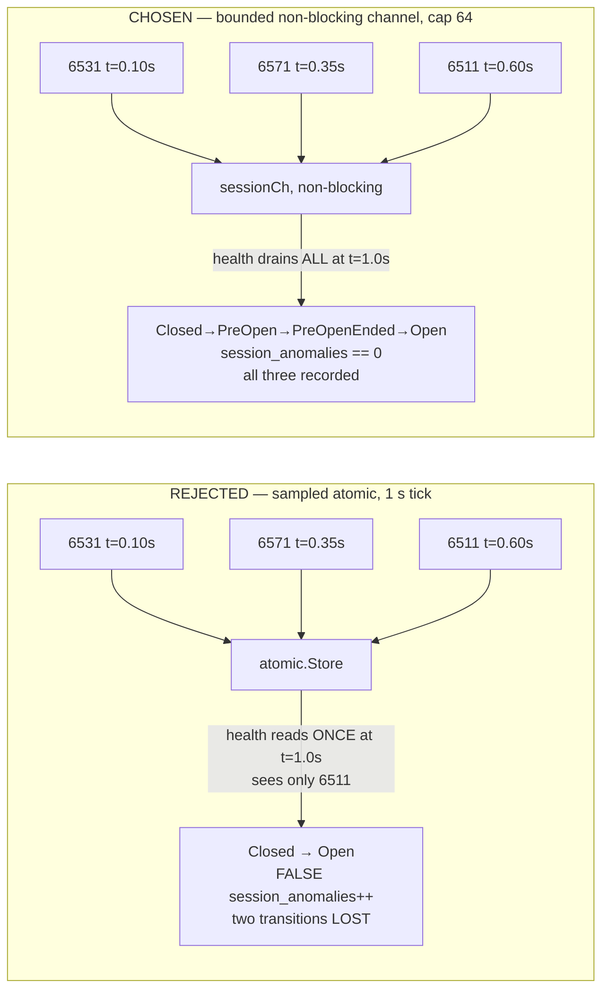

# FeedValve Phase 1 LLD — Volume 4: Lifecycle, Observability, Failure Handling and Test Strategy

**Status:** draft for review
**Binds to:** `docs/lld/00-foundations.md` (Volume 0, the frozen contract — cited as `Vol 0 §x`).
**Detailed from:** `docs/architecture/phase1_hld_design1.md` (the HLD, authoritative).
**Protocol authority:** `ncobrd_bible.md` (the bible). Every protocol claim below cites a section of it.
**Siblings:** Volume 1 (receive/decode), Volume 2 (shard and mirror), Volume 3 (writer pool and
persistence). Where this volume hands off, the boundary is named and the sibling's side is *not*
designed here.

> **What this volume owns.** The cross-cutting concerns — process lifecycle, configuration reload,
> circuit liveness, market-session tracking, the complete failure-mode catalogue, observability, the
> gate suite, and build/deploy — plus the *verification* of everything the other three volumes
> specify. It owns no data-path mechanism.

---

## Table of contents

| § | Section | Contains |
|---|---|---|
| **0** | [Scope, and what this volume does not solve](#0-scope-and-what-this-volume-does-not-solve) | ownership table, hand-offs, the three governing constraints |
| **1** | [Process lifecycle](#1-process-lifecycle) | `main`/`run` split, exit codes, 17 startup steps, 13 shutdown steps, the defer chain |
| **2** | [Configuration reload](#2-configuration-reload) | SIGHUP path, the complete validation rule set, atomicity, per-goroutine pickup, rejection |
| **3** | [Circuit liveness](#3-circuit-liveness) | why silence is circuit-down, the 6541 wire layout, the machine, the severity gate |
| **4** | [Market session state machine](#4-market-session-state-machine) | the total machine, anomalies, the hand-off to Vol 2's ordering guard, channel **H** |
| **5** | [Failure modes](#5-failure-modes) | F1–F29, three failure-path diagrams, the database-outage analysis, panic containment |
| **6** | [Observability](#6-observability) | emission, levels, DSN hygiene, health checks, the twelve-question runbook, AIX |
| **7** | [The gate suite](#7-the-gate-suite) | 89 gates in six layers, and the race-detector constraint |
| **8** | [Build, cross-compile and deploy](#8-build-cross-compile-and-deploy) | the build line, the dependency audit, sizing, `udp_recvspace`, deploy and rollback |
| **9** | [ADRs](#9-adrs) | ADR-L30 … ADR-L38 |
| **10** | [Additions to the Vol 0 ledger](#10-additions-to-the-vol-0-ledger) | 14 instruments, 1 type, 1 channel, **0 new config keys** |
| **11** | [Deltas against the HLD](#11-deltas-against-the-hld) | D4-1 … D4-10 |
| **12** | [Assumptions](#12-assumptions) | ASM-A1 … ASM-A9, each with a measurement |
| **13** | [Open questions](#13-open-questions) | OQ-L7 … OQ-L12 and the inherited ones this volume depends on |

### Diagrams in this volume

| Figure | Title | Type | § |
|---|---|---|---|
| 4.1 | Process lifecycle: starting → running → reloading → draining → stopped | `stateDiagram-v2` | §1.3 |
| 4.2 | Startup ordering and the three early exits | `flowchart TD` | §1.4 |
| 4.3 | Shutdown sequence and the async handoffs | `sequenceDiagram` | §1.5 |
| 4.4 | The SIGHUP path, accepted and rejected | `sequenceDiagram` | §2.1 |
| 4.5 | Reload decision tree and the three reload classes | `flowchart TD` | §2.5 |
| — | Broadcast data wire layout: prefix, `BCAST_HEADER` vs `MESSAGE_HEADER`, and the offset-14 collision | ASCII / offset table | §3.2 |
| 4.6 | Broadcast circuit liveness | `stateDiagram-v2` | §3.3 |
| 4.7 | Market session state per `MarketType` | `stateDiagram-v2` | §4.2 |
| 4.8 | Ingest-path failure paths | `flowchart TD` | §5.2 |
| 4.9 | Writer health, per writer, with the pool-level escalations | `stateDiagram-v2` | §5.2 |
| 4.10 | The six terminal paths and the one drain they share | `flowchart TD` | §5.2 |
| 4.11 | Deployment and system context | `flowchart TD` | §8.1 |
| 4.12 | ADR-L34's rejected alternative, side by side with the chosen one | `flowchart LR` | ADR-L34 |
| — | Part V layout verification: 15 structures, declared vs field sum | ASCII table | §7.1 |

**Required diagrams deliberately omitted, with the reason:**

| Omitted | Why |
|---|---|
| **Component decomposition** | Frozen in **Vol 0 §1.3, Figure 0.1** (package tree, import-direction rule, compile-checked boundaries). Redrawing it here would create a second source of truth for a contract that is binding, and any divergence would be a defect. This volume's §10.4 states its only addition — the health machines join the stats goroutine's exclusive state — in Vol 0's own form |
| **Concurrency and ownership** | Frozen in **Vol 0 §9.3, Figure 0.4** (goroutines, channels, capacities, blocking semantics, drop policy). Same reason. §10.3 declares this volume's one addition — channel **H** — as a row in Vol 0 §9.2's table rather than as a competing picture |
| **Packet lifecycle sequence** (socket → … → committed row) | **Volumes 1, 2 and 3 own it**, one segment each, and a fourth version drawn from outside would contradict at least one of them. The two sequence diagrams here (4.3, 4.4) are *lifecycle* sequences, which is this volume's scope |
| **Canonical ingest pipeline data flow** | **Volume 1 owns it.** Figure 4.8 covers the same pipeline from the failure-path angle — the FIFO loop, the `iCompLen > 0` branch with its predicate on the edge, the prefix skip, and both branches rejoining — because failure paths are this volume's concern, but it is not offered as the canonical data-flow diagram |
| **Persistence schema (`erDiagram`)** | **Volume 3 owns it**, and OQ-13 leaves the destination set, row keys and column lists open. Drawing a schema this volume does not decide would be an invention presented as a design. Every gate here that touches a column (V-D4, V-D5, V-T4, V-T6, G-LAY-3, G-KEY-1) is written against *the shipped configuration*, whatever it turns out to be |

---

## 0. Scope, and what this volume does not solve

### 0.1 What this volume decides

| Concern | Section | Who else depends on it |
|---|---|---|
| Startup ordering, shutdown ordering, the defer chain, exit codes | §1 | all three siblings: every goroutine class is started and stopped here |
| SIGHUP reload: validation set, atomicity, per-goroutine pickup point, rejection behaviour | §2 | Vol 1 (receiver boundary), Vol 2 (epoch boundary), Vol 3 (batch boundary) |
| Circuit liveness state machine | §3 | nobody — it is a leaf. It reads `heartbeat_seen` and a receipt timestamp |
| Market session state machine, and the ordering constraint it imposes | §4 | **Vol 2** — §4.3 states the constraint, Vol 2 owns the guard |
| The complete failure catalogue and the failure paths | §5 | all three; each sibling owns the mechanism inside its own row |
| Emission, log format and levels, health checks, the runbook | §6 | all three: the ledger is Vol 0 §8, the *emission* is here |
| The gate suite | §7 | all three: every gate names the volume whose invariant it protects |
| Build, cross-compile, deploy, rollback | §8 | all three via the dependency audit |

### 0.2 What this volume does not solve, stated so silence is not read as permission

1. **The shard main loop, the flush wakeup, the completion path and the "skip the row" fallback** —
   Vol 0 §0.2 defects L1–L4, **Volume 2's**. This volume specifies the *drain* (§1.5 step 7) as a
   contract on that loop — "flush all, repeat while dirty, bounded by one shared deadline" — and the
   gates that verify it (§7.3 G-DRAIN-1, G-DRAIN-2). It does not choose the mechanism.
2. **Statement text, the prepared-statement cache, the retry loop and the array-bind strategy** —
   **Volume 3's**. §5 catalogues the failure *classes* and their observables; §7 gates the
   classification, not the SQL.
3. **The decoder bodies and the framing cursor arithmetic** — **Volume 1's**. §7.1 specifies the
   layout-arithmetic gates that constrain them, because a build-time gate is a cross-cutting
   verification artifact, not a decoder detail.
4. **The destination schema** — OQ-13's, still open. Every gate that touches a column list is written
   against *the shipped configuration*, whatever it turns out to be, not against HLD §8.2's
   illustrative one.
5. **Anything on the interactive VCID circuit**, including 7211's documented fallback to it when
   broadcast is unavailable (bible §4.13). Out of the bible's scope (Ch. 3–7, 11–16) and out of ours;
   HLD §14.1 already names it as a known blind spot.

### 0.3 The three constraints every section below is written against

> **C-1 — `os.Exit` skips every `defer`.** `appLogger.Fatalf` calls `os.Exit`
> (`poc/logger.go:10`, stdlib `log.Logger.Fatalf`). `poc` split `main` into `main` → `run(ctx) error`
> for exactly this reason (`poc/gobrdclnt.go:19-28`, CLAUDE.md "Connection lifetime"). This design has
> four Oracle sessions, up to eight in-flight batches and ~170 MB of dirty mirror to drain, so the
> split is not a style preference — it is the only thing that makes shutdown mean anything. Vol 0
> §10.4 states it as a MUST. **"FATAL" in this document is a severity string, never a logger method**
> (§6.2, delta D4-2).
>
> **C-2 — the circuit is one-way and has no retransmission** (bible §1, §2.8). Every millisecond the
> read loop is not in `ReadFrom` is a millisecond the kernel's 640 KB buffer is absorbing on our
> behalf. That is why the socket is opened last (§1.4 step 15) and closed first (§1.5 step 3), and why
> a reload may not rebind it (Vol 0 §7.2, `udp.listen` startup-only).
>
> **C-3 — there is no race detector on `aix/ppc64`.** Concurrency correctness must be established on
> the development host and cannot be re-established on the target (§7.4). Every concurrency
> invariant in Vols 1–3 therefore needs a gate that runs under `-race` on amd64 *and* a
> non-race assertion that still means something on the LPAR.

---

## 1. Process lifecycle

### 1.1 The shape of `main`

```go
package main

// main installs the signal context FIRST, before any resource exists, so that a
// SIGTERM arriving 40 ms into startup cancels ctx and lets run's defers fire
// rather than killing the process with an Oracle session open. This mirrors
// poc/gobrdclnt.go:19-21 and is the only work main does besides mapping an
// error to an exit code.
//
// main MUST NOT call appLogger.Fatalf, log.Fatal, or os.Exit anywhere except
// the single mapping below: os.Exit skips every defer (Vol 0 §10.4, CLAUDE.md).
func main()

// run builds the whole process graph, runs it until ctx is cancelled or a
// terminal condition fires, drains it, and returns. It never calls os.Exit.
//
// The drain (§1.5 steps 6-10) happens in run's BODY, not in a defer. A defer
// cannot be sequenced against another defer's resource, and the writers need
// the Oracle pool open while they finish their last batch — while closing the
// pool is itself a defer registered at open time. Putting the drain in the body
// makes that ordering explicit instead of depending on LIFO unwind order.
func run(ctx context.Context, args []string, stderr io.Writer) error
```

`run` takes `args` and `stderr` rather than reading `os.Args` and `os.Stderr` directly so the whole
lifecycle is testable in-process — which is what makes the startup-ordering and drain gates of §7.3
possible at all.

### 1.2 Exit-code taxonomy

The supervisor restarts on non-zero exit (HLD §11.4). A requested stop must therefore be
distinguishable from a failure, or every planned shutdown becomes a restart.

| Code | Meaning | Supervisor behaviour | Emitted when |
|---|---|---|---|
| **0** | Requested shutdown completed | do not restart | SIGINT/SIGTERM; **including when the drain deadline expired** and rows were abandoned — that is a counted, logged degradation of a stop we asked for, not a failure (ADR-L37) |
| **0** | `-selfcheck` or `-dbcheck` passed | n/a | one-shot modes |
| **1** | Startup failure | restart; a loop is the correct visible symptom | invalid configuration, `ErrNoPassword` (Vol 0 §3.11), Oracle unreachable at open, socket bind refused, arena allocation failure |
| **2** | **RESERVED — do not use.** The Go runtime exits with status 2 on an **unrecovered panic** | restart | a panic outside the contained regions of §5.5. Seeing 2 means "read the stack trace on stderr", which is a different instruction from either 1 or 4 |
| **3** | `-selfcheck` failed | n/a — CI branches on it | any validation rule in §2.2 |
| **4** | Terminal runtime condition | restart | Q1 overflow (F9), database fail-fast (F13), writer-pool self-stop (F20), an impossible `batchQ` send failing (F21), shard panic (F26), persistent UDP read failure (V7, Vol 1 §3.7), a batch row never adjudicated (F27), a non-panic shard construction defect (`FatalShardInvariant`) — eight in all *(erratum, Phase 3, ruling D9: the draft listed five)* |

Codes 1, 2 and 4 are all "restart" to a supervisor and differ only diagnostically. That is the point:
`echo $?` at 03:00 answers "did it fail to start, did it panic, or did it hit a terminal condition?"
before anybody opens a log. **2 is deliberately left to the Go runtime** rather than claimed for a
design condition, so a panic exit can never be mistaken for a designed one.

### 1.3 Process lifecycle state machine



*Figure 4.1 — Process lifecycle. `Reloading` has two exits and both return to `Running`: a reload
never stops the process (§2.6). `Draining` is entered by both a requested stop and a terminal
condition and is the **same** sequence in both cases — only the exit code differs (§1.2) — because a
Q1 overflow leaves three healthy shards with dirty rows that are still worth writing (§5.4, delta
D4-1).*

### 1.4 Startup ordering

Seventeen steps. The column that matters is the last one: **why this position and not another.**

| # | Step | Why here |
|---|---|---|
| 1 | `main` installs `signal.NotifyContext(ctx, os.Interrupt, syscall.SIGTERM)` | **Before any resource exists.** A SIGTERM during a 200 ms startup must cancel `ctx` so `run` returns and its defers fire; the default disposition would kill the process with a session open (`poc/gobrdclnt.go:19-21`) |
| 2 | Parse flags: `-config`, `-selfcheck`, `-dbcheck` | Nothing below can be decided without knowing the mode. Flags beat file beats built-in default (Vol 0 §7.2, `poc/config.go`) |
| 3 | `config.Load(path)` | Everything below is parameterised by it, and a parse error here holds no resource, so there is nothing to clean up |
| 4 | `config.Validate(c, nil)` — the complete §2.2 rule set | **Pure.** It opens no socket, no file and no database, which is what lets `-selfcheck` run it without `FEEDVALVE_DB_PASSWORD` (Vol 0 §7.2). One implementation, three call sites: startup, `-selfcheck`, SIGHUP (HLD §6.8, §10.3) |
| 5 | If `-selfcheck`: print the report, return nil (exit 0) or the error (exit 3) | Must be reachable without credentials and without a network |
| 6 | Configure loggers: `appLogger` → stderr; `debugLogger` → stderr, gated per transcode. **No packet logger** | After validation, so a bad file cannot produce a half-configured logger. The `poc` full-payload packet logger is deleted, not configured (Vol 0 §1.2, HLD §10.2) |
| 7 | Emit the **effective configuration** INFO line | The single most useful artifact in a postmortem. Safe to dump `Config` wholesale because `Config` has no password field at any depth (Vol 0 §7.5) |
| 8 | `runtime.GOMAXPROCS(cfg.Runtime.GOMAXPROCS)` | **Before the first goroutine**, so every goroutine is scheduled under the intended parallelism. Never `runtime.NumCPU()`: the LPAR is capped at entitled capacity 4 while the runtime may observe 32 (ADR-009) |
| 9 | Construct the `obs` registry; resolve **every** instrument into its holder | Vol 0 §8.4 MUST: instruments are resolved once at startup and never from the hot path. A name collision becomes a startup error instead of a silent double-count |
| 10 | Build immutable derived state: destinations table, `ColMask` bit assignment, image offsets, contributor slot assignment by ascending code, decoder registry, policy map | Vol 0 §4.1 R8 — frozen for the life of the process. Any error is a config defect and must surface before a resource is held |
| 11 | `oradb.OpenDB(ctx, settings)`: read `FEEDVALVE_DB_PASSWORD`, `sql.Open`, `Ping` under `db.connectTimeoutSec` (10 s). Register `defer db.Close()`. If `-dbcheck`: log the server version, return nil | **`sql.Open` does not connect** (CLAUDE.md). Pinging here turns a bad host, a wrong service name or a wrong credential into a startup failure rather than a first-write failure at 09:00:03. The password is read here and never enters `Config` |
| 12 | Pre-allocate: arenas (first `arenaChunkRows` chunk per destination per shard), indexes at `expectedRows/shards`, batch free lists (`maxInFlightPerShard` × `maxBatchSizeCeiling` rows), `shardCh[k]` at 4096, receiver buffers (`readBuf` 64 KB, `decompBuf` 2 KB, `fanoutBuf` 40 units) | **Before the socket.** A first-datagram-triggered allocation of tens of megabytes would blow the 50 ms stall budget on packet one at market open, and an out-of-memory condition must be a startup failure, not a 10:00:00 failure |
| 13 | Start `writers.count` writer goroutines | They must be draining `batchQ` before any shard can emit a batch. An idle writer costs one blocked goroutine |
| 14 | Start `runtime.shards` shard goroutines | They must be consuming `shardCh[k]` before the receiver produces. Starting them after the receiver burns Q1 slack for nothing and can trip the 50 ms budget at open |
| 15 | Start the ticker and the stats/health goroutine | After the shards, so the first tick cannot land on a shard that does not exist. Before the socket, so the liveness machine is in `Starting` and its `startupGraceSec` (60 s) clock is already running when the first datagram can arrive |
| 16 | `net.ListenPacket("udp", cfg.UDP.Listen)`; `SetReadBuffer(cfg.UDP.ReadBufferBytes)`; **log the effective buffer size**; register `defer conn.Close()` | **Last of the resources**, so nothing arrives before there is somewhere to put it (HLD §11.4). The kernel begins buffering at bind, before the first `ReadFrom` — that window is bounded by 640 KB ≈ 0.53 s of slack (HLD §6.6 Q0), which is far longer than steps 16–17 take |
| 17 | Start the receiver goroutine; install the SIGHUP handler; block on `ctx.Done()` or `fatalCh` | SIGHUP is installed **after** the graph exists: a SIGHUP mid-construction would race a half-built registry against a swap. Before this point SIGHUP's default disposition terminates the process, which during a sub-second startup is acceptable and is stated rather than discovered |



*Figure 4.2 — Startup ordering and the three early exits. The ordering constraint that matters is the
bottom half: consumers before producers (writers before shards before receiver), and the socket after
every allocation. Steps 1–11 hold no goroutine and no memory worth naming, so a failure there is a
clean `return err`; from step 12 onward the defers registered at 11 and 16 are what make failure
clean.*

### 1.5 Shutdown ordering

Ten steps. Steps 3–10 are the drain and live in `run`'s **body**; steps 11–13 are the defer unwind.

| # | Step | Why here, and what bounds it |
|---|---|---|
| 1 | `ctx.Done()` fires, **or** a terminal condition is delivered on `fatalCh` | One entry point for both, so there is one drain implementation (§1.3) |
| 2 | Log `INFO shutdown initiated reason=<signal\|F9\|F13\|F20\|F21\|F26\|V7\|F27\|shard-invariant>` **with the counter snapshot** *(erratum, Phase 3: the eight `FatalReason`s of §1.2)* | HLD §10.2: a terminal message must carry the counters that led to it. R12 — "operators do not read the 60 s line" — is mitigated only if the last line is self-contained |
| 3 | **Close the UDP listener** | The **only** way to unblock an in-flight `ReadFrom` (`poc/gobrdclnt.go:135-145`). No deadline, no `SetReadDeadline`, no polling |
| 4 | Receiver observes the read error, sees `ctx.Err() != nil`, returns **without logging it as a failure** | A read error during shutdown is shutdown, not a fault (`poc/gobrdclnt.go:152-154`) |
| 5 | `app` waits for the receiver's `done` channel | Bounded: the receiver's only wait is a Q1 send at ≤ 50 ms (Vol 0 §9.2 Q1), plus one datagram's decode. Worst case well under 100 ms |
| 6 | Close every `shardCh[k]` | A closed channel is the shard's drain signal and guarantees no further units. **Must follow step 5**: closing a channel the receiver may still send on panics |
| 7 | Each shard drains its channel buffer, then flushes all three destinations, **repeating while dirty rows remain** and one **shared** deadline `t_drain = t_shutdown + flush.drainTimeoutMs` (5 s) has not passed | The deadline is computed **once and shared**, not per shard: Vol 0 §7.2 says it "bounds the final flush-all", singular, so total shutdown is bounded by 5 s and not by 4 × 5 s |
| 8 | On expiry, each shard counts `drain_abandoned_rows{destination}` for its remaining dirty rows and returns | HLD §6.10: "logs how many dirty rows were abandoned, per destination — an honest count of what req §10.1 already says is unrecoverable" |
| 9 | Close `batchQ` | Safe only after every shard has returned, because no shard can then emit another batch |
| 10 | Writers finish their current batch, return it on `completionCh[Batch.Shard]`, observe the closed `batchQ`, and return | **Proof that no writer can block here:** `completionCh[k]` has capacity `maxInFlightPerShard` = 2 and a shard can have at most 2 batches outstanding, so every return fits in the buffer even though the shard has stopped reading (Vol 0 §9.2 Q2c). This is the one place where the shard drain and the writer drain could deadlock, and the capacity choice is what prevents it |
| 11 | *(defer, registered at step 16 of startup)* close the listener — idempotent, already closed at step 3 | A second `Close` returns `ErrClosed`, which is discarded |
| 12 | *(defer, registered at step 11 of startup)* `db.Close()` | Runs **after** the body's drain, which is why the drain is not itself a defer |
| 13 | *(defer, registered first, runs last)* log the shutdown summary: drain duration, abandoned rows per destination, final counter snapshot | Registered first so it is the last thing in the log, after every resource has reported its own close |

```mermaid
sequenceDiagram
    autonumber
    participant SIG as "OS signal / fatalCh"
    participant RUN as "run goroutine (lifecycle)"
    participant RX as "receiver goroutine"
    participant SH as "shard k, 1 of 4"
    participant WR as "writer, 1 of 4"
    participant ORA as "Oracle"

    SIG->>RUN: "SIGTERM (ctx cancel) or F9/F13/F20/F21"
    RUN->>RUN: "log INFO shutdown initiated reason=... + counter snapshot"
    RUN->>RX: "conn.Close() — the ONLY way to unblock ReadFrom"
    RX-->>RUN: "read error + ctx.Err()!=nil ⇒ return, no ERROR line"
    Note over RUN,RX: "bounded by the 50 ms Q1 stall budget + one datagram's decode"
    RUN->>SH: "close(shardCh[k]) — drain signal, no more units"
    loop "while dirty rows remain AND now < t_shutdown + 5000 ms (ONE shared deadline)"
        SH->>WR: "batchQ <- *Batch (≤ maxBatchSize=1000 rows, dest 0→1→2)"
        WR->>ORA: "one transaction: MERGE per (dest, mask), array binds"
        ORA-->>WR: "commit / per-row outcome"
        WR-->>SH: "completionCh[k] <- *Batch, cap 2 ⇒ CANNOT BLOCK even if SH has stopped"
    end
    SH->>RUN: "drain_abandoned_rows{destination} += remaining; return"
    RUN->>WR: "close(batchQ) — safe: no shard can emit another batch"
    WR-->>RUN: "current batch finished, returned, goroutine returns"
    RUN->>ORA: "defer db.Close() — AFTER the body's drain"
    RUN->>RUN: "defer: shutdown summary line, then return err ⇒ main maps to exit code"
```

*Figure 4.3 — Shutdown sequence. The async handoffs are the two loops: a shard emits a batch and
returns to its own loop rather than waiting, and a writer returns a completed batch into a buffered
channel it cannot block on. The deadline in the loop guard is shared across all four shards, so total
shutdown is bounded at ~5.15 s, not 20 s.*

### 1.6 What the drain deliberately does not do

- **It does not wait for the database to recover.** If the drain begins while the writer pool is in
  `FailFast` (§5.3), every batch fails immediately, the 5 s deadline expires, and
  `drain_abandoned_rows` counts the whole dirty set. That is correct: HLD §9.2 and req §10.2 define a
  database outage as an application outage, and a shutdown that blocks on a dead database is a
  shutdown that never completes.
- **It does not extend the deadline for a large backlog.** A shard holding 100,000 dirty rows at
  ~5,000 rows/s (HLD §4.2) needs 20 s and will be cut off at 5. The abandonment is counted per
  destination and the operator sees it. Making the deadline proportional to the backlog would make
  shutdown unbounded in exactly the situation where a supervisor is trying to restart a wedged
  process.
- **It does not re-open the socket** to catch late datagrams. C-2: rebinding is startup-only.
- **It does not prime, snapshot or persist the mirror.** HLD §14.1 rejects priming on startup; the
  symmetric operation on shutdown would be worse — it writes a snapshot nothing reads.

### 1.7 Interface sketch

```go
package app

// Graph is the constructed process graph. Everything in it is built by Build
// and owned by Run; no field is exported because nothing outside app may hold a
// reference to a shard, a writer or the socket.
type Graph struct { /* unexported */ }

// Build performs startup steps 8-14 of §1.4: GOMAXPROCS, the obs registry, the
// immutable derived state, the pre-allocation, and the writer and shard
// goroutines. It does NOT bind the socket — that is Run's first act, so that no
// datagram can arrive against a partially constructed graph.
//
// db may be nil only when cfg declares no db object, which Validate rejects
// outside -selfcheck (§2.2 rule V-DB-1).
func Build(cfg *config.Config, store *config.Store, db *oradb.DB, reg obs.Registry) (*Graph, error)

// Run binds the socket, starts the receiver and the SIGHUP handler, and blocks
// until ctx is cancelled or a terminal condition is delivered internally. It
// then performs the drain of §1.5 steps 3-10 and returns.
//
// The returned error is nil for a requested shutdown — INCLUDING one in which
// the drain deadline expired and rows were abandoned (ADR-L37) — and non-nil
// only for a terminal runtime condition, which main maps to exit code 4.
func (g *Graph) Run(ctx context.Context) error

// Fatal is how any goroutine reports a terminal condition. It is a one-shot:
// the first caller wins, later callers are no-ops, and the reason of the first
// is what reaches the shutdown log line. It never calls os.Exit (Vol 0 §10.4).
func (g *Graph) Fatal(reason FatalReason, detail string)

// FatalReason enumerates the eight conditions of §1.2 exit code 4, so the
// shutdown line and the exit path cannot disagree about which one fired.
type FatalReason uint8

const (
    FatalQ1Overflow     FatalReason = iota // F9  — Vol 0 §9.2 Q1, HLD §6.6
    FatalDBFailFast                        // F13 — HLD §9.2
    FatalWriterPoolStop                    // F20 — the two-writer statement rule, HLD §9.2
    FatalBatchQSendFail                    // F21 — impossible by construction, HLD §7.3
    FatalShardPanic                        // F26 — arena mid-mutation, §5.5
    FatalUDPReadFailure                    // V7  — persistent read failure, Vol 1 §3.7
    FatalBatchRowUnreported                // F27 — Vol 2 §2.7 S3            [erratum, Phase 3, D9]
    FatalShardInvariant                    // non-panic shard defect, Vol 2 §2.7  [erratum, Phase 3, D9]
)
```

> **Delta D4-10, settled in P1-09: four departures from this sketch, all in the same direction.**
>
> 1. **`Build(Deps)` rather than four positional parameters.** It needs the two loggers, the
>    destination table, the stderr writer, the resolved instrument handles and the Phase 2 decode
>    seam as well — the sketch predates P1-07 — and a nine-field positional signature is one a future
>    addition can silently reorder.
> 2. **`db` is a `*sql.DB`, not a `*oradb.DB`.** No such type exists: `oradb` exposes
>    `Open(ctx, DBSettings) (*sql.DB, error)`, because the package is the connection *policy* — pool
>    sizes, timeouts, DSN hygiene — and not a wrapper type.
> 3. **`Build` starts no goroutine.** The sketch has it starting the writer and shard pools, which
>    arrive in Phase 3. Keeping it allocation-only means a failure between `Build` and `Run` has
>    nothing running to stop, which is what makes the unwind that gate **G-LIFE-3** tests simple
>    enough to be obviously correct. The same argument will apply to those pools: start them in
>    `Run`, where the teardown that must stop them also lives.
> 4. **The registry (step 9) is constructed before the loggers (step 6).** Nothing in step 6 needs
>    the registry but the logger *wants* it, because `log_events_suppressed{class}` is what makes the
>    rate limiter visible. Validation — the reason step 6 is not earlier still — already happened at
>    step 4, so the swap costs nothing and leaves exactly one `AppLogger` for the life of the process
>    instead of an unattached one replaced moments later.
>
> P1-09 also adds a `Decode func(*model.Datagram) error` field to `Deps`: the seam Phase 2 fills with
> framing, the decoder registry and the fan-out. Until then the decoder drains and discards — which
> still has to *take* each datagram, or shutdown abandons a ring with items in it.
>
> **`runtime.GOMAXPROCS` is called from `relay`, not from `main`.** Step 8 requires it before the
> first goroutine, and `relay` starts none before it; `main` holds only flag parsing, the signal
> context and the exit-code mapping, which is what §1.1 asks of it.

---

## 2. Configuration reload

ADR-010: SIGHUP → re-read → validate wholesale → atomic pointer swap. NFR8's reason is that a restart
discards coalescing state (req §9) and leaves Oracle stale (req §10.3), so a restart must not be the
price of a tuning change — which is also what makes every operator lever in HLD §9.3 usable during an
incident.

### 2.1 The mechanism, end to end

```mermaid
sequenceDiagram
    autonumber
    participant OP as "operator"
    participant LC as "lifecycle goroutine (app)"
    participant CFG as "config.Store — atomic.Pointer[Config]"
    participant RX as "receiver"
    participant SH as "shard k"
    participant WRP as "writer pool"

    OP->>LC: "kill -HUP <pid>"
    LC->>LC: "config.Load(path) — build a NEW *Config, never mutate the live one"
    LC->>CFG: "prev := Store.Load()"
    LC->>LC: "config.Validate(new, prev) — the complete §2.2 rule set,<br/>including the startup-only comparison against prev"
    alt "any rule fails"
        LC->>LC: "WARN config reload rejected key=<path> reason=<rule id><br/>config_reload_rejected++ ; NOTHING is applied"
        Note over LC,WRP: "the previous configuration keeps running, unchanged.<br/>A partially applied configuration is worse than a stale one (HLD §6.9, F15)"
    else "all rules pass"
        LC->>LC: "rebuild derived state: decoder registry entries with new ColSpecs,<br/>the GuardOff bits are NOT rebuilt: they live in mirror.GuardTable (§2.4 R-GUARD)"
        LC->>CFG: "Store.Swap(new) — ONE store; readers see all-old or all-new"
        LC->>LC: "apply live side effects IN ORDER: GOMAXPROCS,<br/>SetReadBuffer, SetMaxOpenConns/Idle = writers.count+1,<br/>SetConnMaxLifetime, writer pool resize"
        LC->>LC: "config_reloads++ ; config_generation = n+1<br/>INFO config reloaded generation=n+1 changed=[keys]"
    end
    RX-->>CFG: "Store.Load() at the top of the NEXT read-loop iteration"
    SH-->>CFG: "Store.Load() at the NEXT epoch open, and per tick for flush.windowMs"
    WRP-->>CFG: "Store.Load() at the top of the NEXT batch"
```

*Figure 4.4 — The SIGHUP path. The only write to shared state is the single `Store.Swap`; everything
before it is construction on the lifecycle goroutine's own stack and everything after it is idempotent
side effects derived from the freshly published pointer. The rejected branch touches nothing at all.*

> *(Erratum, Phase 5, rulings D1, D2, D21; `internal/app/reload.go`.)* Three corrections to the figure.
> **Two publication points, not one store:** `config.Store.Swap` assigns the generation and publishes the
> `*Config`; `Graph.setRuntime` then publishes the `Runtime` snapshot (config, registry, destinations, mirror
> parameters, parsed source allow-list), which is what the datapath reads. Between the two, `Store.Load()` is
> new while `loadRuntime()` is old; this is benign because no datapath reader uses `Store.Load()`. **Validation
> is `config.ValidateAll(ModeRun)`**, never a bare `Store.Swap`, which skips the schema and destination rules.
> **A fresh `decodeCounters` is built with each registry** (D11); the old sink is never mutated. The generation
> is stored in the `config_generation` gauge and the INFO line `config reloaded generation=n changed=[keys]
> applied=[...] failed=[...]` is written at once, not at the next emission.

### 2.2 The validation rule set, complete

One implementation, three call sites: startup (step 4 of §1.4), `-selfcheck`, and the SIGHUP path.
`prev` is `nil` at startup and under `-selfcheck`, and non-nil on reload; the **R-** rules run only
when `prev != nil`.

**Range and type rules (V-RANGE).** Every key in Vol 0 §7.2 is checked against its declared range.
Not enumerated again here — Vol 0 §7.2 is the table and re-listing it would create a second source of
truth. The validator MUST be generated from or table-driven by that same list, and §7.3 gate
**G-CFG-1** asserts that every key in Vol 0 §7.2 has a range check.

**Cross-field rules.**

| ID | Rule | Source | Why rejection and not clamping |
|---|---|---|---|
| V-X1 | `writers.statementFailWriters ≤ writers.count` | Vol 0 §7.3 C6 | A silently clamped safety threshold is worse than a refused file: the pool-stop rule (F20) would become unreachable and nobody would know |
| V-X2 | `liveness.heartbeatDownSec > liveness.heartbeatWarnSec` | Vol 0 §7.3 C7 | An inverted pair makes the liveness machine skip `Quiet` entirely (§3.2) |
| V-X3 | `1 ≤ flush.maxBatchSize ≤ runtime.maxBatchSizeCeiling` | Vol 0 §7.2, §7.3 C2 | The ceiling is startup-only and sizes the pre-allocated `Batch.Rows`; a larger live value would index past allocated memory |
| V-X4 | `0 ≤ runtime.generalShard < runtime.shards` | Vol 0 §7.3 C4 | An out-of-range designated shard routes every general unit (FR8) into a nil channel |
| V-X5 | `writers.retryMaxMs ≥ writers.retryInitialMs` | Vol 0 §7.2 | Backoff that shrinks is a busy loop against a dead database |
| V-X6 | `udp.stallBudgetMs ≤ 100` | Vol 0 §7.2, NFR4 | 100 ms *is* NFR4's whole budget; a value above it violates the requirement rather than tuning within it |
| V-X7 | `db.connMaxLifetimeMinutes` **cannot be validated** against the Oracle profile's `IDLE_TIME` | CLAUDE.md, OQ-8 | Stated as un-checkable rather than silently assumed. The observable is a recurring `ORA-03113` (F12) |

**Schema rules (destinations and transcodes).** These are HLD §10.3's `-selfcheck` list, made
executable.

| ID | Rule | Source | The defect it catches |
|---|---|---|---|
| V-D1 | exactly three destinations | HLD §8.1, Vol 0 §3.0 `maxDestinations` | A fourth destination indexes past every `[maxDestinations]` array in `UpdateUnit` and `Entry` |
| V-D2 | destination names unique; `table` non-empty | Vol 0 §7.2 | Two destinations resolving to one `DestID` |
| V-D3 | `len(columns) ≤ maxColumns` (64) | Vol 0 §3.0 | A 65th column has no `ColMask` bit |
| V-D4 | `Σ Columns[i].Width ≤ imageSize` (256) — **ASM-16b** | Vol 0 §4.7 layer 2 | A destination whose image overruns `Entry.Image`, silently corrupting the neighbouring entry in the arena |
| V-D5 | every `sql[]` name non-empty and unique within the destination | Vol 0 §7.2 | A `MERGE` naming one column twice ⇒ `ORA-00957`, surfacing as a statement-level error (F22) at 09:00 |
| V-D6 | `NContributors ≤ maxContributors` (8) | Vol 0 §3.0, ADR-L03 | A ninth contributor indexes past `LastSeq`/`LastTime`/`LastRecv` |
| V-D7 | **every destination's row key is derivable from the shard key of every transcode contributing to it** — ASM-15 | HLD §10.3, R13 | Two shards writing one row: intermittent lost updates, and HLD §8.4's deadlock layer 1 fails. **The single most valuable rule here**, because it is otherwise invisible until production |
| V-T1 | every configured transcode has a registered decoder | HLD §10.3 | A code in the inventory that silently never decodes, indistinguishable from a quiet market |
| V-T2 | `class ∈ {rate-limited, non-rate-limited}` | Vol 0 §7.2 | — |
| V-T3 | every contribution names a declared destination | HLD §10.3 | — |
| V-T4 | every contributed column name is already declared by that destination | Vol 0 §7.3 C1 | This is the rule that makes contribution column lists reloadable at all (§2.5) |
| V-T5 | `Σ width` across all of one transcode's destinations ≤ `unitBlobSize` (256) — **ASM-16a** | Vol 0 §4.7 layer 2 | A decoder overrunning `UpdateUnit.Blob` |
| V-T6 | each `ColSpec.Width` equals the sum of its mask's declared widths | Vol 0 §3.9 | A blob run whose length disagrees with its mask: the merge loop walks off the end of the run and writes a neighbouring field |

**Environment and resource rules.**

| ID | Rule | Note |
|---|---|---|
| V-DB1 | a `db` object is **required** outside `-selfcheck` and `-dbcheck` | Delta D4-5: neither the HLD nor Vol 0 says what a missing `db` means in production. `poc` no-ops the write (`updateDummyRowForPacket` when `packetDB == nil`, CLAUDE.md), which is right for a POC and wrong for a relay whose only purpose is to persist. A config with no `db` is a validation error; decoder-only operation is `-selfcheck` or a future explicit dry-run flag, never an accident |
| V-DB2 | `db.host`, `db.service`, `db.user` non-empty | Vol 0 §7.2 |
| V-DB3 | **there is no `db.password` key at any depth** — its presence is a validation *error*, not a warning | Vol 0 §7.5. A file carrying one has already leaked; refusing to start is the only response that makes the operator rotate it |
| V-TZ1 | `liveness.tradingWindow.tz` resolves via `time.LoadLocation` | Requires `time/tzdata` on AIX (§8.7, OQ-L5) |
| V-TW1 | `tradingWindow.start` / `.end` parse as `HH:MM` | Vol 0 §7.2 |
| V-DBG1 | every entry in `debug.traceTranscodes` is a code in the configured inventory | A typo silently traces nothing, which reads as "the bug went away" |
| V-SRC1 | every `udp.sourceAllowList` entry parses as an IP or a CIDR | With `sourceEnforce` true, an unparseable entry blinds the feed (F19) |
| V-STRICT1 | **an unknown JSON key anywhere in the file is a validation error**, not a warning and not silently ignored (`json.Decoder.DisallowUnknownFields`) | A typo in a tuning key — `windowMS` for `windowMs` — otherwise does nothing at all, silently, during the incident the operator is trying to fix. The cost is that one config file cannot serve two binary versions during a rollback; §8.8 resolves that by versioning the config file alongside the binary, which is the correct answer anyway |

**Reload-only rules.**

| ID | Rule | Rejection message must name |
|---|---|---|
| V-R1 | every **startup-only** key equals its value in `prev` | the key path, the running value, the attempted value |
| V-R2 | the `destinations` array is startup-only **in its entirety** — name, table, rowKey, and the full ordered column list | the destination and the field |
| V-R3 | the **set** of transcodes is startup-only, and for each transcode the **set of destinations it contributes to** is startup-only | the code, and whether it was added, removed or re-targeted |
| V-R4 | `runtime.maxBatchSizeCeiling` is startup-only, so V-X3's bound cannot move | — |

### 2.3 What makes the swap atomic from a reader's point of view

Four properties, all required together. Drop any one and the swap stops being atomic in a way that is
invisible until it corrupts a row.

1. **`Config` is immutable once published.** Reload *builds a new* `*Config`. Nothing — not the
   lifecycle goroutine, not the validator — writes through a published pointer. Vol 0 §3.10 states
   this; it is repeated here because it is the property the other three depend on.
2. **One store, one load.** `atomic.Pointer[Config].Store` is a single machine word. A reader's
   `Store.Load()` returns either the entire old configuration or the entire new one, never a mix.
   There is no mutex on the data path (Vol 0 §9.1).
3. **Every structure reachable through the pointer is rebuilt, not patched.** The decoder registry
   carries `Contrib [maxDestinations]ColSpec` per code (Vol 0 §3.9). If a reload changes a transcode's
   contributed columns, the registry must be **rebuilt and hung off the new `*Config`**. Patching the
   live registry in place would let a decode in progress read a `Mask` from the new configuration and
   a `Width` from the old — and Vol 0 §3.9's `Contribution.BlobLen == Σ widths(Mask)` invariant would
   break for exactly the packets in flight during the reload.
4. **A reader holds one pointer for one whole unit of work** (Vol 0 §7.4, MUST). Re-loading mid-unit
   lets one `Config` govern the first half of an operation and another the second — for a shard, two
   different `maxBatchSize` values inside one epoch.

> **R-GUARD — the one piece of mutable state a rebuilt registry must carry forward.**
> *(erratum, Phase 3, ruling D2: satisfied structurally. The bit is not in `RegistryEntry`; it lives in
> `mirror.GuardTable`, built once by `app`, shared by every shard and never rebuilt, so a reload cannot
> reset it. The rule below stands as the reason that table is outside the registry.)*
> `RegistryEntry.GuardOff` is a `*atomic.Bool` (Vol 0 §3.9) written solely by the stats goroutine when
> `ordering.guard: auto` disables the guard for a transcode (HLD §6.5). It is **state, not
> configuration**. A rebuilt registry that allocates a fresh `atomic.Bool` per code silently
> re-enables every guard that `auto` had disabled — and the transcode whose `BCSeqNo` is unpopulated
> immediately stops updating its rows again, minutes after an operator "fixed" something unrelated by
> reloading. **MUST:** for every code present in both the old and the new registry, the new entry
> reuses the *same* `*atomic.Bool`. Codes cannot be added or removed by a reload (V-R3), so the
> carry-forward is total. Gated by §7.3 **G-CFG-4**.

### 2.4 Where each goroutine picks up the new pointer, and the consistency window that implies

Binding to Vol 0 §7.4, with the window each boundary implies made explicit — because "takes effect
within one window" (HLD §6.9) is not true of all of them.

| Goroutine | Pickup boundary | Consistency window | The surprise, stated |
|---|---|---|---|
| lifecycle | immediately, in the swap itself | 0 | — |
| receiver | top of each read-loop iteration, before `ReadFromUDPAddrPort` | one datagram ≈ 0.4 ms at 2,400/s | **Unbounded in a silent market**: a receiver parked in `ReadFrom` holds the old pointer until the next datagram. Harmless — the only keys it reads are `stallBudgetMs`, `expectedNetId` and the source list, none of which matters while nothing is arriving |
| ticker | at each tick, to reset its period | ≤ `flush.windowMs` (200 ms) | — |
| shard | at **epoch open**, held for the whole epoch; and at each tick for `flush.windowMs` | ≤ `W` + one epoch duration; observable as `epoch_duration_max_ns` | A shard with nothing dirty never opens an epoch, so a `maxBatchSize` change waits for the next real flush. Correct, and invisible |
| writer | top of each batch | ≤ `W` + one epoch | A writer blocked on `batchQ` in a quiet market holds the old timeouts. Harmless: it is not in a transaction |
| stats / health | at each emission, and at each guard evaluation | ≤ `stats.intervalSec` (**60 s**) for emission; ≤ `ordering.guardEvalIntervalSec` (5 s) for the guard | **The longest window in the system, and the one that confuses operators.** A reload that shortens `stats.intervalSec` from 60 s to 10 s takes up to one *old* interval — 60 s — to take effect, because the sleeping goroutine is still on the old period. Documented in the runbook (§6.6 Q8) rather than engineered around: a timer that re-reads its period more often than it fires is a timer with two sources of truth |

**Live side effects, applied after the swap, in this order** (Vol 0 §7.4 lifecycle row):

1. `runtime.GOMAXPROCS(new.Runtime.GOMAXPROCS)`
2. `(*net.UDPConn).SetReadBuffer(new.UDP.ReadBufferBytes)` — then **log the effective value** and
   `Store` it into `readbuf_effective_bytes` (§10). The kernel silently caps at `udp_recvspace`, so
   the requested value is a wish and the effective one is a fact (Vol 0 §7.2)
3. `db.SetMaxOpenConns(new.Writers.Count + 1)` and `SetMaxIdleConns(new.Writers.Count + 1)` — derived,
   not configured (Vol 0 §7.3 C5, delta D9). **Before** the pool resize, so a grown pool has sessions
   available the instant its goroutines start
4. `db.SetConnMaxLifetime(new.DB.ConnMaxLifetime)`
5. Writer pool resize (§2.5)

> *(Erratum, Phase 5, rulings D14, D19, D13; `applyLive` in `internal/app/reload.go`.)* The as-built order is
> `GOMAXPROCS` (only if changed), `SetReadBuffer` (read back, `readbuf_effective_bytes`, logged), the database
> setters `SetConnMaxLifetime` **and `SetConnectTimeout`** (a sixth effect beyond the five listed: the key
> `db.connectTimeoutSec` is reloadable and would otherwise be silently ignored), then `SetLevel`,
> `SetRatePerMin`, `DebugLogger.Set` and `Reg.SetIntervalSec`, and `Pool.Resize` **last**. Step 3 is
> **amended**: the `database/sql` limits are not applied by a separate step before the resize. `Pool.Resize`
> calls `SetPoolSize(n+1, n+1)` itself, first, and is called only when `writers.count` changed. `Pool.ReloadHealth()`
> runs before any of this, right after the `Runtime` is published, so the new `statementFailWriters` is in force
> when the new count is judged (a count below it is rejected by V-X1, not clamped). A side-effect failure is
> listed under `failed=` in the INFO line and never rolls the swap back. The receiver does not pick up at "the
> top of the read-loop iteration" but once per datagram, after `ReadFrom` returns, via `loadRuntime()`; the
> guard evaluator and the circuit tick re-arm their timers from the live configuration after each firing, like
> `stats.intervalSec`, so each takes up to one OLD period to adopt a change.

They are applied **after** the swap, not before, because each one is idempotent and derived from the
*published* pointer: there is then exactly one source of truth, and a side effect that fails can be
re-derived by re-reading `Store.Load()`. Applying before the swap would make the published config the
laggard, which is the direction that produces "the log says 8 writers and there are 4".

### 2.5 The three reload classes, and how a startup-only change is rejected



*Figure 4.5 — Reload decision tree. The startup-only class is not "ignored on reload" — it is
**rejected wholesale**, taking the reloadable changes in the same file down with it. That is
deliberate: a file where half the operator's edits took effect and half did not is the condition
HLD §6.9 and ADR-010 exist to prevent.*

> *(Erratum, Phase 5.)* `config.StartupOnlyKeys` has **fourteen** entries: Vol 0 §7.2's thirteen plus
> `runtime.destinationsFile`, an implementation addition (the destination file is read once; V-R2 compares
> the loaded set). The destination set's shape (name, table, rowKey, ordered columns) is V-R2 and is compared
> against `Runtime.Dests`, the running set. `udp.sourceAllowList`, `udp.sourceEnforce`, `ordering.gapScope`
> and `ordering.gapAuditPackets` remain **reloadable** as Vol 0 §7.2 marks them (ruling D9, default; see the
> Phase 5 as-built notes): the first two through the `Runtime` snapshot, the last two through
> `decode.GapDetector.Reconfigure`, applied by the decoder at the next datagram after a new generation.

**How V-R1 is implemented, and why not a fingerprint.** The comparison is table-driven over a
**declared list of startup-only key paths**, not a hash of the whole projection. A hash would be two
lines and would produce the rejection message *"something startup-only changed"*, which is useless at
03:00. The list gives the key path, the running value and the attempted value. The list itself is the
thing that rots, so §7.3 gate **G-CFG-2** asserts that every key marked `startup-only` in Vol 0 §7.2
appears in it — the list and the contract cannot drift apart without CI failing.

**`flush.maxBatchSize`: binding to Vol 0, and the discrepancy named.** HLD §6.9 says "reloadable, but
**downward only**, within the startup-only `maxBatchSizeCeiling`". **Vol 0 §7.3 C2 and delta D8
override that**: reloadable in `[1, maxBatchSizeCeiling]` in **both** directions, because the HLD's
own justification — the row buffers are pre-allocated *sized by the ceiling* — permits any value
within the ceiling. Vol 0 is binding, so V-X3 is the rule and the class is plain `reloadable`. The
practical consequence is that an operator who lowers `maxBatchSize` during an incident can raise it
again afterwards without a restart, which is what makes it an incident lever rather than a one-way
door. Recorded in §11 as inherited delta D8; flagged in the summary because the dispatching brief
stated the HLD's wording.

**Contributor membership versus column lists, stated precisely** (Vol 0 §7.3 C1, delta D6):

| What | Class | Why |
|---|---|---|
| The **destination's** declared column list | **startup-only** | It fixes every `ColMask` bit index and every image offset (Vol 0 §4.1 R8). Inserting a column would renumber every live mask and re-lay ~400,000 images and every stored digest in one step |
| Which transcodes contribute to a destination at all — **membership** | **startup-only** | Membership fixes the `[maxContributors]` slot assignment that `LastSeq`, `LastTime` and `LastRecv` are indexed by. Adding one indexes past a fixed array; reordering silently reassigns every stored ordering value to the wrong transcode, which fails as lost updates rather than as an error (HLD §6.9) |
| Which of a destination's **already-declared** columns a given transcode supplies | **reloadable** | This is the only reading of HLD §6.9's own phrase "adding a column *a destination already declares*". V-T4 is what makes it safe |

**Writer pool resize.** `app` owns the pool's lifecycle; Vol 3 owns the writer body.

- **Grow** (`new.Writers.Count > old`): start the difference as fresh goroutines, each acquiring its
  own session from the already-widened pool. `writers_configured` is `Store`d by the lifecycle
  goroutine (Vol 0 §8.2). *(Erratum, Phase 5: by the **pool**, in `Start` and `Resize`. The stats sampler no
  longer writes it; doing so overwrote the resized value with the startup count.)*
- **Shrink**: close the per-writer `stop chan struct{}` of the highest-indexed writers. A writer
  checks `stop` **only between batches, never inside a transaction** — a writer that abandoned a
  transaction would leave row locks held until the session timed out. It holds no mirror state
  (ADR-005), so exiting is free.
- `SetMaxOpenConns` to a value below the currently-open count does not kill in-use connections;
  `database/sql` closes idle ones as they are returned. Safe by construction, stated so nobody adds a
  drain step that is not needed.
- V-X1 prevents the shrink that would make the pool-stop rule unreachable.

### 2.6 Behaviour on an invalid reload, exactly

1. **Nothing is applied.** No swap, no side effect, no partial write. The rejection happens entirely
   on the lifecycle goroutine's stack before the single `Store.Swap`.
2. **The previous configuration keeps running**, unmodified. The process does **not** stop: a bad
   reload is an operator error during an incident, and stopping would convert a typo into an outage
   (HLD §9.1 F15).
3. **One WARN line**, naming the **first** failing rule, its key path, the running value and the
   attempted value. First rather than all: a file with a structural error produces cascading failures
   and a hundred-line rejection is unreadable. `-selfcheck` reports *all* of them, which is the right
   place for exhaustiveness.
4. **`config_reload_rejected` increments** (Vol 0 §8.2, gap G8). This is the one that matters: a
   rejected reload means the operator's change did not take effect while the process looks perfectly
   healthy.
5. **`config_generation` does not increment.** An accepted reload increments it and logs it; the
   operator's confirmation that a change is live is "generation went from 7 to 8", not "no error
   appeared". This closes the human failure mode Vol 0 §8.3 G8 names — *"an operator who fixes an
   incident by reloading a rejected file believes the fix is live"* — with a positive
   acknowledgement rather than an absence of a negative one. `config_generation` is an addition to the
   Vol 0 ledger (§10).

### 2.7 Interface sketch

```go
package config

// Validate runs the complete rule set of §2.2. prev is nil at startup and
// under -selfcheck, and the running configuration on the SIGHUP path; the V-R
// rules run only when prev != nil.
//
// It returns the FIRST failing rule as a *RuleError. -selfcheck calls
// ValidateAll instead, which returns every failure.
func Validate(c *Config, prev *Config) error

// ValidateAll is Validate with exhaustive reporting, for -selfcheck only.
func ValidateAll(c *Config, prev *Config) []error

// RuleError names the rule, the JSON key path, and — for a V-R rule — both
// values, so the WARN line is actionable without opening the file.
type RuleError struct {
    Rule    string // "V-R1", "V-D7", …
    KeyPath string // "runtime.shards"
    Running string // set only for V-R rules
    Attempt string
    Detail  string
}

// StartupOnlyKeys is the declared list V-R1 compares over. Gate G-CFG-2
// asserts it covers every key Vol 0 §7.2 marks startup-only.
var StartupOnlyKeys = []string{ /* … */ }

// Generation is the monotonically increasing count of ACCEPTED configurations,
// starting at 1 for the one loaded at startup. It is published as the
// config_generation gauge and logged on every accepted reload, so an operator
// can confirm a change took effect rather than inferring it from silence.
func (s *Store) Generation() uint64  // as built: Gen()
```

> *(Erratum, Phase 5, rulings D21 and D22. The sketch above is superseded by the as-built API.)*
> `config.ValidateAll(c, dests, prevDests *destinations.Set, prev *Config, mode Mode) error` is the one entry
> point; `prev` and `prevDests` are nil at startup and under `-selfcheck`. It returns a `*ValidationError`
> holding every `Problem` (rule, key path, running and attempted values, detail); `ValidationError.RuleError()`
> derives the spec's `RuleError{Rule, KeyPath, Running, Attempt, Detail}` from `Problems[0]`, so the reload
> WARN names the first failure while `-selfcheck` prints all. There is no `Validate`/`ValidateAll` split and
> no `[]error` return. `StartupOnlyKeys` exists as sketched but is derived from the same table V-R1 enforces
> (fourteen entries, see §2.5). **There is no `Store.Generation()`**: the method is `Store.Gen()`
> (`internal/config/store.go`), and the gauge reads it. V-DB3 (a password key anywhere in the file, caught by
> a key-walk before strict decoding because `DisallowUnknownFields` would otherwise fire first and hide it)
> and V-STRICT1 are raised by the loader; V-STRICT1 reports the **leaf** key name only, since
> `encoding/json` does not give the path.

---

## 3. Circuit liveness

### 3.1 Why silence is a circuit-down signal and not a quiet market

The argument is a protocol fact, not a heuristic. Bible §4.12: *"If no data has flowed on the
broadcast circuit for a stipulated period, the host sends a pulse. The period is currently 9 seconds
and is changeable by NSEIL control."*

The consequence is the whole design: **on a working circuit, the maximum interval between datagrams
is bounded by the pulse interval, regardless of market activity.** An observed interval longer than
that is therefore evidence about the *circuit*, and carries no information about the market at all. A
market that has genuinely stopped trading still produces a datagram every ~9 s.

Why this matters operationally, in the order the consequences land:

1. **There is no other signal.** The circuit is one-way and there are no host-end inquiries for NNF
   users (bible §1, §2.8). We cannot ask "are you still there?", we cannot request a resend, and a
   TCP-style connection reset does not exist on a UDP broadcast feed. Bible §4.12's own design note is
   explicit: *"This is your only liveness signal."*
2. **Without it, the two failure modes are indistinguishable, and one of them is total.** A dead
   circuit and a quiet market both look like an empty log. The first symptom of a dead circuit would
   otherwise be a human noticing stale prices — typically tens of minutes later, and typically as a
   question rather than an alert.
3. **Everything lost during the silence is lost permanently** (bible §1). Detection time is
   therefore not a convenience; it is directly proportional to unrecoverable data. Twelve seconds of
   detection latency at ~10,000 messages/s is ~120,000 messages we can at least *account* for via the
   `BCSeqNo` gap on recovery (F1). Twenty minutes is not.
4. **Both thresholds must be configuration, never constants.** The interval is changeable by NSEIL
   control (bible §4.12). A hard-coded 9 s guarantees a future false alarm if the exchange shortens
   it, and a future missed alarm if it lengthens it. Vol 0 §7.2 makes `liveness.heartbeatWarnSec`
   (12) and `liveness.heartbeatDownSec` (27) reloadable keys with cross-field rule V-X2. This is
   ADR-013, and it is why 12 and 27 appear in a config table rather than in a `const` block.

### 3.2 The wire fact the machine depends on: 6541 carries `MESSAGE_HEADER`

Getting this wrong does not merely mis-count heartbeats — it fabricates a sequence gap every nine
seconds. Cited so the implementer can check it against a capture without opening the bible.

```
Broadcast data as handed to the decoder — prefix INCLUDED          bible §3.4, §2.8

 payload  0        1 . . . 7        8 . . . . . . . . . . . . . . . 47      48 . . .
         +--------+---------------+---------------------------------+-----------
         | netId  |   ignored     |   40-byte header                | body
         +--------+---------------+---------------------------------+-----------
          ^ byte 0 repeats the segment netId (8 = commodity, bible §3.4, Appendix A)
                                   ^ the header starts at the 9th byte, ALWAYS,
                                     and for compressed sub-packets only AFTER
                                     decompression (bible §3.4)

BCAST_HEADER — nearly every broadcast message                             bible §2.8
 hdr.off  payload.off  size  field
    0          8         2   Reserved BYTE[2]
    2         10         2   Reserved BYTE[2]
    4         12         4   LogTime           LONG, seconds since 1 Jan 1980 (§2.5)
    8         16         2   AlphaChar CHAR[2]
 ->10       ->18         2   TransactionCode   *** the dispatch key for the whole feed
   12         20         2   ErrorCode         non-zero ⇒ MS_ERROR_RESPONSE (§2.10)
 ->14       ->22         4   BCSeqNo           *** the ONLY per-stream sequence number
   18         26         1   Reserved CHAR[1]
   19         27         3   Reserved CHAR[3]
   22         30         8   TimeStamp2        machine number, NOT a time (§2.5)
   30         38         8   Filler2 BYTE[8]
   38         46         2   MessageLength     counts from hdr.off 0; EXCLUDES the 8-byte prefix
                        ---
                         40

MESSAGE_HEADER — 6541 heartbeat, and 6503                          bible §2.8, §4.12
 hdr.off  payload.off  size  field
 -> 0       -> 8         2   TransactionCode   *** at offset 0, i.e. PAYLOAD offset 8, not 18
    2         10         4   LogTime
    6         14         2   AlphaChar CHAR[2]
    8         16         4   TraderId
   12         20         2   ErrorCode         same offset in BOTH layouts — checkable before resolving
 ->14       ->22         8   Timestamp         LONG LONG, ns since 1 Jan 1980 (§2.5)
   22         30         8   TimeStamp1 CHAR[8]
   30         38         8   TimeStamp2 CHAR[8]
   38         46         2   MessageLength
                        ---
                         40

6541 BCAST_CIRCUIT_MSG is MESSAGE_HEADER *only* (bible §4.12), so the whole
broadcast data is  8 (prefix) + 40 (header) + 0 (body) = 48 bytes.
```

**The collision that matters is at offset 14.** In `BCAST_HEADER` that is `BCSeqNo`; in
`MESSAGE_HEADER` it is the top four bytes of a nanosecond `Timestamp`. A 6541 resolved as a
`BCAST_HEADER` would hand the gap detector the high half of a nanosecond counter **every nine
seconds**, fabricating a gap on every heartbeat and burying the real ones. Vol 0 §3.6 states this as
the reason `MsgHeader.Kind` is resolved **before** the gap detector runs and **before** the registry
is consulted; §7.3 gate **G-HDR-1** pins it. Header resolution is Volume 1's mechanism — this volume
only states the constraint and the gate.

### 3.3 The state machine



*Figure 4.6 — Broadcast circuit liveness. Driven by **any** datagram, not by 6541 alone: during an
active market no pulse is sent because data is flowing, so counting only pulses would alarm
continuously during normal trading (ADR-013). Both guards are configuration keys, because bible
§4.12 makes the pulse interval exchange-changeable. `circuit_state` is published as gauge values
0 = Starting, 1 = Live, 2 = Quiet, 3 = Down (Vol 0 §8.2).*

**How the machine is fed, and what it costs the receive path.** The receiver stores
`time.Since(processStart).Nanoseconds()` into one padded `atomic.Int64` per datagram — one uncontended
store against a reader that samples once a second, so ~2,400 writes/s versus 1 read/s. It is placed on
its own cache line so it cannot false-share with the hot counters. **The wall clock is never used**:
Vol 0 §10.2 MUST — an NTP step during a quiet period would otherwise manufacture an outage or hide
one.

**The evaluation tick is 1 s, clamped to at most `heartbeatWarnSec / 2`**, recomputed at each fire
from the live config (Vol 0 §7.4, health row). Detection granularity is then ±1 s against the 12 s
default — 8 % — and never worse than 50 % at the smallest legal `heartbeatWarnSec` of 1. It is
deliberately **not** a configuration key: its only possible effect is to make the alarm later, and a
tunable whose optimum is "as small as is free" is not a tunable. The health machine is folded into the
stats goroutine (Vol 0 §9.1), which is otherwise asleep between 60 s emissions.

### 3.4 What each transition emits, and what the operator does

Severity is shown as *in-window* / *outside-window* (§3.5).

| Transition | Level | Log line | Instruments | Operator action |
|---|---|---|---|---|
| `Starting → Live` | INFO | `circuit live first_datagram_after_ms=<n>` | `circuit_state`=1 | none |
| `Starting → Down` | **ERROR** / WARN | `circuit down: no datagram within startup grace grace_s=60 listen=<addr>` | `circuit_state`=3, `circuit_down_events`++ | **The deployment case.** Verify `udp.listen` matches what the exchange sends to; verify the BCID circuit is provisioned to *this* host; take a capture. `datagrams_received` will be 0, which distinguishes this from a mid-session outage |
| `Live → Quiet` | WARN / INFO | `circuit quiet silent_s=<n> last_transcode=<code>` | `circuit_state`=2, `circuit_quiet_events`++ | Usually nothing — this fires on a slow pulse or a brief hiccup. Watch for it to clear |
| `Quiet → Live` | INFO | `circuit recovered quiet_s=<n>` | `circuit_state`=1 | none |
| `Quiet → Down` | **ERROR** / WARN | `circuit down silent_s=<n> threshold_s=27` | `circuit_state`=3, `circuit_down_events`++ | Contact the exchange. **We cannot request a resend** (bible §1). Check the host's network path and `netstat -s -p udp` to rule out a local receive failure |
| `Down → Live` | INFO | `circuit recovered outage_s=<n> — expect a BCSeqNo gap` | `circuit_state`=1, `circuit_outage_max_ns`.Observe | **Correlate with `seq_gap_messages` in the next 60 s line.** The gap magnitude is the size of the hole and is the only accounting available (F1, bible §2.8) |

The last row is the one that earns its place: a circuit recovery and a sequence gap are the same event
seen from two instruments, and reading them together converts *"the data looks odd"* into *"we lost
N messages across a 43-second outage"*. §6.6 Q5 of the runbook makes that pairing explicit.

### 3.5 The trading-window severity gate, and why it fails open

`liveness.tradingWindow.{start,end,tz}` (default `09:00`–`23:55`, `Asia/Kolkata` — **assumed**, ASM-A4)
downgrades the *log severity* of `Quiet` and `Down` by one level outside the window, so an overnight
host outage does not page anyone (HLD §6.10, ADR-013).

Three rules, each stated because each is a way to get this wrong:

1. **The gauge is never downgraded.** `circuit_state` reports the state; only the log line's severity
   is a judgement about whether it should wake somebody. Downgrading the state itself would make an
   overnight outage invisible in the morning's counters.
2. **It never gates data.** Nothing about the trading window touches the receive, decode, merge or
   write paths. A datagram at 03:00 is processed identically to one at 11:00.
3. **It fails open.** If `time.LoadLocation` fails — which is live risk OQ-L5 on AIX, mitigated by
   importing `time/tzdata` (§8.7) — the gate treats **every hour as in-window**, logs one WARN at
   startup naming the unresolvable zone, and leaves severities at their louder setting. A timezone
   database problem must not silence a circuit alarm.

> *(Erratum, Phase 5, ruling D3; OPEN for the user's decision.)* As built, **V-TZ1 rejects an unresolvable
> zone at load, at `-selfcheck` and on reload**, so the "WARN at startup, fail open" leg cannot occur through
> the shipped binary (`time/tzdata` is linked, so only a genuinely unknown name fails). The fail-open path
> exists in `health.NewWindow` as defence in depth (a fail-open Window, every hour in-window, plus an error the
> caller in `internal/app/health.go` logs once; state and counters untouched) and **G-LIVE-3 is gated at health level** (`TestG_LIVE_3_UnresolvableZoneFailsOpen`).
> The alternative is to demote V-TZ1 to a WARN and fail open at runtime. This also qualifies OQ-L5: a missing
> zoneinfo is now a startup refusal, not a louder alarm.

### 3.6 Interface sketch

```go
package health

// Circuit is the liveness machine of Figure 4.6. It is owned exclusively by the
// stats goroutine (Vol 0 §9.1) and is driven by one atomic the receiver writes
// and one timer.
type Circuit struct { /* unexported */ }

// Observe is called by the RECEIVER, once per datagram, and is the only thing
// the receive path does for liveness: a single atomic store of
// time.Since(processStart).Nanoseconds(). Monotonic, never wall clock
// (Vol 0 §10.2).
func (c *Circuit) Observe(recvMono int64)

// Tick advances the machine. Called once per health tick (1 s, clamped to
// heartbeatWarnSec/2) with the live configuration, so both thresholds are read
// fresh at every fire and a reload takes effect within one tick.
//
// It returns the transition that occurred, or TransitionNone. The caller logs
// and counts; the machine itself does neither, so it is testable by feeding it
// timestamps with no clock and no logger.
func (c *Circuit) Tick(nowMono int64, cfg LivenessConfig) Transition

// State is the published gauge value: 0 Starting, 1 Live, 2 Quiet, 3 Down.
func (c *Circuit) State() CircuitState
```

---

## 4. Market session state machine

### 4.1 The protocol facts

Bible §4.5, `MS_BCAST_VCT_MSGS`, 320 bytes, one trailing pad byte at 319 (bible Part V):

| Code | Constant | Sent when |
|---|---|---|
| 6511 | `BC_OPEN_MSG` | Market opened |
| 6521 | `BC_CLOSE_MSG` | Market closed |
| 6522 | `BC_POSTCLOSE_MSG` | Market in post-close session |
| 6531 | `BC_PRE_OR_POST_DAY_MSG` | Market pre-opened |
| 6571 | `BC_PRE_OPEN_ENDED` | Pre-open period ended |

And the sequencing rule that a naive implementation gets wrong (bible §4.5, verbatim in substance):

- **Regular (first) opening of the day:** `BC_OPEN_MSG` (6511) **only**.
- **Re-opening later the same day** (e.g. after a sun outage or a circuit hit):
  `BC_PRE_OR_POST_DAY_MSG` (6531) → `BC_PRE_OPEN_ENDED` (6571) → `BC_OPEN_MSG` (6511).
- *"A state machine that requires a pre-open before every open will stall at the regular market
  open."*

State is tracked **per `MarketType`**, read from message offset 74 (bible §4.5): 1 Normal, 2 Odd Lot,
3 Spot, 4 Auction (bible Appendix A). A market type outside 1–4 is counted and ignored.

### 4.2 The machine



*Figure 4.7 — Market session state per `MarketType` (bible §4.5). Every edge drawn is an **expected**
transition. The machine is nevertheless **total**: the next state is a pure function of the code
(6511→Open, 6521→Closed, 6522→PostClose, 6531→PreOpen, 6571→PreOpenEnded), so an undrawn combination
still advances — it is merely counted as an anomaly (§4.3). The five `Unknown →` edges are the
restart case (F18): after a mid-session start the very first status message of any kind establishes
the state. Gauge values 0 Unknown, 1 PreOpen, 2 PreOpenEnded, 3 Open, 4 Closed, 5 PostClose
(Vol 0 §8.2, `session_state{market_type}`).*

> *(Erratum, Phase 5, ruling D4; OPEN for the user's decision.)* The as-built edge set is Figure 4.7
> **exactly as drawn** (`health.expectedEdge`, one table pinned by `TestSessionEdgeSetIsPinned`). Consequence:
> an overnight process sees `Closed -6511-> Open` or `PostClose -6511-> Open` the next morning if the
> pre-open pair 6531/6571 is not received first, and counts `session_anomalies`. The proposal is to add those
> two edges as expected so a normal morning is not an anomaly; it would also shrink the signal §10.1 asks
> `session_anomalies` to give next to `seq_gap_messages` (a lost 6531/6571 pair would no longer register). It
> is a two-line change to `expectedEdge`; it needs bible §4.5 cited if taken.

### 4.3 Out-of-order and missed transitions: accept, count, never reject

> **Rule:** `next = stateOf(code)`, always. The edge set of Figure 4.7 determines only whether the
> transition is logged as expected or as an anomaly. **The machine never refuses to advance and never
> gates the data path.**

Three cases, each with a concrete reason:

| Case | Behaviour | Why |
|---|---|---|
| **Missed intermediate** — e.g. `Open --6511--> Open` after a lost 6521/6531 pair, or `Closed --6511--> Open` with the re-open's 6531 and 6571 lost | Apply. Count `session_anomalies{market_type}`. WARN, rate-limited per `(market_type, from, to)` | The messages themselves can be lost, permanently, with no retransmission (bible §1, §2.8). A missing intermediate is the *expected* consequence of one lost datagram. A machine that refused to advance would convert one lost datagram into a session-long wrong state — strictly worse than the thing it was protecting against |
| **Repeat** — the same code arriving while already in that state | Apply (idempotent). Count `session_transitions{market_type}`. No anomaly, no log | The exchange may resend; a duplicate is not information |
| **Genuinely out of order** — a transition whose ordering value is older than the last applied | The *health* machine applies it in arrival order regardless. The *mirror* is where ordering is enforced, per contributor slot (§4.4) | Two consumers of one message with deliberately different semantics: health describes **what arrived**; the mirror decides **what is written**. Conflating them would put the ordering guard on the logging path |

> *(Erratum, Phase 5, rulings D15, D16.)* The table's first row lists `Open --6511--> Open` as a missed
> intermediate and an anomaly, which contradicts its own second row. As built, a **repeat** (the next state
> equals the current one, whatever the cause) is applied, counted in `session_transitions`, and is **not** an
> anomaly (G-SESS-3), so the example in row one is a repeat. A genuine missed intermediate is a change of
> state along a non-drawn edge (for example `Closed -6511-> Open`). Anomaly WARNs are rate-limited **per
> class** (`session_anomaly`), coarser than per `(market_type, from, to)`. A `MarketType` outside 1-4 is
> logged (rate-limited) and counts nothing.

**And it never gates the data path.** HLD §6.10 states the reason and it is worth repeating because
the temptation is real: gating writes on a session state derived from messages that can themselves be
lost would convert one lost datagram into a session-long outage. Market status is used for logging
and for liveness severity only.

### 4.4 The hand-off to Volume 2: why the re-open sequence needs a sub-second tiebreak

This is the constraint, not the mechanism. **Volume 2 owns the ordering guard**; this section states
what it must satisfy and why, because the requirement originates in bible §4.5.

The three facts collide:

1. A same-day re-open sends **6531 → 6571 → 6511 inside one second** (bible §4.5).
2. `BCAST_HEADER.LogTime` is **seconds** since 1 Jan 1980 (bible §2.5, §2.8, offset 4). All three
   messages therefore carry the **same** `LogTime`.
3. All five market-status codes write **destination 2 (`MD_MARKET_STATUS`), one row per
   `market_type`**, and differ only in which code last wrote it — `transcode` is bit 0 of that row's
   image (Vol 0 §4.5).

A guard that compares `LogTime` alone with `>` would apply 6531 and then **discard 6571 and 6511**,
and the database would sit at `PreOpen` for the rest of the day while the market traded. A guard that
keeps a *single* per-row ordering value would do the same even with a tiebreak, because the three
codes share one row.

Two properties are therefore required together, and neither alone is sufficient:

| Required property | Vol 0 contract | What breaks without it |
|---|---|---|
| **Per-contributor ordering slots** — `Entry.LastSeq`, `LastTime`, `LastRecv` are `[maxContributors]` arrays indexed by contributor slot, not scalars | Vol 0 §3.7, §3.4 `Contribution.Slot`; slots assigned at startup by ascending code, membership startup-only (§2.5) | The three re-open codes share one counter; whichever arrives first permanently suppresses the other two on that row (HLD §6.5, review finding B9) |
| **A monotonic receipt tiebreak** — `UpdateUnit.RecvMono` / `Entry.LastRecv`, nanoseconds since process start, **recorded always, never as a fallback** | Vol 0 §3.5, §3.7, §10.2 | Within one `LogTime` second the three are incomparable, so any deterministic rule that is not arrival order picks wrongly. `RecvMono` is monotonic by construction, so a clock step cannot perturb it (§5, F23) |

**A free cross-check falls out of this**, and it belongs in the runbook: the health machine applies
transitions in arrival order on a single goroutine, and the mirror — *if* Vol 2 implements the
`RecvMono` tiebreak — applies them in the same order. So `session_state{market_type}` in the 60 s line
and `MD_MARKET_STATUS.transcode` in Oracle **must agree**. A persistent disagreement is a
zero-cost, always-on detector for exactly the ordering defect above. §6.6 Q6.

### 4.5 How the machine is fed: one channel, declared as an addition to Vol 0 §9.2

The health machine lives on the stats goroutine and the receiver "never touches" mirror or health
state (Vol 0 §9.1). A per-market-type atomic holding "the latest code seen" would be the cheapest
handoff, and it is **wrong**: the re-open's three transitions arrive inside one second (bible §4.5)
and a 1 s health tick would collapse them, seeing `Closed → Open` directly and logging an anomaly
that never happened.

The handoff is therefore a small channel. It is an **addition to the Vol 0 §9.2 channel inventory**
and is declared here in the same form (§10, addition A-CH-1):

| # | Channel | Element | Capacity | Producer | Consumer | Send semantics | Full ⇒ |
|---|---|---|---|---|---|---|---|
| **H** | `sessionCh` | `model.SessionEvent` **by value**, 16 B | **64**, startup-only | decoder side of the receive path *(erratum, Phase 5, D5)* | stats/health (sole) | **non-blocking** `select` with `default` — never waits, never enters the stall budget | drop the event; `session_events_dropped`++ . Losing one costs a log line and a gauge update and **never costs data**: the same message has already been routed to its shard as an `UpdateUnit` and will be written |

**Capacity arithmetic.** The worst plausible burst is one simultaneous re-open across all four market
types: 4 × 3 = **12 events inside one second**, drained by a 1 s health tick. Sixty-four is 5× that,
and an exchange resending every one of the five codes to every market type is 20. The channel is
otherwise idle: steady-state traffic is a handful of events per market type per day.

```go
package model

// SessionEvent is one market-status observation crossing the receive → health
// boundary. Pointer-free and 16 bytes, so it crosses by value like every other
// unit in this design (ADR-006).
type SessionEvent struct {
    MarketType uint16    // bible §4.5 message offset 74: 1 Normal, 2 Odd Lot, 3 Spot, 4 Auction
    Code       TransCode // 6511 | 6521 | 6522 | 6531 | 6571
    LogTime    int32     // BCAST_HEADER.LogTime, seconds since 1 Jan 1980 (bible §2.5, §2.8)
    RecvMono   int64     // ns since process start — the ordering the health machine applies
}
```

> *(Erratum, Phase 5, ruling D5.)* The producer is the **decode step of the receive path**, not a separate
> "receiver" duty: after a sub-packet's units are routed to their shards, outside the recover boundary,
> `publishSession` (`internal/app/health.go`) calls `decode.SessionEventOf(&unit)`, which reads `MarketType`
> from the unit's destination-2 row key (all five status codes are one structure, `vctMsgs`, whose
> `MarketType` is the row key), so **no field was added to `UpdateUnit` and no decoder changed**. The send is
> a non-blocking `select`; a full channel increments `session_events_dropped` and the `UpdateUnit` is still
> delivered. The ledger names the instrument's owner `decoder` (`internal/obs/ledger.go`), not `receiver`.
> The channel is allocated in `Build` (`sessionChCap = 64`); the stats goroutine drains it completely,
> FIFO, on its circuit tick, and the channel survives a stats-goroutine restart, so events queued across a
> restart are drained, not dropped.

```
SessionEvent — align 8, size 16
  off  size  field
    0     2  MarketType  uint16
    2     2  Code        TransCode (uint16)
    4     4  LogTime     int32
    8     8  RecvMono    int64
  ----------------------------------------
   16 total.  16 % 8 == 0, no trailing pad.
```

---

## 5. Failure modes

### 5.1 The catalogue

HLD §9.1's F1–F19 keep their identifiers so the two documents can be read against each other. F20–F29
are **new here**: each is a condition the HLD describes in prose (§9.2's pool-stop rule, §9.5's panic
containment, Vol 0 §5.4's unreported row) or does not mention at all (a clock step), and none had a
row an operator could look up.

| # | Trigger | Detection | Blast radius | Response | Observable emitted | Operator action |
|---|---|---|---|---|---|---|
| **F1** | `BCSeqNo` gap — datagrams lost on the wire or in the kernel | Gap detector on the receive goroutine, **after** header-kind resolution (§3.2). `ordering.gapScope` default `global` (Vol 0 §7.2) | The lost messages, permanently. Coalesced rows self-heal on their next tick; a lost market-status message does not | WARN `seq_gap from=<a> to=<b> missing=<n>`, rate-limited. **No recovery is possible or attempted** (bible §1, §2.8) | `seq_gap_events`, `seq_gap_messages` | Correlate with `netstat -s -p udp` overflows (§6.6 Q5). Overflows present ⇒ ours; absent ⇒ the circuit, and only the exchange can answer |
| **F2** | Unknown or unconfigured transaction code | Registry lookup miss | That message only. **Framing is unaffected** — the cursor comes from `iCompLen`/`MessageLength`, read before any body (bible §3.3) | Count by code; log once per code per interval; continue the sub-packet loop (ADR-011) | `unknown_transcode{code}`, `unknown_transcode_other` | Add the code to the inventory and its policy row, then SIGHUP. **Adding a code is startup-only** (V-R3) — this is a restart, not a reload |
| **F3** | Decompression failure on one sub-packet | `DecompressSafe` returns an error (bible §3.5) | **That sub-packet only.** The remaining sub-packets of the same datagram still frame correctly, because the cursor advanced by `iCompLen` *before* decompression | Count, ERROR with the packet index, skip to the next sub-packet | `decompress_failed` | If sustained, suspect a wrong compression assumption or wire corruption. Compare the offending code against bible §3.1's exhaustive list of eight compressed codes |
| **F4** | `MessageLength < 40` on an uncompressed sub-packet | Explicit check (bible §3.3) | **The remainder of the datagram.** Accepting it advances the cursor too little and misframes every later sub-packet | Abandon the datagram remainder, count, ERROR | `framing_abandoned` | Almost always a format change. Capture the datagram and re-derive against bible Part V |
| **F5** | Payload byte 0 ≠ the segment netId | The free frame-alignment oracle (bible §3.4) | **Diagnostic only — never used to drop** | WARN, with the hint that a mismatch on sub-packet 2+ means the *previous* length was computed wrongly | `netid_mismatch` | Sub-packet 1 ⇒ wrong segment or changed encoding. Sub-packet 2+ ⇒ a framing bug in our code |
| **F6** | Datagram larger than 516 bytes | The read buffer is 64 KB, deliberately larger than the envelope, because `ReadFrom` silently discards the excess and reports no error — an exactly-sized buffer makes oversize indistinguishable from full (bible §3.2, §3.6; CLAUDE.md) | The excess beyond `cPackData`'s 512 bytes | WARN, trim to 512, process what fits | `datagrams_oversize` | **The envelope assumption has changed — escalate to the exchange before trusting any decode.** Do not tune around it |
| **F7** | `ErrorCode` non-zero in the header | Checked before dispatch, at offset 12 in **both** header layouts (bible §2.10, §2.8) | That message. The payload is `MS_ERROR_RESPONSE`, 182 bytes — not the structure the code implies | Count, log the code and text, write nothing | `error_response` | If common, ASM-9 is wrong and `MS_ERROR_RESPONSE` needs a first-class decoder |
| **F8** | `NoOfRecords` / `MsgCount` out of range | Clamp and warn (bible §4.4b, §4.8, §4.16) | The over-declared records only | Clamp to the array bound, parse only that many, count | `record_count_clamped{code}` | A persistent non-zero count means corruption or misframing upstream of the parse |
| **F9** | **Q1 saturated** — `shardCh[k]` full and the datagram's stall budget expires | Non-blocking send fails, then the **per-read-loop-iteration** 50 ms budget expires (Vol 0 §9.2 Q1, §7.2 `udp.stallBudgetMs`) | **Whole process, by design.** req §10.2 permits exactly one response to a critical-path queue overflowing | **Terminal on the FIRST expiry. Nothing is discarded anywhere.** FATAL with shard id, channel depth and the counter snapshot → `Fatal(FatalQ1Overflow)` → drain → **exit 4** | `shard_send_blocked`, `stall_budget_used_max_ns`, `shard_depth_max{k}` | At ~0.08 % steady-state shard occupancy this is a **defect, not load**. Check `shard_loop_max_ns{k}`, arena/index growth, and whether a completion path is blocking the shard. **There is no lever that makes it acceptable** |
| **F10** | Non-rate-limited arrivals faster than flushes complete | `flush_coalesced` rising against `flush_triggered` | That class's latency only | Requests coalesce; one epoch at a time per shard; the class degrades toward `W`. **No queue fills, nothing stops** | `flush_coalesced`, `flush_triggered` | Usually nothing — this is the designed behaviour. If sustained and latency matters, reclassify the transcode to `rate-limited` (reloadable, §2.5) |
| **F11** | Database transiently slow | `epoch_duration_max_ns` > `W`; `tick_skipped_epoch_open` and `dirty_depth` rise | Freshness only | The epoch outlasts the window, the next tick is skipped, its rows join a larger cohort. **Intended automatic degradation** (req §9 step 2) | `epoch_duration_max_ns{k}`, `tick_skipped_epoch_open{k}`, `dirty_depth{k,destination}` | Usually nothing. If sustained, **raise `writers`** (live lever), widen `W`, or raise `maxBatchSize`. If writers are idle while one shard's epoch climbs, `maxInFlightPerShard` is binding — **startup-only**, so it needs a restart (OQ-14) |
| **F12** | Dead Oracle session — `ORA-03113`, `ORA-03114` | `oracleErrCode` classification ⇒ `ErrSession` (Vol 0 §3.11) | **One batch.** The affected writer's batch returns failed, its rows are re-dirtied at the ring **head**, every other writer keeps serving every shard | Retire the connection, retry once on a fresh session, then backoff | `write_retry{class=session}`, `writes_failed`, `retry_requeued{k}` | None if it self-heals. **Recurring means the Oracle profile's `IDLE_TIME` is shorter than `db.connMaxLifetimeMinutes` (30)** — the one thing V-X7 cannot validate. Lower the key or raise the profile (OQ-8) |
| **F13** | **Database hard outage** — `ORA-12541` no listener, connect refused, sustained | Consecutive failures past the fail-fast budget: `writers.failFastSeconds` (30) **or** `writers.failFastWrites` (20), whichever first | **Whole process**, by design (req §10.2) | Retry with backoff until the budget expires, then FATAL → `Fatal(FatalDBFailFast)` → drain (which will abandon everything, §1.6) → **exit 4**. No spooling, no catch-up (ADR-014) | `writes_failed`, `write_retry{class=session}`, `writer_health_state`=2 | Fix the database. §5.3 has the full hour-long-outage analysis **and the one lever that changes the answer** |
| **F14** | Row-level data error — `ORA-00001`, `ORA-01438`, `ORA-12899`, `ORA-01722` *(erratum, Phase 4: 01722 is a row-data code and a phase 2 trigger, ruling D6b; `ORA-24381` is not one, it is Unknown with one retry, D6a)* | `oracleErrCode` ⇒ `ErrRowData` | **One row.** `OutcomeRejected`: the batch continues and the writer stays Healthy | Log the key and ORA code, count, **continue the batch**. The row's `Digest` is left unchanged, so its next genuine change is not suppressed and the row self-heals on its next tick (Vol 0 §5.4) | `row_rejected{destination}` | Investigate the value. Usually a scaling or column-width mismatch — **bible §2.4: v3.5 changed price precision from (6,4) to (7,2)**, which is exactly an `ORA-01438` generator |
| **F15** | Invalid configuration on SIGHUP | Validation before the swap (§2.2) | **None** | Reject wholesale, log the first failing rule with key and both values, keep the previous configuration running. The process does not stop | `config_reload_rejected`; `config_generation` does **not** advance | Fix the file, re-send SIGHUP, **confirm `config_generation` advanced** — absence of an error is not confirmation (§2.6) |
| **F16** | Disk fills | The platform's own monitoring; in-process, log writes begin failing silently (`log.Printf` discards its write error) | **Operational logging only. The data path writes no files at all** — no packet log (deleted, Vol 0 §1.2), no spool, no WAL, no checkpoint (ADR-014) | Log volume is bounded by design: counters plus rate-limited events. The relay keeps decoding and writing to Oracle while blind | none in-process — this is the honest limit | Rotate via the platform's normal mechanism. `poc`'s `-maxout` cap and `packetLogger` do **not** exist here, so the `poc` failure mode of a packet log filling the disk cannot recur |
| **F17** | Circuit silent — no data and no 6541 pulse | Liveness machine (§3, bible §4.12) | **All data, for the duration, permanently** | WARN at `heartbeatWarnSec`, ERROR at `heartbeatDownSec`, outage duration logged on recovery. Severity downgraded outside the trading window (§3.5) | `circuit_state`, `circuit_quiet_events`, `circuit_down_events`, `circuit_outage_max_ns` | Check the circuit with the exchange. **FeedValve cannot request a resend** (bible §1). On recovery, read `seq_gap_messages` for the size of the hole |
| **F18** | Process restart mid-session | Startup log | Every row that does not tick again keeps its pre-restart database value (req §10.3) | Mirror starts empty; `Entry.Digest == 0` makes the first write per row unconditional; the guard engages from the second contribution (Vol 0 §5.1) | `uptime_seconds` resetting; `config_generation` back to 1 | Accept. req §9 classes a mid-session restart as exceptional. **Do not prime the mirror from the database** — HLD §14.1 rejects it and explains why |
| **F19** | Datagram from an unexpected source | Source comparison against `udp.sourceAllowList` | **None by default** | Count and log; never drop unless `udp.sourceEnforce` is set — mirroring the netId philosophy (F5) | `datagrams_unexpected_source` | If a second source is legitimate, nothing. If not, set the allow-list **and** `sourceEnforce`, knowing a wrong list silently blinds the feed |
| **F20** | **Writer-pool self-stop** — the same statement identity `(DestID, Mask)` fails on `writers.statementFailWriters` (2) distinct writers inside `statementFailWindowSec` (60) | Per-writer failure attribution keyed on statement *identity*, not statement text (Vol 0 §3.11 `Error.Stmt`) | **Whole process.** A wrong statement is wrong for every writer equally; retiring writers one at a time would empty the pool one session per occurrence while the process looked healthy | Pool takes no further batches, in-flight batches are returned failed, FATAL → `Fatal(FatalWriterPoolStop)` → drain → **exit 4** | `writers_stopped`, `writer_health_state`=2, and the statement identity in the FATAL line | **A deployment defect, not a runtime condition.** The named `(destination, mask)` tells you which statement; check the table, the column list and the grants. `-selfcheck` would have caught a column-list mismatch (V-D5, V-T4) but not a missing grant |
| **F21** | `batchQ` send fails | Non-blocking send returns not-ok | **Whole process** | **Impossible by construction** — only `shards × maxInFlightPerShard` = 8 batches exist and `batchQ` has capacity 8 (Vol 0 §9.2 Q2). Any occurrence is a defect: it cannot be resumed when `CohortOut == 0`, so FATAL → `Fatal(FatalBatchQSendFail)` → **exit 4** | `flush_deferred{k}` — **any non-zero value is a defect** | File a bug with the counter snapshot. There is no operational response |
| **F22** | Statement-level error on **one** writer — `ORA-00936` missing expression, `ORA-00942` table does not exist | `oracleErrCode` ⇒ `ErrStatement` | **One writer.** The rest of the pool keeps serving every shard | ERROR naming destination and statement identity; **stop that writer**; `writers_stopped`++. Escalates to F20 on a second distinct writer inside the window | `writers_stopped`, `write_retry` unchanged (no retry) | A deployment defect. If only one writer stopped, capacity is `writers-1` and `writers_busy / writers_configured` will read misleadingly high — **which is why `writers_stopped` must be read alongside it** (HLD §9.2) |
| **F23** | **Clock step** — NTP correction, manual set | Compare the wall-clock delta against the monotonic delta at each stats emission; `\|Δwall − Δmono\| > 1 s` | **Cosmetic and one bind value.** Ordering, liveness, flush cadence and `ConnMaxLifetime` are **all monotonic** and unaffected (Vol 0 §10.2 MUST) | Count and log WARN with the magnitude and direction. **No automatic response** | `clock_step_detected` | Expect a discontinuity in log timestamps and in `updated_at`. **The data is unaffected** — this row exists to let an operator confirm that in ten seconds instead of an hour |
| **F24** | **Shard stall** — a shard's loop pass takes orders of magnitude longer than budgeted | `shard_loop_max_ns{k}` and `shard_depth_max{k}` rising; `shard_send_blocked` non-zero | Rising: freshness on that partition. If it continues, **F9** | No automatic response. This is the **early warning for the one fatal condition**, and it is the only one there is | `shard_loop_max_ns{k}`, `shard_depth_max{k}`, `shard_send_blocked{k}` | Investigate **before** F9 fires. Likely causes: arena chunk allocation (`arenaChunkRows`), index rehash (`expectedRows` under-sized), or a completion path doing work it should not |
| **F25** | **Panic inside framing or decode of one sub-packet** | `recover()` at the sub-packet boundary, as `poc/gobrdclnt.go:178-183` | **That sub-packet.** The datagram's remaining sub-packets are still framed and processed | Recover, ERROR with the transcode and packet index, count, continue the loop. **This is HLD §9.5's layer 4 — the last line, not the first** | `panics_recovered{stage=decode}` — **an addition to the Vol 0 ledger** (§10); without it, a decoder bug degrades to one silently lost message per packet forever | Any non-zero value is a decoder bug. Capture the payload with `debug.traceTranscodes` for that code and re-derive the layout against bible Part V |
| **F26** | **Panic inside a shard goroutine** | Deferred `recover()` in the shard's own top frame | **Whole process** | **Terminal.** The arena and the index are mid-mutation, so every later read of that partition is undefined — and Q1 would fill and go fatal a second later anyway, with a worse message. FATAL with the stack → `Fatal(FatalShardPanic)` → drain the **other** shards → **exit 4** | `panics_recovered{stage=shard}` (counted once, then terminal) | File a bug with the stack. Then restart: the mirror is rebuilt from the feed (F18) |
| **F27** | **A batch returns with a row still `OutcomePending`** | The owning shard's completion path checks every row (Vol 0 §5.4) | **Whole process** | A writer returned a batch it never adjudicated — a **writer defect, not a load condition**. Count, requeue the rows at the ring head, and stop loudly: `Fatal(FatalBatchRowUnreported)` → drain → **exit 4**. The shard does **not** return; it keeps running into the normal drain, which may still write the requeued rows *(erratum, Phase 3, ruling D9; Vol 2 §2.7 S3)* | `batch_row_unreported{k}` — **zero or the process stops** | File a bug. This is the failure mode of HLD's L3/L4 defects and it is invisible without this counter (Vol 0 §8.3 G6) |
| **—** `FatalShardInvariant` *(erratum, Phase 3, ruling D9)* | **A shard construction defect that is not a panic** — a row in two batches (S2), a non-empty cohort at epoch open, a misrouted or twice-returned batch (step 0a) | The shard's own checks (Vol 2 §2.7); `Run` returns the error | **Whole process** | The partition's state can no longer be trusted. ERROR `shard stopped on a construction defect` naming the counter, then `Fatal(FatalShardInvariant)` → drain the **other** shards → **exit 4**. Not F26: there is no panic and no stack | `inflight_desync{k}`, `cohort_not_empty{k}`, or none (step 0a) — named in the FATAL line as `counter=` | File a bug with the counter snapshot and the line. Then restart: the mirror is rebuilt from the feed (F18) |
| **F28** | **Panic inside the stats/health goroutine** | Deferred `recover()` in its own top frame | **Observability only** — but that is the whole safety story (R12) | Recover, ERROR directly via `appLogger` (which never depends on the registry), count, **restart the goroutine** | `panics_recovered{stage=stats}` | Non-zero means observability was blind for up to one interval. File a bug; the process is otherwise healthy |
| **F29** | A variable-width value exceeds its declared image width and is cut | Length check at merge; `message_len` clamped to 128 (Vol 0 §4.5) | One column of one row. **Two market-status messages agreeing in their first 128 bytes digest identically and the second is suppressed** (Vol 0 §5.2) | Truncate, store, count. Correct behaviour for the declared schema | `message_truncated{destination,column}` | Non-zero means the cap is too tight **or** ASM-16b needs revisiting. Both are schema decisions, so this is what keeps OQ-13 honest after the fact |

### 5.2 Failure paths as paths

Three diagrams, split by concern rather than crammed into one. HLD Figure 13 already draws the
*degradation* paths (load rises, epoch outlasts `W`, flush coalescing) and is not redrawn here — these
three draw the *failure* paths it does not cover.



*Figure 4.8 — Ingest-path failure paths. Every branch except **F4** costs at most one sub-packet,
because the cursor is computed from `iCompLen`/`MessageLength` before any body is interpreted
(bible §3.3, HLD §9.5 layer 1). F4 is the exception and that is exactly why `MessageLength < 40` is
rejected rather than clamped. Note the two loop-back edges: F2, F3 and F25 return to the FIFO loop;
only F4 leaves it.*



*Figure 4.9 — Writer health, per writer, with the pool-level escalations. Detailing HLD Figure 12 with
the two paths it omits: F22's single-writer stop, and F20's pool-level escalation. The asymmetry is
deliberate — a **session** failure is routed around (any other writer retries the rows), a
**statement** failure is not, because the statement is wrong for every writer equally.*



*Figure 4.10 — The eight terminal paths and the one drain they share *(erratum, Phase 3, ruling D9:
six in the draft, with F27 stopping the shard; V7 and `FatalShardInvariant` added)*. The left branch's value is the
node marked **early warning**: F24 is observable for as long as the stall lasts, and F9 is the cliff
at the end of it. After a **F13** or **F20** stop the drain will abandon everything, because the
database is the thing that failed — that is expected and is counted, not an additional error (§1.6).*

### 5.3 "A database outage must not stop the relay decoding the feed" — resolved honestly

This constraint and req §10.2 (*"a DB outage is an application outage"*) are in tension, and the
tension must be resolved explicitly rather than papered over.

**What the constraint does buy, completely and by construction:**

- The receive path **cannot name a database handle**. `model`, `wire`, `lzo`, `framing`, `decode`,
  `destinations` and `policy` may not import `oradb`, `writer`, `database/sql` or `go-ora`, and
  `mirror` may not either — **compile-checked**, Vol 0 §1.3, gated by §7.3 **G-DEP-1**. A shard
  goroutine that cannot name a database handle cannot block on a commit.
- A **slow** database (F11) is absorbed entirely as staleness: the epoch outlasts `W`, the next tick
  is skipped, rows coalesce further. Nothing in the receive path notices.
- A **transiently failing** database (F12) costs one batch; its rows return to the ring head and any
  other writer retries them.
- Decode, gap detection, liveness and the counters all keep running throughout. Observability does
  not depend on Oracle.

**What it does not buy, and this is the blunt part.** A *sustained* outage crosses the fail-fast
budget and the process stops. With the defaults that is **~30 seconds**, not an hour:

| t | What happens |
|---|---|
| 0 s | First write fails, `ErrSession`. Writer → Degraded, retry with backoff (100 ms → 5 s, **assumed**, OQ-L4) |
| ≤ 30 s | `writers.failFastSeconds` (30) or `writers.failFastWrites` (20) exhausted, whichever first → **F13** → FATAL → drain (abandons everything) → **exit 4** |
| 30 s … 60 min | Supervisor restarts. Each attempt validates config, then fails at `OpenDB`'s `Ping` under `db.connectTimeoutSec` (10 s), returns the error, **exit 1**. A visible restart loop, ~one attempt every 10–15 s |
| 60 min | Database returns. The next restart succeeds. The mirror is **empty**, so the first contribution per row writes unconditionally (F18) and Oracle stays stale for every row that does not tick again (req §10.3) |

**The datagrams for the whole hour are gone.** The process is not running, so the socket is not bound
and the kernel discards everything. That is the real cost, and it is a consequence of req §10.2 and
ADR-014 (no spooling, no WAL, no catch-up), not of a coupling bug.

**The lever that changes the answer, and why it is safe.** `writers.failFastSeconds` and
`writers.failFastWrites` are **reloadable** (Vol 0 §7.2). An operator who knows the database is
returning in an hour can raise them before the budget expires and keep the relay running — still
decoding, still detecting gaps, still reporting liveness, and accumulating the outage in the mirror.
The memory arithmetic says this is safe, and the result is not obvious:

```
The mirror coalesces, so the dirty set is bounded by the KEY UNIVERSE,
not by the arrival rate (ADR-003).

  worst case = every row in every destination dirty
             = ASM-7's ~400,000 rows  (already the arena's sizing, Vol 0 §3.7)
  arena                                    169.6 MB   — already allocated
  dirty ring slots, 400,000 × 4 B            1.6 MB   — within the 3 MB budgeted
  additional memory for a ONE-HOUR outage      ~0 MB
                                           ---------
  resident, unchanged                        ~189 MB  = 0.47 % of the 40 GB LPAR
```

**An hour-long outage costs no additional memory at all.** What it costs is intermediate values
(latest-wins, which req §9 accepts) and freshness. On recovery the whole 400,000-row backlog drains
at Oracle's ~5,000 rows/s (HLD §4.2) — about **80 seconds** — with no channel cap metering it out.

So: **the architecture can ride out an hour-long outage in bounded memory; the requirement chooses not
to.** That is a materially different statement from "it cannot", and an operator who knows the
difference has a real decision to make at 03:00. It is written into the runbook (§6.6 Q7) with the
warning that goes with it: raising the budget means a longer outage produces a longer stale window and
no alarm from the write path, so it must be lowered again afterwards.

**How the operator learns of it, in order:** `writes_failed` and `write_retry{class=session}` climbing
in the 60 s line → `writer_health_state` = 1 (Degraded) → the ERROR lines from the retry path →
`writer_health_state` = 2 (FailFast) → the FATAL line carrying the counter snapshot → exit 4 → the
supervisor's restart loop, each cycle logging `open database: ... ORA-12541` at ERROR.

### 5.4 Q1 overflow: fatal on the first expiry, and the budget it is measured against

Restating the three numbers because they are the ones most likely to be softened by a well-meaning
implementer:

1. **The budget is 50 ms** (`udp.stallBudgetMs`, Vol 0 §7.2), **half of NFR4's 100 ms**, so ASM-4 —
   the socket-slack assumption — can be substantially wrong before the requirement is breached.
2. **It is measured per read-loop iteration, not per unit.** It is started once when the datagram is
   read and shared by every unit that datagram fans out. A per-unit deadline would let one 35-token
   7320 datagram (bible §4.4b) stall 35 × 50 ms = 1.75 s while satisfying its own rule.
3. **It is fatal on the first expiry.** Not the third, not after a warning threshold. req §10.2
   permits exactly one response to a critical-path queue overflowing, and Q1 carries unthrottled
   traffic since ADR-004 collapsed the lanes. **Nothing is discarded anywhere in this design** — the
   drop-oldest policy an earlier draft had was removed rather than tuned, because under
   destination-row keying the oldest queued unit may be the only carrier of a *different
   destination's* columns (HLD §6.6).

> **The consequence to state plainly:** there is no graduated stage between "fine" and "the process
> stops". The only warning is F24 — `shard_send_blocked` going non-zero against a shard the design
> computes as 0.08 % busy. HLD R12 ("operators do not read the 60 s line") is therefore not a soft
> risk here; it is the difference between a diagnosed stall and a 03:00 restart loop. §6.6 Q4 puts
> `shard_send_blocked` third in the runbook for that reason.

### 5.5 Panic containment: four regions, three policies

HLD §9.5's layer 4 specifies panic containment at the sub-packet boundary and says nothing about the
other goroutines. Stated here in full, because "recover everywhere" and "recover nowhere" are both
wrong.

| Region | Policy | Why |
|---|---|---|
| Framing + decode of **one sub-packet** | **Recover, count, skip the sub-packet, continue the loop** (F25) | HLD §9.5: a decoder bug degrades to one lost message rather than a dead relay. It is the *last* line, not the first — layers 1–3 (cursor-before-content, bounds-checked decompression, declared-length checks) do the real work, and relying on recover instead would make every malformed packet an expensive stack unwind on the receive goroutine |
| **Shard goroutine** | **Recover once, log the stack, terminal** (F26) | The arena and index are mid-mutation; continuing reads undefined state. Q1 would fill and go fatal ~1 s later regardless, with a worse message and no stack |
| **Writer goroutine** | **Recover, return the held batch with `Err` set, stop that writer** (`writers_stopped`++) | `ExecTx` already rolls back on panic and re-panics (CLAUDE.md #5), so no transaction is left holding row locks. The batch must still come back, or its rows are stranded: Vol 0 §3.8 note 2 says `Err != nil` means every `Pending` row is `OutcomeFailed`. If the pool reaches zero writers, the existing F20 path fires |
| **Stats/health goroutine** | **Recover, log via `appLogger` directly, restart the goroutine** (F28) | Observability is the whole safety story (R12). The recover handler must not depend on the registry it may have just corrupted, so it logs through `appLogger`, which has no dependencies |

Everything else — the lifecycle goroutine, the ticker, the receiver **outside** the sub-packet
region — is deliberately **not** recovered. An unrecovered panic there prints a stack and exits with
the Go runtime's status 2, which §1.2 reserves for exactly this and which tells an operator to read
the stack rather than the counters.

---

## 6. Observability

Binding to **Vol 0 §8** for the instrument ledger: names, shapes and label sets are frozen there and
are not restated. Anything this volume needs that the ledger lacks is declared in §10, not invented
inline. Vol 0 §8.1's three shapes — **C** monotonic counter, **M** CAS-if-greater high-water mark
reset at emission, **G** gauge published by the state's owner — are the only shapes. **There are no
percentiles and no histograms**: a p99 needs a reservoir or a bucketed histogram, which is precisely
the instrumentation req §8 defers (HLD §10.1).

### 6.1 Emission: mechanism, interval and shape of the output

**Mechanism.** One emission event every `stats.intervalSec` (default 60 s, reloadable) on the stats
goroutine. Instruments were resolved into their holders at startup step 9 (§1.4), so emission is a
walk over a fixed array of pointers: no map lookup, no `[]Label` allocation, nothing registered at
runtime (Vol 0 §8.4 MUST). Counters are published as **cumulative total and delta since the last
emission**; **M** instruments are `LoadAndReset`; **G** instruments are sampled.

**Destination.** `appLogger` → stderr. There is no file, no socket and no endpoint (ADR-014, §6.7).

**Shape of the output — a refinement of Vol 0 §8.1's "one structured line".** Taken literally at the
full instrument count, that line is unusable:

```
distinct emitted values at the Phase 1 defaults
  unlabelled instruments                              ~35
  packets_by_transcode{code}, ~10 configured codes     10
  unknown_transcode{code}, up to 64 dynamic slots    ≤ 64
  {k}-labelled, ~10 instruments × 4 shards             40
  {k,destination}, 2 instruments × 4 × 3               24
  {destination}, 4 instruments × 3                     12
  {transcode}, 3 instruments × ~10                     30
  {market_type}, 2 instruments × 4                      8
                                                    -----
                                        ≈ 200 values × ~25 chars ≈ 5 KB on one line
```

Five kilobytes on one line is unreadable at 03:00 and is truncated by several log transports. The
emission therefore stays **one event** — one atomic pass, one timestamp, one consistent snapshot — but
is written as a small fixed set of **group lines**, one per Vol 0 §8.2 group heading:

```
2026-09-24 03:14:07.118412 INFO stats gen=1 interval_s=60 group=health   uptime_s=19847 circuit_state=1 session_state{1}=3 session_state{2}=3 heartbeat_seen=214(+6) datagrams_received=141293004(+144017) seq_gap_events=0(+0) writer_health_state=0 config_generation=3 config_reload_rejected=0
2026-09-24 03:14:07.118412 INFO stats gen=1 interval_s=60 group=ingress  subpackets_total=... subpackets_compressed=... decompressed_len_max=1184 datagrams_oversize=0(+0) ...
2026-09-24 03:14:07.118412 INFO stats gen=1 interval_s=60 group=stall    shard_send_blocked{0}=0(+0) ... stall_budget_used_max_ns=418203 shard_loop_max_ns{0}=61002 ... shard_depth_max{0}=3 ...
...
```

Three rules make that workable without losing trendability:

1. **The `health` line is always emitted**, first, and carries the dozen values §6.6 Q1–Q3 read. An
   operator who reads one line reads that one.
2. **A group line is emitted when any counter in it has a non-zero delta, or any gauge has moved.** A
   quiet system emits 2–3 lines a minute; a busy one emits all fifteen.
3. **Every group is emitted at least once every tenth interval** (10 minutes at the default), so a
   trend never has an unbounded gap and a value that has been zero all night is still visible as zero.

All lines of one emission share the same timestamp and the same `gen=` (the config generation), so
they are a single snapshot that can be reassembled by grep. Recorded as delta **D4-6**.

> **Delta D4-7, settled in P1-07: one timestamp layout, and it is this one.** The example line above
> renders a date as `2026-09-24`, with hyphens. `poc`'s `appLogger` uses `log.LstdFlags`, which
> renders `2026/09/24` with **slashes** — so as written, the stats line and every WARN beside it
> would not share a format, and the grep correlation this section depends on could not work. Since
> §6.7 leaves an operator no other way to join a log event to a trend, the two have to agree, and
> this is the only place in the contract where a timestamp is actually written out. `obs` therefore
> uses `2006-01-02 15:04:05.000000` for **both** paths: the emission builds it in place with
> `AppendFormat` (no `log.Printf`, which allocates and would fail G-OBS-2), and `appLogger` runs with
> `log.Logger` flags set to zero and writes the same layout by hand. `poc`'s slashes were the
> standard library's default rather than a decision. A test asserts a log line's prefix parses with
> the emission layout, so the two cannot drift again.
>
> Two further corrections to the example line itself, both settled in P1-07: it writes `uptime_s=`
> where the ledger name is **`uptime_seconds`** (Vol 0 §8.2a, delta D0-3 — the ledger wins, because
> G-OBS-3 round-trips emitted names against it), and it shows `gen=1` alongside
> `config_reload_rejected` and a `config_generation=3`, which cannot all hold at once. The prose is
> authoritative: `gen=` **is** the config generation, read from the `config_generation` gauge, so
> there is one source for it and the line is internally consistent.

**Cost.** ~200 atomic loads and one `strconv` pass per value, once a minute, on a goroutine that is
otherwise asleep. Unmeasurable against a 4-way LPAR.

### 6.2 Log levels, and what is logged once versus per occurrence

Four levels, with the discipline that matters more than the levels: **nothing on the packet path logs
per packet** (HLD §10.2).

| Level | Emitted for | Rate control |
|---|---|---|
| INFO | startup with the effective configuration; socket bind with the **effective** receive-buffer size; Oracle server version; accepted config reload with `generation=` and the changed keys; circuit and session transitions; the interval emission; shutdown with the drain summary | naturally bounded — all are per-process or per-event-at-human-rate |
| WARN | F1 sequence gap, F5 netId mismatch, F6 oversize datagram, F8 record-count clamp, F19 unexpected source, F29 truncation, F23 clock step, F15 rejected reload, session anomalies (§4.3), a Q1 send that had to wait at all, Vol 2's `epoch_stalled` (§2.4) *(erratum, Phase 3: this and the four ERROR classes below were Vol 2 events with no class)* | token bucket **per event class**, `stats.eventRatePerMin` (10/min), with a `suppressed=N` suffix on the next emitted line of that class and a `log_events_suppressed{class}` counter |
| ERROR | F3 decompression failure, F4 framing abandoned, F7 error response, F12/F13 write failures, F14 row rejected, F22 writer stopped, F25/F26/F28 recovered panics, a failed startup step; Vol 2's `blob_len_mismatch` (§4 step 4), `guard_disabled` (§5.5), `drain_deadline` (§2.6) and `shard_defect` (§2.7, F27 / `FatalShardInvariant`) *(erratum, Phase 3)* | token bucket per class |
| **FATAL** | the eight terminal conditions of §1.2 exit code 4 *(erratum, Phase 3: five in the draft)* | **once**, with the full reason **and the counter snapshot that led to it** |

**Phase 5 log classes *(erratum, ruling D16; `internal/obs/class.go`)*.** Three classes were added and one
was split. `circuit_quiet` (WARN) and `circuit_down` (ERROR) carry the §3.4 transitions (a Down outside the
trading window is emitted at WARN under the `circuit_down` class). `decode_anomaly` (in the WARN run of the
enum) now carries what `session_anomaly` used to carry from the decode path (content a sub-packet should not
carry: a decompressed-length mismatch, an unconfigured or unknown transcode, a decoder error, a unit-count
overrun, a blob overrun); `session_anomaly` is session-only (§4.3). The
Q1 stall-budget fatal (§5.4) is re-homed to `shard_defect` and, as before, deliberately takes no `Allow`.
Rate limiting stays **per class**, coarser than §4.3's per-`(market_type, from, to)`. **Known wrinkle:**
`Allow` and `Warnf` treat every class below the first ERROR class as WARN-gated, so the three
`decode_anomaly` sites that call `Errorf` (a decoder error, a unit-count overrun, a blob overrun) are
suppressed at `stats.logLevel=error`, which is not what the severity says. Follow-up: split the class by
severity. The F28 stats-restart line uses the startup class (exempt from `Allow`) so a drained bucket cannot
hide a stack.

**Writer log classes *(erratum, Phase 4)*.** The writer logs through four of the classes above and no
other: `write_failed` (F12/F13 batch failures at ERROR; and, at WARN, the one line for a batch that
committed after a retry, ruling D6c, which changes no health state), `row_rejected` (F14, with the row
key and the ORA number, never a bind value), `writer_stopped` (F22, a member retiring itself, including
after a recovered panic) and `panic_recovered` (stage `writer`, ruling D10). No writer line carries the
DSN, a bind value or statement text (G-SEC-1).

> **FATAL is a severity string, not a logger method.** HLD §10.2 calls the level "FATAL-then-exit",
> which reads as an invitation to `log.Fatalf` — and `log.Fatalf` calls `os.Exit`, which skips every
> defer (C-1, Vol 0 §10.4, CLAUDE.md). The implementation is `appLogger.Printf("FATAL …")` followed by
> `Graph.Fatal(reason, detail)`, which delivers to `fatalCh` and lets `run` drain and return. Recorded
> as delta **D4-2**; gated by §7.1 **G-BLD-3**, a source scan that fails the build on any
> `Fatalf`/`Fatalln`/`os.Exit` outside `cmd/feedvalve/main.go`.

**Why the rate control is not decoration.** A misframed feed produces one WARN per sub-packet. At
~10,000 messages/s an uncapped logger is both the loudest and the slowest thing in the process — it
converts a data problem into an availability problem, and it does so on the receive goroutine, which
is the one NFR4 protects. `poc` hit the same wall from the other direction and had to cap its packet
log (`poc/logger.go:31-61`); the production answer is not to have a per-packet log at all.

**Once per process, exactly:**

| Line | Why it is worth a line |
|---|---|
| effective configuration, as a full dump of `Config` | The single most useful artifact in a postmortem. **Safe to dump wholesale** because `Config` has no password field at any depth (Vol 0 §7.5) |
| `socket bound listen=… requested_rcvbuf=655360 effective_rcvbuf=<n>` | The kernel silently caps at `udp_recvspace`. The requested value is a wish; only the effective one bounds Q0's 0.53 s of slack (HLD §6.6). Also published as `readbuf_effective_bytes` (§10) |
| Oracle server version, from `-dbcheck`'s query path | Proves the round trip and pins the server side of a version-dependent bug |
| `arenas preallocated rows=<n> bytes=<n> shards=4 destinations=3` | Turns "it used 189 MB" from a document claim into an observation |
| shutdown summary: drain duration, `drain_abandoned_rows` per destination, final counter snapshot | §1.5 step 13 |

**Never logged, at any level:** the DSN, the password, a per-packet payload, a per-field trace unless
`debug.traceTranscodes` names that code.

### 6.3 What is deliberately not carried over from `poc`

The full-payload packet logger — `packetLogger`, `initPacketLogger`, `cappedWriter`, the `-maxout`
cap (`poc/logger.go:19-61`, `poc/gobrdclnt.go:246-247`) — **does not exist here** (Vol 0 §1.2, HLD
§10.2). It writes several times the wire rate to an append-only file. Its removal is what makes F16
(disk full) a non-event for the data path.

The `-debug` field trace **is** carried over, as an operator-triggered, per-transcode mode
(`debug.traceTranscodes`, `debug.hexDump`) rather than a global flag. Its output format is kept
**verbatim** from `poc/reader.go:30`:

```
field=header.transactionCode         offset=18-20 hex=1c89 value=7305
field=token                          offset=48-52 hex=000181cd value=98765
```

with **offsets absolute within the broadcast data, including the 8-byte prefix** (bible §3.4). Two
reasons, both load-bearing: the offsets line up 1:1 against a `hexdump -C` and against a wire capture,
and the differential harness (§7.3 **G-DIFF-1**) diffs this exact stream against `poc`'s, so the
format is a compatibility obligation, not a preference.

### 6.4 DSN hygiene

Vol 0 §7.5 is the contract. Repeated here only as the operational statement and the gates:

> **MUST.** The password comes only from `FEEDVALVE_DB_PASSWORD`. No flag — flags are visible in `ps`
> to every user on the host. No configuration key — configuration files get committed and copied
> between environments; V-DB3 makes the *presence* of a `db.password` key a validation error, because
> a file carrying one has already leaked and refusing to start is the only response that makes anyone
> rotate it.

> **MUST.** The DSN never reaches any log, any error string, or any counter label. `describe()` is
> built from the individual fields so no URL-escaping edge case can leak (`poc/db.go:134`);
> `redactDSN` is the second line of defence against a driver error quoting the connection string back
> (`poc/db.go:190-206`); and `oradb.Error.Err` is redacted **when the error is constructed**, not when
> it is printed (Vol 0 §3.11), so no future call site has to remember.

On this host operational logs are long-lived and append-only, **so a leak is permanent.** Two gates:
§7.3 **G-SEC-1** (no code path can render a DSN) and **G-SEC-2** (a driver error quoting the DSN is
scrubbed before it reaches an `oradb.Error`).

### 6.5 Health checks

Two one-shot modes, both modelled on `poc`'s `-dbcheck` (`poc/gobrdclnt.go:79-87`), because proving
connectivity from the deployment host without starting the relay is worth having.

| Mode | Does | Requires `FEEDVALVE_DB_PASSWORD`? | Exit |
|---|---|---|---|
| `-selfcheck` | Runs `config.ValidateAll` — every rule in §2.2, reporting **all** failures — and exits. Opens no socket, no file and no database | **No** | 0 or 3 |
| `-dbcheck` | Connects, `SELECT 1 FROM dual`, logs the server version, exits. Read-only. Proves credentials, listener and service name from *this* host | **Yes** | 0 or 1 |

**There is no HTTP health endpoint**, and this is a decision rather than an omission: req §8 defers
the scrape surface, and a listening socket on this host is an attack surface and a port allocation
nobody asked for (ADR-014). **Liveness for a supervisor is the process exit code**, which is honest
because every terminal condition in this design exits (§1.2).

### 6.6 The bad-feed runbook: twelve ordered questions

Ordered by how much each one rules out. An operator working top to bottom stops at the first question
whose answer is abnormal. Every question names the instrument that answers it; where a shell command
is needed it is one that exists on AIX.

| # | Question | Answered by | What the answer means |
|---|---|---|---|
| **Q1** | **Is it even running, and has it been restarting?** | `uptime_seconds`, `config_generation` in the `health` line; the supervisor's own log | An `uptime_seconds` that keeps resetting is a restart loop and explains everything below it. `config_generation` back at 1 confirms a restart rather than a reload. **Check this first** — it is the only question whose answer invalidates the other eleven |
| **Q2** | **Is anything arriving at all?** | `circuit_state` (0 Starting / 1 Live / 2 Quiet / 3 Down), `datagrams_received` delta, `heartbeat_seen` | **Silence is a circuit-down signal, not a quiet market** (bible §4.12): a working circuit sends a pulse after ~9 s of silence, so a long gap is evidence about the circuit. `circuit_state`=3 with `datagrams_received` delta 0 and the process up ⇒ F17 |
| **Q3** | **Are we losing messages, and is it us or the wire?** | `seq_gap_messages`, `seq_gap_events`; then `netstat -s -p udp` for socket-buffer overflows | Overflows present ⇒ a read-loop stall on our side, **and `shard_send_blocked` will have been climbing first** (go to Q4). Overflows absent ⇒ the circuit, and only the exchange can answer (bible §1). **There is no third case**: FeedValve discards nothing, so a gap is never something we did to ourselves silently |
| **Q4** | **How close are we to the one fatal cliff?** | `shard_send_blocked{k}`, `shard_depth_max{k}`, `stall_budget_used_max_ns`, `shard_loop_max_ns{k}` | Against a shard the design computes as **0.08 % busy**, any non-zero `shard_send_blocked` is a **defect, not load** (F24). This is the only warning before F9 stops the process, and there is no lever that makes F9 acceptable |
| **Q5** | **Did the circuit drop and come back?** | `circuit_down_events`, `circuit_outage_max_ns`, paired with `seq_gap_messages` over the same interval | A recovery and a gap are one event seen from two instruments. Reading them together converts "the data looks odd" into "we lost N messages across a 43-second outage", which is the difference between a diagnosable incident and a rumour |
| **Q6** | **Is the decode correct, or plausible-but-wrong?** | In this order: `netid_mismatch` → `body_len_mismatch{code}` → `record_count_clamped{code}` → `decompress_failed` → `framing_abandoned` → `panics_recovered{stage=decode}` | `netid_mismatch` is the **free frame-alignment oracle** and the cheapest signal in the system (bible §3.4): a mismatch on sub-packet 2 or later means the *previous* sub-packet's length was computed wrongly, essentially always. If all six are zero and values still look wrong, go to Q6a |
| **Q6a** | **Are the bytes wrong, or are the right bytes in the wrong field?** | Set `debug.traceTranscodes: [<code>]` and `debug.hexDump: true`, SIGHUP, read the trace | Offsets are **absolute within the broadcast data including the 8-byte prefix**, so they line up 1:1 against the hex dump and a wire capture (§6.3). Wrong bytes ⇒ decompression. Right bytes in the wrong field ⇒ layout, go to Q6b. **Turn the trace off again** — it is per-field and verbose |
| **Q6b** | **If layout: does the pack(2) arithmetic still reconcile?** | Sum the fields, apply pack(2) (bible §2.2), compare against the declared packet length in bible Part V | 7208 is the worked example and the one that **fails silently**: stride 214, not 213 — `40 + 2 + 2×214 = 470`. Fields before record offset 17 stay correct and everything after becomes noise (bible §4.8, Appendix B item 1). The build gate G-LAY-1 should have caught this; if it did not, the gate is wrong too |
| **Q7** | **Is the write path keeping up?** | `writers_busy` / `writers_configured` — **always read together with `writers_stopped`**; `epoch_duration_max_ns{k}` against `W`; `tick_skipped_epoch_open{k}`; `dirty_depth{k,destination}` | Without `writers_stopped`, a pool that has lost half its writers to F22 **reads as half idle**, and the operator raises a number that is already too high (HLD §9.2). `epoch_duration_max_ns` > `W` with `tick_skipped_epoch_open` rising is HLD Figure 13's left branch — intended, automatic, and it recovers by itself |
| **Q8** | **Is the database healthy?** | `writer_health_state` (0 Healthy / 1 Degraded / 2 FailFast), `writes_failed`, `write_retry{class}`, `row_rejected{destination}` | `write_retry{class=deadlock}` non-zero means HLD §8.4's disjoint-ownership invariant is broken — **a configuration defect, not load**, and the single most important thing the design assumes cannot happen. `row_rejected` climbing is usually a scaling or width mismatch (bible §2.4: v3.5 moved price precision from (6,4) to (7,2)) |
| **Q9** | **Is the ordering guard eating data?** | `ordering_guard_disabled{transcode}`, `guard_superseded{transcode}` / `guard_offered{transcode}`; **and the free cross-check**: `session_state{market_type}` against `MD_MARKET_STATUS.transcode` in Oracle | `ordering_guard_disabled` naming a transcode is the observable that req §12.3 resolved badly for it — far better than that transcode's rows silently ceasing to update. The cross-check is zero-cost and always on: the two **must** agree, and a persistent disagreement is a direct detector for the missing `RecvMono` tiebreak (§4.4) |
| **Q10** | **Did my configuration change take effect?** | `config_generation` advanced **and** `config_reload_rejected` unchanged | Absence of an error is **not** confirmation (§2.6). Note that a change to `stats.intervalSec` takes up to one *old* interval to appear, because the sleeping goroutine is still on the old period (§2.4) — 60 s of apparent nothing is expected, not a failure |
| **Q11** | **Is anything being silently dropped or truncated at the edges?** | `unknown_transcode{code}`, `unknown_transcode_other`, `message_truncated{destination,column}`, `datagrams_oversize`, `datagrams_unexpected_source` | A new `unknown_transcode{code}` is the inventory discovery mechanism (ADR-011) and closing it needs a **restart**, not a reload (V-R3). `datagrams_oversize` non-zero means the 516-byte envelope assumption has changed and must be escalated to the exchange before any decode is trusted (bible §3.2, §3.6) |
| **Q12** | **What did the last shutdown lose?** | `drain_abandoned_rows{destination}` in the shutdown summary line | Non-zero means the 5 s drain deadline expired. Expected after an F13 or F20 stop (the database is the thing that failed); **unexpected after a clean SIGTERM**, where it means the backlog exceeded ~25,000 rows and the restart left Oracle that much staler |

### 6.7 Observability on AIX, where the usual agents do not exist

Stated as constraints rather than assumed away:

- **There is no metrics agent, no scrape endpoint, no sidecar, no tracing collector** (ADR-014, HLD
  §11.5). Each would have to justify itself against a single static binary *and* run on AIX/ppc64,
  which is where most of them fail before the argument starts. The entire observability surface is
  **stderr**.
- **Rotation is the platform's job.** FeedValve writes to stderr and the supervisor captures it. There
  is no in-process rotation, no `cappedWriter`, no size cap — because there is no packet log to cap
  (§6.3). Log volume at the defaults is ~15 lines/minute plus rate-limited events, so an uncapped
  append is bounded by construction.
- **`netstat -s -p udp` is the only external tool the runbook depends on**, and it exists on AIX. It
  is the sole source for socket-buffer overflow accounting, which req §10.4 puts out of scope
  in-process. Q3 is built around it.
- **No `golang.org/x/sys`.** HLD §7.8 and §11.2 exclude it deliberately: its AIX surface is thin.
  `SetReadBuffer` comes from `net`, signals from `os/signal`. Nothing in the observability path needs
  a syscall we cannot reach from the standard library.
- **`time/tzdata` is imported** so the trading-window severity gate does not depend on a zoneinfo
  database being present (§8.7, OQ-L5). Pure Go, ~450 KB, no cgo.
- **The 60 s emission is the product.** Because there is nothing downstream computing rates, the
  emission publishes both the cumulative total and the delta, and the `_max`/`_max_ns` instruments
  publish an interval maximum rather than a value anyone has to differentiate by hand (Vol 0 §8.1).
  That is the concession to having no metrics system, and it is why HLD R12 — "operators do not read
  the 60 s counter line" — is listed there as the most human risk in the design and is **not solvable
  in software**.

---

## 7. The gate suite

HLD §10.4 lists the gates. This section turns each into something an implementer can execute:
**setup, stimulus, assertion, and the specific defect it would have caught.** Several exist because a
particular bug got through, and where that is so it is named — a gate whose motivating defect is
forgotten is a gate somebody deletes during a refactor.

**Eighty-nine gates in six layers**, cheapest first. The layer matters: a build-time gate costs nothing
and cannot be skipped; a test-time gate costs CI and can be `t.Skip`ped; a runtime gate costs
production. Push each invariant to the cheapest layer that can hold it.

| Layer | Count | When it fires | Can it be bypassed? |
|---|---|---|---|
| §7.1 Build-time — constant expressions and source scans | **9** | `go build` / `go vet` / CI | No |
| §7.2 Config-load — the `-selfcheck` rule set | **2** (covering every rule of §2.2) | startup, `-selfcheck`, **and every SIGHUP** | No — a violating configuration cannot be loaded |
| §7.3 Test-time — property and regression gates | **73** (§7.3.1 3, §7.3.2 10, §7.3.3 9, §7.3.4 11, §7.3.5 5, §7.3.6 35) | `go test ./...` | Only by deleting the test |
| §7.4 Race and stress | **3** | `go test -race` on the dev host + a stress harness | See §7.4's honest limits |
| §7.5 On-target smoke | **1** suite, 5 assertions | cross-compiled and run on the LPAR | It is the only layer that runs on big-endian ppc64 |
| §7.6 Runtime — assertions compiled in under a build tag | **1** | stress + LPAR smoke; compiled out in production | — |

**By owning volume**, so each sibling knows which gates are its acceptance criteria: Vol 1 (receive
and decode) 21 — G-LAY-1, G-BLD-1, G-DEP-1/3, G-SC-2, G-ALLOC-1, G-PTR-1, G-HDR-1/2, G-FRM-1…8,
G-ORD-4, G-DIFF-1, G-FIX-1, G-AIX-1. Vol 2 (shard and mirror) 26 — G-LAY-2/3, G-ALLOC-2, G-PTR-1,
G-MASK-1/2, G-DIG-1/2/3, G-ORD-1/2/3, G-FLUSH-1/2/3, G-EPOCH-1…4, G-INFL-1…4, G-ROW-1/2/3.
Vol 3 (writer and persistence) 7 — G-STMT-1/2, G-ROW-1/2, G-SEC-1/2, G-CFG-7. Vol 4 (this one) 38 —
G-BLD-2/3, G-DEP-2, G-SC-1, the thirty §7.3.6 gates not named above (G-LIFE-1…5, G-DRAIN-1/2,
G-CFG-1…6, G-CFG-8, G-SEC-3, G-LIVE-1…3, G-SESS-1…4, G-CLOCK-1, G-OBS-1…4, G-LOG-1, G-KEY-1,
G-UNT-1), G-RACE-1…3 and G-ASSERT-1. The four figures sum to 92 against eighty-nine distinct gates
because three are credited to two volumes: G-PTR-1 (Vols 1 and 2) and G-ROW-1/2 (Vols 2 and 3).
*(erratum, Phase 3: the draft said Vol 1 24, Vol 2 25 and Vol 4 35 — "everything in §7.3.6 outside the
four above, plus §7.2, §7.4, §7.5, §7.6", which re-credited G-SC-2 and G-AIX-1 and left G-BLD-2, G-BLD-3
and G-DEP-2 with no owner — while enumerating 21 and 26 ids; its headlines summed to 91. The
enumerations are the authority and every headline now equals its list.)*

### 7.1 Build-time gates — the build fails

| ID | Protects | Mechanism | Would have caught |
|---|---|---|---|
| **G-LAY-1** | Vol 1 — every decoder's pack(2) arithmetic reconciles with its declared packet length (bible §2.3, Part V) | One constant expression per decoder, in the style of `mbpLayoutCheck` (`poc/exchange_communication.go:132-139`): `const slack = declared - (hdr + fixed + n*stride); const _ = uint(slack) + uint(-slack)` — compiles only when `slack == 0` | **7208's 213-byte stride.** The bug is *subtly* wrong, not obviously wrong: `token` and everything before record offset 17 still decode correctly while `openPrice`, `highPrice` and `lowPrice` become noise and `records[1]` starts a byte early (bible §4.8, Appendix B item 1, CLAUDE.md). Nothing alarms |
| **G-LAY-2** | Vol 0 §2 rule 7 — every fixed-size Go type's total is pinned | `const _ = uint(unsafe.Sizeof(Entry{}) - entrySize) + uint(entrySize - unsafe.Sizeof(Entry{}))` for **all seven** size-pinned types: `Entry` 424, `UpdateUnit` 360, `Contribution` 24, `BatchRow` 288, `MsgHeader` 32, `SessionEvent` 16 and **`Datagram` 1040** — this list named only the first six, because it predates the QD merge that added the seventh (§9.5.2). Corrected in P1-10; P1-03 had already implemented all seven, and every field **offset** as well as every total, because a struct can keep its size while two fields swap places. `unsafe.Sizeof` is a compile-time constant and does **not** make the build cgo-dependent | A field inserted without updating the explicit `_ [n]byte` padding, which silently changes every memory figure *and* desynchronises Vol 0's offset tables from the compiler — the exact drift Vol 0 §2 rule 6 exists to prevent |
| **G-LAY-3** | Vol 0 §4.7 layer 1 — ASM-16b at build time | One-sided per compiled-in destination: `const _ = uint(imageSize - destImageLen)`. A negative constant converted to `uint` is a compile-time error | A destination's declared columns growing past `Entry.Image`'s 256 bytes and silently overwriting the neighbouring arena slot. Note the **one-sided** form is correct here: the rule is `≤`, not `==` |
| **G-BLD-1** | Vol 1 — the protocol constants (bible Appendix A) | Constant expressions pinning `broadcastDataPrefixLen == 8`, `bcastHeaderSize == 40`, `messageHeaderSize == 40`, `innerMessageHeaderSize == 40`, `maxPackedDataLen == 512`, `maxDatagramLen == 516`, `msErrorResponseLen == 182` | A "tidy-up" that computes the prefix length from a struct instead of pinning it to 8 — bible §3.4 calls the prefix "the single most common decoding error", and getting it wrong shifts **every** field by 8 bytes |
> **Delta D4-11, settled in P1-10: G-BLD-1's constants are spelled `BroadcastHeaderSize`, not
> `bcastHeaderSize`, and they are exported.** The long form is what `poc` uses and what
> `internal/wire/doc.go`'s own list of what the package owns already said; matching the package beat
> matching this table's abbreviation. They are capitalised because `framing` and `decode` read them in
> Phase 2, the same choice `model` made for `MaxDestinations`. `MaxDatagramLen` is **derived** as
> `2 + 2 + MaxPackedDataLen` rather than written as 516, so the envelope arithmetic and the declared
> total have to agree — and the gate asserts they do.
>
> Note also that `internal/app` had a local `maxDatagramLen = 65536`, which is the *read buffer* and a
> different quantity entirely. It was renamed `readBufferLen` in P1-10, before `app` imports `wire` in
> Phase 2 and one word starts meaning both 516 and 65536. `poc` had already made that distinction
> with two names.

| **G-BLD-2** | Vol 0 §3.0 — the build-time constants | Pin `maxDestinations == 3`, `maxContributors == 8`, `maxColumns == 64`, `unitBlobSize == 256`, `imageSize == 256` | A change to `maxContributors` made to fix one destination, silently altering `Entry`'s size and every memory figure. ADR-L03 raised it from 4 to 8 for a reason; the next change must be as deliberate |
| **G-BLD-3** | **C-1** — `os.Exit` skips every defer; and **ADR-009** — nothing is sized from a detected CPU count | A `go/ast` source scan, run as a test, failing on (a) any `log.Fatal*`, `logger.Fatal*`, `os.Exit` or `runtime.Goexit` outside `cmd/feedvalve/main.go`, and (b) **any reference to `runtime.NumCPU` anywhere**, which no package legitimately needs (§8.4) | **The regression CLAUDE.md is written about.** `poc` was restructured specifically because `appLogger.Fatalf` skipped the `defer` that closed the database (`poc/gobrdclnt.go:19-28`). With four Oracle sessions and eight in-flight batches, one reintroduced `Fatalf` in an error path nobody exercises leaves sessions open on every terminal condition. Also catches the literal reading of HLD §10.2's "FATAL-then-exit" (delta D4-2) |
| **G-DEP-1** | Vol 0 §1.3 — the import-direction rule | Table-driven test shelling `go list -deps <pkg>` for each of `model`, `wire`, `lzo`, `framing`, `decode`, `destinations`, `policy`, failing on any of `database/sql`, `github.com/sijms/go-ora/v2`, `feedvalve/internal/oradb`, `feedvalve/internal/writer`. **`mirror` additionally fails on `net`** | A well-intentioned refactor at 03:00 that imports `oradb` into `decode` "just for the error type", re-coupling the receive path to the database and breaking the property HLD §7.3 depends on and states only in prose. This is the only mechanism that survives such a refactor |
| **G-DEP-2** | The AIX constraint | `CGO_ENABLED=0 GOOS=aix GOARCH=ppc64 go build ./...` as a required CI step, plus `go list -deps ./... \| grep -c runtime/cgo` asserting 0 | A dependency added on the dev host that pulls cgo or is not portable to a second-tier port. The failure would otherwise surface at release time |
| **G-DEP-3** | CLAUDE.md — `github.com/rhnvrm/lzo1z` is **test-only** | `go list -deps ./...` for the non-test build asserting the package is absent | The reference *compressor* used to build fixtures leaking into production code. This repo's decompression is its own port; importing someone else's compressor into the binary would add an unaudited dependency for zero benefit |

**The Part V arithmetic G-LAY-1 encodes**, reproduced from bible Part V so the gate can be written
without re-deriving it. Every row is one constant expression.

```
Txn code                    Structure                          Declared  Sum   Δ   Resolution
7305 / 7340                 MS_SECURITY_UPDATE_INFO                 294   294   0   no padding; ST_SEC_ELIGIBILITY_PER_MARKET stride 3, NOT 4
7324                        MS_INSTRUMENT_UPDATE_INFO                80    79  +1   trailing pad at 79
7306                        PARTICIPANT_UPDATE_INFO                  84    83  +1   trailing pad at 83
7320 / 7210                 MS_SECURITY_STATUS_UPDATE_INFO          462   462   0   40 + 2 + 35×12
9010 / 9011                 MS_BROADCAST_LIMIT_EXCEEDED              98    98   0   exact
6511/6521/6522/6531/6571    MS_BCAST_VCT_MSGS                       320   319  +1   trailing pad at 319, after BroadcastMessage[239]
7202                        MS_TICKER_TRADE_DATA                    484   484   0   40 + 2 + 17×26
7200                        MS_BCAST_MBO_MBP                        410   409  +1   INTERIOR pad at offset 17 of ST_INTERACTIVE_MBO_DATA ⇒ struct 236, not 235
7208                        MS_BCAST_ONLY_MBP                       470   468  +2   INTERIOR pad at offset 17 of each record ⇒ stride 214, not 213; 40+2+2×214
7201                        MS_BCAST_INQ_RESP_2                     472   472   0   40 + 2 + 5×86
7213                        MS_ASSET_DATA                            76    76   0   exact
7214                        MBP_INFO                                262   262   0   exact
7211                        MS_SPD_MKT_INFO                         204   204   0   exact
6503                        MS_ASSET_UPDT_INT_RATE_INFO              52    52   0   LONG at odd-for-4 offset 46 — pack(2) confirmed
7220                        MS_BCAST_LIMIT_PRICE_PROTECTION_RANGE   344   344   0   40 + 4 + 25×12
```

Only **7200 and 7208** carry interior padding, both for the same reason: a `CHAR NetChangeIndicator`
at offset 16 of a record. Three structures carry one trailing pad byte. The other ten are exact as
printed (bible Part V).

> **7200 and 7208 are mutually exclusive** and the choice is NSEIL's, not ours (bible §4.8a, Part VI).
> The decoder selection MUST be data-driven — both decoders registered, whichever arrives is decoded —
> and **G-SC-2** asserts that a configuration declaring both is accepted, not rejected. A build that
> can only decode one is a build that goes blind if the exchange switches.

### 7.2 Config-load gates — the `-selfcheck` rule set

| ID | Protects | Setup | Stimulus | Assertion | Would have caught |
|---|---|---|---|---|---|
| **G-SC-1** | All volumes — every rule of §2.2 | The shipped `config.json` | `config.ValidateAll(cfg, nil)` | Zero failures; and separately, one deliberately-broken configuration **per rule id**, each producing exactly that id and no other | **V-D7 / ASM-15 above all**: a destination whose row key is not derivable from the shard key of every contributing transcode. Two shards write one row ⇒ intermittent lost updates **and** HLD §8.4's deadlock layer 1 fails. It is invisible until production and it is the motivation for HLD R13 |
| **G-SC-2** | Vol 1 — decoder inventory and the 7200/7208 exclusivity | The shipped config plus the compiled decoder registry | `-selfcheck` | Every configured transcode resolves to a registered decoder (V-T1); a config declaring **both** 7200 and 7208 is **accepted** (bible §4.8a); `-selfcheck` completes with **no** `FEEDVALVE_DB_PASSWORD` set and **no** network available | A build hard-wired to one of 7200/7208, going blind the day NSEIL switches; and a `-selfcheck` that quietly requires credentials, making it useless as a pre-deployment check from a host that has none |

These same rules run **on every SIGHUP** (§2.1), so R13's residual — "catchable before deployment" —
becomes "cannot be loaded at all".

### 7.3 Test-time gates

#### 7.3.1 Allocation and pointer-freedom (Vols 1 and 2)

| ID | Setup | Stimulus | Assertion | Would have caught |
|---|---|---|---|---|
| **G-ALLOC-1** | A fake packet source over a pre-built datagram carrying one compressed and one uncompressed sub-packet; the full receive graph with fake shard channels drained by a no-op consumer | `testing.AllocsPerRun(1000, …)` over **the whole receive iteration**: read, envelope split, FIFO loop, decompress, prefix skip, header resolve, dispatch, decode, fan out, gap-detect, active-token sample, Q1 route | **0 allocs/op** | Reverting to a `ReadFrom` that allocates its buffer (ASM-13); the per-second active-token set being *rebuilt* rather than *cleared*; a `fmt.Errorf` on the decode path (Vol 0 §3.9's allocation rule); a `Registry.Counter(name, labels...)` call on the hot path allocating a `[]Label` (Vol 0 §8.4). **Scoping this to decode-and-fan-out alone left the gap detector and the token set uncovered** and both run on the same goroutine — HLD §10.4 records that correction |
| **G-ALLOC-2** | One `Entry.Image` of destination 0's 181 bytes | `AllocsPerRun` over `maphash.Bytes(seed, img[:181])` | 0 allocs/op | A digest implementation that hashes through an `io.Writer` or an interface, allocating per merge at 20,000 merges/s (Vol 0 §5.5, OQ-L3) |
| **G-PTR-1** | — | A `reflect` walk of `UpdateUnit`, `Entry`, `BatchRow`, `Contribution`, `SessionEvent`, recursing into every field | No field, transitively, is a pointer, slice, map, string, channel, func or interface | HLD R5 — *"a one-line change that looks harmless"*. A `[]byte` in `UpdateUnit` would alias `decompBuf`, which the receiver overwrites on the very next packet, producing intermittent cross-contamination that looks **exactly** like a decode bug; and it would put ~170 MB of arena back into the GC's mark phase (ADR-006) |

#### 7.3.2 Header resolution and framing (Vol 1)

| ID | Setup | Stimulus | Assertion | Would have caught |
|---|---|---|---|---|
| **G-HDR-1** | A 6541 broadcast payload: 8-byte prefix + 40-byte `MESSAGE_HEADER`, total 48 bytes (bible §4.12) | Feed it through header resolution and the gap detector | `Kind == HeaderMessage`; `BCSeqNo == 0`; `heartbeat_seen`++; **`seq_gap_events` and `seq_gap_messages` unchanged** | Resolving 6541 as `BCAST_HEADER` and reading the **high four bytes of a nanosecond `Timestamp`** (`MESSAGE_HEADER` offset 14) as `BCSeqNo` (`BCAST_HEADER` offset 14) — **fabricating a sequence gap every nine seconds** and burying the real ones (§3.2, Vol 0 §3.6) |
| **G-HDR-2** | Payloads for 6503 at 60 bytes, 6541 at 48, and 7208 at 478 (8 + 470) | Resolve each | 6503 and 6541 → `HeaderMessage`; 7208 → `HeaderBcast`; and a **7305 whose payload happens to be 48 bytes long is still `HeaderBcast`**, because resolution is by `(code, length)` and not by length alone | A length-only rule over-matching and misreading an ordinary message's header — HLD R10, where the rule is designed rather than specified (OQ-6) |
| **G-FRM-1** | A datagram with `iNoPackets = 3`: compressed, uncompressed, compressed, in that order (bible §3.2 permits the mixture) | Frame it | All three decoded, **in FIFO order**; the cursor advanced by `iCompLen` for the compressed ones and by `2 + 8 + MessageLength` for the uncompressed one (bible §3.3) | A cursor computed from the *decompressed* length rather than `iCompLen`, misframing every later sub-packet in the buffer — detectable for free as a `netid_mismatch` on sub-packet 2+ (bible §3.4) |
| **G-FRM-2** | An uncompressed sub-packet declaring `MessageLength = 39` | Frame it | The **remainder of the datagram is abandoned**, `framing_abandoned`++, and the earlier sub-packets of the same datagram were still processed | Accepting a short `MessageLength`, which advances the cursor too little and misframes everything after it (bible §3.3, F4) |
| **G-FRM-3** | A 600-byte datagram | Read it | WARN, `datagrams_oversize`++, trimmed to 512, **and the sub-packets that fit are still processed** | An exactly-516-byte read buffer: `ReadFrom` silently discards the excess and reports no error, making an oversized datagram indistinguishable from a full one (CLAUDE.md, bible §3.6) |
| **G-FRM-4** | A compressed sub-packet whose LZO1Z stream is truncated | Frame it | `DecompressSafe` returns an error; `decompress_failed`++; **the next sub-packet in the same datagram still decodes**; no panic | Using the unchecked `Decompress` on untrusted network input, which reads or writes out of bounds (bible §3.5, `poc/decompress.go:28` vs `:39`) |
| **G-FRM-5** | A payload whose byte 0 is 4 (equity) against an envelope netId of 8 (commodity) | Frame it | WARN, `netid_mismatch`++, **and the payload is processed anyway** | Turning the frame-alignment oracle into a filter. Bible §3.4 and Part VI are explicit: logged, **never** used to drop |
| **G-FRM-6** | A 7208 payload with `NoOfRecords = 5` against `mbpMaxRecords = 2` | Decode it | Clamped to 2, `record_count_clamped{7208}`++, **exactly two records parsed**, the rest left zeroed | Parsing all array slots unconditionally, which decodes the message's trailing padding into a second, entirely fabricated security that looks exactly like a real one downstream (CLAUDE.md, bible §4.4b/§4.8/§4.16) |
| **G-FRM-7** | A payload with a non-zero header `ErrorCode` | Dispatch it | `error_response`++, **no decoder runs**, nothing is written | Dispatching on `TransactionCode` while `ErrorCode != 0`: the payload is `MS_ERROR_RESPONSE`, 182 bytes, **not** the structure the code implies (bible §2.10, F7) |
| **G-FRM-8** | A decoder rigged to panic | Feed one datagram carrying three sub-packets, the second of which triggers it | The panic is recovered at the **sub-packet** boundary; `panics_recovered{stage=decode}`++; sub-packets 1 and 3 are decoded; the process survives | Recovering at the *datagram* boundary instead, which throws away two valid messages per decoder bug; or not recovering at all, which kills the relay (HLD §9.5 layer 4, F25) |

#### 7.3.3 Mask, digest and ordering (Vols 2 and 3)

| ID | Setup | Stimulus | Assertion | Would have caught |
|---|---|---|---|---|
| **G-MASK-1** | One row of destination 0, batched and in flight | Merge a contribution touching a column **the batch also wrote**; then complete the batch **successfully** | The next flush's statement **includes that column** and carries the **newer** value | **The `ColMask` defect of HLD §6.7 and R14**: clearing written bits at *completion* instead of at *fill*, which discards every column re-dirtied while the batch was outstanding. It looks exactly like a decode bug and nothing alarms |
| **G-MASK-2** | One row, two transcodes with disjoint column sets | Apply both partial contributions | The emitted statement's column list equals the **union** of their masks, and unmentioned columns retain their prior Oracle values | A merge or statement builder that blanks columns the contributing transcode does not own (HLD R14) |
| **G-DIG-1** | A row batched, then re-merged while in flight | Complete the batch successfully | `Entry.Digest == BatchRow.Digest` — **the digest of the image the batch carried** — and **not** `digest(entry.Image)` | Recomputing the digest at completion. It records the *newer* image as written, after which NFR13 suppression swallows that change **permanently** (Vol 0 §5.4). Silent, and unrecoverable without a restart |
| **G-DIG-2** | A row where a field's first-ever value equals its zero fill, its bit **not** in `Entry.Written` | Merge and evaluate the suppression predicate | **Not suppressed**; the statement names the column; `Written` gains the bit on commit | The permanent-`NULL` defect of ADR-L04: the image is unchanged so the digest matches, but the Oracle column was never named by any statement and stays `NULL` **forever** |
| **G-DIG-3** | A destination-2 row whose `message_text` is rewritten from a 200-byte value to a 20-byte value | Merge, digest | The 128-byte region is **fully rewritten and zero-filled past the valid length**; the digest of the short value does not depend on the long value's tail | Copying only the valid prefix and leaving the old tail: two identical logical values then produce different digests, defeating suppression silently (Vol 0 §5.2 normalisation rule 2). Bible §4.5 warns that the bytes beyond `BroadcastMessageLength` are "not meaningful", so the exchange may put anything there |
| **G-ORD-1** | One destination-2 row (`market_type = 1`), three contributors | Feed 6531, 6571 and 6511 with the **same** `LogTime`, differing only in receipt order (bible §4.5: the re-open sequence arrives inside one second) | All three applied **in arrival order**; the row ends carrying 6511; **none** counted `guard_superseded` | The market never reaching `Open` in the database for the rest of the day. Needs **both** per-contributor ordering slots and the `RecvMono` tiebreak (§4.4); either one alone fails this test — *across two setups, not one (erratum, Phase 3): the `RecvMono` tiebreak alone resolves the canonical sequence (Vol 2 §5.6), so only a setup with the slots pre-seeded proves the tiebreak necessary, and only an equal-`RecvMono` setup proves the slots are* |
| **G-ORD-2** | Two transcodes contributing to one destination: one with a **descending** `BCSeqNo` and an advancing `RecvMono` *(erratum, Phase 3: the draft said "constant". Since Vol 2 §5.3 step 8, a constant `BCSeqNo` with an equal `LogTime` falls through to the receipt clock and is Applied — it freezes nothing and its ratio is 0. The fault guarded against is a sequence field that reads as **older** at step 6, descending or reset below the last value seen; the constant case is pinned as Apply)*, one ascending, at a mix where the **global** ratio stays below `guardSuppressionRatio` (0.5) | Run past `guardMinSamples` (100) and one `guardEvalIntervalSec` (5 s) | The descending-sequence transcode's guard disables; the healthy one's does **not**; the descending-sequence transcode's rows resume updating within one evaluation interval; `ordering_guard_disabled{code}` = 1 for it only | A **global** ratio, which both fails to fire for a minority transcode with a dead sequence field and, when it does fire, switches the guard off for well-behaved ones (HLD §6.5) |
| **G-ORD-3** | N distinct rows, one contribution each, all from one transcode | Merge all N | `guard_offered == 0` — nothing reached a comparison — so `auto` cannot trip on a workload that never repeats a key | Counting slot-initialising contributions in the denominator, which makes the ratio drift with inventory mix rather than with field health (HLD §6.5) |
| **G-ORD-4** | `Entry.LastSeq[slot]` at `int32` `0x7FFFFFFF` | Apply a contribution with `BCSeqNo = 0x80000000` | Treated as **newer**: `int32(a-b) > 0`, never `a > b` | **Every affected row freezing permanently after a wrap.** A 4-byte signed counter at 10,000 messages/s wraps in ~59 hours, so this is reachable in a long session (Vol 0 §10.3, ASM-11). The companion assertion is that `LogTime` uses a **plain** signed comparison — applying serial arithmetic to a timestamp is harmless today and wrong in a way nobody would find |

#### 7.3.4 Flush, epoch and in-flight (Vol 2)

| ID | Setup | Stimulus | Assertion | Would have caught |
|---|---|---|---|---|
| **G-FLUSH-1** | A shard whose rings are empty, with `flushReq[k]` raised | Deliver one contribution | An epoch opens **immediately**, not at the next tick; `epoch_empty` did **not** consume the request | The HLD §7.3 ordering defect: clearing `FlushReq` before testing the rings, so a request raised against a not-yet-drained unit is consumed and the unit waits a full `W` |
| **G-FLUSH-2** | One stalled in-flight flush | Raise N further requests during it | Exactly **one** follow-up flush; `flush_coalesced == N-1` on a one-shard bus and `(N-1) × S` on an S-shard bus *(erratum, Phase 3, ruling D7: `flush_coalesced` has no shard label and `Trigger` counts it per already-set bit, so each of the N−1 requests coalesces on every shard)* | A regression turning the flag back into a queue, which reintroduces the `A × S` commit demand the flag exists to bound (HLD §6.6) |
| **G-FLUSH-3** | A shard with `flushReq[k]` raised and the shard parked in `select` with no tick due for 199 ms | Raise the flag | The shard wakes **via channel W**, not at the next tick *(erratum, Phase 3: "within microseconds" is informational; the gate asserts the cause — the wake arm taken — which does not flake under G-RACE-2's `-race -count=20`)* | **Vol 0 §9.2 defect L1**: a flush flag with no wakeup leaves the shard parked until its next tick, which is precisely the `W` delay the non-rate-limited class exists to avoid. **Volume 2 owns the mechanism**; this gate is the acceptance criterion |
| **G-EPOCH-1** | N dirty rows spanning several `maxBatchSize` batches | Fire **one** tick; stall nothing | All N written before the epoch closes, carried by `ceil(N / maxBatchSize)` batches **of one epoch** | The defect ADR-018 exists to prevent: a tick flushing only part of the dirty set. It looks like nothing at all until a shard is imbalanced |
| **G-EPOCH-2** | An epoch mid-drain | Merge a contribution | It lands on the **accumulating** ring, is **not** written in this epoch, and **is** written in the next | HLD §7.12 risk 9: arriving work extending the drain, so that under load the epoch never terminates |
| **G-EPOCH-3** | One row whose commit always fails | Run several epochs | The epoch **closes**; the row reappears at the **head** of the next cohort; ticks continue to fire | A permanently-failing row holding its epoch open forever, after which no tick fires and the flush cadence silently stops |
| **G-EPOCH-4** | A shard with `epoch_rows{k}` and `rows_dirtied` both instrumented | Run a mixed workload for M intervals | `Σ epoch_rows` over the interval ≥ rows dirtied in it | HLD §7.12 risk 10, the swapped-rings defect — the accumulating and cohort rings exchanged, so rows are pumped from the wrong one |
| **G-INFL-1** | Every writer stalled | Drive repeated updates to one row | The row appears in **exactly one** outstanding batch; the later update is recorded by `ReDirty`, not by a second ring entry | Breaking HLD §8.4's deadlock layer 1 and FR9 at once, once several writers can serve one shard (HLD R15) |
| **G-INFL-2** | A row merged into while in flight | Complete the batch | The row is **dirty again** and the **newer** image is what the next flush carries | A row silently losing the update that arrived while it was in flight — it would sit clean holding an image that was never written (HLD R15) |
| **G-INFL-3** | `maxInFlightPerShard = 1`, a cohort spanning k batches | Drain | Exactly **one** batch outstanding at any instant, and every row of batch *i* was dirtied before every row of batch *i+1* | Concurrency appearing where the configuration forbids it, or the drain order ceasing to be oldest-first (ADR-015) |
| **G-INFL-4** | `maxInFlightPerShard = m` | Drain the same cohort | Up to **m** batches from one shard outstanding simultaneously (≤ m held, m reached), and the cohort drains in roughly `1/m` of the `m = 1` wall time *(erratum, Phase 3: the wall-time ratio is informational; the gate asserts the concurrency, which does not flake under G-RACE-2)* | The pump emitting one batch at a time regardless of the setting — **the original defect, which no other gate here would notice** |

#### 7.3.5 Row outcomes and the writer contract (Vols 2 and 3)

| ID | Setup | Stimulus | Assertion | Would have caught |
|---|---|---|---|---|
| **G-ROW-1** | A three-row batch | Return it with `OutcomeCommitted`, `OutcomeRejected`, `OutcomeFailed` respectively | Vol 0 §5.4's obligation table holds per row: committed ⇒ `Digest = BatchRow.Digest`, `Written \|= Mask`, requeued only if `ReDirty`; rejected ⇒ `Digest`, `Written` unchanged, `ColMask` = the refused `Mask`, quarantined, not requeued, `row_quarantined`++ *(erratum, Phase 3: "nothing changed" — the quarantine flag is the specified change and the mask fold is Vol 2 §8.4's, ruling D13; `row_rejected` is the writer's, ruling D11)*; failed ⇒ `ColMask \|= Mask`, requeued at the **head**, `retry_requeued`++ | Collapsing three outcomes into two, which makes F14 inexpressible: one permanently-bad row then retries its whole batch indefinitely (Vol 0 §0.2 defect L3, HLD §9.2's stated fallback) |
| **G-ROW-2** | A batch returned with `Err != nil` and every row still `OutcomePending` | Apply the completion | **Every** Pending row is treated as `OutcomeFailed` and requeued at the head | Vol 0 §0.2 defect L4 — the missing fallback branch. A batch that never reached the server would otherwise strand every row in it |
| **G-ROW-3** | A batch returned with `Err == nil` and one row still `OutcomePending` | Apply the completion | `batch_row_unreported{k}`++ and the process **stops loudly** *(erratum, Phase 3, ruling D9: through `Fatal(FatalBatchRowUnreported)`; the shard requeues the rows at the head and keeps running into the drain rather than returning)* | A writer returning a batch it never adjudicated. **Undetectable without this counter** (Vol 0 §8.3 G6, F27) |
| **G-STMT-1** | Two writers, one destination whose statement is invalid | Fail the same `(DestID, Mask)` identity on writer 0, then on writer 1, inside `statementFailWindowSec` | Writer 0 stops (`writers_stopped` = 1, F22); on writer 1 the **pool** stops and the process enters FailFast (F20), FATAL naming the identity, exit 4 | Retiring writers one at a time, emptying the pool one session per occurrence while the process goes on looking healthy (HLD §9.2). Also catches keying the rule on statement *text* rather than identity, which would never match across writers with different bind formatting |
| **G-STMT-2** | A batch with one `ORA-00001` row | Commit | The batch **commits**, the offending row is `OutcomeRejected`, the writer stays **Healthy**, `row_rejected{destination}`++ | Treating a row-level data error as a session error and retrying forever — F14's explicit prohibition |

#### 7.3.6 Lifecycle, configuration and security (Vol 4's own)

| ID | Setup | Stimulus | Assertion | Would have caught |
|---|---|---|---|---|
| **G-LIFE-1** | A `Graph` built with fakes that record the order of every resource acquisition | `run` to the `Running` state | The socket bind is recorded **after** arena pre-allocation, **after** the writer goroutines start and **after** the shard goroutines start (§1.4 steps 12–16) | A refactor that binds the socket early, so the first datagrams arrive during a multi-hundred-millisecond arena allocation and are dropped by the kernel on a circuit with no retransmission (C-2) |
| **G-LIFE-2** | A running graph with **no** datagrams arriving, the receiver blocked in `ReadFrom` | Send SIGTERM | `run` returns within 200 ms; the receiver logged **no** ERROR for the read failure | Adding a `SetReadDeadline` poll loop, or forgetting that **closing the listener is the only way to unblock an in-flight `ReadFrom`** (`poc/gobrdclnt.go:135-145`); and logging the shutdown read error as a failure (`poc/gobrdclnt.go:152-154`) |
| **G-LIFE-3** | `OpenDB` succeeds; the socket bind is rigged to fail | `run` | `run` returns a non-nil error **and `db.Close()` was called** | A `Fatalf` in the bind error path. G-BLD-3 catches the literal call; this catches an equivalent early `os.Exit` reached indirectly, and it is the runtime half of C-1 |
| **G-LIFE-4** | `maxInFlightPerShard` batches outstanding for shard *k*; the shard returns at the drain deadline with rows still dirty | The writers then return their batches on `completionCh[k]` with nobody reading | **No writer blocks**; all writers return; `run` completes | The §1.5 step 10 deadlock. The proof rests entirely on `cap(completionCh[k]) == maxInFlightPerShard`; a well-meaning reduction to an unbuffered channel makes shutdown hang forever with no diagnostic |
| **G-LIFE-5** | — | Table test over: requested shutdown; requested shutdown with the drain deadline expired; each of the eight `FatalReason`s; a startup error; a `-selfcheck` failure | Exit codes 0, **0**, 4×8, 1, 3 respectively *(erratum, Phase 3: five in the draft; six today plus F27 and `FatalShardInvariant`, ruling D9)*; and **nothing ever maps to 2**, which is reserved for the Go runtime's unrecovered panic | A drain-deadline expiry mapping to non-zero, which makes the supervisor **restart a process we just asked to stop** (ADR-L37); and a design condition claiming exit 2, making a real panic indistinguishable |
| **G-DRAIN-1** | N dirty rows well inside the deadline's capacity, a healthy fake database | SIGTERM | All N written; `drain_abandoned_rows{destination} == 0`; exit 0 | A drain that closes `shardCh` and returns without a final flush-all, silently losing up to `W` of state on every planned restart |
| **G-DRAIN-2** | Dirty rows far beyond what 5 s can write, or a writer stalled indefinitely | SIGTERM | The process exits within `drainTimeoutMs` + ε; `drain_abandoned_rows{destination}` equals the remainder **per destination** *(erratum, Phase 4: the remainder includes the rows of batches a stalled writer still holds when the deadline passes, not only the rows still dirty on the rings)*; exit **0** | An unbounded drain — a shutdown that never completes is worse than one that abandons honestly. Also catches a **per-shard** deadline, which would make total shutdown `shards × drainTimeoutMs` = 20 s (§1.5 step 7) |
| **G-CFG-1** | Vol 0 §7.2's key list, as data | For each key, a configuration with a value one step outside the declared range | Every one is rejected, naming the key | A key added to the schema with no validation, accepted at any value, failing later as something unrelated |
| **G-CFG-2** | Vol 0 §7.2's key list, as data | Compare against `config.StartupOnlyKeys` | Every key Vol 0 §7.2 marks `startup-only` appears in the list, and no other key does | The list and the contract drifting apart — a new startup-only key silently becoming reloadable, which is how `runtime.generalShard` and `udp.listen` were missing from HLD §6.9 in the first place (Vol 0 C3, C4) |
| **G-CFG-3** | A running graph under continuous load | SIGHUP with a valid config changing several reloadable keys | No reader ever observes a mixed configuration: a probe reading two keys at a natural boundary always sees them from the **same generation** | Patching the live `*Config` in place, or rebuilding only part of the derived state (§2.3 property 3) |
| **G-CFG-4** | `ordering.guard: auto` has disabled the guard for transcode X | SIGHUP with a valid config that changes an unrelated key | The rebuilt registry entry for X carries the **same** `*atomic.Bool`, still `true` — *(erratum, Phase 3, ruling D2: the bit is in `mirror.GuardTable`, which a reload never rebuilds; the assertion is that X's bit is still `true` after the reload)* | **R-GUARD** (§2.3): a fresh `atomic.Bool` per rebuild silently re-enables every guard `auto` had disabled, and X's rows freeze again minutes after an unrelated reload. Nothing alarms |
| **G-CFG-5** | A running graph | SIGHUP with a config failing one rule | Nothing applied; the old config still governs; `config_reload_rejected`++; `config_generation` **unchanged**; the WARN names the rule, the key and both values | Partial application (HLD §6.9, F15); and a rejection that logs nothing, leaving the operator believing a fix is live |
| **G-CFG-6** | A running graph | SIGHUP with a config changing a startup-only key **and** a reloadable one in the same file | **Both** rejected — the file is refused wholesale — and the message names the startup-only key | Applying the reloadable half, which produces a configuration the operator never wrote and the validator never saw as a whole |
| **G-CFG-7** | `writers.count = 4` | SIGHUP raising it to 8 | 8 writer goroutines running; `db.maxOpenConns` and `maxIdleConns` both 9; `writers_configured` = 8 | Vol 0 C5 / delta D9: a fixed pool size, so raising `writers` past it produces writers that block on `database/sql` forever — **a silent throughput cliff on the exact lever the runbook names** (Q7) |
| **G-CFG-8** | `writers.count = 4`, `statementFailWriters = 2` | SIGHUP lowering `writers.count` to 1 | **Rejected** (V-X1), not clamped | A silently clamped safety threshold, after which the pool-stop rule can never fire (Vol 0 C6) |
| **G-SEC-1** | A `DBSettings` with every field populated and `FEEDVALVE_DB_PASSWORD` set | Render it through `describe()`, `fmt.Sprintf("%v")`, `fmt.Sprintf("%+v")`, and the effective-configuration INFO line | **None** contains the password. `DBSettings` has no `String()` and no `MarshalJSON` (asserted by type assertion) | A `String()` added for convenience, after which one hurried `%v` puts the DSN in an append-only, world-readable log **permanently** (Vol 0 §7.5, `poc/db.go:134`) |
| **G-SEC-2** | A driver error whose text quotes the full connection string | Wrap it into an `oradb.Error` | The password is scrubbed **at construction**, so `Error()`, `Unwrap()` and `%w` chains are all clean | Redacting at print time, which means every future call site has to remember (Vol 0 §3.11) |
| **G-SEC-3** | A configuration file containing a `db.password` key | `config.Load` + `Validate` | **Rejected** by V-DB3 with a message telling the operator to rotate the credential | Accepting and ignoring it, which leaves a live password in version control with nobody informed |
| **G-LIVE-1** | The `Circuit` machine driven by synthetic monotonic timestamps, no real clock | Advance past `heartbeatWarnSec` then `heartbeatDownSec`; then reload both to different values and repeat | Transitions occur at exactly the **configured** thresholds, both times | A hard-coded 9 / 12 / 27. Bible §4.12 makes the pulse interval NSEIL-changeable, so a constant guarantees either a future false alarm or a future missed one (ADR-013) |
| **G-LIVE-2** | A stream of 7208 datagrams and **no** 6541 at all | Run for 10 × `heartbeatWarnSec` | The machine stays `Live` throughout | Counting only 6541 as liveness, which alarms continuously during an active market because no pulse is sent while data is flowing (ADR-013) |
| **G-LIVE-3** | `liveness.tradingWindow.tz` set to an unresolvable zone | Start | One WARN at startup; **every hour treated as in-window**; severities stay at their louder setting | Failing closed, which silences a circuit alarm because of a timezone-database problem (§3.5, OQ-L5) |
| **G-SESS-1** | A fresh `Unknown` state for `market_type = 1` | Feed **6511 alone** | State → `Open`; `session_anomalies == 0` | **The stall bible §4.5 warns about**: *"A state machine that requires a pre-open before every open will stall at the regular market open."* The regular first opening of the day sends 6511 by itself |
| **G-SESS-2** | State `Closed` | Feed 6531 → 6571 → 6511, all with the **same** `LogTime` | State ends `Open`; all three transitions recorded; `session_anomalies == 0` | A machine that orders by `LogTime` and collapses the same-day re-open (bible §4.5); and a 1-second sampling handoff that would see only the last one (§4.5) |
| **G-SESS-3** | State `Open` | Feed 6511 again, then feed 6522 directly (skipping 6521) | Both applied; the first is idempotent with no anomaly; the second sets `PostClose` and counts `session_anomalies{1}`++; **the machine never refuses to advance** | A machine that rejects an unexpected transition, converting **one lost datagram** — which the protocol guarantees is unrecoverable (bible §1) — into a session-long wrong state |
| **G-SESS-4** | `sessionCh` pre-filled to capacity | Deliver another market-status message | The send does **not** block, `session_events_dropped`++, and the corresponding `UpdateUnit` **still reaches its shard and is written** | A blocking send on the receive path, which would put a logging concern inside the 50 ms stall budget; and any implementation in which dropping a health event also drops the data |
| **G-CLOCK-1** | An injectable wall clock alongside the real monotonic clock | Step the wall clock +3600 s, then −3600 s | `clock_step_detected`++ each time with the magnitude logged; **ordering, liveness thresholds, the flush tick and `ConnMaxLifetime` are all unaffected** | Any use of `t1.UnixNano() - t0.UnixNano()` for an elapsed measurement, which produces wrong — and possibly **negative** — durations across an NTP step; passing a negative duration to an unsigned counter is catastrophic (Vol 0 §10.2, F23) |
| **G-OBS-1** | A registry that panics if `Counter`/`Max`/`Gauge` is called after `Run` begins | A full pipeline run under load | No panic | A per-event map lookup and `[]Label` allocation on the receive goroutine — exactly the cost ADR-006 exists to avoid (Vol 0 §8.4 MUST) |
| **G-OBS-2** | A fully populated registry | `AllocsPerRun` over one `Emit` | A small constant, independent of the interval count, and **zero** growth across repeated emissions | An emission that builds its output by string concatenation or rebuilds its label set each time, turning observability into a per-minute garbage source |
| **G-OBS-3** | The Vol 0 §8.2 ledger plus §10's additions, as data | One emission with every instrument touched | **Every** named instrument appears in the output, and every instrument in the output is in the ledger | A counter defined and incremented but never emitted — which is **exactly how Vol 0 §8.3's gaps G1–G9 arose**: nine instruments named in HLD prose and absent from its own §10.1 table |
| **G-OBS-4** | A system with zero activity for three intervals | Emit | The `health` group line is emitted **every** interval; every other group is emitted at least once every ten (§6.1) | A suppression rule that hides a silent system entirely, which is indistinguishable from a dead stats goroutine |
| **G-LOG-1** | `stats.eventRatePerMin = 10` | Emit 1,000 events of one class within one minute | ≤ 10 lines for that class; the next emitted line carries `suppressed=N`; `log_events_suppressed{class}` equals the remainder; **other classes are unaffected** | A misframed feed producing one WARN per sub-packet at ~10,000/s, making the logger the loudest and slowest thing in the process and converting a data problem into an availability problem (HLD §10.2) |
| **G-KEY-1** | The **shipped** configuration | For every destination and every contributing transcode, compute `ShardOf(unit)` and the shard owning `RowKeyOf(contribution)` | They are equal in every case | ASM-15 / HLD R13 — the defect that breaks both FR9 and the deadlock argument. This is `-selfcheck`'s V-D7 logic run as a unit test, so a config change that is never `-selfcheck`ed still fails CI |
| **G-UNT-1** | A stream of `non-rate-limited` units delivered slowly enough that each flush completes | Feed N | N writes, **zero** discards | An FR7 regression. Note this asserts the *applied* reading of FR7 (HLD §8.1) — two occurrences inside one flush cycle still produce one row, and this gate does not claim otherwise |
| **G-DIFF-1** | `poc` built and runnable; fabricated inputs per supported transcode, covering `NoOfRecords` at 0, 1 and above the array bound; a compressed and an uncompressed sub-packet in one datagram; a record with a **negative** price (prices may be negative, bible §2.4) | Run `poc` as a **subprocess** with `-debug`; run the new decoder's equivalent trace; diff the two field streams | Identical field name, absolute offset range, hex and decoded value for every field | **HLD R1, the worst failure in the system**: plausible values in the wrong fields, silent in Oracle until somebody reconciles. req §7 both mandates validation against `poc` and forbids reusing its code — the oracle is its *output*, and no `poc` code is linked, imported or copied (ADR-012) |
| **G-FIX-1** | An **independently written** table of absolute byte offsets for 7208's records — deliberately **not** produced by `buildMSBroadcastOnlyMBPMessage` or any builder that walks the parser's field order | Decode a fixture and compare every field against the table | Exact match at every absolute offset | **The `poc` lesson, learned the hard way**: a fixture builder that walks the same field order as the parser agrees with the parser **even when both are wrong** — which is exactly how the 213-byte stride survived (CLAUDE.md, HLD §10.4) |

### 7.4 Race and concurrency testing, and the constraint that shapes it

> **The race detector does not run on the target.** Go's `-race` is supported on linux/amd64,
> linux/arm64, linux/ppc64le, freebsd/amd64, darwin and windows/amd64. **It is not available for
> `aix/ppc64`** (req §4, HLD §11.1 Figure 14). Concurrency correctness must therefore be established
> on the development host and **cannot be re-established on the machine it will run on.**

**What we do about it.**

| ID | Gate | Specification |
|---|---|---|
| **G-RACE-1** | `go test -race ./...` on linux/amd64, **required on every commit** | Non-negotiable CI step. Any `t.Skip` under `-race` must carry a comment naming the reason |
| **G-RACE-2** | `-race -count=20` on the scheduling-sensitive gates specifically: G-FLUSH-\*, G-EPOCH-\*, G-INFL-\*, G-ROW-\*, G-CFG-3, G-LIFE-4 | A single run of a scheduling-sensitive test proves very little. Twenty runs with the race detector's own scheduling perturbation is the cheapest available approximation of "many interleavings" |
| **G-RACE-3** | **The scheduler-stress harness.** The whole pipeline — fake socket → framing → decode → 4 shards → fake writers — run for 60 s under `-race` with `GOMAXPROCS` set to **2 × `shards`** and a randomised 0–100 µs delay injected at **every** channel boundary. At the end, assert the ordering, mask and outcome properties of G-MASK-1, G-ORD-1, G-INFL-1 and G-ROW-1 over the accumulated state | This is what turns "we ran the tests" into "we exercised the interleavings". Deliberately over-subscribed `GOMAXPROCS` and injected jitter, because the production configuration (`GOMAXPROCS = 4`, ADR-009) is the *least* interleaved setting we ship |

**What none of this covers, stated rather than implied.**

1. **Memory-model differences between amd64 and ppc64.** amd64 is total-store-order; **ppc64 is weakly
   ordered**. A missing `atomic` that is benign on amd64 because stores are not reordered can produce
   visibly reordered state on ppc64. The race detector reports *unsynchronised access*, so in
   principle it catches the same defect — **but only on interleavings it actually observes.** A race
   the amd64 scheduler never exposes is never reported, and may manifest on the LPAR. **This is the
   residual risk and it is not eliminable.**

   What makes it survivable is the design rather than the tooling: Vol 0 §9.1's ownership rule —
   *every field is written by exactly one goroutine class, and anything read by another crosses a
   channel or an `atomic`; there is no mutex anywhere on the data path* — means there is no
   intentionally-unsynchronised sharing to get wrong. `Entry.InFlight` and `Entry.ReDirty` are plain
   `bool`s precisely because the shard is the only thing that touches them. **The `-race` run is a
   check on the rule, not the mechanism that makes it safe.** If the rule is what we rely on, then the
   rule is what the assertions in G-ASSERT-1 must test.
2. **Bugs that need real load.** `-race` slows execution 5–20× and changes scheduling; a defect that
   needs 10,000 packets/s to reproduce will not appear under it. G-RACE-3's jitter injection is a
   partial substitute, not a replacement.
3. **AIX-specific runtime behaviour** — goroutine preemption points, netpoller behaviour,
   `SetReadBuffer` semantics against `udp_recvspace`. Not concurrency bugs in our code, but they change
   which interleavings occur, and none of them is reproducible on the dev host.
4. **`go-ora`'s own internal concurrency.** We use one `*sql.Conn` per writer, which is the documented
   safe pattern, and `database/sql`'s pool is race-tested upstream. We test our *use* of it, not it.

### 7.5 On-target smoke suite — the only layer that runs on big-endian ppc64

| ID | Gate | Specification |
|---|---|---|
| **G-AIX-1** | Cross-compile the test binaries (`go test -c -o … ./internal/...`) with `CGO_ENABLED=0 GOOS=aix GOARCH=ppc64` and run them **on the LPAR** | Five assertions no amd64 run can make. **Phase 1 owns 3, 4 and 5**; assertion 1 needs the Phase 2 decoders and assertion 2 the Phase 3 mirror. P1-11 automated the *preparation* (`TestG_AIX_1_TestBinariesCrossCompileForTheTarget`) and made the suite survive having no source tree, which is the target's condition — the scans skip there and a counter-test proves they do not skip on the build host |

The five, in order of value:

1. **Big-endian decode correctness.** The development host is little-endian; **the target is
   big-endian** (`ppc64`, not `ppc64le` — Vol 0 §2). A decoder that reads a field with
   `binary.BigEndian.Uint32` passes on both; one that accidentally depends on host order passes on
   amd64 and **fails on ppc64**. Vol 0 §4.1 R1 stores the image in wire form specifically so byte
   order is always explicit, and this is the only test that proves nobody broke that. Highest-value
   assertion in this suite.
2. **`hash/maphash` is allocation-free and fast enough** — `go test -bench -benchmem` asserting
   `0 allocs/op` and ≥ 200 MB/s. Closes **OQ-L3**; the fallback is FNV-1a (ADR-L02).
3. **`time.LoadLocation("Asia/Kolkata")` resolves**, with and without the `time/tzdata` import.
   Closes **OQ-L5**.
4. **The layout constants hold under the ppc64 compiler** — G-LAY-1, G-LAY-2 and G-LAY-3 re-run on the
   target, because `unsafe.Sizeof` is architecture-dependent and Vol 0's tables are derived for a
   64-bit target.
5. **The socket receive buffer is actually granted.** Bind, `SetReadBuffer(655360)`, read it back,
   and compare against `udp_recvspace`. This is the only way to falsify **ASM-4**, whose failure
   turns NFR4's 5× margin into ~1.3× (HLD R4).

### 7.6 Runtime assertions under a build tag

| ID | Gate | Specification |
|---|---|---|
| **G-ASSERT-1** | `-tags feedvalve_assert` compiles in ownership assertions; the production build does not | A per-shard `sync.Mutex` whose `TryLock` wraps the shard's loop body: a **failed** `TryLock` means two goroutines entered one shard's state and is reported as a fatal assertion. Likewise one per writer around its batch, and one per `Entry` mutation path. No goroutine-ID parsing, no `runtime.Stack`, and it compiles out to nothing |

This is the partial substitute for the missing race detector on the target. It cannot detect a
*race*, but it can detect an **ownership violation** — which is the actual rule Vol 0 §9.1 states and
the thing the whole lock-free design rests on. It runs in G-RACE-3's stress harness and in
G-AIX-1's on-target suite, where it is the only concurrency check available at all.

---

## 8. Build, cross-compile and deploy

### 8.1 System context and deployment



*Figure 4.11 — Deployment and system context. The top subgraph is everything we cannot change: the
broadcast circuit is one-way with no retransmission, and the interactive circuit is deliberately not
consumed even though 7211 falls back to it (bible §4.13) — a named blind spot, not an oversight. The
build host is a different architecture **and a different byte order** from the target, which is why
§7.5's on-target smoke suite exists. The only things crossing into the LPAR are one binary, one
config file and one environment variable.*

### 8.2 The build, and the dependency audit that keeps it working

```sh
# Required, on every commit, on the build host:
go vet ./...
gofmt -l .                                    # must be empty
go test ./...
go test -race ./...                           # G-RACE-1 — the only place this can run

# Cross-compile gate — G-DEP-2:
CGO_ENABLED=0 GOOS=aix GOARCH=ppc64 go vet   ./...
CGO_ENABLED=0 GOOS=aix GOARCH=ppc64 go build ./...

# Dependency audit — G-DEP-1, G-DEP-3, and the golden-list form:
go list -deps ./cmd/feedvalve | sort > deps.txt   # COMMITTED; CI diffs against it
go list -deps ./cmd/feedvalve | grep -x 'runtime/cgo'          # must produce NOTHING
go list -deps ./cmd/feedvalve | grep -x 'github.com/rhnvrm/lzo1z'  # must produce NOTHING
go mod why gorm.io/gorm                       # must report the main module does not need it

# The release artifact:
CGO_ENABLED=0 GOOS=aix GOARCH=ppc64 go build \
    -trimpath \
    -ldflags "-X main.version=$(git describe --tags --always --dirty) \
              -X main.buildTime=$(date -u +%Y-%m-%dT%H:%M:%SZ)" \
    -o feedvalve-$(git describe --tags --always) ./cmd/feedvalve
```

Four choices in that command line, each with a reason:

- **`-trimpath`** — removes the build host's absolute paths from the binary. Reproducibility, and no
  developer's home directory ends up in a panic stack on a production host.
- **`-X main.version`** — the startup INFO line must say what is running. Without it a rollback is
  guesswork, and §8.8 step 10's verification has nothing to check.
- **No `-s -w`.** Symbols and DWARF are deliberately **kept**. On AIX the only debugging tool
  available is a Go panic stack (exit code 2, §1.2); stripping saves a few megabytes on a 40 GB
  partition and costs the one diagnostic there is. A bad trade.
- **No build tags.** `feedvalve_assert` (§7.6) is explicitly **not** set for a release build.

**The golden dependency list is the strongest part of the audit.** `deps.txt` is committed and CI
diffs the freshly generated list against it. A new transitive dependency then requires an explicit
commit that a human reviews — which is what turns "we audited the dependencies once" into "the
dependency set cannot change without somebody noticing". This is the golden-list form of G-DEP-1.

**The audit, current** (Vol 0 §1.4, HLD §11.2, verified in CLAUDE.md):

| Dependency | Where | cgo-free? | `aix/ppc64`? | Evidence |
|---|---|---|---|---|
| Go standard library | everywhere | yes | yes | `aix/ppc64` is a supported Go port |
| `github.com/sijms/go-ora/v2` | `oradb` **only** (enforced by G-DEP-1) | **yes** | yes | Pure Go, no Instant Client, no OCI. CLAUDE.md records the `go list -deps ./poc` verification; `go mod why gorm.io/gorm` shows the gorm/xorm entries belong to go-ora's *test* tree |
| `hash/maphash` | `mirror` | yes | yes | stdlib. Reaches `runtime.memhash` by linkname; on some architectures that is hand-written **assembly, which is not cgo**. On ppc64 the AES path is not enabled, so it takes the portable word-at-a-time implementation — *(assumed, OQ-L3; measured by G-AIX-1 assertion 2)* |
| `time/tzdata` | `cmd/feedvalve` | yes | yes | stdlib, pure Go, ~450 KB of embedded zoneinfo. §8.7 |
| `encoding/binary` | `wire`, `destinations`, `writer` | yes | yes | stdlib; `BigEndian.Uint32` and friends are pure Go and alignment-agnostic, which Vol 0 §4.1 R2 relies on |
| `github.com/rhnvrm/lzo1z` | **test files only** | yes | n/a | Reference *compressor* for fixtures. **Must never be imported by non-test code** (CLAUDE.md); G-DEP-3 enforces it |
| `golang.org/x/sys` | **not used** | — | — | Deliberately excluded: req §4 warns its AIX surface is thin. `SetReadBuffer` comes from `net`, signals from `os/signal` (HLD §7.8, §11.2) |
| Metrics / telemetry libraries | **none** | — | — | req §8 defers the metrics system; §6 is atomic counters and a log line |
| Broker, cache, queue client | **none** | — | — | ADR-014, and none ships as a pure-Go cgo-free AIX/ppc64 binary that could be co-deployed anyway |

**This volume introduces no new third-party dependency.** The one addition is `time/tzdata`, which is
standard library.

Two platform behaviours the design must not depend on without confirmation (req §4): `SO_REUSEPORT`
and batched receive (`recvmmsg`-style). **Neither is used**, so neither needs confirming — which is a
design decision rather than an accident (HLD §5.2, §11.2).

### 8.3 The unit of deployment

One statically linked binary, one process, one host. No shared libraries, no `liblzo2`, no Oracle
Instant Client, no runtime, no interpreter, no container. The artifact is a single file, and the only
other things on the host are `config.json` and one environment variable.

There is no zero-downtime upgrade path and none is warranted: the feed is **unicast to this host**
(req §8), so a second instance would receive nothing, and the restart cost is exactly the staleness
req §10.3 already accepts (F18). Restarts are scheduled outside the trading session for that reason.

### 8.4 Everything sized from configuration, never from a detected CPU count

ADR-009, and the reason is specific rather than stylistic: the LPAR is a **capped** partition with
entitled capacity **4** on dedicated SMT-8 processors, so the Go runtime may observe **32 logical
CPUs** while the partition is entitled to consume four. Sizing anything off the detected count
oversubscribes a capped partition and **adds latency rather than throughput** (req §4).

| Quantity | Source | Default | Reload class |
|---|---|---|---|
| `GOMAXPROCS` | `runtime.gomaxprocs` | 4 | reloadable — `runtime.GOMAXPROCS` is a supported live call |
| Shard goroutines | `runtime.shards` | 4 | startup-only |
| Writer goroutines | `writers.count` | 4 | **reloadable both ways** — the design's lever for a write path that cannot keep up |
| Oracle pool size | **derived** `writers.count + 1` | 5 | follows `writers.count` (Vol 0 C5, delta D9) |
| Q1 depth | `runtime.shardQueueCapacity` | 4096 | startup-only |
| `batchQ` depth | **derived** `shards × maxInFlightPerShard` | 8 | startup-only |
| `completionCh[k]` depth | **derived** `maxInFlightPerShard` | 2 | startup-only |
| `sessionCh` depth | fixed | 64 | startup-only (§4.5) |
| Batch row buffers | `maxInFlightPerShard × maxBatchSizeCeiling` | 2 × 1000 | startup-only |
| Arena chunk | `runtime.arenaChunkRows` | 4096 | startup-only |
| Index pre-size | `runtime.expectedRows / shards` | 200000 / 4 | startup-only |

> **MUST: nothing in this codebase calls `runtime.NumCPU()`.** Gate **G-BLD-3** bans the identifier
> outright by AST scan — there is no package that legitimately needs it, so a total ban is both
> correct and the easiest rule to enforce. `GOMAXPROCS` is set once at startup step 8, before the
> first goroutine (§1.4), and re-applied on every accepted reload (§2.4 side effect 1).

### 8.5 The socket receive buffer

```
Kernel tunables to verify on the LPAR before deployment:
    no -o udp_recvspace      # must be >= 655360
    no -o sb_max             # must be >= udp_recvspace, or the setting is capped silently
Set persistently with:
    no -p -o udp_recvspace=655360

Arithmetic, at HLD §6.6's Q0:
    640 KB / 516 B per datagram  = 1,270 datagrams
    1,270 / 2,400 datagrams/s    = 0.53 s of slack   (ASM-4 holds)
    ... / 4 if mbuf overhead is charged  ≈ 0.13 s    (ASM-4 wrong — HLD R4)

Against a 50 ms per-read-loop-iteration stall budget (Vol 0 §7.2):
    margin = 10.6x   if ASM-4 holds
    margin =  2.6x   if ASM-4 is wrong
```

Three rules:

1. **A per-socket `SetReadBuffer` request cannot exceed `udp_recvspace`** without a kernel tunable
   change (req §4). The kernel caps silently, so the requested value is a wish.
2. **Read the effective value back and log it** at startup and after every reload that touches it
   (§6.2, §2.4 side effect 2), and publish it as `readbuf_effective_bytes` (§10). This is the only
   thing that makes the slack arithmetic above an observation rather than a claim.
3. **`sb_max` must be at least `udp_recvspace`** on AIX or the larger setting is silently reduced —
   *(assumed; verify with `no -o sb_max` on the LPAR, ASM-A5)*. Because rule 2 logs the effective
   value, a wrong `sb_max` shows up as a startup log line rather than as a mystery packet loss three
   weeks later.

The AIX **default** for `udp_recvspace` is materially smaller than 640 KB — *(assumed; the exact
default is not established here, check with `no -o udp_recvspace`, ASM-A5)* — so this is a deployment
prerequisite, not an optimisation. G-AIX-1 assertion 5 is what falsifies ASM-4.

### 8.6 Resource envelope on the LPAR

Updated from HLD §11.3 with Vol 0's re-derived memory figures (Vol 0 §3.7: `Entry` 424 B, not 368).

| Resource | Budget | Design usage | Margin |
|---|---|---|---|
| CPU | entitled **4**, capped, dedicated SMT-8 | under 15 % of one core steady-state: receiver 5–10 %, shards ~1 %, writers I/O-blocked | ~25× |
| `GOMAXPROCS` | must be configured, never detected | pinned to 4 (§8.4) | the runtime may observe 32 on this partition |
| Memory | **40 GB** | **~189 MB resident at ~400,000 rows**: arenas 169.6, indexes 7, Q1 5.9, batch buffers 2.3, rings 3, fixed buffers < 1 | **~210×**, 0.47 % of the partition |
| Memory **during a one-hour database outage** | — | **~189 MB — unchanged.** The mirror coalesces, so the dirty set is bounded by the key universe, not the arrival rate (§5.3) | unchanged |
| Socket buffer | `udp_recvspace` 655360 | requested via `SetReadBuffer`, effective value logged | 0.53 s of slack, or ~0.13 s if ASM-4 is wrong |
| Oracle sessions | instance `sessions`/`processes` (ASM-10, OQ-8) | `writers.count + 1` = 5, derived | small by design; raising `writers` is a live lever, so the headroom above 5 is what OQ-8 must establish |
| Disk | operational log only | 15 group lines per 60 s plus rate-limited events. **No packet log, no spool, no WAL** (ADR-014, Vol 0 §1.2) | the `poc` disk-fill mode cannot recur |
| File descriptors | — | 1 UDP socket + 5 Oracle connections + stderr ≈ 10 | — |
| Binary size | — | a few MB, unstripped, plus ~450 KB of `time/tzdata` | — |

### 8.7 `time/tzdata`

`cmd/feedvalve/main.go` contains `import _ "time/tzdata"`. It embeds the IANA zoneinfo database in the
binary, is pure Go and cgo-free, and costs ~450 KB.

It is needed because `liveness.tradingWindow.tz` (default `Asia/Kolkata`) is resolved with
`time.LoadLocation`, and **whether AIX ships a zoneinfo database the Go runtime can find is OQ-L5,
unresolved**. Importing `time/tzdata` removes the question entirely rather than deferring it to a
production surprise. The gate is **G-LIVE-3**: even with the import, an unresolvable zone must fail
**open** — every hour treated as in-window — because a timezone problem must never silence a circuit
alarm (§3.5).

### 8.8 Deployment and rollback

**Deploy — ten steps, and the two that people skip are 4 and 5.**

| # | Step | Gate |
|---|---|---|
| 1 | Full gate suite on the build host: `go vet`, `gofmt -l`, `go test ./...`, `go test -race ./...`, `-race -count=20` on the scheduling-sensitive set | §7.1, §7.3, G-RACE-1, G-RACE-2 |
| 2 | Cross-compile with `-trimpath` and the version stamp; record the version string and the artifact's SHA-256 | G-DEP-2 |
| 3 | Copy to the LPAR as `feedvalve-<version>`, **alongside** the running binary. Never overwrite in place — that destroys the rollback target | — |
| 4 | `./feedvalve-<version> -config config.json -selfcheck` → **must exit 0** | G-SC-1, G-SC-2. Needs no password, no network |
| 5 | `FEEDVALVE_DB_PASSWORD=… ./feedvalve-<version> -config config.json -dbcheck` → **must exit 0** and log the server version | Proves credentials, listener and service name **from this host** |
| 6 | Optionally run the cross-compiled smoke binaries | G-AIX-1 |
| 7 | **Schedule the switch outside the trading session.** There is no zero-downtime path (§8.3) | — |
| 8 | `kill -TERM` the running process; wait for **exit 0** and a shutdown summary with `drain_abandoned_rows = 0` | G-DRAIN-1 |
| 9 | Repoint the symlink; start the new binary under the supervisor | — |
| 10 | **Verify within 120 s**, all six: the startup INFO line shows the expected `version` and `config_generation=1`; `circuit_state` reaches 1; `datagrams_received` delta non-zero; `rows_written` delta non-zero; `writers_stopped = 0`; `seq_gap_messages` no worse than the pre-deploy baseline | §6.6 Q1, Q2, Q7 |

**Roll back — the trigger conditions are explicit so nobody has to decide under pressure:**

| Trigger, within the first 5 minutes | Why it is a rollback and not an investigation |
|---|---|
| Exit code **1** or **4**, or **2** (panic) | The new binary cannot run here |
| `circuit_state` does not reach 1 within `startupGraceSec` (60 s) | Either the bind is wrong or the socket is not receiving. Both are ours |
| `writers_stopped > 0` | F22 — a statement the new build emits is invalid. It will escalate to F20 |
| `panics_recovered{stage=decode} > 0` | A decoder bug the gates did not catch. Every occurrence is a silently lost message |
| `netid_mismatch` or `framing_abandoned` non-zero where the previous build had zero | A framing regression — the free frame-alignment oracle firing (bible §3.4) |
| `row_rejected` non-zero where the previous build had zero | A scaling or column-width regression (bible §2.4's (6,4) → (7,2) precision change is the classic) |

**Rollback procedure:** SIGTERM → repoint the symlink to the previous binary **and the previous
`config.json`** → start. Two things make this cheap:

- **The mirror is lost either way.** A rollback costs exactly what any restart costs (F18, req §10.3):
  the mirror starts empty, the first contribution per row writes unconditionally, and Oracle stays
  stale for rows that do not tick again. There is no state migration, no schema version and no
  on-disk format to be compatible with — because nothing is persisted outside Oracle (ADR-014).
- **The config file is versioned with the binary.** V-STRICT1 makes an unknown JSON key a validation
  error, so a new binary's config file will be *rejected* by the old binary rather than
  half-understood. That is the correct failure and it is why the two artifacts move together.

**Configuration rollback is separate, and is often the real fix.** Keeping the previous `config.json`
alongside lets an operator SIGHUP back to it at **zero restart cost** — no lost mirror, no staleness,
no gap. The limits are exactly the reload classes: a **startup-only** key cannot be rolled back this
way (§2.5), and `config_generation` advancing is the confirmation that the rollback took effect
(§6.6 Q10).

---

## 9. ADRs

Numbered `ADR-L30` onward, continuing Vol 0's `ADR-L01`…`ADR-L05` so LLD-level decisions form one
sequence and cannot be confused with the HLD's `ADR-001`…`ADR-018`. Only decisions neither the HLD nor
Vol 0 made appear here.

### ADR-L30: Bind the socket last, close it first, and put the drain in `run`'s body rather than a defer

**Status:** proposed

**Context:** `appLogger.Fatalf` calls `os.Exit`, which skips every `defer` — the reason `poc` split
`main` into `main` → `run(ctx) error` (`poc/gobrdclnt.go:19-28`, CLAUDE.md, Vol 0 §10.4). This design
adds four Oracle sessions, eight pre-allocated batches and ~170 MB of dirty mirror to the things a
shutdown must handle. Separately, the circuit has no retransmission (bible §1), so every millisecond
between binding the socket and being ready to consume is absorbed by the kernel's 640 KB buffer, and
closing the listener is **the only way to unblock an in-flight `ReadFrom`**
(`poc/gobrdclnt.go:135-145`).

**Decision:** the socket is the **last** resource acquired (§1.4 step 16, after arena pre-allocation
and after the writer and shard goroutines are running) and the **first** released (§1.5 step 3). The
drain — close socket, await receiver, close `shardCh`, final flush-all under one shared deadline,
close `batchQ`, await writers — lives in `run`'s **function body**. Only `db.Close()`, the listener
close and the summary line are defers.

**Alternatives considered:**

- *Put the drain in a `defer` too.* Rejected: a defer cannot be sequenced against another defer's
  resource. The writers need the Oracle pool open while they finish their last batch, and closing the
  pool is itself a defer registered at open time. It would work by LIFO accident, and a later
  reordering of two `defer` statements — which looks like a no-op — would break shutdown silently.
- *Bind the socket early so no datagram is missed during construction.* Rejected: it misses them
  anyway. Binding early means the kernel buffers into a socket nobody is reading while ~170 MB of
  arena is allocated; at 2,400 datagrams/s a 300 ms allocation consumes 55 % of the 0.53 s of slack
  for no benefit, and the first `ReadFrom` then races the allocation.
- *Use `SetReadDeadline` to poll for shutdown instead of closing the listener.* Rejected: it puts a
  timer syscall on the hot receive path to solve a once-per-process problem, and `poc` already
  demonstrates the close-to-unblock pattern working.
- *Per-shard drain deadlines.* Rejected: with `shards = 4` and `drainTimeoutMs = 5000` the worst-case
  shutdown becomes 20 s, and a supervisor trying to restart a wedged process is the exact situation
  where an unbounded-looking shutdown is worst. Vol 0 §7.2 says the key "bounds the final flush-all",
  singular.

**Consequences:** better — shutdown is bounded at ~5.15 s, every resource is released in an order
that is written down rather than inferred, and G-LIFE-1/2/3/4 can each test one property. Worse — the
drain is ~40 lines of explicit sequencing in `run` rather than three tidy defers, and a future
contributor may be tempted to "clean it up". The doc comment on `run` (§1.1) says why not.

**Revisit when:** a resource is added whose close must interleave with the drain rather than follow
it — which would mean the graph has grown a second ownership domain and §1.5 needs restructuring, not
patching.

### ADR-L31: Reject a startup-only reload by comparing a declared list of key paths, not a fingerprint

**Status:** proposed

**Context:** ADR-010 makes a reload an all-or-nothing atomic swap, and Vol 0 §7.2 marks fourteen key
paths startup-only. Vol 0 §7.3 C3 and C4 record that HLD §6.9 **omitted two of them** — `udp.listen`
and `runtime.generalShard` — which is direct evidence that this list rots.

**Decision:** V-R1 compares a **declared list**, `config.StartupOnlyKeys`, and the rejection names the
key path, the running value and the attempted value. Gate **G-CFG-2** asserts the list covers exactly
the set Vol 0 §7.2 marks startup-only.

**Alternatives considered:**

- *A fingerprint — hash the startup-only projection and compare.* Rejected: two lines of code, and the
  rejection message is *"something startup-only changed"*. At 03:00, during an incident, that is a
  message that costs more time than it saves. It also still needs a declared projection to hash, so it
  does not actually avoid the list — it only hides it.
- *Per-key `reloadable` struct tags, checked by reflection.* Rejected: it puts the contract in two
  places (the tag and Vol 0 §7.2) with no mechanism to keep them equal, which is the failure mode this
  ADR exists to close. A tag is also invisible in a diff of the config schema documentation.
- *Silently ignore startup-only changes and apply the rest.* Rejected outright: it produces a running
  configuration the operator never wrote. HLD §6.9 and ADR-010 both say a partially applied
  configuration is worse than a stale one, and this is the largest possible partial application.
- *Restart automatically when a startup-only key changes.* Rejected: a reload is an operator action
  during an incident, and converting it into an unplanned restart — losing the mirror and leaving
  Oracle stale (req §10.3) — is the single most surprising thing the process could do.

**Consequences:** better — an actionable rejection message, and a CI gate that keeps the list honest.
Worse — one list to maintain, and G-CFG-2 fails on a legitimate new startup-only key until it is
added, which is the intended friction.

**Revisit when:** the key count roughly doubles, at which point generating both the list and Vol 0
§7.2's table from one machine-readable schema becomes cheaper than maintaining the gate.

### ADR-L32: Drive circuit liveness from any datagram via one atomic and a 1 s timer

**Status:** proposed — **SHOULD**, inheriting ADR-013's status

**Context:** Bible §4.12 guarantees a pulse after a stipulated silence, currently 9 s and
**NSEIL-changeable**, so on a working circuit the inter-datagram interval is bounded regardless of
market activity. ADR-013 decides that liveness is derived from the heartbeat with both thresholds
configurable, but specifies no **evaluation mechanism** and no **evaluation period** — and Vol 0 §9.1
folds `health` into the stats goroutine, whose emission interval is 60 s, five times the 12 s warn
threshold.

**Decision:** the receiver stores `time.Since(processStart).Nanoseconds()` into one padded
`atomic.Int64` per datagram. The health machine evaluates on its own timer at **1 s, clamped to at
most `heartbeatWarnSec / 2`**, recomputed from the live config at each fire. The tick is **not** a
configuration key.

**Alternatives considered:**

- *Evaluate at the 60 s stats emission.* Rejected: it cannot detect a 12 s threshold at all. An
  outage would be reported somewhere between 12 s and 72 s after it began, and on recovery the machine
  might never have observed `Quiet`.
- *Send every datagram's timestamp on a channel to the health goroutine.* Rejected: 2,400 channel
  sends/s to compute a maximum. One atomic store is the same information at a fraction of the cost,
  and it cannot back-pressure the receive path.
- *Count 6541 messages and alarm on their absence.* Rejected, as ADR-013 already records: during an
  active market **no pulse is sent**, because data is flowing. Any datagram is evidence of life.
  G-LIVE-2 pins this.
- *Make the tick configurable.* Rejected: its only possible effect is to make the alarm later. A
  tunable whose optimum is "as small as is free" is not a tunable, and it would need its own
  cross-field rule against `heartbeatWarnSec`.
- *Use the wall clock.* Rejected: an NTP step during a quiet period would manufacture an outage or
  hide one (Vol 0 §10.2 MUST, F23).

**Consequences:** better — ±1 s detection against a 12 s threshold, one atomic store on the receive
path, and the machine is testable by feeding it synthetic timestamps with no clock and no logger
(G-LIVE-1). Worse — one timer fire per second on a goroutine that would otherwise sleep for 60 s,
which is unmeasurable.

**Revisit when:** `heartbeatWarnSec` is routinely configured below 2 s, at which point the clamp
dominates and the tick should be derived rather than clamped.

### ADR-L33: Make the market-session machine total — the next state is a pure function of the code

**Status:** proposed

**Context:** Bible §4.5 gives five codes, and warns that *"a state machine that requires a pre-open
before every open will stall at the regular market open"* — because the regular first opening of the
day sends 6511 **alone**, while a same-day re-open runs 6531 → 6571 → 6511. HLD Figure 7 draws a
transition relation; taken literally, an undrawn combination has no defined behaviour. And the
messages carrying these transitions are themselves losable, permanently, with no retransmission
(bible §1, §2.8).

**Decision:** `next = stateOf(code)` — 6511→Open, 6521→Closed, 6522→PostClose, 6531→PreOpen,
6571→PreOpenEnded — **always**. Figure 4.7's edge set determines only whether the transition is logged
as expected or counted as `session_anomalies{market_type}`. The machine never refuses to advance and
never gates the data path.

**Alternatives considered:**

- *A strict machine that ignores an unexpected transition.* Rejected, and this is the important one:
  it converts **one lost datagram** — an event the protocol guarantees is unrecoverable — into a
  session-long wrong state. Losing 6521 would leave the gauge reading `Open` all evening; losing 6531
  and 6571 during a re-open would leave it reading `Closed` while the market traded. Strictly worse
  than the thing it protects against.
- *A strict machine that logs and then force-syncs after N anomalies.* Rejected: it is the total
  machine with extra latency and a threshold to tune.
- *Gate the data path on session state* — e.g. suppress quote writes while `Closed`. Rejected
  explicitly by HLD §6.10 and repeated here: gating data on a state derived from losable messages
  converts one lost datagram into a session-long outage.
- *Track one global session state rather than one per `MarketType`.* Rejected: bible §4.5 puts
  `MarketType` at message offset 74 with four values, and Vol 0 §4.5 keys destination 2 on it. One
  global state would make Normal and Auction indistinguishable.

**Consequences:** better — the regular open works (G-SESS-1), the re-open works (G-SESS-2), a lost
message costs one anomaly rather than a session (G-SESS-3), and the machine is six states and one
lookup table. Worse — `session_anomalies` will be non-zero in normal operation whenever a status
message is lost, so it is a signal to correlate with `seq_gap_messages`, not an alarm on its own.
Stated in §6.6 Q11 rather than left for someone to discover.

**Revisit when:** the exchange documents a transition the lookup table cannot express — for example a
code meaning "resume previous state".

### ADR-L34: Feed the session machine through a bounded non-blocking channel, not a sampled atomic

**Status:** proposed

**Context:** Vol 0 §9.1 says the receiver never touches health state and `health` owns the session
machines, so the observation must cross a goroutine boundary. Vol 0 §9.2's channel inventory has no
channel for it. Market-status messages arrive a handful of times per day per market type.

**Decision:** one channel **H** (`sessionCh`), `model.SessionEvent` by value, 16 B, capacity **64**,
**non-blocking** send from the decode path, `session_events_dropped` on overflow. Declared as addition
A-CH-1 to Vol 0 §9.2 (§4.5, §10).

**Alternatives considered:**

- *One `atomic.Uint64` per market type holding the latest `(seq, code)`, sampled by the health tick.*
  **Nearly shipped, and structurally wrong.** The re-open sends 6531 → 6571 → 6511 **inside one
  second** (bible §4.5) while the health tick is 1 s, so the sampler sees only the last of the three.
  It would report `Closed → Open` directly and log an anomaly **that never happened** — turning a
  correct sequence into a false alarm, in exactly the scenario the machine exists to model.
- *Run the machine inline on the receive goroutine.* Rejected: it violates Vol 0 §9.1's ownership
  table, which is the contract the whole lock-free design rests on, to save a 16-byte channel send
  ten times a day.
- *A blocking send.* Rejected: it puts a logging concern inside the 50 ms per-datagram stall budget,
  and a wedged health goroutine would then be able to stop the feed.
- *A larger capacity, or an unbounded queue.* Rejected: 64 is 5× the worst plausible burst (§4.5), and
  an unbounded queue on the receive path is the one structure this design does not have anywhere.



*Figure 4.12 — Why the sampled atomic loses. The same-day re-open completes inside one second
(bible §4.5), so any mechanism that samples rather than queues collapses three transitions into one
and fabricates an anomaly. The structural difference is that the channel preserves the sequence and
the atomic preserves only the latest value.*

**Consequences:** better — the re-open is modelled correctly (G-SESS-2) and the receive path is
unaffected (G-SESS-4). Worse — one more channel in a design that deliberately has few, and one more
counter that must stay at zero.

**Revisit when:** market-status traffic becomes high-rate, which would mean the exchange has changed
what these codes are for.

### ADR-L35: Emit as a small set of group lines with a mandatory `health` line, not one line

**Status:** proposed

**Context:** Vol 0 §8.1 says everything is emitted as "one structured line" every `stats.intervalSec`.
At the Phase 1 defaults the ledger plus §10's additions produce **≈ 200 distinct labelled values**,
about 5 KB on one line (§6.1). There is no metrics system and no collector — a human reads this on
stderr (req §8, ADR-014, §6.7).

**Decision:** one **emission event** — one atomic pass, one timestamp, one `gen=` — written as one
line per Vol 0 §8.2 group heading. The `health` line is always emitted first; a group line is emitted
when anything in it moved; every group is emitted at least once every tenth interval.

**Alternatives considered:**

- *One 5 KB line, literally.* Rejected: unreadable, and truncated by several transports. The
  requirement Vol 0 §8.1 is actually expressing is *one consistent snapshot*, which the shared
  timestamp and `gen=` preserve.
- *One line per instrument.* Rejected: ~200 lines a minute, 288,000 a day, and the snapshot property
  is lost — an operator cannot tell which lines belong together.
- *JSON.* Rejected **for now**: `key=value` is greppable with the tools that exist on the LPAR and
  readable without a parser. If a collector ever appears (OQ-L11), JSON becomes correct and this is a
  formatter change behind Vol 0 §8.4's `Registry.Emit(io.Writer)` — no data-path change.
- *Emit everything every interval with no suppression.* Rejected: a quiet overnight system would
  produce 15 lines a minute of zeros, and the signal an operator needs — the `health` line — would be
  one line in fifteen.
- *Suppress the `health` line too when nothing moved.* Rejected: a silent system then looks identical
  to a dead stats goroutine. G-OBS-4 pins this.

**Consequences:** better — a quiet system emits 2–3 lines a minute and a busy one 15, the first line
is always the one to read, and `grep 'group=stall'` gives a clean time series. Worse — it is a
refinement of Vol 0's wording and must be recorded as such (delta D4-6); and reassembling a full
snapshot needs a grep on the shared timestamp rather than a single line.

**Revisit when:** a log collector exists on this host (OQ-L11), at which point JSON and one object per
emission is strictly better.

### ADR-L36: Prove concurrency on the development host, and substitute ownership assertions on the target

**Status:** proposed

**Context:** the race detector is not available for `aix/ppc64` (req §4, HLD §11.1). The target is
additionally **weakly ordered and big-endian**, where the build host is TSO and little-endian. The
design's entire concurrency safety rests on Vol 0 §9.1's ownership rule — one writer per field,
everything crossing a boundary through a channel or an `atomic`, no mutex on the data path.

**Decision:** three layers. (1) `go test -race ./...` on the dev host, required on every commit, plus
`-race -count=20` on the scheduling-sensitive gates. (2) A scheduler-stress harness: the whole
pipeline for 60 s under `-race` with `GOMAXPROCS = 2 × shards` and 0–100 µs jitter injected at every
channel boundary. (3) A `-tags feedvalve_assert` build carrying `TryLock`-based **ownership**
assertions, exercised in the stress harness and in the on-target smoke suite, compiled out in
production.

**Alternatives considered:**

- *Rely on the race detector alone.* Rejected: it never runs where the code runs, and it reports only
  interleavings it observes. A race the amd64 scheduler never exposes may still manifest on a weakly
  ordered ppc64.
- *Use mutexes everywhere so correctness does not depend on the ownership discipline.* Rejected: it
  contradicts Vol 0 §9.1 and ADR-002, puts lock acquisition on the receive path, and — decisively —
  HLD §5.2 already rejected striped locks. It would also not help: a mutex protects against
  concurrent access, not against the wrong goroutine legitimately holding it.
- *Ship the assertions in production.* Rejected: a `TryLock` per shard loop pass and per `Entry`
  mutation is measurable at 15,000 units/s, and a failed assertion in production would have to either
  panic (making an observability aid a terminal condition) or log (making it noise).
- *Run the race detector under emulation (QEMU ppc64).* Rejected: `-race` is not supported for that
  target regardless of how it is executed, so emulation buys a slow build and no detector.

**Consequences:** better — the rule the design actually depends on is *asserted* on the target, even
though races are not *detected* there; and G-AIX-1 covers the big-endian gap, which no amd64 run can.
Worse — **the residual risk is real and is not eliminable** (§7.4): a weak-memory reordering that
never manifests on amd64 can manifest on ppc64 and nothing we run will have seen it. Named as a risk
rather than buried.

**Revisit when:** Go adds race-detector support for `aix/ppc64`, or the LPAR is replaced by
`linux/ppc64le`, where `-race` **is** supported and the whole layer (3) becomes redundant.

### ADR-L37: A drain-deadline expiry exits 0, and exit code 2 is reserved for the Go runtime

**Status:** proposed

**Context:** HLD §11.4 says the supervisor restarts on non-zero exit and that the design's terminal
conditions "exit non-zero", and says nothing further. HLD §6.10 says that on drain-deadline expiry
"the process exits anyway and logs how many dirty rows were abandoned". Go's runtime exits with
**status 2** on an unrecovered panic.

**Decision:** 0 requested shutdown (**including** a drain-deadline expiry), 1 startup failure,
**2 reserved for the Go runtime**, 3 `-selfcheck` failure, 4 terminal runtime condition (§1.2).

**Alternatives considered:**

- *Any non-zero for a drain-deadline expiry.* Rejected: the supervisor would then **restart a process
  we just asked to stop**, every time the backlog exceeded ~25,000 rows — turning a planned restart
  into a loop. The abandonment is counted (`drain_abandoned_rows`) and logged; it is a degradation of
  a requested stop, not a failure of one.
- *One non-zero code for everything.* Rejected: `echo $?` is the cheapest diagnostic on the host and
  it would carry one bit. Distinguishing "failed to start" from "hit a terminal condition" from
  "panicked" is free.
- *Claim 2 for the terminal runtime condition* (the obvious next number). Rejected: it collides with
  the Go runtime's panic status, making a real panic indistinguishable from a designed stop — in a
  system whose only on-target debugging tool is a panic stack.
- *Encode the `FatalReason` in the exit code* (4, 5, 6, 7, 8). Rejected: the reason is already in the
  FATAL log line with its counter snapshot, and five codes a supervisor treats identically is five
  things to document for no operational gain.

**Consequences:** better — the supervisor's restart policy is correct for every case, and the exit
code is a first-line diagnostic. Worse — a five-value taxonomy to document, and G-LIFE-5 must be kept
in step with `FatalReason`.

**Revisit when:** a terminal condition is added that a supervisor should treat *differently* — for
example one that should back off rather than restart immediately.

### ADR-L38: Reject unknown configuration keys, and version the config file with the binary

**Status:** proposed

**Context:** `poc` uses pointer fields to distinguish "absent" from "set to zero" (`poc/config.go`,
CLAUDE.md) and ignores anything it does not recognise. Vol 0 §7.2 defines ~45 keys across nine
sections, several with `Ms`/`Sec` suffixes that differ by one character (`windowMs`,
`heartbeatWarnSec`, `retryInitialMs`). Reload is an operator action during an incident (NFR8, HLD
§9.3).

**Decision:** V-STRICT1 — `json.Decoder.DisallowUnknownFields`. An unknown key anywhere is a
validation error at startup, under `-selfcheck`, and on SIGHUP. The config file is a **versioned
release artifact alongside the binary** and the two roll back together (§8.8).

**Alternatives considered:**

- *Ignore unknown keys (lenient), the `poc` behaviour.* Rejected: a typo in a tuning key does
  **nothing at all, silently**, during the incident the operator is trying to fix — and the 60 s line
  shows the old value, which most people read as "the reload did not take" rather than "the key name
  is wrong". `config_generation` advancing would even *confirm* the reload while the change was
  discarded.
- *Warn on unknown keys but accept the file.* Rejected: it produces a running configuration the
  operator did not intend while reporting success, which is the same failure mode ADR-010 rejects for
  partial application. A WARN in a rate-limited log during an incident is not read.
- *Lenient decoding so one config file can serve both binaries during a rollback.* Rejected, and this
  was the only serious argument for lenient: the rollback case is solved properly by versioning the
  config file with the binary, which is correct regardless — a binary and the configuration it was
  validated against are one release, not two.

**Consequences:** better — a typo fails loudly, at `-selfcheck` time, before deployment (§8.8 step 4).
Worse — a config file from a newer binary is rejected by an older one, so the two artifacts **must**
move together, and §8.8's rollback procedure says so explicitly rather than assuming it.

**Revisit when:** configuration is ever generated by a tool rather than hand-edited, at which point
forward-compatibility may matter more than typo detection.

---

## 10. Additions to the Vol 0 ledger

Everything this volume needs that Vol 0 does not define. Declared here in Vol 0's own form, so the
next revision of Vol 0 can absorb them without reinterpretation.

### 10.1 New instruments

Shapes are Vol 0 §8.1's: **C** counter, **M** high-water mark reset at emission, **G** gauge published
by the owner. **No percentiles, no histograms.**

| Instrument | Shape | Unit | Writer | Labels | Earns its place because |
|---|---|---|---|---|---|
| `panics_recovered` | C | panics | decode / shard / writer / stats | `{stage}` = decode, shard, writer, stats | **The most important addition.** HLD §9.5 layer 4 specifies panic containment per sub-packet and Vol 0 §8.2 has no counter for it, so a decoder bug degrades to **one silently lost message per packet, forever**, with nothing to read (F25, F26, F28) |
| `shard_depth_max` | **M** | units | shard | `{k}` | Vol 0 §8.2's `shard_depth` is shape G, *sampled* at emission. Against a queue that is empty 99.9 % of the time (shards are ~0.08 % busy) a 60 s sample reads 0 forever. **A high-water mark is the only form that can show Q1 rising**, and the whole early-warning story for F9 depends on it (delta D4-3) |
| `circuit_quiet_events` | C | events | health | — | `circuit_state` is a gauge sampled every 60 s: a 20-second `Quiet` episode between two samples is **completely invisible**. A counter is the only way to see episodes shorter than the interval |
| `circuit_down_events` | C | events | health | — | as above, for `Down`. A three-minute overnight outage that recovered must still be countable in the morning |
| `circuit_outage_max_ns` | **M** | ns | health | — | The magnitude of the worst outage in the interval, pairing with `seq_gap_messages` for the §6.6 Q5 triage |
| `session_transitions` | C | transitions | health | `{market_type}` | `session_state` is a gauge; the re-open's three transitions inside one second (bible §4.5) are otherwise invisible |
| `session_anomalies` | C | transitions | health | `{market_type}` | An out-of-order or missed transition (§4.3). Correlates with `seq_gap_messages` to distinguish "we lost the message" from "the exchange sent something unexpected" |
| `session_events_dropped` | C | events | decoder *(erratum, Phase 5, D5: the ledger owner is `decoder`)* | — | The drop policy of channel **H** (§4.5). **Must remain zero**; any non-zero value falsifies ASM-A2 |
| `writer_health_state` | G | enum 0–2 | writer | — | HLD Figure 12 defines Healthy / Degraded / FailFast and Vol 0 §8.2 has no instrument for it. Without it, `writes_failed` rising cannot be told from "retrying and recovering" (§6.6 Q8) |
| `log_events_suppressed` | C | events | obs | `{class}` | The token bucket's suffix appears only on the *next* emitted line of that class. A counter makes suppression visible in the 60 s line, and a large value is itself a signal that something is firing thousands of times a minute |
| `clock_step_detected` | C | steps | stats | — | Makes F23 detectable rather than merely harmless. Non-zero explains a discontinuity in log timestamps and in `updated_at` in ten seconds instead of an hour |
| `readbuf_effective_bytes` | G | bytes | lifecycle | — | The kernel silently caps `SetReadBuffer` at `udp_recvspace`, so the **effective** value is the one that bounds Q0's 0.53 s of slack (§8.5). Logged at startup, but a gauge keeps it visible after a reload changes it |
| `uptime_seconds` | G | s | stats | — | **§6.6 Q1's answer.** A value that keeps resetting is a restart loop, which invalidates every other question below it. One `time.Since(processStart)` at emission |
| `config_generation` | G | generation | lifecycle | — | The **positive acknowledgement** that a reload took effect. Vol 0 §8.3 G8 names the human failure mode — "an operator who fixes an incident by reloading a rejected file believes the fix is live" — and `config_reload_rejected` staying at zero is an absence of a negative, not a confirmation (§2.6, §6.6 Q10) |

Fourteen additions. Every one is shape C, M or G; none needs a reservoir.

### 10.2 New type

`model.SessionEvent` — 16 bytes, pointer-free, crosses the receive → health boundary by value. Full
declaration and offset table in §4.5.

### 10.3 New channel — addition A-CH-1 to Vol 0 §9.2

| # | Channel | Element | Capacity | Producer | Consumer | Send semantics | Full ⇒ |
|---|---|---|---|---|---|---|---|
| **H** | `sessionCh` | `model.SessionEvent` by value, 16 B | **64**, startup-only | decoder side of the receive path *(erratum, Phase 5, D5)* | stats/health (sole) | **non-blocking** `select` with `default`; never enters the stall budget | drop; `session_events_dropped`++. Losing one costs a log line and a gauge update and **never costs data** — the same message is already routed to its shard as an `UpdateUnit` |

Capacity arithmetic and the rejected alternative are in §4.5 and ADR-L34. This is the only addition to
Vol 0's channel inventory, and Vol 0 §9.4's property — *"no goroutine in this diagram can block
indefinitely on another"* — survives it, because the send is non-blocking and the consumer's only
other work is a 1 s timer.

### 10.4 New goroutine responsibility — not a new goroutine

The health machines already live on the stats goroutine (Vol 0 §9.1). This volume adds to that
goroutine's exclusive state: the `Circuit` machine, the four per-`MarketType` session machines, the
previous wall/monotonic pair for clock-step detection, and the `sessionCh` receive. **The goroutine
census of twelve is unchanged** (HLD §7.1, Vol 0 §9).

### 10.5 No new configuration keys

Stated explicitly, because adding a key is the easy thing to do wrong. The health evaluation tick is
derived (§3.3, ADR-L32), `sessionCh`'s capacity is fixed (§4.5), the emission grouping rules are fixed
(§6.1), and `feedvalve_assert` is a build tag rather than configuration (§7.6). **Vol 0 §7.2 remains
the complete key table**, with one rule added to its validation set (V-STRICT1, ADR-L38) and no new
keys.

---

## 11. Deltas against the HLD

The HLD is authoritative and Vol 0 is binding. Every place this volume does something different is
listed here with the citation or the arithmetic that forced it. This is a deliverable, not an
apology: a sibling volume reading only the HLD would contradict this document at each of these points.

| # | Source | What it says | What this volume does | Why | Impact |
|---|---|---|---|---|---|
| **D4-1** | HLD §6.10, Figure 8 | `Running → Draining` on a "fatal condition, Q1 overflow or DB fail-fast", with a single `drainTimeout` (5 s) and no statement about whose | (a) A **Q1-overflow stop still drains the three healthy shards**; the stalled shard's rows are counted as `drain_abandoned_rows` rather than the whole drain being skipped. (b) The deadline is **one shared deadline** computed once at shutdown start, not one per shard | (a) F9 means *one* shard is stuck; the other three hold dirty rows that are still worth writing, and abandoning them is a gratuitous loss on a feed with no retransmission. (b) Vol 0 §7.2 says the key "bounds the final flush-all", singular; per-shard would make worst-case shutdown `4 × 5 s = 20 s` on a supervisor trying to restart a wedged process | Shutdown bounded at ~5.15 s in all cases; G-DRAIN-2 pins it |
| **D4-2** | HLD §10.2 | A log level named **"FATAL-then-exit"** | **FATAL is a severity string**, emitted as `appLogger.Printf("FATAL …")`, followed by `Graph.Fatal(reason, detail)` → `fatalCh` → drain → `run` returns | The HLD's name reads as an invitation to `log.Fatalf`, which calls `os.Exit` and **skips every defer** — the exact regression CLAUDE.md is written about and the reason `poc` was restructured (`poc/gobrdclnt.go:19-28`). With four Oracle sessions and eight in-flight batches, one reintroduced `Fatalf` leaves sessions open on every terminal condition | Gated by G-BLD-3, an AST scan that fails the build |
| **D4-3** | HLD §10.2 | WARN at "queue at 50 %", ERROR at "queue at 80 %" | **Removed.** Replaced by `shard_send_blocked` non-zero as the WARN trigger, plus a new `shard_depth_max{k}` high-water mark | Two independent problems. **(a)** Q2 and Q2c *cannot fill by construction* (Vol 0 §9.2), so a percentage threshold on them is dead code. **(b)** Q1 sits at ~0.08 % occupancy, so a 50 % threshold would fire microseconds before the fatal condition — it is not an early warning, it is a death rattle. Worse, Vol 0 §8.2's `shard_depth` is shape **G**, *sampled* at emission, and a 60 s sample of a queue that is empty 99.9 % of the time reads 0 forever, so the HLD's own threshold story has no instrument that could support it | Needs one new instrument (§10.1). The early warning HLD §6.6 itself names — `shard_send_blocked` — becomes the actual mechanism |
| **D4-4** | HLD §11.4, Vol 0 §7.2 | Neither says what a **missing `db` object** means in production. `poc` no-ops the write when `packetDB == nil` (CLAUDE.md) | **V-DB1**: a `db` object is required outside `-selfcheck` and `-dbcheck`; its absence is a validation error | `poc`'s no-op is right for a POC — it is what keeps the decoder tests working — and wrong for a relay whose only purpose is to persist. A production process that decodes perfectly and writes nothing, silently, is the worst possible failure: every counter looks healthy | One validation rule. A future decoder-only mode must be an explicit flag, never an accident of omission |
| **D4-5** | HLD §9.1 | Nineteen failure rows, F1–F19 | **Ten added**, F20–F29: pool self-stop, `batchQ` send failure, single-writer statement stop, clock step, shard stall, three panic regions, an unreported row, and value truncation | Each is a condition the HLD describes in prose elsewhere (§9.2's pool-stop rule and statement class, §9.5's panic containment, Vol 0 §5.4's `OutcomePending`, §8.2's `message_truncated`) or does not mention at all (a clock step). None had a row an operator could look up, and F24 in particular — the shard stall — is the **only** warning before F9 stops the process | Ten rows, three new counters (§10.1), one new `FatalReason` |
| **D4-6** | **Vol 0 §8.1** | "Everything is emitted as **one structured line** every `stats.intervalSec`" | One **emission event** — one atomic pass, one timestamp, one `gen=` — written as one line per Vol 0 §8.2 group heading, with a mandatory `health` line and a full sweep every tenth interval | At the Phase 1 defaults the ledger plus §10's additions produce **≈ 200 distinct labelled values ≈ 5 KB** (§6.1 arithmetic). That is unreadable on stderr and truncated by several transports. The property Vol 0 is expressing — one consistent snapshot — is preserved by the shared timestamp and generation | A refinement of wording, not of content. **This is the one delta against Vol 0 rather than the HLD**; ADR-L35 argues it |
| **D4-7** | HLD §6.10 Figure 6, ADR-013 | The liveness thresholds, with no **evaluation mechanism** and no evaluation period | One padded `atomic.Int64` written by the receiver per datagram; evaluation on a **1 s tick, clamped to `heartbeatWarnSec / 2`**, not a configuration key | Vol 0 §9.1 folds `health` into the stats goroutine, whose interval is **60 s — five times the 12 s warn threshold**. Evaluating at emission cannot detect the threshold at all: an outage would be reported somewhere between 12 s and 72 s after it began, and a `Quiet` episode might never be observed | ±1 s detection; one timer fire per second on an otherwise sleeping goroutine |
| **D4-8** | HLD §6.10 Figure 7 | A partial transition relation for the market session | A **total** machine: `next = stateOf(code)` always; the edge set only distinguishes expected from anomalous | Taken literally, an undrawn combination has no defined behaviour, and the obvious implementation — ignore it — converts **one lost datagram** into a session-long wrong state on a feed with no retransmission (bible §1, §2.8) | Six states, one lookup table; `session_anomalies` will be legitimately non-zero when a status message is lost |
| **D4-9** | HLD §11.4 | Terminal conditions "exit non-zero" | A five-value taxonomy: 0 / 1 / **2 reserved for the Go runtime** / 3 / 4, with a **drain-deadline expiry exiting 0** | A single non-zero code makes a requested shutdown that hit the drain deadline indistinguishable from a failure, so the supervisor **restarts a process we just asked to stop**. And claiming 2 would collide with the Go runtime's unrecovered-panic status on a host whose only debugging tool is a panic stack | ADR-L37; gated by G-LIFE-5 |
| **D4-10** | HLD §6.9 | `maxBatchSize` "reloadable, but **downward only**" | **Inherited from Vol 0 delta D8**: reloadable in `[1, maxBatchSizeCeiling]` in **both** directions | The HLD's own justification — the row buffers are pre-allocated *sized by the ceiling* — permits any value within the ceiling. Vol 0 §7.3 C2 already resolved this; restated here only because it is easy to reintroduce the stricter rule from the HLD's wording | Not a new delta. An operator who lowers `maxBatchSize` during an incident can raise it again without a restart |

Two HLD statements re-derived and **confirmed**, for the record:

- **"The socket binds last so no datagram arrives before there is somewhere to put it"** (HLD §11.4) —
  correct, and §1.4 makes the ordering explicit with a reason per position. The one refinement is that
  the kernel begins buffering at *bind*, not at first `ReadFrom`, so steps 16–17 must be adjacent;
  the 640 KB buffer covers that window ~1,000× over.
- **"Closing the socket is the only way to unblock an in-flight read"** (HLD §11.4,
  `poc/gobrdclnt.go:135-145`) — correct, and G-LIFE-2 pins it against a future `SetReadDeadline`
  refactor.

---

## 12. Assumptions

Every number this volume introduced that is not derived from the bible, the HLD or Vol 0. Each is
labelled **(assumed)** where it appears and each has a way to be measured.

| # | Assumption | Value | How to falsify it | What it affects if wrong |
|---|---|---|---|---|
| **ASM-A1** | A **1 s** health evaluation tick gives acceptable detection granularity against a 12 s warn threshold | 1 s, clamped to `heartbeatWarnSec / 2` | G-LIVE-1 drives the machine with synthetic timestamps and compares the observed transition time against the injected silence. On the LPAR, compare the logged `silent_s` against a deliberately severed circuit | Only the latency of a liveness alarm, by at most one tick. Cheap to lower |
| **ASM-A2** | `sessionCh` capacity **64** is ample: the worst plausible burst is one simultaneous re-open across four market types = 12 events inside one second | 64 | `session_events_dropped` **must remain 0**. Any non-zero value falsifies this directly and is itself the measurement | A dropped health event costs a log line and a gauge update; **never data** (§4.5). Raising it is a one-constant change |
| **ASM-A3** | The full instrument set emits **≈ 200 distinct labelled values ≈ 5 KB**, which is why the emission is grouped | ~200 values | Count the values in one emission on the LPAR with the shipped configuration | If it is materially smaller — say under 40 values — ADR-L35's single-line alternative becomes viable again and the grouping is unnecessary complexity |
| **ASM-A4** | The commodity trading window is **09:00–23:55 `Asia/Kolkata`** | that | Exchange confirmation (req §12.7, open), or observe the first and last datagram of a session for one week and take the envelope | Only the **severity** of a liveness log line, never the gauge and never the data path. It fails open (§3.5), so an entirely wrong window makes alarms louder, not quieter |
| **ASM-A5** | On AIX, the default `udp_recvspace` is materially below 640 KB, and **`sb_max` must be ≥ `udp_recvspace`** or the larger setting is silently capped | — | `no -o udp_recvspace` and `no -o sb_max` on the LPAR; then read the **effective** buffer back after `SetReadBuffer` and compare against the request (§8.5 rule 2) | If `sb_max` is the binding limit, Q0's slack is smaller than HLD §6.6's 0.53 s and ASM-4's 4× margin shrinks further (HLD R4). **The startup log line makes this observable rather than latent** |
| **ASM-A6** | A wall-versus-monotonic divergence of **> 1 s between two emissions** is a reliable clock-step detector | 1 s threshold | G-CLOCK-1 with injected steps; then watch `clock_step_detected` in production for false positives | A false positive would mean the stats goroutine was descheduled for over a second — which is itself worth knowing on a capped LPAR, so the failure mode of this assumption is informative rather than harmful |
| **ASM-A7** | A **5 s** drain deadline suffices for a normal shutdown: at ~5,000 rows/s (HLD §4.2) that is ~25,000 rows | 5000 ms | `drain_abandoned_rows{destination}` after planned restarts. Routinely non-zero means the backlog exceeds the deadline | `flush.drainTimeoutMs` is reloadable, so this is tunable without a rebuild. The cost of being wrong is a staler database after a planned restart (req §10.3 already accepts staleness) |
| **ASM-A8** | Writer retry backoff **100 ms → 5 s, doubling** | inherited from Vol 0 §7.2, OQ-L4 | Measure the real reconnect time against the instance during OQ-4's spike | Bounded regardless by the fail-fast budget (30 s / 20 writes), so the blast radius is how many retries fit inside it |
| **ASM-A9** | The supervisor **restarts on non-zero exit and can deliver SIGHUP** | — | Ask the platform team; or send SIGHUP and check `config_generation` advanced | §1.2's entire taxonomy and §2's whole reload story. See OQ-L7 — **this is an assumption about something outside our control** |

Inherited assumptions this volume depends on but does not own: **ASM-4** (socket slack, HLD R4),
**ASM-6** (`go-ora` per-row results, OQ-4), **ASM-8** (the heartbeat interval), **ASM-15** (row key
derivable from shard key, gated by V-D7 and G-KEY-1), **ASM-16a/b** (blob and image fit, gated by
G-LAY-3 and V-D4/V-T5).

---

## 13. Open questions

Each with who or what resolves it and what it blocks. `OQ-n` are the HLD's, `OQ-Ln` up to L6 are
Vol 0's, `OQ-L7` onward are raised here.

| # | Question | Resolved by | Blocks |
|---|---|---|---|
| **OQ-L7** | **Does the production supervisor restart on non-zero exit, and can it deliver SIGHUP?** ADR-L37's taxonomy assumes the first; every operator lever in HLD §9.3 assumes the second | The platform team, or one experiment: send SIGHUP and check `config_generation` advanced; kill with a non-zero exit and check it comes back | **The entire exit-code taxonomy (§1.2) and the whole reload story (§2).** If SIGHUP is unavailable, every "reloadable" key in Vol 0 §7.2 is effectively startup-only and HLD §9.3's operator levers all become restarts. Highest-value open item in this volume |
| **OQ-L8** | **Where does stderr go, and is it rotated?** The entire observability surface is stderr (§6.7); there is no file, no endpoint and no agent | The platform team | Whether the runbook (§6.6) is usable at all. If stderr is discarded, this design has **no** observability and F16's "bounded by design" argument is irrelevant because nothing is retained |
| **OQ-L9** | **Does `netstat -s -p udp` on this AIX version report socket-buffer overflows in a form attributable to our socket?** The counters are typically system-wide, not per-socket | One command on the LPAR under synthetic load, with and without a deliberate read-loop stall | **§6.6 Q3** — the only triage step that distinguishes "we stalled" from "the circuit dropped". If attribution is impossible because another process also receives UDP, the triage degrades to "a gap with no other explanation" and `shard_send_blocked` becomes the sole in-process signal |
| **OQ-L10** | **Is there a log collector reachable from this host?** Determines whether the emission should be `key=value` (chosen, grep-friendly, human-readable) or JSON | The platform team | Only ADR-L35's format, which is a formatter change behind `Registry.Emit(io.Writer)` with no data-path impact. Recorded so the choice is revisited deliberately rather than inherited |
| **OQ-L11** | **What is the LPAR's AIX version, and does the Go `aix/ppc64` port's netpoller behave as assumed there?** §7.4 point 3 lists AIX runtime behaviour as uncovered by any test we can run on the dev host | Running G-AIX-1's smoke suite on the actual LPAR | Nothing structurally — but it is the only way to discover a platform surprise before production. Should be done once, early, at the same time as OQ-L3 and OQ-L5 |
| **OQ-L12** | **Does the operations team have a runbook-delivery mechanism?** §6.6's twelve questions are worthless if they live only in this document | The platform/ops team | HLD **R12** — "operators do not read the 60 s counter line", named there as the most human risk and explicitly *not solvable in software*. This is the one place where a documentation decision has a direct reliability consequence |
| **OQ-4** *(HLD)* | Does `go-ora` report **per-row results** for an array bind inside a transaction (ASM-6)? | A half-day spike against the real instance | **G-ROW-1 and the three-valued `RowOutcome`.** If it cannot attribute a failure to a row, `OutcomeRejected` and `OutcomeFailed` collapse into one, F14's "skip the row, continue the batch" becomes inexpressible, and one permanently-bad row retries its whole batch indefinitely. Vol 0 calls this the highest-value open item for the LLD and this volume agrees |
| **OQ-8** *(HLD)* | The Oracle session budget, and whether `db.connMaxLifetimeMinutes` (30) is under the profile's `IDLE_TIME` | The DBA | **V-X7 is explicitly un-checkable in code.** The observable is a recurring F12 (`ORA-03113` on first reuse of a dead session). Also bounds `writers.count`, which D9 makes the pool follow |
| **OQ-L3** *(Vol 0)* | Is `hash/maphash` allocation-free and fast on `aix/ppc64`? | G-AIX-1 assertion 2 | Only the claim that the digest costs 0.15 % of a core. FNV-1a is the drop-in fallback (ADR-L02) |
| **OQ-L5** *(Vol 0)* | Does AIX ship a zoneinfo database the Go runtime can find? | §8.7 **resolves it by importing `time/tzdata` unconditionally**; G-AIX-1 assertion 3 confirms | Nothing further. G-LIVE-3 additionally ensures the gate fails **open** if the zone is still unresolvable *(erratum, Phase 5, D3, open: as built V-TZ1 rejects an unresolvable zone at load, so fail-open is reachable only in `health.NewWindow`, see §3.5)* |
| **OQ-13** *(HLD)* | The three destinations, their row keys and their column lists | req §8 / the schema owner | Every gate in §7 that names a column is written against **the shipped configuration**, whatever it turns out to be, so none of them is blocked. V-D4, V-D5, V-T4 and V-T6 are what keep the eventual schema honest |

### What is complete, and what a sibling volume must not read as permission

Every section of this volume is complete on disk. Four things are deliberately **not** decided here:

1. **The shard main loop, the flush wakeup, the completion path and the "skip the row" fallback** —
   Vol 0 §0.2 defects L1–L4, **Volume 2's**. This volume specifies the *drain* as a contract on that
   loop (§1.5 step 7) and the gates that verify it (G-DRAIN-1/2, G-FLUSH-3, G-ROW-1/2/3). It chooses
   no mechanism.
2. **Statement text, the prepared-statement cache, the retry loop and array binds** — **Volume 3's**.
   §5 catalogues the failure classes and their observables; §7.3.5 gates the classification, not the
   SQL.
3. **Decoder bodies and framing cursor arithmetic** — **Volume 1's**. §7.1's layout gates and §7.3.2's
   framing gates constrain them; they do not write them.
4. **The destination schema** — OQ-13's, still open.
